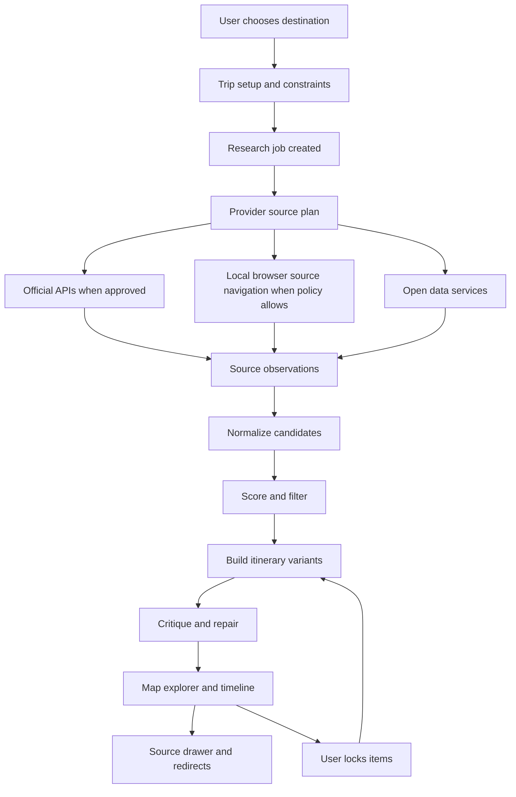

# TravelWizard Full Build Plan

Generated on 2026-05-23. This file is the authoritative build plan for TravelWizard. It is intentionally detailed and agent-ready. It answers the user's 50 planning decisions, fills remaining gaps with recommended choices, and avoids asking more questions. This document is a plan only. Do not build code from this session unless the user later gives an explicit build instruction.

TravelWizard is a global AI travel coordination app. It combines provider-backed research, local user-device browser navigation, exact observed prices, merged ratings, route-aware planning, weather-aware scheduling, OCR booking imports, and source-transparent explanations into a complete itinerary workflow. It must redirect traffic to original providers rather than take bookings or payments itself.

## Non-Negotiable Build Contract For Future AI Agents

- Do not reduce the product to a thin first release. Implement the full scoped system in phases, with browser-source research available immediately after policy guards pass and fixtures maintained for regression.
- Do not ask the user additional product questions. Use the decisions and defaults in this file unless a future user message explicitly changes them.
- Do not build payment, booking, cancellation, or third-party credential flows.
- Do not fill forms on provider websites in v1.
- Do not click provider booking, payment, confirmation, cancellation, login, or account-management actions.
- Do not claim local browser automation is automatically legal. Enforce provider policies, source display limits, copyright constraints, robots/anti-abuse boundaries, and user control.
- Do not store replay traces, provider credentials, passport data, government IDs, or traveler PII.
- Use exact observed source prices with timestamp and source. If exact current price is unavailable, mark it unavailable or manual verification required.
- Every recommendation must carry source links, timestamps, rating/review math, freshness, and an explanation of winners and losers.
- All long-running jobs must support pause, resume, cancel, progress, and cost visibility.
- All external-source ingestion must be testable with fixtures. Browser-source research may run immediately only after URL policy, action policy, local companion pairing, source transparency, and retention guards pass.
- All UI must meet WCAG 2.2 AA and include keyboard-accessible alternatives to map and drag interactions.

## Locked User Decisions

| Area | Decision |
| --- | --- |
| Geography | Global destinations, global inventory, global maps, global currencies, global weather. |
| Traveler style | Support both budget/student travel and comfort/quality travel. |
| Verticals | Flights, trains, local transit, hotels, activities, attractions, restaurants, map exploration, booking imports, price monitoring, and provider source comparison. |
| Optimization posture | Best Value - Balanced: optimize rating, reliability, cost, route efficiency, time fit, freshness, source confidence, and user preferences without blindly choosing cheapest. |
| Destination choice | Destination is always chosen by the user. The product can suggest neighborhoods and day structure after destination is set. |
| Collaboration | Group collaboration is not first-release critical, but all data models must allow future shared trips, roles, comments, and votes. |
| Booking import | Include existing booking import with OCR and direct text extraction. |
| Restaurants | Include restaurants as first-class itinerary candidates. |
| Visa/passport/safety | Not first-class v1 modules. Add extension points and disclaimers, but do not block the core product on regulatory advice. |
| Weather | Include weather and use it in itinerary timing. |
| Priority providers | Tripadvisor, Klook, GetYourGuide, Expedia, Agoda, plus optional Kiwi and other sources when legal and useful. |
| Affiliate | No affiliate program on day one. Redirect/source-open flow only. |
| Source legality | Prefer licensed API integration. When not available, use local user-agent browser research, summaries, and links with provider policy guardrails. |
| Local browser automation | Use headless or hybrid browser automation on the user computer through the repo-copied `vendor/swiftbrowse` package after the user copies it in, but never treat local execution as a legal loophole. |
| Navigation | Automate visible browser navigation only. |
| Form filling | No form filling in v1. |
| Booking actions | No booking, payment, confirmation, cancellation, or irreversible clicks. Recommend, compare, open tabs, and redirect only. |
| Third-party credentials | Do not collect, store, proxy, or request third-party credentials. |
| PII | Do not store traveler PII unless future user consent and a privacy model are added. |
| Payments | No payments. Redirect to provider. |
| Agent actions | Suggest, open source tabs, monitor prices if user asks, and explain results. |
| Source display | Show every source used for every recommendation. |
| Explanation | Explain why winners beat losers and why losers were filtered or demoted. |
| Runtime browser | Headless browser on the user computer, with headed fallback when the user needs visible navigation. |
| Replay traces | Do not store replay traces. Store only minimal source snapshots/metadata needed for transparency and debugging, with retention controls. |
| Job controls | Pause, resume, cancel for long-running agent jobs. |
| Price monitoring | Allow if user asks. No always-on monitoring without explicit user action. |
| Agent loop | Multi-round research, draft, critique, improve, and final. |
| Model provider | OpenAI-compatible API configured through .env. |
| AI cost cap | No hard cap, but track and display cost, token use, provider health, and job runtime. |
| Primary UX | Map explorer first, with itinerary timeline first inside planning detail. |
| Itinerary display | Timeline-first itinerary, plus map, compare, budget, and source views. |
| Lock and reoptimize | Allow users to lock items, remove items, and reoptimize around constraints. |
| Compare variants | Support variant comparison as a core workflow. |
| Prices | Use exact observed source prices with timestamp and source. Never invent exact prices. If unavailable, mark as unavailable or manual verification required. |
| Monetization | No launch monetization except future ad integration hooks. |
| Agent API | Build private/internal API first. Public agent API later after quotas, auth, policy enforcement, and abuse prevention are proven. |
| Brand | No fixed brand requirement. Build complete capability surface. |
| Human agent escalation | No human travel-agent escalation. |
| Support for provider bookings | No support promise for external bookings. The app must state booking support remains with provider. |
| Framework | Next.js. |
| Open source | Open-source preference does not override quality or safety; choose recommended practical stack. |
| Database | Recommended: PostgreSQL plus PostGIS, accessed through Drizzle ORM and raw SQL for geospatial operations. |
| Map library | Leaflet with OpenStreetMap-derived data and proper attribution. |
| Routing | Recommended: self-host Valhalla for production-grade multimodal OSM routing; OSRM as simpler fallback for road/walk demos. Public demo endpoints only for local development if usage policy permits. |
| Geocoding | Recommended: Photon or Pelias self-host for production; Nominatim public endpoint only for low-volume development with strict 1 rps and caching. |
| Analytics | Privacy-preserving first-party analytics only, preferably self-hosted PostHog or equivalent event store. |
| Admin | Include cost dashboard, provider health dashboard, and automatic demotion of low-review, low-confidence, stale, or poorly rated items. |
| Job runtime | Async long-running jobs are expected and must be observable and controllable. |
| Scope | Full everything to the final extent for now. No scope shrink. |
| First build runtime | Local, private, single-user app. No hosted multi-user auth, no signup flow, and no cloud account requirement for the first build. |
| swiftbrowse packaging | The user will copy the whole swiftbrowse project into this repo before implementation. Recommended target path: `vendor/swiftbrowse`, included as a workspace package. After that copy, do not depend on `C:/Users/manab/swiftbrowse` except as historical source context. |
| Provider research timing | Browser-source research starts immediately in the first functional build, guarded by local companion pairing, provider policy, URL allowlists, command allowlists, source transparency, and no form-fill/payment/booking actions. |
| Demo data | Do not seed a demo trip. Empty states must be real and the user will test with their own destination. |
| Deployment posture | Focus on building and locally running now. Vercel is a future deployment target only. |

## Resolved Technical Defaults


## Latest Implementation Decisions From Follow-Up

These decisions supersede any older ambiguous defaults in this file. They are not questions and should be treated as fixed until the user explicitly changes them.

| Decision area | Locked implementation choice |
| --- | --- |
| App mode | Local, private, single-user first build. Do not build signup, teams, cloud tenancy, or hosted auth in the initial implementation. |
| Data ownership | Store data locally for the single owner. Keep schema migration paths for future accounts, but do not require accounts now. |
| swiftbrowse copy | The user will paste/copy the whole swiftbrowse project into this repository before implementation. Build against `vendor/swiftbrowse` once present. |
| Browser-source timing | Build browser-source research immediately as the primary first provider path, with strict policy gating. Do not postpone it behind official API access. |
| Fixture role | Fixtures are mandatory for deterministic tests and regression, but they are not a reason to delay the immediate browser-source workflow. |
| Demo trip | Do not add a seeded demo trip. The app should open to an empty but usable real workflow. |
| Local run | Prioritize `pnpm dev`, local worker, local companion, and Docker Compose services. Vercel remains a future deployment target. |

| Area | Recommended choice |
| --- | --- |
| Frontend | Next.js App Router, TypeScript, React Server Components where useful, client islands for map and interactive planner, strict ESLint, strict TypeScript. |
| Package manager | pnpm workspace. Use Turborepo only if multiple apps/packages are created; otherwise keep a single workspace with clear package boundaries. |
| Styling | Tailwind CSS plus CSS variables for design tokens. Avoid heavy UI kits unless needed. Use lucide-react for icons. |
| Database | PostgreSQL 16+ with PostGIS. Drizzle ORM for typed schema and migrations, with raw SQL for geospatial ranking, indexes, and materialized views. |
| Queue | Redis plus BullMQ. Use flows for multi-step research jobs and job schedulers for explicit user-enabled price monitors. |
| Object storage | Local filesystem for dev, S3-compatible storage later for import files, OCR page images, and redacted source snapshots. Default retention: short. |
| AI provider | OpenAI-compatible API using .env: OPENAI_BASE_URL, OPENAI_API_KEY, OPENAI_MODEL_PLANNER, OPENAI_MODEL_EXTRACTOR, OPENAI_MODEL_CRITIC, OPENAI_MODEL_EMBEDDINGS if used. |
| Browser companion | Node 22 local companion using the repo-copied `vendor/swiftbrowse` package after the user copies it in. Bind to 127.0.0.1 only, require pairing secret, enforce command allowlist, disable cookies by default, do not save replay traces. |
| Maps | Leaflet and React Leaflet. Production tiles from a paid or self-hosted OSM-derived tile service. Public OSM tiles only in local dev with attribution, caching, and low volume. |
| Routing | Valhalla self-host target for multimodal OSM/GTFS; OSRM fallback for simple road/walk. Routing provider abstraction required from day one. |
| Geocoding | Photon or Pelias self-host target. Nominatim public endpoint only in local dev with 1 rps, caching, identifying User-Agent, and attribution. |
| Weather | Open-Meteo for no-key weather forecast and historical context where allowed. Cache by coordinate/date and show freshness. |
| Currency | Use open exchange-rate sources where terms allow, cache daily, and preserve original source currency beside normalized display currency. |
| Analytics | First-party, privacy-preserving analytics only. Self-host PostHog or internal events. No ad tracking launch. |
| Testing | Vitest unit tests, React Testing Library component tests, Playwright E2E, axe accessibility checks, API integration tests with fixtures, and policy tests that gate immediate browser-source research. |
| Deployment | Local-first runtime now: Next.js dev server, local worker, local companion, and Docker Compose for Postgres/PostGIS/Redis. Vercel is future-only and must not drive first-build architecture decisions. |

## Research Source Ledger

This ledger gives future agents the starting source set. Before implementation, agents should refresh official docs because provider API access and policy details can change. Use official provider documentation first, then reputable secondary sources only for market context.

| Source | URL or path | Planning implication |
| --- | --- | --- |
| Tripadvisor Content API | https://tripadvisor-content-api.readme.io/reference | Official partner content API exposes hotels, restaurants, attractions, details, photos, reviews, search, and Tripadvisor URLs. Treat display of reviews/photos as licensed-content only. |
| Tripadvisor B2B/Terra context | https://www.tripadvisor.com/business/solutions/hotels/terra-content-api-bottom | Tripadvisor has partner content solutions. Access and permitted use must be handled as provider-approved integration. |
| GetYourGuide Integrator Documentation | https://integrator.getyourguide.com/documentation/overview | The documented supplier integration centers on availability, reservation, booking, and cancellation connectivity. TravelWizard v1 must not perform booking actions. |
| GetYourGuide connectivity help | https://supply.getyourguide.support/hc/en-us/articles/14149999629853-Supported-Systems-Instructions | GetYourGuide API connectivity is partner/system oriented. Use official integration where approved; otherwise source-link/recommend only. |
| Klook OpenAPI docs | https://klook.gitbook.io/ | Klook describes partner API integration for experiences, attractions, food, transport passes, and related travel products. Use partner credentials only when approved. |
| Klook partner page | https://www.klook.com/en-US/partner/ | Klook partner access and distribution context. Treat as gated provider relationship. |
| Expedia Rapid API | https://partner.expediagroup.com/en-us/solutions/build-your-travel-experience/rapid-api | Expedia Rapid offers lodging content, rates, availability, images, reviews, and partner tooling. Use only with approved partner access. |
| Agoda Demand API getting started | https://partners.agoda.com/DeveloperPortal/APIDoc/GettingStarted | Agoda provides partner models including search/content/booking APIs. TravelWizard should use Search/Content only unless future scope changes. |
| Agoda Developer Portal | https://developer.agoda.com/ | Agoda partner documentation gateway. Access depends on partner status. |
| Kiwi partnership update | https://media.kiwi.com/articles-and-interviews/better-for-business-kiwi-com-takes-a-new-approach-to-partnerships/ | Kiwi partnership direction should be verified before treating Tequila-like access as available. Keep as optional transport source. |
| Kiwi legal pages | https://www.kiwi.com/us/pages/content/legal/ | Provider terms must govern any browsing, linking, or use of Kiwi content. |
| Leaflet reference | https://leafletjs.com/reference.html | Leaflet is the chosen open-source web map library. |
| React Leaflet docs | https://react-leaflet.js.org/ | React binding for Leaflet in the Next.js client layer. Must be dynamically loaded in browser-only components. |
| OSM tile usage policy | https://operations.osmfoundation.org/policies/tiles/ | OpenStreetMap public tile servers are limited, best-effort, require attribution and valid identifying headers, and are not production infrastructure for heavy use. |
| OSM Nominatim usage policy | https://operations.osmfoundation.org/policies/nominatim/ | Public Nominatim is limited capacity, max 1 request per second, requires attribution and identifying headers; production should self-host or use a provider. |
| Valhalla API docs | https://valhalla.github.io/valhalla/api/ | Open-source routing toolkit using OSM and optional GTFS for multimodal routing. Recommended production routing target. |
| OSRM docs | https://project-osrm.org/docs/v26.4.0/ | Open-source routing engine with route, table, trip, match, nearest, and tile services. Useful fallback or development target. |
| Open-Meteo docs | https://open-meteo.com/en/docs | Weather forecast API with no API key required for many uses; commercial/reserved resources may require API key. |
| Tesseract.js docs | https://tesseract.projectnaptha.com/ | Browser/Node OCR library suitable for local image OCR prototypes. |
| Tesseract OCR docs | https://tesseract-ocr.github.io/ | Underlying open-source OCR engine. |
| OCRmyPDF docs | https://ocrmypdf.readthedocs.io/ | Adds OCR text layer to scanned PDFs using Tesseract and supporting tools. Optional local pipeline. |
| PDF.js docs | https://mozilla.github.io/pdf.js/ | PDF parsing/rendering for extracting selectable text and rendering scanned pages for OCR. |
| Next.js App Router docs | https://nextjs.org/docs/app | Chosen framework foundation with server/client component boundaries, layouts, and route handlers. |
| Drizzle PostGIS guide | https://orm.drizzle.team/docs/guides/postgis-geometry-point | Drizzle supports Postgres/PostGIS patterns with SQL escape hatches. |
| BullMQ docs | https://docs.bullmq.io/ | Redis-backed queues for long-running async jobs, workers, events, flows, and scheduled monitors. |
| BullMQ Job Schedulers | https://docs.bullmq.io/guide/job-schedulers | Use modern job schedulers rather than deprecated repeatable APIs for price monitoring. |
| OWASP API Security Top 10 SSRF | https://owasp.org/API-Security/editions/2023/en/0xa7-server-side-request-forgery/ | Remote fetches, provider URLs, OCR imports, and browser navigation require SSRF prevention. |
| OWASP CSRF Cheat Sheet | https://cheatsheetseries.owasp.org/cheatsheets/Cross-Site_Request_Forgery_Prevention_Cheat_Sheet.html | Needed for state-changing app routes and job controls. |
| OWASP XSS Cheat Sheet | https://cheatsheetseries.owasp.org/cheatsheets/Cross_Site_Scripting_Prevention_Cheat_Sheet.html | Provider content and OCR output must be escaped/sanitized. |
| WCAG 2.2 | https://www.w3.org/TR/WCAG22/ | Accessibility target: WCAG 2.2 AA, including target size, focus visibility, keyboard access, non-text contrast, and complete process conformance. |
| WAI-ARIA APG | https://www.w3.org/WAI/ARIA/apg/ | Use APG keyboard patterns for tabs, dialogs, comboboxes, menus, listboxes, and disclosure widgets. |
| Material Design color overview | https://m3.material.io/styles/color/overview | Use tokenized color roles and sufficient contrast, not one-note decoration. |
| Apple HIG Color | https://developer.apple.com/design/human-interface-guidelines/color | Use color carefully, maintain contrast, and do not communicate critical status by color alone. |
| swiftbrowse local package | Current source context: C:/Users/manab/swiftbrowse. Target build path after user copy: vendor/swiftbrowse. | Local CDP-based browser automation package with browse, goto, snapshot, screenshot, extract, links, table, click, type, fill, and network tools. TravelWizard must wrap it with a stricter allowlist and import the repo-copied package. |

## Product North Star

The product is not another static itinerary generator. It is an AI coordination layer over fragmented travel surfaces. It should help a user decide what to do, where to stay, how to move, what to eat, what to skip, how much it costs, what evidence supports the choices, and how to open the original source to book or verify. Its advantage is coordinated decision quality, not owning inventory.

- User outcome: a source-backed, route-aware, budget-aware, weather-aware itinerary the user trusts enough to act on.
- Provider outcome: the user is redirected to original platforms, preserving traffic and provider ownership of booking/support.
- System outcome: every choice can be audited back to observations and policy-safe extraction methods.
- Business outcome: future monetization can be ads or partnerships, but v1 avoids affiliate complexity and conversion obligations.

## System Architecture

Use a modular monolith first, with clear package boundaries. This avoids premature microservices while preserving enough separation for background workers, local browser companion, and future public agent API.

| Layer | Responsibilities | Must include |
| --- | --- | --- |
| Next.js web app | Map explorer, timeline planner, compare variants, budget, imports, job console, admin dashboards, settings. | App Router, TypeScript, client-only map islands, server route handlers, accessible UI. |
| Domain packages | Trip planning, scoring, constraints, source normalization, policies, explanations, OCR structuring. | Pure functions where possible, deterministic tests, immutable data updates. |
| Database | Trips, candidates, sources, observations, prices, routes, jobs, imports, monitors, admin metrics. | Postgres, PostGIS, Drizzle migrations, indexes, retention tables. |
| Queue workers | Provider research, browser jobs, OCR jobs, itinerary solving, price monitoring, admin health checks. | BullMQ, Redis, job events, pause/resume/cancel semantics. |
| Local companion | User-device browser automation through swiftbrowse. | 127.0.0.1 binding, pairing secret, command allowlist, no cookies by default, policy classifier. |
| Provider adapters | Browser-source research immediately where legal and policy-approved; official APIs when approved; user-open fallback when automation is blocked. | Fixture-backed, rate-limited, source-linked, policy-tagged, and never allowed to perform booking/payment/form actions. |
| AI orchestration | Research, extraction, critique, improvement, explanation. | OpenAI-compatible .env, structured outputs, cost tracking, eval harness. |
| Map/routing/geocoding | Leaflet display, coordinate resolution, route buffers, route alternatives. | OSM attribution, routing abstraction, Valhalla target, geocoder cache. |
| Admin/observability | Cost, health, failures, policy blocks, demotion signals. | Dashboards, metrics events, structured logs, alerts later. |

## Recommended Repository Structure

```text
apps/
  web/                         Next.js App Router application
  worker/                      BullMQ worker process
  local-companion/             127.0.0.1 swiftbrowse wrapper service
vendor/
  swiftbrowse/                 User-copied swiftbrowse package; preserve upstream layout
packages/
  domain/                      Trip, candidate, scoring, constraints, itinerary algorithms
  providers/                   Provider adapters, fixtures, source policies
  browser-policy/              URL policy, action classifier, extraction policy
  ocr/                         PDF text, image rendering, OCR, structuring schemas
  maps/                        Geocoding, routing, tiles, attribution helpers
  db/                          Drizzle schema, migrations, repositories
  ui/                          Shared UI primitives and design tokens
  agent/                       Research loop, critic loop, structured-output schemas
  evals/                       Planner and extraction evaluation harness
  test-fixtures/               Provider, OCR, routing, weather, currency fixtures
docs/
  provider-policies/           Human-readable provider integration notes
  architecture/                ADRs and diagrams
  runbooks/                    Local dev, provider refresh, incident handling
```

## Environment Variables

| Variable | Required | Purpose | Notes |
| --- | --- | --- | --- |
| DATABASE_URL | yes | Postgres/PostGIS connection | Must not be logged. |
| REDIS_URL | yes | BullMQ Redis connection | Required for jobs and monitors. |
| OPENAI_BASE_URL | yes | OpenAI-compatible API base URL | Allows OpenAI, local gateway, or compatible provider. |
| OPENAI_API_KEY | yes | Model provider key | Read from .env only. |
| OPENAI_MODEL_PLANNER | yes | Planner model | Use stronger model for multi-round itinerary. |
| OPENAI_MODEL_EXTRACTOR | yes | Extraction model | Can be cheaper model if evals pass. |
| OPENAI_MODEL_CRITIC | yes | Critic model | Can be same as planner. |
| SWIFTBROWSE_PATH | optional override | Path to repo-copied swiftbrowse package | Default target after user copy: vendor/swiftbrowse. Use C:/Users/manab/swiftbrowse only before the copy exists. |
| LOCAL_COMPANION_SECRET | yes | Pairing secret for local companion | Generated per install; not committed. |
| APP_ORIGIN | yes | Allowed local web origin for local companion | Default http://localhost:3000 or the active local dev port. Used for CORS and pairing. |
| TILE_PROVIDER_URL | dev optional | Tile endpoint | Production must not depend on public OSM tile servers. |
| GEOCODER_BASE_URL | dev optional | Photon/Pelias/Nominatim endpoint | Nominatim public endpoint only dev and cached. |
| ROUTER_BASE_URL | dev optional | Valhalla or OSRM endpoint | Public demo endpoints only dev. |
| OPEN_METEO_BASE_URL | optional | Weather endpoint | Default https://api.open-meteo.com. |
| TRIPADVISOR_API_KEY | optional | Licensed Tripadvisor Content API | Only if approved. |
| KLOOK_API_KEY | optional | Klook partner API | Only if approved. |
| GETYOURGUIDE_API_KEY | optional | Approved integration | Only if approved. |
| EXPEDIA_RAPID_KEY | optional | Expedia Rapid API | Only if approved. |
| AGODA_API_KEY | optional | Agoda partner API | Only if approved. |

## Core Data Model

| Entity | Meaning | Build requirements |
| --- | --- | --- |
| User | Local single-owner identity only for first build. No hosted multi-user auth, passport, government ID, third-party provider credentials, or signup profile. | Create Drizzle table, repository, Zod schema, factory fixture, unit tests, and migration coverage for future auth migration without requiring login now. |
| Trip | Destination, dates, party size, budget posture, comfort posture, constraints, user locks, selected variant, status. | Create Drizzle table, repository, Zod schema, factory fixture, unit tests, and migration coverage for Trip. |
| Destination | Canonical city/region/country, coordinates, bounding box, time zone, source aliases, confidence. | Create Drizzle table, repository, Zod schema, factory fixture, unit tests, and migration coverage for Destination. |
| ProviderSource | Provider identity, access mode, policy status, API credentials status, domain allowlist, rate limits, health score. | Create Drizzle table, repository, Zod schema, factory fixture, unit tests, and migration coverage for ProviderSource. |
| SearchRun | Long-running research job with status, phase, cost, logs, pause/resume/cancel flags, source budget, model usage. | Create Drizzle table, repository, Zod schema, factory fixture, unit tests, and migration coverage for SearchRun. |
| SourceObservation | Atomic observed fact from a provider or import: price, rating, review count, URL, timestamp, extraction method, confidence, provenance hash. | Create Drizzle table, repository, Zod schema, factory fixture, unit tests, and migration coverage for SourceObservation. |
| Candidate | Hotel, activity, restaurant, attraction, flight, train, transit leg, or imported booking normalized into common comparison fields. | Create Drizzle table, repository, Zod schema, factory fixture, unit tests, and migration coverage for Candidate. |
| ItineraryVariant | A complete proposed plan with days, timeline, route geometry, budget, score vector, explanations, and loser notes. | Create Drizzle table, repository, Zod schema, factory fixture, unit tests, and migration coverage for ItineraryVariant. |
| ItineraryItem | Scheduled candidate or manual item with start/end, location, travel buffer, source links, lock state, replacement candidates. | Create Drizzle table, repository, Zod schema, factory fixture, unit tests, and migration coverage for ItineraryItem. |
| PriceSnapshot | Exact observed price with source, currency, included fees/taxes if visible, timestamp, stale policy, and redirect URL. | Create Drizzle table, repository, Zod schema, factory fixture, unit tests, and migration coverage for PriceSnapshot. |
| ReviewSignal | Normalized rating/review count/recency/source credibility without copying protected review text unless licensed. | Create Drizzle table, repository, Zod schema, factory fixture, unit tests, and migration coverage for ReviewSignal. |
| BookingImport | Uploaded PDF/image/email text result, OCR confidence, extracted booking entities, manual verification status. | Create Drizzle table, repository, Zod schema, factory fixture, unit tests, and migration coverage for BookingImport. |
| BrowserSession | Local browser job metadata, allowed provider, allowed commands, current URL, redacted observation metadata, no replay trace. | Create Drizzle table, repository, Zod schema, factory fixture, unit tests, and migration coverage for BrowserSession. |
| PriceMonitor | User-enabled monitor for selected candidate/provider, cadence, stop date, notification policy, last check, last result. | Create Drizzle table, repository, Zod schema, factory fixture, unit tests, and migration coverage for PriceMonitor. |
| AdminMetric | Cost, latency, failure rate, provider health, route engine health, geocoder health, OCR success, browser policy blocks. | Create Drizzle table, repository, Zod schema, factory fixture, unit tests, and migration coverage for AdminMetric. |

## Provider Access And Policy Model

The source strategy must be explicit per provider. The app can use official APIs where approved. If official API access is unavailable, the app can open provider pages for the user and can use local browser research within a strict policy envelope. Browser automation must be treated as user-delegated reading/navigation, not as a hosted scraping substitute.

| Provider | Verticals | Allowed modes | Explicitly blocked |
| --- | --- | --- | --- |
| Tripadvisor | hotels, restaurants, attractions, reviews, ratings | official_content_api, local_user_browser, source_link | unlicensed review republishing, credential capture, captcha bypass |
| Klook | activities, attractions, passes, food, transport passes | partner_api, local_user_browser, source_link | booking submit, payment, unapproved API use |
| GetYourGuide | activities, tours, tickets, experiences | approved_partner_or_supplier_api, local_user_browser, source_link | reservation creation, booking creation, cancellation |
| Expedia | hotels, lodging content, rates, availability | Rapid API if approved, local_user_browser, source_link | booking path automation, payment, post-booking support claim |
| Agoda | hotels, lodging content, rates | Demand/Search/Content API if approved, local_user_browser, source_link | Book API in v1, payment, support claim |
| Kiwi | flights, ground transport where available | partner path if available, local_user_browser, source_link | ticket purchase, traveler PII submission, payment |
| OpenStreetMap | map data, base geography | OSM data, self-hosted services, compliant tile provider | bulk tile scraping, missing attribution, public service overload |
| Open-Meteo | weather, air quality optional | public API within terms, cached forecast | uncached high-volume polling, commercial reserved endpoints without key |
| Wikidata/Wikivoyage | destination context, landmarks, public descriptions | public API with attribution/license compliance | license omission, unverified travel claims |

## Browser Automation Policy

TravelWizard should wrap swiftbrowse rather than expose swiftbrowse directly. swiftbrowse has powerful tools, including click/type/fill/extract/network logging. TravelWizard v1 must expose only a safe subset to the planning agent, and every attempted browser action must pass URL policy, provider policy, action classification, and user-job scope checks.

| Command class | V1 status | Rules |
| --- | --- | --- |
| browse/goto/snapshot/text/links/table/extract | allowed with policy | Allowed for public pages and user-approved provider pages after URL allowlist and robots/terms review. Output must be summarized and source-linked. |
| scroll/back/forward/tabs | allowed with policy | Allowed as navigation support. Must not escape provider/domain job scope. |
| screenshot | limited | Allowed only for debugging or visual confirmation. No replay trace retention. Redact or short-retain images. |
| click | restricted | Allowed only for navigation, tab opening, pagination, filter expansion, or consent controls after classifier approval. Block booking/payment/login/account/confirm/cancel/submit actions. |
| type/fill/select/upload/drag | blocked in v1 | No provider form filling, no file uploads to providers, no credential entry, no checkout paths. |
| save-state/cookie extraction | blocked by default | Do not use provider cookies unless a future explicit consent model exists. Default swiftbrowse --no-cookies. |
| network-log/console-log/eval | admin/debug only | Not exposed to itinerary agent. Use only local debugging with retention controls. |
| captcha/anti-bot handling | blocked | Do not bypass CAPTCHA, bot checks, paywalls, login walls, or access controls. |

## Design Direction

The interface should feel like a dense but calm travel operating surface: useful first, not a marketing landing page. The first viewport must be the product experience: map plus planning controls. Avoid oversized hero sections, decorative cards, gradient orbs, beige-only palettes, and copy that explains the app instead of letting the workflow function.

| Token | Value | Usage |
| --- | --- | --- |
| --color-ink | #10201C | Primary text on light surfaces. |
| --color-muted | #5D6863 | Secondary text and metadata. |
| --color-surface | #F7F8F3 | Warm off-white app background. |
| --color-panel | #FFFFFF | Panels, cards, popovers, drawers. |
| --color-border | #DDE3DA | Subtle borders and map panel separators. |
| --color-primary | #0F766E | Primary action, selected map layer, active itinerary state. |
| --color-primary-strong | #0B4F49 | Hover/pressed primary and high-contrast text tags. |
| --color-secondary | #2563EB | Transport links, comparison accents, secondary calls. |
| --color-accent | #F59E0B | Price freshness, watch states, notable warnings when paired with dark text. |
| --color-food | #DB2777 | Restaurant category. |
| --color-lodging | #0284C7 | Hotel/lodging category. |
| --color-activity | #7C3AED | Activities and experiences. |
| --color-transport | #EA580C | Flights, trains, transit. |
| --color-success | #15803D | Healthy provider and accepted import. |
| --color-warning | #B45309 | Stale source, uncertain fee inclusion, route risk. |
| --color-danger | #B42318 | Policy block, failed job, impossible itinerary. |
| --color-focus | #111827 | Visible focus ring. |
| --shadow-panel | 0 10px 30px rgba(16, 32, 28, 0.10) | Use sparingly for overlays only. |

| Viewport | Layout |
| --- | --- |
| Desktop >= 1280px | Three-pane workspace: left trip/search/filter panel 320-380px, center Leaflet map, right itinerary/source inspector 420-520px. Timeline can expand to full width from bottom drawer. |
| Tablet 768-1279px | Two-pane workspace with map plus collapsible timeline/inspector. Keep map usable and avoid nested cards. |
| Mobile < 768px | Bottom tab navigation: Map, Timeline, Compare, Budget, Sources. Map has bottom sheet for selected item. Controls use icons plus short labels where needed. |
| Print/export | Readable timeline and budget summary, source ledger, and provider redirect URLs. No unsupported map-only information. |

## Screen Specifications

### Destination Setup

User enters destination, dates, party size, budget posture, comfort posture, must-haves, avoidances, accessibility needs, and preferred pace.

| Requirement | Acceptance criteria |
| --- | --- |
| Primary state | Destination Setup must have loading, empty, populated, error, partial, stale, and permission/policy-blocked states. |
| Accessibility | Destination Setup must be keyboard reachable, have visible focus, use semantic headings, and provide screen-reader status updates for async changes. |
| Source transparency | Destination Setup must never show provider-derived facts without a visible source affordance and timestamp. |
| Responsive behavior | Destination Setup must fit 360px mobile width and 1440px desktop without overlapping text, controls, map pins, panels, or toolbars. |
| Tests | Destination Setup needs component tests, Playwright route, visual screenshot baseline, and axe scan. |

### Map Explorer

Primary first screen. Leaflet map with neighborhoods, clustered candidates, filters, route overlays, weather layers, and source badges.

| Requirement | Acceptance criteria |
| --- | --- |
| Primary state | Map Explorer must have loading, empty, populated, error, partial, stale, and permission/policy-blocked states. |
| Accessibility | Map Explorer must be keyboard reachable, have visible focus, use semantic headings, and provide screen-reader status updates for async changes. |
| Source transparency | Map Explorer must never show provider-derived facts without a visible source affordance and timestamp. |
| Responsive behavior | Map Explorer must fit 360px mobile width and 1440px desktop without overlapping text, controls, map pins, panels, or toolbars. |
| Tests | Map Explorer needs component tests, Playwright route, visual screenshot baseline, and axe scan. |

### Timeline Planner

Timeline-first itinerary with day columns, locks, travel buffers, meal slots, weather warnings, route gaps, and replacement affordances.

| Requirement | Acceptance criteria |
| --- | --- |
| Primary state | Timeline Planner must have loading, empty, populated, error, partial, stale, and permission/policy-blocked states. |
| Accessibility | Timeline Planner must be keyboard reachable, have visible focus, use semantic headings, and provide screen-reader status updates for async changes. |
| Source transparency | Timeline Planner must never show provider-derived facts without a visible source affordance and timestamp. |
| Responsive behavior | Timeline Planner must fit 360px mobile width and 1440px desktop without overlapping text, controls, map pins, panels, or toolbars. |
| Tests | Timeline Planner needs component tests, Playwright route, visual screenshot baseline, and axe scan. |

### Compare Variants

Side-by-side plans such as balanced, cheaper, higher comfort, fewer transfers, food-heavy, culture-heavy, and weather-safe.

| Requirement | Acceptance criteria |
| --- | --- |
| Primary state | Compare Variants must have loading, empty, populated, error, partial, stale, and permission/policy-blocked states. |
| Accessibility | Compare Variants must be keyboard reachable, have visible focus, use semantic headings, and provide screen-reader status updates for async changes. |
| Source transparency | Compare Variants must never show provider-derived facts without a visible source affordance and timestamp. |
| Responsive behavior | Compare Variants must fit 360px mobile width and 1440px desktop without overlapping text, controls, map pins, panels, or toolbars. |
| Tests | Compare Variants needs component tests, Playwright route, visual screenshot baseline, and axe scan. |

### Candidate Inspector

Single item detail: sources, rating math, price snapshots, why selected, why alternatives lost, provider redirect buttons.

| Requirement | Acceptance criteria |
| --- | --- |
| Primary state | Candidate Inspector must have loading, empty, populated, error, partial, stale, and permission/policy-blocked states. |
| Accessibility | Candidate Inspector must be keyboard reachable, have visible focus, use semantic headings, and provide screen-reader status updates for async changes. |
| Source transparency | Candidate Inspector must never show provider-derived facts without a visible source affordance and timestamp. |
| Responsive behavior | Candidate Inspector must fit 360px mobile width and 1440px desktop without overlapping text, controls, map pins, panels, or toolbars. |
| Tests | Candidate Inspector needs component tests, Playwright route, visual screenshot baseline, and axe scan. |

### Budget Board

Exact observed costs, unknown costs, taxes/fees visibility, currency conversion, category rollup, per-day rollup, stale markers.

| Requirement | Acceptance criteria |
| --- | --- |
| Primary state | Budget Board must have loading, empty, populated, error, partial, stale, and permission/policy-blocked states. |
| Accessibility | Budget Board must be keyboard reachable, have visible focus, use semantic headings, and provide screen-reader status updates for async changes. |
| Source transparency | Budget Board must never show provider-derived facts without a visible source affordance and timestamp. |
| Responsive behavior | Budget Board must fit 360px mobile width and 1440px desktop without overlapping text, controls, map pins, panels, or toolbars. |
| Tests | Budget Board needs component tests, Playwright route, visual screenshot baseline, and axe scan. |

### Source Drawer

Every provider observation, timestamp, URL, access mode, confidence, extraction notes, license/display limitation.

| Requirement | Acceptance criteria |
| --- | --- |
| Primary state | Source Drawer must have loading, empty, populated, error, partial, stale, and permission/policy-blocked states. |
| Accessibility | Source Drawer must be keyboard reachable, have visible focus, use semantic headings, and provide screen-reader status updates for async changes. |
| Source transparency | Source Drawer must never show provider-derived facts without a visible source affordance and timestamp. |
| Responsive behavior | Source Drawer must fit 360px mobile width and 1440px desktop without overlapping text, controls, map pins, panels, or toolbars. |
| Tests | Source Drawer needs component tests, Playwright route, visual screenshot baseline, and axe scan. |

### Import Center

Upload booking PDFs/images/emails, run text extraction/OCR, review parsed bookings, attach to trip, resolve conflicts.

| Requirement | Acceptance criteria |
| --- | --- |
| Primary state | Import Center must have loading, empty, populated, error, partial, stale, and permission/policy-blocked states. |
| Accessibility | Import Center must be keyboard reachable, have visible focus, use semantic headings, and provide screen-reader status updates for async changes. |
| Source transparency | Import Center must never show provider-derived facts without a visible source affordance and timestamp. |
| Responsive behavior | Import Center must fit 360px mobile width and 1440px desktop without overlapping text, controls, map pins, panels, or toolbars. |
| Tests | Import Center needs component tests, Playwright route, visual screenshot baseline, and axe scan. |

### Agent Job Console

Long-running job status, phases, source progress, cost, pause/resume/cancel, failures, policy blocks, final report.

| Requirement | Acceptance criteria |
| --- | --- |
| Primary state | Agent Job Console must have loading, empty, populated, error, partial, stale, and permission/policy-blocked states. |
| Accessibility | Agent Job Console must be keyboard reachable, have visible focus, use semantic headings, and provide screen-reader status updates for async changes. |
| Source transparency | Agent Job Console must never show provider-derived facts without a visible source affordance and timestamp. |
| Responsive behavior | Agent Job Console must fit 360px mobile width and 1440px desktop without overlapping text, controls, map pins, panels, or toolbars. |
| Tests | Agent Job Console needs component tests, Playwright route, visual screenshot baseline, and axe scan. |

### Price Monitor Center

User-enabled monitors, cadence, last result, price movement, freshness, stop controls, notification settings.

| Requirement | Acceptance criteria |
| --- | --- |
| Primary state | Price Monitor Center must have loading, empty, populated, error, partial, stale, and permission/policy-blocked states. |
| Accessibility | Price Monitor Center must be keyboard reachable, have visible focus, use semantic headings, and provide screen-reader status updates for async changes. |
| Source transparency | Price Monitor Center must never show provider-derived facts without a visible source affordance and timestamp. |
| Responsive behavior | Price Monitor Center must fit 360px mobile width and 1440px desktop without overlapping text, controls, map pins, panels, or toolbars. |
| Tests | Price Monitor Center needs component tests, Playwright route, visual screenshot baseline, and axe scan. |

### Provider Health Admin

Provider availability, error rate, policy block rate, stale data rate, latency, cost, source confidence, demotion thresholds.

| Requirement | Acceptance criteria |
| --- | --- |
| Primary state | Provider Health Admin must have loading, empty, populated, error, partial, stale, and permission/policy-blocked states. |
| Accessibility | Provider Health Admin must be keyboard reachable, have visible focus, use semantic headings, and provide screen-reader status updates for async changes. |
| Source transparency | Provider Health Admin must never show provider-derived facts without a visible source affordance and timestamp. |
| Responsive behavior | Provider Health Admin must fit 360px mobile width and 1440px desktop without overlapping text, controls, map pins, panels, or toolbars. |
| Tests | Provider Health Admin needs component tests, Playwright route, visual screenshot baseline, and axe scan. |

### Cost Admin

AI token spend, OCR spend, queue runtime, provider API spend, map/routing/geocoding costs, per-trip cost breakdown.

| Requirement | Acceptance criteria |
| --- | --- |
| Primary state | Cost Admin must have loading, empty, populated, error, partial, stale, and permission/policy-blocked states. |
| Accessibility | Cost Admin must be keyboard reachable, have visible focus, use semantic headings, and provide screen-reader status updates for async changes. |
| Source transparency | Cost Admin must never show provider-derived facts without a visible source affordance and timestamp. |
| Responsive behavior | Cost Admin must fit 360px mobile width and 1440px desktop without overlapping text, controls, map pins, panels, or toolbars. |
| Tests | Cost Admin needs component tests, Playwright route, visual screenshot baseline, and axe scan. |

### Settings

Model settings, local browser pairing, privacy controls, retention, analytics opt-out, export/delete data.

| Requirement | Acceptance criteria |
| --- | --- |
| Primary state | Settings must have loading, empty, populated, error, partial, stale, and permission/policy-blocked states. |
| Accessibility | Settings must be keyboard reachable, have visible focus, use semantic headings, and provide screen-reader status updates for async changes. |
| Source transparency | Settings must never show provider-derived facts without a visible source affordance and timestamp. |
| Responsive behavior | Settings must fit 360px mobile width and 1440px desktop without overlapping text, controls, map pins, panels, or toolbars. |
| Tests | Settings needs component tests, Playwright route, visual screenshot baseline, and axe scan. |

## P00 - Repository and guardrail bootstrap

This phase is part of the full build, not a reduced scope. The future build agent must complete tests before implementation where practical, then implement, refactor, and verify. Browser-source research can run immediately after local pairing, provider policy, command policy, source transparency, and retention tests pass; fixtures remain required for repeatable regression coverage.

| Task ID | Module | Deliverables | Guardrails |
| --- | --- | --- | --- |
| P00.01 | Trip Lifecycle | Define schema/interfaces for Trip Lifecycle; add failing tests; implement minimal production path; wire observability; document behavior; verify with unit and integration coverage. | No secrets, no provider side effects, no irreversible actions, no untested external calls. |
| P00.02 | Candidate Normalizer | Define schema/interfaces for Candidate Normalizer; add failing tests; implement minimal production path; wire observability; document behavior; verify with unit and integration coverage. | No secrets, no provider side effects, no irreversible actions, no untested external calls. |
| P00.03 | Candidate Inspector UI | Define schema/interfaces for Candidate Inspector UI; add failing tests; implement minimal production path; wire observability; document behavior; verify with unit and integration coverage. | No secrets, no provider side effects, no irreversible actions, no untested external calls. |
| P00.04 | Loser Explanation Engine | Define schema/interfaces for Loser Explanation Engine; add failing tests; implement minimal production path; wire observability; document behavior; verify with unit and integration coverage. | No secrets, no provider side effects, no irreversible actions, no untested external calls. |
| P00.05 | Environment Validation | Define schema/interfaces for Environment Validation; add failing tests; implement minimal production path; wire observability; document behavior; verify with unit and integration coverage. | No secrets, no provider side effects, no irreversible actions, no untested external calls. |

| Gate | Required proof |
| --- | --- |
| correctness | P00 must include correctness proof appropriate to Repository and guardrail bootstrap, recorded in tests, fixtures, logs, screenshots, or documentation. |
| security | P00 must include security proof appropriate to Repository and guardrail bootstrap, recorded in tests, fixtures, logs, screenshots, or documentation. |
| privacy | P00 must include privacy proof appropriate to Repository and guardrail bootstrap, recorded in tests, fixtures, logs, screenshots, or documentation. |
| accessibility | P00 must include accessibility proof appropriate to Repository and guardrail bootstrap, recorded in tests, fixtures, logs, screenshots, or documentation. |
| provider policy | P00 must include provider policy proof appropriate to Repository and guardrail bootstrap, recorded in tests, fixtures, logs, screenshots, or documentation. |
| observability | P00 must include observability proof appropriate to Repository and guardrail bootstrap, recorded in tests, fixtures, logs, screenshots, or documentation. |
| performance | P00 must include performance proof appropriate to Repository and guardrail bootstrap, recorded in tests, fixtures, logs, screenshots, or documentation. |
| cost tracking | P00 must include cost tracking proof appropriate to Repository and guardrail bootstrap, recorded in tests, fixtures, logs, screenshots, or documentation. |
| fallback behavior | P00 must include fallback behavior proof appropriate to Repository and guardrail bootstrap, recorded in tests, fixtures, logs, screenshots, or documentation. |
| user control | P00 must include user control proof appropriate to Repository and guardrail bootstrap, recorded in tests, fixtures, logs, screenshots, or documentation. |
| source transparency | P00 must include source transparency proof appropriate to Repository and guardrail bootstrap, recorded in tests, fixtures, logs, screenshots, or documentation. |
| testability | P00 must include testability proof appropriate to Repository and guardrail bootstrap, recorded in tests, fixtures, logs, screenshots, or documentation. |

## P01 - Design system and layout shell

This phase is part of the full build, not a reduced scope. The future build agent must complete tests before implementation where practical, then implement, refactor, and verify. Browser-source research can run immediately after local pairing, provider policy, command policy, source transparency, and retention tests pass; fixtures remain required for repeatable regression coverage.

| Task ID | Module | Deliverables | Guardrails |
| --- | --- | --- | --- |
| P01.01 | Destination Canonicalization | Define schema/interfaces for Destination Canonicalization; add failing tests; implement minimal production path; wire observability; document behavior; verify with unit and integration coverage. | No secrets, no provider side effects, no irreversible actions, no untested external calls. |
| P01.02 | Review Signal Normalizer | Define schema/interfaces for Review Signal Normalizer; add failing tests; implement minimal production path; wire observability; document behavior; verify with unit and integration coverage. | No secrets, no provider side effects, no irreversible actions, no untested external calls. |
| P01.03 | Source Drawer UI | Define schema/interfaces for Source Drawer UI; add failing tests; implement minimal production path; wire observability; document behavior; verify with unit and integration coverage. | No secrets, no provider side effects, no irreversible actions, no untested external calls. |
| P01.04 | Data Freshness Engine | Define schema/interfaces for Data Freshness Engine; add failing tests; implement minimal production path; wire observability; document behavior; verify with unit and integration coverage. | No secrets, no provider side effects, no irreversible actions, no untested external calls. |
| P01.05 | Documentation Gate | Define schema/interfaces for Documentation Gate; add failing tests; implement minimal production path; wire observability; document behavior; verify with unit and integration coverage. | No secrets, no provider side effects, no irreversible actions, no untested external calls. |

| Gate | Required proof |
| --- | --- |
| correctness | P01 must include correctness proof appropriate to Design system and layout shell, recorded in tests, fixtures, logs, screenshots, or documentation. |
| security | P01 must include security proof appropriate to Design system and layout shell, recorded in tests, fixtures, logs, screenshots, or documentation. |
| privacy | P01 must include privacy proof appropriate to Design system and layout shell, recorded in tests, fixtures, logs, screenshots, or documentation. |
| accessibility | P01 must include accessibility proof appropriate to Design system and layout shell, recorded in tests, fixtures, logs, screenshots, or documentation. |
| provider policy | P01 must include provider policy proof appropriate to Design system and layout shell, recorded in tests, fixtures, logs, screenshots, or documentation. |
| observability | P01 must include observability proof appropriate to Design system and layout shell, recorded in tests, fixtures, logs, screenshots, or documentation. |
| performance | P01 must include performance proof appropriate to Design system and layout shell, recorded in tests, fixtures, logs, screenshots, or documentation. |
| cost tracking | P01 must include cost tracking proof appropriate to Design system and layout shell, recorded in tests, fixtures, logs, screenshots, or documentation. |
| fallback behavior | P01 must include fallback behavior proof appropriate to Design system and layout shell, recorded in tests, fixtures, logs, screenshots, or documentation. |
| user control | P01 must include user control proof appropriate to Design system and layout shell, recorded in tests, fixtures, logs, screenshots, or documentation. |
| source transparency | P01 must include source transparency proof appropriate to Design system and layout shell, recorded in tests, fixtures, logs, screenshots, or documentation. |
| testability | P01 must include testability proof appropriate to Design system and layout shell, recorded in tests, fixtures, logs, screenshots, or documentation. |

## P02 - Database schema and migrations

This phase is part of the full build, not a reduced scope. The future build agent must complete tests before implementation where practical, then implement, refactor, and verify. Browser-source research can run immediately after local pairing, provider policy, command policy, source transparency, and retention tests pass; fixtures remain required for repeatable regression coverage.

| Task ID | Module | Deliverables | Guardrails |
| --- | --- | --- | --- |
| P02.01 | User Preference Model | Define schema/interfaces for User Preference Model; add failing tests; implement minimal production path; wire observability; document behavior; verify with unit and integration coverage. | No secrets, no provider side effects, no irreversible actions, no untested external calls. |
| P02.02 | Exact Price Snapshotter | Define schema/interfaces for Exact Price Snapshotter; add failing tests; implement minimal production path; wire observability; document behavior; verify with unit and integration coverage. | No secrets, no provider side effects, no irreversible actions, no untested external calls. |
| P02.03 | Budget Board UI | Define schema/interfaces for Budget Board UI; add failing tests; implement minimal production path; wire observability; document behavior; verify with unit and integration coverage. | No secrets, no provider side effects, no irreversible actions, no untested external calls. |
| P02.04 | Confidence Engine | Define schema/interfaces for Confidence Engine; add failing tests; implement minimal production path; wire observability; document behavior; verify with unit and integration coverage. | No secrets, no provider side effects, no irreversible actions, no untested external calls. |

| Gate | Required proof |
| --- | --- |
| correctness | P02 must include correctness proof appropriate to Database schema and migrations, recorded in tests, fixtures, logs, screenshots, or documentation. |
| security | P02 must include security proof appropriate to Database schema and migrations, recorded in tests, fixtures, logs, screenshots, or documentation. |
| privacy | P02 must include privacy proof appropriate to Database schema and migrations, recorded in tests, fixtures, logs, screenshots, or documentation. |
| accessibility | P02 must include accessibility proof appropriate to Database schema and migrations, recorded in tests, fixtures, logs, screenshots, or documentation. |
| provider policy | P02 must include provider policy proof appropriate to Database schema and migrations, recorded in tests, fixtures, logs, screenshots, or documentation. |
| observability | P02 must include observability proof appropriate to Database schema and migrations, recorded in tests, fixtures, logs, screenshots, or documentation. |
| performance | P02 must include performance proof appropriate to Database schema and migrations, recorded in tests, fixtures, logs, screenshots, or documentation. |
| cost tracking | P02 must include cost tracking proof appropriate to Database schema and migrations, recorded in tests, fixtures, logs, screenshots, or documentation. |
| fallback behavior | P02 must include fallback behavior proof appropriate to Database schema and migrations, recorded in tests, fixtures, logs, screenshots, or documentation. |
| user control | P02 must include user control proof appropriate to Database schema and migrations, recorded in tests, fixtures, logs, screenshots, or documentation. |
| source transparency | P02 must include source transparency proof appropriate to Database schema and migrations, recorded in tests, fixtures, logs, screenshots, or documentation. |
| testability | P02 must include testability proof appropriate to Database schema and migrations, recorded in tests, fixtures, logs, screenshots, or documentation. |

## P03 - Source registry and provider policy engine

This phase is part of the full build, not a reduced scope. The future build agent must complete tests before implementation where practical, then implement, refactor, and verify. Browser-source research can run immediately after local pairing, provider policy, command policy, source transparency, and retention tests pass; fixtures remain required for repeatable regression coverage.

| Task ID | Module | Deliverables | Guardrails |
| --- | --- | --- | --- |
| P03.01 | Budget Envelope | Define schema/interfaces for Budget Envelope; add failing tests; implement minimal production path; wire observability; document behavior; verify with unit and integration coverage. | No secrets, no provider side effects, no irreversible actions, no untested external calls. |
| P03.02 | Local Browser Companion | Define schema/interfaces for Local Browser Companion; add failing tests; implement minimal production path; wire observability; document behavior; verify with unit and integration coverage. | No secrets, no provider side effects, no irreversible actions, no untested external calls. |
| P03.03 | Compare Variants UI | Define schema/interfaces for Compare Variants UI; add failing tests; implement minimal production path; wire observability; document behavior; verify with unit and integration coverage. | No secrets, no provider side effects, no irreversible actions, no untested external calls. |
| P03.04 | Demotion Engine | Define schema/interfaces for Demotion Engine; add failing tests; implement minimal production path; wire observability; document behavior; verify with unit and integration coverage. | No secrets, no provider side effects, no irreversible actions, no untested external calls. |

| Gate | Required proof |
| --- | --- |
| correctness | P03 must include correctness proof appropriate to Source registry and provider policy engine, recorded in tests, fixtures, logs, screenshots, or documentation. |
| security | P03 must include security proof appropriate to Source registry and provider policy engine, recorded in tests, fixtures, logs, screenshots, or documentation. |
| privacy | P03 must include privacy proof appropriate to Source registry and provider policy engine, recorded in tests, fixtures, logs, screenshots, or documentation. |
| accessibility | P03 must include accessibility proof appropriate to Source registry and provider policy engine, recorded in tests, fixtures, logs, screenshots, or documentation. |
| provider policy | P03 must include provider policy proof appropriate to Source registry and provider policy engine, recorded in tests, fixtures, logs, screenshots, or documentation. |
| observability | P03 must include observability proof appropriate to Source registry and provider policy engine, recorded in tests, fixtures, logs, screenshots, or documentation. |
| performance | P03 must include performance proof appropriate to Source registry and provider policy engine, recorded in tests, fixtures, logs, screenshots, or documentation. |
| cost tracking | P03 must include cost tracking proof appropriate to Source registry and provider policy engine, recorded in tests, fixtures, logs, screenshots, or documentation. |
| fallback behavior | P03 must include fallback behavior proof appropriate to Source registry and provider policy engine, recorded in tests, fixtures, logs, screenshots, or documentation. |
| user control | P03 must include user control proof appropriate to Source registry and provider policy engine, recorded in tests, fixtures, logs, screenshots, or documentation. |
| source transparency | P03 must include source transparency proof appropriate to Source registry and provider policy engine, recorded in tests, fixtures, logs, screenshots, or documentation. |
| testability | P03 must include testability proof appropriate to Source registry and provider policy engine, recorded in tests, fixtures, logs, screenshots, or documentation. |

## P04 - Local swiftbrowse companion integration

This phase is part of the full build, not a reduced scope. The future build agent must complete tests before implementation where practical, then implement, refactor, and verify. Browser-source research can run immediately after local pairing, provider policy, command policy, source transparency, and retention tests pass; fixtures remain required for repeatable regression coverage.

| Task ID | Module | Deliverables | Guardrails |
| --- | --- | --- | --- |
| P04.01 | Comfort Envelope | Define schema/interfaces for Comfort Envelope; add failing tests; implement minimal production path; wire observability; document behavior; verify with unit and integration coverage. | No secrets, no provider side effects, no irreversible actions, no untested external calls. |
| P04.02 | swiftbrowse Tool Wrapper | Define schema/interfaces for swiftbrowse Tool Wrapper; add failing tests; implement minimal production path; wire observability; document behavior; verify with unit and integration coverage. | No secrets, no provider side effects, no irreversible actions, no untested external calls. |
| P04.03 | Job Console UI | Define schema/interfaces for Job Console UI; add failing tests; implement minimal production path; wire observability; document behavior; verify with unit and integration coverage. | No secrets, no provider side effects, no irreversible actions, no untested external calls. |
| P04.04 | Notification Stub | Define schema/interfaces for Notification Stub; add failing tests; implement minimal production path; wire observability; document behavior; verify with unit and integration coverage. | No secrets, no provider side effects, no irreversible actions, no untested external calls. |

| Gate | Required proof |
| --- | --- |
| correctness | P04 must include correctness proof appropriate to Local swiftbrowse companion integration, recorded in tests, fixtures, logs, screenshots, or documentation. |
| security | P04 must include security proof appropriate to Local swiftbrowse companion integration, recorded in tests, fixtures, logs, screenshots, or documentation. |
| privacy | P04 must include privacy proof appropriate to Local swiftbrowse companion integration, recorded in tests, fixtures, logs, screenshots, or documentation. |
| accessibility | P04 must include accessibility proof appropriate to Local swiftbrowse companion integration, recorded in tests, fixtures, logs, screenshots, or documentation. |
| provider policy | P04 must include provider policy proof appropriate to Local swiftbrowse companion integration, recorded in tests, fixtures, logs, screenshots, or documentation. |
| observability | P04 must include observability proof appropriate to Local swiftbrowse companion integration, recorded in tests, fixtures, logs, screenshots, or documentation. |
| performance | P04 must include performance proof appropriate to Local swiftbrowse companion integration, recorded in tests, fixtures, logs, screenshots, or documentation. |
| cost tracking | P04 must include cost tracking proof appropriate to Local swiftbrowse companion integration, recorded in tests, fixtures, logs, screenshots, or documentation. |
| fallback behavior | P04 must include fallback behavior proof appropriate to Local swiftbrowse companion integration, recorded in tests, fixtures, logs, screenshots, or documentation. |
| user control | P04 must include user control proof appropriate to Local swiftbrowse companion integration, recorded in tests, fixtures, logs, screenshots, or documentation. |
| source transparency | P04 must include source transparency proof appropriate to Local swiftbrowse companion integration, recorded in tests, fixtures, logs, screenshots, or documentation. |
| testability | P04 must include testability proof appropriate to Local swiftbrowse companion integration, recorded in tests, fixtures, logs, screenshots, or documentation. |

## P05 - Destination setup and geocoding

This phase is part of the full build, not a reduced scope. The future build agent must complete tests before implementation where practical, then implement, refactor, and verify. Browser-source research can run immediately after local pairing, provider policy, command policy, source transparency, and retention tests pass; fixtures remain required for repeatable regression coverage.

| Task ID | Module | Deliverables | Guardrails |
| --- | --- | --- | --- |
| P05.01 | Provider Registry | Define schema/interfaces for Provider Registry; add failing tests; implement minimal production path; wire observability; document behavior; verify with unit and integration coverage. | No secrets, no provider side effects, no irreversible actions, no untested external calls. |
| P05.02 | Browser Action Classifier | Define schema/interfaces for Browser Action Classifier; add failing tests; implement minimal production path; wire observability; document behavior; verify with unit and integration coverage. | No secrets, no provider side effects, no irreversible actions, no untested external calls. |
| P05.03 | Price Monitor UI | Define schema/interfaces for Price Monitor UI; add failing tests; implement minimal production path; wire observability; document behavior; verify with unit and integration coverage. | No secrets, no provider side effects, no irreversible actions, no untested external calls. |
| P05.04 | Export Stub | Define schema/interfaces for Export Stub; add failing tests; implement minimal production path; wire observability; document behavior; verify with unit and integration coverage. | No secrets, no provider side effects, no irreversible actions, no untested external calls. |

| Gate | Required proof |
| --- | --- |
| correctness | P05 must include correctness proof appropriate to Destination setup and geocoding, recorded in tests, fixtures, logs, screenshots, or documentation. |
| security | P05 must include security proof appropriate to Destination setup and geocoding, recorded in tests, fixtures, logs, screenshots, or documentation. |
| privacy | P05 must include privacy proof appropriate to Destination setup and geocoding, recorded in tests, fixtures, logs, screenshots, or documentation. |
| accessibility | P05 must include accessibility proof appropriate to Destination setup and geocoding, recorded in tests, fixtures, logs, screenshots, or documentation. |
| provider policy | P05 must include provider policy proof appropriate to Destination setup and geocoding, recorded in tests, fixtures, logs, screenshots, or documentation. |
| observability | P05 must include observability proof appropriate to Destination setup and geocoding, recorded in tests, fixtures, logs, screenshots, or documentation. |
| performance | P05 must include performance proof appropriate to Destination setup and geocoding, recorded in tests, fixtures, logs, screenshots, or documentation. |
| cost tracking | P05 must include cost tracking proof appropriate to Destination setup and geocoding, recorded in tests, fixtures, logs, screenshots, or documentation. |
| fallback behavior | P05 must include fallback behavior proof appropriate to Destination setup and geocoding, recorded in tests, fixtures, logs, screenshots, or documentation. |
| user control | P05 must include user control proof appropriate to Destination setup and geocoding, recorded in tests, fixtures, logs, screenshots, or documentation. |
| source transparency | P05 must include source transparency proof appropriate to Destination setup and geocoding, recorded in tests, fixtures, logs, screenshots, or documentation. |
| testability | P05 must include testability proof appropriate to Destination setup and geocoding, recorded in tests, fixtures, logs, screenshots, or documentation. |

## P06 - Map explorer and candidate layers

This phase is part of the full build, not a reduced scope. The future build agent must complete tests before implementation where practical, then implement, refactor, and verify. Browser-source research can run immediately after local pairing, provider policy, command policy, source transparency, and retention tests pass; fixtures remain required for repeatable regression coverage.

| Task ID | Module | Deliverables | Guardrails |
| --- | --- | --- | --- |
| P06.01 | Provider Policy Engine | Define schema/interfaces for Provider Policy Engine; add failing tests; implement minimal production path; wire observability; document behavior; verify with unit and integration coverage. | No secrets, no provider side effects, no irreversible actions, no untested external calls. |
| P06.02 | Browser Source Summarizer | Define schema/interfaces for Browser Source Summarizer; add failing tests; implement minimal production path; wire observability; document behavior; verify with unit and integration coverage. | No secrets, no provider side effects, no irreversible actions, no untested external calls. |
| P06.03 | Provider Health Admin | Define schema/interfaces for Provider Health Admin; add failing tests; implement minimal production path; wire observability; document behavior; verify with unit and integration coverage. | No secrets, no provider side effects, no irreversible actions, no untested external calls. |
| P06.04 | Analytics Events | Define schema/interfaces for Analytics Events; add failing tests; implement minimal production path; wire observability; document behavior; verify with unit and integration coverage. | No secrets, no provider side effects, no irreversible actions, no untested external calls. |

| Gate | Required proof |
| --- | --- |
| correctness | P06 must include correctness proof appropriate to Map explorer and candidate layers, recorded in tests, fixtures, logs, screenshots, or documentation. |
| security | P06 must include security proof appropriate to Map explorer and candidate layers, recorded in tests, fixtures, logs, screenshots, or documentation. |
| privacy | P06 must include privacy proof appropriate to Map explorer and candidate layers, recorded in tests, fixtures, logs, screenshots, or documentation. |
| accessibility | P06 must include accessibility proof appropriate to Map explorer and candidate layers, recorded in tests, fixtures, logs, screenshots, or documentation. |
| provider policy | P06 must include provider policy proof appropriate to Map explorer and candidate layers, recorded in tests, fixtures, logs, screenshots, or documentation. |
| observability | P06 must include observability proof appropriate to Map explorer and candidate layers, recorded in tests, fixtures, logs, screenshots, or documentation. |
| performance | P06 must include performance proof appropriate to Map explorer and candidate layers, recorded in tests, fixtures, logs, screenshots, or documentation. |
| cost tracking | P06 must include cost tracking proof appropriate to Map explorer and candidate layers, recorded in tests, fixtures, logs, screenshots, or documentation. |
| fallback behavior | P06 must include fallback behavior proof appropriate to Map explorer and candidate layers, recorded in tests, fixtures, logs, screenshots, or documentation. |
| user control | P06 must include user control proof appropriate to Map explorer and candidate layers, recorded in tests, fixtures, logs, screenshots, or documentation. |
| source transparency | P06 must include source transparency proof appropriate to Map explorer and candidate layers, recorded in tests, fixtures, logs, screenshots, or documentation. |
| testability | P06 must include testability proof appropriate to Map explorer and candidate layers, recorded in tests, fixtures, logs, screenshots, or documentation. |

## P07 - Provider connectors and fixture ingestion

This phase is part of the full build, not a reduced scope. The future build agent must complete tests before implementation where practical, then implement, refactor, and verify. Browser-source research can run immediately after local pairing, provider policy, command policy, source transparency, and retention tests pass; fixtures remain required for repeatable regression coverage.

| Task ID | Module | Deliverables | Guardrails |
| --- | --- | --- | --- |
| P07.01 | Source Observation Store | Define schema/interfaces for Source Observation Store; add failing tests; implement minimal production path; wire observability; document behavior; verify with unit and integration coverage. | No secrets, no provider side effects, no irreversible actions, no untested external calls. |
| P07.02 | Booking Import Upload | Define schema/interfaces for Booking Import Upload; add failing tests; implement minimal production path; wire observability; document behavior; verify with unit and integration coverage. | No secrets, no provider side effects, no irreversible actions, no untested external calls. |
| P07.03 | Cost Admin | Define schema/interfaces for Cost Admin; add failing tests; implement minimal production path; wire observability; document behavior; verify with unit and integration coverage. | No secrets, no provider side effects, no irreversible actions, no untested external calls. |
| P07.04 | Audit Log | Define schema/interfaces for Audit Log; add failing tests; implement minimal production path; wire observability; document behavior; verify with unit and integration coverage. | No secrets, no provider side effects, no irreversible actions, no untested external calls. |

| Gate | Required proof |
| --- | --- |
| correctness | P07 must include correctness proof appropriate to Provider connectors and fixture ingestion, recorded in tests, fixtures, logs, screenshots, or documentation. |
| security | P07 must include security proof appropriate to Provider connectors and fixture ingestion, recorded in tests, fixtures, logs, screenshots, or documentation. |
| privacy | P07 must include privacy proof appropriate to Provider connectors and fixture ingestion, recorded in tests, fixtures, logs, screenshots, or documentation. |
| accessibility | P07 must include accessibility proof appropriate to Provider connectors and fixture ingestion, recorded in tests, fixtures, logs, screenshots, or documentation. |
| provider policy | P07 must include provider policy proof appropriate to Provider connectors and fixture ingestion, recorded in tests, fixtures, logs, screenshots, or documentation. |
| observability | P07 must include observability proof appropriate to Provider connectors and fixture ingestion, recorded in tests, fixtures, logs, screenshots, or documentation. |
| performance | P07 must include performance proof appropriate to Provider connectors and fixture ingestion, recorded in tests, fixtures, logs, screenshots, or documentation. |
| cost tracking | P07 must include cost tracking proof appropriate to Provider connectors and fixture ingestion, recorded in tests, fixtures, logs, screenshots, or documentation. |
| fallback behavior | P07 must include fallback behavior proof appropriate to Provider connectors and fixture ingestion, recorded in tests, fixtures, logs, screenshots, or documentation. |
| user control | P07 must include user control proof appropriate to Provider connectors and fixture ingestion, recorded in tests, fixtures, logs, screenshots, or documentation. |
| source transparency | P07 must include source transparency proof appropriate to Provider connectors and fixture ingestion, recorded in tests, fixtures, logs, screenshots, or documentation. |
| testability | P07 must include testability proof appropriate to Provider connectors and fixture ingestion, recorded in tests, fixtures, logs, screenshots, or documentation. |

## P08 - OCR booking import pipeline

This phase is part of the full build, not a reduced scope. The future build agent must complete tests before implementation where practical, then implement, refactor, and verify. Browser-source research can run immediately after local pairing, provider policy, command policy, source transparency, and retention tests pass; fixtures remain required for repeatable regression coverage.

| Task ID | Module | Deliverables | Guardrails |
| --- | --- | --- | --- |
| P08.01 | Tripadvisor Connector | Define schema/interfaces for Tripadvisor Connector; add failing tests; implement minimal production path; wire observability; document behavior; verify with unit and integration coverage. | No secrets, no provider side effects, no irreversible actions, no untested external calls. |
| P08.02 | PDF Text Extraction | Define schema/interfaces for PDF Text Extraction; add failing tests; implement minimal production path; wire observability; document behavior; verify with unit and integration coverage. | No secrets, no provider side effects, no irreversible actions, no untested external calls. |
| P08.03 | Privacy Settings | Define schema/interfaces for Privacy Settings; add failing tests; implement minimal production path; wire observability; document behavior; verify with unit and integration coverage. | No secrets, no provider side effects, no irreversible actions, no untested external calls. |
| P08.04 | Security Middleware | Define schema/interfaces for Security Middleware; add failing tests; implement minimal production path; wire observability; document behavior; verify with unit and integration coverage. | No secrets, no provider side effects, no irreversible actions, no untested external calls. |

| Gate | Required proof |
| --- | --- |
| correctness | P08 must include correctness proof appropriate to OCR booking import pipeline, recorded in tests, fixtures, logs, screenshots, or documentation. |
| security | P08 must include security proof appropriate to OCR booking import pipeline, recorded in tests, fixtures, logs, screenshots, or documentation. |
| privacy | P08 must include privacy proof appropriate to OCR booking import pipeline, recorded in tests, fixtures, logs, screenshots, or documentation. |
| accessibility | P08 must include accessibility proof appropriate to OCR booking import pipeline, recorded in tests, fixtures, logs, screenshots, or documentation. |
| provider policy | P08 must include provider policy proof appropriate to OCR booking import pipeline, recorded in tests, fixtures, logs, screenshots, or documentation. |
| observability | P08 must include observability proof appropriate to OCR booking import pipeline, recorded in tests, fixtures, logs, screenshots, or documentation. |
| performance | P08 must include performance proof appropriate to OCR booking import pipeline, recorded in tests, fixtures, logs, screenshots, or documentation. |
| cost tracking | P08 must include cost tracking proof appropriate to OCR booking import pipeline, recorded in tests, fixtures, logs, screenshots, or documentation. |
| fallback behavior | P08 must include fallback behavior proof appropriate to OCR booking import pipeline, recorded in tests, fixtures, logs, screenshots, or documentation. |
| user control | P08 must include user control proof appropriate to OCR booking import pipeline, recorded in tests, fixtures, logs, screenshots, or documentation. |
| source transparency | P08 must include source transparency proof appropriate to OCR booking import pipeline, recorded in tests, fixtures, logs, screenshots, or documentation. |
| testability | P08 must include testability proof appropriate to OCR booking import pipeline, recorded in tests, fixtures, logs, screenshots, or documentation. |

## P09 - Planner scoring and itinerary solver

This phase is part of the full build, not a reduced scope. The future build agent must complete tests before implementation where practical, then implement, refactor, and verify. Browser-source research can run immediately after local pairing, provider policy, command policy, source transparency, and retention tests pass; fixtures remain required for repeatable regression coverage.

| Task ID | Module | Deliverables | Guardrails |
| --- | --- | --- | --- |
| P09.01 | Klook Connector | Define schema/interfaces for Klook Connector; add failing tests; implement minimal production path; wire observability; document behavior; verify with unit and integration coverage. | No secrets, no provider side effects, no irreversible actions, no untested external calls. |
| P09.02 | OCR Image Pipeline | Define schema/interfaces for OCR Image Pipeline; add failing tests; implement minimal production path; wire observability; document behavior; verify with unit and integration coverage. | No secrets, no provider side effects, no irreversible actions, no untested external calls. |
| P09.03 | Model Configuration | Define schema/interfaces for Model Configuration; add failing tests; implement minimal production path; wire observability; document behavior; verify with unit and integration coverage. | No secrets, no provider side effects, no irreversible actions, no untested external calls. |
| P09.04 | CSRF Protection | Define schema/interfaces for CSRF Protection; add failing tests; implement minimal production path; wire observability; document behavior; verify with unit and integration coverage. | No secrets, no provider side effects, no irreversible actions, no untested external calls. |

| Gate | Required proof |
| --- | --- |
| correctness | P09 must include correctness proof appropriate to Planner scoring and itinerary solver, recorded in tests, fixtures, logs, screenshots, or documentation. |
| security | P09 must include security proof appropriate to Planner scoring and itinerary solver, recorded in tests, fixtures, logs, screenshots, or documentation. |
| privacy | P09 must include privacy proof appropriate to Planner scoring and itinerary solver, recorded in tests, fixtures, logs, screenshots, or documentation. |
| accessibility | P09 must include accessibility proof appropriate to Planner scoring and itinerary solver, recorded in tests, fixtures, logs, screenshots, or documentation. |
| provider policy | P09 must include provider policy proof appropriate to Planner scoring and itinerary solver, recorded in tests, fixtures, logs, screenshots, or documentation. |
| observability | P09 must include observability proof appropriate to Planner scoring and itinerary solver, recorded in tests, fixtures, logs, screenshots, or documentation. |
| performance | P09 must include performance proof appropriate to Planner scoring and itinerary solver, recorded in tests, fixtures, logs, screenshots, or documentation. |
| cost tracking | P09 must include cost tracking proof appropriate to Planner scoring and itinerary solver, recorded in tests, fixtures, logs, screenshots, or documentation. |
| fallback behavior | P09 must include fallback behavior proof appropriate to Planner scoring and itinerary solver, recorded in tests, fixtures, logs, screenshots, or documentation. |
| user control | P09 must include user control proof appropriate to Planner scoring and itinerary solver, recorded in tests, fixtures, logs, screenshots, or documentation. |
| source transparency | P09 must include source transparency proof appropriate to Planner scoring and itinerary solver, recorded in tests, fixtures, logs, screenshots, or documentation. |
| testability | P09 must include testability proof appropriate to Planner scoring and itinerary solver, recorded in tests, fixtures, logs, screenshots, or documentation. |

## P10 - Timeline, locks, and reoptimization

This phase is part of the full build, not a reduced scope. The future build agent must complete tests before implementation where practical, then implement, refactor, and verify. Browser-source research can run immediately after local pairing, provider policy, command policy, source transparency, and retention tests pass; fixtures remain required for repeatable regression coverage.

| Task ID | Module | Deliverables | Guardrails |
| --- | --- | --- | --- |
| P10.01 | GetYourGuide Connector | Define schema/interfaces for GetYourGuide Connector; add failing tests; implement minimal production path; wire observability; document behavior; verify with unit and integration coverage. | No secrets, no provider side effects, no irreversible actions, no untested external calls. |
| P10.02 | OCR Structuring Agent | Define schema/interfaces for OCR Structuring Agent; add failing tests; implement minimal production path; wire observability; document behavior; verify with unit and integration coverage. | No secrets, no provider side effects, no irreversible actions, no untested external calls. |
| P10.03 | Queue Orchestration | Define schema/interfaces for Queue Orchestration; add failing tests; implement minimal production path; wire observability; document behavior; verify with unit and integration coverage. | No secrets, no provider side effects, no irreversible actions, no untested external calls. |
| P10.04 | SSRF Protection | Define schema/interfaces for SSRF Protection; add failing tests; implement minimal production path; wire observability; document behavior; verify with unit and integration coverage. | No secrets, no provider side effects, no irreversible actions, no untested external calls. |

| Gate | Required proof |
| --- | --- |
| correctness | P10 must include correctness proof appropriate to Timeline, locks, and reoptimization, recorded in tests, fixtures, logs, screenshots, or documentation. |
| security | P10 must include security proof appropriate to Timeline, locks, and reoptimization, recorded in tests, fixtures, logs, screenshots, or documentation. |
| privacy | P10 must include privacy proof appropriate to Timeline, locks, and reoptimization, recorded in tests, fixtures, logs, screenshots, or documentation. |
| accessibility | P10 must include accessibility proof appropriate to Timeline, locks, and reoptimization, recorded in tests, fixtures, logs, screenshots, or documentation. |
| provider policy | P10 must include provider policy proof appropriate to Timeline, locks, and reoptimization, recorded in tests, fixtures, logs, screenshots, or documentation. |
| observability | P10 must include observability proof appropriate to Timeline, locks, and reoptimization, recorded in tests, fixtures, logs, screenshots, or documentation. |
| performance | P10 must include performance proof appropriate to Timeline, locks, and reoptimization, recorded in tests, fixtures, logs, screenshots, or documentation. |
| cost tracking | P10 must include cost tracking proof appropriate to Timeline, locks, and reoptimization, recorded in tests, fixtures, logs, screenshots, or documentation. |
| fallback behavior | P10 must include fallback behavior proof appropriate to Timeline, locks, and reoptimization, recorded in tests, fixtures, logs, screenshots, or documentation. |
| user control | P10 must include user control proof appropriate to Timeline, locks, and reoptimization, recorded in tests, fixtures, logs, screenshots, or documentation. |
| source transparency | P10 must include source transparency proof appropriate to Timeline, locks, and reoptimization, recorded in tests, fixtures, logs, screenshots, or documentation. |
| testability | P10 must include testability proof appropriate to Timeline, locks, and reoptimization, recorded in tests, fixtures, logs, screenshots, or documentation. |

## P11 - Compare variants and explanations

This phase is part of the full build, not a reduced scope. The future build agent must complete tests before implementation where practical, then implement, refactor, and verify. Browser-source research can run immediately after local pairing, provider policy, command policy, source transparency, and retention tests pass; fixtures remain required for repeatable regression coverage.

| Task ID | Module | Deliverables | Guardrails |
| --- | --- | --- | --- |
| P11.01 | Expedia Connector | Define schema/interfaces for Expedia Connector; add failing tests; implement minimal production path; wire observability; document behavior; verify with unit and integration coverage. | No secrets, no provider side effects, no irreversible actions, no untested external calls. |
| P11.02 | Import Conflict Resolver | Define schema/interfaces for Import Conflict Resolver; add failing tests; implement minimal production path; wire observability; document behavior; verify with unit and integration coverage. | No secrets, no provider side effects, no irreversible actions, no untested external calls. |
| P11.03 | Pause Resume Cancel | Define schema/interfaces for Pause Resume Cancel; add failing tests; implement minimal production path; wire observability; document behavior; verify with unit and integration coverage. | No secrets, no provider side effects, no irreversible actions, no untested external calls. |
| P11.04 | Rate Limiting | Define schema/interfaces for Rate Limiting; add failing tests; implement minimal production path; wire observability; document behavior; verify with unit and integration coverage. | No secrets, no provider side effects, no irreversible actions, no untested external calls. |

| Gate | Required proof |
| --- | --- |
| correctness | P11 must include correctness proof appropriate to Compare variants and explanations, recorded in tests, fixtures, logs, screenshots, or documentation. |
| security | P11 must include security proof appropriate to Compare variants and explanations, recorded in tests, fixtures, logs, screenshots, or documentation. |
| privacy | P11 must include privacy proof appropriate to Compare variants and explanations, recorded in tests, fixtures, logs, screenshots, or documentation. |
| accessibility | P11 must include accessibility proof appropriate to Compare variants and explanations, recorded in tests, fixtures, logs, screenshots, or documentation. |
| provider policy | P11 must include provider policy proof appropriate to Compare variants and explanations, recorded in tests, fixtures, logs, screenshots, or documentation. |
| observability | P11 must include observability proof appropriate to Compare variants and explanations, recorded in tests, fixtures, logs, screenshots, or documentation. |
| performance | P11 must include performance proof appropriate to Compare variants and explanations, recorded in tests, fixtures, logs, screenshots, or documentation. |
| cost tracking | P11 must include cost tracking proof appropriate to Compare variants and explanations, recorded in tests, fixtures, logs, screenshots, or documentation. |
| fallback behavior | P11 must include fallback behavior proof appropriate to Compare variants and explanations, recorded in tests, fixtures, logs, screenshots, or documentation. |
| user control | P11 must include user control proof appropriate to Compare variants and explanations, recorded in tests, fixtures, logs, screenshots, or documentation. |
| source transparency | P11 must include source transparency proof appropriate to Compare variants and explanations, recorded in tests, fixtures, logs, screenshots, or documentation. |
| testability | P11 must include testability proof appropriate to Compare variants and explanations, recorded in tests, fixtures, logs, screenshots, or documentation. |

## P12 - Budget, exact observed prices, and currency

This phase is part of the full build, not a reduced scope. The future build agent must complete tests before implementation where practical, then implement, refactor, and verify. Browser-source research can run immediately after local pairing, provider policy, command policy, source transparency, and retention tests pass; fixtures remain required for repeatable regression coverage.

| Task ID | Module | Deliverables | Guardrails |
| --- | --- | --- | --- |
| P12.01 | Agoda Connector | Define schema/interfaces for Agoda Connector; add failing tests; implement minimal production path; wire observability; document behavior; verify with unit and integration coverage. | No secrets, no provider side effects, no irreversible actions, no untested external calls. |
| P12.02 | Restaurant Candidate Pipeline | Define schema/interfaces for Restaurant Candidate Pipeline; add failing tests; implement minimal production path; wire observability; document behavior; verify with unit and integration coverage. | No secrets, no provider side effects, no irreversible actions, no untested external calls. |
| P12.03 | Agent Research Loop | Define schema/interfaces for Agent Research Loop; add failing tests; implement minimal production path; wire observability; document behavior; verify with unit and integration coverage. | No secrets, no provider side effects, no irreversible actions, no untested external calls. |
| P12.04 | Input Validation | Define schema/interfaces for Input Validation; add failing tests; implement minimal production path; wire observability; document behavior; verify with unit and integration coverage. | No secrets, no provider side effects, no irreversible actions, no untested external calls. |

| Gate | Required proof |
| --- | --- |
| correctness | P12 must include correctness proof appropriate to Budget, exact observed prices, and currency, recorded in tests, fixtures, logs, screenshots, or documentation. |
| security | P12 must include security proof appropriate to Budget, exact observed prices, and currency, recorded in tests, fixtures, logs, screenshots, or documentation. |
| privacy | P12 must include privacy proof appropriate to Budget, exact observed prices, and currency, recorded in tests, fixtures, logs, screenshots, or documentation. |
| accessibility | P12 must include accessibility proof appropriate to Budget, exact observed prices, and currency, recorded in tests, fixtures, logs, screenshots, or documentation. |
| provider policy | P12 must include provider policy proof appropriate to Budget, exact observed prices, and currency, recorded in tests, fixtures, logs, screenshots, or documentation. |
| observability | P12 must include observability proof appropriate to Budget, exact observed prices, and currency, recorded in tests, fixtures, logs, screenshots, or documentation. |
| performance | P12 must include performance proof appropriate to Budget, exact observed prices, and currency, recorded in tests, fixtures, logs, screenshots, or documentation. |
| cost tracking | P12 must include cost tracking proof appropriate to Budget, exact observed prices, and currency, recorded in tests, fixtures, logs, screenshots, or documentation. |
| fallback behavior | P12 must include fallback behavior proof appropriate to Budget, exact observed prices, and currency, recorded in tests, fixtures, logs, screenshots, or documentation. |
| user control | P12 must include user control proof appropriate to Budget, exact observed prices, and currency, recorded in tests, fixtures, logs, screenshots, or documentation. |
| source transparency | P12 must include source transparency proof appropriate to Budget, exact observed prices, and currency, recorded in tests, fixtures, logs, screenshots, or documentation. |
| testability | P12 must include testability proof appropriate to Budget, exact observed prices, and currency, recorded in tests, fixtures, logs, screenshots, or documentation. |

## P13 - Weather and route-aware scheduling

This phase is part of the full build, not a reduced scope. The future build agent must complete tests before implementation where practical, then implement, refactor, and verify. Browser-source research can run immediately after local pairing, provider policy, command policy, source transparency, and retention tests pass; fixtures remain required for repeatable regression coverage.

| Task ID | Module | Deliverables | Guardrails |
| --- | --- | --- | --- |
| P13.01 | Kiwi Optional Connector | Define schema/interfaces for Kiwi Optional Connector; add failing tests; implement minimal production path; wire observability; document behavior; verify with unit and integration coverage. | No secrets, no provider side effects, no irreversible actions, no untested external calls. |
| P13.02 | Hotel Candidate Pipeline | Define schema/interfaces for Hotel Candidate Pipeline; add failing tests; implement minimal production path; wire observability; document behavior; verify with unit and integration coverage. | No secrets, no provider side effects, no irreversible actions, no untested external calls. |
| P13.03 | Critic Loop | Define schema/interfaces for Critic Loop; add failing tests; implement minimal production path; wire observability; document behavior; verify with unit and integration coverage. | No secrets, no provider side effects, no irreversible actions, no untested external calls. |
| P13.04 | Output Sanitization | Define schema/interfaces for Output Sanitization; add failing tests; implement minimal production path; wire observability; document behavior; verify with unit and integration coverage. | No secrets, no provider side effects, no irreversible actions, no untested external calls. |

| Gate | Required proof |
| --- | --- |
| correctness | P13 must include correctness proof appropriate to Weather and route-aware scheduling, recorded in tests, fixtures, logs, screenshots, or documentation. |
| security | P13 must include security proof appropriate to Weather and route-aware scheduling, recorded in tests, fixtures, logs, screenshots, or documentation. |
| privacy | P13 must include privacy proof appropriate to Weather and route-aware scheduling, recorded in tests, fixtures, logs, screenshots, or documentation. |
| accessibility | P13 must include accessibility proof appropriate to Weather and route-aware scheduling, recorded in tests, fixtures, logs, screenshots, or documentation. |
| provider policy | P13 must include provider policy proof appropriate to Weather and route-aware scheduling, recorded in tests, fixtures, logs, screenshots, or documentation. |
| observability | P13 must include observability proof appropriate to Weather and route-aware scheduling, recorded in tests, fixtures, logs, screenshots, or documentation. |
| performance | P13 must include performance proof appropriate to Weather and route-aware scheduling, recorded in tests, fixtures, logs, screenshots, or documentation. |
| cost tracking | P13 must include cost tracking proof appropriate to Weather and route-aware scheduling, recorded in tests, fixtures, logs, screenshots, or documentation. |
| fallback behavior | P13 must include fallback behavior proof appropriate to Weather and route-aware scheduling, recorded in tests, fixtures, logs, screenshots, or documentation. |
| user control | P13 must include user control proof appropriate to Weather and route-aware scheduling, recorded in tests, fixtures, logs, screenshots, or documentation. |
| source transparency | P13 must include source transparency proof appropriate to Weather and route-aware scheduling, recorded in tests, fixtures, logs, screenshots, or documentation. |
| testability | P13 must include testability proof appropriate to Weather and route-aware scheduling, recorded in tests, fixtures, logs, screenshots, or documentation. |

## P14 - Price monitoring on explicit user request

This phase is part of the full build, not a reduced scope. The future build agent must complete tests before implementation where practical, then implement, refactor, and verify. Browser-source research can run immediately after local pairing, provider policy, command policy, source transparency, and retention tests pass; fixtures remain required for repeatable regression coverage.

| Task ID | Module | Deliverables | Guardrails |
| --- | --- | --- | --- |
| P14.01 | OSM Data Layer | Define schema/interfaces for OSM Data Layer; add failing tests; implement minimal production path; wire observability; document behavior; verify with unit and integration coverage. | No secrets, no provider side effects, no irreversible actions, no untested external calls. |
| P14.02 | Activity Candidate Pipeline | Define schema/interfaces for Activity Candidate Pipeline; add failing tests; implement minimal production path; wire observability; document behavior; verify with unit and integration coverage. | No secrets, no provider side effects, no irreversible actions, no untested external calls. |
| P14.03 | Score Engine | Define schema/interfaces for Score Engine; add failing tests; implement minimal production path; wire observability; document behavior; verify with unit and integration coverage. | No secrets, no provider side effects, no irreversible actions, no untested external calls. |
| P14.04 | Retention Cleanup | Define schema/interfaces for Retention Cleanup; add failing tests; implement minimal production path; wire observability; document behavior; verify with unit and integration coverage. | No secrets, no provider side effects, no irreversible actions, no untested external calls. |

| Gate | Required proof |
| --- | --- |
| correctness | P14 must include correctness proof appropriate to Price monitoring on explicit user request, recorded in tests, fixtures, logs, screenshots, or documentation. |
| security | P14 must include security proof appropriate to Price monitoring on explicit user request, recorded in tests, fixtures, logs, screenshots, or documentation. |
| privacy | P14 must include privacy proof appropriate to Price monitoring on explicit user request, recorded in tests, fixtures, logs, screenshots, or documentation. |
| accessibility | P14 must include accessibility proof appropriate to Price monitoring on explicit user request, recorded in tests, fixtures, logs, screenshots, or documentation. |
| provider policy | P14 must include provider policy proof appropriate to Price monitoring on explicit user request, recorded in tests, fixtures, logs, screenshots, or documentation. |
| observability | P14 must include observability proof appropriate to Price monitoring on explicit user request, recorded in tests, fixtures, logs, screenshots, or documentation. |
| performance | P14 must include performance proof appropriate to Price monitoring on explicit user request, recorded in tests, fixtures, logs, screenshots, or documentation. |
| cost tracking | P14 must include cost tracking proof appropriate to Price monitoring on explicit user request, recorded in tests, fixtures, logs, screenshots, or documentation. |
| fallback behavior | P14 must include fallback behavior proof appropriate to Price monitoring on explicit user request, recorded in tests, fixtures, logs, screenshots, or documentation. |
| user control | P14 must include user control proof appropriate to Price monitoring on explicit user request, recorded in tests, fixtures, logs, screenshots, or documentation. |
| source transparency | P14 must include source transparency proof appropriate to Price monitoring on explicit user request, recorded in tests, fixtures, logs, screenshots, or documentation. |
| testability | P14 must include testability proof appropriate to Price monitoring on explicit user request, recorded in tests, fixtures, logs, screenshots, or documentation. |

## P15 - Agent API and job orchestration

This phase is part of the full build, not a reduced scope. The future build agent must complete tests before implementation where practical, then implement, refactor, and verify. Browser-source research can run immediately after local pairing, provider policy, command policy, source transparency, and retention tests pass; fixtures remain required for repeatable regression coverage.

| Task ID | Module | Deliverables | Guardrails |
| --- | --- | --- | --- |
| P15.01 | Tile Provider Adapter | Define schema/interfaces for Tile Provider Adapter; add failing tests; implement minimal production path; wire observability; document behavior; verify with unit and integration coverage. | No secrets, no provider side effects, no irreversible actions, no untested external calls. |
| P15.02 | Flight Candidate Pipeline | Define schema/interfaces for Flight Candidate Pipeline; add failing tests; implement minimal production path; wire observability; document behavior; verify with unit and integration coverage. | No secrets, no provider side effects, no irreversible actions, no untested external calls. |
| P15.03 | Constraint Engine | Define schema/interfaces for Constraint Engine; add failing tests; implement minimal production path; wire observability; document behavior; verify with unit and integration coverage. | No secrets, no provider side effects, no irreversible actions, no untested external calls. |
| P15.04 | Accessibility Harness | Define schema/interfaces for Accessibility Harness; add failing tests; implement minimal production path; wire observability; document behavior; verify with unit and integration coverage. | No secrets, no provider side effects, no irreversible actions, no untested external calls. |

| Gate | Required proof |
| --- | --- |
| correctness | P15 must include correctness proof appropriate to Agent API and job orchestration, recorded in tests, fixtures, logs, screenshots, or documentation. |
| security | P15 must include security proof appropriate to Agent API and job orchestration, recorded in tests, fixtures, logs, screenshots, or documentation. |
| privacy | P15 must include privacy proof appropriate to Agent API and job orchestration, recorded in tests, fixtures, logs, screenshots, or documentation. |
| accessibility | P15 must include accessibility proof appropriate to Agent API and job orchestration, recorded in tests, fixtures, logs, screenshots, or documentation. |
| provider policy | P15 must include provider policy proof appropriate to Agent API and job orchestration, recorded in tests, fixtures, logs, screenshots, or documentation. |
| observability | P15 must include observability proof appropriate to Agent API and job orchestration, recorded in tests, fixtures, logs, screenshots, or documentation. |
| performance | P15 must include performance proof appropriate to Agent API and job orchestration, recorded in tests, fixtures, logs, screenshots, or documentation. |
| cost tracking | P15 must include cost tracking proof appropriate to Agent API and job orchestration, recorded in tests, fixtures, logs, screenshots, or documentation. |
| fallback behavior | P15 must include fallback behavior proof appropriate to Agent API and job orchestration, recorded in tests, fixtures, logs, screenshots, or documentation. |
| user control | P15 must include user control proof appropriate to Agent API and job orchestration, recorded in tests, fixtures, logs, screenshots, or documentation. |
| source transparency | P15 must include source transparency proof appropriate to Agent API and job orchestration, recorded in tests, fixtures, logs, screenshots, or documentation. |
| testability | P15 must include testability proof appropriate to Agent API and job orchestration, recorded in tests, fixtures, logs, screenshots, or documentation. |

## P16 - Admin health and cost surfaces

This phase is part of the full build, not a reduced scope. The future build agent must complete tests before implementation where practical, then implement, refactor, and verify. Browser-source research can run immediately after local pairing, provider policy, command policy, source transparency, and retention tests pass; fixtures remain required for repeatable regression coverage.

| Task ID | Module | Deliverables | Guardrails |
| --- | --- | --- | --- |
| P16.01 | Geocoder Adapter | Define schema/interfaces for Geocoder Adapter; add failing tests; implement minimal production path; wire observability; document behavior; verify with unit and integration coverage. | No secrets, no provider side effects, no irreversible actions, no untested external calls. |
| P16.02 | Train Candidate Pipeline | Define schema/interfaces for Train Candidate Pipeline; add failing tests; implement minimal production path; wire observability; document behavior; verify with unit and integration coverage. | No secrets, no provider side effects, no irreversible actions, no untested external calls. |
| P16.03 | Itinerary Solver | Define schema/interfaces for Itinerary Solver; add failing tests; implement minimal production path; wire observability; document behavior; verify with unit and integration coverage. | No secrets, no provider side effects, no irreversible actions, no untested external calls. |
| P16.04 | E2E Harness | Define schema/interfaces for E2E Harness; add failing tests; implement minimal production path; wire observability; document behavior; verify with unit and integration coverage. | No secrets, no provider side effects, no irreversible actions, no untested external calls. |

| Gate | Required proof |
| --- | --- |
| correctness | P16 must include correctness proof appropriate to Admin health and cost surfaces, recorded in tests, fixtures, logs, screenshots, or documentation. |
| security | P16 must include security proof appropriate to Admin health and cost surfaces, recorded in tests, fixtures, logs, screenshots, or documentation. |
| privacy | P16 must include privacy proof appropriate to Admin health and cost surfaces, recorded in tests, fixtures, logs, screenshots, or documentation. |
| accessibility | P16 must include accessibility proof appropriate to Admin health and cost surfaces, recorded in tests, fixtures, logs, screenshots, or documentation. |
| provider policy | P16 must include provider policy proof appropriate to Admin health and cost surfaces, recorded in tests, fixtures, logs, screenshots, or documentation. |
| observability | P16 must include observability proof appropriate to Admin health and cost surfaces, recorded in tests, fixtures, logs, screenshots, or documentation. |
| performance | P16 must include performance proof appropriate to Admin health and cost surfaces, recorded in tests, fixtures, logs, screenshots, or documentation. |
| cost tracking | P16 must include cost tracking proof appropriate to Admin health and cost surfaces, recorded in tests, fixtures, logs, screenshots, or documentation. |
| fallback behavior | P16 must include fallback behavior proof appropriate to Admin health and cost surfaces, recorded in tests, fixtures, logs, screenshots, or documentation. |
| user control | P16 must include user control proof appropriate to Admin health and cost surfaces, recorded in tests, fixtures, logs, screenshots, or documentation. |
| source transparency | P16 must include source transparency proof appropriate to Admin health and cost surfaces, recorded in tests, fixtures, logs, screenshots, or documentation. |
| testability | P16 must include testability proof appropriate to Admin health and cost surfaces, recorded in tests, fixtures, logs, screenshots, or documentation. |

## P17 - Privacy, security, abuse prevention

This phase is part of the full build, not a reduced scope. The future build agent must complete tests before implementation where practical, then implement, refactor, and verify. Browser-source research can run immediately after local pairing, provider policy, command policy, source transparency, and retention tests pass; fixtures remain required for repeatable regression coverage.

| Task ID | Module | Deliverables | Guardrails |
| --- | --- | --- | --- |
| P17.01 | Routing Adapter | Define schema/interfaces for Routing Adapter; add failing tests; implement minimal production path; wire observability; document behavior; verify with unit and integration coverage. | No secrets, no provider side effects, no irreversible actions, no untested external calls. |
| P17.02 | Transit Candidate Pipeline | Define schema/interfaces for Transit Candidate Pipeline; add failing tests; implement minimal production path; wire observability; document behavior; verify with unit and integration coverage. | No secrets, no provider side effects, no irreversible actions, no untested external calls. |
| P17.03 | Route Buffer Engine | Define schema/interfaces for Route Buffer Engine; add failing tests; implement minimal production path; wire observability; document behavior; verify with unit and integration coverage. | No secrets, no provider side effects, no irreversible actions, no untested external calls. |
| P17.04 | Provider Fixture Harness | Define schema/interfaces for Provider Fixture Harness; add failing tests; implement minimal production path; wire observability; document behavior; verify with unit and integration coverage. | No secrets, no provider side effects, no irreversible actions, no untested external calls. |

| Gate | Required proof |
| --- | --- |
| correctness | P17 must include correctness proof appropriate to Privacy, security, abuse prevention, recorded in tests, fixtures, logs, screenshots, or documentation. |
| security | P17 must include security proof appropriate to Privacy, security, abuse prevention, recorded in tests, fixtures, logs, screenshots, or documentation. |
| privacy | P17 must include privacy proof appropriate to Privacy, security, abuse prevention, recorded in tests, fixtures, logs, screenshots, or documentation. |
| accessibility | P17 must include accessibility proof appropriate to Privacy, security, abuse prevention, recorded in tests, fixtures, logs, screenshots, or documentation. |
| provider policy | P17 must include provider policy proof appropriate to Privacy, security, abuse prevention, recorded in tests, fixtures, logs, screenshots, or documentation. |
| observability | P17 must include observability proof appropriate to Privacy, security, abuse prevention, recorded in tests, fixtures, logs, screenshots, or documentation. |
| performance | P17 must include performance proof appropriate to Privacy, security, abuse prevention, recorded in tests, fixtures, logs, screenshots, or documentation. |
| cost tracking | P17 must include cost tracking proof appropriate to Privacy, security, abuse prevention, recorded in tests, fixtures, logs, screenshots, or documentation. |
| fallback behavior | P17 must include fallback behavior proof appropriate to Privacy, security, abuse prevention, recorded in tests, fixtures, logs, screenshots, or documentation. |
| user control | P17 must include user control proof appropriate to Privacy, security, abuse prevention, recorded in tests, fixtures, logs, screenshots, or documentation. |
| source transparency | P17 must include source transparency proof appropriate to Privacy, security, abuse prevention, recorded in tests, fixtures, logs, screenshots, or documentation. |
| testability | P17 must include testability proof appropriate to Privacy, security, abuse prevention, recorded in tests, fixtures, logs, screenshots, or documentation. |

## P18 - Testing, evaluations, accessibility

This phase is part of the full build, not a reduced scope. The future build agent must complete tests before implementation where practical, then implement, refactor, and verify. Browser-source research can run immediately after local pairing, provider policy, command policy, source transparency, and retention tests pass; fixtures remain required for repeatable regression coverage.

| Task ID | Module | Deliverables | Guardrails |
| --- | --- | --- | --- |
| P18.01 | Weather Adapter | Define schema/interfaces for Weather Adapter; add failing tests; implement minimal production path; wire observability; document behavior; verify with unit and integration coverage. | No secrets, no provider side effects, no irreversible actions, no untested external calls. |
| P18.02 | Map Explorer UI | Define schema/interfaces for Map Explorer UI; add failing tests; implement minimal production path; wire observability; document behavior; verify with unit and integration coverage. | No secrets, no provider side effects, no irreversible actions, no untested external calls. |
| P18.03 | Weather Risk Engine | Define schema/interfaces for Weather Risk Engine; add failing tests; implement minimal production path; wire observability; document behavior; verify with unit and integration coverage. | No secrets, no provider side effects, no irreversible actions, no untested external calls. |
| P18.04 | Evaluation Harness | Define schema/interfaces for Evaluation Harness; add failing tests; implement minimal production path; wire observability; document behavior; verify with unit and integration coverage. | No secrets, no provider side effects, no irreversible actions, no untested external calls. |

| Gate | Required proof |
| --- | --- |
| correctness | P18 must include correctness proof appropriate to Testing, evaluations, accessibility, recorded in tests, fixtures, logs, screenshots, or documentation. |
| security | P18 must include security proof appropriate to Testing, evaluations, accessibility, recorded in tests, fixtures, logs, screenshots, or documentation. |
| privacy | P18 must include privacy proof appropriate to Testing, evaluations, accessibility, recorded in tests, fixtures, logs, screenshots, or documentation. |
| accessibility | P18 must include accessibility proof appropriate to Testing, evaluations, accessibility, recorded in tests, fixtures, logs, screenshots, or documentation. |
| provider policy | P18 must include provider policy proof appropriate to Testing, evaluations, accessibility, recorded in tests, fixtures, logs, screenshots, or documentation. |
| observability | P18 must include observability proof appropriate to Testing, evaluations, accessibility, recorded in tests, fixtures, logs, screenshots, or documentation. |
| performance | P18 must include performance proof appropriate to Testing, evaluations, accessibility, recorded in tests, fixtures, logs, screenshots, or documentation. |
| cost tracking | P18 must include cost tracking proof appropriate to Testing, evaluations, accessibility, recorded in tests, fixtures, logs, screenshots, or documentation. |
| fallback behavior | P18 must include fallback behavior proof appropriate to Testing, evaluations, accessibility, recorded in tests, fixtures, logs, screenshots, or documentation. |
| user control | P18 must include user control proof appropriate to Testing, evaluations, accessibility, recorded in tests, fixtures, logs, screenshots, or documentation. |
| source transparency | P18 must include source transparency proof appropriate to Testing, evaluations, accessibility, recorded in tests, fixtures, logs, screenshots, or documentation. |
| testability | P18 must include testability proof appropriate to Testing, evaluations, accessibility, recorded in tests, fixtures, logs, screenshots, or documentation. |

## P19 - Production readiness and launch checklist

This phase is part of the full build, not a reduced scope. The future build agent must complete tests before implementation where practical, then implement, refactor, and verify. Browser-source research can run immediately after local pairing, provider policy, command policy, source transparency, and retention tests pass; fixtures remain required for repeatable regression coverage.

| Task ID | Module | Deliverables | Guardrails |
| --- | --- | --- | --- |
| P19.01 | Currency Adapter | Define schema/interfaces for Currency Adapter; add failing tests; implement minimal production path; wire observability; document behavior; verify with unit and integration coverage. | No secrets, no provider side effects, no irreversible actions, no untested external calls. |
| P19.02 | Timeline UI | Define schema/interfaces for Timeline UI; add failing tests; implement minimal production path; wire observability; document behavior; verify with unit and integration coverage. | No secrets, no provider side effects, no irreversible actions, no untested external calls. |
| P19.03 | Lock Reoptimizer | Define schema/interfaces for Lock Reoptimizer; add failing tests; implement minimal production path; wire observability; document behavior; verify with unit and integration coverage. | No secrets, no provider side effects, no irreversible actions, no untested external calls. |
| P19.04 | Deployment Compose | Define schema/interfaces for Deployment Compose; add failing tests; implement minimal production path; wire observability; document behavior; verify with unit and integration coverage. | No secrets, no provider side effects, no irreversible actions, no untested external calls. |

| Gate | Required proof |
| --- | --- |
| correctness | P19 must include correctness proof appropriate to Production readiness and launch checklist, recorded in tests, fixtures, logs, screenshots, or documentation. |
| security | P19 must include security proof appropriate to Production readiness and launch checklist, recorded in tests, fixtures, logs, screenshots, or documentation. |
| privacy | P19 must include privacy proof appropriate to Production readiness and launch checklist, recorded in tests, fixtures, logs, screenshots, or documentation. |
| accessibility | P19 must include accessibility proof appropriate to Production readiness and launch checklist, recorded in tests, fixtures, logs, screenshots, or documentation. |
| provider policy | P19 must include provider policy proof appropriate to Production readiness and launch checklist, recorded in tests, fixtures, logs, screenshots, or documentation. |
| observability | P19 must include observability proof appropriate to Production readiness and launch checklist, recorded in tests, fixtures, logs, screenshots, or documentation. |
| performance | P19 must include performance proof appropriate to Production readiness and launch checklist, recorded in tests, fixtures, logs, screenshots, or documentation. |
| cost tracking | P19 must include cost tracking proof appropriate to Production readiness and launch checklist, recorded in tests, fixtures, logs, screenshots, or documentation. |
| fallback behavior | P19 must include fallback behavior proof appropriate to Production readiness and launch checklist, recorded in tests, fixtures, logs, screenshots, or documentation. |
| user control | P19 must include user control proof appropriate to Production readiness and launch checklist, recorded in tests, fixtures, logs, screenshots, or documentation. |
| source transparency | P19 must include source transparency proof appropriate to Production readiness and launch checklist, recorded in tests, fixtures, logs, screenshots, or documentation. |
| testability | P19 must include testability proof appropriate to Production readiness and launch checklist, recorded in tests, fixtures, logs, screenshots, or documentation. |

## Module Spec 001 - Trip Lifecycle

Trip Lifecycle is a required part of the final TravelWizard system. Build it as a focused, testable module with immutable inputs and outputs, strict schemas, fixture coverage, and clear failure behavior. The module must prefer deterministic code over agent reasoning except where source extraction, critique, or explanation generation explicitly requires an LLM.

| Aspect | Detailed instruction |
| --- | --- |
| Purpose | Provide the Trip Lifecycle capability without leaking provider data, user secrets, or unsupported claims. |
| Inputs | Typed domain objects, validated request payloads, source observations, user trip constraints, and explicit job context. Reject unknown fields at boundaries. |
| Outputs | Return structured results with success, data, warnings, errors, provenance, freshness, confidence, and trace IDs. Do not return raw provider HTML as product data. |
| Persistence | Persist only normalized records, exact source timestamps, provenance hashes, and necessary metadata. Avoid storing replay traces, credentials, and unnecessary personal data. |
| User controls | Support pause/resume/cancel if the module runs in a background job. Surface partial results where safe. |
| Observability | Emit structured metrics for duration, failures, retries, source freshness, model cost, policy blocks, and confidence. |
| Security | Validate inputs, enforce authorization on trip/job access, prevent SSRF for URLs, sanitize external text, and rate-limit API routes. |
| Testing | Create unit tests, fixture tests, integration tests, and at least one failure-mode test for Trip Lifecycle. Add E2E coverage when user-visible. |
| Accessibility | If Trip Lifecycle has UI, provide keyboard access, ARIA states, visible focus, non-color status indicators, and mobile target sizing. |
| Done | Trip Lifecycle is done only when code, tests, docs, fixtures, and acceptance checks are complete and no unresolved placeholder remains. |

## Module Spec 002 - Destination Canonicalization

Destination Canonicalization is a required part of the final TravelWizard system. Build it as a focused, testable module with immutable inputs and outputs, strict schemas, fixture coverage, and clear failure behavior. The module must prefer deterministic code over agent reasoning except where source extraction, critique, or explanation generation explicitly requires an LLM.

| Aspect | Detailed instruction |
| --- | --- |
| Purpose | Provide the Destination Canonicalization capability without leaking provider data, user secrets, or unsupported claims. |
| Inputs | Typed domain objects, validated request payloads, source observations, user trip constraints, and explicit job context. Reject unknown fields at boundaries. |
| Outputs | Return structured results with success, data, warnings, errors, provenance, freshness, confidence, and trace IDs. Do not return raw provider HTML as product data. |
| Persistence | Persist only normalized records, exact source timestamps, provenance hashes, and necessary metadata. Avoid storing replay traces, credentials, and unnecessary personal data. |
| User controls | Support pause/resume/cancel if the module runs in a background job. Surface partial results where safe. |
| Observability | Emit structured metrics for duration, failures, retries, source freshness, model cost, policy blocks, and confidence. |
| Security | Validate inputs, enforce authorization on trip/job access, prevent SSRF for URLs, sanitize external text, and rate-limit API routes. |
| Testing | Create unit tests, fixture tests, integration tests, and at least one failure-mode test for Destination Canonicalization. Add E2E coverage when user-visible. |
| Accessibility | If Destination Canonicalization has UI, provide keyboard access, ARIA states, visible focus, non-color status indicators, and mobile target sizing. |
| Done | Destination Canonicalization is done only when code, tests, docs, fixtures, and acceptance checks are complete and no unresolved placeholder remains. |

## Module Spec 003 - User Preference Model

User Preference Model is a required part of the final TravelWizard system. Build it as a focused, testable module with immutable inputs and outputs, strict schemas, fixture coverage, and clear failure behavior. The module must prefer deterministic code over agent reasoning except where source extraction, critique, or explanation generation explicitly requires an LLM.

| Aspect | Detailed instruction |
| --- | --- |
| Purpose | Provide the User Preference Model capability without leaking provider data, user secrets, or unsupported claims. |
| Inputs | Typed domain objects, validated request payloads, source observations, user trip constraints, and explicit job context. Reject unknown fields at boundaries. |
| Outputs | Return structured results with success, data, warnings, errors, provenance, freshness, confidence, and trace IDs. Do not return raw provider HTML as product data. |
| Persistence | Persist only normalized records, exact source timestamps, provenance hashes, and necessary metadata. Avoid storing replay traces, credentials, and unnecessary personal data. |
| User controls | Support pause/resume/cancel if the module runs in a background job. Surface partial results where safe. |
| Observability | Emit structured metrics for duration, failures, retries, source freshness, model cost, policy blocks, and confidence. |
| Security | Validate inputs, enforce authorization on trip/job access, prevent SSRF for URLs, sanitize external text, and rate-limit API routes. |
| Testing | Create unit tests, fixture tests, integration tests, and at least one failure-mode test for User Preference Model. Add E2E coverage when user-visible. |
| Accessibility | If User Preference Model has UI, provide keyboard access, ARIA states, visible focus, non-color status indicators, and mobile target sizing. |
| Done | User Preference Model is done only when code, tests, docs, fixtures, and acceptance checks are complete and no unresolved placeholder remains. |

## Module Spec 004 - Budget Envelope

Budget Envelope is a required part of the final TravelWizard system. Build it as a focused, testable module with immutable inputs and outputs, strict schemas, fixture coverage, and clear failure behavior. The module must prefer deterministic code over agent reasoning except where source extraction, critique, or explanation generation explicitly requires an LLM.

| Aspect | Detailed instruction |
| --- | --- |
| Purpose | Provide the Budget Envelope capability without leaking provider data, user secrets, or unsupported claims. |
| Inputs | Typed domain objects, validated request payloads, source observations, user trip constraints, and explicit job context. Reject unknown fields at boundaries. |
| Outputs | Return structured results with success, data, warnings, errors, provenance, freshness, confidence, and trace IDs. Do not return raw provider HTML as product data. |
| Persistence | Persist only normalized records, exact source timestamps, provenance hashes, and necessary metadata. Avoid storing replay traces, credentials, and unnecessary personal data. |
| User controls | Support pause/resume/cancel if the module runs in a background job. Surface partial results where safe. |
| Observability | Emit structured metrics for duration, failures, retries, source freshness, model cost, policy blocks, and confidence. |
| Security | Validate inputs, enforce authorization on trip/job access, prevent SSRF for URLs, sanitize external text, and rate-limit API routes. |
| Testing | Create unit tests, fixture tests, integration tests, and at least one failure-mode test for Budget Envelope. Add E2E coverage when user-visible. |
| Accessibility | If Budget Envelope has UI, provide keyboard access, ARIA states, visible focus, non-color status indicators, and mobile target sizing. |
| Done | Budget Envelope is done only when code, tests, docs, fixtures, and acceptance checks are complete and no unresolved placeholder remains. |

## Module Spec 005 - Comfort Envelope

Comfort Envelope is a required part of the final TravelWizard system. Build it as a focused, testable module with immutable inputs and outputs, strict schemas, fixture coverage, and clear failure behavior. The module must prefer deterministic code over agent reasoning except where source extraction, critique, or explanation generation explicitly requires an LLM.

| Aspect | Detailed instruction |
| --- | --- |
| Purpose | Provide the Comfort Envelope capability without leaking provider data, user secrets, or unsupported claims. |
| Inputs | Typed domain objects, validated request payloads, source observations, user trip constraints, and explicit job context. Reject unknown fields at boundaries. |
| Outputs | Return structured results with success, data, warnings, errors, provenance, freshness, confidence, and trace IDs. Do not return raw provider HTML as product data. |
| Persistence | Persist only normalized records, exact source timestamps, provenance hashes, and necessary metadata. Avoid storing replay traces, credentials, and unnecessary personal data. |
| User controls | Support pause/resume/cancel if the module runs in a background job. Surface partial results where safe. |
| Observability | Emit structured metrics for duration, failures, retries, source freshness, model cost, policy blocks, and confidence. |
| Security | Validate inputs, enforce authorization on trip/job access, prevent SSRF for URLs, sanitize external text, and rate-limit API routes. |
| Testing | Create unit tests, fixture tests, integration tests, and at least one failure-mode test for Comfort Envelope. Add E2E coverage when user-visible. |
| Accessibility | If Comfort Envelope has UI, provide keyboard access, ARIA states, visible focus, non-color status indicators, and mobile target sizing. |
| Done | Comfort Envelope is done only when code, tests, docs, fixtures, and acceptance checks are complete and no unresolved placeholder remains. |

## Module Spec 006 - Provider Registry

Provider Registry is a required part of the final TravelWizard system. Build it as a focused, testable module with immutable inputs and outputs, strict schemas, fixture coverage, and clear failure behavior. The module must prefer deterministic code over agent reasoning except where source extraction, critique, or explanation generation explicitly requires an LLM.

| Aspect | Detailed instruction |
| --- | --- |
| Purpose | Provide the Provider Registry capability without leaking provider data, user secrets, or unsupported claims. |
| Inputs | Typed domain objects, validated request payloads, source observations, user trip constraints, and explicit job context. Reject unknown fields at boundaries. |
| Outputs | Return structured results with success, data, warnings, errors, provenance, freshness, confidence, and trace IDs. Do not return raw provider HTML as product data. |
| Persistence | Persist only normalized records, exact source timestamps, provenance hashes, and necessary metadata. Avoid storing replay traces, credentials, and unnecessary personal data. |
| User controls | Support pause/resume/cancel if the module runs in a background job. Surface partial results where safe. |
| Observability | Emit structured metrics for duration, failures, retries, source freshness, model cost, policy blocks, and confidence. |
| Security | Validate inputs, enforce authorization on trip/job access, prevent SSRF for URLs, sanitize external text, and rate-limit API routes. |
| Testing | Create unit tests, fixture tests, integration tests, and at least one failure-mode test for Provider Registry. Add E2E coverage when user-visible. |
| Accessibility | If Provider Registry has UI, provide keyboard access, ARIA states, visible focus, non-color status indicators, and mobile target sizing. |
| Done | Provider Registry is done only when code, tests, docs, fixtures, and acceptance checks are complete and no unresolved placeholder remains. |

## Module Spec 007 - Provider Policy Engine

Provider Policy Engine is a required part of the final TravelWizard system. Build it as a focused, testable module with immutable inputs and outputs, strict schemas, fixture coverage, and clear failure behavior. The module must prefer deterministic code over agent reasoning except where source extraction, critique, or explanation generation explicitly requires an LLM.

| Aspect | Detailed instruction |
| --- | --- |
| Purpose | Provide the Provider Policy Engine capability without leaking provider data, user secrets, or unsupported claims. |
| Inputs | Typed domain objects, validated request payloads, source observations, user trip constraints, and explicit job context. Reject unknown fields at boundaries. |
| Outputs | Return structured results with success, data, warnings, errors, provenance, freshness, confidence, and trace IDs. Do not return raw provider HTML as product data. |
| Persistence | Persist only normalized records, exact source timestamps, provenance hashes, and necessary metadata. Avoid storing replay traces, credentials, and unnecessary personal data. |
| User controls | Support pause/resume/cancel if the module runs in a background job. Surface partial results where safe. |
| Observability | Emit structured metrics for duration, failures, retries, source freshness, model cost, policy blocks, and confidence. |
| Security | Validate inputs, enforce authorization on trip/job access, prevent SSRF for URLs, sanitize external text, and rate-limit API routes. |
| Testing | Create unit tests, fixture tests, integration tests, and at least one failure-mode test for Provider Policy Engine. Add E2E coverage when user-visible. |
| Accessibility | If Provider Policy Engine has UI, provide keyboard access, ARIA states, visible focus, non-color status indicators, and mobile target sizing. |
| Done | Provider Policy Engine is done only when code, tests, docs, fixtures, and acceptance checks are complete and no unresolved placeholder remains. |

## Module Spec 008 - Source Observation Store

Source Observation Store is a required part of the final TravelWizard system. Build it as a focused, testable module with immutable inputs and outputs, strict schemas, fixture coverage, and clear failure behavior. The module must prefer deterministic code over agent reasoning except where source extraction, critique, or explanation generation explicitly requires an LLM.

| Aspect | Detailed instruction |
| --- | --- |
| Purpose | Provide the Source Observation Store capability without leaking provider data, user secrets, or unsupported claims. |
| Inputs | Typed domain objects, validated request payloads, source observations, user trip constraints, and explicit job context. Reject unknown fields at boundaries. |
| Outputs | Return structured results with success, data, warnings, errors, provenance, freshness, confidence, and trace IDs. Do not return raw provider HTML as product data. |
| Persistence | Persist only normalized records, exact source timestamps, provenance hashes, and necessary metadata. Avoid storing replay traces, credentials, and unnecessary personal data. |
| User controls | Support pause/resume/cancel if the module runs in a background job. Surface partial results where safe. |
| Observability | Emit structured metrics for duration, failures, retries, source freshness, model cost, policy blocks, and confidence. |
| Security | Validate inputs, enforce authorization on trip/job access, prevent SSRF for URLs, sanitize external text, and rate-limit API routes. |
| Testing | Create unit tests, fixture tests, integration tests, and at least one failure-mode test for Source Observation Store. Add E2E coverage when user-visible. |
| Accessibility | If Source Observation Store has UI, provide keyboard access, ARIA states, visible focus, non-color status indicators, and mobile target sizing. |
| Done | Source Observation Store is done only when code, tests, docs, fixtures, and acceptance checks are complete and no unresolved placeholder remains. |

## Module Spec 009 - Tripadvisor Connector

Tripadvisor Connector is a required part of the final TravelWizard system. Build it as a focused, testable module with immutable inputs and outputs, strict schemas, fixture coverage, and clear failure behavior. The module must prefer deterministic code over agent reasoning except where source extraction, critique, or explanation generation explicitly requires an LLM.

| Aspect | Detailed instruction |
| --- | --- |
| Purpose | Provide the Tripadvisor Connector capability without leaking provider data, user secrets, or unsupported claims. |
| Inputs | Typed domain objects, validated request payloads, source observations, user trip constraints, and explicit job context. Reject unknown fields at boundaries. |
| Outputs | Return structured results with success, data, warnings, errors, provenance, freshness, confidence, and trace IDs. Do not return raw provider HTML as product data. |
| Persistence | Persist only normalized records, exact source timestamps, provenance hashes, and necessary metadata. Avoid storing replay traces, credentials, and unnecessary personal data. |
| User controls | Support pause/resume/cancel if the module runs in a background job. Surface partial results where safe. |
| Observability | Emit structured metrics for duration, failures, retries, source freshness, model cost, policy blocks, and confidence. |
| Security | Validate inputs, enforce authorization on trip/job access, prevent SSRF for URLs, sanitize external text, and rate-limit API routes. |
| Testing | Create unit tests, fixture tests, integration tests, and at least one failure-mode test for Tripadvisor Connector. Add E2E coverage when user-visible. |
| Accessibility | If Tripadvisor Connector has UI, provide keyboard access, ARIA states, visible focus, non-color status indicators, and mobile target sizing. |
| Done | Tripadvisor Connector is done only when code, tests, docs, fixtures, and acceptance checks are complete and no unresolved placeholder remains. |

## Module Spec 010 - Klook Connector

Klook Connector is a required part of the final TravelWizard system. Build it as a focused, testable module with immutable inputs and outputs, strict schemas, fixture coverage, and clear failure behavior. The module must prefer deterministic code over agent reasoning except where source extraction, critique, or explanation generation explicitly requires an LLM.

| Aspect | Detailed instruction |
| --- | --- |
| Purpose | Provide the Klook Connector capability without leaking provider data, user secrets, or unsupported claims. |
| Inputs | Typed domain objects, validated request payloads, source observations, user trip constraints, and explicit job context. Reject unknown fields at boundaries. |
| Outputs | Return structured results with success, data, warnings, errors, provenance, freshness, confidence, and trace IDs. Do not return raw provider HTML as product data. |
| Persistence | Persist only normalized records, exact source timestamps, provenance hashes, and necessary metadata. Avoid storing replay traces, credentials, and unnecessary personal data. |
| User controls | Support pause/resume/cancel if the module runs in a background job. Surface partial results where safe. |
| Observability | Emit structured metrics for duration, failures, retries, source freshness, model cost, policy blocks, and confidence. |
| Security | Validate inputs, enforce authorization on trip/job access, prevent SSRF for URLs, sanitize external text, and rate-limit API routes. |
| Testing | Create unit tests, fixture tests, integration tests, and at least one failure-mode test for Klook Connector. Add E2E coverage when user-visible. |
| Accessibility | If Klook Connector has UI, provide keyboard access, ARIA states, visible focus, non-color status indicators, and mobile target sizing. |
| Done | Klook Connector is done only when code, tests, docs, fixtures, and acceptance checks are complete and no unresolved placeholder remains. |

## Module Spec 011 - GetYourGuide Connector

GetYourGuide Connector is a required part of the final TravelWizard system. Build it as a focused, testable module with immutable inputs and outputs, strict schemas, fixture coverage, and clear failure behavior. The module must prefer deterministic code over agent reasoning except where source extraction, critique, or explanation generation explicitly requires an LLM.

| Aspect | Detailed instruction |
| --- | --- |
| Purpose | Provide the GetYourGuide Connector capability without leaking provider data, user secrets, or unsupported claims. |
| Inputs | Typed domain objects, validated request payloads, source observations, user trip constraints, and explicit job context. Reject unknown fields at boundaries. |
| Outputs | Return structured results with success, data, warnings, errors, provenance, freshness, confidence, and trace IDs. Do not return raw provider HTML as product data. |
| Persistence | Persist only normalized records, exact source timestamps, provenance hashes, and necessary metadata. Avoid storing replay traces, credentials, and unnecessary personal data. |
| User controls | Support pause/resume/cancel if the module runs in a background job. Surface partial results where safe. |
| Observability | Emit structured metrics for duration, failures, retries, source freshness, model cost, policy blocks, and confidence. |
| Security | Validate inputs, enforce authorization on trip/job access, prevent SSRF for URLs, sanitize external text, and rate-limit API routes. |
| Testing | Create unit tests, fixture tests, integration tests, and at least one failure-mode test for GetYourGuide Connector. Add E2E coverage when user-visible. |
| Accessibility | If GetYourGuide Connector has UI, provide keyboard access, ARIA states, visible focus, non-color status indicators, and mobile target sizing. |
| Done | GetYourGuide Connector is done only when code, tests, docs, fixtures, and acceptance checks are complete and no unresolved placeholder remains. |

## Module Spec 012 - Expedia Connector

Expedia Connector is a required part of the final TravelWizard system. Build it as a focused, testable module with immutable inputs and outputs, strict schemas, fixture coverage, and clear failure behavior. The module must prefer deterministic code over agent reasoning except where source extraction, critique, or explanation generation explicitly requires an LLM.

| Aspect | Detailed instruction |
| --- | --- |
| Purpose | Provide the Expedia Connector capability without leaking provider data, user secrets, or unsupported claims. |
| Inputs | Typed domain objects, validated request payloads, source observations, user trip constraints, and explicit job context. Reject unknown fields at boundaries. |
| Outputs | Return structured results with success, data, warnings, errors, provenance, freshness, confidence, and trace IDs. Do not return raw provider HTML as product data. |
| Persistence | Persist only normalized records, exact source timestamps, provenance hashes, and necessary metadata. Avoid storing replay traces, credentials, and unnecessary personal data. |
| User controls | Support pause/resume/cancel if the module runs in a background job. Surface partial results where safe. |
| Observability | Emit structured metrics for duration, failures, retries, source freshness, model cost, policy blocks, and confidence. |
| Security | Validate inputs, enforce authorization on trip/job access, prevent SSRF for URLs, sanitize external text, and rate-limit API routes. |
| Testing | Create unit tests, fixture tests, integration tests, and at least one failure-mode test for Expedia Connector. Add E2E coverage when user-visible. |
| Accessibility | If Expedia Connector has UI, provide keyboard access, ARIA states, visible focus, non-color status indicators, and mobile target sizing. |
| Done | Expedia Connector is done only when code, tests, docs, fixtures, and acceptance checks are complete and no unresolved placeholder remains. |

## Module Spec 013 - Agoda Connector

Agoda Connector is a required part of the final TravelWizard system. Build it as a focused, testable module with immutable inputs and outputs, strict schemas, fixture coverage, and clear failure behavior. The module must prefer deterministic code over agent reasoning except where source extraction, critique, or explanation generation explicitly requires an LLM.

| Aspect | Detailed instruction |
| --- | --- |
| Purpose | Provide the Agoda Connector capability without leaking provider data, user secrets, or unsupported claims. |
| Inputs | Typed domain objects, validated request payloads, source observations, user trip constraints, and explicit job context. Reject unknown fields at boundaries. |
| Outputs | Return structured results with success, data, warnings, errors, provenance, freshness, confidence, and trace IDs. Do not return raw provider HTML as product data. |
| Persistence | Persist only normalized records, exact source timestamps, provenance hashes, and necessary metadata. Avoid storing replay traces, credentials, and unnecessary personal data. |
| User controls | Support pause/resume/cancel if the module runs in a background job. Surface partial results where safe. |
| Observability | Emit structured metrics for duration, failures, retries, source freshness, model cost, policy blocks, and confidence. |
| Security | Validate inputs, enforce authorization on trip/job access, prevent SSRF for URLs, sanitize external text, and rate-limit API routes. |
| Testing | Create unit tests, fixture tests, integration tests, and at least one failure-mode test for Agoda Connector. Add E2E coverage when user-visible. |
| Accessibility | If Agoda Connector has UI, provide keyboard access, ARIA states, visible focus, non-color status indicators, and mobile target sizing. |
| Done | Agoda Connector is done only when code, tests, docs, fixtures, and acceptance checks are complete and no unresolved placeholder remains. |

## Module Spec 014 - Kiwi Optional Connector

Kiwi Optional Connector is a required part of the final TravelWizard system. Build it as a focused, testable module with immutable inputs and outputs, strict schemas, fixture coverage, and clear failure behavior. The module must prefer deterministic code over agent reasoning except where source extraction, critique, or explanation generation explicitly requires an LLM.

| Aspect | Detailed instruction |
| --- | --- |
| Purpose | Provide the Kiwi Optional Connector capability without leaking provider data, user secrets, or unsupported claims. |
| Inputs | Typed domain objects, validated request payloads, source observations, user trip constraints, and explicit job context. Reject unknown fields at boundaries. |
| Outputs | Return structured results with success, data, warnings, errors, provenance, freshness, confidence, and trace IDs. Do not return raw provider HTML as product data. |
| Persistence | Persist only normalized records, exact source timestamps, provenance hashes, and necessary metadata. Avoid storing replay traces, credentials, and unnecessary personal data. |
| User controls | Support pause/resume/cancel if the module runs in a background job. Surface partial results where safe. |
| Observability | Emit structured metrics for duration, failures, retries, source freshness, model cost, policy blocks, and confidence. |
| Security | Validate inputs, enforce authorization on trip/job access, prevent SSRF for URLs, sanitize external text, and rate-limit API routes. |
| Testing | Create unit tests, fixture tests, integration tests, and at least one failure-mode test for Kiwi Optional Connector. Add E2E coverage when user-visible. |
| Accessibility | If Kiwi Optional Connector has UI, provide keyboard access, ARIA states, visible focus, non-color status indicators, and mobile target sizing. |
| Done | Kiwi Optional Connector is done only when code, tests, docs, fixtures, and acceptance checks are complete and no unresolved placeholder remains. |

## Module Spec 015 - OSM Data Layer

OSM Data Layer is a required part of the final TravelWizard system. Build it as a focused, testable module with immutable inputs and outputs, strict schemas, fixture coverage, and clear failure behavior. The module must prefer deterministic code over agent reasoning except where source extraction, critique, or explanation generation explicitly requires an LLM.

| Aspect | Detailed instruction |
| --- | --- |
| Purpose | Provide the OSM Data Layer capability without leaking provider data, user secrets, or unsupported claims. |
| Inputs | Typed domain objects, validated request payloads, source observations, user trip constraints, and explicit job context. Reject unknown fields at boundaries. |
| Outputs | Return structured results with success, data, warnings, errors, provenance, freshness, confidence, and trace IDs. Do not return raw provider HTML as product data. |
| Persistence | Persist only normalized records, exact source timestamps, provenance hashes, and necessary metadata. Avoid storing replay traces, credentials, and unnecessary personal data. |
| User controls | Support pause/resume/cancel if the module runs in a background job. Surface partial results where safe. |
| Observability | Emit structured metrics for duration, failures, retries, source freshness, model cost, policy blocks, and confidence. |
| Security | Validate inputs, enforce authorization on trip/job access, prevent SSRF for URLs, sanitize external text, and rate-limit API routes. |
| Testing | Create unit tests, fixture tests, integration tests, and at least one failure-mode test for OSM Data Layer. Add E2E coverage when user-visible. |
| Accessibility | If OSM Data Layer has UI, provide keyboard access, ARIA states, visible focus, non-color status indicators, and mobile target sizing. |
| Done | OSM Data Layer is done only when code, tests, docs, fixtures, and acceptance checks are complete and no unresolved placeholder remains. |

## Module Spec 016 - Tile Provider Adapter

Tile Provider Adapter is a required part of the final TravelWizard system. Build it as a focused, testable module with immutable inputs and outputs, strict schemas, fixture coverage, and clear failure behavior. The module must prefer deterministic code over agent reasoning except where source extraction, critique, or explanation generation explicitly requires an LLM.

| Aspect | Detailed instruction |
| --- | --- |
| Purpose | Provide the Tile Provider Adapter capability without leaking provider data, user secrets, or unsupported claims. |
| Inputs | Typed domain objects, validated request payloads, source observations, user trip constraints, and explicit job context. Reject unknown fields at boundaries. |
| Outputs | Return structured results with success, data, warnings, errors, provenance, freshness, confidence, and trace IDs. Do not return raw provider HTML as product data. |
| Persistence | Persist only normalized records, exact source timestamps, provenance hashes, and necessary metadata. Avoid storing replay traces, credentials, and unnecessary personal data. |
| User controls | Support pause/resume/cancel if the module runs in a background job. Surface partial results where safe. |
| Observability | Emit structured metrics for duration, failures, retries, source freshness, model cost, policy blocks, and confidence. |
| Security | Validate inputs, enforce authorization on trip/job access, prevent SSRF for URLs, sanitize external text, and rate-limit API routes. |
| Testing | Create unit tests, fixture tests, integration tests, and at least one failure-mode test for Tile Provider Adapter. Add E2E coverage when user-visible. |
| Accessibility | If Tile Provider Adapter has UI, provide keyboard access, ARIA states, visible focus, non-color status indicators, and mobile target sizing. |
| Done | Tile Provider Adapter is done only when code, tests, docs, fixtures, and acceptance checks are complete and no unresolved placeholder remains. |

## Module Spec 017 - Geocoder Adapter

Geocoder Adapter is a required part of the final TravelWizard system. Build it as a focused, testable module with immutable inputs and outputs, strict schemas, fixture coverage, and clear failure behavior. The module must prefer deterministic code over agent reasoning except where source extraction, critique, or explanation generation explicitly requires an LLM.

| Aspect | Detailed instruction |
| --- | --- |
| Purpose | Provide the Geocoder Adapter capability without leaking provider data, user secrets, or unsupported claims. |
| Inputs | Typed domain objects, validated request payloads, source observations, user trip constraints, and explicit job context. Reject unknown fields at boundaries. |
| Outputs | Return structured results with success, data, warnings, errors, provenance, freshness, confidence, and trace IDs. Do not return raw provider HTML as product data. |
| Persistence | Persist only normalized records, exact source timestamps, provenance hashes, and necessary metadata. Avoid storing replay traces, credentials, and unnecessary personal data. |
| User controls | Support pause/resume/cancel if the module runs in a background job. Surface partial results where safe. |
| Observability | Emit structured metrics for duration, failures, retries, source freshness, model cost, policy blocks, and confidence. |
| Security | Validate inputs, enforce authorization on trip/job access, prevent SSRF for URLs, sanitize external text, and rate-limit API routes. |
| Testing | Create unit tests, fixture tests, integration tests, and at least one failure-mode test for Geocoder Adapter. Add E2E coverage when user-visible. |
| Accessibility | If Geocoder Adapter has UI, provide keyboard access, ARIA states, visible focus, non-color status indicators, and mobile target sizing. |
| Done | Geocoder Adapter is done only when code, tests, docs, fixtures, and acceptance checks are complete and no unresolved placeholder remains. |

## Module Spec 018 - Routing Adapter

Routing Adapter is a required part of the final TravelWizard system. Build it as a focused, testable module with immutable inputs and outputs, strict schemas, fixture coverage, and clear failure behavior. The module must prefer deterministic code over agent reasoning except where source extraction, critique, or explanation generation explicitly requires an LLM.

| Aspect | Detailed instruction |
| --- | --- |
| Purpose | Provide the Routing Adapter capability without leaking provider data, user secrets, or unsupported claims. |
| Inputs | Typed domain objects, validated request payloads, source observations, user trip constraints, and explicit job context. Reject unknown fields at boundaries. |
| Outputs | Return structured results with success, data, warnings, errors, provenance, freshness, confidence, and trace IDs. Do not return raw provider HTML as product data. |
| Persistence | Persist only normalized records, exact source timestamps, provenance hashes, and necessary metadata. Avoid storing replay traces, credentials, and unnecessary personal data. |
| User controls | Support pause/resume/cancel if the module runs in a background job. Surface partial results where safe. |
| Observability | Emit structured metrics for duration, failures, retries, source freshness, model cost, policy blocks, and confidence. |
| Security | Validate inputs, enforce authorization on trip/job access, prevent SSRF for URLs, sanitize external text, and rate-limit API routes. |
| Testing | Create unit tests, fixture tests, integration tests, and at least one failure-mode test for Routing Adapter. Add E2E coverage when user-visible. |
| Accessibility | If Routing Adapter has UI, provide keyboard access, ARIA states, visible focus, non-color status indicators, and mobile target sizing. |
| Done | Routing Adapter is done only when code, tests, docs, fixtures, and acceptance checks are complete and no unresolved placeholder remains. |

## Module Spec 019 - Weather Adapter

Weather Adapter is a required part of the final TravelWizard system. Build it as a focused, testable module with immutable inputs and outputs, strict schemas, fixture coverage, and clear failure behavior. The module must prefer deterministic code over agent reasoning except where source extraction, critique, or explanation generation explicitly requires an LLM.

| Aspect | Detailed instruction |
| --- | --- |
| Purpose | Provide the Weather Adapter capability without leaking provider data, user secrets, or unsupported claims. |
| Inputs | Typed domain objects, validated request payloads, source observations, user trip constraints, and explicit job context. Reject unknown fields at boundaries. |
| Outputs | Return structured results with success, data, warnings, errors, provenance, freshness, confidence, and trace IDs. Do not return raw provider HTML as product data. |
| Persistence | Persist only normalized records, exact source timestamps, provenance hashes, and necessary metadata. Avoid storing replay traces, credentials, and unnecessary personal data. |
| User controls | Support pause/resume/cancel if the module runs in a background job. Surface partial results where safe. |
| Observability | Emit structured metrics for duration, failures, retries, source freshness, model cost, policy blocks, and confidence. |
| Security | Validate inputs, enforce authorization on trip/job access, prevent SSRF for URLs, sanitize external text, and rate-limit API routes. |
| Testing | Create unit tests, fixture tests, integration tests, and at least one failure-mode test for Weather Adapter. Add E2E coverage when user-visible. |
| Accessibility | If Weather Adapter has UI, provide keyboard access, ARIA states, visible focus, non-color status indicators, and mobile target sizing. |
| Done | Weather Adapter is done only when code, tests, docs, fixtures, and acceptance checks are complete and no unresolved placeholder remains. |

## Module Spec 020 - Currency Adapter

Currency Adapter is a required part of the final TravelWizard system. Build it as a focused, testable module with immutable inputs and outputs, strict schemas, fixture coverage, and clear failure behavior. The module must prefer deterministic code over agent reasoning except where source extraction, critique, or explanation generation explicitly requires an LLM.

| Aspect | Detailed instruction |
| --- | --- |
| Purpose | Provide the Currency Adapter capability without leaking provider data, user secrets, or unsupported claims. |
| Inputs | Typed domain objects, validated request payloads, source observations, user trip constraints, and explicit job context. Reject unknown fields at boundaries. |
| Outputs | Return structured results with success, data, warnings, errors, provenance, freshness, confidence, and trace IDs. Do not return raw provider HTML as product data. |
| Persistence | Persist only normalized records, exact source timestamps, provenance hashes, and necessary metadata. Avoid storing replay traces, credentials, and unnecessary personal data. |
| User controls | Support pause/resume/cancel if the module runs in a background job. Surface partial results where safe. |
| Observability | Emit structured metrics for duration, failures, retries, source freshness, model cost, policy blocks, and confidence. |
| Security | Validate inputs, enforce authorization on trip/job access, prevent SSRF for URLs, sanitize external text, and rate-limit API routes. |
| Testing | Create unit tests, fixture tests, integration tests, and at least one failure-mode test for Currency Adapter. Add E2E coverage when user-visible. |
| Accessibility | If Currency Adapter has UI, provide keyboard access, ARIA states, visible focus, non-color status indicators, and mobile target sizing. |
| Done | Currency Adapter is done only when code, tests, docs, fixtures, and acceptance checks are complete and no unresolved placeholder remains. |

## Module Spec 021 - Candidate Normalizer

Candidate Normalizer is a required part of the final TravelWizard system. Build it as a focused, testable module with immutable inputs and outputs, strict schemas, fixture coverage, and clear failure behavior. The module must prefer deterministic code over agent reasoning except where source extraction, critique, or explanation generation explicitly requires an LLM.

| Aspect | Detailed instruction |
| --- | --- |
| Purpose | Provide the Candidate Normalizer capability without leaking provider data, user secrets, or unsupported claims. |
| Inputs | Typed domain objects, validated request payloads, source observations, user trip constraints, and explicit job context. Reject unknown fields at boundaries. |
| Outputs | Return structured results with success, data, warnings, errors, provenance, freshness, confidence, and trace IDs. Do not return raw provider HTML as product data. |
| Persistence | Persist only normalized records, exact source timestamps, provenance hashes, and necessary metadata. Avoid storing replay traces, credentials, and unnecessary personal data. |
| User controls | Support pause/resume/cancel if the module runs in a background job. Surface partial results where safe. |
| Observability | Emit structured metrics for duration, failures, retries, source freshness, model cost, policy blocks, and confidence. |
| Security | Validate inputs, enforce authorization on trip/job access, prevent SSRF for URLs, sanitize external text, and rate-limit API routes. |
| Testing | Create unit tests, fixture tests, integration tests, and at least one failure-mode test for Candidate Normalizer. Add E2E coverage when user-visible. |
| Accessibility | If Candidate Normalizer has UI, provide keyboard access, ARIA states, visible focus, non-color status indicators, and mobile target sizing. |
| Done | Candidate Normalizer is done only when code, tests, docs, fixtures, and acceptance checks are complete and no unresolved placeholder remains. |

## Module Spec 022 - Review Signal Normalizer

Review Signal Normalizer is a required part of the final TravelWizard system. Build it as a focused, testable module with immutable inputs and outputs, strict schemas, fixture coverage, and clear failure behavior. The module must prefer deterministic code over agent reasoning except where source extraction, critique, or explanation generation explicitly requires an LLM.

| Aspect | Detailed instruction |
| --- | --- |
| Purpose | Provide the Review Signal Normalizer capability without leaking provider data, user secrets, or unsupported claims. |
| Inputs | Typed domain objects, validated request payloads, source observations, user trip constraints, and explicit job context. Reject unknown fields at boundaries. |
| Outputs | Return structured results with success, data, warnings, errors, provenance, freshness, confidence, and trace IDs. Do not return raw provider HTML as product data. |
| Persistence | Persist only normalized records, exact source timestamps, provenance hashes, and necessary metadata. Avoid storing replay traces, credentials, and unnecessary personal data. |
| User controls | Support pause/resume/cancel if the module runs in a background job. Surface partial results where safe. |
| Observability | Emit structured metrics for duration, failures, retries, source freshness, model cost, policy blocks, and confidence. |
| Security | Validate inputs, enforce authorization on trip/job access, prevent SSRF for URLs, sanitize external text, and rate-limit API routes. |
| Testing | Create unit tests, fixture tests, integration tests, and at least one failure-mode test for Review Signal Normalizer. Add E2E coverage when user-visible. |
| Accessibility | If Review Signal Normalizer has UI, provide keyboard access, ARIA states, visible focus, non-color status indicators, and mobile target sizing. |
| Done | Review Signal Normalizer is done only when code, tests, docs, fixtures, and acceptance checks are complete and no unresolved placeholder remains. |

## Module Spec 023 - Exact Price Snapshotter

Exact Price Snapshotter is a required part of the final TravelWizard system. Build it as a focused, testable module with immutable inputs and outputs, strict schemas, fixture coverage, and clear failure behavior. The module must prefer deterministic code over agent reasoning except where source extraction, critique, or explanation generation explicitly requires an LLM.

| Aspect | Detailed instruction |
| --- | --- |
| Purpose | Provide the Exact Price Snapshotter capability without leaking provider data, user secrets, or unsupported claims. |
| Inputs | Typed domain objects, validated request payloads, source observations, user trip constraints, and explicit job context. Reject unknown fields at boundaries. |
| Outputs | Return structured results with success, data, warnings, errors, provenance, freshness, confidence, and trace IDs. Do not return raw provider HTML as product data. |
| Persistence | Persist only normalized records, exact source timestamps, provenance hashes, and necessary metadata. Avoid storing replay traces, credentials, and unnecessary personal data. |
| User controls | Support pause/resume/cancel if the module runs in a background job. Surface partial results where safe. |
| Observability | Emit structured metrics for duration, failures, retries, source freshness, model cost, policy blocks, and confidence. |
| Security | Validate inputs, enforce authorization on trip/job access, prevent SSRF for URLs, sanitize external text, and rate-limit API routes. |
| Testing | Create unit tests, fixture tests, integration tests, and at least one failure-mode test for Exact Price Snapshotter. Add E2E coverage when user-visible. |
| Accessibility | If Exact Price Snapshotter has UI, provide keyboard access, ARIA states, visible focus, non-color status indicators, and mobile target sizing. |
| Done | Exact Price Snapshotter is done only when code, tests, docs, fixtures, and acceptance checks are complete and no unresolved placeholder remains. |

## Module Spec 024 - Local Browser Companion

Local Browser Companion is a required part of the final TravelWizard system. Build it as a focused, testable module with immutable inputs and outputs, strict schemas, fixture coverage, and clear failure behavior. The module must prefer deterministic code over agent reasoning except where source extraction, critique, or explanation generation explicitly requires an LLM.

| Aspect | Detailed instruction |
| --- | --- |
| Purpose | Provide the Local Browser Companion capability without leaking provider data, user secrets, or unsupported claims. |
| Inputs | Typed domain objects, validated request payloads, source observations, user trip constraints, and explicit job context. Reject unknown fields at boundaries. |
| Outputs | Return structured results with success, data, warnings, errors, provenance, freshness, confidence, and trace IDs. Do not return raw provider HTML as product data. |
| Persistence | Persist only normalized records, exact source timestamps, provenance hashes, and necessary metadata. Avoid storing replay traces, credentials, and unnecessary personal data. |
| User controls | Support pause/resume/cancel if the module runs in a background job. Surface partial results where safe. |
| Observability | Emit structured metrics for duration, failures, retries, source freshness, model cost, policy blocks, and confidence. |
| Security | Validate inputs, enforce authorization on trip/job access, prevent SSRF for URLs, sanitize external text, and rate-limit API routes. |
| Testing | Create unit tests, fixture tests, integration tests, and at least one failure-mode test for Local Browser Companion. Add E2E coverage when user-visible. |
| Accessibility | If Local Browser Companion has UI, provide keyboard access, ARIA states, visible focus, non-color status indicators, and mobile target sizing. |
| Done | Local Browser Companion is done only when code, tests, docs, fixtures, and acceptance checks are complete and no unresolved placeholder remains. |

## Module Spec 025 - swiftbrowse Tool Wrapper

swiftbrowse Tool Wrapper is a required part of the final TravelWizard system. Build it as a focused, testable module with immutable inputs and outputs, strict schemas, fixture coverage, and clear failure behavior. The module must prefer deterministic code over agent reasoning except where source extraction, critique, or explanation generation explicitly requires an LLM.

| Aspect | Detailed instruction |
| --- | --- |
| Purpose | Provide the swiftbrowse Tool Wrapper capability without leaking provider data, user secrets, or unsupported claims. |
| Inputs | Typed domain objects, validated request payloads, source observations, user trip constraints, and explicit job context. Reject unknown fields at boundaries. |
| Outputs | Return structured results with success, data, warnings, errors, provenance, freshness, confidence, and trace IDs. Do not return raw provider HTML as product data. |
| Persistence | Persist only normalized records, exact source timestamps, provenance hashes, and necessary metadata. Avoid storing replay traces, credentials, and unnecessary personal data. |
| User controls | Support pause/resume/cancel if the module runs in a background job. Surface partial results where safe. |
| Observability | Emit structured metrics for duration, failures, retries, source freshness, model cost, policy blocks, and confidence. |
| Security | Validate inputs, enforce authorization on trip/job access, prevent SSRF for URLs, sanitize external text, and rate-limit API routes. |
| Testing | Create unit tests, fixture tests, integration tests, and at least one failure-mode test for swiftbrowse Tool Wrapper. Add E2E coverage when user-visible. |
| Accessibility | If swiftbrowse Tool Wrapper has UI, provide keyboard access, ARIA states, visible focus, non-color status indicators, and mobile target sizing. |
| Done | swiftbrowse Tool Wrapper is done only when code, tests, docs, fixtures, and acceptance checks are complete and no unresolved placeholder remains. |

## Module Spec 026 - Browser Action Classifier

Browser Action Classifier is a required part of the final TravelWizard system. Build it as a focused, testable module with immutable inputs and outputs, strict schemas, fixture coverage, and clear failure behavior. The module must prefer deterministic code over agent reasoning except where source extraction, critique, or explanation generation explicitly requires an LLM.

| Aspect | Detailed instruction |
| --- | --- |
| Purpose | Provide the Browser Action Classifier capability without leaking provider data, user secrets, or unsupported claims. |
| Inputs | Typed domain objects, validated request payloads, source observations, user trip constraints, and explicit job context. Reject unknown fields at boundaries. |
| Outputs | Return structured results with success, data, warnings, errors, provenance, freshness, confidence, and trace IDs. Do not return raw provider HTML as product data. |
| Persistence | Persist only normalized records, exact source timestamps, provenance hashes, and necessary metadata. Avoid storing replay traces, credentials, and unnecessary personal data. |
| User controls | Support pause/resume/cancel if the module runs in a background job. Surface partial results where safe. |
| Observability | Emit structured metrics for duration, failures, retries, source freshness, model cost, policy blocks, and confidence. |
| Security | Validate inputs, enforce authorization on trip/job access, prevent SSRF for URLs, sanitize external text, and rate-limit API routes. |
| Testing | Create unit tests, fixture tests, integration tests, and at least one failure-mode test for Browser Action Classifier. Add E2E coverage when user-visible. |
| Accessibility | If Browser Action Classifier has UI, provide keyboard access, ARIA states, visible focus, non-color status indicators, and mobile target sizing. |
| Done | Browser Action Classifier is done only when code, tests, docs, fixtures, and acceptance checks are complete and no unresolved placeholder remains. |

## Module Spec 027 - Browser Source Summarizer

Browser Source Summarizer is a required part of the final TravelWizard system. Build it as a focused, testable module with immutable inputs and outputs, strict schemas, fixture coverage, and clear failure behavior. The module must prefer deterministic code over agent reasoning except where source extraction, critique, or explanation generation explicitly requires an LLM.

| Aspect | Detailed instruction |
| --- | --- |
| Purpose | Provide the Browser Source Summarizer capability without leaking provider data, user secrets, or unsupported claims. |
| Inputs | Typed domain objects, validated request payloads, source observations, user trip constraints, and explicit job context. Reject unknown fields at boundaries. |
| Outputs | Return structured results with success, data, warnings, errors, provenance, freshness, confidence, and trace IDs. Do not return raw provider HTML as product data. |
| Persistence | Persist only normalized records, exact source timestamps, provenance hashes, and necessary metadata. Avoid storing replay traces, credentials, and unnecessary personal data. |
| User controls | Support pause/resume/cancel if the module runs in a background job. Surface partial results where safe. |
| Observability | Emit structured metrics for duration, failures, retries, source freshness, model cost, policy blocks, and confidence. |
| Security | Validate inputs, enforce authorization on trip/job access, prevent SSRF for URLs, sanitize external text, and rate-limit API routes. |
| Testing | Create unit tests, fixture tests, integration tests, and at least one failure-mode test for Browser Source Summarizer. Add E2E coverage when user-visible. |
| Accessibility | If Browser Source Summarizer has UI, provide keyboard access, ARIA states, visible focus, non-color status indicators, and mobile target sizing. |
| Done | Browser Source Summarizer is done only when code, tests, docs, fixtures, and acceptance checks are complete and no unresolved placeholder remains. |

## Module Spec 028 - Booking Import Upload

Booking Import Upload is a required part of the final TravelWizard system. Build it as a focused, testable module with immutable inputs and outputs, strict schemas, fixture coverage, and clear failure behavior. The module must prefer deterministic code over agent reasoning except where source extraction, critique, or explanation generation explicitly requires an LLM.

| Aspect | Detailed instruction |
| --- | --- |
| Purpose | Provide the Booking Import Upload capability without leaking provider data, user secrets, or unsupported claims. |
| Inputs | Typed domain objects, validated request payloads, source observations, user trip constraints, and explicit job context. Reject unknown fields at boundaries. |
| Outputs | Return structured results with success, data, warnings, errors, provenance, freshness, confidence, and trace IDs. Do not return raw provider HTML as product data. |
| Persistence | Persist only normalized records, exact source timestamps, provenance hashes, and necessary metadata. Avoid storing replay traces, credentials, and unnecessary personal data. |
| User controls | Support pause/resume/cancel if the module runs in a background job. Surface partial results where safe. |
| Observability | Emit structured metrics for duration, failures, retries, source freshness, model cost, policy blocks, and confidence. |
| Security | Validate inputs, enforce authorization on trip/job access, prevent SSRF for URLs, sanitize external text, and rate-limit API routes. |
| Testing | Create unit tests, fixture tests, integration tests, and at least one failure-mode test for Booking Import Upload. Add E2E coverage when user-visible. |
| Accessibility | If Booking Import Upload has UI, provide keyboard access, ARIA states, visible focus, non-color status indicators, and mobile target sizing. |
| Done | Booking Import Upload is done only when code, tests, docs, fixtures, and acceptance checks are complete and no unresolved placeholder remains. |

## Module Spec 029 - PDF Text Extraction

PDF Text Extraction is a required part of the final TravelWizard system. Build it as a focused, testable module with immutable inputs and outputs, strict schemas, fixture coverage, and clear failure behavior. The module must prefer deterministic code over agent reasoning except where source extraction, critique, or explanation generation explicitly requires an LLM.

| Aspect | Detailed instruction |
| --- | --- |
| Purpose | Provide the PDF Text Extraction capability without leaking provider data, user secrets, or unsupported claims. |
| Inputs | Typed domain objects, validated request payloads, source observations, user trip constraints, and explicit job context. Reject unknown fields at boundaries. |
| Outputs | Return structured results with success, data, warnings, errors, provenance, freshness, confidence, and trace IDs. Do not return raw provider HTML as product data. |
| Persistence | Persist only normalized records, exact source timestamps, provenance hashes, and necessary metadata. Avoid storing replay traces, credentials, and unnecessary personal data. |
| User controls | Support pause/resume/cancel if the module runs in a background job. Surface partial results where safe. |
| Observability | Emit structured metrics for duration, failures, retries, source freshness, model cost, policy blocks, and confidence. |
| Security | Validate inputs, enforce authorization on trip/job access, prevent SSRF for URLs, sanitize external text, and rate-limit API routes. |
| Testing | Create unit tests, fixture tests, integration tests, and at least one failure-mode test for PDF Text Extraction. Add E2E coverage when user-visible. |
| Accessibility | If PDF Text Extraction has UI, provide keyboard access, ARIA states, visible focus, non-color status indicators, and mobile target sizing. |
| Done | PDF Text Extraction is done only when code, tests, docs, fixtures, and acceptance checks are complete and no unresolved placeholder remains. |

## Module Spec 030 - OCR Image Pipeline

OCR Image Pipeline is a required part of the final TravelWizard system. Build it as a focused, testable module with immutable inputs and outputs, strict schemas, fixture coverage, and clear failure behavior. The module must prefer deterministic code over agent reasoning except where source extraction, critique, or explanation generation explicitly requires an LLM.

| Aspect | Detailed instruction |
| --- | --- |
| Purpose | Provide the OCR Image Pipeline capability without leaking provider data, user secrets, or unsupported claims. |
| Inputs | Typed domain objects, validated request payloads, source observations, user trip constraints, and explicit job context. Reject unknown fields at boundaries. |
| Outputs | Return structured results with success, data, warnings, errors, provenance, freshness, confidence, and trace IDs. Do not return raw provider HTML as product data. |
| Persistence | Persist only normalized records, exact source timestamps, provenance hashes, and necessary metadata. Avoid storing replay traces, credentials, and unnecessary personal data. |
| User controls | Support pause/resume/cancel if the module runs in a background job. Surface partial results where safe. |
| Observability | Emit structured metrics for duration, failures, retries, source freshness, model cost, policy blocks, and confidence. |
| Security | Validate inputs, enforce authorization on trip/job access, prevent SSRF for URLs, sanitize external text, and rate-limit API routes. |
| Testing | Create unit tests, fixture tests, integration tests, and at least one failure-mode test for OCR Image Pipeline. Add E2E coverage when user-visible. |
| Accessibility | If OCR Image Pipeline has UI, provide keyboard access, ARIA states, visible focus, non-color status indicators, and mobile target sizing. |
| Done | OCR Image Pipeline is done only when code, tests, docs, fixtures, and acceptance checks are complete and no unresolved placeholder remains. |

## Module Spec 031 - OCR Structuring Agent

OCR Structuring Agent is a required part of the final TravelWizard system. Build it as a focused, testable module with immutable inputs and outputs, strict schemas, fixture coverage, and clear failure behavior. The module must prefer deterministic code over agent reasoning except where source extraction, critique, or explanation generation explicitly requires an LLM.

| Aspect | Detailed instruction |
| --- | --- |
| Purpose | Provide the OCR Structuring Agent capability without leaking provider data, user secrets, or unsupported claims. |
| Inputs | Typed domain objects, validated request payloads, source observations, user trip constraints, and explicit job context. Reject unknown fields at boundaries. |
| Outputs | Return structured results with success, data, warnings, errors, provenance, freshness, confidence, and trace IDs. Do not return raw provider HTML as product data. |
| Persistence | Persist only normalized records, exact source timestamps, provenance hashes, and necessary metadata. Avoid storing replay traces, credentials, and unnecessary personal data. |
| User controls | Support pause/resume/cancel if the module runs in a background job. Surface partial results where safe. |
| Observability | Emit structured metrics for duration, failures, retries, source freshness, model cost, policy blocks, and confidence. |
| Security | Validate inputs, enforce authorization on trip/job access, prevent SSRF for URLs, sanitize external text, and rate-limit API routes. |
| Testing | Create unit tests, fixture tests, integration tests, and at least one failure-mode test for OCR Structuring Agent. Add E2E coverage when user-visible. |
| Accessibility | If OCR Structuring Agent has UI, provide keyboard access, ARIA states, visible focus, non-color status indicators, and mobile target sizing. |
| Done | OCR Structuring Agent is done only when code, tests, docs, fixtures, and acceptance checks are complete and no unresolved placeholder remains. |

## Module Spec 032 - Import Conflict Resolver

Import Conflict Resolver is a required part of the final TravelWizard system. Build it as a focused, testable module with immutable inputs and outputs, strict schemas, fixture coverage, and clear failure behavior. The module must prefer deterministic code over agent reasoning except where source extraction, critique, or explanation generation explicitly requires an LLM.

| Aspect | Detailed instruction |
| --- | --- |
| Purpose | Provide the Import Conflict Resolver capability without leaking provider data, user secrets, or unsupported claims. |
| Inputs | Typed domain objects, validated request payloads, source observations, user trip constraints, and explicit job context. Reject unknown fields at boundaries. |
| Outputs | Return structured results with success, data, warnings, errors, provenance, freshness, confidence, and trace IDs. Do not return raw provider HTML as product data. |
| Persistence | Persist only normalized records, exact source timestamps, provenance hashes, and necessary metadata. Avoid storing replay traces, credentials, and unnecessary personal data. |
| User controls | Support pause/resume/cancel if the module runs in a background job. Surface partial results where safe. |
| Observability | Emit structured metrics for duration, failures, retries, source freshness, model cost, policy blocks, and confidence. |
| Security | Validate inputs, enforce authorization on trip/job access, prevent SSRF for URLs, sanitize external text, and rate-limit API routes. |
| Testing | Create unit tests, fixture tests, integration tests, and at least one failure-mode test for Import Conflict Resolver. Add E2E coverage when user-visible. |
| Accessibility | If Import Conflict Resolver has UI, provide keyboard access, ARIA states, visible focus, non-color status indicators, and mobile target sizing. |
| Done | Import Conflict Resolver is done only when code, tests, docs, fixtures, and acceptance checks are complete and no unresolved placeholder remains. |

## Module Spec 033 - Restaurant Candidate Pipeline

Restaurant Candidate Pipeline is a required part of the final TravelWizard system. Build it as a focused, testable module with immutable inputs and outputs, strict schemas, fixture coverage, and clear failure behavior. The module must prefer deterministic code over agent reasoning except where source extraction, critique, or explanation generation explicitly requires an LLM.

| Aspect | Detailed instruction |
| --- | --- |
| Purpose | Provide the Restaurant Candidate Pipeline capability without leaking provider data, user secrets, or unsupported claims. |
| Inputs | Typed domain objects, validated request payloads, source observations, user trip constraints, and explicit job context. Reject unknown fields at boundaries. |
| Outputs | Return structured results with success, data, warnings, errors, provenance, freshness, confidence, and trace IDs. Do not return raw provider HTML as product data. |
| Persistence | Persist only normalized records, exact source timestamps, provenance hashes, and necessary metadata. Avoid storing replay traces, credentials, and unnecessary personal data. |
| User controls | Support pause/resume/cancel if the module runs in a background job. Surface partial results where safe. |
| Observability | Emit structured metrics for duration, failures, retries, source freshness, model cost, policy blocks, and confidence. |
| Security | Validate inputs, enforce authorization on trip/job access, prevent SSRF for URLs, sanitize external text, and rate-limit API routes. |
| Testing | Create unit tests, fixture tests, integration tests, and at least one failure-mode test for Restaurant Candidate Pipeline. Add E2E coverage when user-visible. |
| Accessibility | If Restaurant Candidate Pipeline has UI, provide keyboard access, ARIA states, visible focus, non-color status indicators, and mobile target sizing. |
| Done | Restaurant Candidate Pipeline is done only when code, tests, docs, fixtures, and acceptance checks are complete and no unresolved placeholder remains. |

## Module Spec 034 - Hotel Candidate Pipeline

Hotel Candidate Pipeline is a required part of the final TravelWizard system. Build it as a focused, testable module with immutable inputs and outputs, strict schemas, fixture coverage, and clear failure behavior. The module must prefer deterministic code over agent reasoning except where source extraction, critique, or explanation generation explicitly requires an LLM.

| Aspect | Detailed instruction |
| --- | --- |
| Purpose | Provide the Hotel Candidate Pipeline capability without leaking provider data, user secrets, or unsupported claims. |
| Inputs | Typed domain objects, validated request payloads, source observations, user trip constraints, and explicit job context. Reject unknown fields at boundaries. |
| Outputs | Return structured results with success, data, warnings, errors, provenance, freshness, confidence, and trace IDs. Do not return raw provider HTML as product data. |
| Persistence | Persist only normalized records, exact source timestamps, provenance hashes, and necessary metadata. Avoid storing replay traces, credentials, and unnecessary personal data. |
| User controls | Support pause/resume/cancel if the module runs in a background job. Surface partial results where safe. |
| Observability | Emit structured metrics for duration, failures, retries, source freshness, model cost, policy blocks, and confidence. |
| Security | Validate inputs, enforce authorization on trip/job access, prevent SSRF for URLs, sanitize external text, and rate-limit API routes. |
| Testing | Create unit tests, fixture tests, integration tests, and at least one failure-mode test for Hotel Candidate Pipeline. Add E2E coverage when user-visible. |
| Accessibility | If Hotel Candidate Pipeline has UI, provide keyboard access, ARIA states, visible focus, non-color status indicators, and mobile target sizing. |
| Done | Hotel Candidate Pipeline is done only when code, tests, docs, fixtures, and acceptance checks are complete and no unresolved placeholder remains. |

## Module Spec 035 - Activity Candidate Pipeline

Activity Candidate Pipeline is a required part of the final TravelWizard system. Build it as a focused, testable module with immutable inputs and outputs, strict schemas, fixture coverage, and clear failure behavior. The module must prefer deterministic code over agent reasoning except where source extraction, critique, or explanation generation explicitly requires an LLM.

| Aspect | Detailed instruction |
| --- | --- |
| Purpose | Provide the Activity Candidate Pipeline capability without leaking provider data, user secrets, or unsupported claims. |
| Inputs | Typed domain objects, validated request payloads, source observations, user trip constraints, and explicit job context. Reject unknown fields at boundaries. |
| Outputs | Return structured results with success, data, warnings, errors, provenance, freshness, confidence, and trace IDs. Do not return raw provider HTML as product data. |
| Persistence | Persist only normalized records, exact source timestamps, provenance hashes, and necessary metadata. Avoid storing replay traces, credentials, and unnecessary personal data. |
| User controls | Support pause/resume/cancel if the module runs in a background job. Surface partial results where safe. |
| Observability | Emit structured metrics for duration, failures, retries, source freshness, model cost, policy blocks, and confidence. |
| Security | Validate inputs, enforce authorization on trip/job access, prevent SSRF for URLs, sanitize external text, and rate-limit API routes. |
| Testing | Create unit tests, fixture tests, integration tests, and at least one failure-mode test for Activity Candidate Pipeline. Add E2E coverage when user-visible. |
| Accessibility | If Activity Candidate Pipeline has UI, provide keyboard access, ARIA states, visible focus, non-color status indicators, and mobile target sizing. |
| Done | Activity Candidate Pipeline is done only when code, tests, docs, fixtures, and acceptance checks are complete and no unresolved placeholder remains. |

## Module Spec 036 - Flight Candidate Pipeline

Flight Candidate Pipeline is a required part of the final TravelWizard system. Build it as a focused, testable module with immutable inputs and outputs, strict schemas, fixture coverage, and clear failure behavior. The module must prefer deterministic code over agent reasoning except where source extraction, critique, or explanation generation explicitly requires an LLM.

| Aspect | Detailed instruction |
| --- | --- |
| Purpose | Provide the Flight Candidate Pipeline capability without leaking provider data, user secrets, or unsupported claims. |
| Inputs | Typed domain objects, validated request payloads, source observations, user trip constraints, and explicit job context. Reject unknown fields at boundaries. |
| Outputs | Return structured results with success, data, warnings, errors, provenance, freshness, confidence, and trace IDs. Do not return raw provider HTML as product data. |
| Persistence | Persist only normalized records, exact source timestamps, provenance hashes, and necessary metadata. Avoid storing replay traces, credentials, and unnecessary personal data. |
| User controls | Support pause/resume/cancel if the module runs in a background job. Surface partial results where safe. |
| Observability | Emit structured metrics for duration, failures, retries, source freshness, model cost, policy blocks, and confidence. |
| Security | Validate inputs, enforce authorization on trip/job access, prevent SSRF for URLs, sanitize external text, and rate-limit API routes. |
| Testing | Create unit tests, fixture tests, integration tests, and at least one failure-mode test for Flight Candidate Pipeline. Add E2E coverage when user-visible. |
| Accessibility | If Flight Candidate Pipeline has UI, provide keyboard access, ARIA states, visible focus, non-color status indicators, and mobile target sizing. |
| Done | Flight Candidate Pipeline is done only when code, tests, docs, fixtures, and acceptance checks are complete and no unresolved placeholder remains. |

## Module Spec 037 - Train Candidate Pipeline

Train Candidate Pipeline is a required part of the final TravelWizard system. Build it as a focused, testable module with immutable inputs and outputs, strict schemas, fixture coverage, and clear failure behavior. The module must prefer deterministic code over agent reasoning except where source extraction, critique, or explanation generation explicitly requires an LLM.

| Aspect | Detailed instruction |
| --- | --- |
| Purpose | Provide the Train Candidate Pipeline capability without leaking provider data, user secrets, or unsupported claims. |
| Inputs | Typed domain objects, validated request payloads, source observations, user trip constraints, and explicit job context. Reject unknown fields at boundaries. |
| Outputs | Return structured results with success, data, warnings, errors, provenance, freshness, confidence, and trace IDs. Do not return raw provider HTML as product data. |
| Persistence | Persist only normalized records, exact source timestamps, provenance hashes, and necessary metadata. Avoid storing replay traces, credentials, and unnecessary personal data. |
| User controls | Support pause/resume/cancel if the module runs in a background job. Surface partial results where safe. |
| Observability | Emit structured metrics for duration, failures, retries, source freshness, model cost, policy blocks, and confidence. |
| Security | Validate inputs, enforce authorization on trip/job access, prevent SSRF for URLs, sanitize external text, and rate-limit API routes. |
| Testing | Create unit tests, fixture tests, integration tests, and at least one failure-mode test for Train Candidate Pipeline. Add E2E coverage when user-visible. |
| Accessibility | If Train Candidate Pipeline has UI, provide keyboard access, ARIA states, visible focus, non-color status indicators, and mobile target sizing. |
| Done | Train Candidate Pipeline is done only when code, tests, docs, fixtures, and acceptance checks are complete and no unresolved placeholder remains. |

## Module Spec 038 - Transit Candidate Pipeline

Transit Candidate Pipeline is a required part of the final TravelWizard system. Build it as a focused, testable module with immutable inputs and outputs, strict schemas, fixture coverage, and clear failure behavior. The module must prefer deterministic code over agent reasoning except where source extraction, critique, or explanation generation explicitly requires an LLM.

| Aspect | Detailed instruction |
| --- | --- |
| Purpose | Provide the Transit Candidate Pipeline capability without leaking provider data, user secrets, or unsupported claims. |
| Inputs | Typed domain objects, validated request payloads, source observations, user trip constraints, and explicit job context. Reject unknown fields at boundaries. |
| Outputs | Return structured results with success, data, warnings, errors, provenance, freshness, confidence, and trace IDs. Do not return raw provider HTML as product data. |
| Persistence | Persist only normalized records, exact source timestamps, provenance hashes, and necessary metadata. Avoid storing replay traces, credentials, and unnecessary personal data. |
| User controls | Support pause/resume/cancel if the module runs in a background job. Surface partial results where safe. |
| Observability | Emit structured metrics for duration, failures, retries, source freshness, model cost, policy blocks, and confidence. |
| Security | Validate inputs, enforce authorization on trip/job access, prevent SSRF for URLs, sanitize external text, and rate-limit API routes. |
| Testing | Create unit tests, fixture tests, integration tests, and at least one failure-mode test for Transit Candidate Pipeline. Add E2E coverage when user-visible. |
| Accessibility | If Transit Candidate Pipeline has UI, provide keyboard access, ARIA states, visible focus, non-color status indicators, and mobile target sizing. |
| Done | Transit Candidate Pipeline is done only when code, tests, docs, fixtures, and acceptance checks are complete and no unresolved placeholder remains. |

## Module Spec 039 - Map Explorer UI

Map Explorer UI is a required part of the final TravelWizard system. Build it as a focused, testable module with immutable inputs and outputs, strict schemas, fixture coverage, and clear failure behavior. The module must prefer deterministic code over agent reasoning except where source extraction, critique, or explanation generation explicitly requires an LLM.

| Aspect | Detailed instruction |
| --- | --- |
| Purpose | Provide the Map Explorer UI capability without leaking provider data, user secrets, or unsupported claims. |
| Inputs | Typed domain objects, validated request payloads, source observations, user trip constraints, and explicit job context. Reject unknown fields at boundaries. |
| Outputs | Return structured results with success, data, warnings, errors, provenance, freshness, confidence, and trace IDs. Do not return raw provider HTML as product data. |
| Persistence | Persist only normalized records, exact source timestamps, provenance hashes, and necessary metadata. Avoid storing replay traces, credentials, and unnecessary personal data. |
| User controls | Support pause/resume/cancel if the module runs in a background job. Surface partial results where safe. |
| Observability | Emit structured metrics for duration, failures, retries, source freshness, model cost, policy blocks, and confidence. |
| Security | Validate inputs, enforce authorization on trip/job access, prevent SSRF for URLs, sanitize external text, and rate-limit API routes. |
| Testing | Create unit tests, fixture tests, integration tests, and at least one failure-mode test for Map Explorer UI. Add E2E coverage when user-visible. |
| Accessibility | If Map Explorer UI has UI, provide keyboard access, ARIA states, visible focus, non-color status indicators, and mobile target sizing. |
| Done | Map Explorer UI is done only when code, tests, docs, fixtures, and acceptance checks are complete and no unresolved placeholder remains. |

## Module Spec 040 - Timeline UI

Timeline UI is a required part of the final TravelWizard system. Build it as a focused, testable module with immutable inputs and outputs, strict schemas, fixture coverage, and clear failure behavior. The module must prefer deterministic code over agent reasoning except where source extraction, critique, or explanation generation explicitly requires an LLM.

| Aspect | Detailed instruction |
| --- | --- |
| Purpose | Provide the Timeline UI capability without leaking provider data, user secrets, or unsupported claims. |
| Inputs | Typed domain objects, validated request payloads, source observations, user trip constraints, and explicit job context. Reject unknown fields at boundaries. |
| Outputs | Return structured results with success, data, warnings, errors, provenance, freshness, confidence, and trace IDs. Do not return raw provider HTML as product data. |
| Persistence | Persist only normalized records, exact source timestamps, provenance hashes, and necessary metadata. Avoid storing replay traces, credentials, and unnecessary personal data. |
| User controls | Support pause/resume/cancel if the module runs in a background job. Surface partial results where safe. |
| Observability | Emit structured metrics for duration, failures, retries, source freshness, model cost, policy blocks, and confidence. |
| Security | Validate inputs, enforce authorization on trip/job access, prevent SSRF for URLs, sanitize external text, and rate-limit API routes. |
| Testing | Create unit tests, fixture tests, integration tests, and at least one failure-mode test for Timeline UI. Add E2E coverage when user-visible. |
| Accessibility | If Timeline UI has UI, provide keyboard access, ARIA states, visible focus, non-color status indicators, and mobile target sizing. |
| Done | Timeline UI is done only when code, tests, docs, fixtures, and acceptance checks are complete and no unresolved placeholder remains. |

## Module Spec 041 - Candidate Inspector UI

Candidate Inspector UI is a required part of the final TravelWizard system. Build it as a focused, testable module with immutable inputs and outputs, strict schemas, fixture coverage, and clear failure behavior. The module must prefer deterministic code over agent reasoning except where source extraction, critique, or explanation generation explicitly requires an LLM.

| Aspect | Detailed instruction |
| --- | --- |
| Purpose | Provide the Candidate Inspector UI capability without leaking provider data, user secrets, or unsupported claims. |
| Inputs | Typed domain objects, validated request payloads, source observations, user trip constraints, and explicit job context. Reject unknown fields at boundaries. |
| Outputs | Return structured results with success, data, warnings, errors, provenance, freshness, confidence, and trace IDs. Do not return raw provider HTML as product data. |
| Persistence | Persist only normalized records, exact source timestamps, provenance hashes, and necessary metadata. Avoid storing replay traces, credentials, and unnecessary personal data. |
| User controls | Support pause/resume/cancel if the module runs in a background job. Surface partial results where safe. |
| Observability | Emit structured metrics for duration, failures, retries, source freshness, model cost, policy blocks, and confidence. |
| Security | Validate inputs, enforce authorization on trip/job access, prevent SSRF for URLs, sanitize external text, and rate-limit API routes. |
| Testing | Create unit tests, fixture tests, integration tests, and at least one failure-mode test for Candidate Inspector UI. Add E2E coverage when user-visible. |
| Accessibility | If Candidate Inspector UI has UI, provide keyboard access, ARIA states, visible focus, non-color status indicators, and mobile target sizing. |
| Done | Candidate Inspector UI is done only when code, tests, docs, fixtures, and acceptance checks are complete and no unresolved placeholder remains. |

## Module Spec 042 - Source Drawer UI

Source Drawer UI is a required part of the final TravelWizard system. Build it as a focused, testable module with immutable inputs and outputs, strict schemas, fixture coverage, and clear failure behavior. The module must prefer deterministic code over agent reasoning except where source extraction, critique, or explanation generation explicitly requires an LLM.

| Aspect | Detailed instruction |
| --- | --- |
| Purpose | Provide the Source Drawer UI capability without leaking provider data, user secrets, or unsupported claims. |
| Inputs | Typed domain objects, validated request payloads, source observations, user trip constraints, and explicit job context. Reject unknown fields at boundaries. |
| Outputs | Return structured results with success, data, warnings, errors, provenance, freshness, confidence, and trace IDs. Do not return raw provider HTML as product data. |
| Persistence | Persist only normalized records, exact source timestamps, provenance hashes, and necessary metadata. Avoid storing replay traces, credentials, and unnecessary personal data. |
| User controls | Support pause/resume/cancel if the module runs in a background job. Surface partial results where safe. |
| Observability | Emit structured metrics for duration, failures, retries, source freshness, model cost, policy blocks, and confidence. |
| Security | Validate inputs, enforce authorization on trip/job access, prevent SSRF for URLs, sanitize external text, and rate-limit API routes. |
| Testing | Create unit tests, fixture tests, integration tests, and at least one failure-mode test for Source Drawer UI. Add E2E coverage when user-visible. |
| Accessibility | If Source Drawer UI has UI, provide keyboard access, ARIA states, visible focus, non-color status indicators, and mobile target sizing. |
| Done | Source Drawer UI is done only when code, tests, docs, fixtures, and acceptance checks are complete and no unresolved placeholder remains. |

## Module Spec 043 - Budget Board UI

Budget Board UI is a required part of the final TravelWizard system. Build it as a focused, testable module with immutable inputs and outputs, strict schemas, fixture coverage, and clear failure behavior. The module must prefer deterministic code over agent reasoning except where source extraction, critique, or explanation generation explicitly requires an LLM.

| Aspect | Detailed instruction |
| --- | --- |
| Purpose | Provide the Budget Board UI capability without leaking provider data, user secrets, or unsupported claims. |
| Inputs | Typed domain objects, validated request payloads, source observations, user trip constraints, and explicit job context. Reject unknown fields at boundaries. |
| Outputs | Return structured results with success, data, warnings, errors, provenance, freshness, confidence, and trace IDs. Do not return raw provider HTML as product data. |
| Persistence | Persist only normalized records, exact source timestamps, provenance hashes, and necessary metadata. Avoid storing replay traces, credentials, and unnecessary personal data. |
| User controls | Support pause/resume/cancel if the module runs in a background job. Surface partial results where safe. |
| Observability | Emit structured metrics for duration, failures, retries, source freshness, model cost, policy blocks, and confidence. |
| Security | Validate inputs, enforce authorization on trip/job access, prevent SSRF for URLs, sanitize external text, and rate-limit API routes. |
| Testing | Create unit tests, fixture tests, integration tests, and at least one failure-mode test for Budget Board UI. Add E2E coverage when user-visible. |
| Accessibility | If Budget Board UI has UI, provide keyboard access, ARIA states, visible focus, non-color status indicators, and mobile target sizing. |
| Done | Budget Board UI is done only when code, tests, docs, fixtures, and acceptance checks are complete and no unresolved placeholder remains. |

## Module Spec 044 - Compare Variants UI

Compare Variants UI is a required part of the final TravelWizard system. Build it as a focused, testable module with immutable inputs and outputs, strict schemas, fixture coverage, and clear failure behavior. The module must prefer deterministic code over agent reasoning except where source extraction, critique, or explanation generation explicitly requires an LLM.

| Aspect | Detailed instruction |
| --- | --- |
| Purpose | Provide the Compare Variants UI capability without leaking provider data, user secrets, or unsupported claims. |
| Inputs | Typed domain objects, validated request payloads, source observations, user trip constraints, and explicit job context. Reject unknown fields at boundaries. |
| Outputs | Return structured results with success, data, warnings, errors, provenance, freshness, confidence, and trace IDs. Do not return raw provider HTML as product data. |
| Persistence | Persist only normalized records, exact source timestamps, provenance hashes, and necessary metadata. Avoid storing replay traces, credentials, and unnecessary personal data. |
| User controls | Support pause/resume/cancel if the module runs in a background job. Surface partial results where safe. |
| Observability | Emit structured metrics for duration, failures, retries, source freshness, model cost, policy blocks, and confidence. |
| Security | Validate inputs, enforce authorization on trip/job access, prevent SSRF for URLs, sanitize external text, and rate-limit API routes. |
| Testing | Create unit tests, fixture tests, integration tests, and at least one failure-mode test for Compare Variants UI. Add E2E coverage when user-visible. |
| Accessibility | If Compare Variants UI has UI, provide keyboard access, ARIA states, visible focus, non-color status indicators, and mobile target sizing. |
| Done | Compare Variants UI is done only when code, tests, docs, fixtures, and acceptance checks are complete and no unresolved placeholder remains. |

## Module Spec 045 - Job Console UI

Job Console UI is a required part of the final TravelWizard system. Build it as a focused, testable module with immutable inputs and outputs, strict schemas, fixture coverage, and clear failure behavior. The module must prefer deterministic code over agent reasoning except where source extraction, critique, or explanation generation explicitly requires an LLM.

| Aspect | Detailed instruction |
| --- | --- |
| Purpose | Provide the Job Console UI capability without leaking provider data, user secrets, or unsupported claims. |
| Inputs | Typed domain objects, validated request payloads, source observations, user trip constraints, and explicit job context. Reject unknown fields at boundaries. |
| Outputs | Return structured results with success, data, warnings, errors, provenance, freshness, confidence, and trace IDs. Do not return raw provider HTML as product data. |
| Persistence | Persist only normalized records, exact source timestamps, provenance hashes, and necessary metadata. Avoid storing replay traces, credentials, and unnecessary personal data. |
| User controls | Support pause/resume/cancel if the module runs in a background job. Surface partial results where safe. |
| Observability | Emit structured metrics for duration, failures, retries, source freshness, model cost, policy blocks, and confidence. |
| Security | Validate inputs, enforce authorization on trip/job access, prevent SSRF for URLs, sanitize external text, and rate-limit API routes. |
| Testing | Create unit tests, fixture tests, integration tests, and at least one failure-mode test for Job Console UI. Add E2E coverage when user-visible. |
| Accessibility | If Job Console UI has UI, provide keyboard access, ARIA states, visible focus, non-color status indicators, and mobile target sizing. |
| Done | Job Console UI is done only when code, tests, docs, fixtures, and acceptance checks are complete and no unresolved placeholder remains. |

## Module Spec 046 - Price Monitor UI

Price Monitor UI is a required part of the final TravelWizard system. Build it as a focused, testable module with immutable inputs and outputs, strict schemas, fixture coverage, and clear failure behavior. The module must prefer deterministic code over agent reasoning except where source extraction, critique, or explanation generation explicitly requires an LLM.

| Aspect | Detailed instruction |
| --- | --- |
| Purpose | Provide the Price Monitor UI capability without leaking provider data, user secrets, or unsupported claims. |
| Inputs | Typed domain objects, validated request payloads, source observations, user trip constraints, and explicit job context. Reject unknown fields at boundaries. |
| Outputs | Return structured results with success, data, warnings, errors, provenance, freshness, confidence, and trace IDs. Do not return raw provider HTML as product data. |
| Persistence | Persist only normalized records, exact source timestamps, provenance hashes, and necessary metadata. Avoid storing replay traces, credentials, and unnecessary personal data. |
| User controls | Support pause/resume/cancel if the module runs in a background job. Surface partial results where safe. |
| Observability | Emit structured metrics for duration, failures, retries, source freshness, model cost, policy blocks, and confidence. |
| Security | Validate inputs, enforce authorization on trip/job access, prevent SSRF for URLs, sanitize external text, and rate-limit API routes. |
| Testing | Create unit tests, fixture tests, integration tests, and at least one failure-mode test for Price Monitor UI. Add E2E coverage when user-visible. |
| Accessibility | If Price Monitor UI has UI, provide keyboard access, ARIA states, visible focus, non-color status indicators, and mobile target sizing. |
| Done | Price Monitor UI is done only when code, tests, docs, fixtures, and acceptance checks are complete and no unresolved placeholder remains. |

## Module Spec 047 - Provider Health Admin

Provider Health Admin is a required part of the final TravelWizard system. Build it as a focused, testable module with immutable inputs and outputs, strict schemas, fixture coverage, and clear failure behavior. The module must prefer deterministic code over agent reasoning except where source extraction, critique, or explanation generation explicitly requires an LLM.

| Aspect | Detailed instruction |
| --- | --- |
| Purpose | Provide the Provider Health Admin capability without leaking provider data, user secrets, or unsupported claims. |
| Inputs | Typed domain objects, validated request payloads, source observations, user trip constraints, and explicit job context. Reject unknown fields at boundaries. |
| Outputs | Return structured results with success, data, warnings, errors, provenance, freshness, confidence, and trace IDs. Do not return raw provider HTML as product data. |
| Persistence | Persist only normalized records, exact source timestamps, provenance hashes, and necessary metadata. Avoid storing replay traces, credentials, and unnecessary personal data. |
| User controls | Support pause/resume/cancel if the module runs in a background job. Surface partial results where safe. |
| Observability | Emit structured metrics for duration, failures, retries, source freshness, model cost, policy blocks, and confidence. |
| Security | Validate inputs, enforce authorization on trip/job access, prevent SSRF for URLs, sanitize external text, and rate-limit API routes. |
| Testing | Create unit tests, fixture tests, integration tests, and at least one failure-mode test for Provider Health Admin. Add E2E coverage when user-visible. |
| Accessibility | If Provider Health Admin has UI, provide keyboard access, ARIA states, visible focus, non-color status indicators, and mobile target sizing. |
| Done | Provider Health Admin is done only when code, tests, docs, fixtures, and acceptance checks are complete and no unresolved placeholder remains. |

## Module Spec 048 - Cost Admin

Cost Admin is a required part of the final TravelWizard system. Build it as a focused, testable module with immutable inputs and outputs, strict schemas, fixture coverage, and clear failure behavior. The module must prefer deterministic code over agent reasoning except where source extraction, critique, or explanation generation explicitly requires an LLM.

| Aspect | Detailed instruction |
| --- | --- |
| Purpose | Provide the Cost Admin capability without leaking provider data, user secrets, or unsupported claims. |
| Inputs | Typed domain objects, validated request payloads, source observations, user trip constraints, and explicit job context. Reject unknown fields at boundaries. |
| Outputs | Return structured results with success, data, warnings, errors, provenance, freshness, confidence, and trace IDs. Do not return raw provider HTML as product data. |
| Persistence | Persist only normalized records, exact source timestamps, provenance hashes, and necessary metadata. Avoid storing replay traces, credentials, and unnecessary personal data. |
| User controls | Support pause/resume/cancel if the module runs in a background job. Surface partial results where safe. |
| Observability | Emit structured metrics for duration, failures, retries, source freshness, model cost, policy blocks, and confidence. |
| Security | Validate inputs, enforce authorization on trip/job access, prevent SSRF for URLs, sanitize external text, and rate-limit API routes. |
| Testing | Create unit tests, fixture tests, integration tests, and at least one failure-mode test for Cost Admin. Add E2E coverage when user-visible. |
| Accessibility | If Cost Admin has UI, provide keyboard access, ARIA states, visible focus, non-color status indicators, and mobile target sizing. |
| Done | Cost Admin is done only when code, tests, docs, fixtures, and acceptance checks are complete and no unresolved placeholder remains. |

## Module Spec 049 - Privacy Settings

Privacy Settings is a required part of the final TravelWizard system. Build it as a focused, testable module with immutable inputs and outputs, strict schemas, fixture coverage, and clear failure behavior. The module must prefer deterministic code over agent reasoning except where source extraction, critique, or explanation generation explicitly requires an LLM.

| Aspect | Detailed instruction |
| --- | --- |
| Purpose | Provide the Privacy Settings capability without leaking provider data, user secrets, or unsupported claims. |
| Inputs | Typed domain objects, validated request payloads, source observations, user trip constraints, and explicit job context. Reject unknown fields at boundaries. |
| Outputs | Return structured results with success, data, warnings, errors, provenance, freshness, confidence, and trace IDs. Do not return raw provider HTML as product data. |
| Persistence | Persist only normalized records, exact source timestamps, provenance hashes, and necessary metadata. Avoid storing replay traces, credentials, and unnecessary personal data. |
| User controls | Support pause/resume/cancel if the module runs in a background job. Surface partial results where safe. |
| Observability | Emit structured metrics for duration, failures, retries, source freshness, model cost, policy blocks, and confidence. |
| Security | Validate inputs, enforce authorization on trip/job access, prevent SSRF for URLs, sanitize external text, and rate-limit API routes. |
| Testing | Create unit tests, fixture tests, integration tests, and at least one failure-mode test for Privacy Settings. Add E2E coverage when user-visible. |
| Accessibility | If Privacy Settings has UI, provide keyboard access, ARIA states, visible focus, non-color status indicators, and mobile target sizing. |
| Done | Privacy Settings is done only when code, tests, docs, fixtures, and acceptance checks are complete and no unresolved placeholder remains. |

## Module Spec 050 - Model Configuration

Model Configuration is a required part of the final TravelWizard system. Build it as a focused, testable module with immutable inputs and outputs, strict schemas, fixture coverage, and clear failure behavior. The module must prefer deterministic code over agent reasoning except where source extraction, critique, or explanation generation explicitly requires an LLM.

| Aspect | Detailed instruction |
| --- | --- |
| Purpose | Provide the Model Configuration capability without leaking provider data, user secrets, or unsupported claims. |
| Inputs | Typed domain objects, validated request payloads, source observations, user trip constraints, and explicit job context. Reject unknown fields at boundaries. |
| Outputs | Return structured results with success, data, warnings, errors, provenance, freshness, confidence, and trace IDs. Do not return raw provider HTML as product data. |
| Persistence | Persist only normalized records, exact source timestamps, provenance hashes, and necessary metadata. Avoid storing replay traces, credentials, and unnecessary personal data. |
| User controls | Support pause/resume/cancel if the module runs in a background job. Surface partial results where safe. |
| Observability | Emit structured metrics for duration, failures, retries, source freshness, model cost, policy blocks, and confidence. |
| Security | Validate inputs, enforce authorization on trip/job access, prevent SSRF for URLs, sanitize external text, and rate-limit API routes. |
| Testing | Create unit tests, fixture tests, integration tests, and at least one failure-mode test for Model Configuration. Add E2E coverage when user-visible. |
| Accessibility | If Model Configuration has UI, provide keyboard access, ARIA states, visible focus, non-color status indicators, and mobile target sizing. |
| Done | Model Configuration is done only when code, tests, docs, fixtures, and acceptance checks are complete and no unresolved placeholder remains. |

## Module Spec 051 - Queue Orchestration

Queue Orchestration is a required part of the final TravelWizard system. Build it as a focused, testable module with immutable inputs and outputs, strict schemas, fixture coverage, and clear failure behavior. The module must prefer deterministic code over agent reasoning except where source extraction, critique, or explanation generation explicitly requires an LLM.

| Aspect | Detailed instruction |
| --- | --- |
| Purpose | Provide the Queue Orchestration capability without leaking provider data, user secrets, or unsupported claims. |
| Inputs | Typed domain objects, validated request payloads, source observations, user trip constraints, and explicit job context. Reject unknown fields at boundaries. |
| Outputs | Return structured results with success, data, warnings, errors, provenance, freshness, confidence, and trace IDs. Do not return raw provider HTML as product data. |
| Persistence | Persist only normalized records, exact source timestamps, provenance hashes, and necessary metadata. Avoid storing replay traces, credentials, and unnecessary personal data. |
| User controls | Support pause/resume/cancel if the module runs in a background job. Surface partial results where safe. |
| Observability | Emit structured metrics for duration, failures, retries, source freshness, model cost, policy blocks, and confidence. |
| Security | Validate inputs, enforce authorization on trip/job access, prevent SSRF for URLs, sanitize external text, and rate-limit API routes. |
| Testing | Create unit tests, fixture tests, integration tests, and at least one failure-mode test for Queue Orchestration. Add E2E coverage when user-visible. |
| Accessibility | If Queue Orchestration has UI, provide keyboard access, ARIA states, visible focus, non-color status indicators, and mobile target sizing. |
| Done | Queue Orchestration is done only when code, tests, docs, fixtures, and acceptance checks are complete and no unresolved placeholder remains. |

## Module Spec 052 - Pause Resume Cancel

Pause Resume Cancel is a required part of the final TravelWizard system. Build it as a focused, testable module with immutable inputs and outputs, strict schemas, fixture coverage, and clear failure behavior. The module must prefer deterministic code over agent reasoning except where source extraction, critique, or explanation generation explicitly requires an LLM.

| Aspect | Detailed instruction |
| --- | --- |
| Purpose | Provide the Pause Resume Cancel capability without leaking provider data, user secrets, or unsupported claims. |
| Inputs | Typed domain objects, validated request payloads, source observations, user trip constraints, and explicit job context. Reject unknown fields at boundaries. |
| Outputs | Return structured results with success, data, warnings, errors, provenance, freshness, confidence, and trace IDs. Do not return raw provider HTML as product data. |
| Persistence | Persist only normalized records, exact source timestamps, provenance hashes, and necessary metadata. Avoid storing replay traces, credentials, and unnecessary personal data. |
| User controls | Support pause/resume/cancel if the module runs in a background job. Surface partial results where safe. |
| Observability | Emit structured metrics for duration, failures, retries, source freshness, model cost, policy blocks, and confidence. |
| Security | Validate inputs, enforce authorization on trip/job access, prevent SSRF for URLs, sanitize external text, and rate-limit API routes. |
| Testing | Create unit tests, fixture tests, integration tests, and at least one failure-mode test for Pause Resume Cancel. Add E2E coverage when user-visible. |
| Accessibility | If Pause Resume Cancel has UI, provide keyboard access, ARIA states, visible focus, non-color status indicators, and mobile target sizing. |
| Done | Pause Resume Cancel is done only when code, tests, docs, fixtures, and acceptance checks are complete and no unresolved placeholder remains. |

## Module Spec 053 - Agent Research Loop

Agent Research Loop is a required part of the final TravelWizard system. Build it as a focused, testable module with immutable inputs and outputs, strict schemas, fixture coverage, and clear failure behavior. The module must prefer deterministic code over agent reasoning except where source extraction, critique, or explanation generation explicitly requires an LLM.

| Aspect | Detailed instruction |
| --- | --- |
| Purpose | Provide the Agent Research Loop capability without leaking provider data, user secrets, or unsupported claims. |
| Inputs | Typed domain objects, validated request payloads, source observations, user trip constraints, and explicit job context. Reject unknown fields at boundaries. |
| Outputs | Return structured results with success, data, warnings, errors, provenance, freshness, confidence, and trace IDs. Do not return raw provider HTML as product data. |
| Persistence | Persist only normalized records, exact source timestamps, provenance hashes, and necessary metadata. Avoid storing replay traces, credentials, and unnecessary personal data. |
| User controls | Support pause/resume/cancel if the module runs in a background job. Surface partial results where safe. |
| Observability | Emit structured metrics for duration, failures, retries, source freshness, model cost, policy blocks, and confidence. |
| Security | Validate inputs, enforce authorization on trip/job access, prevent SSRF for URLs, sanitize external text, and rate-limit API routes. |
| Testing | Create unit tests, fixture tests, integration tests, and at least one failure-mode test for Agent Research Loop. Add E2E coverage when user-visible. |
| Accessibility | If Agent Research Loop has UI, provide keyboard access, ARIA states, visible focus, non-color status indicators, and mobile target sizing. |
| Done | Agent Research Loop is done only when code, tests, docs, fixtures, and acceptance checks are complete and no unresolved placeholder remains. |

## Module Spec 054 - Critic Loop

Critic Loop is a required part of the final TravelWizard system. Build it as a focused, testable module with immutable inputs and outputs, strict schemas, fixture coverage, and clear failure behavior. The module must prefer deterministic code over agent reasoning except where source extraction, critique, or explanation generation explicitly requires an LLM.

| Aspect | Detailed instruction |
| --- | --- |
| Purpose | Provide the Critic Loop capability without leaking provider data, user secrets, or unsupported claims. |
| Inputs | Typed domain objects, validated request payloads, source observations, user trip constraints, and explicit job context. Reject unknown fields at boundaries. |
| Outputs | Return structured results with success, data, warnings, errors, provenance, freshness, confidence, and trace IDs. Do not return raw provider HTML as product data. |
| Persistence | Persist only normalized records, exact source timestamps, provenance hashes, and necessary metadata. Avoid storing replay traces, credentials, and unnecessary personal data. |
| User controls | Support pause/resume/cancel if the module runs in a background job. Surface partial results where safe. |
| Observability | Emit structured metrics for duration, failures, retries, source freshness, model cost, policy blocks, and confidence. |
| Security | Validate inputs, enforce authorization on trip/job access, prevent SSRF for URLs, sanitize external text, and rate-limit API routes. |
| Testing | Create unit tests, fixture tests, integration tests, and at least one failure-mode test for Critic Loop. Add E2E coverage when user-visible. |
| Accessibility | If Critic Loop has UI, provide keyboard access, ARIA states, visible focus, non-color status indicators, and mobile target sizing. |
| Done | Critic Loop is done only when code, tests, docs, fixtures, and acceptance checks are complete and no unresolved placeholder remains. |

## Module Spec 055 - Score Engine

Score Engine is a required part of the final TravelWizard system. Build it as a focused, testable module with immutable inputs and outputs, strict schemas, fixture coverage, and clear failure behavior. The module must prefer deterministic code over agent reasoning except where source extraction, critique, or explanation generation explicitly requires an LLM.

| Aspect | Detailed instruction |
| --- | --- |
| Purpose | Provide the Score Engine capability without leaking provider data, user secrets, or unsupported claims. |
| Inputs | Typed domain objects, validated request payloads, source observations, user trip constraints, and explicit job context. Reject unknown fields at boundaries. |
| Outputs | Return structured results with success, data, warnings, errors, provenance, freshness, confidence, and trace IDs. Do not return raw provider HTML as product data. |
| Persistence | Persist only normalized records, exact source timestamps, provenance hashes, and necessary metadata. Avoid storing replay traces, credentials, and unnecessary personal data. |
| User controls | Support pause/resume/cancel if the module runs in a background job. Surface partial results where safe. |
| Observability | Emit structured metrics for duration, failures, retries, source freshness, model cost, policy blocks, and confidence. |
| Security | Validate inputs, enforce authorization on trip/job access, prevent SSRF for URLs, sanitize external text, and rate-limit API routes. |
| Testing | Create unit tests, fixture tests, integration tests, and at least one failure-mode test for Score Engine. Add E2E coverage when user-visible. |
| Accessibility | If Score Engine has UI, provide keyboard access, ARIA states, visible focus, non-color status indicators, and mobile target sizing. |
| Done | Score Engine is done only when code, tests, docs, fixtures, and acceptance checks are complete and no unresolved placeholder remains. |

## Module Spec 056 - Constraint Engine

Constraint Engine is a required part of the final TravelWizard system. Build it as a focused, testable module with immutable inputs and outputs, strict schemas, fixture coverage, and clear failure behavior. The module must prefer deterministic code over agent reasoning except where source extraction, critique, or explanation generation explicitly requires an LLM.

| Aspect | Detailed instruction |
| --- | --- |
| Purpose | Provide the Constraint Engine capability without leaking provider data, user secrets, or unsupported claims. |
| Inputs | Typed domain objects, validated request payloads, source observations, user trip constraints, and explicit job context. Reject unknown fields at boundaries. |
| Outputs | Return structured results with success, data, warnings, errors, provenance, freshness, confidence, and trace IDs. Do not return raw provider HTML as product data. |
| Persistence | Persist only normalized records, exact source timestamps, provenance hashes, and necessary metadata. Avoid storing replay traces, credentials, and unnecessary personal data. |
| User controls | Support pause/resume/cancel if the module runs in a background job. Surface partial results where safe. |
| Observability | Emit structured metrics for duration, failures, retries, source freshness, model cost, policy blocks, and confidence. |
| Security | Validate inputs, enforce authorization on trip/job access, prevent SSRF for URLs, sanitize external text, and rate-limit API routes. |
| Testing | Create unit tests, fixture tests, integration tests, and at least one failure-mode test for Constraint Engine. Add E2E coverage when user-visible. |
| Accessibility | If Constraint Engine has UI, provide keyboard access, ARIA states, visible focus, non-color status indicators, and mobile target sizing. |
| Done | Constraint Engine is done only when code, tests, docs, fixtures, and acceptance checks are complete and no unresolved placeholder remains. |

## Module Spec 057 - Itinerary Solver

Itinerary Solver is a required part of the final TravelWizard system. Build it as a focused, testable module with immutable inputs and outputs, strict schemas, fixture coverage, and clear failure behavior. The module must prefer deterministic code over agent reasoning except where source extraction, critique, or explanation generation explicitly requires an LLM.

| Aspect | Detailed instruction |
| --- | --- |
| Purpose | Provide the Itinerary Solver capability without leaking provider data, user secrets, or unsupported claims. |
| Inputs | Typed domain objects, validated request payloads, source observations, user trip constraints, and explicit job context. Reject unknown fields at boundaries. |
| Outputs | Return structured results with success, data, warnings, errors, provenance, freshness, confidence, and trace IDs. Do not return raw provider HTML as product data. |
| Persistence | Persist only normalized records, exact source timestamps, provenance hashes, and necessary metadata. Avoid storing replay traces, credentials, and unnecessary personal data. |
| User controls | Support pause/resume/cancel if the module runs in a background job. Surface partial results where safe. |
| Observability | Emit structured metrics for duration, failures, retries, source freshness, model cost, policy blocks, and confidence. |
| Security | Validate inputs, enforce authorization on trip/job access, prevent SSRF for URLs, sanitize external text, and rate-limit API routes. |
| Testing | Create unit tests, fixture tests, integration tests, and at least one failure-mode test for Itinerary Solver. Add E2E coverage when user-visible. |
| Accessibility | If Itinerary Solver has UI, provide keyboard access, ARIA states, visible focus, non-color status indicators, and mobile target sizing. |
| Done | Itinerary Solver is done only when code, tests, docs, fixtures, and acceptance checks are complete and no unresolved placeholder remains. |

## Module Spec 058 - Route Buffer Engine

Route Buffer Engine is a required part of the final TravelWizard system. Build it as a focused, testable module with immutable inputs and outputs, strict schemas, fixture coverage, and clear failure behavior. The module must prefer deterministic code over agent reasoning except where source extraction, critique, or explanation generation explicitly requires an LLM.

| Aspect | Detailed instruction |
| --- | --- |
| Purpose | Provide the Route Buffer Engine capability without leaking provider data, user secrets, or unsupported claims. |
| Inputs | Typed domain objects, validated request payloads, source observations, user trip constraints, and explicit job context. Reject unknown fields at boundaries. |
| Outputs | Return structured results with success, data, warnings, errors, provenance, freshness, confidence, and trace IDs. Do not return raw provider HTML as product data. |
| Persistence | Persist only normalized records, exact source timestamps, provenance hashes, and necessary metadata. Avoid storing replay traces, credentials, and unnecessary personal data. |
| User controls | Support pause/resume/cancel if the module runs in a background job. Surface partial results where safe. |
| Observability | Emit structured metrics for duration, failures, retries, source freshness, model cost, policy blocks, and confidence. |
| Security | Validate inputs, enforce authorization on trip/job access, prevent SSRF for URLs, sanitize external text, and rate-limit API routes. |
| Testing | Create unit tests, fixture tests, integration tests, and at least one failure-mode test for Route Buffer Engine. Add E2E coverage when user-visible. |
| Accessibility | If Route Buffer Engine has UI, provide keyboard access, ARIA states, visible focus, non-color status indicators, and mobile target sizing. |
| Done | Route Buffer Engine is done only when code, tests, docs, fixtures, and acceptance checks are complete and no unresolved placeholder remains. |

## Module Spec 059 - Weather Risk Engine

Weather Risk Engine is a required part of the final TravelWizard system. Build it as a focused, testable module with immutable inputs and outputs, strict schemas, fixture coverage, and clear failure behavior. The module must prefer deterministic code over agent reasoning except where source extraction, critique, or explanation generation explicitly requires an LLM.

| Aspect | Detailed instruction |
| --- | --- |
| Purpose | Provide the Weather Risk Engine capability without leaking provider data, user secrets, or unsupported claims. |
| Inputs | Typed domain objects, validated request payloads, source observations, user trip constraints, and explicit job context. Reject unknown fields at boundaries. |
| Outputs | Return structured results with success, data, warnings, errors, provenance, freshness, confidence, and trace IDs. Do not return raw provider HTML as product data. |
| Persistence | Persist only normalized records, exact source timestamps, provenance hashes, and necessary metadata. Avoid storing replay traces, credentials, and unnecessary personal data. |
| User controls | Support pause/resume/cancel if the module runs in a background job. Surface partial results where safe. |
| Observability | Emit structured metrics for duration, failures, retries, source freshness, model cost, policy blocks, and confidence. |
| Security | Validate inputs, enforce authorization on trip/job access, prevent SSRF for URLs, sanitize external text, and rate-limit API routes. |
| Testing | Create unit tests, fixture tests, integration tests, and at least one failure-mode test for Weather Risk Engine. Add E2E coverage when user-visible. |
| Accessibility | If Weather Risk Engine has UI, provide keyboard access, ARIA states, visible focus, non-color status indicators, and mobile target sizing. |
| Done | Weather Risk Engine is done only when code, tests, docs, fixtures, and acceptance checks are complete and no unresolved placeholder remains. |

## Module Spec 060 - Lock Reoptimizer

Lock Reoptimizer is a required part of the final TravelWizard system. Build it as a focused, testable module with immutable inputs and outputs, strict schemas, fixture coverage, and clear failure behavior. The module must prefer deterministic code over agent reasoning except where source extraction, critique, or explanation generation explicitly requires an LLM.

| Aspect | Detailed instruction |
| --- | --- |
| Purpose | Provide the Lock Reoptimizer capability without leaking provider data, user secrets, or unsupported claims. |
| Inputs | Typed domain objects, validated request payloads, source observations, user trip constraints, and explicit job context. Reject unknown fields at boundaries. |
| Outputs | Return structured results with success, data, warnings, errors, provenance, freshness, confidence, and trace IDs. Do not return raw provider HTML as product data. |
| Persistence | Persist only normalized records, exact source timestamps, provenance hashes, and necessary metadata. Avoid storing replay traces, credentials, and unnecessary personal data. |
| User controls | Support pause/resume/cancel if the module runs in a background job. Surface partial results where safe. |
| Observability | Emit structured metrics for duration, failures, retries, source freshness, model cost, policy blocks, and confidence. |
| Security | Validate inputs, enforce authorization on trip/job access, prevent SSRF for URLs, sanitize external text, and rate-limit API routes. |
| Testing | Create unit tests, fixture tests, integration tests, and at least one failure-mode test for Lock Reoptimizer. Add E2E coverage when user-visible. |
| Accessibility | If Lock Reoptimizer has UI, provide keyboard access, ARIA states, visible focus, non-color status indicators, and mobile target sizing. |
| Done | Lock Reoptimizer is done only when code, tests, docs, fixtures, and acceptance checks are complete and no unresolved placeholder remains. |

## Module Spec 061 - Loser Explanation Engine

Loser Explanation Engine is a required part of the final TravelWizard system. Build it as a focused, testable module with immutable inputs and outputs, strict schemas, fixture coverage, and clear failure behavior. The module must prefer deterministic code over agent reasoning except where source extraction, critique, or explanation generation explicitly requires an LLM.

| Aspect | Detailed instruction |
| --- | --- |
| Purpose | Provide the Loser Explanation Engine capability without leaking provider data, user secrets, or unsupported claims. |
| Inputs | Typed domain objects, validated request payloads, source observations, user trip constraints, and explicit job context. Reject unknown fields at boundaries. |
| Outputs | Return structured results with success, data, warnings, errors, provenance, freshness, confidence, and trace IDs. Do not return raw provider HTML as product data. |
| Persistence | Persist only normalized records, exact source timestamps, provenance hashes, and necessary metadata. Avoid storing replay traces, credentials, and unnecessary personal data. |
| User controls | Support pause/resume/cancel if the module runs in a background job. Surface partial results where safe. |
| Observability | Emit structured metrics for duration, failures, retries, source freshness, model cost, policy blocks, and confidence. |
| Security | Validate inputs, enforce authorization on trip/job access, prevent SSRF for URLs, sanitize external text, and rate-limit API routes. |
| Testing | Create unit tests, fixture tests, integration tests, and at least one failure-mode test for Loser Explanation Engine. Add E2E coverage when user-visible. |
| Accessibility | If Loser Explanation Engine has UI, provide keyboard access, ARIA states, visible focus, non-color status indicators, and mobile target sizing. |
| Done | Loser Explanation Engine is done only when code, tests, docs, fixtures, and acceptance checks are complete and no unresolved placeholder remains. |

## Module Spec 062 - Data Freshness Engine

Data Freshness Engine is a required part of the final TravelWizard system. Build it as a focused, testable module with immutable inputs and outputs, strict schemas, fixture coverage, and clear failure behavior. The module must prefer deterministic code over agent reasoning except where source extraction, critique, or explanation generation explicitly requires an LLM.

| Aspect | Detailed instruction |
| --- | --- |
| Purpose | Provide the Data Freshness Engine capability without leaking provider data, user secrets, or unsupported claims. |
| Inputs | Typed domain objects, validated request payloads, source observations, user trip constraints, and explicit job context. Reject unknown fields at boundaries. |
| Outputs | Return structured results with success, data, warnings, errors, provenance, freshness, confidence, and trace IDs. Do not return raw provider HTML as product data. |
| Persistence | Persist only normalized records, exact source timestamps, provenance hashes, and necessary metadata. Avoid storing replay traces, credentials, and unnecessary personal data. |
| User controls | Support pause/resume/cancel if the module runs in a background job. Surface partial results where safe. |
| Observability | Emit structured metrics for duration, failures, retries, source freshness, model cost, policy blocks, and confidence. |
| Security | Validate inputs, enforce authorization on trip/job access, prevent SSRF for URLs, sanitize external text, and rate-limit API routes. |
| Testing | Create unit tests, fixture tests, integration tests, and at least one failure-mode test for Data Freshness Engine. Add E2E coverage when user-visible. |
| Accessibility | If Data Freshness Engine has UI, provide keyboard access, ARIA states, visible focus, non-color status indicators, and mobile target sizing. |
| Done | Data Freshness Engine is done only when code, tests, docs, fixtures, and acceptance checks are complete and no unresolved placeholder remains. |

## Module Spec 063 - Confidence Engine

Confidence Engine is a required part of the final TravelWizard system. Build it as a focused, testable module with immutable inputs and outputs, strict schemas, fixture coverage, and clear failure behavior. The module must prefer deterministic code over agent reasoning except where source extraction, critique, or explanation generation explicitly requires an LLM.

| Aspect | Detailed instruction |
| --- | --- |
| Purpose | Provide the Confidence Engine capability without leaking provider data, user secrets, or unsupported claims. |
| Inputs | Typed domain objects, validated request payloads, source observations, user trip constraints, and explicit job context. Reject unknown fields at boundaries. |
| Outputs | Return structured results with success, data, warnings, errors, provenance, freshness, confidence, and trace IDs. Do not return raw provider HTML as product data. |
| Persistence | Persist only normalized records, exact source timestamps, provenance hashes, and necessary metadata. Avoid storing replay traces, credentials, and unnecessary personal data. |
| User controls | Support pause/resume/cancel if the module runs in a background job. Surface partial results where safe. |
| Observability | Emit structured metrics for duration, failures, retries, source freshness, model cost, policy blocks, and confidence. |
| Security | Validate inputs, enforce authorization on trip/job access, prevent SSRF for URLs, sanitize external text, and rate-limit API routes. |
| Testing | Create unit tests, fixture tests, integration tests, and at least one failure-mode test for Confidence Engine. Add E2E coverage when user-visible. |
| Accessibility | If Confidence Engine has UI, provide keyboard access, ARIA states, visible focus, non-color status indicators, and mobile target sizing. |
| Done | Confidence Engine is done only when code, tests, docs, fixtures, and acceptance checks are complete and no unresolved placeholder remains. |

## Module Spec 064 - Demotion Engine

Demotion Engine is a required part of the final TravelWizard system. Build it as a focused, testable module with immutable inputs and outputs, strict schemas, fixture coverage, and clear failure behavior. The module must prefer deterministic code over agent reasoning except where source extraction, critique, or explanation generation explicitly requires an LLM.

| Aspect | Detailed instruction |
| --- | --- |
| Purpose | Provide the Demotion Engine capability without leaking provider data, user secrets, or unsupported claims. |
| Inputs | Typed domain objects, validated request payloads, source observations, user trip constraints, and explicit job context. Reject unknown fields at boundaries. |
| Outputs | Return structured results with success, data, warnings, errors, provenance, freshness, confidence, and trace IDs. Do not return raw provider HTML as product data. |
| Persistence | Persist only normalized records, exact source timestamps, provenance hashes, and necessary metadata. Avoid storing replay traces, credentials, and unnecessary personal data. |
| User controls | Support pause/resume/cancel if the module runs in a background job. Surface partial results where safe. |
| Observability | Emit structured metrics for duration, failures, retries, source freshness, model cost, policy blocks, and confidence. |
| Security | Validate inputs, enforce authorization on trip/job access, prevent SSRF for URLs, sanitize external text, and rate-limit API routes. |
| Testing | Create unit tests, fixture tests, integration tests, and at least one failure-mode test for Demotion Engine. Add E2E coverage when user-visible. |
| Accessibility | If Demotion Engine has UI, provide keyboard access, ARIA states, visible focus, non-color status indicators, and mobile target sizing. |
| Done | Demotion Engine is done only when code, tests, docs, fixtures, and acceptance checks are complete and no unresolved placeholder remains. |

## Module Spec 065 - Notification Stub

Notification Stub is a required part of the final TravelWizard system. Build it as a focused, testable module with immutable inputs and outputs, strict schemas, fixture coverage, and clear failure behavior. The module must prefer deterministic code over agent reasoning except where source extraction, critique, or explanation generation explicitly requires an LLM.

| Aspect | Detailed instruction |
| --- | --- |
| Purpose | Provide the Notification Stub capability without leaking provider data, user secrets, or unsupported claims. |
| Inputs | Typed domain objects, validated request payloads, source observations, user trip constraints, and explicit job context. Reject unknown fields at boundaries. |
| Outputs | Return structured results with success, data, warnings, errors, provenance, freshness, confidence, and trace IDs. Do not return raw provider HTML as product data. |
| Persistence | Persist only normalized records, exact source timestamps, provenance hashes, and necessary metadata. Avoid storing replay traces, credentials, and unnecessary personal data. |
| User controls | Support pause/resume/cancel if the module runs in a background job. Surface partial results where safe. |
| Observability | Emit structured metrics for duration, failures, retries, source freshness, model cost, policy blocks, and confidence. |
| Security | Validate inputs, enforce authorization on trip/job access, prevent SSRF for URLs, sanitize external text, and rate-limit API routes. |
| Testing | Create unit tests, fixture tests, integration tests, and at least one failure-mode test for Notification Stub. Add E2E coverage when user-visible. |
| Accessibility | If Notification Stub has UI, provide keyboard access, ARIA states, visible focus, non-color status indicators, and mobile target sizing. |
| Done | Notification Stub is done only when code, tests, docs, fixtures, and acceptance checks are complete and no unresolved placeholder remains. |

## Module Spec 066 - Export Stub

Export Stub is a required part of the final TravelWizard system. Build it as a focused, testable module with immutable inputs and outputs, strict schemas, fixture coverage, and clear failure behavior. The module must prefer deterministic code over agent reasoning except where source extraction, critique, or explanation generation explicitly requires an LLM.

| Aspect | Detailed instruction |
| --- | --- |
| Purpose | Provide the Export Stub capability without leaking provider data, user secrets, or unsupported claims. |
| Inputs | Typed domain objects, validated request payloads, source observations, user trip constraints, and explicit job context. Reject unknown fields at boundaries. |
| Outputs | Return structured results with success, data, warnings, errors, provenance, freshness, confidence, and trace IDs. Do not return raw provider HTML as product data. |
| Persistence | Persist only normalized records, exact source timestamps, provenance hashes, and necessary metadata. Avoid storing replay traces, credentials, and unnecessary personal data. |
| User controls | Support pause/resume/cancel if the module runs in a background job. Surface partial results where safe. |
| Observability | Emit structured metrics for duration, failures, retries, source freshness, model cost, policy blocks, and confidence. |
| Security | Validate inputs, enforce authorization on trip/job access, prevent SSRF for URLs, sanitize external text, and rate-limit API routes. |
| Testing | Create unit tests, fixture tests, integration tests, and at least one failure-mode test for Export Stub. Add E2E coverage when user-visible. |
| Accessibility | If Export Stub has UI, provide keyboard access, ARIA states, visible focus, non-color status indicators, and mobile target sizing. |
| Done | Export Stub is done only when code, tests, docs, fixtures, and acceptance checks are complete and no unresolved placeholder remains. |

## Module Spec 067 - Analytics Events

Analytics Events is a required part of the final TravelWizard system. Build it as a focused, testable module with immutable inputs and outputs, strict schemas, fixture coverage, and clear failure behavior. The module must prefer deterministic code over agent reasoning except where source extraction, critique, or explanation generation explicitly requires an LLM.

| Aspect | Detailed instruction |
| --- | --- |
| Purpose | Provide the Analytics Events capability without leaking provider data, user secrets, or unsupported claims. |
| Inputs | Typed domain objects, validated request payloads, source observations, user trip constraints, and explicit job context. Reject unknown fields at boundaries. |
| Outputs | Return structured results with success, data, warnings, errors, provenance, freshness, confidence, and trace IDs. Do not return raw provider HTML as product data. |
| Persistence | Persist only normalized records, exact source timestamps, provenance hashes, and necessary metadata. Avoid storing replay traces, credentials, and unnecessary personal data. |
| User controls | Support pause/resume/cancel if the module runs in a background job. Surface partial results where safe. |
| Observability | Emit structured metrics for duration, failures, retries, source freshness, model cost, policy blocks, and confidence. |
| Security | Validate inputs, enforce authorization on trip/job access, prevent SSRF for URLs, sanitize external text, and rate-limit API routes. |
| Testing | Create unit tests, fixture tests, integration tests, and at least one failure-mode test for Analytics Events. Add E2E coverage when user-visible. |
| Accessibility | If Analytics Events has UI, provide keyboard access, ARIA states, visible focus, non-color status indicators, and mobile target sizing. |
| Done | Analytics Events is done only when code, tests, docs, fixtures, and acceptance checks are complete and no unresolved placeholder remains. |

## Module Spec 068 - Audit Log

Audit Log is a required part of the final TravelWizard system. Build it as a focused, testable module with immutable inputs and outputs, strict schemas, fixture coverage, and clear failure behavior. The module must prefer deterministic code over agent reasoning except where source extraction, critique, or explanation generation explicitly requires an LLM.

| Aspect | Detailed instruction |
| --- | --- |
| Purpose | Provide the Audit Log capability without leaking provider data, user secrets, or unsupported claims. |
| Inputs | Typed domain objects, validated request payloads, source observations, user trip constraints, and explicit job context. Reject unknown fields at boundaries. |
| Outputs | Return structured results with success, data, warnings, errors, provenance, freshness, confidence, and trace IDs. Do not return raw provider HTML as product data. |
| Persistence | Persist only normalized records, exact source timestamps, provenance hashes, and necessary metadata. Avoid storing replay traces, credentials, and unnecessary personal data. |
| User controls | Support pause/resume/cancel if the module runs in a background job. Surface partial results where safe. |
| Observability | Emit structured metrics for duration, failures, retries, source freshness, model cost, policy blocks, and confidence. |
| Security | Validate inputs, enforce authorization on trip/job access, prevent SSRF for URLs, sanitize external text, and rate-limit API routes. |
| Testing | Create unit tests, fixture tests, integration tests, and at least one failure-mode test for Audit Log. Add E2E coverage when user-visible. |
| Accessibility | If Audit Log has UI, provide keyboard access, ARIA states, visible focus, non-color status indicators, and mobile target sizing. |
| Done | Audit Log is done only when code, tests, docs, fixtures, and acceptance checks are complete and no unresolved placeholder remains. |

## Module Spec 069 - Security Middleware

Security Middleware is a required part of the final TravelWizard system. Build it as a focused, testable module with immutable inputs and outputs, strict schemas, fixture coverage, and clear failure behavior. The module must prefer deterministic code over agent reasoning except where source extraction, critique, or explanation generation explicitly requires an LLM.

| Aspect | Detailed instruction |
| --- | --- |
| Purpose | Provide the Security Middleware capability without leaking provider data, user secrets, or unsupported claims. |
| Inputs | Typed domain objects, validated request payloads, source observations, user trip constraints, and explicit job context. Reject unknown fields at boundaries. |
| Outputs | Return structured results with success, data, warnings, errors, provenance, freshness, confidence, and trace IDs. Do not return raw provider HTML as product data. |
| Persistence | Persist only normalized records, exact source timestamps, provenance hashes, and necessary metadata. Avoid storing replay traces, credentials, and unnecessary personal data. |
| User controls | Support pause/resume/cancel if the module runs in a background job. Surface partial results where safe. |
| Observability | Emit structured metrics for duration, failures, retries, source freshness, model cost, policy blocks, and confidence. |
| Security | Validate inputs, enforce authorization on trip/job access, prevent SSRF for URLs, sanitize external text, and rate-limit API routes. |
| Testing | Create unit tests, fixture tests, integration tests, and at least one failure-mode test for Security Middleware. Add E2E coverage when user-visible. |
| Accessibility | If Security Middleware has UI, provide keyboard access, ARIA states, visible focus, non-color status indicators, and mobile target sizing. |
| Done | Security Middleware is done only when code, tests, docs, fixtures, and acceptance checks are complete and no unresolved placeholder remains. |

## Module Spec 070 - CSRF Protection

CSRF Protection is a required part of the final TravelWizard system. Build it as a focused, testable module with immutable inputs and outputs, strict schemas, fixture coverage, and clear failure behavior. The module must prefer deterministic code over agent reasoning except where source extraction, critique, or explanation generation explicitly requires an LLM.

| Aspect | Detailed instruction |
| --- | --- |
| Purpose | Provide the CSRF Protection capability without leaking provider data, user secrets, or unsupported claims. |
| Inputs | Typed domain objects, validated request payloads, source observations, user trip constraints, and explicit job context. Reject unknown fields at boundaries. |
| Outputs | Return structured results with success, data, warnings, errors, provenance, freshness, confidence, and trace IDs. Do not return raw provider HTML as product data. |
| Persistence | Persist only normalized records, exact source timestamps, provenance hashes, and necessary metadata. Avoid storing replay traces, credentials, and unnecessary personal data. |
| User controls | Support pause/resume/cancel if the module runs in a background job. Surface partial results where safe. |
| Observability | Emit structured metrics for duration, failures, retries, source freshness, model cost, policy blocks, and confidence. |
| Security | Validate inputs, enforce authorization on trip/job access, prevent SSRF for URLs, sanitize external text, and rate-limit API routes. |
| Testing | Create unit tests, fixture tests, integration tests, and at least one failure-mode test for CSRF Protection. Add E2E coverage when user-visible. |
| Accessibility | If CSRF Protection has UI, provide keyboard access, ARIA states, visible focus, non-color status indicators, and mobile target sizing. |
| Done | CSRF Protection is done only when code, tests, docs, fixtures, and acceptance checks are complete and no unresolved placeholder remains. |

## Module Spec 071 - SSRF Protection

SSRF Protection is a required part of the final TravelWizard system. Build it as a focused, testable module with immutable inputs and outputs, strict schemas, fixture coverage, and clear failure behavior. The module must prefer deterministic code over agent reasoning except where source extraction, critique, or explanation generation explicitly requires an LLM.

| Aspect | Detailed instruction |
| --- | --- |
| Purpose | Provide the SSRF Protection capability without leaking provider data, user secrets, or unsupported claims. |
| Inputs | Typed domain objects, validated request payloads, source observations, user trip constraints, and explicit job context. Reject unknown fields at boundaries. |
| Outputs | Return structured results with success, data, warnings, errors, provenance, freshness, confidence, and trace IDs. Do not return raw provider HTML as product data. |
| Persistence | Persist only normalized records, exact source timestamps, provenance hashes, and necessary metadata. Avoid storing replay traces, credentials, and unnecessary personal data. |
| User controls | Support pause/resume/cancel if the module runs in a background job. Surface partial results where safe. |
| Observability | Emit structured metrics for duration, failures, retries, source freshness, model cost, policy blocks, and confidence. |
| Security | Validate inputs, enforce authorization on trip/job access, prevent SSRF for URLs, sanitize external text, and rate-limit API routes. |
| Testing | Create unit tests, fixture tests, integration tests, and at least one failure-mode test for SSRF Protection. Add E2E coverage when user-visible. |
| Accessibility | If SSRF Protection has UI, provide keyboard access, ARIA states, visible focus, non-color status indicators, and mobile target sizing. |
| Done | SSRF Protection is done only when code, tests, docs, fixtures, and acceptance checks are complete and no unresolved placeholder remains. |

## Module Spec 072 - Rate Limiting

Rate Limiting is a required part of the final TravelWizard system. Build it as a focused, testable module with immutable inputs and outputs, strict schemas, fixture coverage, and clear failure behavior. The module must prefer deterministic code over agent reasoning except where source extraction, critique, or explanation generation explicitly requires an LLM.

| Aspect | Detailed instruction |
| --- | --- |
| Purpose | Provide the Rate Limiting capability without leaking provider data, user secrets, or unsupported claims. |
| Inputs | Typed domain objects, validated request payloads, source observations, user trip constraints, and explicit job context. Reject unknown fields at boundaries. |
| Outputs | Return structured results with success, data, warnings, errors, provenance, freshness, confidence, and trace IDs. Do not return raw provider HTML as product data. |
| Persistence | Persist only normalized records, exact source timestamps, provenance hashes, and necessary metadata. Avoid storing replay traces, credentials, and unnecessary personal data. |
| User controls | Support pause/resume/cancel if the module runs in a background job. Surface partial results where safe. |
| Observability | Emit structured metrics for duration, failures, retries, source freshness, model cost, policy blocks, and confidence. |
| Security | Validate inputs, enforce authorization on trip/job access, prevent SSRF for URLs, sanitize external text, and rate-limit API routes. |
| Testing | Create unit tests, fixture tests, integration tests, and at least one failure-mode test for Rate Limiting. Add E2E coverage when user-visible. |
| Accessibility | If Rate Limiting has UI, provide keyboard access, ARIA states, visible focus, non-color status indicators, and mobile target sizing. |
| Done | Rate Limiting is done only when code, tests, docs, fixtures, and acceptance checks are complete and no unresolved placeholder remains. |

## Module Spec 073 - Input Validation

Input Validation is a required part of the final TravelWizard system. Build it as a focused, testable module with immutable inputs and outputs, strict schemas, fixture coverage, and clear failure behavior. The module must prefer deterministic code over agent reasoning except where source extraction, critique, or explanation generation explicitly requires an LLM.

| Aspect | Detailed instruction |
| --- | --- |
| Purpose | Provide the Input Validation capability without leaking provider data, user secrets, or unsupported claims. |
| Inputs | Typed domain objects, validated request payloads, source observations, user trip constraints, and explicit job context. Reject unknown fields at boundaries. |
| Outputs | Return structured results with success, data, warnings, errors, provenance, freshness, confidence, and trace IDs. Do not return raw provider HTML as product data. |
| Persistence | Persist only normalized records, exact source timestamps, provenance hashes, and necessary metadata. Avoid storing replay traces, credentials, and unnecessary personal data. |
| User controls | Support pause/resume/cancel if the module runs in a background job. Surface partial results where safe. |
| Observability | Emit structured metrics for duration, failures, retries, source freshness, model cost, policy blocks, and confidence. |
| Security | Validate inputs, enforce authorization on trip/job access, prevent SSRF for URLs, sanitize external text, and rate-limit API routes. |
| Testing | Create unit tests, fixture tests, integration tests, and at least one failure-mode test for Input Validation. Add E2E coverage when user-visible. |
| Accessibility | If Input Validation has UI, provide keyboard access, ARIA states, visible focus, non-color status indicators, and mobile target sizing. |
| Done | Input Validation is done only when code, tests, docs, fixtures, and acceptance checks are complete and no unresolved placeholder remains. |

## Module Spec 074 - Output Sanitization

Output Sanitization is a required part of the final TravelWizard system. Build it as a focused, testable module with immutable inputs and outputs, strict schemas, fixture coverage, and clear failure behavior. The module must prefer deterministic code over agent reasoning except where source extraction, critique, or explanation generation explicitly requires an LLM.

| Aspect | Detailed instruction |
| --- | --- |
| Purpose | Provide the Output Sanitization capability without leaking provider data, user secrets, or unsupported claims. |
| Inputs | Typed domain objects, validated request payloads, source observations, user trip constraints, and explicit job context. Reject unknown fields at boundaries. |
| Outputs | Return structured results with success, data, warnings, errors, provenance, freshness, confidence, and trace IDs. Do not return raw provider HTML as product data. |
| Persistence | Persist only normalized records, exact source timestamps, provenance hashes, and necessary metadata. Avoid storing replay traces, credentials, and unnecessary personal data. |
| User controls | Support pause/resume/cancel if the module runs in a background job. Surface partial results where safe. |
| Observability | Emit structured metrics for duration, failures, retries, source freshness, model cost, policy blocks, and confidence. |
| Security | Validate inputs, enforce authorization on trip/job access, prevent SSRF for URLs, sanitize external text, and rate-limit API routes. |
| Testing | Create unit tests, fixture tests, integration tests, and at least one failure-mode test for Output Sanitization. Add E2E coverage when user-visible. |
| Accessibility | If Output Sanitization has UI, provide keyboard access, ARIA states, visible focus, non-color status indicators, and mobile target sizing. |
| Done | Output Sanitization is done only when code, tests, docs, fixtures, and acceptance checks are complete and no unresolved placeholder remains. |

## Module Spec 075 - Retention Cleanup

Retention Cleanup is a required part of the final TravelWizard system. Build it as a focused, testable module with immutable inputs and outputs, strict schemas, fixture coverage, and clear failure behavior. The module must prefer deterministic code over agent reasoning except where source extraction, critique, or explanation generation explicitly requires an LLM.

| Aspect | Detailed instruction |
| --- | --- |
| Purpose | Provide the Retention Cleanup capability without leaking provider data, user secrets, or unsupported claims. |
| Inputs | Typed domain objects, validated request payloads, source observations, user trip constraints, and explicit job context. Reject unknown fields at boundaries. |
| Outputs | Return structured results with success, data, warnings, errors, provenance, freshness, confidence, and trace IDs. Do not return raw provider HTML as product data. |
| Persistence | Persist only normalized records, exact source timestamps, provenance hashes, and necessary metadata. Avoid storing replay traces, credentials, and unnecessary personal data. |
| User controls | Support pause/resume/cancel if the module runs in a background job. Surface partial results where safe. |
| Observability | Emit structured metrics for duration, failures, retries, source freshness, model cost, policy blocks, and confidence. |
| Security | Validate inputs, enforce authorization on trip/job access, prevent SSRF for URLs, sanitize external text, and rate-limit API routes. |
| Testing | Create unit tests, fixture tests, integration tests, and at least one failure-mode test for Retention Cleanup. Add E2E coverage when user-visible. |
| Accessibility | If Retention Cleanup has UI, provide keyboard access, ARIA states, visible focus, non-color status indicators, and mobile target sizing. |
| Done | Retention Cleanup is done only when code, tests, docs, fixtures, and acceptance checks are complete and no unresolved placeholder remains. |

## Module Spec 076 - Accessibility Harness

Accessibility Harness is a required part of the final TravelWizard system. Build it as a focused, testable module with immutable inputs and outputs, strict schemas, fixture coverage, and clear failure behavior. The module must prefer deterministic code over agent reasoning except where source extraction, critique, or explanation generation explicitly requires an LLM.

| Aspect | Detailed instruction |
| --- | --- |
| Purpose | Provide the Accessibility Harness capability without leaking provider data, user secrets, or unsupported claims. |
| Inputs | Typed domain objects, validated request payloads, source observations, user trip constraints, and explicit job context. Reject unknown fields at boundaries. |
| Outputs | Return structured results with success, data, warnings, errors, provenance, freshness, confidence, and trace IDs. Do not return raw provider HTML as product data. |
| Persistence | Persist only normalized records, exact source timestamps, provenance hashes, and necessary metadata. Avoid storing replay traces, credentials, and unnecessary personal data. |
| User controls | Support pause/resume/cancel if the module runs in a background job. Surface partial results where safe. |
| Observability | Emit structured metrics for duration, failures, retries, source freshness, model cost, policy blocks, and confidence. |
| Security | Validate inputs, enforce authorization on trip/job access, prevent SSRF for URLs, sanitize external text, and rate-limit API routes. |
| Testing | Create unit tests, fixture tests, integration tests, and at least one failure-mode test for Accessibility Harness. Add E2E coverage when user-visible. |
| Accessibility | If Accessibility Harness has UI, provide keyboard access, ARIA states, visible focus, non-color status indicators, and mobile target sizing. |
| Done | Accessibility Harness is done only when code, tests, docs, fixtures, and acceptance checks are complete and no unresolved placeholder remains. |

## Module Spec 077 - E2E Harness

E2E Harness is a required part of the final TravelWizard system. Build it as a focused, testable module with immutable inputs and outputs, strict schemas, fixture coverage, and clear failure behavior. The module must prefer deterministic code over agent reasoning except where source extraction, critique, or explanation generation explicitly requires an LLM.

| Aspect | Detailed instruction |
| --- | --- |
| Purpose | Provide the E2E Harness capability without leaking provider data, user secrets, or unsupported claims. |
| Inputs | Typed domain objects, validated request payloads, source observations, user trip constraints, and explicit job context. Reject unknown fields at boundaries. |
| Outputs | Return structured results with success, data, warnings, errors, provenance, freshness, confidence, and trace IDs. Do not return raw provider HTML as product data. |
| Persistence | Persist only normalized records, exact source timestamps, provenance hashes, and necessary metadata. Avoid storing replay traces, credentials, and unnecessary personal data. |
| User controls | Support pause/resume/cancel if the module runs in a background job. Surface partial results where safe. |
| Observability | Emit structured metrics for duration, failures, retries, source freshness, model cost, policy blocks, and confidence. |
| Security | Validate inputs, enforce authorization on trip/job access, prevent SSRF for URLs, sanitize external text, and rate-limit API routes. |
| Testing | Create unit tests, fixture tests, integration tests, and at least one failure-mode test for E2E Harness. Add E2E coverage when user-visible. |
| Accessibility | If E2E Harness has UI, provide keyboard access, ARIA states, visible focus, non-color status indicators, and mobile target sizing. |
| Done | E2E Harness is done only when code, tests, docs, fixtures, and acceptance checks are complete and no unresolved placeholder remains. |

## Module Spec 078 - Provider Fixture Harness

Provider Fixture Harness is a required part of the final TravelWizard system. Build it as a focused, testable module with immutable inputs and outputs, strict schemas, fixture coverage, and clear failure behavior. The module must prefer deterministic code over agent reasoning except where source extraction, critique, or explanation generation explicitly requires an LLM.

| Aspect | Detailed instruction |
| --- | --- |
| Purpose | Provide the Provider Fixture Harness capability without leaking provider data, user secrets, or unsupported claims. |
| Inputs | Typed domain objects, validated request payloads, source observations, user trip constraints, and explicit job context. Reject unknown fields at boundaries. |
| Outputs | Return structured results with success, data, warnings, errors, provenance, freshness, confidence, and trace IDs. Do not return raw provider HTML as product data. |
| Persistence | Persist only normalized records, exact source timestamps, provenance hashes, and necessary metadata. Avoid storing replay traces, credentials, and unnecessary personal data. |
| User controls | Support pause/resume/cancel if the module runs in a background job. Surface partial results where safe. |
| Observability | Emit structured metrics for duration, failures, retries, source freshness, model cost, policy blocks, and confidence. |
| Security | Validate inputs, enforce authorization on trip/job access, prevent SSRF for URLs, sanitize external text, and rate-limit API routes. |
| Testing | Create unit tests, fixture tests, integration tests, and at least one failure-mode test for Provider Fixture Harness. Add E2E coverage when user-visible. |
| Accessibility | If Provider Fixture Harness has UI, provide keyboard access, ARIA states, visible focus, non-color status indicators, and mobile target sizing. |
| Done | Provider Fixture Harness is done only when code, tests, docs, fixtures, and acceptance checks are complete and no unresolved placeholder remains. |

## Module Spec 079 - Evaluation Harness

Evaluation Harness is a required part of the final TravelWizard system. Build it as a focused, testable module with immutable inputs and outputs, strict schemas, fixture coverage, and clear failure behavior. The module must prefer deterministic code over agent reasoning except where source extraction, critique, or explanation generation explicitly requires an LLM.

| Aspect | Detailed instruction |
| --- | --- |
| Purpose | Provide the Evaluation Harness capability without leaking provider data, user secrets, or unsupported claims. |
| Inputs | Typed domain objects, validated request payloads, source observations, user trip constraints, and explicit job context. Reject unknown fields at boundaries. |
| Outputs | Return structured results with success, data, warnings, errors, provenance, freshness, confidence, and trace IDs. Do not return raw provider HTML as product data. |
| Persistence | Persist only normalized records, exact source timestamps, provenance hashes, and necessary metadata. Avoid storing replay traces, credentials, and unnecessary personal data. |
| User controls | Support pause/resume/cancel if the module runs in a background job. Surface partial results where safe. |
| Observability | Emit structured metrics for duration, failures, retries, source freshness, model cost, policy blocks, and confidence. |
| Security | Validate inputs, enforce authorization on trip/job access, prevent SSRF for URLs, sanitize external text, and rate-limit API routes. |
| Testing | Create unit tests, fixture tests, integration tests, and at least one failure-mode test for Evaluation Harness. Add E2E coverage when user-visible. |
| Accessibility | If Evaluation Harness has UI, provide keyboard access, ARIA states, visible focus, non-color status indicators, and mobile target sizing. |
| Done | Evaluation Harness is done only when code, tests, docs, fixtures, and acceptance checks are complete and no unresolved placeholder remains. |

## Module Spec 080 - Deployment Compose

Deployment Compose is a required part of the final TravelWizard system. Build it as a focused, testable module with immutable inputs and outputs, strict schemas, fixture coverage, and clear failure behavior. The module must prefer deterministic code over agent reasoning except where source extraction, critique, or explanation generation explicitly requires an LLM.

| Aspect | Detailed instruction |
| --- | --- |
| Purpose | Provide the Deployment Compose capability without leaking provider data, user secrets, or unsupported claims. |
| Inputs | Typed domain objects, validated request payloads, source observations, user trip constraints, and explicit job context. Reject unknown fields at boundaries. |
| Outputs | Return structured results with success, data, warnings, errors, provenance, freshness, confidence, and trace IDs. Do not return raw provider HTML as product data. |
| Persistence | Persist only normalized records, exact source timestamps, provenance hashes, and necessary metadata. Avoid storing replay traces, credentials, and unnecessary personal data. |
| User controls | Support pause/resume/cancel if the module runs in a background job. Surface partial results where safe. |
| Observability | Emit structured metrics for duration, failures, retries, source freshness, model cost, policy blocks, and confidence. |
| Security | Validate inputs, enforce authorization on trip/job access, prevent SSRF for URLs, sanitize external text, and rate-limit API routes. |
| Testing | Create unit tests, fixture tests, integration tests, and at least one failure-mode test for Deployment Compose. Add E2E coverage when user-visible. |
| Accessibility | If Deployment Compose has UI, provide keyboard access, ARIA states, visible focus, non-color status indicators, and mobile target sizing. |
| Done | Deployment Compose is done only when code, tests, docs, fixtures, and acceptance checks are complete and no unresolved placeholder remains. |

## Module Spec 081 - Environment Validation

Environment Validation is a required part of the final TravelWizard system. Build it as a focused, testable module with immutable inputs and outputs, strict schemas, fixture coverage, and clear failure behavior. The module must prefer deterministic code over agent reasoning except where source extraction, critique, or explanation generation explicitly requires an LLM.

| Aspect | Detailed instruction |
| --- | --- |
| Purpose | Provide the Environment Validation capability without leaking provider data, user secrets, or unsupported claims. |
| Inputs | Typed domain objects, validated request payloads, source observations, user trip constraints, and explicit job context. Reject unknown fields at boundaries. |
| Outputs | Return structured results with success, data, warnings, errors, provenance, freshness, confidence, and trace IDs. Do not return raw provider HTML as product data. |
| Persistence | Persist only normalized records, exact source timestamps, provenance hashes, and necessary metadata. Avoid storing replay traces, credentials, and unnecessary personal data. |
| User controls | Support pause/resume/cancel if the module runs in a background job. Surface partial results where safe. |
| Observability | Emit structured metrics for duration, failures, retries, source freshness, model cost, policy blocks, and confidence. |
| Security | Validate inputs, enforce authorization on trip/job access, prevent SSRF for URLs, sanitize external text, and rate-limit API routes. |
| Testing | Create unit tests, fixture tests, integration tests, and at least one failure-mode test for Environment Validation. Add E2E coverage when user-visible. |
| Accessibility | If Environment Validation has UI, provide keyboard access, ARIA states, visible focus, non-color status indicators, and mobile target sizing. |
| Done | Environment Validation is done only when code, tests, docs, fixtures, and acceptance checks are complete and no unresolved placeholder remains. |

## Module Spec 082 - Documentation Gate

Documentation Gate is a required part of the final TravelWizard system. Build it as a focused, testable module with immutable inputs and outputs, strict schemas, fixture coverage, and clear failure behavior. The module must prefer deterministic code over agent reasoning except where source extraction, critique, or explanation generation explicitly requires an LLM.

| Aspect | Detailed instruction |
| --- | --- |
| Purpose | Provide the Documentation Gate capability without leaking provider data, user secrets, or unsupported claims. |
| Inputs | Typed domain objects, validated request payloads, source observations, user trip constraints, and explicit job context. Reject unknown fields at boundaries. |
| Outputs | Return structured results with success, data, warnings, errors, provenance, freshness, confidence, and trace IDs. Do not return raw provider HTML as product data. |
| Persistence | Persist only normalized records, exact source timestamps, provenance hashes, and necessary metadata. Avoid storing replay traces, credentials, and unnecessary personal data. |
| User controls | Support pause/resume/cancel if the module runs in a background job. Surface partial results where safe. |
| Observability | Emit structured metrics for duration, failures, retries, source freshness, model cost, policy blocks, and confidence. |
| Security | Validate inputs, enforce authorization on trip/job access, prevent SSRF for URLs, sanitize external text, and rate-limit API routes. |
| Testing | Create unit tests, fixture tests, integration tests, and at least one failure-mode test for Documentation Gate. Add E2E coverage when user-visible. |
| Accessibility | If Documentation Gate has UI, provide keyboard access, ARIA states, visible focus, non-color status indicators, and mobile target sizing. |
| Done | Documentation Gate is done only when code, tests, docs, fixtures, and acceptance checks are complete and no unresolved placeholder remains. |

## API Surface

| Endpoint | Purpose | Controls |
| --- | --- | --- |
| POST /api/trips | Create trip from destination/date/preferences. | Auth required; Zod validation; no PII beyond minimal account linkage. |
| GET /api/trips/:id | Fetch trip workspace. | Must enforce ownership and include source summary counts. |
| PATCH /api/trips/:id | Update constraints, budget, preferences. | Immutable update; audit event. |
| POST /api/trips/:id/research-runs | Start long-running research. | Creates BullMQ flow; returns job ID; no live provider if policy disabled. |
| GET /api/jobs/:id | Fetch job status. | Progress, phase, cost, source counts, warnings. |
| POST /api/jobs/:id/pause | Pause job. | Idempotent; workers must check pause token. |
| POST /api/jobs/:id/resume | Resume job. | Idempotent; permissions checked. |
| POST /api/jobs/:id/cancel | Cancel job. | Stops future work; marks partial outputs. |
| POST /api/trips/:id/imports | Upload booking import. | File type/size validation, malware scanning hook, OCR queue. |
| GET /api/imports/:id | Fetch OCR/import result. | Redacted by default; confidence fields shown. |
| POST /api/imports/:id/accept | Attach verified import to trip. | User confirmation required for parsed entities. |
| GET /api/trips/:id/candidates | List normalized candidates. | Filter by vertical/source/rating/price/location/freshness. |
| GET /api/candidates/:id | Candidate detail and source ledger. | Never omit source metadata. |
| POST /api/trips/:id/itinerary/solve | Generate variants. | Async for nontrivial trips; supports locked items. |
| PATCH /api/itinerary-items/:id/lock | Lock/unlock item. | Triggers optional reoptimization. |
| POST /api/itinerary-items/:id/replacements | Find replacements. | Explain why replacements are valid. |
| GET /api/trips/:id/budget | Budget rollup. | Exact observed prices only; unknowns separate. |
| POST /api/trips/:id/monitors | Create explicit price monitor. | User-requested only; scheduler created. |
| DELETE /api/monitors/:id | Stop monitor. | Remove scheduler; retain minimal history if user allows. |
| GET /api/admin/provider-health | Provider health metrics. | Admin only. |
| GET /api/admin/costs | Cost metrics. | Admin only. |
| POST /api/local-companion/pair | Pair local browser companion. | 127.0.0.1 expected; signed challenge. |
| POST /api/local-companion/jobs | Request browser research job. | Must include provider, URL scope, command policy, and user job ID. |

## Planner Algorithm Summary

| Step | Instruction |
| --- | --- |
| 1. Normalize trip | Resolve destination, dates, travelers, budget posture, pace, must-have constraints, and locked imported bookings. |
| 2. Build source plan | Select official APIs first, then local browser/source-link modes when policy allows. Assign rate limits, freshness goals, and fallback sources. |
| 3. Collect observations | Gather exact source observations with timestamps, URLs, extraction method, source confidence, and field-level confidence. |
| 4. Normalize candidates | Map provider-specific hotels/activities/restaurants/transport into shared candidate schema with deduplication and source merge. |
| 5. Filter hard rejects | Remove closed items, impossible times, poor review count/rating, untrusted sources, stale prices, route impossibilities, and policy-blocked observations. |
| 6. Score candidates | Weighted balanced score using rating, review count, freshness, price fit, route fit, time fit, weather fit, source confidence, and user preference fit. |
| 7. Construct variants | Generate balanced, cheaper, comfort, route-light, food-forward, culture-forward, and weather-safe variants, then remove dominated variants. |
| 8. Route and schedule | Place items into timeline with opening hours, travel buffers, meal windows, weather windows, fatigue constraints, and locked items. |
| 9. Critique | Use deterministic checks plus LLM critic to identify missing meals, impossible transfers, stale prices, weak sources, repetitive days, and budget issues. |
| 10. Repair | Replace weak items, adjust timing, re-route, re-score, and produce loser explanations. |
| 11. Explain | For every selected and rejected meaningful candidate, explain evidence, tradeoff, confidence, and source links. |
| 12. Finalize | Return itinerary variants, exact price ledger, source drawer entries, freshness warnings, redirect links, and manual verification requirements. |

## Balanced Scoring Components

| Component | Meaning |
| --- | --- |
| rating_score | Normalized rating adjusted by source credibility and review count confidence. |
| review_volume_score | Saturating function so 4.8 from 20 reviews does not automatically beat 4.6 from 10,000 reviews. |
| price_fit_score | Best-value distance from budget target, not cheapest-only. Penalize hidden fees and unknown taxes. |
| freshness_score | Degrades with source age and stale price windows. Exact price without timestamp is invalid. |
| route_score | Travel time, backtracking, transfer complexity, and clustering across the day. |
| time_fit_score | Opening hours, duration, queue risk, meal timing, sleep schedule, arrival/departure constraints. |
| weather_score | Indoor/outdoor sensitivity vs forecast windows. |
| preference_score | User interests, avoidances, pace, comfort, and mandatory locks. |
| source_confidence_score | API/official source confidence, extraction reliability, field-level confidence, duplicate agreement. |
| risk_penalty | Low review count, policy blocks, stale data, inaccessible location, unknown price, provider health issues. |

## Provider Field Policy Matrix

| Provider | Field | Policy |
| --- | --- | --- |
| Tripadvisor | name | Store normalized factual metadata with provenance and confidence; avoid copying protected long-form text. |
| Tripadvisor | category | Store normalized factual metadata with provenance and confidence; avoid copying protected long-form text. |
| Tripadvisor | location | Store normalized factual metadata with provenance and confidence; avoid copying protected long-form text. |
| Tripadvisor | rating | Display only when official API/license permits, otherwise summarize as derived signal and link to provider. |
| Tripadvisor | review_count | Display only when official API/license permits, otherwise summarize as derived signal and link to provider. |
| Tripadvisor | price | Store only exact observed price/currency with timestamp, source URL, fee/tax visibility, and freshness. Never invent. |
| Tripadvisor | currency | Store only exact observed price/currency with timestamp, source URL, fee/tax visibility, and freshness. Never invent. |
| Tripadvisor | availability | Display only when official API/license permits, otherwise summarize as derived signal and link to provider. |
| Tripadvisor | duration | Store normalized factual metadata with provenance and confidence; avoid copying protected long-form text. |
| Tripadvisor | opening_hours | Store normalized factual metadata with provenance and confidence; avoid copying protected long-form text. |
| Tripadvisor | cancellation_hint | Display only when official API/license permits, otherwise summarize as derived signal and link to provider. |
| Tripadvisor | photo_url | Display only when official API/license permits, otherwise summarize as derived signal and link to provider. |
| Tripadvisor | provider_url | Always allowed to store as redirect/source URL if obtained from public/official source and not a tracking-abuse URL. |
| Tripadvisor | deep_link | Always allowed to store as redirect/source URL if obtained from public/official source and not a tracking-abuse URL. |
| Tripadvisor | source_timestamp | Store normalized factual metadata with provenance and confidence; avoid copying protected long-form text. |
| Tripadvisor | source_confidence | Store normalized factual metadata with provenance and confidence; avoid copying protected long-form text. |
| Tripadvisor | display_license | Required before showing source-owned content. Default to link-only for unlicensed sources. |

| Provider | Field | Policy |
| --- | --- | --- |
| Klook | name | Store normalized factual metadata with provenance and confidence; avoid copying protected long-form text. |
| Klook | category | Store normalized factual metadata with provenance and confidence; avoid copying protected long-form text. |
| Klook | location | Store normalized factual metadata with provenance and confidence; avoid copying protected long-form text. |
| Klook | rating | Display only when official API/license permits, otherwise summarize as derived signal and link to provider. |
| Klook | review_count | Display only when official API/license permits, otherwise summarize as derived signal and link to provider. |
| Klook | price | Store only exact observed price/currency with timestamp, source URL, fee/tax visibility, and freshness. Never invent. |
| Klook | currency | Store only exact observed price/currency with timestamp, source URL, fee/tax visibility, and freshness. Never invent. |
| Klook | availability | Display only when official API/license permits, otherwise summarize as derived signal and link to provider. |
| Klook | duration | Store normalized factual metadata with provenance and confidence; avoid copying protected long-form text. |
| Klook | opening_hours | Store normalized factual metadata with provenance and confidence; avoid copying protected long-form text. |
| Klook | cancellation_hint | Display only when official API/license permits, otherwise summarize as derived signal and link to provider. |
| Klook | photo_url | Display only when official API/license permits, otherwise summarize as derived signal and link to provider. |
| Klook | provider_url | Always allowed to store as redirect/source URL if obtained from public/official source and not a tracking-abuse URL. |
| Klook | deep_link | Always allowed to store as redirect/source URL if obtained from public/official source and not a tracking-abuse URL. |
| Klook | source_timestamp | Store normalized factual metadata with provenance and confidence; avoid copying protected long-form text. |
| Klook | source_confidence | Store normalized factual metadata with provenance and confidence; avoid copying protected long-form text. |
| Klook | display_license | Required before showing source-owned content. Default to link-only for unlicensed sources. |

| Provider | Field | Policy |
| --- | --- | --- |
| GetYourGuide | name | Store normalized factual metadata with provenance and confidence; avoid copying protected long-form text. |
| GetYourGuide | category | Store normalized factual metadata with provenance and confidence; avoid copying protected long-form text. |
| GetYourGuide | location | Store normalized factual metadata with provenance and confidence; avoid copying protected long-form text. |
| GetYourGuide | rating | Display only when official API/license permits, otherwise summarize as derived signal and link to provider. |
| GetYourGuide | review_count | Display only when official API/license permits, otherwise summarize as derived signal and link to provider. |
| GetYourGuide | price | Store only exact observed price/currency with timestamp, source URL, fee/tax visibility, and freshness. Never invent. |
| GetYourGuide | currency | Store only exact observed price/currency with timestamp, source URL, fee/tax visibility, and freshness. Never invent. |
| GetYourGuide | availability | Display only when official API/license permits, otherwise summarize as derived signal and link to provider. |
| GetYourGuide | duration | Store normalized factual metadata with provenance and confidence; avoid copying protected long-form text. |
| GetYourGuide | opening_hours | Store normalized factual metadata with provenance and confidence; avoid copying protected long-form text. |
| GetYourGuide | cancellation_hint | Display only when official API/license permits, otherwise summarize as derived signal and link to provider. |
| GetYourGuide | photo_url | Display only when official API/license permits, otherwise summarize as derived signal and link to provider. |
| GetYourGuide | provider_url | Always allowed to store as redirect/source URL if obtained from public/official source and not a tracking-abuse URL. |
| GetYourGuide | deep_link | Always allowed to store as redirect/source URL if obtained from public/official source and not a tracking-abuse URL. |
| GetYourGuide | source_timestamp | Store normalized factual metadata with provenance and confidence; avoid copying protected long-form text. |
| GetYourGuide | source_confidence | Store normalized factual metadata with provenance and confidence; avoid copying protected long-form text. |
| GetYourGuide | display_license | Required before showing source-owned content. Default to link-only for unlicensed sources. |

| Provider | Field | Policy |
| --- | --- | --- |
| Expedia | name | Store normalized factual metadata with provenance and confidence; avoid copying protected long-form text. |
| Expedia | category | Store normalized factual metadata with provenance and confidence; avoid copying protected long-form text. |
| Expedia | location | Store normalized factual metadata with provenance and confidence; avoid copying protected long-form text. |
| Expedia | rating | Display only when official API/license permits, otherwise summarize as derived signal and link to provider. |
| Expedia | review_count | Display only when official API/license permits, otherwise summarize as derived signal and link to provider. |
| Expedia | price | Store only exact observed price/currency with timestamp, source URL, fee/tax visibility, and freshness. Never invent. |
| Expedia | currency | Store only exact observed price/currency with timestamp, source URL, fee/tax visibility, and freshness. Never invent. |
| Expedia | availability | Display only when official API/license permits, otherwise summarize as derived signal and link to provider. |
| Expedia | duration | Store normalized factual metadata with provenance and confidence; avoid copying protected long-form text. |
| Expedia | opening_hours | Store normalized factual metadata with provenance and confidence; avoid copying protected long-form text. |
| Expedia | cancellation_hint | Display only when official API/license permits, otherwise summarize as derived signal and link to provider. |
| Expedia | photo_url | Display only when official API/license permits, otherwise summarize as derived signal and link to provider. |
| Expedia | provider_url | Always allowed to store as redirect/source URL if obtained from public/official source and not a tracking-abuse URL. |
| Expedia | deep_link | Always allowed to store as redirect/source URL if obtained from public/official source and not a tracking-abuse URL. |
| Expedia | source_timestamp | Store normalized factual metadata with provenance and confidence; avoid copying protected long-form text. |
| Expedia | source_confidence | Store normalized factual metadata with provenance and confidence; avoid copying protected long-form text. |
| Expedia | display_license | Required before showing source-owned content. Default to link-only for unlicensed sources. |

| Provider | Field | Policy |
| --- | --- | --- |
| Agoda | name | Store normalized factual metadata with provenance and confidence; avoid copying protected long-form text. |
| Agoda | category | Store normalized factual metadata with provenance and confidence; avoid copying protected long-form text. |
| Agoda | location | Store normalized factual metadata with provenance and confidence; avoid copying protected long-form text. |
| Agoda | rating | Display only when official API/license permits, otherwise summarize as derived signal and link to provider. |
| Agoda | review_count | Display only when official API/license permits, otherwise summarize as derived signal and link to provider. |
| Agoda | price | Store only exact observed price/currency with timestamp, source URL, fee/tax visibility, and freshness. Never invent. |
| Agoda | currency | Store only exact observed price/currency with timestamp, source URL, fee/tax visibility, and freshness. Never invent. |
| Agoda | availability | Display only when official API/license permits, otherwise summarize as derived signal and link to provider. |
| Agoda | duration | Store normalized factual metadata with provenance and confidence; avoid copying protected long-form text. |
| Agoda | opening_hours | Store normalized factual metadata with provenance and confidence; avoid copying protected long-form text. |
| Agoda | cancellation_hint | Display only when official API/license permits, otherwise summarize as derived signal and link to provider. |
| Agoda | photo_url | Display only when official API/license permits, otherwise summarize as derived signal and link to provider. |
| Agoda | provider_url | Always allowed to store as redirect/source URL if obtained from public/official source and not a tracking-abuse URL. |
| Agoda | deep_link | Always allowed to store as redirect/source URL if obtained from public/official source and not a tracking-abuse URL. |
| Agoda | source_timestamp | Store normalized factual metadata with provenance and confidence; avoid copying protected long-form text. |
| Agoda | source_confidence | Store normalized factual metadata with provenance and confidence; avoid copying protected long-form text. |
| Agoda | display_license | Required before showing source-owned content. Default to link-only for unlicensed sources. |

| Provider | Field | Policy |
| --- | --- | --- |
| Kiwi | name | Store normalized factual metadata with provenance and confidence; avoid copying protected long-form text. |
| Kiwi | category | Store normalized factual metadata with provenance and confidence; avoid copying protected long-form text. |
| Kiwi | location | Store normalized factual metadata with provenance and confidence; avoid copying protected long-form text. |
| Kiwi | rating | Display only when official API/license permits, otherwise summarize as derived signal and link to provider. |
| Kiwi | review_count | Display only when official API/license permits, otherwise summarize as derived signal and link to provider. |
| Kiwi | price | Store only exact observed price/currency with timestamp, source URL, fee/tax visibility, and freshness. Never invent. |
| Kiwi | currency | Store only exact observed price/currency with timestamp, source URL, fee/tax visibility, and freshness. Never invent. |
| Kiwi | availability | Display only when official API/license permits, otherwise summarize as derived signal and link to provider. |
| Kiwi | duration | Store normalized factual metadata with provenance and confidence; avoid copying protected long-form text. |
| Kiwi | opening_hours | Store normalized factual metadata with provenance and confidence; avoid copying protected long-form text. |
| Kiwi | cancellation_hint | Display only when official API/license permits, otherwise summarize as derived signal and link to provider. |
| Kiwi | photo_url | Display only when official API/license permits, otherwise summarize as derived signal and link to provider. |
| Kiwi | provider_url | Always allowed to store as redirect/source URL if obtained from public/official source and not a tracking-abuse URL. |
| Kiwi | deep_link | Always allowed to store as redirect/source URL if obtained from public/official source and not a tracking-abuse URL. |
| Kiwi | source_timestamp | Store normalized factual metadata with provenance and confidence; avoid copying protected long-form text. |
| Kiwi | source_confidence | Store normalized factual metadata with provenance and confidence; avoid copying protected long-form text. |
| Kiwi | display_license | Required before showing source-owned content. Default to link-only for unlicensed sources. |

## UX State Matrix

| Screen | State | Required behavior |
| --- | --- | --- |
| Destination Setup | empty | Destination Setup: Show actionable setup controls and no fake sample data unless clearly labeled fixture/demo. |
| Destination Setup | loading | Destination Setup: Show progress, current phase, and cancellation path; avoid layout shift. |
| Destination Setup | partial | Destination Setup: Show usable partial results with confidence and missing-source warnings. |
| Destination Setup | complete | Destination Setup: Show final source-backed content, explanations, and next actions. |
| Destination Setup | stale | Destination Setup: Mark stale fields, keep prior values visible, and provide refresh/verify action. |
| Destination Setup | error | Destination Setup: Show recoverable error, retry path, and diagnostic ID without leaking secrets. |
| Destination Setup | policy_blocked | Destination Setup: Explain blocked action in product language and provide manual provider open link. |
| Destination Setup | offline | Destination Setup: Keep local saved trip readable and queue refresh when connectivity returns. |
| Destination Setup | mobile | Destination Setup: Use bottom sheets/tabs, stable dimensions, and no overlapping controls. |
| Destination Setup | keyboard_only | Destination Setup: Every action reachable by keyboard with visible focus and ARIA status updates. |

| Screen | State | Required behavior |
| --- | --- | --- |
| Map Explorer | empty | Map Explorer: Show actionable setup controls and no fake sample data unless clearly labeled fixture/demo. |
| Map Explorer | loading | Map Explorer: Show progress, current phase, and cancellation path; avoid layout shift. |
| Map Explorer | partial | Map Explorer: Show usable partial results with confidence and missing-source warnings. |
| Map Explorer | complete | Map Explorer: Show final source-backed content, explanations, and next actions. |
| Map Explorer | stale | Map Explorer: Mark stale fields, keep prior values visible, and provide refresh/verify action. |
| Map Explorer | error | Map Explorer: Show recoverable error, retry path, and diagnostic ID without leaking secrets. |
| Map Explorer | policy_blocked | Map Explorer: Explain blocked action in product language and provide manual provider open link. |
| Map Explorer | offline | Map Explorer: Keep local saved trip readable and queue refresh when connectivity returns. |
| Map Explorer | mobile | Map Explorer: Use bottom sheets/tabs, stable dimensions, and no overlapping controls. |
| Map Explorer | keyboard_only | Map Explorer: Every action reachable by keyboard with visible focus and ARIA status updates. |

| Screen | State | Required behavior |
| --- | --- | --- |
| Timeline Planner | empty | Timeline Planner: Show actionable setup controls and no fake sample data unless clearly labeled fixture/demo. |
| Timeline Planner | loading | Timeline Planner: Show progress, current phase, and cancellation path; avoid layout shift. |
| Timeline Planner | partial | Timeline Planner: Show usable partial results with confidence and missing-source warnings. |
| Timeline Planner | complete | Timeline Planner: Show final source-backed content, explanations, and next actions. |
| Timeline Planner | stale | Timeline Planner: Mark stale fields, keep prior values visible, and provide refresh/verify action. |
| Timeline Planner | error | Timeline Planner: Show recoverable error, retry path, and diagnostic ID without leaking secrets. |
| Timeline Planner | policy_blocked | Timeline Planner: Explain blocked action in product language and provide manual provider open link. |
| Timeline Planner | offline | Timeline Planner: Keep local saved trip readable and queue refresh when connectivity returns. |
| Timeline Planner | mobile | Timeline Planner: Use bottom sheets/tabs, stable dimensions, and no overlapping controls. |
| Timeline Planner | keyboard_only | Timeline Planner: Every action reachable by keyboard with visible focus and ARIA status updates. |

| Screen | State | Required behavior |
| --- | --- | --- |
| Compare Variants | empty | Compare Variants: Show actionable setup controls and no fake sample data unless clearly labeled fixture/demo. |
| Compare Variants | loading | Compare Variants: Show progress, current phase, and cancellation path; avoid layout shift. |
| Compare Variants | partial | Compare Variants: Show usable partial results with confidence and missing-source warnings. |
| Compare Variants | complete | Compare Variants: Show final source-backed content, explanations, and next actions. |
| Compare Variants | stale | Compare Variants: Mark stale fields, keep prior values visible, and provide refresh/verify action. |
| Compare Variants | error | Compare Variants: Show recoverable error, retry path, and diagnostic ID without leaking secrets. |
| Compare Variants | policy_blocked | Compare Variants: Explain blocked action in product language and provide manual provider open link. |
| Compare Variants | offline | Compare Variants: Keep local saved trip readable and queue refresh when connectivity returns. |
| Compare Variants | mobile | Compare Variants: Use bottom sheets/tabs, stable dimensions, and no overlapping controls. |
| Compare Variants | keyboard_only | Compare Variants: Every action reachable by keyboard with visible focus and ARIA status updates. |

| Screen | State | Required behavior |
| --- | --- | --- |
| Candidate Inspector | empty | Candidate Inspector: Show actionable setup controls and no fake sample data unless clearly labeled fixture/demo. |
| Candidate Inspector | loading | Candidate Inspector: Show progress, current phase, and cancellation path; avoid layout shift. |
| Candidate Inspector | partial | Candidate Inspector: Show usable partial results with confidence and missing-source warnings. |
| Candidate Inspector | complete | Candidate Inspector: Show final source-backed content, explanations, and next actions. |
| Candidate Inspector | stale | Candidate Inspector: Mark stale fields, keep prior values visible, and provide refresh/verify action. |
| Candidate Inspector | error | Candidate Inspector: Show recoverable error, retry path, and diagnostic ID without leaking secrets. |
| Candidate Inspector | policy_blocked | Candidate Inspector: Explain blocked action in product language and provide manual provider open link. |
| Candidate Inspector | offline | Candidate Inspector: Keep local saved trip readable and queue refresh when connectivity returns. |
| Candidate Inspector | mobile | Candidate Inspector: Use bottom sheets/tabs, stable dimensions, and no overlapping controls. |
| Candidate Inspector | keyboard_only | Candidate Inspector: Every action reachable by keyboard with visible focus and ARIA status updates. |

| Screen | State | Required behavior |
| --- | --- | --- |
| Budget Board | empty | Budget Board: Show actionable setup controls and no fake sample data unless clearly labeled fixture/demo. |
| Budget Board | loading | Budget Board: Show progress, current phase, and cancellation path; avoid layout shift. |
| Budget Board | partial | Budget Board: Show usable partial results with confidence and missing-source warnings. |
| Budget Board | complete | Budget Board: Show final source-backed content, explanations, and next actions. |
| Budget Board | stale | Budget Board: Mark stale fields, keep prior values visible, and provide refresh/verify action. |
| Budget Board | error | Budget Board: Show recoverable error, retry path, and diagnostic ID without leaking secrets. |
| Budget Board | policy_blocked | Budget Board: Explain blocked action in product language and provide manual provider open link. |
| Budget Board | offline | Budget Board: Keep local saved trip readable and queue refresh when connectivity returns. |
| Budget Board | mobile | Budget Board: Use bottom sheets/tabs, stable dimensions, and no overlapping controls. |
| Budget Board | keyboard_only | Budget Board: Every action reachable by keyboard with visible focus and ARIA status updates. |

| Screen | State | Required behavior |
| --- | --- | --- |
| Source Drawer | empty | Source Drawer: Show actionable setup controls and no fake sample data unless clearly labeled fixture/demo. |
| Source Drawer | loading | Source Drawer: Show progress, current phase, and cancellation path; avoid layout shift. |
| Source Drawer | partial | Source Drawer: Show usable partial results with confidence and missing-source warnings. |
| Source Drawer | complete | Source Drawer: Show final source-backed content, explanations, and next actions. |
| Source Drawer | stale | Source Drawer: Mark stale fields, keep prior values visible, and provide refresh/verify action. |
| Source Drawer | error | Source Drawer: Show recoverable error, retry path, and diagnostic ID without leaking secrets. |
| Source Drawer | policy_blocked | Source Drawer: Explain blocked action in product language and provide manual provider open link. |
| Source Drawer | offline | Source Drawer: Keep local saved trip readable and queue refresh when connectivity returns. |
| Source Drawer | mobile | Source Drawer: Use bottom sheets/tabs, stable dimensions, and no overlapping controls. |
| Source Drawer | keyboard_only | Source Drawer: Every action reachable by keyboard with visible focus and ARIA status updates. |

| Screen | State | Required behavior |
| --- | --- | --- |
| Import Center | empty | Import Center: Show actionable setup controls and no fake sample data unless clearly labeled fixture/demo. |
| Import Center | loading | Import Center: Show progress, current phase, and cancellation path; avoid layout shift. |
| Import Center | partial | Import Center: Show usable partial results with confidence and missing-source warnings. |
| Import Center | complete | Import Center: Show final source-backed content, explanations, and next actions. |
| Import Center | stale | Import Center: Mark stale fields, keep prior values visible, and provide refresh/verify action. |
| Import Center | error | Import Center: Show recoverable error, retry path, and diagnostic ID without leaking secrets. |
| Import Center | policy_blocked | Import Center: Explain blocked action in product language and provide manual provider open link. |
| Import Center | offline | Import Center: Keep local saved trip readable and queue refresh when connectivity returns. |
| Import Center | mobile | Import Center: Use bottom sheets/tabs, stable dimensions, and no overlapping controls. |
| Import Center | keyboard_only | Import Center: Every action reachable by keyboard with visible focus and ARIA status updates. |

| Screen | State | Required behavior |
| --- | --- | --- |
| Agent Job Console | empty | Agent Job Console: Show actionable setup controls and no fake sample data unless clearly labeled fixture/demo. |
| Agent Job Console | loading | Agent Job Console: Show progress, current phase, and cancellation path; avoid layout shift. |
| Agent Job Console | partial | Agent Job Console: Show usable partial results with confidence and missing-source warnings. |
| Agent Job Console | complete | Agent Job Console: Show final source-backed content, explanations, and next actions. |
| Agent Job Console | stale | Agent Job Console: Mark stale fields, keep prior values visible, and provide refresh/verify action. |
| Agent Job Console | error | Agent Job Console: Show recoverable error, retry path, and diagnostic ID without leaking secrets. |
| Agent Job Console | policy_blocked | Agent Job Console: Explain blocked action in product language and provide manual provider open link. |
| Agent Job Console | offline | Agent Job Console: Keep local saved trip readable and queue refresh when connectivity returns. |
| Agent Job Console | mobile | Agent Job Console: Use bottom sheets/tabs, stable dimensions, and no overlapping controls. |
| Agent Job Console | keyboard_only | Agent Job Console: Every action reachable by keyboard with visible focus and ARIA status updates. |

| Screen | State | Required behavior |
| --- | --- | --- |
| Price Monitor Center | empty | Price Monitor Center: Show actionable setup controls and no fake sample data unless clearly labeled fixture/demo. |
| Price Monitor Center | loading | Price Monitor Center: Show progress, current phase, and cancellation path; avoid layout shift. |
| Price Monitor Center | partial | Price Monitor Center: Show usable partial results with confidence and missing-source warnings. |
| Price Monitor Center | complete | Price Monitor Center: Show final source-backed content, explanations, and next actions. |
| Price Monitor Center | stale | Price Monitor Center: Mark stale fields, keep prior values visible, and provide refresh/verify action. |
| Price Monitor Center | error | Price Monitor Center: Show recoverable error, retry path, and diagnostic ID without leaking secrets. |
| Price Monitor Center | policy_blocked | Price Monitor Center: Explain blocked action in product language and provide manual provider open link. |
| Price Monitor Center | offline | Price Monitor Center: Keep local saved trip readable and queue refresh when connectivity returns. |
| Price Monitor Center | mobile | Price Monitor Center: Use bottom sheets/tabs, stable dimensions, and no overlapping controls. |
| Price Monitor Center | keyboard_only | Price Monitor Center: Every action reachable by keyboard with visible focus and ARIA status updates. |

| Screen | State | Required behavior |
| --- | --- | --- |
| Provider Health Admin | empty | Provider Health Admin: Show actionable setup controls and no fake sample data unless clearly labeled fixture/demo. |
| Provider Health Admin | loading | Provider Health Admin: Show progress, current phase, and cancellation path; avoid layout shift. |
| Provider Health Admin | partial | Provider Health Admin: Show usable partial results with confidence and missing-source warnings. |
| Provider Health Admin | complete | Provider Health Admin: Show final source-backed content, explanations, and next actions. |
| Provider Health Admin | stale | Provider Health Admin: Mark stale fields, keep prior values visible, and provide refresh/verify action. |
| Provider Health Admin | error | Provider Health Admin: Show recoverable error, retry path, and diagnostic ID without leaking secrets. |
| Provider Health Admin | policy_blocked | Provider Health Admin: Explain blocked action in product language and provide manual provider open link. |
| Provider Health Admin | offline | Provider Health Admin: Keep local saved trip readable and queue refresh when connectivity returns. |
| Provider Health Admin | mobile | Provider Health Admin: Use bottom sheets/tabs, stable dimensions, and no overlapping controls. |
| Provider Health Admin | keyboard_only | Provider Health Admin: Every action reachable by keyboard with visible focus and ARIA status updates. |

| Screen | State | Required behavior |
| --- | --- | --- |
| Cost Admin | empty | Cost Admin: Show actionable setup controls and no fake sample data unless clearly labeled fixture/demo. |
| Cost Admin | loading | Cost Admin: Show progress, current phase, and cancellation path; avoid layout shift. |
| Cost Admin | partial | Cost Admin: Show usable partial results with confidence and missing-source warnings. |
| Cost Admin | complete | Cost Admin: Show final source-backed content, explanations, and next actions. |
| Cost Admin | stale | Cost Admin: Mark stale fields, keep prior values visible, and provide refresh/verify action. |
| Cost Admin | error | Cost Admin: Show recoverable error, retry path, and diagnostic ID without leaking secrets. |
| Cost Admin | policy_blocked | Cost Admin: Explain blocked action in product language and provide manual provider open link. |
| Cost Admin | offline | Cost Admin: Keep local saved trip readable and queue refresh when connectivity returns. |
| Cost Admin | mobile | Cost Admin: Use bottom sheets/tabs, stable dimensions, and no overlapping controls. |
| Cost Admin | keyboard_only | Cost Admin: Every action reachable by keyboard with visible focus and ARIA status updates. |

| Screen | State | Required behavior |
| --- | --- | --- |
| Settings | empty | Settings: Show actionable setup controls and no fake sample data unless clearly labeled fixture/demo. |
| Settings | loading | Settings: Show progress, current phase, and cancellation path; avoid layout shift. |
| Settings | partial | Settings: Show usable partial results with confidence and missing-source warnings. |
| Settings | complete | Settings: Show final source-backed content, explanations, and next actions. |
| Settings | stale | Settings: Mark stale fields, keep prior values visible, and provide refresh/verify action. |
| Settings | error | Settings: Show recoverable error, retry path, and diagnostic ID without leaking secrets. |
| Settings | policy_blocked | Settings: Explain blocked action in product language and provide manual provider open link. |
| Settings | offline | Settings: Keep local saved trip readable and queue refresh when connectivity returns. |
| Settings | mobile | Settings: Use bottom sheets/tabs, stable dimensions, and no overlapping controls. |
| Settings | keyboard_only | Settings: Every action reachable by keyboard with visible focus and ARIA status updates. |

## Testing Matrix

| Module | Test type | Minimum proof |
| --- | --- | --- |
| Trip Lifecycle | unit | Trip Lifecycle: Pure function coverage for successful and failing paths, including boundary values. |
| Trip Lifecycle | integration | Trip Lifecycle: Database/queue/API integration with isolated fixtures and rollback cleanup. |
| Trip Lifecycle | component | Trip Lifecycle: Rendered UI states where applicable, including loading/error/stale. |
| Trip Lifecycle | e2e | Trip Lifecycle: Critical user flow through Playwright when user-visible. |
| Trip Lifecycle | accessibility | Trip Lifecycle: axe scan plus keyboard pass for every interactive view. |
| Trip Lifecycle | security | Trip Lifecycle: Input validation, authz, SSRF/XSS/CSRF/rate-limit tests as applicable. |
| Trip Lifecycle | provider_policy | Trip Lifecycle: No blocked provider action can execute; source display rules enforced. |
| Trip Lifecycle | fixture_regression | Trip Lifecycle: Golden fixtures for extraction and normalization changes. |
| Trip Lifecycle | cost_budget | Trip Lifecycle: Model/token/job cost emitted and bounded by alerts, not hard user cap. |
| Trip Lifecycle | performance | Trip Lifecycle: Reasonable latency and no unbounded loops; async jobs expose progress. |

| Module | Test type | Minimum proof |
| --- | --- | --- |
| Destination Canonicalization | unit | Destination Canonicalization: Pure function coverage for successful and failing paths, including boundary values. |
| Destination Canonicalization | integration | Destination Canonicalization: Database/queue/API integration with isolated fixtures and rollback cleanup. |
| Destination Canonicalization | component | Destination Canonicalization: Rendered UI states where applicable, including loading/error/stale. |
| Destination Canonicalization | e2e | Destination Canonicalization: Critical user flow through Playwright when user-visible. |
| Destination Canonicalization | accessibility | Destination Canonicalization: axe scan plus keyboard pass for every interactive view. |
| Destination Canonicalization | security | Destination Canonicalization: Input validation, authz, SSRF/XSS/CSRF/rate-limit tests as applicable. |
| Destination Canonicalization | provider_policy | Destination Canonicalization: No blocked provider action can execute; source display rules enforced. |
| Destination Canonicalization | fixture_regression | Destination Canonicalization: Golden fixtures for extraction and normalization changes. |
| Destination Canonicalization | cost_budget | Destination Canonicalization: Model/token/job cost emitted and bounded by alerts, not hard user cap. |
| Destination Canonicalization | performance | Destination Canonicalization: Reasonable latency and no unbounded loops; async jobs expose progress. |

| Module | Test type | Minimum proof |
| --- | --- | --- |
| User Preference Model | unit | User Preference Model: Pure function coverage for successful and failing paths, including boundary values. |
| User Preference Model | integration | User Preference Model: Database/queue/API integration with isolated fixtures and rollback cleanup. |
| User Preference Model | component | User Preference Model: Rendered UI states where applicable, including loading/error/stale. |
| User Preference Model | e2e | User Preference Model: Critical user flow through Playwright when user-visible. |
| User Preference Model | accessibility | User Preference Model: axe scan plus keyboard pass for every interactive view. |
| User Preference Model | security | User Preference Model: Input validation, authz, SSRF/XSS/CSRF/rate-limit tests as applicable. |
| User Preference Model | provider_policy | User Preference Model: No blocked provider action can execute; source display rules enforced. |
| User Preference Model | fixture_regression | User Preference Model: Golden fixtures for extraction and normalization changes. |
| User Preference Model | cost_budget | User Preference Model: Model/token/job cost emitted and bounded by alerts, not hard user cap. |
| User Preference Model | performance | User Preference Model: Reasonable latency and no unbounded loops; async jobs expose progress. |

| Module | Test type | Minimum proof |
| --- | --- | --- |
| Budget Envelope | unit | Budget Envelope: Pure function coverage for successful and failing paths, including boundary values. |
| Budget Envelope | integration | Budget Envelope: Database/queue/API integration with isolated fixtures and rollback cleanup. |
| Budget Envelope | component | Budget Envelope: Rendered UI states where applicable, including loading/error/stale. |
| Budget Envelope | e2e | Budget Envelope: Critical user flow through Playwright when user-visible. |
| Budget Envelope | accessibility | Budget Envelope: axe scan plus keyboard pass for every interactive view. |
| Budget Envelope | security | Budget Envelope: Input validation, authz, SSRF/XSS/CSRF/rate-limit tests as applicable. |
| Budget Envelope | provider_policy | Budget Envelope: No blocked provider action can execute; source display rules enforced. |
| Budget Envelope | fixture_regression | Budget Envelope: Golden fixtures for extraction and normalization changes. |
| Budget Envelope | cost_budget | Budget Envelope: Model/token/job cost emitted and bounded by alerts, not hard user cap. |
| Budget Envelope | performance | Budget Envelope: Reasonable latency and no unbounded loops; async jobs expose progress. |

| Module | Test type | Minimum proof |
| --- | --- | --- |
| Comfort Envelope | unit | Comfort Envelope: Pure function coverage for successful and failing paths, including boundary values. |
| Comfort Envelope | integration | Comfort Envelope: Database/queue/API integration with isolated fixtures and rollback cleanup. |
| Comfort Envelope | component | Comfort Envelope: Rendered UI states where applicable, including loading/error/stale. |
| Comfort Envelope | e2e | Comfort Envelope: Critical user flow through Playwright when user-visible. |
| Comfort Envelope | accessibility | Comfort Envelope: axe scan plus keyboard pass for every interactive view. |
| Comfort Envelope | security | Comfort Envelope: Input validation, authz, SSRF/XSS/CSRF/rate-limit tests as applicable. |
| Comfort Envelope | provider_policy | Comfort Envelope: No blocked provider action can execute; source display rules enforced. |
| Comfort Envelope | fixture_regression | Comfort Envelope: Golden fixtures for extraction and normalization changes. |
| Comfort Envelope | cost_budget | Comfort Envelope: Model/token/job cost emitted and bounded by alerts, not hard user cap. |
| Comfort Envelope | performance | Comfort Envelope: Reasonable latency and no unbounded loops; async jobs expose progress. |

| Module | Test type | Minimum proof |
| --- | --- | --- |
| Provider Registry | unit | Provider Registry: Pure function coverage for successful and failing paths, including boundary values. |
| Provider Registry | integration | Provider Registry: Database/queue/API integration with isolated fixtures and rollback cleanup. |
| Provider Registry | component | Provider Registry: Rendered UI states where applicable, including loading/error/stale. |
| Provider Registry | e2e | Provider Registry: Critical user flow through Playwright when user-visible. |
| Provider Registry | accessibility | Provider Registry: axe scan plus keyboard pass for every interactive view. |
| Provider Registry | security | Provider Registry: Input validation, authz, SSRF/XSS/CSRF/rate-limit tests as applicable. |
| Provider Registry | provider_policy | Provider Registry: No blocked provider action can execute; source display rules enforced. |
| Provider Registry | fixture_regression | Provider Registry: Golden fixtures for extraction and normalization changes. |
| Provider Registry | cost_budget | Provider Registry: Model/token/job cost emitted and bounded by alerts, not hard user cap. |
| Provider Registry | performance | Provider Registry: Reasonable latency and no unbounded loops; async jobs expose progress. |

| Module | Test type | Minimum proof |
| --- | --- | --- |
| Provider Policy Engine | unit | Provider Policy Engine: Pure function coverage for successful and failing paths, including boundary values. |
| Provider Policy Engine | integration | Provider Policy Engine: Database/queue/API integration with isolated fixtures and rollback cleanup. |
| Provider Policy Engine | component | Provider Policy Engine: Rendered UI states where applicable, including loading/error/stale. |
| Provider Policy Engine | e2e | Provider Policy Engine: Critical user flow through Playwright when user-visible. |
| Provider Policy Engine | accessibility | Provider Policy Engine: axe scan plus keyboard pass for every interactive view. |
| Provider Policy Engine | security | Provider Policy Engine: Input validation, authz, SSRF/XSS/CSRF/rate-limit tests as applicable. |
| Provider Policy Engine | provider_policy | Provider Policy Engine: No blocked provider action can execute; source display rules enforced. |
| Provider Policy Engine | fixture_regression | Provider Policy Engine: Golden fixtures for extraction and normalization changes. |
| Provider Policy Engine | cost_budget | Provider Policy Engine: Model/token/job cost emitted and bounded by alerts, not hard user cap. |
| Provider Policy Engine | performance | Provider Policy Engine: Reasonable latency and no unbounded loops; async jobs expose progress. |

| Module | Test type | Minimum proof |
| --- | --- | --- |
| Source Observation Store | unit | Source Observation Store: Pure function coverage for successful and failing paths, including boundary values. |
| Source Observation Store | integration | Source Observation Store: Database/queue/API integration with isolated fixtures and rollback cleanup. |
| Source Observation Store | component | Source Observation Store: Rendered UI states where applicable, including loading/error/stale. |
| Source Observation Store | e2e | Source Observation Store: Critical user flow through Playwright when user-visible. |
| Source Observation Store | accessibility | Source Observation Store: axe scan plus keyboard pass for every interactive view. |
| Source Observation Store | security | Source Observation Store: Input validation, authz, SSRF/XSS/CSRF/rate-limit tests as applicable. |
| Source Observation Store | provider_policy | Source Observation Store: No blocked provider action can execute; source display rules enforced. |
| Source Observation Store | fixture_regression | Source Observation Store: Golden fixtures for extraction and normalization changes. |
| Source Observation Store | cost_budget | Source Observation Store: Model/token/job cost emitted and bounded by alerts, not hard user cap. |
| Source Observation Store | performance | Source Observation Store: Reasonable latency and no unbounded loops; async jobs expose progress. |

| Module | Test type | Minimum proof |
| --- | --- | --- |
| Tripadvisor Connector | unit | Tripadvisor Connector: Pure function coverage for successful and failing paths, including boundary values. |
| Tripadvisor Connector | integration | Tripadvisor Connector: Database/queue/API integration with isolated fixtures and rollback cleanup. |
| Tripadvisor Connector | component | Tripadvisor Connector: Rendered UI states where applicable, including loading/error/stale. |
| Tripadvisor Connector | e2e | Tripadvisor Connector: Critical user flow through Playwright when user-visible. |
| Tripadvisor Connector | accessibility | Tripadvisor Connector: axe scan plus keyboard pass for every interactive view. |
| Tripadvisor Connector | security | Tripadvisor Connector: Input validation, authz, SSRF/XSS/CSRF/rate-limit tests as applicable. |
| Tripadvisor Connector | provider_policy | Tripadvisor Connector: No blocked provider action can execute; source display rules enforced. |
| Tripadvisor Connector | fixture_regression | Tripadvisor Connector: Golden fixtures for extraction and normalization changes. |
| Tripadvisor Connector | cost_budget | Tripadvisor Connector: Model/token/job cost emitted and bounded by alerts, not hard user cap. |
| Tripadvisor Connector | performance | Tripadvisor Connector: Reasonable latency and no unbounded loops; async jobs expose progress. |

| Module | Test type | Minimum proof |
| --- | --- | --- |
| Klook Connector | unit | Klook Connector: Pure function coverage for successful and failing paths, including boundary values. |
| Klook Connector | integration | Klook Connector: Database/queue/API integration with isolated fixtures and rollback cleanup. |
| Klook Connector | component | Klook Connector: Rendered UI states where applicable, including loading/error/stale. |
| Klook Connector | e2e | Klook Connector: Critical user flow through Playwright when user-visible. |
| Klook Connector | accessibility | Klook Connector: axe scan plus keyboard pass for every interactive view. |
| Klook Connector | security | Klook Connector: Input validation, authz, SSRF/XSS/CSRF/rate-limit tests as applicable. |
| Klook Connector | provider_policy | Klook Connector: No blocked provider action can execute; source display rules enforced. |
| Klook Connector | fixture_regression | Klook Connector: Golden fixtures for extraction and normalization changes. |
| Klook Connector | cost_budget | Klook Connector: Model/token/job cost emitted and bounded by alerts, not hard user cap. |
| Klook Connector | performance | Klook Connector: Reasonable latency and no unbounded loops; async jobs expose progress. |

| Module | Test type | Minimum proof |
| --- | --- | --- |
| GetYourGuide Connector | unit | GetYourGuide Connector: Pure function coverage for successful and failing paths, including boundary values. |
| GetYourGuide Connector | integration | GetYourGuide Connector: Database/queue/API integration with isolated fixtures and rollback cleanup. |
| GetYourGuide Connector | component | GetYourGuide Connector: Rendered UI states where applicable, including loading/error/stale. |
| GetYourGuide Connector | e2e | GetYourGuide Connector: Critical user flow through Playwright when user-visible. |
| GetYourGuide Connector | accessibility | GetYourGuide Connector: axe scan plus keyboard pass for every interactive view. |
| GetYourGuide Connector | security | GetYourGuide Connector: Input validation, authz, SSRF/XSS/CSRF/rate-limit tests as applicable. |
| GetYourGuide Connector | provider_policy | GetYourGuide Connector: No blocked provider action can execute; source display rules enforced. |
| GetYourGuide Connector | fixture_regression | GetYourGuide Connector: Golden fixtures for extraction and normalization changes. |
| GetYourGuide Connector | cost_budget | GetYourGuide Connector: Model/token/job cost emitted and bounded by alerts, not hard user cap. |
| GetYourGuide Connector | performance | GetYourGuide Connector: Reasonable latency and no unbounded loops; async jobs expose progress. |

| Module | Test type | Minimum proof |
| --- | --- | --- |
| Expedia Connector | unit | Expedia Connector: Pure function coverage for successful and failing paths, including boundary values. |
| Expedia Connector | integration | Expedia Connector: Database/queue/API integration with isolated fixtures and rollback cleanup. |
| Expedia Connector | component | Expedia Connector: Rendered UI states where applicable, including loading/error/stale. |
| Expedia Connector | e2e | Expedia Connector: Critical user flow through Playwright when user-visible. |
| Expedia Connector | accessibility | Expedia Connector: axe scan plus keyboard pass for every interactive view. |
| Expedia Connector | security | Expedia Connector: Input validation, authz, SSRF/XSS/CSRF/rate-limit tests as applicable. |
| Expedia Connector | provider_policy | Expedia Connector: No blocked provider action can execute; source display rules enforced. |
| Expedia Connector | fixture_regression | Expedia Connector: Golden fixtures for extraction and normalization changes. |
| Expedia Connector | cost_budget | Expedia Connector: Model/token/job cost emitted and bounded by alerts, not hard user cap. |
| Expedia Connector | performance | Expedia Connector: Reasonable latency and no unbounded loops; async jobs expose progress. |

| Module | Test type | Minimum proof |
| --- | --- | --- |
| Agoda Connector | unit | Agoda Connector: Pure function coverage for successful and failing paths, including boundary values. |
| Agoda Connector | integration | Agoda Connector: Database/queue/API integration with isolated fixtures and rollback cleanup. |
| Agoda Connector | component | Agoda Connector: Rendered UI states where applicable, including loading/error/stale. |
| Agoda Connector | e2e | Agoda Connector: Critical user flow through Playwright when user-visible. |
| Agoda Connector | accessibility | Agoda Connector: axe scan plus keyboard pass for every interactive view. |
| Agoda Connector | security | Agoda Connector: Input validation, authz, SSRF/XSS/CSRF/rate-limit tests as applicable. |
| Agoda Connector | provider_policy | Agoda Connector: No blocked provider action can execute; source display rules enforced. |
| Agoda Connector | fixture_regression | Agoda Connector: Golden fixtures for extraction and normalization changes. |
| Agoda Connector | cost_budget | Agoda Connector: Model/token/job cost emitted and bounded by alerts, not hard user cap. |
| Agoda Connector | performance | Agoda Connector: Reasonable latency and no unbounded loops; async jobs expose progress. |

| Module | Test type | Minimum proof |
| --- | --- | --- |
| Kiwi Optional Connector | unit | Kiwi Optional Connector: Pure function coverage for successful and failing paths, including boundary values. |
| Kiwi Optional Connector | integration | Kiwi Optional Connector: Database/queue/API integration with isolated fixtures and rollback cleanup. |
| Kiwi Optional Connector | component | Kiwi Optional Connector: Rendered UI states where applicable, including loading/error/stale. |
| Kiwi Optional Connector | e2e | Kiwi Optional Connector: Critical user flow through Playwright when user-visible. |
| Kiwi Optional Connector | accessibility | Kiwi Optional Connector: axe scan plus keyboard pass for every interactive view. |
| Kiwi Optional Connector | security | Kiwi Optional Connector: Input validation, authz, SSRF/XSS/CSRF/rate-limit tests as applicable. |
| Kiwi Optional Connector | provider_policy | Kiwi Optional Connector: No blocked provider action can execute; source display rules enforced. |
| Kiwi Optional Connector | fixture_regression | Kiwi Optional Connector: Golden fixtures for extraction and normalization changes. |
| Kiwi Optional Connector | cost_budget | Kiwi Optional Connector: Model/token/job cost emitted and bounded by alerts, not hard user cap. |
| Kiwi Optional Connector | performance | Kiwi Optional Connector: Reasonable latency and no unbounded loops; async jobs expose progress. |

| Module | Test type | Minimum proof |
| --- | --- | --- |
| OSM Data Layer | unit | OSM Data Layer: Pure function coverage for successful and failing paths, including boundary values. |
| OSM Data Layer | integration | OSM Data Layer: Database/queue/API integration with isolated fixtures and rollback cleanup. |
| OSM Data Layer | component | OSM Data Layer: Rendered UI states where applicable, including loading/error/stale. |
| OSM Data Layer | e2e | OSM Data Layer: Critical user flow through Playwright when user-visible. |
| OSM Data Layer | accessibility | OSM Data Layer: axe scan plus keyboard pass for every interactive view. |
| OSM Data Layer | security | OSM Data Layer: Input validation, authz, SSRF/XSS/CSRF/rate-limit tests as applicable. |
| OSM Data Layer | provider_policy | OSM Data Layer: No blocked provider action can execute; source display rules enforced. |
| OSM Data Layer | fixture_regression | OSM Data Layer: Golden fixtures for extraction and normalization changes. |
| OSM Data Layer | cost_budget | OSM Data Layer: Model/token/job cost emitted and bounded by alerts, not hard user cap. |
| OSM Data Layer | performance | OSM Data Layer: Reasonable latency and no unbounded loops; async jobs expose progress. |

| Module | Test type | Minimum proof |
| --- | --- | --- |
| Tile Provider Adapter | unit | Tile Provider Adapter: Pure function coverage for successful and failing paths, including boundary values. |
| Tile Provider Adapter | integration | Tile Provider Adapter: Database/queue/API integration with isolated fixtures and rollback cleanup. |
| Tile Provider Adapter | component | Tile Provider Adapter: Rendered UI states where applicable, including loading/error/stale. |
| Tile Provider Adapter | e2e | Tile Provider Adapter: Critical user flow through Playwright when user-visible. |
| Tile Provider Adapter | accessibility | Tile Provider Adapter: axe scan plus keyboard pass for every interactive view. |
| Tile Provider Adapter | security | Tile Provider Adapter: Input validation, authz, SSRF/XSS/CSRF/rate-limit tests as applicable. |
| Tile Provider Adapter | provider_policy | Tile Provider Adapter: No blocked provider action can execute; source display rules enforced. |
| Tile Provider Adapter | fixture_regression | Tile Provider Adapter: Golden fixtures for extraction and normalization changes. |
| Tile Provider Adapter | cost_budget | Tile Provider Adapter: Model/token/job cost emitted and bounded by alerts, not hard user cap. |
| Tile Provider Adapter | performance | Tile Provider Adapter: Reasonable latency and no unbounded loops; async jobs expose progress. |

| Module | Test type | Minimum proof |
| --- | --- | --- |
| Geocoder Adapter | unit | Geocoder Adapter: Pure function coverage for successful and failing paths, including boundary values. |
| Geocoder Adapter | integration | Geocoder Adapter: Database/queue/API integration with isolated fixtures and rollback cleanup. |
| Geocoder Adapter | component | Geocoder Adapter: Rendered UI states where applicable, including loading/error/stale. |
| Geocoder Adapter | e2e | Geocoder Adapter: Critical user flow through Playwright when user-visible. |
| Geocoder Adapter | accessibility | Geocoder Adapter: axe scan plus keyboard pass for every interactive view. |
| Geocoder Adapter | security | Geocoder Adapter: Input validation, authz, SSRF/XSS/CSRF/rate-limit tests as applicable. |
| Geocoder Adapter | provider_policy | Geocoder Adapter: No blocked provider action can execute; source display rules enforced. |
| Geocoder Adapter | fixture_regression | Geocoder Adapter: Golden fixtures for extraction and normalization changes. |
| Geocoder Adapter | cost_budget | Geocoder Adapter: Model/token/job cost emitted and bounded by alerts, not hard user cap. |
| Geocoder Adapter | performance | Geocoder Adapter: Reasonable latency and no unbounded loops; async jobs expose progress. |

| Module | Test type | Minimum proof |
| --- | --- | --- |
| Routing Adapter | unit | Routing Adapter: Pure function coverage for successful and failing paths, including boundary values. |
| Routing Adapter | integration | Routing Adapter: Database/queue/API integration with isolated fixtures and rollback cleanup. |
| Routing Adapter | component | Routing Adapter: Rendered UI states where applicable, including loading/error/stale. |
| Routing Adapter | e2e | Routing Adapter: Critical user flow through Playwright when user-visible. |
| Routing Adapter | accessibility | Routing Adapter: axe scan plus keyboard pass for every interactive view. |
| Routing Adapter | security | Routing Adapter: Input validation, authz, SSRF/XSS/CSRF/rate-limit tests as applicable. |
| Routing Adapter | provider_policy | Routing Adapter: No blocked provider action can execute; source display rules enforced. |
| Routing Adapter | fixture_regression | Routing Adapter: Golden fixtures for extraction and normalization changes. |
| Routing Adapter | cost_budget | Routing Adapter: Model/token/job cost emitted and bounded by alerts, not hard user cap. |
| Routing Adapter | performance | Routing Adapter: Reasonable latency and no unbounded loops; async jobs expose progress. |

| Module | Test type | Minimum proof |
| --- | --- | --- |
| Weather Adapter | unit | Weather Adapter: Pure function coverage for successful and failing paths, including boundary values. |
| Weather Adapter | integration | Weather Adapter: Database/queue/API integration with isolated fixtures and rollback cleanup. |
| Weather Adapter | component | Weather Adapter: Rendered UI states where applicable, including loading/error/stale. |
| Weather Adapter | e2e | Weather Adapter: Critical user flow through Playwright when user-visible. |
| Weather Adapter | accessibility | Weather Adapter: axe scan plus keyboard pass for every interactive view. |
| Weather Adapter | security | Weather Adapter: Input validation, authz, SSRF/XSS/CSRF/rate-limit tests as applicable. |
| Weather Adapter | provider_policy | Weather Adapter: No blocked provider action can execute; source display rules enforced. |
| Weather Adapter | fixture_regression | Weather Adapter: Golden fixtures for extraction and normalization changes. |
| Weather Adapter | cost_budget | Weather Adapter: Model/token/job cost emitted and bounded by alerts, not hard user cap. |
| Weather Adapter | performance | Weather Adapter: Reasonable latency and no unbounded loops; async jobs expose progress. |

| Module | Test type | Minimum proof |
| --- | --- | --- |
| Currency Adapter | unit | Currency Adapter: Pure function coverage for successful and failing paths, including boundary values. |
| Currency Adapter | integration | Currency Adapter: Database/queue/API integration with isolated fixtures and rollback cleanup. |
| Currency Adapter | component | Currency Adapter: Rendered UI states where applicable, including loading/error/stale. |
| Currency Adapter | e2e | Currency Adapter: Critical user flow through Playwright when user-visible. |
| Currency Adapter | accessibility | Currency Adapter: axe scan plus keyboard pass for every interactive view. |
| Currency Adapter | security | Currency Adapter: Input validation, authz, SSRF/XSS/CSRF/rate-limit tests as applicable. |
| Currency Adapter | provider_policy | Currency Adapter: No blocked provider action can execute; source display rules enforced. |
| Currency Adapter | fixture_regression | Currency Adapter: Golden fixtures for extraction and normalization changes. |
| Currency Adapter | cost_budget | Currency Adapter: Model/token/job cost emitted and bounded by alerts, not hard user cap. |
| Currency Adapter | performance | Currency Adapter: Reasonable latency and no unbounded loops; async jobs expose progress. |

| Module | Test type | Minimum proof |
| --- | --- | --- |
| Candidate Normalizer | unit | Candidate Normalizer: Pure function coverage for successful and failing paths, including boundary values. |
| Candidate Normalizer | integration | Candidate Normalizer: Database/queue/API integration with isolated fixtures and rollback cleanup. |
| Candidate Normalizer | component | Candidate Normalizer: Rendered UI states where applicable, including loading/error/stale. |
| Candidate Normalizer | e2e | Candidate Normalizer: Critical user flow through Playwright when user-visible. |
| Candidate Normalizer | accessibility | Candidate Normalizer: axe scan plus keyboard pass for every interactive view. |
| Candidate Normalizer | security | Candidate Normalizer: Input validation, authz, SSRF/XSS/CSRF/rate-limit tests as applicable. |
| Candidate Normalizer | provider_policy | Candidate Normalizer: No blocked provider action can execute; source display rules enforced. |
| Candidate Normalizer | fixture_regression | Candidate Normalizer: Golden fixtures for extraction and normalization changes. |
| Candidate Normalizer | cost_budget | Candidate Normalizer: Model/token/job cost emitted and bounded by alerts, not hard user cap. |
| Candidate Normalizer | performance | Candidate Normalizer: Reasonable latency and no unbounded loops; async jobs expose progress. |

| Module | Test type | Minimum proof |
| --- | --- | --- |
| Review Signal Normalizer | unit | Review Signal Normalizer: Pure function coverage for successful and failing paths, including boundary values. |
| Review Signal Normalizer | integration | Review Signal Normalizer: Database/queue/API integration with isolated fixtures and rollback cleanup. |
| Review Signal Normalizer | component | Review Signal Normalizer: Rendered UI states where applicable, including loading/error/stale. |
| Review Signal Normalizer | e2e | Review Signal Normalizer: Critical user flow through Playwright when user-visible. |
| Review Signal Normalizer | accessibility | Review Signal Normalizer: axe scan plus keyboard pass for every interactive view. |
| Review Signal Normalizer | security | Review Signal Normalizer: Input validation, authz, SSRF/XSS/CSRF/rate-limit tests as applicable. |
| Review Signal Normalizer | provider_policy | Review Signal Normalizer: No blocked provider action can execute; source display rules enforced. |
| Review Signal Normalizer | fixture_regression | Review Signal Normalizer: Golden fixtures for extraction and normalization changes. |
| Review Signal Normalizer | cost_budget | Review Signal Normalizer: Model/token/job cost emitted and bounded by alerts, not hard user cap. |
| Review Signal Normalizer | performance | Review Signal Normalizer: Reasonable latency and no unbounded loops; async jobs expose progress. |

| Module | Test type | Minimum proof |
| --- | --- | --- |
| Exact Price Snapshotter | unit | Exact Price Snapshotter: Pure function coverage for successful and failing paths, including boundary values. |
| Exact Price Snapshotter | integration | Exact Price Snapshotter: Database/queue/API integration with isolated fixtures and rollback cleanup. |
| Exact Price Snapshotter | component | Exact Price Snapshotter: Rendered UI states where applicable, including loading/error/stale. |
| Exact Price Snapshotter | e2e | Exact Price Snapshotter: Critical user flow through Playwright when user-visible. |
| Exact Price Snapshotter | accessibility | Exact Price Snapshotter: axe scan plus keyboard pass for every interactive view. |
| Exact Price Snapshotter | security | Exact Price Snapshotter: Input validation, authz, SSRF/XSS/CSRF/rate-limit tests as applicable. |
| Exact Price Snapshotter | provider_policy | Exact Price Snapshotter: No blocked provider action can execute; source display rules enforced. |
| Exact Price Snapshotter | fixture_regression | Exact Price Snapshotter: Golden fixtures for extraction and normalization changes. |
| Exact Price Snapshotter | cost_budget | Exact Price Snapshotter: Model/token/job cost emitted and bounded by alerts, not hard user cap. |
| Exact Price Snapshotter | performance | Exact Price Snapshotter: Reasonable latency and no unbounded loops; async jobs expose progress. |

| Module | Test type | Minimum proof |
| --- | --- | --- |
| Local Browser Companion | unit | Local Browser Companion: Pure function coverage for successful and failing paths, including boundary values. |
| Local Browser Companion | integration | Local Browser Companion: Database/queue/API integration with isolated fixtures and rollback cleanup. |
| Local Browser Companion | component | Local Browser Companion: Rendered UI states where applicable, including loading/error/stale. |
| Local Browser Companion | e2e | Local Browser Companion: Critical user flow through Playwright when user-visible. |
| Local Browser Companion | accessibility | Local Browser Companion: axe scan plus keyboard pass for every interactive view. |
| Local Browser Companion | security | Local Browser Companion: Input validation, authz, SSRF/XSS/CSRF/rate-limit tests as applicable. |
| Local Browser Companion | provider_policy | Local Browser Companion: No blocked provider action can execute; source display rules enforced. |
| Local Browser Companion | fixture_regression | Local Browser Companion: Golden fixtures for extraction and normalization changes. |
| Local Browser Companion | cost_budget | Local Browser Companion: Model/token/job cost emitted and bounded by alerts, not hard user cap. |
| Local Browser Companion | performance | Local Browser Companion: Reasonable latency and no unbounded loops; async jobs expose progress. |

| Module | Test type | Minimum proof |
| --- | --- | --- |
| swiftbrowse Tool Wrapper | unit | swiftbrowse Tool Wrapper: Pure function coverage for successful and failing paths, including boundary values. |
| swiftbrowse Tool Wrapper | integration | swiftbrowse Tool Wrapper: Database/queue/API integration with isolated fixtures and rollback cleanup. |
| swiftbrowse Tool Wrapper | component | swiftbrowse Tool Wrapper: Rendered UI states where applicable, including loading/error/stale. |
| swiftbrowse Tool Wrapper | e2e | swiftbrowse Tool Wrapper: Critical user flow through Playwright when user-visible. |
| swiftbrowse Tool Wrapper | accessibility | swiftbrowse Tool Wrapper: axe scan plus keyboard pass for every interactive view. |
| swiftbrowse Tool Wrapper | security | swiftbrowse Tool Wrapper: Input validation, authz, SSRF/XSS/CSRF/rate-limit tests as applicable. |
| swiftbrowse Tool Wrapper | provider_policy | swiftbrowse Tool Wrapper: No blocked provider action can execute; source display rules enforced. |
| swiftbrowse Tool Wrapper | fixture_regression | swiftbrowse Tool Wrapper: Golden fixtures for extraction and normalization changes. |
| swiftbrowse Tool Wrapper | cost_budget | swiftbrowse Tool Wrapper: Model/token/job cost emitted and bounded by alerts, not hard user cap. |
| swiftbrowse Tool Wrapper | performance | swiftbrowse Tool Wrapper: Reasonable latency and no unbounded loops; async jobs expose progress. |

| Module | Test type | Minimum proof |
| --- | --- | --- |
| Browser Action Classifier | unit | Browser Action Classifier: Pure function coverage for successful and failing paths, including boundary values. |
| Browser Action Classifier | integration | Browser Action Classifier: Database/queue/API integration with isolated fixtures and rollback cleanup. |
| Browser Action Classifier | component | Browser Action Classifier: Rendered UI states where applicable, including loading/error/stale. |
| Browser Action Classifier | e2e | Browser Action Classifier: Critical user flow through Playwright when user-visible. |
| Browser Action Classifier | accessibility | Browser Action Classifier: axe scan plus keyboard pass for every interactive view. |
| Browser Action Classifier | security | Browser Action Classifier: Input validation, authz, SSRF/XSS/CSRF/rate-limit tests as applicable. |
| Browser Action Classifier | provider_policy | Browser Action Classifier: No blocked provider action can execute; source display rules enforced. |
| Browser Action Classifier | fixture_regression | Browser Action Classifier: Golden fixtures for extraction and normalization changes. |
| Browser Action Classifier | cost_budget | Browser Action Classifier: Model/token/job cost emitted and bounded by alerts, not hard user cap. |
| Browser Action Classifier | performance | Browser Action Classifier: Reasonable latency and no unbounded loops; async jobs expose progress. |

| Module | Test type | Minimum proof |
| --- | --- | --- |
| Browser Source Summarizer | unit | Browser Source Summarizer: Pure function coverage for successful and failing paths, including boundary values. |
| Browser Source Summarizer | integration | Browser Source Summarizer: Database/queue/API integration with isolated fixtures and rollback cleanup. |
| Browser Source Summarizer | component | Browser Source Summarizer: Rendered UI states where applicable, including loading/error/stale. |
| Browser Source Summarizer | e2e | Browser Source Summarizer: Critical user flow through Playwright when user-visible. |
| Browser Source Summarizer | accessibility | Browser Source Summarizer: axe scan plus keyboard pass for every interactive view. |
| Browser Source Summarizer | security | Browser Source Summarizer: Input validation, authz, SSRF/XSS/CSRF/rate-limit tests as applicable. |
| Browser Source Summarizer | provider_policy | Browser Source Summarizer: No blocked provider action can execute; source display rules enforced. |
| Browser Source Summarizer | fixture_regression | Browser Source Summarizer: Golden fixtures for extraction and normalization changes. |
| Browser Source Summarizer | cost_budget | Browser Source Summarizer: Model/token/job cost emitted and bounded by alerts, not hard user cap. |
| Browser Source Summarizer | performance | Browser Source Summarizer: Reasonable latency and no unbounded loops; async jobs expose progress. |

| Module | Test type | Minimum proof |
| --- | --- | --- |
| Booking Import Upload | unit | Booking Import Upload: Pure function coverage for successful and failing paths, including boundary values. |
| Booking Import Upload | integration | Booking Import Upload: Database/queue/API integration with isolated fixtures and rollback cleanup. |
| Booking Import Upload | component | Booking Import Upload: Rendered UI states where applicable, including loading/error/stale. |
| Booking Import Upload | e2e | Booking Import Upload: Critical user flow through Playwright when user-visible. |
| Booking Import Upload | accessibility | Booking Import Upload: axe scan plus keyboard pass for every interactive view. |
| Booking Import Upload | security | Booking Import Upload: Input validation, authz, SSRF/XSS/CSRF/rate-limit tests as applicable. |
| Booking Import Upload | provider_policy | Booking Import Upload: No blocked provider action can execute; source display rules enforced. |
| Booking Import Upload | fixture_regression | Booking Import Upload: Golden fixtures for extraction and normalization changes. |
| Booking Import Upload | cost_budget | Booking Import Upload: Model/token/job cost emitted and bounded by alerts, not hard user cap. |
| Booking Import Upload | performance | Booking Import Upload: Reasonable latency and no unbounded loops; async jobs expose progress. |

| Module | Test type | Minimum proof |
| --- | --- | --- |
| PDF Text Extraction | unit | PDF Text Extraction: Pure function coverage for successful and failing paths, including boundary values. |
| PDF Text Extraction | integration | PDF Text Extraction: Database/queue/API integration with isolated fixtures and rollback cleanup. |
| PDF Text Extraction | component | PDF Text Extraction: Rendered UI states where applicable, including loading/error/stale. |
| PDF Text Extraction | e2e | PDF Text Extraction: Critical user flow through Playwright when user-visible. |
| PDF Text Extraction | accessibility | PDF Text Extraction: axe scan plus keyboard pass for every interactive view. |
| PDF Text Extraction | security | PDF Text Extraction: Input validation, authz, SSRF/XSS/CSRF/rate-limit tests as applicable. |
| PDF Text Extraction | provider_policy | PDF Text Extraction: No blocked provider action can execute; source display rules enforced. |
| PDF Text Extraction | fixture_regression | PDF Text Extraction: Golden fixtures for extraction and normalization changes. |
| PDF Text Extraction | cost_budget | PDF Text Extraction: Model/token/job cost emitted and bounded by alerts, not hard user cap. |
| PDF Text Extraction | performance | PDF Text Extraction: Reasonable latency and no unbounded loops; async jobs expose progress. |

| Module | Test type | Minimum proof |
| --- | --- | --- |
| OCR Image Pipeline | unit | OCR Image Pipeline: Pure function coverage for successful and failing paths, including boundary values. |
| OCR Image Pipeline | integration | OCR Image Pipeline: Database/queue/API integration with isolated fixtures and rollback cleanup. |
| OCR Image Pipeline | component | OCR Image Pipeline: Rendered UI states where applicable, including loading/error/stale. |
| OCR Image Pipeline | e2e | OCR Image Pipeline: Critical user flow through Playwright when user-visible. |
| OCR Image Pipeline | accessibility | OCR Image Pipeline: axe scan plus keyboard pass for every interactive view. |
| OCR Image Pipeline | security | OCR Image Pipeline: Input validation, authz, SSRF/XSS/CSRF/rate-limit tests as applicable. |
| OCR Image Pipeline | provider_policy | OCR Image Pipeline: No blocked provider action can execute; source display rules enforced. |
| OCR Image Pipeline | fixture_regression | OCR Image Pipeline: Golden fixtures for extraction and normalization changes. |
| OCR Image Pipeline | cost_budget | OCR Image Pipeline: Model/token/job cost emitted and bounded by alerts, not hard user cap. |
| OCR Image Pipeline | performance | OCR Image Pipeline: Reasonable latency and no unbounded loops; async jobs expose progress. |

| Module | Test type | Minimum proof |
| --- | --- | --- |
| OCR Structuring Agent | unit | OCR Structuring Agent: Pure function coverage for successful and failing paths, including boundary values. |
| OCR Structuring Agent | integration | OCR Structuring Agent: Database/queue/API integration with isolated fixtures and rollback cleanup. |
| OCR Structuring Agent | component | OCR Structuring Agent: Rendered UI states where applicable, including loading/error/stale. |
| OCR Structuring Agent | e2e | OCR Structuring Agent: Critical user flow through Playwright when user-visible. |
| OCR Structuring Agent | accessibility | OCR Structuring Agent: axe scan plus keyboard pass for every interactive view. |
| OCR Structuring Agent | security | OCR Structuring Agent: Input validation, authz, SSRF/XSS/CSRF/rate-limit tests as applicable. |
| OCR Structuring Agent | provider_policy | OCR Structuring Agent: No blocked provider action can execute; source display rules enforced. |
| OCR Structuring Agent | fixture_regression | OCR Structuring Agent: Golden fixtures for extraction and normalization changes. |
| OCR Structuring Agent | cost_budget | OCR Structuring Agent: Model/token/job cost emitted and bounded by alerts, not hard user cap. |
| OCR Structuring Agent | performance | OCR Structuring Agent: Reasonable latency and no unbounded loops; async jobs expose progress. |

| Module | Test type | Minimum proof |
| --- | --- | --- |
| Import Conflict Resolver | unit | Import Conflict Resolver: Pure function coverage for successful and failing paths, including boundary values. |
| Import Conflict Resolver | integration | Import Conflict Resolver: Database/queue/API integration with isolated fixtures and rollback cleanup. |
| Import Conflict Resolver | component | Import Conflict Resolver: Rendered UI states where applicable, including loading/error/stale. |
| Import Conflict Resolver | e2e | Import Conflict Resolver: Critical user flow through Playwright when user-visible. |
| Import Conflict Resolver | accessibility | Import Conflict Resolver: axe scan plus keyboard pass for every interactive view. |
| Import Conflict Resolver | security | Import Conflict Resolver: Input validation, authz, SSRF/XSS/CSRF/rate-limit tests as applicable. |
| Import Conflict Resolver | provider_policy | Import Conflict Resolver: No blocked provider action can execute; source display rules enforced. |
| Import Conflict Resolver | fixture_regression | Import Conflict Resolver: Golden fixtures for extraction and normalization changes. |
| Import Conflict Resolver | cost_budget | Import Conflict Resolver: Model/token/job cost emitted and bounded by alerts, not hard user cap. |
| Import Conflict Resolver | performance | Import Conflict Resolver: Reasonable latency and no unbounded loops; async jobs expose progress. |

| Module | Test type | Minimum proof |
| --- | --- | --- |
| Restaurant Candidate Pipeline | unit | Restaurant Candidate Pipeline: Pure function coverage for successful and failing paths, including boundary values. |
| Restaurant Candidate Pipeline | integration | Restaurant Candidate Pipeline: Database/queue/API integration with isolated fixtures and rollback cleanup. |
| Restaurant Candidate Pipeline | component | Restaurant Candidate Pipeline: Rendered UI states where applicable, including loading/error/stale. |
| Restaurant Candidate Pipeline | e2e | Restaurant Candidate Pipeline: Critical user flow through Playwright when user-visible. |
| Restaurant Candidate Pipeline | accessibility | Restaurant Candidate Pipeline: axe scan plus keyboard pass for every interactive view. |
| Restaurant Candidate Pipeline | security | Restaurant Candidate Pipeline: Input validation, authz, SSRF/XSS/CSRF/rate-limit tests as applicable. |
| Restaurant Candidate Pipeline | provider_policy | Restaurant Candidate Pipeline: No blocked provider action can execute; source display rules enforced. |
| Restaurant Candidate Pipeline | fixture_regression | Restaurant Candidate Pipeline: Golden fixtures for extraction and normalization changes. |
| Restaurant Candidate Pipeline | cost_budget | Restaurant Candidate Pipeline: Model/token/job cost emitted and bounded by alerts, not hard user cap. |
| Restaurant Candidate Pipeline | performance | Restaurant Candidate Pipeline: Reasonable latency and no unbounded loops; async jobs expose progress. |

| Module | Test type | Minimum proof |
| --- | --- | --- |
| Hotel Candidate Pipeline | unit | Hotel Candidate Pipeline: Pure function coverage for successful and failing paths, including boundary values. |
| Hotel Candidate Pipeline | integration | Hotel Candidate Pipeline: Database/queue/API integration with isolated fixtures and rollback cleanup. |
| Hotel Candidate Pipeline | component | Hotel Candidate Pipeline: Rendered UI states where applicable, including loading/error/stale. |
| Hotel Candidate Pipeline | e2e | Hotel Candidate Pipeline: Critical user flow through Playwright when user-visible. |
| Hotel Candidate Pipeline | accessibility | Hotel Candidate Pipeline: axe scan plus keyboard pass for every interactive view. |
| Hotel Candidate Pipeline | security | Hotel Candidate Pipeline: Input validation, authz, SSRF/XSS/CSRF/rate-limit tests as applicable. |
| Hotel Candidate Pipeline | provider_policy | Hotel Candidate Pipeline: No blocked provider action can execute; source display rules enforced. |
| Hotel Candidate Pipeline | fixture_regression | Hotel Candidate Pipeline: Golden fixtures for extraction and normalization changes. |
| Hotel Candidate Pipeline | cost_budget | Hotel Candidate Pipeline: Model/token/job cost emitted and bounded by alerts, not hard user cap. |
| Hotel Candidate Pipeline | performance | Hotel Candidate Pipeline: Reasonable latency and no unbounded loops; async jobs expose progress. |

| Module | Test type | Minimum proof |
| --- | --- | --- |
| Activity Candidate Pipeline | unit | Activity Candidate Pipeline: Pure function coverage for successful and failing paths, including boundary values. |
| Activity Candidate Pipeline | integration | Activity Candidate Pipeline: Database/queue/API integration with isolated fixtures and rollback cleanup. |
| Activity Candidate Pipeline | component | Activity Candidate Pipeline: Rendered UI states where applicable, including loading/error/stale. |
| Activity Candidate Pipeline | e2e | Activity Candidate Pipeline: Critical user flow through Playwright when user-visible. |
| Activity Candidate Pipeline | accessibility | Activity Candidate Pipeline: axe scan plus keyboard pass for every interactive view. |
| Activity Candidate Pipeline | security | Activity Candidate Pipeline: Input validation, authz, SSRF/XSS/CSRF/rate-limit tests as applicable. |
| Activity Candidate Pipeline | provider_policy | Activity Candidate Pipeline: No blocked provider action can execute; source display rules enforced. |
| Activity Candidate Pipeline | fixture_regression | Activity Candidate Pipeline: Golden fixtures for extraction and normalization changes. |
| Activity Candidate Pipeline | cost_budget | Activity Candidate Pipeline: Model/token/job cost emitted and bounded by alerts, not hard user cap. |
| Activity Candidate Pipeline | performance | Activity Candidate Pipeline: Reasonable latency and no unbounded loops; async jobs expose progress. |

| Module | Test type | Minimum proof |
| --- | --- | --- |
| Flight Candidate Pipeline | unit | Flight Candidate Pipeline: Pure function coverage for successful and failing paths, including boundary values. |
| Flight Candidate Pipeline | integration | Flight Candidate Pipeline: Database/queue/API integration with isolated fixtures and rollback cleanup. |
| Flight Candidate Pipeline | component | Flight Candidate Pipeline: Rendered UI states where applicable, including loading/error/stale. |
| Flight Candidate Pipeline | e2e | Flight Candidate Pipeline: Critical user flow through Playwright when user-visible. |
| Flight Candidate Pipeline | accessibility | Flight Candidate Pipeline: axe scan plus keyboard pass for every interactive view. |
| Flight Candidate Pipeline | security | Flight Candidate Pipeline: Input validation, authz, SSRF/XSS/CSRF/rate-limit tests as applicable. |
| Flight Candidate Pipeline | provider_policy | Flight Candidate Pipeline: No blocked provider action can execute; source display rules enforced. |
| Flight Candidate Pipeline | fixture_regression | Flight Candidate Pipeline: Golden fixtures for extraction and normalization changes. |
| Flight Candidate Pipeline | cost_budget | Flight Candidate Pipeline: Model/token/job cost emitted and bounded by alerts, not hard user cap. |
| Flight Candidate Pipeline | performance | Flight Candidate Pipeline: Reasonable latency and no unbounded loops; async jobs expose progress. |

| Module | Test type | Minimum proof |
| --- | --- | --- |
| Train Candidate Pipeline | unit | Train Candidate Pipeline: Pure function coverage for successful and failing paths, including boundary values. |
| Train Candidate Pipeline | integration | Train Candidate Pipeline: Database/queue/API integration with isolated fixtures and rollback cleanup. |
| Train Candidate Pipeline | component | Train Candidate Pipeline: Rendered UI states where applicable, including loading/error/stale. |
| Train Candidate Pipeline | e2e | Train Candidate Pipeline: Critical user flow through Playwright when user-visible. |
| Train Candidate Pipeline | accessibility | Train Candidate Pipeline: axe scan plus keyboard pass for every interactive view. |
| Train Candidate Pipeline | security | Train Candidate Pipeline: Input validation, authz, SSRF/XSS/CSRF/rate-limit tests as applicable. |
| Train Candidate Pipeline | provider_policy | Train Candidate Pipeline: No blocked provider action can execute; source display rules enforced. |
| Train Candidate Pipeline | fixture_regression | Train Candidate Pipeline: Golden fixtures for extraction and normalization changes. |
| Train Candidate Pipeline | cost_budget | Train Candidate Pipeline: Model/token/job cost emitted and bounded by alerts, not hard user cap. |
| Train Candidate Pipeline | performance | Train Candidate Pipeline: Reasonable latency and no unbounded loops; async jobs expose progress. |

| Module | Test type | Minimum proof |
| --- | --- | --- |
| Transit Candidate Pipeline | unit | Transit Candidate Pipeline: Pure function coverage for successful and failing paths, including boundary values. |
| Transit Candidate Pipeline | integration | Transit Candidate Pipeline: Database/queue/API integration with isolated fixtures and rollback cleanup. |
| Transit Candidate Pipeline | component | Transit Candidate Pipeline: Rendered UI states where applicable, including loading/error/stale. |
| Transit Candidate Pipeline | e2e | Transit Candidate Pipeline: Critical user flow through Playwright when user-visible. |
| Transit Candidate Pipeline | accessibility | Transit Candidate Pipeline: axe scan plus keyboard pass for every interactive view. |
| Transit Candidate Pipeline | security | Transit Candidate Pipeline: Input validation, authz, SSRF/XSS/CSRF/rate-limit tests as applicable. |
| Transit Candidate Pipeline | provider_policy | Transit Candidate Pipeline: No blocked provider action can execute; source display rules enforced. |
| Transit Candidate Pipeline | fixture_regression | Transit Candidate Pipeline: Golden fixtures for extraction and normalization changes. |
| Transit Candidate Pipeline | cost_budget | Transit Candidate Pipeline: Model/token/job cost emitted and bounded by alerts, not hard user cap. |
| Transit Candidate Pipeline | performance | Transit Candidate Pipeline: Reasonable latency and no unbounded loops; async jobs expose progress. |

| Module | Test type | Minimum proof |
| --- | --- | --- |
| Map Explorer UI | unit | Map Explorer UI: Pure function coverage for successful and failing paths, including boundary values. |
| Map Explorer UI | integration | Map Explorer UI: Database/queue/API integration with isolated fixtures and rollback cleanup. |
| Map Explorer UI | component | Map Explorer UI: Rendered UI states where applicable, including loading/error/stale. |
| Map Explorer UI | e2e | Map Explorer UI: Critical user flow through Playwright when user-visible. |
| Map Explorer UI | accessibility | Map Explorer UI: axe scan plus keyboard pass for every interactive view. |
| Map Explorer UI | security | Map Explorer UI: Input validation, authz, SSRF/XSS/CSRF/rate-limit tests as applicable. |
| Map Explorer UI | provider_policy | Map Explorer UI: No blocked provider action can execute; source display rules enforced. |
| Map Explorer UI | fixture_regression | Map Explorer UI: Golden fixtures for extraction and normalization changes. |
| Map Explorer UI | cost_budget | Map Explorer UI: Model/token/job cost emitted and bounded by alerts, not hard user cap. |
| Map Explorer UI | performance | Map Explorer UI: Reasonable latency and no unbounded loops; async jobs expose progress. |

| Module | Test type | Minimum proof |
| --- | --- | --- |
| Timeline UI | unit | Timeline UI: Pure function coverage for successful and failing paths, including boundary values. |
| Timeline UI | integration | Timeline UI: Database/queue/API integration with isolated fixtures and rollback cleanup. |
| Timeline UI | component | Timeline UI: Rendered UI states where applicable, including loading/error/stale. |
| Timeline UI | e2e | Timeline UI: Critical user flow through Playwright when user-visible. |
| Timeline UI | accessibility | Timeline UI: axe scan plus keyboard pass for every interactive view. |
| Timeline UI | security | Timeline UI: Input validation, authz, SSRF/XSS/CSRF/rate-limit tests as applicable. |
| Timeline UI | provider_policy | Timeline UI: No blocked provider action can execute; source display rules enforced. |
| Timeline UI | fixture_regression | Timeline UI: Golden fixtures for extraction and normalization changes. |
| Timeline UI | cost_budget | Timeline UI: Model/token/job cost emitted and bounded by alerts, not hard user cap. |
| Timeline UI | performance | Timeline UI: Reasonable latency and no unbounded loops; async jobs expose progress. |

| Module | Test type | Minimum proof |
| --- | --- | --- |
| Candidate Inspector UI | unit | Candidate Inspector UI: Pure function coverage for successful and failing paths, including boundary values. |
| Candidate Inspector UI | integration | Candidate Inspector UI: Database/queue/API integration with isolated fixtures and rollback cleanup. |
| Candidate Inspector UI | component | Candidate Inspector UI: Rendered UI states where applicable, including loading/error/stale. |
| Candidate Inspector UI | e2e | Candidate Inspector UI: Critical user flow through Playwright when user-visible. |
| Candidate Inspector UI | accessibility | Candidate Inspector UI: axe scan plus keyboard pass for every interactive view. |
| Candidate Inspector UI | security | Candidate Inspector UI: Input validation, authz, SSRF/XSS/CSRF/rate-limit tests as applicable. |
| Candidate Inspector UI | provider_policy | Candidate Inspector UI: No blocked provider action can execute; source display rules enforced. |
| Candidate Inspector UI | fixture_regression | Candidate Inspector UI: Golden fixtures for extraction and normalization changes. |
| Candidate Inspector UI | cost_budget | Candidate Inspector UI: Model/token/job cost emitted and bounded by alerts, not hard user cap. |
| Candidate Inspector UI | performance | Candidate Inspector UI: Reasonable latency and no unbounded loops; async jobs expose progress. |

| Module | Test type | Minimum proof |
| --- | --- | --- |
| Source Drawer UI | unit | Source Drawer UI: Pure function coverage for successful and failing paths, including boundary values. |
| Source Drawer UI | integration | Source Drawer UI: Database/queue/API integration with isolated fixtures and rollback cleanup. |
| Source Drawer UI | component | Source Drawer UI: Rendered UI states where applicable, including loading/error/stale. |
| Source Drawer UI | e2e | Source Drawer UI: Critical user flow through Playwright when user-visible. |
| Source Drawer UI | accessibility | Source Drawer UI: axe scan plus keyboard pass for every interactive view. |
| Source Drawer UI | security | Source Drawer UI: Input validation, authz, SSRF/XSS/CSRF/rate-limit tests as applicable. |
| Source Drawer UI | provider_policy | Source Drawer UI: No blocked provider action can execute; source display rules enforced. |
| Source Drawer UI | fixture_regression | Source Drawer UI: Golden fixtures for extraction and normalization changes. |
| Source Drawer UI | cost_budget | Source Drawer UI: Model/token/job cost emitted and bounded by alerts, not hard user cap. |
| Source Drawer UI | performance | Source Drawer UI: Reasonable latency and no unbounded loops; async jobs expose progress. |

| Module | Test type | Minimum proof |
| --- | --- | --- |
| Budget Board UI | unit | Budget Board UI: Pure function coverage for successful and failing paths, including boundary values. |
| Budget Board UI | integration | Budget Board UI: Database/queue/API integration with isolated fixtures and rollback cleanup. |
| Budget Board UI | component | Budget Board UI: Rendered UI states where applicable, including loading/error/stale. |
| Budget Board UI | e2e | Budget Board UI: Critical user flow through Playwright when user-visible. |
| Budget Board UI | accessibility | Budget Board UI: axe scan plus keyboard pass for every interactive view. |
| Budget Board UI | security | Budget Board UI: Input validation, authz, SSRF/XSS/CSRF/rate-limit tests as applicable. |
| Budget Board UI | provider_policy | Budget Board UI: No blocked provider action can execute; source display rules enforced. |
| Budget Board UI | fixture_regression | Budget Board UI: Golden fixtures for extraction and normalization changes. |
| Budget Board UI | cost_budget | Budget Board UI: Model/token/job cost emitted and bounded by alerts, not hard user cap. |
| Budget Board UI | performance | Budget Board UI: Reasonable latency and no unbounded loops; async jobs expose progress. |

| Module | Test type | Minimum proof |
| --- | --- | --- |
| Compare Variants UI | unit | Compare Variants UI: Pure function coverage for successful and failing paths, including boundary values. |
| Compare Variants UI | integration | Compare Variants UI: Database/queue/API integration with isolated fixtures and rollback cleanup. |
| Compare Variants UI | component | Compare Variants UI: Rendered UI states where applicable, including loading/error/stale. |
| Compare Variants UI | e2e | Compare Variants UI: Critical user flow through Playwright when user-visible. |
| Compare Variants UI | accessibility | Compare Variants UI: axe scan plus keyboard pass for every interactive view. |
| Compare Variants UI | security | Compare Variants UI: Input validation, authz, SSRF/XSS/CSRF/rate-limit tests as applicable. |
| Compare Variants UI | provider_policy | Compare Variants UI: No blocked provider action can execute; source display rules enforced. |
| Compare Variants UI | fixture_regression | Compare Variants UI: Golden fixtures for extraction and normalization changes. |
| Compare Variants UI | cost_budget | Compare Variants UI: Model/token/job cost emitted and bounded by alerts, not hard user cap. |
| Compare Variants UI | performance | Compare Variants UI: Reasonable latency and no unbounded loops; async jobs expose progress. |

| Module | Test type | Minimum proof |
| --- | --- | --- |
| Job Console UI | unit | Job Console UI: Pure function coverage for successful and failing paths, including boundary values. |
| Job Console UI | integration | Job Console UI: Database/queue/API integration with isolated fixtures and rollback cleanup. |
| Job Console UI | component | Job Console UI: Rendered UI states where applicable, including loading/error/stale. |
| Job Console UI | e2e | Job Console UI: Critical user flow through Playwright when user-visible. |
| Job Console UI | accessibility | Job Console UI: axe scan plus keyboard pass for every interactive view. |
| Job Console UI | security | Job Console UI: Input validation, authz, SSRF/XSS/CSRF/rate-limit tests as applicable. |
| Job Console UI | provider_policy | Job Console UI: No blocked provider action can execute; source display rules enforced. |
| Job Console UI | fixture_regression | Job Console UI: Golden fixtures for extraction and normalization changes. |
| Job Console UI | cost_budget | Job Console UI: Model/token/job cost emitted and bounded by alerts, not hard user cap. |
| Job Console UI | performance | Job Console UI: Reasonable latency and no unbounded loops; async jobs expose progress. |

| Module | Test type | Minimum proof |
| --- | --- | --- |
| Price Monitor UI | unit | Price Monitor UI: Pure function coverage for successful and failing paths, including boundary values. |
| Price Monitor UI | integration | Price Monitor UI: Database/queue/API integration with isolated fixtures and rollback cleanup. |
| Price Monitor UI | component | Price Monitor UI: Rendered UI states where applicable, including loading/error/stale. |
| Price Monitor UI | e2e | Price Monitor UI: Critical user flow through Playwright when user-visible. |
| Price Monitor UI | accessibility | Price Monitor UI: axe scan plus keyboard pass for every interactive view. |
| Price Monitor UI | security | Price Monitor UI: Input validation, authz, SSRF/XSS/CSRF/rate-limit tests as applicable. |
| Price Monitor UI | provider_policy | Price Monitor UI: No blocked provider action can execute; source display rules enforced. |
| Price Monitor UI | fixture_regression | Price Monitor UI: Golden fixtures for extraction and normalization changes. |
| Price Monitor UI | cost_budget | Price Monitor UI: Model/token/job cost emitted and bounded by alerts, not hard user cap. |
| Price Monitor UI | performance | Price Monitor UI: Reasonable latency and no unbounded loops; async jobs expose progress. |

| Module | Test type | Minimum proof |
| --- | --- | --- |
| Provider Health Admin | unit | Provider Health Admin: Pure function coverage for successful and failing paths, including boundary values. |
| Provider Health Admin | integration | Provider Health Admin: Database/queue/API integration with isolated fixtures and rollback cleanup. |
| Provider Health Admin | component | Provider Health Admin: Rendered UI states where applicable, including loading/error/stale. |
| Provider Health Admin | e2e | Provider Health Admin: Critical user flow through Playwright when user-visible. |
| Provider Health Admin | accessibility | Provider Health Admin: axe scan plus keyboard pass for every interactive view. |
| Provider Health Admin | security | Provider Health Admin: Input validation, authz, SSRF/XSS/CSRF/rate-limit tests as applicable. |
| Provider Health Admin | provider_policy | Provider Health Admin: No blocked provider action can execute; source display rules enforced. |
| Provider Health Admin | fixture_regression | Provider Health Admin: Golden fixtures for extraction and normalization changes. |
| Provider Health Admin | cost_budget | Provider Health Admin: Model/token/job cost emitted and bounded by alerts, not hard user cap. |
| Provider Health Admin | performance | Provider Health Admin: Reasonable latency and no unbounded loops; async jobs expose progress. |

| Module | Test type | Minimum proof |
| --- | --- | --- |
| Cost Admin | unit | Cost Admin: Pure function coverage for successful and failing paths, including boundary values. |
| Cost Admin | integration | Cost Admin: Database/queue/API integration with isolated fixtures and rollback cleanup. |
| Cost Admin | component | Cost Admin: Rendered UI states where applicable, including loading/error/stale. |
| Cost Admin | e2e | Cost Admin: Critical user flow through Playwright when user-visible. |
| Cost Admin | accessibility | Cost Admin: axe scan plus keyboard pass for every interactive view. |
| Cost Admin | security | Cost Admin: Input validation, authz, SSRF/XSS/CSRF/rate-limit tests as applicable. |
| Cost Admin | provider_policy | Cost Admin: No blocked provider action can execute; source display rules enforced. |
| Cost Admin | fixture_regression | Cost Admin: Golden fixtures for extraction and normalization changes. |
| Cost Admin | cost_budget | Cost Admin: Model/token/job cost emitted and bounded by alerts, not hard user cap. |
| Cost Admin | performance | Cost Admin: Reasonable latency and no unbounded loops; async jobs expose progress. |

| Module | Test type | Minimum proof |
| --- | --- | --- |
| Privacy Settings | unit | Privacy Settings: Pure function coverage for successful and failing paths, including boundary values. |
| Privacy Settings | integration | Privacy Settings: Database/queue/API integration with isolated fixtures and rollback cleanup. |
| Privacy Settings | component | Privacy Settings: Rendered UI states where applicable, including loading/error/stale. |
| Privacy Settings | e2e | Privacy Settings: Critical user flow through Playwright when user-visible. |
| Privacy Settings | accessibility | Privacy Settings: axe scan plus keyboard pass for every interactive view. |
| Privacy Settings | security | Privacy Settings: Input validation, authz, SSRF/XSS/CSRF/rate-limit tests as applicable. |
| Privacy Settings | provider_policy | Privacy Settings: No blocked provider action can execute; source display rules enforced. |
| Privacy Settings | fixture_regression | Privacy Settings: Golden fixtures for extraction and normalization changes. |
| Privacy Settings | cost_budget | Privacy Settings: Model/token/job cost emitted and bounded by alerts, not hard user cap. |
| Privacy Settings | performance | Privacy Settings: Reasonable latency and no unbounded loops; async jobs expose progress. |

| Module | Test type | Minimum proof |
| --- | --- | --- |
| Model Configuration | unit | Model Configuration: Pure function coverage for successful and failing paths, including boundary values. |
| Model Configuration | integration | Model Configuration: Database/queue/API integration with isolated fixtures and rollback cleanup. |
| Model Configuration | component | Model Configuration: Rendered UI states where applicable, including loading/error/stale. |
| Model Configuration | e2e | Model Configuration: Critical user flow through Playwright when user-visible. |
| Model Configuration | accessibility | Model Configuration: axe scan plus keyboard pass for every interactive view. |
| Model Configuration | security | Model Configuration: Input validation, authz, SSRF/XSS/CSRF/rate-limit tests as applicable. |
| Model Configuration | provider_policy | Model Configuration: No blocked provider action can execute; source display rules enforced. |
| Model Configuration | fixture_regression | Model Configuration: Golden fixtures for extraction and normalization changes. |
| Model Configuration | cost_budget | Model Configuration: Model/token/job cost emitted and bounded by alerts, not hard user cap. |
| Model Configuration | performance | Model Configuration: Reasonable latency and no unbounded loops; async jobs expose progress. |

| Module | Test type | Minimum proof |
| --- | --- | --- |
| Queue Orchestration | unit | Queue Orchestration: Pure function coverage for successful and failing paths, including boundary values. |
| Queue Orchestration | integration | Queue Orchestration: Database/queue/API integration with isolated fixtures and rollback cleanup. |
| Queue Orchestration | component | Queue Orchestration: Rendered UI states where applicable, including loading/error/stale. |
| Queue Orchestration | e2e | Queue Orchestration: Critical user flow through Playwright when user-visible. |
| Queue Orchestration | accessibility | Queue Orchestration: axe scan plus keyboard pass for every interactive view. |
| Queue Orchestration | security | Queue Orchestration: Input validation, authz, SSRF/XSS/CSRF/rate-limit tests as applicable. |
| Queue Orchestration | provider_policy | Queue Orchestration: No blocked provider action can execute; source display rules enforced. |
| Queue Orchestration | fixture_regression | Queue Orchestration: Golden fixtures for extraction and normalization changes. |
| Queue Orchestration | cost_budget | Queue Orchestration: Model/token/job cost emitted and bounded by alerts, not hard user cap. |
| Queue Orchestration | performance | Queue Orchestration: Reasonable latency and no unbounded loops; async jobs expose progress. |

| Module | Test type | Minimum proof |
| --- | --- | --- |
| Pause Resume Cancel | unit | Pause Resume Cancel: Pure function coverage for successful and failing paths, including boundary values. |
| Pause Resume Cancel | integration | Pause Resume Cancel: Database/queue/API integration with isolated fixtures and rollback cleanup. |
| Pause Resume Cancel | component | Pause Resume Cancel: Rendered UI states where applicable, including loading/error/stale. |
| Pause Resume Cancel | e2e | Pause Resume Cancel: Critical user flow through Playwright when user-visible. |
| Pause Resume Cancel | accessibility | Pause Resume Cancel: axe scan plus keyboard pass for every interactive view. |
| Pause Resume Cancel | security | Pause Resume Cancel: Input validation, authz, SSRF/XSS/CSRF/rate-limit tests as applicable. |
| Pause Resume Cancel | provider_policy | Pause Resume Cancel: No blocked provider action can execute; source display rules enforced. |
| Pause Resume Cancel | fixture_regression | Pause Resume Cancel: Golden fixtures for extraction and normalization changes. |
| Pause Resume Cancel | cost_budget | Pause Resume Cancel: Model/token/job cost emitted and bounded by alerts, not hard user cap. |
| Pause Resume Cancel | performance | Pause Resume Cancel: Reasonable latency and no unbounded loops; async jobs expose progress. |

| Module | Test type | Minimum proof |
| --- | --- | --- |
| Agent Research Loop | unit | Agent Research Loop: Pure function coverage for successful and failing paths, including boundary values. |
| Agent Research Loop | integration | Agent Research Loop: Database/queue/API integration with isolated fixtures and rollback cleanup. |
| Agent Research Loop | component | Agent Research Loop: Rendered UI states where applicable, including loading/error/stale. |
| Agent Research Loop | e2e | Agent Research Loop: Critical user flow through Playwright when user-visible. |
| Agent Research Loop | accessibility | Agent Research Loop: axe scan plus keyboard pass for every interactive view. |
| Agent Research Loop | security | Agent Research Loop: Input validation, authz, SSRF/XSS/CSRF/rate-limit tests as applicable. |
| Agent Research Loop | provider_policy | Agent Research Loop: No blocked provider action can execute; source display rules enforced. |
| Agent Research Loop | fixture_regression | Agent Research Loop: Golden fixtures for extraction and normalization changes. |
| Agent Research Loop | cost_budget | Agent Research Loop: Model/token/job cost emitted and bounded by alerts, not hard user cap. |
| Agent Research Loop | performance | Agent Research Loop: Reasonable latency and no unbounded loops; async jobs expose progress. |

| Module | Test type | Minimum proof |
| --- | --- | --- |
| Critic Loop | unit | Critic Loop: Pure function coverage for successful and failing paths, including boundary values. |
| Critic Loop | integration | Critic Loop: Database/queue/API integration with isolated fixtures and rollback cleanup. |
| Critic Loop | component | Critic Loop: Rendered UI states where applicable, including loading/error/stale. |
| Critic Loop | e2e | Critic Loop: Critical user flow through Playwright when user-visible. |
| Critic Loop | accessibility | Critic Loop: axe scan plus keyboard pass for every interactive view. |
| Critic Loop | security | Critic Loop: Input validation, authz, SSRF/XSS/CSRF/rate-limit tests as applicable. |
| Critic Loop | provider_policy | Critic Loop: No blocked provider action can execute; source display rules enforced. |
| Critic Loop | fixture_regression | Critic Loop: Golden fixtures for extraction and normalization changes. |
| Critic Loop | cost_budget | Critic Loop: Model/token/job cost emitted and bounded by alerts, not hard user cap. |
| Critic Loop | performance | Critic Loop: Reasonable latency and no unbounded loops; async jobs expose progress. |

| Module | Test type | Minimum proof |
| --- | --- | --- |
| Score Engine | unit | Score Engine: Pure function coverage for successful and failing paths, including boundary values. |
| Score Engine | integration | Score Engine: Database/queue/API integration with isolated fixtures and rollback cleanup. |
| Score Engine | component | Score Engine: Rendered UI states where applicable, including loading/error/stale. |
| Score Engine | e2e | Score Engine: Critical user flow through Playwright when user-visible. |
| Score Engine | accessibility | Score Engine: axe scan plus keyboard pass for every interactive view. |
| Score Engine | security | Score Engine: Input validation, authz, SSRF/XSS/CSRF/rate-limit tests as applicable. |
| Score Engine | provider_policy | Score Engine: No blocked provider action can execute; source display rules enforced. |
| Score Engine | fixture_regression | Score Engine: Golden fixtures for extraction and normalization changes. |
| Score Engine | cost_budget | Score Engine: Model/token/job cost emitted and bounded by alerts, not hard user cap. |
| Score Engine | performance | Score Engine: Reasonable latency and no unbounded loops; async jobs expose progress. |

| Module | Test type | Minimum proof |
| --- | --- | --- |
| Constraint Engine | unit | Constraint Engine: Pure function coverage for successful and failing paths, including boundary values. |
| Constraint Engine | integration | Constraint Engine: Database/queue/API integration with isolated fixtures and rollback cleanup. |
| Constraint Engine | component | Constraint Engine: Rendered UI states where applicable, including loading/error/stale. |
| Constraint Engine | e2e | Constraint Engine: Critical user flow through Playwright when user-visible. |
| Constraint Engine | accessibility | Constraint Engine: axe scan plus keyboard pass for every interactive view. |
| Constraint Engine | security | Constraint Engine: Input validation, authz, SSRF/XSS/CSRF/rate-limit tests as applicable. |
| Constraint Engine | provider_policy | Constraint Engine: No blocked provider action can execute; source display rules enforced. |
| Constraint Engine | fixture_regression | Constraint Engine: Golden fixtures for extraction and normalization changes. |
| Constraint Engine | cost_budget | Constraint Engine: Model/token/job cost emitted and bounded by alerts, not hard user cap. |
| Constraint Engine | performance | Constraint Engine: Reasonable latency and no unbounded loops; async jobs expose progress. |

| Module | Test type | Minimum proof |
| --- | --- | --- |
| Itinerary Solver | unit | Itinerary Solver: Pure function coverage for successful and failing paths, including boundary values. |
| Itinerary Solver | integration | Itinerary Solver: Database/queue/API integration with isolated fixtures and rollback cleanup. |
| Itinerary Solver | component | Itinerary Solver: Rendered UI states where applicable, including loading/error/stale. |
| Itinerary Solver | e2e | Itinerary Solver: Critical user flow through Playwright when user-visible. |
| Itinerary Solver | accessibility | Itinerary Solver: axe scan plus keyboard pass for every interactive view. |
| Itinerary Solver | security | Itinerary Solver: Input validation, authz, SSRF/XSS/CSRF/rate-limit tests as applicable. |
| Itinerary Solver | provider_policy | Itinerary Solver: No blocked provider action can execute; source display rules enforced. |
| Itinerary Solver | fixture_regression | Itinerary Solver: Golden fixtures for extraction and normalization changes. |
| Itinerary Solver | cost_budget | Itinerary Solver: Model/token/job cost emitted and bounded by alerts, not hard user cap. |
| Itinerary Solver | performance | Itinerary Solver: Reasonable latency and no unbounded loops; async jobs expose progress. |

| Module | Test type | Minimum proof |
| --- | --- | --- |
| Route Buffer Engine | unit | Route Buffer Engine: Pure function coverage for successful and failing paths, including boundary values. |
| Route Buffer Engine | integration | Route Buffer Engine: Database/queue/API integration with isolated fixtures and rollback cleanup. |
| Route Buffer Engine | component | Route Buffer Engine: Rendered UI states where applicable, including loading/error/stale. |
| Route Buffer Engine | e2e | Route Buffer Engine: Critical user flow through Playwright when user-visible. |
| Route Buffer Engine | accessibility | Route Buffer Engine: axe scan plus keyboard pass for every interactive view. |
| Route Buffer Engine | security | Route Buffer Engine: Input validation, authz, SSRF/XSS/CSRF/rate-limit tests as applicable. |
| Route Buffer Engine | provider_policy | Route Buffer Engine: No blocked provider action can execute; source display rules enforced. |
| Route Buffer Engine | fixture_regression | Route Buffer Engine: Golden fixtures for extraction and normalization changes. |
| Route Buffer Engine | cost_budget | Route Buffer Engine: Model/token/job cost emitted and bounded by alerts, not hard user cap. |
| Route Buffer Engine | performance | Route Buffer Engine: Reasonable latency and no unbounded loops; async jobs expose progress. |

| Module | Test type | Minimum proof |
| --- | --- | --- |
| Weather Risk Engine | unit | Weather Risk Engine: Pure function coverage for successful and failing paths, including boundary values. |
| Weather Risk Engine | integration | Weather Risk Engine: Database/queue/API integration with isolated fixtures and rollback cleanup. |
| Weather Risk Engine | component | Weather Risk Engine: Rendered UI states where applicable, including loading/error/stale. |
| Weather Risk Engine | e2e | Weather Risk Engine: Critical user flow through Playwright when user-visible. |
| Weather Risk Engine | accessibility | Weather Risk Engine: axe scan plus keyboard pass for every interactive view. |
| Weather Risk Engine | security | Weather Risk Engine: Input validation, authz, SSRF/XSS/CSRF/rate-limit tests as applicable. |
| Weather Risk Engine | provider_policy | Weather Risk Engine: No blocked provider action can execute; source display rules enforced. |
| Weather Risk Engine | fixture_regression | Weather Risk Engine: Golden fixtures for extraction and normalization changes. |
| Weather Risk Engine | cost_budget | Weather Risk Engine: Model/token/job cost emitted and bounded by alerts, not hard user cap. |
| Weather Risk Engine | performance | Weather Risk Engine: Reasonable latency and no unbounded loops; async jobs expose progress. |

| Module | Test type | Minimum proof |
| --- | --- | --- |
| Lock Reoptimizer | unit | Lock Reoptimizer: Pure function coverage for successful and failing paths, including boundary values. |
| Lock Reoptimizer | integration | Lock Reoptimizer: Database/queue/API integration with isolated fixtures and rollback cleanup. |
| Lock Reoptimizer | component | Lock Reoptimizer: Rendered UI states where applicable, including loading/error/stale. |
| Lock Reoptimizer | e2e | Lock Reoptimizer: Critical user flow through Playwright when user-visible. |
| Lock Reoptimizer | accessibility | Lock Reoptimizer: axe scan plus keyboard pass for every interactive view. |
| Lock Reoptimizer | security | Lock Reoptimizer: Input validation, authz, SSRF/XSS/CSRF/rate-limit tests as applicable. |
| Lock Reoptimizer | provider_policy | Lock Reoptimizer: No blocked provider action can execute; source display rules enforced. |
| Lock Reoptimizer | fixture_regression | Lock Reoptimizer: Golden fixtures for extraction and normalization changes. |
| Lock Reoptimizer | cost_budget | Lock Reoptimizer: Model/token/job cost emitted and bounded by alerts, not hard user cap. |
| Lock Reoptimizer | performance | Lock Reoptimizer: Reasonable latency and no unbounded loops; async jobs expose progress. |

| Module | Test type | Minimum proof |
| --- | --- | --- |
| Loser Explanation Engine | unit | Loser Explanation Engine: Pure function coverage for successful and failing paths, including boundary values. |
| Loser Explanation Engine | integration | Loser Explanation Engine: Database/queue/API integration with isolated fixtures and rollback cleanup. |
| Loser Explanation Engine | component | Loser Explanation Engine: Rendered UI states where applicable, including loading/error/stale. |
| Loser Explanation Engine | e2e | Loser Explanation Engine: Critical user flow through Playwright when user-visible. |
| Loser Explanation Engine | accessibility | Loser Explanation Engine: axe scan plus keyboard pass for every interactive view. |
| Loser Explanation Engine | security | Loser Explanation Engine: Input validation, authz, SSRF/XSS/CSRF/rate-limit tests as applicable. |
| Loser Explanation Engine | provider_policy | Loser Explanation Engine: No blocked provider action can execute; source display rules enforced. |
| Loser Explanation Engine | fixture_regression | Loser Explanation Engine: Golden fixtures for extraction and normalization changes. |
| Loser Explanation Engine | cost_budget | Loser Explanation Engine: Model/token/job cost emitted and bounded by alerts, not hard user cap. |
| Loser Explanation Engine | performance | Loser Explanation Engine: Reasonable latency and no unbounded loops; async jobs expose progress. |

| Module | Test type | Minimum proof |
| --- | --- | --- |
| Data Freshness Engine | unit | Data Freshness Engine: Pure function coverage for successful and failing paths, including boundary values. |
| Data Freshness Engine | integration | Data Freshness Engine: Database/queue/API integration with isolated fixtures and rollback cleanup. |
| Data Freshness Engine | component | Data Freshness Engine: Rendered UI states where applicable, including loading/error/stale. |
| Data Freshness Engine | e2e | Data Freshness Engine: Critical user flow through Playwright when user-visible. |
| Data Freshness Engine | accessibility | Data Freshness Engine: axe scan plus keyboard pass for every interactive view. |
| Data Freshness Engine | security | Data Freshness Engine: Input validation, authz, SSRF/XSS/CSRF/rate-limit tests as applicable. |
| Data Freshness Engine | provider_policy | Data Freshness Engine: No blocked provider action can execute; source display rules enforced. |
| Data Freshness Engine | fixture_regression | Data Freshness Engine: Golden fixtures for extraction and normalization changes. |
| Data Freshness Engine | cost_budget | Data Freshness Engine: Model/token/job cost emitted and bounded by alerts, not hard user cap. |
| Data Freshness Engine | performance | Data Freshness Engine: Reasonable latency and no unbounded loops; async jobs expose progress. |

| Module | Test type | Minimum proof |
| --- | --- | --- |
| Confidence Engine | unit | Confidence Engine: Pure function coverage for successful and failing paths, including boundary values. |
| Confidence Engine | integration | Confidence Engine: Database/queue/API integration with isolated fixtures and rollback cleanup. |
| Confidence Engine | component | Confidence Engine: Rendered UI states where applicable, including loading/error/stale. |
| Confidence Engine | e2e | Confidence Engine: Critical user flow through Playwright when user-visible. |
| Confidence Engine | accessibility | Confidence Engine: axe scan plus keyboard pass for every interactive view. |
| Confidence Engine | security | Confidence Engine: Input validation, authz, SSRF/XSS/CSRF/rate-limit tests as applicable. |
| Confidence Engine | provider_policy | Confidence Engine: No blocked provider action can execute; source display rules enforced. |
| Confidence Engine | fixture_regression | Confidence Engine: Golden fixtures for extraction and normalization changes. |
| Confidence Engine | cost_budget | Confidence Engine: Model/token/job cost emitted and bounded by alerts, not hard user cap. |
| Confidence Engine | performance | Confidence Engine: Reasonable latency and no unbounded loops; async jobs expose progress. |

| Module | Test type | Minimum proof |
| --- | --- | --- |
| Demotion Engine | unit | Demotion Engine: Pure function coverage for successful and failing paths, including boundary values. |
| Demotion Engine | integration | Demotion Engine: Database/queue/API integration with isolated fixtures and rollback cleanup. |
| Demotion Engine | component | Demotion Engine: Rendered UI states where applicable, including loading/error/stale. |
| Demotion Engine | e2e | Demotion Engine: Critical user flow through Playwright when user-visible. |
| Demotion Engine | accessibility | Demotion Engine: axe scan plus keyboard pass for every interactive view. |
| Demotion Engine | security | Demotion Engine: Input validation, authz, SSRF/XSS/CSRF/rate-limit tests as applicable. |
| Demotion Engine | provider_policy | Demotion Engine: No blocked provider action can execute; source display rules enforced. |
| Demotion Engine | fixture_regression | Demotion Engine: Golden fixtures for extraction and normalization changes. |
| Demotion Engine | cost_budget | Demotion Engine: Model/token/job cost emitted and bounded by alerts, not hard user cap. |
| Demotion Engine | performance | Demotion Engine: Reasonable latency and no unbounded loops; async jobs expose progress. |

| Module | Test type | Minimum proof |
| --- | --- | --- |
| Notification Stub | unit | Notification Stub: Pure function coverage for successful and failing paths, including boundary values. |
| Notification Stub | integration | Notification Stub: Database/queue/API integration with isolated fixtures and rollback cleanup. |
| Notification Stub | component | Notification Stub: Rendered UI states where applicable, including loading/error/stale. |
| Notification Stub | e2e | Notification Stub: Critical user flow through Playwright when user-visible. |
| Notification Stub | accessibility | Notification Stub: axe scan plus keyboard pass for every interactive view. |
| Notification Stub | security | Notification Stub: Input validation, authz, SSRF/XSS/CSRF/rate-limit tests as applicable. |
| Notification Stub | provider_policy | Notification Stub: No blocked provider action can execute; source display rules enforced. |
| Notification Stub | fixture_regression | Notification Stub: Golden fixtures for extraction and normalization changes. |
| Notification Stub | cost_budget | Notification Stub: Model/token/job cost emitted and bounded by alerts, not hard user cap. |
| Notification Stub | performance | Notification Stub: Reasonable latency and no unbounded loops; async jobs expose progress. |

| Module | Test type | Minimum proof |
| --- | --- | --- |
| Export Stub | unit | Export Stub: Pure function coverage for successful and failing paths, including boundary values. |
| Export Stub | integration | Export Stub: Database/queue/API integration with isolated fixtures and rollback cleanup. |
| Export Stub | component | Export Stub: Rendered UI states where applicable, including loading/error/stale. |
| Export Stub | e2e | Export Stub: Critical user flow through Playwright when user-visible. |
| Export Stub | accessibility | Export Stub: axe scan plus keyboard pass for every interactive view. |
| Export Stub | security | Export Stub: Input validation, authz, SSRF/XSS/CSRF/rate-limit tests as applicable. |
| Export Stub | provider_policy | Export Stub: No blocked provider action can execute; source display rules enforced. |
| Export Stub | fixture_regression | Export Stub: Golden fixtures for extraction and normalization changes. |
| Export Stub | cost_budget | Export Stub: Model/token/job cost emitted and bounded by alerts, not hard user cap. |
| Export Stub | performance | Export Stub: Reasonable latency and no unbounded loops; async jobs expose progress. |

| Module | Test type | Minimum proof |
| --- | --- | --- |
| Analytics Events | unit | Analytics Events: Pure function coverage for successful and failing paths, including boundary values. |
| Analytics Events | integration | Analytics Events: Database/queue/API integration with isolated fixtures and rollback cleanup. |
| Analytics Events | component | Analytics Events: Rendered UI states where applicable, including loading/error/stale. |
| Analytics Events | e2e | Analytics Events: Critical user flow through Playwright when user-visible. |
| Analytics Events | accessibility | Analytics Events: axe scan plus keyboard pass for every interactive view. |
| Analytics Events | security | Analytics Events: Input validation, authz, SSRF/XSS/CSRF/rate-limit tests as applicable. |
| Analytics Events | provider_policy | Analytics Events: No blocked provider action can execute; source display rules enforced. |
| Analytics Events | fixture_regression | Analytics Events: Golden fixtures for extraction and normalization changes. |
| Analytics Events | cost_budget | Analytics Events: Model/token/job cost emitted and bounded by alerts, not hard user cap. |
| Analytics Events | performance | Analytics Events: Reasonable latency and no unbounded loops; async jobs expose progress. |

| Module | Test type | Minimum proof |
| --- | --- | --- |
| Audit Log | unit | Audit Log: Pure function coverage for successful and failing paths, including boundary values. |
| Audit Log | integration | Audit Log: Database/queue/API integration with isolated fixtures and rollback cleanup. |
| Audit Log | component | Audit Log: Rendered UI states where applicable, including loading/error/stale. |
| Audit Log | e2e | Audit Log: Critical user flow through Playwright when user-visible. |
| Audit Log | accessibility | Audit Log: axe scan plus keyboard pass for every interactive view. |
| Audit Log | security | Audit Log: Input validation, authz, SSRF/XSS/CSRF/rate-limit tests as applicable. |
| Audit Log | provider_policy | Audit Log: No blocked provider action can execute; source display rules enforced. |
| Audit Log | fixture_regression | Audit Log: Golden fixtures for extraction and normalization changes. |
| Audit Log | cost_budget | Audit Log: Model/token/job cost emitted and bounded by alerts, not hard user cap. |
| Audit Log | performance | Audit Log: Reasonable latency and no unbounded loops; async jobs expose progress. |

| Module | Test type | Minimum proof |
| --- | --- | --- |
| Security Middleware | unit | Security Middleware: Pure function coverage for successful and failing paths, including boundary values. |
| Security Middleware | integration | Security Middleware: Database/queue/API integration with isolated fixtures and rollback cleanup. |
| Security Middleware | component | Security Middleware: Rendered UI states where applicable, including loading/error/stale. |
| Security Middleware | e2e | Security Middleware: Critical user flow through Playwright when user-visible. |
| Security Middleware | accessibility | Security Middleware: axe scan plus keyboard pass for every interactive view. |
| Security Middleware | security | Security Middleware: Input validation, authz, SSRF/XSS/CSRF/rate-limit tests as applicable. |
| Security Middleware | provider_policy | Security Middleware: No blocked provider action can execute; source display rules enforced. |
| Security Middleware | fixture_regression | Security Middleware: Golden fixtures for extraction and normalization changes. |
| Security Middleware | cost_budget | Security Middleware: Model/token/job cost emitted and bounded by alerts, not hard user cap. |
| Security Middleware | performance | Security Middleware: Reasonable latency and no unbounded loops; async jobs expose progress. |

| Module | Test type | Minimum proof |
| --- | --- | --- |
| CSRF Protection | unit | CSRF Protection: Pure function coverage for successful and failing paths, including boundary values. |
| CSRF Protection | integration | CSRF Protection: Database/queue/API integration with isolated fixtures and rollback cleanup. |
| CSRF Protection | component | CSRF Protection: Rendered UI states where applicable, including loading/error/stale. |
| CSRF Protection | e2e | CSRF Protection: Critical user flow through Playwright when user-visible. |
| CSRF Protection | accessibility | CSRF Protection: axe scan plus keyboard pass for every interactive view. |
| CSRF Protection | security | CSRF Protection: Input validation, authz, SSRF/XSS/CSRF/rate-limit tests as applicable. |
| CSRF Protection | provider_policy | CSRF Protection: No blocked provider action can execute; source display rules enforced. |
| CSRF Protection | fixture_regression | CSRF Protection: Golden fixtures for extraction and normalization changes. |
| CSRF Protection | cost_budget | CSRF Protection: Model/token/job cost emitted and bounded by alerts, not hard user cap. |
| CSRF Protection | performance | CSRF Protection: Reasonable latency and no unbounded loops; async jobs expose progress. |

| Module | Test type | Minimum proof |
| --- | --- | --- |
| SSRF Protection | unit | SSRF Protection: Pure function coverage for successful and failing paths, including boundary values. |
| SSRF Protection | integration | SSRF Protection: Database/queue/API integration with isolated fixtures and rollback cleanup. |
| SSRF Protection | component | SSRF Protection: Rendered UI states where applicable, including loading/error/stale. |
| SSRF Protection | e2e | SSRF Protection: Critical user flow through Playwright when user-visible. |
| SSRF Protection | accessibility | SSRF Protection: axe scan plus keyboard pass for every interactive view. |
| SSRF Protection | security | SSRF Protection: Input validation, authz, SSRF/XSS/CSRF/rate-limit tests as applicable. |
| SSRF Protection | provider_policy | SSRF Protection: No blocked provider action can execute; source display rules enforced. |
| SSRF Protection | fixture_regression | SSRF Protection: Golden fixtures for extraction and normalization changes. |
| SSRF Protection | cost_budget | SSRF Protection: Model/token/job cost emitted and bounded by alerts, not hard user cap. |
| SSRF Protection | performance | SSRF Protection: Reasonable latency and no unbounded loops; async jobs expose progress. |

| Module | Test type | Minimum proof |
| --- | --- | --- |
| Rate Limiting | unit | Rate Limiting: Pure function coverage for successful and failing paths, including boundary values. |
| Rate Limiting | integration | Rate Limiting: Database/queue/API integration with isolated fixtures and rollback cleanup. |
| Rate Limiting | component | Rate Limiting: Rendered UI states where applicable, including loading/error/stale. |
| Rate Limiting | e2e | Rate Limiting: Critical user flow through Playwright when user-visible. |
| Rate Limiting | accessibility | Rate Limiting: axe scan plus keyboard pass for every interactive view. |
| Rate Limiting | security | Rate Limiting: Input validation, authz, SSRF/XSS/CSRF/rate-limit tests as applicable. |
| Rate Limiting | provider_policy | Rate Limiting: No blocked provider action can execute; source display rules enforced. |
| Rate Limiting | fixture_regression | Rate Limiting: Golden fixtures for extraction and normalization changes. |
| Rate Limiting | cost_budget | Rate Limiting: Model/token/job cost emitted and bounded by alerts, not hard user cap. |
| Rate Limiting | performance | Rate Limiting: Reasonable latency and no unbounded loops; async jobs expose progress. |

| Module | Test type | Minimum proof |
| --- | --- | --- |
| Input Validation | unit | Input Validation: Pure function coverage for successful and failing paths, including boundary values. |
| Input Validation | integration | Input Validation: Database/queue/API integration with isolated fixtures and rollback cleanup. |
| Input Validation | component | Input Validation: Rendered UI states where applicable, including loading/error/stale. |
| Input Validation | e2e | Input Validation: Critical user flow through Playwright when user-visible. |
| Input Validation | accessibility | Input Validation: axe scan plus keyboard pass for every interactive view. |
| Input Validation | security | Input Validation: Input validation, authz, SSRF/XSS/CSRF/rate-limit tests as applicable. |
| Input Validation | provider_policy | Input Validation: No blocked provider action can execute; source display rules enforced. |
| Input Validation | fixture_regression | Input Validation: Golden fixtures for extraction and normalization changes. |
| Input Validation | cost_budget | Input Validation: Model/token/job cost emitted and bounded by alerts, not hard user cap. |
| Input Validation | performance | Input Validation: Reasonable latency and no unbounded loops; async jobs expose progress. |

| Module | Test type | Minimum proof |
| --- | --- | --- |
| Output Sanitization | unit | Output Sanitization: Pure function coverage for successful and failing paths, including boundary values. |
| Output Sanitization | integration | Output Sanitization: Database/queue/API integration with isolated fixtures and rollback cleanup. |
| Output Sanitization | component | Output Sanitization: Rendered UI states where applicable, including loading/error/stale. |
| Output Sanitization | e2e | Output Sanitization: Critical user flow through Playwright when user-visible. |
| Output Sanitization | accessibility | Output Sanitization: axe scan plus keyboard pass for every interactive view. |
| Output Sanitization | security | Output Sanitization: Input validation, authz, SSRF/XSS/CSRF/rate-limit tests as applicable. |
| Output Sanitization | provider_policy | Output Sanitization: No blocked provider action can execute; source display rules enforced. |
| Output Sanitization | fixture_regression | Output Sanitization: Golden fixtures for extraction and normalization changes. |
| Output Sanitization | cost_budget | Output Sanitization: Model/token/job cost emitted and bounded by alerts, not hard user cap. |
| Output Sanitization | performance | Output Sanitization: Reasonable latency and no unbounded loops; async jobs expose progress. |

| Module | Test type | Minimum proof |
| --- | --- | --- |
| Retention Cleanup | unit | Retention Cleanup: Pure function coverage for successful and failing paths, including boundary values. |
| Retention Cleanup | integration | Retention Cleanup: Database/queue/API integration with isolated fixtures and rollback cleanup. |
| Retention Cleanup | component | Retention Cleanup: Rendered UI states where applicable, including loading/error/stale. |
| Retention Cleanup | e2e | Retention Cleanup: Critical user flow through Playwright when user-visible. |
| Retention Cleanup | accessibility | Retention Cleanup: axe scan plus keyboard pass for every interactive view. |
| Retention Cleanup | security | Retention Cleanup: Input validation, authz, SSRF/XSS/CSRF/rate-limit tests as applicable. |
| Retention Cleanup | provider_policy | Retention Cleanup: No blocked provider action can execute; source display rules enforced. |
| Retention Cleanup | fixture_regression | Retention Cleanup: Golden fixtures for extraction and normalization changes. |
| Retention Cleanup | cost_budget | Retention Cleanup: Model/token/job cost emitted and bounded by alerts, not hard user cap. |
| Retention Cleanup | performance | Retention Cleanup: Reasonable latency and no unbounded loops; async jobs expose progress. |

| Module | Test type | Minimum proof |
| --- | --- | --- |
| Accessibility Harness | unit | Accessibility Harness: Pure function coverage for successful and failing paths, including boundary values. |
| Accessibility Harness | integration | Accessibility Harness: Database/queue/API integration with isolated fixtures and rollback cleanup. |
| Accessibility Harness | component | Accessibility Harness: Rendered UI states where applicable, including loading/error/stale. |
| Accessibility Harness | e2e | Accessibility Harness: Critical user flow through Playwright when user-visible. |
| Accessibility Harness | accessibility | Accessibility Harness: axe scan plus keyboard pass for every interactive view. |
| Accessibility Harness | security | Accessibility Harness: Input validation, authz, SSRF/XSS/CSRF/rate-limit tests as applicable. |
| Accessibility Harness | provider_policy | Accessibility Harness: No blocked provider action can execute; source display rules enforced. |
| Accessibility Harness | fixture_regression | Accessibility Harness: Golden fixtures for extraction and normalization changes. |
| Accessibility Harness | cost_budget | Accessibility Harness: Model/token/job cost emitted and bounded by alerts, not hard user cap. |
| Accessibility Harness | performance | Accessibility Harness: Reasonable latency and no unbounded loops; async jobs expose progress. |

| Module | Test type | Minimum proof |
| --- | --- | --- |
| E2E Harness | unit | E2E Harness: Pure function coverage for successful and failing paths, including boundary values. |
| E2E Harness | integration | E2E Harness: Database/queue/API integration with isolated fixtures and rollback cleanup. |
| E2E Harness | component | E2E Harness: Rendered UI states where applicable, including loading/error/stale. |
| E2E Harness | e2e | E2E Harness: Critical user flow through Playwright when user-visible. |
| E2E Harness | accessibility | E2E Harness: axe scan plus keyboard pass for every interactive view. |
| E2E Harness | security | E2E Harness: Input validation, authz, SSRF/XSS/CSRF/rate-limit tests as applicable. |
| E2E Harness | provider_policy | E2E Harness: No blocked provider action can execute; source display rules enforced. |
| E2E Harness | fixture_regression | E2E Harness: Golden fixtures for extraction and normalization changes. |
| E2E Harness | cost_budget | E2E Harness: Model/token/job cost emitted and bounded by alerts, not hard user cap. |
| E2E Harness | performance | E2E Harness: Reasonable latency and no unbounded loops; async jobs expose progress. |

| Module | Test type | Minimum proof |
| --- | --- | --- |
| Provider Fixture Harness | unit | Provider Fixture Harness: Pure function coverage for successful and failing paths, including boundary values. |
| Provider Fixture Harness | integration | Provider Fixture Harness: Database/queue/API integration with isolated fixtures and rollback cleanup. |
| Provider Fixture Harness | component | Provider Fixture Harness: Rendered UI states where applicable, including loading/error/stale. |
| Provider Fixture Harness | e2e | Provider Fixture Harness: Critical user flow through Playwright when user-visible. |
| Provider Fixture Harness | accessibility | Provider Fixture Harness: axe scan plus keyboard pass for every interactive view. |
| Provider Fixture Harness | security | Provider Fixture Harness: Input validation, authz, SSRF/XSS/CSRF/rate-limit tests as applicable. |
| Provider Fixture Harness | provider_policy | Provider Fixture Harness: No blocked provider action can execute; source display rules enforced. |
| Provider Fixture Harness | fixture_regression | Provider Fixture Harness: Golden fixtures for extraction and normalization changes. |
| Provider Fixture Harness | cost_budget | Provider Fixture Harness: Model/token/job cost emitted and bounded by alerts, not hard user cap. |
| Provider Fixture Harness | performance | Provider Fixture Harness: Reasonable latency and no unbounded loops; async jobs expose progress. |

| Module | Test type | Minimum proof |
| --- | --- | --- |
| Evaluation Harness | unit | Evaluation Harness: Pure function coverage for successful and failing paths, including boundary values. |
| Evaluation Harness | integration | Evaluation Harness: Database/queue/API integration with isolated fixtures and rollback cleanup. |
| Evaluation Harness | component | Evaluation Harness: Rendered UI states where applicable, including loading/error/stale. |
| Evaluation Harness | e2e | Evaluation Harness: Critical user flow through Playwright when user-visible. |
| Evaluation Harness | accessibility | Evaluation Harness: axe scan plus keyboard pass for every interactive view. |
| Evaluation Harness | security | Evaluation Harness: Input validation, authz, SSRF/XSS/CSRF/rate-limit tests as applicable. |
| Evaluation Harness | provider_policy | Evaluation Harness: No blocked provider action can execute; source display rules enforced. |
| Evaluation Harness | fixture_regression | Evaluation Harness: Golden fixtures for extraction and normalization changes. |
| Evaluation Harness | cost_budget | Evaluation Harness: Model/token/job cost emitted and bounded by alerts, not hard user cap. |
| Evaluation Harness | performance | Evaluation Harness: Reasonable latency and no unbounded loops; async jobs expose progress. |

| Module | Test type | Minimum proof |
| --- | --- | --- |
| Deployment Compose | unit | Deployment Compose: Pure function coverage for successful and failing paths, including boundary values. |
| Deployment Compose | integration | Deployment Compose: Database/queue/API integration with isolated fixtures and rollback cleanup. |
| Deployment Compose | component | Deployment Compose: Rendered UI states where applicable, including loading/error/stale. |
| Deployment Compose | e2e | Deployment Compose: Critical user flow through Playwright when user-visible. |
| Deployment Compose | accessibility | Deployment Compose: axe scan plus keyboard pass for every interactive view. |
| Deployment Compose | security | Deployment Compose: Input validation, authz, SSRF/XSS/CSRF/rate-limit tests as applicable. |
| Deployment Compose | provider_policy | Deployment Compose: No blocked provider action can execute; source display rules enforced. |
| Deployment Compose | fixture_regression | Deployment Compose: Golden fixtures for extraction and normalization changes. |
| Deployment Compose | cost_budget | Deployment Compose: Model/token/job cost emitted and bounded by alerts, not hard user cap. |
| Deployment Compose | performance | Deployment Compose: Reasonable latency and no unbounded loops; async jobs expose progress. |

| Module | Test type | Minimum proof |
| --- | --- | --- |
| Environment Validation | unit | Environment Validation: Pure function coverage for successful and failing paths, including boundary values. |
| Environment Validation | integration | Environment Validation: Database/queue/API integration with isolated fixtures and rollback cleanup. |
| Environment Validation | component | Environment Validation: Rendered UI states where applicable, including loading/error/stale. |
| Environment Validation | e2e | Environment Validation: Critical user flow through Playwright when user-visible. |
| Environment Validation | accessibility | Environment Validation: axe scan plus keyboard pass for every interactive view. |
| Environment Validation | security | Environment Validation: Input validation, authz, SSRF/XSS/CSRF/rate-limit tests as applicable. |
| Environment Validation | provider_policy | Environment Validation: No blocked provider action can execute; source display rules enforced. |
| Environment Validation | fixture_regression | Environment Validation: Golden fixtures for extraction and normalization changes. |
| Environment Validation | cost_budget | Environment Validation: Model/token/job cost emitted and bounded by alerts, not hard user cap. |
| Environment Validation | performance | Environment Validation: Reasonable latency and no unbounded loops; async jobs expose progress. |

| Module | Test type | Minimum proof |
| --- | --- | --- |
| Documentation Gate | unit | Documentation Gate: Pure function coverage for successful and failing paths, including boundary values. |
| Documentation Gate | integration | Documentation Gate: Database/queue/API integration with isolated fixtures and rollback cleanup. |
| Documentation Gate | component | Documentation Gate: Rendered UI states where applicable, including loading/error/stale. |
| Documentation Gate | e2e | Documentation Gate: Critical user flow through Playwright when user-visible. |
| Documentation Gate | accessibility | Documentation Gate: axe scan plus keyboard pass for every interactive view. |
| Documentation Gate | security | Documentation Gate: Input validation, authz, SSRF/XSS/CSRF/rate-limit tests as applicable. |
| Documentation Gate | provider_policy | Documentation Gate: No blocked provider action can execute; source display rules enforced. |
| Documentation Gate | fixture_regression | Documentation Gate: Golden fixtures for extraction and normalization changes. |
| Documentation Gate | cost_budget | Documentation Gate: Model/token/job cost emitted and bounded by alerts, not hard user cap. |
| Documentation Gate | performance | Documentation Gate: Reasonable latency and no unbounded loops; async jobs expose progress. |

## Agent Task Cards

### TW-0001 - Trip Lifecycle schema

| Field | Instruction |
| --- | --- |
| Objective | Build the schema part of Trip Lifecycle according to this Plan.md and Algorithm.md. |
| Inputs | Use locked decisions, typed schemas, existing fixtures, provider policy matrix, and no additional user questions. |
| Implementation sequence | Write or update failing test first, implement smallest complete behavior, refactor, run relevant verification, and update documentation only where it removes ambiguity. |
| Security/privacy | Do not add secrets, credentials, third-party login capture, provider side effects, replay traces, or unnecessary PII. |
| Provider legality | If this task touches provider content, enforce source mode, license/display flag, source URL, timestamp, and blocked action policy. |
| Done criteria | The Trip Lifecycle schema task is done when tests pass, errors are handled, logs/metrics exist where appropriate, and source transparency is preserved. |
| Regression risk | Changing this task must not break locked/reoptimize behavior, exact price semantics, map accessibility, or provider redirects. |

### TW-0002 - Trip Lifecycle repository

| Field | Instruction |
| --- | --- |
| Objective | Build the repository part of Trip Lifecycle according to this Plan.md and Algorithm.md. |
| Inputs | Use locked decisions, typed schemas, existing fixtures, provider policy matrix, and no additional user questions. |
| Implementation sequence | Write or update failing test first, implement smallest complete behavior, refactor, run relevant verification, and update documentation only where it removes ambiguity. |
| Security/privacy | Do not add secrets, credentials, third-party login capture, provider side effects, replay traces, or unnecessary PII. |
| Provider legality | If this task touches provider content, enforce source mode, license/display flag, source URL, timestamp, and blocked action policy. |
| Done criteria | The Trip Lifecycle repository task is done when tests pass, errors are handled, logs/metrics exist where appropriate, and source transparency is preserved. |
| Regression risk | Changing this task must not break locked/reoptimize behavior, exact price semantics, map accessibility, or provider redirects. |

### TW-0003 - Trip Lifecycle service

| Field | Instruction |
| --- | --- |
| Objective | Build the service part of Trip Lifecycle according to this Plan.md and Algorithm.md. |
| Inputs | Use locked decisions, typed schemas, existing fixtures, provider policy matrix, and no additional user questions. |
| Implementation sequence | Write or update failing test first, implement smallest complete behavior, refactor, run relevant verification, and update documentation only where it removes ambiguity. |
| Security/privacy | Do not add secrets, credentials, third-party login capture, provider side effects, replay traces, or unnecessary PII. |
| Provider legality | If this task touches provider content, enforce source mode, license/display flag, source URL, timestamp, and blocked action policy. |
| Done criteria | The Trip Lifecycle service task is done when tests pass, errors are handled, logs/metrics exist where appropriate, and source transparency is preserved. |
| Regression risk | Changing this task must not break locked/reoptimize behavior, exact price semantics, map accessibility, or provider redirects. |

### TW-0004 - Trip Lifecycle route handler

| Field | Instruction |
| --- | --- |
| Objective | Build the route handler part of Trip Lifecycle according to this Plan.md and Algorithm.md. |
| Inputs | Use locked decisions, typed schemas, existing fixtures, provider policy matrix, and no additional user questions. |
| Implementation sequence | Write or update failing test first, implement smallest complete behavior, refactor, run relevant verification, and update documentation only where it removes ambiguity. |
| Security/privacy | Do not add secrets, credentials, third-party login capture, provider side effects, replay traces, or unnecessary PII. |
| Provider legality | If this task touches provider content, enforce source mode, license/display flag, source URL, timestamp, and blocked action policy. |
| Done criteria | The Trip Lifecycle route handler task is done when tests pass, errors are handled, logs/metrics exist where appropriate, and source transparency is preserved. |
| Regression risk | Changing this task must not break locked/reoptimize behavior, exact price semantics, map accessibility, or provider redirects. |

### TW-0005 - Trip Lifecycle worker job

| Field | Instruction |
| --- | --- |
| Objective | Build the worker job part of Trip Lifecycle according to this Plan.md and Algorithm.md. |
| Inputs | Use locked decisions, typed schemas, existing fixtures, provider policy matrix, and no additional user questions. |
| Implementation sequence | Write or update failing test first, implement smallest complete behavior, refactor, run relevant verification, and update documentation only where it removes ambiguity. |
| Security/privacy | Do not add secrets, credentials, third-party login capture, provider side effects, replay traces, or unnecessary PII. |
| Provider legality | If this task touches provider content, enforce source mode, license/display flag, source URL, timestamp, and blocked action policy. |
| Done criteria | The Trip Lifecycle worker job task is done when tests pass, errors are handled, logs/metrics exist where appropriate, and source transparency is preserved. |
| Regression risk | Changing this task must not break locked/reoptimize behavior, exact price semantics, map accessibility, or provider redirects. |

### TW-0006 - Trip Lifecycle UI state

| Field | Instruction |
| --- | --- |
| Objective | Build the UI state part of Trip Lifecycle according to this Plan.md and Algorithm.md. |
| Inputs | Use locked decisions, typed schemas, existing fixtures, provider policy matrix, and no additional user questions. |
| Implementation sequence | Write or update failing test first, implement smallest complete behavior, refactor, run relevant verification, and update documentation only where it removes ambiguity. |
| Security/privacy | Do not add secrets, credentials, third-party login capture, provider side effects, replay traces, or unnecessary PII. |
| Provider legality | If this task touches provider content, enforce source mode, license/display flag, source URL, timestamp, and blocked action policy. |
| Done criteria | The Trip Lifecycle UI state task is done when tests pass, errors are handled, logs/metrics exist where appropriate, and source transparency is preserved. |
| Regression risk | Changing this task must not break locked/reoptimize behavior, exact price semantics, map accessibility, or provider redirects. |

### TW-0007 - Trip Lifecycle test fixture

| Field | Instruction |
| --- | --- |
| Objective | Build the test fixture part of Trip Lifecycle according to this Plan.md and Algorithm.md. |
| Inputs | Use locked decisions, typed schemas, existing fixtures, provider policy matrix, and no additional user questions. |
| Implementation sequence | Write or update failing test first, implement smallest complete behavior, refactor, run relevant verification, and update documentation only where it removes ambiguity. |
| Security/privacy | Do not add secrets, credentials, third-party login capture, provider side effects, replay traces, or unnecessary PII. |
| Provider legality | If this task touches provider content, enforce source mode, license/display flag, source URL, timestamp, and blocked action policy. |
| Done criteria | The Trip Lifecycle test fixture task is done when tests pass, errors are handled, logs/metrics exist where appropriate, and source transparency is preserved. |
| Regression risk | Changing this task must not break locked/reoptimize behavior, exact price semantics, map accessibility, or provider redirects. |

### TW-0008 - Trip Lifecycle policy gate

| Field | Instruction |
| --- | --- |
| Objective | Build the policy gate part of Trip Lifecycle according to this Plan.md and Algorithm.md. |
| Inputs | Use locked decisions, typed schemas, existing fixtures, provider policy matrix, and no additional user questions. |
| Implementation sequence | Write or update failing test first, implement smallest complete behavior, refactor, run relevant verification, and update documentation only where it removes ambiguity. |
| Security/privacy | Do not add secrets, credentials, third-party login capture, provider side effects, replay traces, or unnecessary PII. |
| Provider legality | If this task touches provider content, enforce source mode, license/display flag, source URL, timestamp, and blocked action policy. |
| Done criteria | The Trip Lifecycle policy gate task is done when tests pass, errors are handled, logs/metrics exist where appropriate, and source transparency is preserved. |
| Regression risk | Changing this task must not break locked/reoptimize behavior, exact price semantics, map accessibility, or provider redirects. |

### TW-0009 - Trip Lifecycle observability

| Field | Instruction |
| --- | --- |
| Objective | Build the observability part of Trip Lifecycle according to this Plan.md and Algorithm.md. |
| Inputs | Use locked decisions, typed schemas, existing fixtures, provider policy matrix, and no additional user questions. |
| Implementation sequence | Write or update failing test first, implement smallest complete behavior, refactor, run relevant verification, and update documentation only where it removes ambiguity. |
| Security/privacy | Do not add secrets, credentials, third-party login capture, provider side effects, replay traces, or unnecessary PII. |
| Provider legality | If this task touches provider content, enforce source mode, license/display flag, source URL, timestamp, and blocked action policy. |
| Done criteria | The Trip Lifecycle observability task is done when tests pass, errors are handled, logs/metrics exist where appropriate, and source transparency is preserved. |
| Regression risk | Changing this task must not break locked/reoptimize behavior, exact price semantics, map accessibility, or provider redirects. |

### TW-0010 - Trip Lifecycle documentation

| Field | Instruction |
| --- | --- |
| Objective | Build the documentation part of Trip Lifecycle according to this Plan.md and Algorithm.md. |
| Inputs | Use locked decisions, typed schemas, existing fixtures, provider policy matrix, and no additional user questions. |
| Implementation sequence | Write or update failing test first, implement smallest complete behavior, refactor, run relevant verification, and update documentation only where it removes ambiguity. |
| Security/privacy | Do not add secrets, credentials, third-party login capture, provider side effects, replay traces, or unnecessary PII. |
| Provider legality | If this task touches provider content, enforce source mode, license/display flag, source URL, timestamp, and blocked action policy. |
| Done criteria | The Trip Lifecycle documentation task is done when tests pass, errors are handled, logs/metrics exist where appropriate, and source transparency is preserved. |
| Regression risk | Changing this task must not break locked/reoptimize behavior, exact price semantics, map accessibility, or provider redirects. |

### TW-0011 - Destination Canonicalization schema

| Field | Instruction |
| --- | --- |
| Objective | Build the schema part of Destination Canonicalization according to this Plan.md and Algorithm.md. |
| Inputs | Use locked decisions, typed schemas, existing fixtures, provider policy matrix, and no additional user questions. |
| Implementation sequence | Write or update failing test first, implement smallest complete behavior, refactor, run relevant verification, and update documentation only where it removes ambiguity. |
| Security/privacy | Do not add secrets, credentials, third-party login capture, provider side effects, replay traces, or unnecessary PII. |
| Provider legality | If this task touches provider content, enforce source mode, license/display flag, source URL, timestamp, and blocked action policy. |
| Done criteria | The Destination Canonicalization schema task is done when tests pass, errors are handled, logs/metrics exist where appropriate, and source transparency is preserved. |
| Regression risk | Changing this task must not break locked/reoptimize behavior, exact price semantics, map accessibility, or provider redirects. |

### TW-0012 - Destination Canonicalization repository

| Field | Instruction |
| --- | --- |
| Objective | Build the repository part of Destination Canonicalization according to this Plan.md and Algorithm.md. |
| Inputs | Use locked decisions, typed schemas, existing fixtures, provider policy matrix, and no additional user questions. |
| Implementation sequence | Write or update failing test first, implement smallest complete behavior, refactor, run relevant verification, and update documentation only where it removes ambiguity. |
| Security/privacy | Do not add secrets, credentials, third-party login capture, provider side effects, replay traces, or unnecessary PII. |
| Provider legality | If this task touches provider content, enforce source mode, license/display flag, source URL, timestamp, and blocked action policy. |
| Done criteria | The Destination Canonicalization repository task is done when tests pass, errors are handled, logs/metrics exist where appropriate, and source transparency is preserved. |
| Regression risk | Changing this task must not break locked/reoptimize behavior, exact price semantics, map accessibility, or provider redirects. |

### TW-0013 - Destination Canonicalization service

| Field | Instruction |
| --- | --- |
| Objective | Build the service part of Destination Canonicalization according to this Plan.md and Algorithm.md. |
| Inputs | Use locked decisions, typed schemas, existing fixtures, provider policy matrix, and no additional user questions. |
| Implementation sequence | Write or update failing test first, implement smallest complete behavior, refactor, run relevant verification, and update documentation only where it removes ambiguity. |
| Security/privacy | Do not add secrets, credentials, third-party login capture, provider side effects, replay traces, or unnecessary PII. |
| Provider legality | If this task touches provider content, enforce source mode, license/display flag, source URL, timestamp, and blocked action policy. |
| Done criteria | The Destination Canonicalization service task is done when tests pass, errors are handled, logs/metrics exist where appropriate, and source transparency is preserved. |
| Regression risk | Changing this task must not break locked/reoptimize behavior, exact price semantics, map accessibility, or provider redirects. |

### TW-0014 - Destination Canonicalization route handler

| Field | Instruction |
| --- | --- |
| Objective | Build the route handler part of Destination Canonicalization according to this Plan.md and Algorithm.md. |
| Inputs | Use locked decisions, typed schemas, existing fixtures, provider policy matrix, and no additional user questions. |
| Implementation sequence | Write or update failing test first, implement smallest complete behavior, refactor, run relevant verification, and update documentation only where it removes ambiguity. |
| Security/privacy | Do not add secrets, credentials, third-party login capture, provider side effects, replay traces, or unnecessary PII. |
| Provider legality | If this task touches provider content, enforce source mode, license/display flag, source URL, timestamp, and blocked action policy. |
| Done criteria | The Destination Canonicalization route handler task is done when tests pass, errors are handled, logs/metrics exist where appropriate, and source transparency is preserved. |
| Regression risk | Changing this task must not break locked/reoptimize behavior, exact price semantics, map accessibility, or provider redirects. |

### TW-0015 - Destination Canonicalization worker job

| Field | Instruction |
| --- | --- |
| Objective | Build the worker job part of Destination Canonicalization according to this Plan.md and Algorithm.md. |
| Inputs | Use locked decisions, typed schemas, existing fixtures, provider policy matrix, and no additional user questions. |
| Implementation sequence | Write or update failing test first, implement smallest complete behavior, refactor, run relevant verification, and update documentation only where it removes ambiguity. |
| Security/privacy | Do not add secrets, credentials, third-party login capture, provider side effects, replay traces, or unnecessary PII. |
| Provider legality | If this task touches provider content, enforce source mode, license/display flag, source URL, timestamp, and blocked action policy. |
| Done criteria | The Destination Canonicalization worker job task is done when tests pass, errors are handled, logs/metrics exist where appropriate, and source transparency is preserved. |
| Regression risk | Changing this task must not break locked/reoptimize behavior, exact price semantics, map accessibility, or provider redirects. |

### TW-0016 - Destination Canonicalization UI state

| Field | Instruction |
| --- | --- |
| Objective | Build the UI state part of Destination Canonicalization according to this Plan.md and Algorithm.md. |
| Inputs | Use locked decisions, typed schemas, existing fixtures, provider policy matrix, and no additional user questions. |
| Implementation sequence | Write or update failing test first, implement smallest complete behavior, refactor, run relevant verification, and update documentation only where it removes ambiguity. |
| Security/privacy | Do not add secrets, credentials, third-party login capture, provider side effects, replay traces, or unnecessary PII. |
| Provider legality | If this task touches provider content, enforce source mode, license/display flag, source URL, timestamp, and blocked action policy. |
| Done criteria | The Destination Canonicalization UI state task is done when tests pass, errors are handled, logs/metrics exist where appropriate, and source transparency is preserved. |
| Regression risk | Changing this task must not break locked/reoptimize behavior, exact price semantics, map accessibility, or provider redirects. |

### TW-0017 - Destination Canonicalization test fixture

| Field | Instruction |
| --- | --- |
| Objective | Build the test fixture part of Destination Canonicalization according to this Plan.md and Algorithm.md. |
| Inputs | Use locked decisions, typed schemas, existing fixtures, provider policy matrix, and no additional user questions. |
| Implementation sequence | Write or update failing test first, implement smallest complete behavior, refactor, run relevant verification, and update documentation only where it removes ambiguity. |
| Security/privacy | Do not add secrets, credentials, third-party login capture, provider side effects, replay traces, or unnecessary PII. |
| Provider legality | If this task touches provider content, enforce source mode, license/display flag, source URL, timestamp, and blocked action policy. |
| Done criteria | The Destination Canonicalization test fixture task is done when tests pass, errors are handled, logs/metrics exist where appropriate, and source transparency is preserved. |
| Regression risk | Changing this task must not break locked/reoptimize behavior, exact price semantics, map accessibility, or provider redirects. |

### TW-0018 - Destination Canonicalization policy gate

| Field | Instruction |
| --- | --- |
| Objective | Build the policy gate part of Destination Canonicalization according to this Plan.md and Algorithm.md. |
| Inputs | Use locked decisions, typed schemas, existing fixtures, provider policy matrix, and no additional user questions. |
| Implementation sequence | Write or update failing test first, implement smallest complete behavior, refactor, run relevant verification, and update documentation only where it removes ambiguity. |
| Security/privacy | Do not add secrets, credentials, third-party login capture, provider side effects, replay traces, or unnecessary PII. |
| Provider legality | If this task touches provider content, enforce source mode, license/display flag, source URL, timestamp, and blocked action policy. |
| Done criteria | The Destination Canonicalization policy gate task is done when tests pass, errors are handled, logs/metrics exist where appropriate, and source transparency is preserved. |
| Regression risk | Changing this task must not break locked/reoptimize behavior, exact price semantics, map accessibility, or provider redirects. |

### TW-0019 - Destination Canonicalization observability

| Field | Instruction |
| --- | --- |
| Objective | Build the observability part of Destination Canonicalization according to this Plan.md and Algorithm.md. |
| Inputs | Use locked decisions, typed schemas, existing fixtures, provider policy matrix, and no additional user questions. |
| Implementation sequence | Write or update failing test first, implement smallest complete behavior, refactor, run relevant verification, and update documentation only where it removes ambiguity. |
| Security/privacy | Do not add secrets, credentials, third-party login capture, provider side effects, replay traces, or unnecessary PII. |
| Provider legality | If this task touches provider content, enforce source mode, license/display flag, source URL, timestamp, and blocked action policy. |
| Done criteria | The Destination Canonicalization observability task is done when tests pass, errors are handled, logs/metrics exist where appropriate, and source transparency is preserved. |
| Regression risk | Changing this task must not break locked/reoptimize behavior, exact price semantics, map accessibility, or provider redirects. |

### TW-0020 - Destination Canonicalization documentation

| Field | Instruction |
| --- | --- |
| Objective | Build the documentation part of Destination Canonicalization according to this Plan.md and Algorithm.md. |
| Inputs | Use locked decisions, typed schemas, existing fixtures, provider policy matrix, and no additional user questions. |
| Implementation sequence | Write or update failing test first, implement smallest complete behavior, refactor, run relevant verification, and update documentation only where it removes ambiguity. |
| Security/privacy | Do not add secrets, credentials, third-party login capture, provider side effects, replay traces, or unnecessary PII. |
| Provider legality | If this task touches provider content, enforce source mode, license/display flag, source URL, timestamp, and blocked action policy. |
| Done criteria | The Destination Canonicalization documentation task is done when tests pass, errors are handled, logs/metrics exist where appropriate, and source transparency is preserved. |
| Regression risk | Changing this task must not break locked/reoptimize behavior, exact price semantics, map accessibility, or provider redirects. |

### TW-0021 - User Preference Model schema

| Field | Instruction |
| --- | --- |
| Objective | Build the schema part of User Preference Model according to this Plan.md and Algorithm.md. |
| Inputs | Use locked decisions, typed schemas, existing fixtures, provider policy matrix, and no additional user questions. |
| Implementation sequence | Write or update failing test first, implement smallest complete behavior, refactor, run relevant verification, and update documentation only where it removes ambiguity. |
| Security/privacy | Do not add secrets, credentials, third-party login capture, provider side effects, replay traces, or unnecessary PII. |
| Provider legality | If this task touches provider content, enforce source mode, license/display flag, source URL, timestamp, and blocked action policy. |
| Done criteria | The User Preference Model schema task is done when tests pass, errors are handled, logs/metrics exist where appropriate, and source transparency is preserved. |
| Regression risk | Changing this task must not break locked/reoptimize behavior, exact price semantics, map accessibility, or provider redirects. |

### TW-0022 - User Preference Model repository

| Field | Instruction |
| --- | --- |
| Objective | Build the repository part of User Preference Model according to this Plan.md and Algorithm.md. |
| Inputs | Use locked decisions, typed schemas, existing fixtures, provider policy matrix, and no additional user questions. |
| Implementation sequence | Write or update failing test first, implement smallest complete behavior, refactor, run relevant verification, and update documentation only where it removes ambiguity. |
| Security/privacy | Do not add secrets, credentials, third-party login capture, provider side effects, replay traces, or unnecessary PII. |
| Provider legality | If this task touches provider content, enforce source mode, license/display flag, source URL, timestamp, and blocked action policy. |
| Done criteria | The User Preference Model repository task is done when tests pass, errors are handled, logs/metrics exist where appropriate, and source transparency is preserved. |
| Regression risk | Changing this task must not break locked/reoptimize behavior, exact price semantics, map accessibility, or provider redirects. |

### TW-0023 - User Preference Model service

| Field | Instruction |
| --- | --- |
| Objective | Build the service part of User Preference Model according to this Plan.md and Algorithm.md. |
| Inputs | Use locked decisions, typed schemas, existing fixtures, provider policy matrix, and no additional user questions. |
| Implementation sequence | Write or update failing test first, implement smallest complete behavior, refactor, run relevant verification, and update documentation only where it removes ambiguity. |
| Security/privacy | Do not add secrets, credentials, third-party login capture, provider side effects, replay traces, or unnecessary PII. |
| Provider legality | If this task touches provider content, enforce source mode, license/display flag, source URL, timestamp, and blocked action policy. |
| Done criteria | The User Preference Model service task is done when tests pass, errors are handled, logs/metrics exist where appropriate, and source transparency is preserved. |
| Regression risk | Changing this task must not break locked/reoptimize behavior, exact price semantics, map accessibility, or provider redirects. |

### TW-0024 - User Preference Model route handler

| Field | Instruction |
| --- | --- |
| Objective | Build the route handler part of User Preference Model according to this Plan.md and Algorithm.md. |
| Inputs | Use locked decisions, typed schemas, existing fixtures, provider policy matrix, and no additional user questions. |
| Implementation sequence | Write or update failing test first, implement smallest complete behavior, refactor, run relevant verification, and update documentation only where it removes ambiguity. |
| Security/privacy | Do not add secrets, credentials, third-party login capture, provider side effects, replay traces, or unnecessary PII. |
| Provider legality | If this task touches provider content, enforce source mode, license/display flag, source URL, timestamp, and blocked action policy. |
| Done criteria | The User Preference Model route handler task is done when tests pass, errors are handled, logs/metrics exist where appropriate, and source transparency is preserved. |
| Regression risk | Changing this task must not break locked/reoptimize behavior, exact price semantics, map accessibility, or provider redirects. |

### TW-0025 - User Preference Model worker job

| Field | Instruction |
| --- | --- |
| Objective | Build the worker job part of User Preference Model according to this Plan.md and Algorithm.md. |
| Inputs | Use locked decisions, typed schemas, existing fixtures, provider policy matrix, and no additional user questions. |
| Implementation sequence | Write or update failing test first, implement smallest complete behavior, refactor, run relevant verification, and update documentation only where it removes ambiguity. |
| Security/privacy | Do not add secrets, credentials, third-party login capture, provider side effects, replay traces, or unnecessary PII. |
| Provider legality | If this task touches provider content, enforce source mode, license/display flag, source URL, timestamp, and blocked action policy. |
| Done criteria | The User Preference Model worker job task is done when tests pass, errors are handled, logs/metrics exist where appropriate, and source transparency is preserved. |
| Regression risk | Changing this task must not break locked/reoptimize behavior, exact price semantics, map accessibility, or provider redirects. |

### TW-0026 - User Preference Model UI state

| Field | Instruction |
| --- | --- |
| Objective | Build the UI state part of User Preference Model according to this Plan.md and Algorithm.md. |
| Inputs | Use locked decisions, typed schemas, existing fixtures, provider policy matrix, and no additional user questions. |
| Implementation sequence | Write or update failing test first, implement smallest complete behavior, refactor, run relevant verification, and update documentation only where it removes ambiguity. |
| Security/privacy | Do not add secrets, credentials, third-party login capture, provider side effects, replay traces, or unnecessary PII. |
| Provider legality | If this task touches provider content, enforce source mode, license/display flag, source URL, timestamp, and blocked action policy. |
| Done criteria | The User Preference Model UI state task is done when tests pass, errors are handled, logs/metrics exist where appropriate, and source transparency is preserved. |
| Regression risk | Changing this task must not break locked/reoptimize behavior, exact price semantics, map accessibility, or provider redirects. |

### TW-0027 - User Preference Model test fixture

| Field | Instruction |
| --- | --- |
| Objective | Build the test fixture part of User Preference Model according to this Plan.md and Algorithm.md. |
| Inputs | Use locked decisions, typed schemas, existing fixtures, provider policy matrix, and no additional user questions. |
| Implementation sequence | Write or update failing test first, implement smallest complete behavior, refactor, run relevant verification, and update documentation only where it removes ambiguity. |
| Security/privacy | Do not add secrets, credentials, third-party login capture, provider side effects, replay traces, or unnecessary PII. |
| Provider legality | If this task touches provider content, enforce source mode, license/display flag, source URL, timestamp, and blocked action policy. |
| Done criteria | The User Preference Model test fixture task is done when tests pass, errors are handled, logs/metrics exist where appropriate, and source transparency is preserved. |
| Regression risk | Changing this task must not break locked/reoptimize behavior, exact price semantics, map accessibility, or provider redirects. |

### TW-0028 - User Preference Model policy gate

| Field | Instruction |
| --- | --- |
| Objective | Build the policy gate part of User Preference Model according to this Plan.md and Algorithm.md. |
| Inputs | Use locked decisions, typed schemas, existing fixtures, provider policy matrix, and no additional user questions. |
| Implementation sequence | Write or update failing test first, implement smallest complete behavior, refactor, run relevant verification, and update documentation only where it removes ambiguity. |
| Security/privacy | Do not add secrets, credentials, third-party login capture, provider side effects, replay traces, or unnecessary PII. |
| Provider legality | If this task touches provider content, enforce source mode, license/display flag, source URL, timestamp, and blocked action policy. |
| Done criteria | The User Preference Model policy gate task is done when tests pass, errors are handled, logs/metrics exist where appropriate, and source transparency is preserved. |
| Regression risk | Changing this task must not break locked/reoptimize behavior, exact price semantics, map accessibility, or provider redirects. |

### TW-0029 - User Preference Model observability

| Field | Instruction |
| --- | --- |
| Objective | Build the observability part of User Preference Model according to this Plan.md and Algorithm.md. |
| Inputs | Use locked decisions, typed schemas, existing fixtures, provider policy matrix, and no additional user questions. |
| Implementation sequence | Write or update failing test first, implement smallest complete behavior, refactor, run relevant verification, and update documentation only where it removes ambiguity. |
| Security/privacy | Do not add secrets, credentials, third-party login capture, provider side effects, replay traces, or unnecessary PII. |
| Provider legality | If this task touches provider content, enforce source mode, license/display flag, source URL, timestamp, and blocked action policy. |
| Done criteria | The User Preference Model observability task is done when tests pass, errors are handled, logs/metrics exist where appropriate, and source transparency is preserved. |
| Regression risk | Changing this task must not break locked/reoptimize behavior, exact price semantics, map accessibility, or provider redirects. |

### TW-0030 - User Preference Model documentation

| Field | Instruction |
| --- | --- |
| Objective | Build the documentation part of User Preference Model according to this Plan.md and Algorithm.md. |
| Inputs | Use locked decisions, typed schemas, existing fixtures, provider policy matrix, and no additional user questions. |
| Implementation sequence | Write or update failing test first, implement smallest complete behavior, refactor, run relevant verification, and update documentation only where it removes ambiguity. |
| Security/privacy | Do not add secrets, credentials, third-party login capture, provider side effects, replay traces, or unnecessary PII. |
| Provider legality | If this task touches provider content, enforce source mode, license/display flag, source URL, timestamp, and blocked action policy. |
| Done criteria | The User Preference Model documentation task is done when tests pass, errors are handled, logs/metrics exist where appropriate, and source transparency is preserved. |
| Regression risk | Changing this task must not break locked/reoptimize behavior, exact price semantics, map accessibility, or provider redirects. |

### TW-0031 - Budget Envelope schema

| Field | Instruction |
| --- | --- |
| Objective | Build the schema part of Budget Envelope according to this Plan.md and Algorithm.md. |
| Inputs | Use locked decisions, typed schemas, existing fixtures, provider policy matrix, and no additional user questions. |
| Implementation sequence | Write or update failing test first, implement smallest complete behavior, refactor, run relevant verification, and update documentation only where it removes ambiguity. |
| Security/privacy | Do not add secrets, credentials, third-party login capture, provider side effects, replay traces, or unnecessary PII. |
| Provider legality | If this task touches provider content, enforce source mode, license/display flag, source URL, timestamp, and blocked action policy. |
| Done criteria | The Budget Envelope schema task is done when tests pass, errors are handled, logs/metrics exist where appropriate, and source transparency is preserved. |
| Regression risk | Changing this task must not break locked/reoptimize behavior, exact price semantics, map accessibility, or provider redirects. |

### TW-0032 - Budget Envelope repository

| Field | Instruction |
| --- | --- |
| Objective | Build the repository part of Budget Envelope according to this Plan.md and Algorithm.md. |
| Inputs | Use locked decisions, typed schemas, existing fixtures, provider policy matrix, and no additional user questions. |
| Implementation sequence | Write or update failing test first, implement smallest complete behavior, refactor, run relevant verification, and update documentation only where it removes ambiguity. |
| Security/privacy | Do not add secrets, credentials, third-party login capture, provider side effects, replay traces, or unnecessary PII. |
| Provider legality | If this task touches provider content, enforce source mode, license/display flag, source URL, timestamp, and blocked action policy. |
| Done criteria | The Budget Envelope repository task is done when tests pass, errors are handled, logs/metrics exist where appropriate, and source transparency is preserved. |
| Regression risk | Changing this task must not break locked/reoptimize behavior, exact price semantics, map accessibility, or provider redirects. |

### TW-0033 - Budget Envelope service

| Field | Instruction |
| --- | --- |
| Objective | Build the service part of Budget Envelope according to this Plan.md and Algorithm.md. |
| Inputs | Use locked decisions, typed schemas, existing fixtures, provider policy matrix, and no additional user questions. |
| Implementation sequence | Write or update failing test first, implement smallest complete behavior, refactor, run relevant verification, and update documentation only where it removes ambiguity. |
| Security/privacy | Do not add secrets, credentials, third-party login capture, provider side effects, replay traces, or unnecessary PII. |
| Provider legality | If this task touches provider content, enforce source mode, license/display flag, source URL, timestamp, and blocked action policy. |
| Done criteria | The Budget Envelope service task is done when tests pass, errors are handled, logs/metrics exist where appropriate, and source transparency is preserved. |
| Regression risk | Changing this task must not break locked/reoptimize behavior, exact price semantics, map accessibility, or provider redirects. |

### TW-0034 - Budget Envelope route handler

| Field | Instruction |
| --- | --- |
| Objective | Build the route handler part of Budget Envelope according to this Plan.md and Algorithm.md. |
| Inputs | Use locked decisions, typed schemas, existing fixtures, provider policy matrix, and no additional user questions. |
| Implementation sequence | Write or update failing test first, implement smallest complete behavior, refactor, run relevant verification, and update documentation only where it removes ambiguity. |
| Security/privacy | Do not add secrets, credentials, third-party login capture, provider side effects, replay traces, or unnecessary PII. |
| Provider legality | If this task touches provider content, enforce source mode, license/display flag, source URL, timestamp, and blocked action policy. |
| Done criteria | The Budget Envelope route handler task is done when tests pass, errors are handled, logs/metrics exist where appropriate, and source transparency is preserved. |
| Regression risk | Changing this task must not break locked/reoptimize behavior, exact price semantics, map accessibility, or provider redirects. |

### TW-0035 - Budget Envelope worker job

| Field | Instruction |
| --- | --- |
| Objective | Build the worker job part of Budget Envelope according to this Plan.md and Algorithm.md. |
| Inputs | Use locked decisions, typed schemas, existing fixtures, provider policy matrix, and no additional user questions. |
| Implementation sequence | Write or update failing test first, implement smallest complete behavior, refactor, run relevant verification, and update documentation only where it removes ambiguity. |
| Security/privacy | Do not add secrets, credentials, third-party login capture, provider side effects, replay traces, or unnecessary PII. |
| Provider legality | If this task touches provider content, enforce source mode, license/display flag, source URL, timestamp, and blocked action policy. |
| Done criteria | The Budget Envelope worker job task is done when tests pass, errors are handled, logs/metrics exist where appropriate, and source transparency is preserved. |
| Regression risk | Changing this task must not break locked/reoptimize behavior, exact price semantics, map accessibility, or provider redirects. |

### TW-0036 - Budget Envelope UI state

| Field | Instruction |
| --- | --- |
| Objective | Build the UI state part of Budget Envelope according to this Plan.md and Algorithm.md. |
| Inputs | Use locked decisions, typed schemas, existing fixtures, provider policy matrix, and no additional user questions. |
| Implementation sequence | Write or update failing test first, implement smallest complete behavior, refactor, run relevant verification, and update documentation only where it removes ambiguity. |
| Security/privacy | Do not add secrets, credentials, third-party login capture, provider side effects, replay traces, or unnecessary PII. |
| Provider legality | If this task touches provider content, enforce source mode, license/display flag, source URL, timestamp, and blocked action policy. |
| Done criteria | The Budget Envelope UI state task is done when tests pass, errors are handled, logs/metrics exist where appropriate, and source transparency is preserved. |
| Regression risk | Changing this task must not break locked/reoptimize behavior, exact price semantics, map accessibility, or provider redirects. |

### TW-0037 - Budget Envelope test fixture

| Field | Instruction |
| --- | --- |
| Objective | Build the test fixture part of Budget Envelope according to this Plan.md and Algorithm.md. |
| Inputs | Use locked decisions, typed schemas, existing fixtures, provider policy matrix, and no additional user questions. |
| Implementation sequence | Write or update failing test first, implement smallest complete behavior, refactor, run relevant verification, and update documentation only where it removes ambiguity. |
| Security/privacy | Do not add secrets, credentials, third-party login capture, provider side effects, replay traces, or unnecessary PII. |
| Provider legality | If this task touches provider content, enforce source mode, license/display flag, source URL, timestamp, and blocked action policy. |
| Done criteria | The Budget Envelope test fixture task is done when tests pass, errors are handled, logs/metrics exist where appropriate, and source transparency is preserved. |
| Regression risk | Changing this task must not break locked/reoptimize behavior, exact price semantics, map accessibility, or provider redirects. |

### TW-0038 - Budget Envelope policy gate

| Field | Instruction |
| --- | --- |
| Objective | Build the policy gate part of Budget Envelope according to this Plan.md and Algorithm.md. |
| Inputs | Use locked decisions, typed schemas, existing fixtures, provider policy matrix, and no additional user questions. |
| Implementation sequence | Write or update failing test first, implement smallest complete behavior, refactor, run relevant verification, and update documentation only where it removes ambiguity. |
| Security/privacy | Do not add secrets, credentials, third-party login capture, provider side effects, replay traces, or unnecessary PII. |
| Provider legality | If this task touches provider content, enforce source mode, license/display flag, source URL, timestamp, and blocked action policy. |
| Done criteria | The Budget Envelope policy gate task is done when tests pass, errors are handled, logs/metrics exist where appropriate, and source transparency is preserved. |
| Regression risk | Changing this task must not break locked/reoptimize behavior, exact price semantics, map accessibility, or provider redirects. |

### TW-0039 - Budget Envelope observability

| Field | Instruction |
| --- | --- |
| Objective | Build the observability part of Budget Envelope according to this Plan.md and Algorithm.md. |
| Inputs | Use locked decisions, typed schemas, existing fixtures, provider policy matrix, and no additional user questions. |
| Implementation sequence | Write or update failing test first, implement smallest complete behavior, refactor, run relevant verification, and update documentation only where it removes ambiguity. |
| Security/privacy | Do not add secrets, credentials, third-party login capture, provider side effects, replay traces, or unnecessary PII. |
| Provider legality | If this task touches provider content, enforce source mode, license/display flag, source URL, timestamp, and blocked action policy. |
| Done criteria | The Budget Envelope observability task is done when tests pass, errors are handled, logs/metrics exist where appropriate, and source transparency is preserved. |
| Regression risk | Changing this task must not break locked/reoptimize behavior, exact price semantics, map accessibility, or provider redirects. |

### TW-0040 - Budget Envelope documentation

| Field | Instruction |
| --- | --- |
| Objective | Build the documentation part of Budget Envelope according to this Plan.md and Algorithm.md. |
| Inputs | Use locked decisions, typed schemas, existing fixtures, provider policy matrix, and no additional user questions. |
| Implementation sequence | Write or update failing test first, implement smallest complete behavior, refactor, run relevant verification, and update documentation only where it removes ambiguity. |
| Security/privacy | Do not add secrets, credentials, third-party login capture, provider side effects, replay traces, or unnecessary PII. |
| Provider legality | If this task touches provider content, enforce source mode, license/display flag, source URL, timestamp, and blocked action policy. |
| Done criteria | The Budget Envelope documentation task is done when tests pass, errors are handled, logs/metrics exist where appropriate, and source transparency is preserved. |
| Regression risk | Changing this task must not break locked/reoptimize behavior, exact price semantics, map accessibility, or provider redirects. |

### TW-0041 - Comfort Envelope schema

| Field | Instruction |
| --- | --- |
| Objective | Build the schema part of Comfort Envelope according to this Plan.md and Algorithm.md. |
| Inputs | Use locked decisions, typed schemas, existing fixtures, provider policy matrix, and no additional user questions. |
| Implementation sequence | Write or update failing test first, implement smallest complete behavior, refactor, run relevant verification, and update documentation only where it removes ambiguity. |
| Security/privacy | Do not add secrets, credentials, third-party login capture, provider side effects, replay traces, or unnecessary PII. |
| Provider legality | If this task touches provider content, enforce source mode, license/display flag, source URL, timestamp, and blocked action policy. |
| Done criteria | The Comfort Envelope schema task is done when tests pass, errors are handled, logs/metrics exist where appropriate, and source transparency is preserved. |
| Regression risk | Changing this task must not break locked/reoptimize behavior, exact price semantics, map accessibility, or provider redirects. |

### TW-0042 - Comfort Envelope repository

| Field | Instruction |
| --- | --- |
| Objective | Build the repository part of Comfort Envelope according to this Plan.md and Algorithm.md. |
| Inputs | Use locked decisions, typed schemas, existing fixtures, provider policy matrix, and no additional user questions. |
| Implementation sequence | Write or update failing test first, implement smallest complete behavior, refactor, run relevant verification, and update documentation only where it removes ambiguity. |
| Security/privacy | Do not add secrets, credentials, third-party login capture, provider side effects, replay traces, or unnecessary PII. |
| Provider legality | If this task touches provider content, enforce source mode, license/display flag, source URL, timestamp, and blocked action policy. |
| Done criteria | The Comfort Envelope repository task is done when tests pass, errors are handled, logs/metrics exist where appropriate, and source transparency is preserved. |
| Regression risk | Changing this task must not break locked/reoptimize behavior, exact price semantics, map accessibility, or provider redirects. |

### TW-0043 - Comfort Envelope service

| Field | Instruction |
| --- | --- |
| Objective | Build the service part of Comfort Envelope according to this Plan.md and Algorithm.md. |
| Inputs | Use locked decisions, typed schemas, existing fixtures, provider policy matrix, and no additional user questions. |
| Implementation sequence | Write or update failing test first, implement smallest complete behavior, refactor, run relevant verification, and update documentation only where it removes ambiguity. |
| Security/privacy | Do not add secrets, credentials, third-party login capture, provider side effects, replay traces, or unnecessary PII. |
| Provider legality | If this task touches provider content, enforce source mode, license/display flag, source URL, timestamp, and blocked action policy. |
| Done criteria | The Comfort Envelope service task is done when tests pass, errors are handled, logs/metrics exist where appropriate, and source transparency is preserved. |
| Regression risk | Changing this task must not break locked/reoptimize behavior, exact price semantics, map accessibility, or provider redirects. |

### TW-0044 - Comfort Envelope route handler

| Field | Instruction |
| --- | --- |
| Objective | Build the route handler part of Comfort Envelope according to this Plan.md and Algorithm.md. |
| Inputs | Use locked decisions, typed schemas, existing fixtures, provider policy matrix, and no additional user questions. |
| Implementation sequence | Write or update failing test first, implement smallest complete behavior, refactor, run relevant verification, and update documentation only where it removes ambiguity. |
| Security/privacy | Do not add secrets, credentials, third-party login capture, provider side effects, replay traces, or unnecessary PII. |
| Provider legality | If this task touches provider content, enforce source mode, license/display flag, source URL, timestamp, and blocked action policy. |
| Done criteria | The Comfort Envelope route handler task is done when tests pass, errors are handled, logs/metrics exist where appropriate, and source transparency is preserved. |
| Regression risk | Changing this task must not break locked/reoptimize behavior, exact price semantics, map accessibility, or provider redirects. |

### TW-0045 - Comfort Envelope worker job

| Field | Instruction |
| --- | --- |
| Objective | Build the worker job part of Comfort Envelope according to this Plan.md and Algorithm.md. |
| Inputs | Use locked decisions, typed schemas, existing fixtures, provider policy matrix, and no additional user questions. |
| Implementation sequence | Write or update failing test first, implement smallest complete behavior, refactor, run relevant verification, and update documentation only where it removes ambiguity. |
| Security/privacy | Do not add secrets, credentials, third-party login capture, provider side effects, replay traces, or unnecessary PII. |
| Provider legality | If this task touches provider content, enforce source mode, license/display flag, source URL, timestamp, and blocked action policy. |
| Done criteria | The Comfort Envelope worker job task is done when tests pass, errors are handled, logs/metrics exist where appropriate, and source transparency is preserved. |
| Regression risk | Changing this task must not break locked/reoptimize behavior, exact price semantics, map accessibility, or provider redirects. |

### TW-0046 - Comfort Envelope UI state

| Field | Instruction |
| --- | --- |
| Objective | Build the UI state part of Comfort Envelope according to this Plan.md and Algorithm.md. |
| Inputs | Use locked decisions, typed schemas, existing fixtures, provider policy matrix, and no additional user questions. |
| Implementation sequence | Write or update failing test first, implement smallest complete behavior, refactor, run relevant verification, and update documentation only where it removes ambiguity. |
| Security/privacy | Do not add secrets, credentials, third-party login capture, provider side effects, replay traces, or unnecessary PII. |
| Provider legality | If this task touches provider content, enforce source mode, license/display flag, source URL, timestamp, and blocked action policy. |
| Done criteria | The Comfort Envelope UI state task is done when tests pass, errors are handled, logs/metrics exist where appropriate, and source transparency is preserved. |
| Regression risk | Changing this task must not break locked/reoptimize behavior, exact price semantics, map accessibility, or provider redirects. |

### TW-0047 - Comfort Envelope test fixture

| Field | Instruction |
| --- | --- |
| Objective | Build the test fixture part of Comfort Envelope according to this Plan.md and Algorithm.md. |
| Inputs | Use locked decisions, typed schemas, existing fixtures, provider policy matrix, and no additional user questions. |
| Implementation sequence | Write or update failing test first, implement smallest complete behavior, refactor, run relevant verification, and update documentation only where it removes ambiguity. |
| Security/privacy | Do not add secrets, credentials, third-party login capture, provider side effects, replay traces, or unnecessary PII. |
| Provider legality | If this task touches provider content, enforce source mode, license/display flag, source URL, timestamp, and blocked action policy. |
| Done criteria | The Comfort Envelope test fixture task is done when tests pass, errors are handled, logs/metrics exist where appropriate, and source transparency is preserved. |
| Regression risk | Changing this task must not break locked/reoptimize behavior, exact price semantics, map accessibility, or provider redirects. |

### TW-0048 - Comfort Envelope policy gate

| Field | Instruction |
| --- | --- |
| Objective | Build the policy gate part of Comfort Envelope according to this Plan.md and Algorithm.md. |
| Inputs | Use locked decisions, typed schemas, existing fixtures, provider policy matrix, and no additional user questions. |
| Implementation sequence | Write or update failing test first, implement smallest complete behavior, refactor, run relevant verification, and update documentation only where it removes ambiguity. |
| Security/privacy | Do not add secrets, credentials, third-party login capture, provider side effects, replay traces, or unnecessary PII. |
| Provider legality | If this task touches provider content, enforce source mode, license/display flag, source URL, timestamp, and blocked action policy. |
| Done criteria | The Comfort Envelope policy gate task is done when tests pass, errors are handled, logs/metrics exist where appropriate, and source transparency is preserved. |
| Regression risk | Changing this task must not break locked/reoptimize behavior, exact price semantics, map accessibility, or provider redirects. |

### TW-0049 - Comfort Envelope observability

| Field | Instruction |
| --- | --- |
| Objective | Build the observability part of Comfort Envelope according to this Plan.md and Algorithm.md. |
| Inputs | Use locked decisions, typed schemas, existing fixtures, provider policy matrix, and no additional user questions. |
| Implementation sequence | Write or update failing test first, implement smallest complete behavior, refactor, run relevant verification, and update documentation only where it removes ambiguity. |
| Security/privacy | Do not add secrets, credentials, third-party login capture, provider side effects, replay traces, or unnecessary PII. |
| Provider legality | If this task touches provider content, enforce source mode, license/display flag, source URL, timestamp, and blocked action policy. |
| Done criteria | The Comfort Envelope observability task is done when tests pass, errors are handled, logs/metrics exist where appropriate, and source transparency is preserved. |
| Regression risk | Changing this task must not break locked/reoptimize behavior, exact price semantics, map accessibility, or provider redirects. |

### TW-0050 - Comfort Envelope documentation

| Field | Instruction |
| --- | --- |
| Objective | Build the documentation part of Comfort Envelope according to this Plan.md and Algorithm.md. |
| Inputs | Use locked decisions, typed schemas, existing fixtures, provider policy matrix, and no additional user questions. |
| Implementation sequence | Write or update failing test first, implement smallest complete behavior, refactor, run relevant verification, and update documentation only where it removes ambiguity. |
| Security/privacy | Do not add secrets, credentials, third-party login capture, provider side effects, replay traces, or unnecessary PII. |
| Provider legality | If this task touches provider content, enforce source mode, license/display flag, source URL, timestamp, and blocked action policy. |
| Done criteria | The Comfort Envelope documentation task is done when tests pass, errors are handled, logs/metrics exist where appropriate, and source transparency is preserved. |
| Regression risk | Changing this task must not break locked/reoptimize behavior, exact price semantics, map accessibility, or provider redirects. |

### TW-0051 - Provider Registry schema

| Field | Instruction |
| --- | --- |
| Objective | Build the schema part of Provider Registry according to this Plan.md and Algorithm.md. |
| Inputs | Use locked decisions, typed schemas, existing fixtures, provider policy matrix, and no additional user questions. |
| Implementation sequence | Write or update failing test first, implement smallest complete behavior, refactor, run relevant verification, and update documentation only where it removes ambiguity. |
| Security/privacy | Do not add secrets, credentials, third-party login capture, provider side effects, replay traces, or unnecessary PII. |
| Provider legality | If this task touches provider content, enforce source mode, license/display flag, source URL, timestamp, and blocked action policy. |
| Done criteria | The Provider Registry schema task is done when tests pass, errors are handled, logs/metrics exist where appropriate, and source transparency is preserved. |
| Regression risk | Changing this task must not break locked/reoptimize behavior, exact price semantics, map accessibility, or provider redirects. |

### TW-0052 - Provider Registry repository

| Field | Instruction |
| --- | --- |
| Objective | Build the repository part of Provider Registry according to this Plan.md and Algorithm.md. |
| Inputs | Use locked decisions, typed schemas, existing fixtures, provider policy matrix, and no additional user questions. |
| Implementation sequence | Write or update failing test first, implement smallest complete behavior, refactor, run relevant verification, and update documentation only where it removes ambiguity. |
| Security/privacy | Do not add secrets, credentials, third-party login capture, provider side effects, replay traces, or unnecessary PII. |
| Provider legality | If this task touches provider content, enforce source mode, license/display flag, source URL, timestamp, and blocked action policy. |
| Done criteria | The Provider Registry repository task is done when tests pass, errors are handled, logs/metrics exist where appropriate, and source transparency is preserved. |
| Regression risk | Changing this task must not break locked/reoptimize behavior, exact price semantics, map accessibility, or provider redirects. |

### TW-0053 - Provider Registry service

| Field | Instruction |
| --- | --- |
| Objective | Build the service part of Provider Registry according to this Plan.md and Algorithm.md. |
| Inputs | Use locked decisions, typed schemas, existing fixtures, provider policy matrix, and no additional user questions. |
| Implementation sequence | Write or update failing test first, implement smallest complete behavior, refactor, run relevant verification, and update documentation only where it removes ambiguity. |
| Security/privacy | Do not add secrets, credentials, third-party login capture, provider side effects, replay traces, or unnecessary PII. |
| Provider legality | If this task touches provider content, enforce source mode, license/display flag, source URL, timestamp, and blocked action policy. |
| Done criteria | The Provider Registry service task is done when tests pass, errors are handled, logs/metrics exist where appropriate, and source transparency is preserved. |
| Regression risk | Changing this task must not break locked/reoptimize behavior, exact price semantics, map accessibility, or provider redirects. |

### TW-0054 - Provider Registry route handler

| Field | Instruction |
| --- | --- |
| Objective | Build the route handler part of Provider Registry according to this Plan.md and Algorithm.md. |
| Inputs | Use locked decisions, typed schemas, existing fixtures, provider policy matrix, and no additional user questions. |
| Implementation sequence | Write or update failing test first, implement smallest complete behavior, refactor, run relevant verification, and update documentation only where it removes ambiguity. |
| Security/privacy | Do not add secrets, credentials, third-party login capture, provider side effects, replay traces, or unnecessary PII. |
| Provider legality | If this task touches provider content, enforce source mode, license/display flag, source URL, timestamp, and blocked action policy. |
| Done criteria | The Provider Registry route handler task is done when tests pass, errors are handled, logs/metrics exist where appropriate, and source transparency is preserved. |
| Regression risk | Changing this task must not break locked/reoptimize behavior, exact price semantics, map accessibility, or provider redirects. |

### TW-0055 - Provider Registry worker job

| Field | Instruction |
| --- | --- |
| Objective | Build the worker job part of Provider Registry according to this Plan.md and Algorithm.md. |
| Inputs | Use locked decisions, typed schemas, existing fixtures, provider policy matrix, and no additional user questions. |
| Implementation sequence | Write or update failing test first, implement smallest complete behavior, refactor, run relevant verification, and update documentation only where it removes ambiguity. |
| Security/privacy | Do not add secrets, credentials, third-party login capture, provider side effects, replay traces, or unnecessary PII. |
| Provider legality | If this task touches provider content, enforce source mode, license/display flag, source URL, timestamp, and blocked action policy. |
| Done criteria | The Provider Registry worker job task is done when tests pass, errors are handled, logs/metrics exist where appropriate, and source transparency is preserved. |
| Regression risk | Changing this task must not break locked/reoptimize behavior, exact price semantics, map accessibility, or provider redirects. |

### TW-0056 - Provider Registry UI state

| Field | Instruction |
| --- | --- |
| Objective | Build the UI state part of Provider Registry according to this Plan.md and Algorithm.md. |
| Inputs | Use locked decisions, typed schemas, existing fixtures, provider policy matrix, and no additional user questions. |
| Implementation sequence | Write or update failing test first, implement smallest complete behavior, refactor, run relevant verification, and update documentation only where it removes ambiguity. |
| Security/privacy | Do not add secrets, credentials, third-party login capture, provider side effects, replay traces, or unnecessary PII. |
| Provider legality | If this task touches provider content, enforce source mode, license/display flag, source URL, timestamp, and blocked action policy. |
| Done criteria | The Provider Registry UI state task is done when tests pass, errors are handled, logs/metrics exist where appropriate, and source transparency is preserved. |
| Regression risk | Changing this task must not break locked/reoptimize behavior, exact price semantics, map accessibility, or provider redirects. |

### TW-0057 - Provider Registry test fixture

| Field | Instruction |
| --- | --- |
| Objective | Build the test fixture part of Provider Registry according to this Plan.md and Algorithm.md. |
| Inputs | Use locked decisions, typed schemas, existing fixtures, provider policy matrix, and no additional user questions. |
| Implementation sequence | Write or update failing test first, implement smallest complete behavior, refactor, run relevant verification, and update documentation only where it removes ambiguity. |
| Security/privacy | Do not add secrets, credentials, third-party login capture, provider side effects, replay traces, or unnecessary PII. |
| Provider legality | If this task touches provider content, enforce source mode, license/display flag, source URL, timestamp, and blocked action policy. |
| Done criteria | The Provider Registry test fixture task is done when tests pass, errors are handled, logs/metrics exist where appropriate, and source transparency is preserved. |
| Regression risk | Changing this task must not break locked/reoptimize behavior, exact price semantics, map accessibility, or provider redirects. |

### TW-0058 - Provider Registry policy gate

| Field | Instruction |
| --- | --- |
| Objective | Build the policy gate part of Provider Registry according to this Plan.md and Algorithm.md. |
| Inputs | Use locked decisions, typed schemas, existing fixtures, provider policy matrix, and no additional user questions. |
| Implementation sequence | Write or update failing test first, implement smallest complete behavior, refactor, run relevant verification, and update documentation only where it removes ambiguity. |
| Security/privacy | Do not add secrets, credentials, third-party login capture, provider side effects, replay traces, or unnecessary PII. |
| Provider legality | If this task touches provider content, enforce source mode, license/display flag, source URL, timestamp, and blocked action policy. |
| Done criteria | The Provider Registry policy gate task is done when tests pass, errors are handled, logs/metrics exist where appropriate, and source transparency is preserved. |
| Regression risk | Changing this task must not break locked/reoptimize behavior, exact price semantics, map accessibility, or provider redirects. |

### TW-0059 - Provider Registry observability

| Field | Instruction |
| --- | --- |
| Objective | Build the observability part of Provider Registry according to this Plan.md and Algorithm.md. |
| Inputs | Use locked decisions, typed schemas, existing fixtures, provider policy matrix, and no additional user questions. |
| Implementation sequence | Write or update failing test first, implement smallest complete behavior, refactor, run relevant verification, and update documentation only where it removes ambiguity. |
| Security/privacy | Do not add secrets, credentials, third-party login capture, provider side effects, replay traces, or unnecessary PII. |
| Provider legality | If this task touches provider content, enforce source mode, license/display flag, source URL, timestamp, and blocked action policy. |
| Done criteria | The Provider Registry observability task is done when tests pass, errors are handled, logs/metrics exist where appropriate, and source transparency is preserved. |
| Regression risk | Changing this task must not break locked/reoptimize behavior, exact price semantics, map accessibility, or provider redirects. |

### TW-0060 - Provider Registry documentation

| Field | Instruction |
| --- | --- |
| Objective | Build the documentation part of Provider Registry according to this Plan.md and Algorithm.md. |
| Inputs | Use locked decisions, typed schemas, existing fixtures, provider policy matrix, and no additional user questions. |
| Implementation sequence | Write or update failing test first, implement smallest complete behavior, refactor, run relevant verification, and update documentation only where it removes ambiguity. |
| Security/privacy | Do not add secrets, credentials, third-party login capture, provider side effects, replay traces, or unnecessary PII. |
| Provider legality | If this task touches provider content, enforce source mode, license/display flag, source URL, timestamp, and blocked action policy. |
| Done criteria | The Provider Registry documentation task is done when tests pass, errors are handled, logs/metrics exist where appropriate, and source transparency is preserved. |
| Regression risk | Changing this task must not break locked/reoptimize behavior, exact price semantics, map accessibility, or provider redirects. |

### TW-0061 - Provider Policy Engine schema

| Field | Instruction |
| --- | --- |
| Objective | Build the schema part of Provider Policy Engine according to this Plan.md and Algorithm.md. |
| Inputs | Use locked decisions, typed schemas, existing fixtures, provider policy matrix, and no additional user questions. |
| Implementation sequence | Write or update failing test first, implement smallest complete behavior, refactor, run relevant verification, and update documentation only where it removes ambiguity. |
| Security/privacy | Do not add secrets, credentials, third-party login capture, provider side effects, replay traces, or unnecessary PII. |
| Provider legality | If this task touches provider content, enforce source mode, license/display flag, source URL, timestamp, and blocked action policy. |
| Done criteria | The Provider Policy Engine schema task is done when tests pass, errors are handled, logs/metrics exist where appropriate, and source transparency is preserved. |
| Regression risk | Changing this task must not break locked/reoptimize behavior, exact price semantics, map accessibility, or provider redirects. |

### TW-0062 - Provider Policy Engine repository

| Field | Instruction |
| --- | --- |
| Objective | Build the repository part of Provider Policy Engine according to this Plan.md and Algorithm.md. |
| Inputs | Use locked decisions, typed schemas, existing fixtures, provider policy matrix, and no additional user questions. |
| Implementation sequence | Write or update failing test first, implement smallest complete behavior, refactor, run relevant verification, and update documentation only where it removes ambiguity. |
| Security/privacy | Do not add secrets, credentials, third-party login capture, provider side effects, replay traces, or unnecessary PII. |
| Provider legality | If this task touches provider content, enforce source mode, license/display flag, source URL, timestamp, and blocked action policy. |
| Done criteria | The Provider Policy Engine repository task is done when tests pass, errors are handled, logs/metrics exist where appropriate, and source transparency is preserved. |
| Regression risk | Changing this task must not break locked/reoptimize behavior, exact price semantics, map accessibility, or provider redirects. |

### TW-0063 - Provider Policy Engine service

| Field | Instruction |
| --- | --- |
| Objective | Build the service part of Provider Policy Engine according to this Plan.md and Algorithm.md. |
| Inputs | Use locked decisions, typed schemas, existing fixtures, provider policy matrix, and no additional user questions. |
| Implementation sequence | Write or update failing test first, implement smallest complete behavior, refactor, run relevant verification, and update documentation only where it removes ambiguity. |
| Security/privacy | Do not add secrets, credentials, third-party login capture, provider side effects, replay traces, or unnecessary PII. |
| Provider legality | If this task touches provider content, enforce source mode, license/display flag, source URL, timestamp, and blocked action policy. |
| Done criteria | The Provider Policy Engine service task is done when tests pass, errors are handled, logs/metrics exist where appropriate, and source transparency is preserved. |
| Regression risk | Changing this task must not break locked/reoptimize behavior, exact price semantics, map accessibility, or provider redirects. |

### TW-0064 - Provider Policy Engine route handler

| Field | Instruction |
| --- | --- |
| Objective | Build the route handler part of Provider Policy Engine according to this Plan.md and Algorithm.md. |
| Inputs | Use locked decisions, typed schemas, existing fixtures, provider policy matrix, and no additional user questions. |
| Implementation sequence | Write or update failing test first, implement smallest complete behavior, refactor, run relevant verification, and update documentation only where it removes ambiguity. |
| Security/privacy | Do not add secrets, credentials, third-party login capture, provider side effects, replay traces, or unnecessary PII. |
| Provider legality | If this task touches provider content, enforce source mode, license/display flag, source URL, timestamp, and blocked action policy. |
| Done criteria | The Provider Policy Engine route handler task is done when tests pass, errors are handled, logs/metrics exist where appropriate, and source transparency is preserved. |
| Regression risk | Changing this task must not break locked/reoptimize behavior, exact price semantics, map accessibility, or provider redirects. |

### TW-0065 - Provider Policy Engine worker job

| Field | Instruction |
| --- | --- |
| Objective | Build the worker job part of Provider Policy Engine according to this Plan.md and Algorithm.md. |
| Inputs | Use locked decisions, typed schemas, existing fixtures, provider policy matrix, and no additional user questions. |
| Implementation sequence | Write or update failing test first, implement smallest complete behavior, refactor, run relevant verification, and update documentation only where it removes ambiguity. |
| Security/privacy | Do not add secrets, credentials, third-party login capture, provider side effects, replay traces, or unnecessary PII. |
| Provider legality | If this task touches provider content, enforce source mode, license/display flag, source URL, timestamp, and blocked action policy. |
| Done criteria | The Provider Policy Engine worker job task is done when tests pass, errors are handled, logs/metrics exist where appropriate, and source transparency is preserved. |
| Regression risk | Changing this task must not break locked/reoptimize behavior, exact price semantics, map accessibility, or provider redirects. |

### TW-0066 - Provider Policy Engine UI state

| Field | Instruction |
| --- | --- |
| Objective | Build the UI state part of Provider Policy Engine according to this Plan.md and Algorithm.md. |
| Inputs | Use locked decisions, typed schemas, existing fixtures, provider policy matrix, and no additional user questions. |
| Implementation sequence | Write or update failing test first, implement smallest complete behavior, refactor, run relevant verification, and update documentation only where it removes ambiguity. |
| Security/privacy | Do not add secrets, credentials, third-party login capture, provider side effects, replay traces, or unnecessary PII. |
| Provider legality | If this task touches provider content, enforce source mode, license/display flag, source URL, timestamp, and blocked action policy. |
| Done criteria | The Provider Policy Engine UI state task is done when tests pass, errors are handled, logs/metrics exist where appropriate, and source transparency is preserved. |
| Regression risk | Changing this task must not break locked/reoptimize behavior, exact price semantics, map accessibility, or provider redirects. |

### TW-0067 - Provider Policy Engine test fixture

| Field | Instruction |
| --- | --- |
| Objective | Build the test fixture part of Provider Policy Engine according to this Plan.md and Algorithm.md. |
| Inputs | Use locked decisions, typed schemas, existing fixtures, provider policy matrix, and no additional user questions. |
| Implementation sequence | Write or update failing test first, implement smallest complete behavior, refactor, run relevant verification, and update documentation only where it removes ambiguity. |
| Security/privacy | Do not add secrets, credentials, third-party login capture, provider side effects, replay traces, or unnecessary PII. |
| Provider legality | If this task touches provider content, enforce source mode, license/display flag, source URL, timestamp, and blocked action policy. |
| Done criteria | The Provider Policy Engine test fixture task is done when tests pass, errors are handled, logs/metrics exist where appropriate, and source transparency is preserved. |
| Regression risk | Changing this task must not break locked/reoptimize behavior, exact price semantics, map accessibility, or provider redirects. |

### TW-0068 - Provider Policy Engine policy gate

| Field | Instruction |
| --- | --- |
| Objective | Build the policy gate part of Provider Policy Engine according to this Plan.md and Algorithm.md. |
| Inputs | Use locked decisions, typed schemas, existing fixtures, provider policy matrix, and no additional user questions. |
| Implementation sequence | Write or update failing test first, implement smallest complete behavior, refactor, run relevant verification, and update documentation only where it removes ambiguity. |
| Security/privacy | Do not add secrets, credentials, third-party login capture, provider side effects, replay traces, or unnecessary PII. |
| Provider legality | If this task touches provider content, enforce source mode, license/display flag, source URL, timestamp, and blocked action policy. |
| Done criteria | The Provider Policy Engine policy gate task is done when tests pass, errors are handled, logs/metrics exist where appropriate, and source transparency is preserved. |
| Regression risk | Changing this task must not break locked/reoptimize behavior, exact price semantics, map accessibility, or provider redirects. |

### TW-0069 - Provider Policy Engine observability

| Field | Instruction |
| --- | --- |
| Objective | Build the observability part of Provider Policy Engine according to this Plan.md and Algorithm.md. |
| Inputs | Use locked decisions, typed schemas, existing fixtures, provider policy matrix, and no additional user questions. |
| Implementation sequence | Write or update failing test first, implement smallest complete behavior, refactor, run relevant verification, and update documentation only where it removes ambiguity. |
| Security/privacy | Do not add secrets, credentials, third-party login capture, provider side effects, replay traces, or unnecessary PII. |
| Provider legality | If this task touches provider content, enforce source mode, license/display flag, source URL, timestamp, and blocked action policy. |
| Done criteria | The Provider Policy Engine observability task is done when tests pass, errors are handled, logs/metrics exist where appropriate, and source transparency is preserved. |
| Regression risk | Changing this task must not break locked/reoptimize behavior, exact price semantics, map accessibility, or provider redirects. |

### TW-0070 - Provider Policy Engine documentation

| Field | Instruction |
| --- | --- |
| Objective | Build the documentation part of Provider Policy Engine according to this Plan.md and Algorithm.md. |
| Inputs | Use locked decisions, typed schemas, existing fixtures, provider policy matrix, and no additional user questions. |
| Implementation sequence | Write or update failing test first, implement smallest complete behavior, refactor, run relevant verification, and update documentation only where it removes ambiguity. |
| Security/privacy | Do not add secrets, credentials, third-party login capture, provider side effects, replay traces, or unnecessary PII. |
| Provider legality | If this task touches provider content, enforce source mode, license/display flag, source URL, timestamp, and blocked action policy. |
| Done criteria | The Provider Policy Engine documentation task is done when tests pass, errors are handled, logs/metrics exist where appropriate, and source transparency is preserved. |
| Regression risk | Changing this task must not break locked/reoptimize behavior, exact price semantics, map accessibility, or provider redirects. |

### TW-0071 - Source Observation Store schema

| Field | Instruction |
| --- | --- |
| Objective | Build the schema part of Source Observation Store according to this Plan.md and Algorithm.md. |
| Inputs | Use locked decisions, typed schemas, existing fixtures, provider policy matrix, and no additional user questions. |
| Implementation sequence | Write or update failing test first, implement smallest complete behavior, refactor, run relevant verification, and update documentation only where it removes ambiguity. |
| Security/privacy | Do not add secrets, credentials, third-party login capture, provider side effects, replay traces, or unnecessary PII. |
| Provider legality | If this task touches provider content, enforce source mode, license/display flag, source URL, timestamp, and blocked action policy. |
| Done criteria | The Source Observation Store schema task is done when tests pass, errors are handled, logs/metrics exist where appropriate, and source transparency is preserved. |
| Regression risk | Changing this task must not break locked/reoptimize behavior, exact price semantics, map accessibility, or provider redirects. |

### TW-0072 - Source Observation Store repository

| Field | Instruction |
| --- | --- |
| Objective | Build the repository part of Source Observation Store according to this Plan.md and Algorithm.md. |
| Inputs | Use locked decisions, typed schemas, existing fixtures, provider policy matrix, and no additional user questions. |
| Implementation sequence | Write or update failing test first, implement smallest complete behavior, refactor, run relevant verification, and update documentation only where it removes ambiguity. |
| Security/privacy | Do not add secrets, credentials, third-party login capture, provider side effects, replay traces, or unnecessary PII. |
| Provider legality | If this task touches provider content, enforce source mode, license/display flag, source URL, timestamp, and blocked action policy. |
| Done criteria | The Source Observation Store repository task is done when tests pass, errors are handled, logs/metrics exist where appropriate, and source transparency is preserved. |
| Regression risk | Changing this task must not break locked/reoptimize behavior, exact price semantics, map accessibility, or provider redirects. |

### TW-0073 - Source Observation Store service

| Field | Instruction |
| --- | --- |
| Objective | Build the service part of Source Observation Store according to this Plan.md and Algorithm.md. |
| Inputs | Use locked decisions, typed schemas, existing fixtures, provider policy matrix, and no additional user questions. |
| Implementation sequence | Write or update failing test first, implement smallest complete behavior, refactor, run relevant verification, and update documentation only where it removes ambiguity. |
| Security/privacy | Do not add secrets, credentials, third-party login capture, provider side effects, replay traces, or unnecessary PII. |
| Provider legality | If this task touches provider content, enforce source mode, license/display flag, source URL, timestamp, and blocked action policy. |
| Done criteria | The Source Observation Store service task is done when tests pass, errors are handled, logs/metrics exist where appropriate, and source transparency is preserved. |
| Regression risk | Changing this task must not break locked/reoptimize behavior, exact price semantics, map accessibility, or provider redirects. |

### TW-0074 - Source Observation Store route handler

| Field | Instruction |
| --- | --- |
| Objective | Build the route handler part of Source Observation Store according to this Plan.md and Algorithm.md. |
| Inputs | Use locked decisions, typed schemas, existing fixtures, provider policy matrix, and no additional user questions. |
| Implementation sequence | Write or update failing test first, implement smallest complete behavior, refactor, run relevant verification, and update documentation only where it removes ambiguity. |
| Security/privacy | Do not add secrets, credentials, third-party login capture, provider side effects, replay traces, or unnecessary PII. |
| Provider legality | If this task touches provider content, enforce source mode, license/display flag, source URL, timestamp, and blocked action policy. |
| Done criteria | The Source Observation Store route handler task is done when tests pass, errors are handled, logs/metrics exist where appropriate, and source transparency is preserved. |
| Regression risk | Changing this task must not break locked/reoptimize behavior, exact price semantics, map accessibility, or provider redirects. |

### TW-0075 - Source Observation Store worker job

| Field | Instruction |
| --- | --- |
| Objective | Build the worker job part of Source Observation Store according to this Plan.md and Algorithm.md. |
| Inputs | Use locked decisions, typed schemas, existing fixtures, provider policy matrix, and no additional user questions. |
| Implementation sequence | Write or update failing test first, implement smallest complete behavior, refactor, run relevant verification, and update documentation only where it removes ambiguity. |
| Security/privacy | Do not add secrets, credentials, third-party login capture, provider side effects, replay traces, or unnecessary PII. |
| Provider legality | If this task touches provider content, enforce source mode, license/display flag, source URL, timestamp, and blocked action policy. |
| Done criteria | The Source Observation Store worker job task is done when tests pass, errors are handled, logs/metrics exist where appropriate, and source transparency is preserved. |
| Regression risk | Changing this task must not break locked/reoptimize behavior, exact price semantics, map accessibility, or provider redirects. |

### TW-0076 - Source Observation Store UI state

| Field | Instruction |
| --- | --- |
| Objective | Build the UI state part of Source Observation Store according to this Plan.md and Algorithm.md. |
| Inputs | Use locked decisions, typed schemas, existing fixtures, provider policy matrix, and no additional user questions. |
| Implementation sequence | Write or update failing test first, implement smallest complete behavior, refactor, run relevant verification, and update documentation only where it removes ambiguity. |
| Security/privacy | Do not add secrets, credentials, third-party login capture, provider side effects, replay traces, or unnecessary PII. |
| Provider legality | If this task touches provider content, enforce source mode, license/display flag, source URL, timestamp, and blocked action policy. |
| Done criteria | The Source Observation Store UI state task is done when tests pass, errors are handled, logs/metrics exist where appropriate, and source transparency is preserved. |
| Regression risk | Changing this task must not break locked/reoptimize behavior, exact price semantics, map accessibility, or provider redirects. |

### TW-0077 - Source Observation Store test fixture

| Field | Instruction |
| --- | --- |
| Objective | Build the test fixture part of Source Observation Store according to this Plan.md and Algorithm.md. |
| Inputs | Use locked decisions, typed schemas, existing fixtures, provider policy matrix, and no additional user questions. |
| Implementation sequence | Write or update failing test first, implement smallest complete behavior, refactor, run relevant verification, and update documentation only where it removes ambiguity. |
| Security/privacy | Do not add secrets, credentials, third-party login capture, provider side effects, replay traces, or unnecessary PII. |
| Provider legality | If this task touches provider content, enforce source mode, license/display flag, source URL, timestamp, and blocked action policy. |
| Done criteria | The Source Observation Store test fixture task is done when tests pass, errors are handled, logs/metrics exist where appropriate, and source transparency is preserved. |
| Regression risk | Changing this task must not break locked/reoptimize behavior, exact price semantics, map accessibility, or provider redirects. |

### TW-0078 - Source Observation Store policy gate

| Field | Instruction |
| --- | --- |
| Objective | Build the policy gate part of Source Observation Store according to this Plan.md and Algorithm.md. |
| Inputs | Use locked decisions, typed schemas, existing fixtures, provider policy matrix, and no additional user questions. |
| Implementation sequence | Write or update failing test first, implement smallest complete behavior, refactor, run relevant verification, and update documentation only where it removes ambiguity. |
| Security/privacy | Do not add secrets, credentials, third-party login capture, provider side effects, replay traces, or unnecessary PII. |
| Provider legality | If this task touches provider content, enforce source mode, license/display flag, source URL, timestamp, and blocked action policy. |
| Done criteria | The Source Observation Store policy gate task is done when tests pass, errors are handled, logs/metrics exist where appropriate, and source transparency is preserved. |
| Regression risk | Changing this task must not break locked/reoptimize behavior, exact price semantics, map accessibility, or provider redirects. |

### TW-0079 - Source Observation Store observability

| Field | Instruction |
| --- | --- |
| Objective | Build the observability part of Source Observation Store according to this Plan.md and Algorithm.md. |
| Inputs | Use locked decisions, typed schemas, existing fixtures, provider policy matrix, and no additional user questions. |
| Implementation sequence | Write or update failing test first, implement smallest complete behavior, refactor, run relevant verification, and update documentation only where it removes ambiguity. |
| Security/privacy | Do not add secrets, credentials, third-party login capture, provider side effects, replay traces, or unnecessary PII. |
| Provider legality | If this task touches provider content, enforce source mode, license/display flag, source URL, timestamp, and blocked action policy. |
| Done criteria | The Source Observation Store observability task is done when tests pass, errors are handled, logs/metrics exist where appropriate, and source transparency is preserved. |
| Regression risk | Changing this task must not break locked/reoptimize behavior, exact price semantics, map accessibility, or provider redirects. |

### TW-0080 - Source Observation Store documentation

| Field | Instruction |
| --- | --- |
| Objective | Build the documentation part of Source Observation Store according to this Plan.md and Algorithm.md. |
| Inputs | Use locked decisions, typed schemas, existing fixtures, provider policy matrix, and no additional user questions. |
| Implementation sequence | Write or update failing test first, implement smallest complete behavior, refactor, run relevant verification, and update documentation only where it removes ambiguity. |
| Security/privacy | Do not add secrets, credentials, third-party login capture, provider side effects, replay traces, or unnecessary PII. |
| Provider legality | If this task touches provider content, enforce source mode, license/display flag, source URL, timestamp, and blocked action policy. |
| Done criteria | The Source Observation Store documentation task is done when tests pass, errors are handled, logs/metrics exist where appropriate, and source transparency is preserved. |
| Regression risk | Changing this task must not break locked/reoptimize behavior, exact price semantics, map accessibility, or provider redirects. |

### TW-0081 - Tripadvisor Connector schema

| Field | Instruction |
| --- | --- |
| Objective | Build the schema part of Tripadvisor Connector according to this Plan.md and Algorithm.md. |
| Inputs | Use locked decisions, typed schemas, existing fixtures, provider policy matrix, and no additional user questions. |
| Implementation sequence | Write or update failing test first, implement smallest complete behavior, refactor, run relevant verification, and update documentation only where it removes ambiguity. |
| Security/privacy | Do not add secrets, credentials, third-party login capture, provider side effects, replay traces, or unnecessary PII. |
| Provider legality | If this task touches provider content, enforce source mode, license/display flag, source URL, timestamp, and blocked action policy. |
| Done criteria | The Tripadvisor Connector schema task is done when tests pass, errors are handled, logs/metrics exist where appropriate, and source transparency is preserved. |
| Regression risk | Changing this task must not break locked/reoptimize behavior, exact price semantics, map accessibility, or provider redirects. |

### TW-0082 - Tripadvisor Connector repository

| Field | Instruction |
| --- | --- |
| Objective | Build the repository part of Tripadvisor Connector according to this Plan.md and Algorithm.md. |
| Inputs | Use locked decisions, typed schemas, existing fixtures, provider policy matrix, and no additional user questions. |
| Implementation sequence | Write or update failing test first, implement smallest complete behavior, refactor, run relevant verification, and update documentation only where it removes ambiguity. |
| Security/privacy | Do not add secrets, credentials, third-party login capture, provider side effects, replay traces, or unnecessary PII. |
| Provider legality | If this task touches provider content, enforce source mode, license/display flag, source URL, timestamp, and blocked action policy. |
| Done criteria | The Tripadvisor Connector repository task is done when tests pass, errors are handled, logs/metrics exist where appropriate, and source transparency is preserved. |
| Regression risk | Changing this task must not break locked/reoptimize behavior, exact price semantics, map accessibility, or provider redirects. |

### TW-0083 - Tripadvisor Connector service

| Field | Instruction |
| --- | --- |
| Objective | Build the service part of Tripadvisor Connector according to this Plan.md and Algorithm.md. |
| Inputs | Use locked decisions, typed schemas, existing fixtures, provider policy matrix, and no additional user questions. |
| Implementation sequence | Write or update failing test first, implement smallest complete behavior, refactor, run relevant verification, and update documentation only where it removes ambiguity. |
| Security/privacy | Do not add secrets, credentials, third-party login capture, provider side effects, replay traces, or unnecessary PII. |
| Provider legality | If this task touches provider content, enforce source mode, license/display flag, source URL, timestamp, and blocked action policy. |
| Done criteria | The Tripadvisor Connector service task is done when tests pass, errors are handled, logs/metrics exist where appropriate, and source transparency is preserved. |
| Regression risk | Changing this task must not break locked/reoptimize behavior, exact price semantics, map accessibility, or provider redirects. |

### TW-0084 - Tripadvisor Connector route handler

| Field | Instruction |
| --- | --- |
| Objective | Build the route handler part of Tripadvisor Connector according to this Plan.md and Algorithm.md. |
| Inputs | Use locked decisions, typed schemas, existing fixtures, provider policy matrix, and no additional user questions. |
| Implementation sequence | Write or update failing test first, implement smallest complete behavior, refactor, run relevant verification, and update documentation only where it removes ambiguity. |
| Security/privacy | Do not add secrets, credentials, third-party login capture, provider side effects, replay traces, or unnecessary PII. |
| Provider legality | If this task touches provider content, enforce source mode, license/display flag, source URL, timestamp, and blocked action policy. |
| Done criteria | The Tripadvisor Connector route handler task is done when tests pass, errors are handled, logs/metrics exist where appropriate, and source transparency is preserved. |
| Regression risk | Changing this task must not break locked/reoptimize behavior, exact price semantics, map accessibility, or provider redirects. |

### TW-0085 - Tripadvisor Connector worker job

| Field | Instruction |
| --- | --- |
| Objective | Build the worker job part of Tripadvisor Connector according to this Plan.md and Algorithm.md. |
| Inputs | Use locked decisions, typed schemas, existing fixtures, provider policy matrix, and no additional user questions. |
| Implementation sequence | Write or update failing test first, implement smallest complete behavior, refactor, run relevant verification, and update documentation only where it removes ambiguity. |
| Security/privacy | Do not add secrets, credentials, third-party login capture, provider side effects, replay traces, or unnecessary PII. |
| Provider legality | If this task touches provider content, enforce source mode, license/display flag, source URL, timestamp, and blocked action policy. |
| Done criteria | The Tripadvisor Connector worker job task is done when tests pass, errors are handled, logs/metrics exist where appropriate, and source transparency is preserved. |
| Regression risk | Changing this task must not break locked/reoptimize behavior, exact price semantics, map accessibility, or provider redirects. |

### TW-0086 - Tripadvisor Connector UI state

| Field | Instruction |
| --- | --- |
| Objective | Build the UI state part of Tripadvisor Connector according to this Plan.md and Algorithm.md. |
| Inputs | Use locked decisions, typed schemas, existing fixtures, provider policy matrix, and no additional user questions. |
| Implementation sequence | Write or update failing test first, implement smallest complete behavior, refactor, run relevant verification, and update documentation only where it removes ambiguity. |
| Security/privacy | Do not add secrets, credentials, third-party login capture, provider side effects, replay traces, or unnecessary PII. |
| Provider legality | If this task touches provider content, enforce source mode, license/display flag, source URL, timestamp, and blocked action policy. |
| Done criteria | The Tripadvisor Connector UI state task is done when tests pass, errors are handled, logs/metrics exist where appropriate, and source transparency is preserved. |
| Regression risk | Changing this task must not break locked/reoptimize behavior, exact price semantics, map accessibility, or provider redirects. |

### TW-0087 - Tripadvisor Connector test fixture

| Field | Instruction |
| --- | --- |
| Objective | Build the test fixture part of Tripadvisor Connector according to this Plan.md and Algorithm.md. |
| Inputs | Use locked decisions, typed schemas, existing fixtures, provider policy matrix, and no additional user questions. |
| Implementation sequence | Write or update failing test first, implement smallest complete behavior, refactor, run relevant verification, and update documentation only where it removes ambiguity. |
| Security/privacy | Do not add secrets, credentials, third-party login capture, provider side effects, replay traces, or unnecessary PII. |
| Provider legality | If this task touches provider content, enforce source mode, license/display flag, source URL, timestamp, and blocked action policy. |
| Done criteria | The Tripadvisor Connector test fixture task is done when tests pass, errors are handled, logs/metrics exist where appropriate, and source transparency is preserved. |
| Regression risk | Changing this task must not break locked/reoptimize behavior, exact price semantics, map accessibility, or provider redirects. |

### TW-0088 - Tripadvisor Connector policy gate

| Field | Instruction |
| --- | --- |
| Objective | Build the policy gate part of Tripadvisor Connector according to this Plan.md and Algorithm.md. |
| Inputs | Use locked decisions, typed schemas, existing fixtures, provider policy matrix, and no additional user questions. |
| Implementation sequence | Write or update failing test first, implement smallest complete behavior, refactor, run relevant verification, and update documentation only where it removes ambiguity. |
| Security/privacy | Do not add secrets, credentials, third-party login capture, provider side effects, replay traces, or unnecessary PII. |
| Provider legality | If this task touches provider content, enforce source mode, license/display flag, source URL, timestamp, and blocked action policy. |
| Done criteria | The Tripadvisor Connector policy gate task is done when tests pass, errors are handled, logs/metrics exist where appropriate, and source transparency is preserved. |
| Regression risk | Changing this task must not break locked/reoptimize behavior, exact price semantics, map accessibility, or provider redirects. |

### TW-0089 - Tripadvisor Connector observability

| Field | Instruction |
| --- | --- |
| Objective | Build the observability part of Tripadvisor Connector according to this Plan.md and Algorithm.md. |
| Inputs | Use locked decisions, typed schemas, existing fixtures, provider policy matrix, and no additional user questions. |
| Implementation sequence | Write or update failing test first, implement smallest complete behavior, refactor, run relevant verification, and update documentation only where it removes ambiguity. |
| Security/privacy | Do not add secrets, credentials, third-party login capture, provider side effects, replay traces, or unnecessary PII. |
| Provider legality | If this task touches provider content, enforce source mode, license/display flag, source URL, timestamp, and blocked action policy. |
| Done criteria | The Tripadvisor Connector observability task is done when tests pass, errors are handled, logs/metrics exist where appropriate, and source transparency is preserved. |
| Regression risk | Changing this task must not break locked/reoptimize behavior, exact price semantics, map accessibility, or provider redirects. |

### TW-0090 - Tripadvisor Connector documentation

| Field | Instruction |
| --- | --- |
| Objective | Build the documentation part of Tripadvisor Connector according to this Plan.md and Algorithm.md. |
| Inputs | Use locked decisions, typed schemas, existing fixtures, provider policy matrix, and no additional user questions. |
| Implementation sequence | Write or update failing test first, implement smallest complete behavior, refactor, run relevant verification, and update documentation only where it removes ambiguity. |
| Security/privacy | Do not add secrets, credentials, third-party login capture, provider side effects, replay traces, or unnecessary PII. |
| Provider legality | If this task touches provider content, enforce source mode, license/display flag, source URL, timestamp, and blocked action policy. |
| Done criteria | The Tripadvisor Connector documentation task is done when tests pass, errors are handled, logs/metrics exist where appropriate, and source transparency is preserved. |
| Regression risk | Changing this task must not break locked/reoptimize behavior, exact price semantics, map accessibility, or provider redirects. |

### TW-0091 - Klook Connector schema

| Field | Instruction |
| --- | --- |
| Objective | Build the schema part of Klook Connector according to this Plan.md and Algorithm.md. |
| Inputs | Use locked decisions, typed schemas, existing fixtures, provider policy matrix, and no additional user questions. |
| Implementation sequence | Write or update failing test first, implement smallest complete behavior, refactor, run relevant verification, and update documentation only where it removes ambiguity. |
| Security/privacy | Do not add secrets, credentials, third-party login capture, provider side effects, replay traces, or unnecessary PII. |
| Provider legality | If this task touches provider content, enforce source mode, license/display flag, source URL, timestamp, and blocked action policy. |
| Done criteria | The Klook Connector schema task is done when tests pass, errors are handled, logs/metrics exist where appropriate, and source transparency is preserved. |
| Regression risk | Changing this task must not break locked/reoptimize behavior, exact price semantics, map accessibility, or provider redirects. |

### TW-0092 - Klook Connector repository

| Field | Instruction |
| --- | --- |
| Objective | Build the repository part of Klook Connector according to this Plan.md and Algorithm.md. |
| Inputs | Use locked decisions, typed schemas, existing fixtures, provider policy matrix, and no additional user questions. |
| Implementation sequence | Write or update failing test first, implement smallest complete behavior, refactor, run relevant verification, and update documentation only where it removes ambiguity. |
| Security/privacy | Do not add secrets, credentials, third-party login capture, provider side effects, replay traces, or unnecessary PII. |
| Provider legality | If this task touches provider content, enforce source mode, license/display flag, source URL, timestamp, and blocked action policy. |
| Done criteria | The Klook Connector repository task is done when tests pass, errors are handled, logs/metrics exist where appropriate, and source transparency is preserved. |
| Regression risk | Changing this task must not break locked/reoptimize behavior, exact price semantics, map accessibility, or provider redirects. |

### TW-0093 - Klook Connector service

| Field | Instruction |
| --- | --- |
| Objective | Build the service part of Klook Connector according to this Plan.md and Algorithm.md. |
| Inputs | Use locked decisions, typed schemas, existing fixtures, provider policy matrix, and no additional user questions. |
| Implementation sequence | Write or update failing test first, implement smallest complete behavior, refactor, run relevant verification, and update documentation only where it removes ambiguity. |
| Security/privacy | Do not add secrets, credentials, third-party login capture, provider side effects, replay traces, or unnecessary PII. |
| Provider legality | If this task touches provider content, enforce source mode, license/display flag, source URL, timestamp, and blocked action policy. |
| Done criteria | The Klook Connector service task is done when tests pass, errors are handled, logs/metrics exist where appropriate, and source transparency is preserved. |
| Regression risk | Changing this task must not break locked/reoptimize behavior, exact price semantics, map accessibility, or provider redirects. |

### TW-0094 - Klook Connector route handler

| Field | Instruction |
| --- | --- |
| Objective | Build the route handler part of Klook Connector according to this Plan.md and Algorithm.md. |
| Inputs | Use locked decisions, typed schemas, existing fixtures, provider policy matrix, and no additional user questions. |
| Implementation sequence | Write or update failing test first, implement smallest complete behavior, refactor, run relevant verification, and update documentation only where it removes ambiguity. |
| Security/privacy | Do not add secrets, credentials, third-party login capture, provider side effects, replay traces, or unnecessary PII. |
| Provider legality | If this task touches provider content, enforce source mode, license/display flag, source URL, timestamp, and blocked action policy. |
| Done criteria | The Klook Connector route handler task is done when tests pass, errors are handled, logs/metrics exist where appropriate, and source transparency is preserved. |
| Regression risk | Changing this task must not break locked/reoptimize behavior, exact price semantics, map accessibility, or provider redirects. |

### TW-0095 - Klook Connector worker job

| Field | Instruction |
| --- | --- |
| Objective | Build the worker job part of Klook Connector according to this Plan.md and Algorithm.md. |
| Inputs | Use locked decisions, typed schemas, existing fixtures, provider policy matrix, and no additional user questions. |
| Implementation sequence | Write or update failing test first, implement smallest complete behavior, refactor, run relevant verification, and update documentation only where it removes ambiguity. |
| Security/privacy | Do not add secrets, credentials, third-party login capture, provider side effects, replay traces, or unnecessary PII. |
| Provider legality | If this task touches provider content, enforce source mode, license/display flag, source URL, timestamp, and blocked action policy. |
| Done criteria | The Klook Connector worker job task is done when tests pass, errors are handled, logs/metrics exist where appropriate, and source transparency is preserved. |
| Regression risk | Changing this task must not break locked/reoptimize behavior, exact price semantics, map accessibility, or provider redirects. |

### TW-0096 - Klook Connector UI state

| Field | Instruction |
| --- | --- |
| Objective | Build the UI state part of Klook Connector according to this Plan.md and Algorithm.md. |
| Inputs | Use locked decisions, typed schemas, existing fixtures, provider policy matrix, and no additional user questions. |
| Implementation sequence | Write or update failing test first, implement smallest complete behavior, refactor, run relevant verification, and update documentation only where it removes ambiguity. |
| Security/privacy | Do not add secrets, credentials, third-party login capture, provider side effects, replay traces, or unnecessary PII. |
| Provider legality | If this task touches provider content, enforce source mode, license/display flag, source URL, timestamp, and blocked action policy. |
| Done criteria | The Klook Connector UI state task is done when tests pass, errors are handled, logs/metrics exist where appropriate, and source transparency is preserved. |
| Regression risk | Changing this task must not break locked/reoptimize behavior, exact price semantics, map accessibility, or provider redirects. |

### TW-0097 - Klook Connector test fixture

| Field | Instruction |
| --- | --- |
| Objective | Build the test fixture part of Klook Connector according to this Plan.md and Algorithm.md. |
| Inputs | Use locked decisions, typed schemas, existing fixtures, provider policy matrix, and no additional user questions. |
| Implementation sequence | Write or update failing test first, implement smallest complete behavior, refactor, run relevant verification, and update documentation only where it removes ambiguity. |
| Security/privacy | Do not add secrets, credentials, third-party login capture, provider side effects, replay traces, or unnecessary PII. |
| Provider legality | If this task touches provider content, enforce source mode, license/display flag, source URL, timestamp, and blocked action policy. |
| Done criteria | The Klook Connector test fixture task is done when tests pass, errors are handled, logs/metrics exist where appropriate, and source transparency is preserved. |
| Regression risk | Changing this task must not break locked/reoptimize behavior, exact price semantics, map accessibility, or provider redirects. |

### TW-0098 - Klook Connector policy gate

| Field | Instruction |
| --- | --- |
| Objective | Build the policy gate part of Klook Connector according to this Plan.md and Algorithm.md. |
| Inputs | Use locked decisions, typed schemas, existing fixtures, provider policy matrix, and no additional user questions. |
| Implementation sequence | Write or update failing test first, implement smallest complete behavior, refactor, run relevant verification, and update documentation only where it removes ambiguity. |
| Security/privacy | Do not add secrets, credentials, third-party login capture, provider side effects, replay traces, or unnecessary PII. |
| Provider legality | If this task touches provider content, enforce source mode, license/display flag, source URL, timestamp, and blocked action policy. |
| Done criteria | The Klook Connector policy gate task is done when tests pass, errors are handled, logs/metrics exist where appropriate, and source transparency is preserved. |
| Regression risk | Changing this task must not break locked/reoptimize behavior, exact price semantics, map accessibility, or provider redirects. |

### TW-0099 - Klook Connector observability

| Field | Instruction |
| --- | --- |
| Objective | Build the observability part of Klook Connector according to this Plan.md and Algorithm.md. |
| Inputs | Use locked decisions, typed schemas, existing fixtures, provider policy matrix, and no additional user questions. |
| Implementation sequence | Write or update failing test first, implement smallest complete behavior, refactor, run relevant verification, and update documentation only where it removes ambiguity. |
| Security/privacy | Do not add secrets, credentials, third-party login capture, provider side effects, replay traces, or unnecessary PII. |
| Provider legality | If this task touches provider content, enforce source mode, license/display flag, source URL, timestamp, and blocked action policy. |
| Done criteria | The Klook Connector observability task is done when tests pass, errors are handled, logs/metrics exist where appropriate, and source transparency is preserved. |
| Regression risk | Changing this task must not break locked/reoptimize behavior, exact price semantics, map accessibility, or provider redirects. |

### TW-0100 - Klook Connector documentation

| Field | Instruction |
| --- | --- |
| Objective | Build the documentation part of Klook Connector according to this Plan.md and Algorithm.md. |
| Inputs | Use locked decisions, typed schemas, existing fixtures, provider policy matrix, and no additional user questions. |
| Implementation sequence | Write or update failing test first, implement smallest complete behavior, refactor, run relevant verification, and update documentation only where it removes ambiguity. |
| Security/privacy | Do not add secrets, credentials, third-party login capture, provider side effects, replay traces, or unnecessary PII. |
| Provider legality | If this task touches provider content, enforce source mode, license/display flag, source URL, timestamp, and blocked action policy. |
| Done criteria | The Klook Connector documentation task is done when tests pass, errors are handled, logs/metrics exist where appropriate, and source transparency is preserved. |
| Regression risk | Changing this task must not break locked/reoptimize behavior, exact price semantics, map accessibility, or provider redirects. |

### TW-0101 - GetYourGuide Connector schema

| Field | Instruction |
| --- | --- |
| Objective | Build the schema part of GetYourGuide Connector according to this Plan.md and Algorithm.md. |
| Inputs | Use locked decisions, typed schemas, existing fixtures, provider policy matrix, and no additional user questions. |
| Implementation sequence | Write or update failing test first, implement smallest complete behavior, refactor, run relevant verification, and update documentation only where it removes ambiguity. |
| Security/privacy | Do not add secrets, credentials, third-party login capture, provider side effects, replay traces, or unnecessary PII. |
| Provider legality | If this task touches provider content, enforce source mode, license/display flag, source URL, timestamp, and blocked action policy. |
| Done criteria | The GetYourGuide Connector schema task is done when tests pass, errors are handled, logs/metrics exist where appropriate, and source transparency is preserved. |
| Regression risk | Changing this task must not break locked/reoptimize behavior, exact price semantics, map accessibility, or provider redirects. |

### TW-0102 - GetYourGuide Connector repository

| Field | Instruction |
| --- | --- |
| Objective | Build the repository part of GetYourGuide Connector according to this Plan.md and Algorithm.md. |
| Inputs | Use locked decisions, typed schemas, existing fixtures, provider policy matrix, and no additional user questions. |
| Implementation sequence | Write or update failing test first, implement smallest complete behavior, refactor, run relevant verification, and update documentation only where it removes ambiguity. |
| Security/privacy | Do not add secrets, credentials, third-party login capture, provider side effects, replay traces, or unnecessary PII. |
| Provider legality | If this task touches provider content, enforce source mode, license/display flag, source URL, timestamp, and blocked action policy. |
| Done criteria | The GetYourGuide Connector repository task is done when tests pass, errors are handled, logs/metrics exist where appropriate, and source transparency is preserved. |
| Regression risk | Changing this task must not break locked/reoptimize behavior, exact price semantics, map accessibility, or provider redirects. |

### TW-0103 - GetYourGuide Connector service

| Field | Instruction |
| --- | --- |
| Objective | Build the service part of GetYourGuide Connector according to this Plan.md and Algorithm.md. |
| Inputs | Use locked decisions, typed schemas, existing fixtures, provider policy matrix, and no additional user questions. |
| Implementation sequence | Write or update failing test first, implement smallest complete behavior, refactor, run relevant verification, and update documentation only where it removes ambiguity. |
| Security/privacy | Do not add secrets, credentials, third-party login capture, provider side effects, replay traces, or unnecessary PII. |
| Provider legality | If this task touches provider content, enforce source mode, license/display flag, source URL, timestamp, and blocked action policy. |
| Done criteria | The GetYourGuide Connector service task is done when tests pass, errors are handled, logs/metrics exist where appropriate, and source transparency is preserved. |
| Regression risk | Changing this task must not break locked/reoptimize behavior, exact price semantics, map accessibility, or provider redirects. |

### TW-0104 - GetYourGuide Connector route handler

| Field | Instruction |
| --- | --- |
| Objective | Build the route handler part of GetYourGuide Connector according to this Plan.md and Algorithm.md. |
| Inputs | Use locked decisions, typed schemas, existing fixtures, provider policy matrix, and no additional user questions. |
| Implementation sequence | Write or update failing test first, implement smallest complete behavior, refactor, run relevant verification, and update documentation only where it removes ambiguity. |
| Security/privacy | Do not add secrets, credentials, third-party login capture, provider side effects, replay traces, or unnecessary PII. |
| Provider legality | If this task touches provider content, enforce source mode, license/display flag, source URL, timestamp, and blocked action policy. |
| Done criteria | The GetYourGuide Connector route handler task is done when tests pass, errors are handled, logs/metrics exist where appropriate, and source transparency is preserved. |
| Regression risk | Changing this task must not break locked/reoptimize behavior, exact price semantics, map accessibility, or provider redirects. |

### TW-0105 - GetYourGuide Connector worker job

| Field | Instruction |
| --- | --- |
| Objective | Build the worker job part of GetYourGuide Connector according to this Plan.md and Algorithm.md. |
| Inputs | Use locked decisions, typed schemas, existing fixtures, provider policy matrix, and no additional user questions. |
| Implementation sequence | Write or update failing test first, implement smallest complete behavior, refactor, run relevant verification, and update documentation only where it removes ambiguity. |
| Security/privacy | Do not add secrets, credentials, third-party login capture, provider side effects, replay traces, or unnecessary PII. |
| Provider legality | If this task touches provider content, enforce source mode, license/display flag, source URL, timestamp, and blocked action policy. |
| Done criteria | The GetYourGuide Connector worker job task is done when tests pass, errors are handled, logs/metrics exist where appropriate, and source transparency is preserved. |
| Regression risk | Changing this task must not break locked/reoptimize behavior, exact price semantics, map accessibility, or provider redirects. |

### TW-0106 - GetYourGuide Connector UI state

| Field | Instruction |
| --- | --- |
| Objective | Build the UI state part of GetYourGuide Connector according to this Plan.md and Algorithm.md. |
| Inputs | Use locked decisions, typed schemas, existing fixtures, provider policy matrix, and no additional user questions. |
| Implementation sequence | Write or update failing test first, implement smallest complete behavior, refactor, run relevant verification, and update documentation only where it removes ambiguity. |
| Security/privacy | Do not add secrets, credentials, third-party login capture, provider side effects, replay traces, or unnecessary PII. |
| Provider legality | If this task touches provider content, enforce source mode, license/display flag, source URL, timestamp, and blocked action policy. |
| Done criteria | The GetYourGuide Connector UI state task is done when tests pass, errors are handled, logs/metrics exist where appropriate, and source transparency is preserved. |
| Regression risk | Changing this task must not break locked/reoptimize behavior, exact price semantics, map accessibility, or provider redirects. |

### TW-0107 - GetYourGuide Connector test fixture

| Field | Instruction |
| --- | --- |
| Objective | Build the test fixture part of GetYourGuide Connector according to this Plan.md and Algorithm.md. |
| Inputs | Use locked decisions, typed schemas, existing fixtures, provider policy matrix, and no additional user questions. |
| Implementation sequence | Write or update failing test first, implement smallest complete behavior, refactor, run relevant verification, and update documentation only where it removes ambiguity. |
| Security/privacy | Do not add secrets, credentials, third-party login capture, provider side effects, replay traces, or unnecessary PII. |
| Provider legality | If this task touches provider content, enforce source mode, license/display flag, source URL, timestamp, and blocked action policy. |
| Done criteria | The GetYourGuide Connector test fixture task is done when tests pass, errors are handled, logs/metrics exist where appropriate, and source transparency is preserved. |
| Regression risk | Changing this task must not break locked/reoptimize behavior, exact price semantics, map accessibility, or provider redirects. |

### TW-0108 - GetYourGuide Connector policy gate

| Field | Instruction |
| --- | --- |
| Objective | Build the policy gate part of GetYourGuide Connector according to this Plan.md and Algorithm.md. |
| Inputs | Use locked decisions, typed schemas, existing fixtures, provider policy matrix, and no additional user questions. |
| Implementation sequence | Write or update failing test first, implement smallest complete behavior, refactor, run relevant verification, and update documentation only where it removes ambiguity. |
| Security/privacy | Do not add secrets, credentials, third-party login capture, provider side effects, replay traces, or unnecessary PII. |
| Provider legality | If this task touches provider content, enforce source mode, license/display flag, source URL, timestamp, and blocked action policy. |
| Done criteria | The GetYourGuide Connector policy gate task is done when tests pass, errors are handled, logs/metrics exist where appropriate, and source transparency is preserved. |
| Regression risk | Changing this task must not break locked/reoptimize behavior, exact price semantics, map accessibility, or provider redirects. |

### TW-0109 - GetYourGuide Connector observability

| Field | Instruction |
| --- | --- |
| Objective | Build the observability part of GetYourGuide Connector according to this Plan.md and Algorithm.md. |
| Inputs | Use locked decisions, typed schemas, existing fixtures, provider policy matrix, and no additional user questions. |
| Implementation sequence | Write or update failing test first, implement smallest complete behavior, refactor, run relevant verification, and update documentation only where it removes ambiguity. |
| Security/privacy | Do not add secrets, credentials, third-party login capture, provider side effects, replay traces, or unnecessary PII. |
| Provider legality | If this task touches provider content, enforce source mode, license/display flag, source URL, timestamp, and blocked action policy. |
| Done criteria | The GetYourGuide Connector observability task is done when tests pass, errors are handled, logs/metrics exist where appropriate, and source transparency is preserved. |
| Regression risk | Changing this task must not break locked/reoptimize behavior, exact price semantics, map accessibility, or provider redirects. |

### TW-0110 - GetYourGuide Connector documentation

| Field | Instruction |
| --- | --- |
| Objective | Build the documentation part of GetYourGuide Connector according to this Plan.md and Algorithm.md. |
| Inputs | Use locked decisions, typed schemas, existing fixtures, provider policy matrix, and no additional user questions. |
| Implementation sequence | Write or update failing test first, implement smallest complete behavior, refactor, run relevant verification, and update documentation only where it removes ambiguity. |
| Security/privacy | Do not add secrets, credentials, third-party login capture, provider side effects, replay traces, or unnecessary PII. |
| Provider legality | If this task touches provider content, enforce source mode, license/display flag, source URL, timestamp, and blocked action policy. |
| Done criteria | The GetYourGuide Connector documentation task is done when tests pass, errors are handled, logs/metrics exist where appropriate, and source transparency is preserved. |
| Regression risk | Changing this task must not break locked/reoptimize behavior, exact price semantics, map accessibility, or provider redirects. |

### TW-0111 - Expedia Connector schema

| Field | Instruction |
| --- | --- |
| Objective | Build the schema part of Expedia Connector according to this Plan.md and Algorithm.md. |
| Inputs | Use locked decisions, typed schemas, existing fixtures, provider policy matrix, and no additional user questions. |
| Implementation sequence | Write or update failing test first, implement smallest complete behavior, refactor, run relevant verification, and update documentation only where it removes ambiguity. |
| Security/privacy | Do not add secrets, credentials, third-party login capture, provider side effects, replay traces, or unnecessary PII. |
| Provider legality | If this task touches provider content, enforce source mode, license/display flag, source URL, timestamp, and blocked action policy. |
| Done criteria | The Expedia Connector schema task is done when tests pass, errors are handled, logs/metrics exist where appropriate, and source transparency is preserved. |
| Regression risk | Changing this task must not break locked/reoptimize behavior, exact price semantics, map accessibility, or provider redirects. |

### TW-0112 - Expedia Connector repository

| Field | Instruction |
| --- | --- |
| Objective | Build the repository part of Expedia Connector according to this Plan.md and Algorithm.md. |
| Inputs | Use locked decisions, typed schemas, existing fixtures, provider policy matrix, and no additional user questions. |
| Implementation sequence | Write or update failing test first, implement smallest complete behavior, refactor, run relevant verification, and update documentation only where it removes ambiguity. |
| Security/privacy | Do not add secrets, credentials, third-party login capture, provider side effects, replay traces, or unnecessary PII. |
| Provider legality | If this task touches provider content, enforce source mode, license/display flag, source URL, timestamp, and blocked action policy. |
| Done criteria | The Expedia Connector repository task is done when tests pass, errors are handled, logs/metrics exist where appropriate, and source transparency is preserved. |
| Regression risk | Changing this task must not break locked/reoptimize behavior, exact price semantics, map accessibility, or provider redirects. |

### TW-0113 - Expedia Connector service

| Field | Instruction |
| --- | --- |
| Objective | Build the service part of Expedia Connector according to this Plan.md and Algorithm.md. |
| Inputs | Use locked decisions, typed schemas, existing fixtures, provider policy matrix, and no additional user questions. |
| Implementation sequence | Write or update failing test first, implement smallest complete behavior, refactor, run relevant verification, and update documentation only where it removes ambiguity. |
| Security/privacy | Do not add secrets, credentials, third-party login capture, provider side effects, replay traces, or unnecessary PII. |
| Provider legality | If this task touches provider content, enforce source mode, license/display flag, source URL, timestamp, and blocked action policy. |
| Done criteria | The Expedia Connector service task is done when tests pass, errors are handled, logs/metrics exist where appropriate, and source transparency is preserved. |
| Regression risk | Changing this task must not break locked/reoptimize behavior, exact price semantics, map accessibility, or provider redirects. |

### TW-0114 - Expedia Connector route handler

| Field | Instruction |
| --- | --- |
| Objective | Build the route handler part of Expedia Connector according to this Plan.md and Algorithm.md. |
| Inputs | Use locked decisions, typed schemas, existing fixtures, provider policy matrix, and no additional user questions. |
| Implementation sequence | Write or update failing test first, implement smallest complete behavior, refactor, run relevant verification, and update documentation only where it removes ambiguity. |
| Security/privacy | Do not add secrets, credentials, third-party login capture, provider side effects, replay traces, or unnecessary PII. |
| Provider legality | If this task touches provider content, enforce source mode, license/display flag, source URL, timestamp, and blocked action policy. |
| Done criteria | The Expedia Connector route handler task is done when tests pass, errors are handled, logs/metrics exist where appropriate, and source transparency is preserved. |
| Regression risk | Changing this task must not break locked/reoptimize behavior, exact price semantics, map accessibility, or provider redirects. |

### TW-0115 - Expedia Connector worker job

| Field | Instruction |
| --- | --- |
| Objective | Build the worker job part of Expedia Connector according to this Plan.md and Algorithm.md. |
| Inputs | Use locked decisions, typed schemas, existing fixtures, provider policy matrix, and no additional user questions. |
| Implementation sequence | Write or update failing test first, implement smallest complete behavior, refactor, run relevant verification, and update documentation only where it removes ambiguity. |
| Security/privacy | Do not add secrets, credentials, third-party login capture, provider side effects, replay traces, or unnecessary PII. |
| Provider legality | If this task touches provider content, enforce source mode, license/display flag, source URL, timestamp, and blocked action policy. |
| Done criteria | The Expedia Connector worker job task is done when tests pass, errors are handled, logs/metrics exist where appropriate, and source transparency is preserved. |
| Regression risk | Changing this task must not break locked/reoptimize behavior, exact price semantics, map accessibility, or provider redirects. |

### TW-0116 - Expedia Connector UI state

| Field | Instruction |
| --- | --- |
| Objective | Build the UI state part of Expedia Connector according to this Plan.md and Algorithm.md. |
| Inputs | Use locked decisions, typed schemas, existing fixtures, provider policy matrix, and no additional user questions. |
| Implementation sequence | Write or update failing test first, implement smallest complete behavior, refactor, run relevant verification, and update documentation only where it removes ambiguity. |
| Security/privacy | Do not add secrets, credentials, third-party login capture, provider side effects, replay traces, or unnecessary PII. |
| Provider legality | If this task touches provider content, enforce source mode, license/display flag, source URL, timestamp, and blocked action policy. |
| Done criteria | The Expedia Connector UI state task is done when tests pass, errors are handled, logs/metrics exist where appropriate, and source transparency is preserved. |
| Regression risk | Changing this task must not break locked/reoptimize behavior, exact price semantics, map accessibility, or provider redirects. |

### TW-0117 - Expedia Connector test fixture

| Field | Instruction |
| --- | --- |
| Objective | Build the test fixture part of Expedia Connector according to this Plan.md and Algorithm.md. |
| Inputs | Use locked decisions, typed schemas, existing fixtures, provider policy matrix, and no additional user questions. |
| Implementation sequence | Write or update failing test first, implement smallest complete behavior, refactor, run relevant verification, and update documentation only where it removes ambiguity. |
| Security/privacy | Do not add secrets, credentials, third-party login capture, provider side effects, replay traces, or unnecessary PII. |
| Provider legality | If this task touches provider content, enforce source mode, license/display flag, source URL, timestamp, and blocked action policy. |
| Done criteria | The Expedia Connector test fixture task is done when tests pass, errors are handled, logs/metrics exist where appropriate, and source transparency is preserved. |
| Regression risk | Changing this task must not break locked/reoptimize behavior, exact price semantics, map accessibility, or provider redirects. |

### TW-0118 - Expedia Connector policy gate

| Field | Instruction |
| --- | --- |
| Objective | Build the policy gate part of Expedia Connector according to this Plan.md and Algorithm.md. |
| Inputs | Use locked decisions, typed schemas, existing fixtures, provider policy matrix, and no additional user questions. |
| Implementation sequence | Write or update failing test first, implement smallest complete behavior, refactor, run relevant verification, and update documentation only where it removes ambiguity. |
| Security/privacy | Do not add secrets, credentials, third-party login capture, provider side effects, replay traces, or unnecessary PII. |
| Provider legality | If this task touches provider content, enforce source mode, license/display flag, source URL, timestamp, and blocked action policy. |
| Done criteria | The Expedia Connector policy gate task is done when tests pass, errors are handled, logs/metrics exist where appropriate, and source transparency is preserved. |
| Regression risk | Changing this task must not break locked/reoptimize behavior, exact price semantics, map accessibility, or provider redirects. |

### TW-0119 - Expedia Connector observability

| Field | Instruction |
| --- | --- |
| Objective | Build the observability part of Expedia Connector according to this Plan.md and Algorithm.md. |
| Inputs | Use locked decisions, typed schemas, existing fixtures, provider policy matrix, and no additional user questions. |
| Implementation sequence | Write or update failing test first, implement smallest complete behavior, refactor, run relevant verification, and update documentation only where it removes ambiguity. |
| Security/privacy | Do not add secrets, credentials, third-party login capture, provider side effects, replay traces, or unnecessary PII. |
| Provider legality | If this task touches provider content, enforce source mode, license/display flag, source URL, timestamp, and blocked action policy. |
| Done criteria | The Expedia Connector observability task is done when tests pass, errors are handled, logs/metrics exist where appropriate, and source transparency is preserved. |
| Regression risk | Changing this task must not break locked/reoptimize behavior, exact price semantics, map accessibility, or provider redirects. |

### TW-0120 - Expedia Connector documentation

| Field | Instruction |
| --- | --- |
| Objective | Build the documentation part of Expedia Connector according to this Plan.md and Algorithm.md. |
| Inputs | Use locked decisions, typed schemas, existing fixtures, provider policy matrix, and no additional user questions. |
| Implementation sequence | Write or update failing test first, implement smallest complete behavior, refactor, run relevant verification, and update documentation only where it removes ambiguity. |
| Security/privacy | Do not add secrets, credentials, third-party login capture, provider side effects, replay traces, or unnecessary PII. |
| Provider legality | If this task touches provider content, enforce source mode, license/display flag, source URL, timestamp, and blocked action policy. |
| Done criteria | The Expedia Connector documentation task is done when tests pass, errors are handled, logs/metrics exist where appropriate, and source transparency is preserved. |
| Regression risk | Changing this task must not break locked/reoptimize behavior, exact price semantics, map accessibility, or provider redirects. |

### TW-0121 - Agoda Connector schema

| Field | Instruction |
| --- | --- |
| Objective | Build the schema part of Agoda Connector according to this Plan.md and Algorithm.md. |
| Inputs | Use locked decisions, typed schemas, existing fixtures, provider policy matrix, and no additional user questions. |
| Implementation sequence | Write or update failing test first, implement smallest complete behavior, refactor, run relevant verification, and update documentation only where it removes ambiguity. |
| Security/privacy | Do not add secrets, credentials, third-party login capture, provider side effects, replay traces, or unnecessary PII. |
| Provider legality | If this task touches provider content, enforce source mode, license/display flag, source URL, timestamp, and blocked action policy. |
| Done criteria | The Agoda Connector schema task is done when tests pass, errors are handled, logs/metrics exist where appropriate, and source transparency is preserved. |
| Regression risk | Changing this task must not break locked/reoptimize behavior, exact price semantics, map accessibility, or provider redirects. |

### TW-0122 - Agoda Connector repository

| Field | Instruction |
| --- | --- |
| Objective | Build the repository part of Agoda Connector according to this Plan.md and Algorithm.md. |
| Inputs | Use locked decisions, typed schemas, existing fixtures, provider policy matrix, and no additional user questions. |
| Implementation sequence | Write or update failing test first, implement smallest complete behavior, refactor, run relevant verification, and update documentation only where it removes ambiguity. |
| Security/privacy | Do not add secrets, credentials, third-party login capture, provider side effects, replay traces, or unnecessary PII. |
| Provider legality | If this task touches provider content, enforce source mode, license/display flag, source URL, timestamp, and blocked action policy. |
| Done criteria | The Agoda Connector repository task is done when tests pass, errors are handled, logs/metrics exist where appropriate, and source transparency is preserved. |
| Regression risk | Changing this task must not break locked/reoptimize behavior, exact price semantics, map accessibility, or provider redirects. |

### TW-0123 - Agoda Connector service

| Field | Instruction |
| --- | --- |
| Objective | Build the service part of Agoda Connector according to this Plan.md and Algorithm.md. |
| Inputs | Use locked decisions, typed schemas, existing fixtures, provider policy matrix, and no additional user questions. |
| Implementation sequence | Write or update failing test first, implement smallest complete behavior, refactor, run relevant verification, and update documentation only where it removes ambiguity. |
| Security/privacy | Do not add secrets, credentials, third-party login capture, provider side effects, replay traces, or unnecessary PII. |
| Provider legality | If this task touches provider content, enforce source mode, license/display flag, source URL, timestamp, and blocked action policy. |
| Done criteria | The Agoda Connector service task is done when tests pass, errors are handled, logs/metrics exist where appropriate, and source transparency is preserved. |
| Regression risk | Changing this task must not break locked/reoptimize behavior, exact price semantics, map accessibility, or provider redirects. |

### TW-0124 - Agoda Connector route handler

| Field | Instruction |
| --- | --- |
| Objective | Build the route handler part of Agoda Connector according to this Plan.md and Algorithm.md. |
| Inputs | Use locked decisions, typed schemas, existing fixtures, provider policy matrix, and no additional user questions. |
| Implementation sequence | Write or update failing test first, implement smallest complete behavior, refactor, run relevant verification, and update documentation only where it removes ambiguity. |
| Security/privacy | Do not add secrets, credentials, third-party login capture, provider side effects, replay traces, or unnecessary PII. |
| Provider legality | If this task touches provider content, enforce source mode, license/display flag, source URL, timestamp, and blocked action policy. |
| Done criteria | The Agoda Connector route handler task is done when tests pass, errors are handled, logs/metrics exist where appropriate, and source transparency is preserved. |
| Regression risk | Changing this task must not break locked/reoptimize behavior, exact price semantics, map accessibility, or provider redirects. |

### TW-0125 - Agoda Connector worker job

| Field | Instruction |
| --- | --- |
| Objective | Build the worker job part of Agoda Connector according to this Plan.md and Algorithm.md. |
| Inputs | Use locked decisions, typed schemas, existing fixtures, provider policy matrix, and no additional user questions. |
| Implementation sequence | Write or update failing test first, implement smallest complete behavior, refactor, run relevant verification, and update documentation only where it removes ambiguity. |
| Security/privacy | Do not add secrets, credentials, third-party login capture, provider side effects, replay traces, or unnecessary PII. |
| Provider legality | If this task touches provider content, enforce source mode, license/display flag, source URL, timestamp, and blocked action policy. |
| Done criteria | The Agoda Connector worker job task is done when tests pass, errors are handled, logs/metrics exist where appropriate, and source transparency is preserved. |
| Regression risk | Changing this task must not break locked/reoptimize behavior, exact price semantics, map accessibility, or provider redirects. |

### TW-0126 - Agoda Connector UI state

| Field | Instruction |
| --- | --- |
| Objective | Build the UI state part of Agoda Connector according to this Plan.md and Algorithm.md. |
| Inputs | Use locked decisions, typed schemas, existing fixtures, provider policy matrix, and no additional user questions. |
| Implementation sequence | Write or update failing test first, implement smallest complete behavior, refactor, run relevant verification, and update documentation only where it removes ambiguity. |
| Security/privacy | Do not add secrets, credentials, third-party login capture, provider side effects, replay traces, or unnecessary PII. |
| Provider legality | If this task touches provider content, enforce source mode, license/display flag, source URL, timestamp, and blocked action policy. |
| Done criteria | The Agoda Connector UI state task is done when tests pass, errors are handled, logs/metrics exist where appropriate, and source transparency is preserved. |
| Regression risk | Changing this task must not break locked/reoptimize behavior, exact price semantics, map accessibility, or provider redirects. |

### TW-0127 - Agoda Connector test fixture

| Field | Instruction |
| --- | --- |
| Objective | Build the test fixture part of Agoda Connector according to this Plan.md and Algorithm.md. |
| Inputs | Use locked decisions, typed schemas, existing fixtures, provider policy matrix, and no additional user questions. |
| Implementation sequence | Write or update failing test first, implement smallest complete behavior, refactor, run relevant verification, and update documentation only where it removes ambiguity. |
| Security/privacy | Do not add secrets, credentials, third-party login capture, provider side effects, replay traces, or unnecessary PII. |
| Provider legality | If this task touches provider content, enforce source mode, license/display flag, source URL, timestamp, and blocked action policy. |
| Done criteria | The Agoda Connector test fixture task is done when tests pass, errors are handled, logs/metrics exist where appropriate, and source transparency is preserved. |
| Regression risk | Changing this task must not break locked/reoptimize behavior, exact price semantics, map accessibility, or provider redirects. |

### TW-0128 - Agoda Connector policy gate

| Field | Instruction |
| --- | --- |
| Objective | Build the policy gate part of Agoda Connector according to this Plan.md and Algorithm.md. |
| Inputs | Use locked decisions, typed schemas, existing fixtures, provider policy matrix, and no additional user questions. |
| Implementation sequence | Write or update failing test first, implement smallest complete behavior, refactor, run relevant verification, and update documentation only where it removes ambiguity. |
| Security/privacy | Do not add secrets, credentials, third-party login capture, provider side effects, replay traces, or unnecessary PII. |
| Provider legality | If this task touches provider content, enforce source mode, license/display flag, source URL, timestamp, and blocked action policy. |
| Done criteria | The Agoda Connector policy gate task is done when tests pass, errors are handled, logs/metrics exist where appropriate, and source transparency is preserved. |
| Regression risk | Changing this task must not break locked/reoptimize behavior, exact price semantics, map accessibility, or provider redirects. |

### TW-0129 - Agoda Connector observability

| Field | Instruction |
| --- | --- |
| Objective | Build the observability part of Agoda Connector according to this Plan.md and Algorithm.md. |
| Inputs | Use locked decisions, typed schemas, existing fixtures, provider policy matrix, and no additional user questions. |
| Implementation sequence | Write or update failing test first, implement smallest complete behavior, refactor, run relevant verification, and update documentation only where it removes ambiguity. |
| Security/privacy | Do not add secrets, credentials, third-party login capture, provider side effects, replay traces, or unnecessary PII. |
| Provider legality | If this task touches provider content, enforce source mode, license/display flag, source URL, timestamp, and blocked action policy. |
| Done criteria | The Agoda Connector observability task is done when tests pass, errors are handled, logs/metrics exist where appropriate, and source transparency is preserved. |
| Regression risk | Changing this task must not break locked/reoptimize behavior, exact price semantics, map accessibility, or provider redirects. |

### TW-0130 - Agoda Connector documentation

| Field | Instruction |
| --- | --- |
| Objective | Build the documentation part of Agoda Connector according to this Plan.md and Algorithm.md. |
| Inputs | Use locked decisions, typed schemas, existing fixtures, provider policy matrix, and no additional user questions. |
| Implementation sequence | Write or update failing test first, implement smallest complete behavior, refactor, run relevant verification, and update documentation only where it removes ambiguity. |
| Security/privacy | Do not add secrets, credentials, third-party login capture, provider side effects, replay traces, or unnecessary PII. |
| Provider legality | If this task touches provider content, enforce source mode, license/display flag, source URL, timestamp, and blocked action policy. |
| Done criteria | The Agoda Connector documentation task is done when tests pass, errors are handled, logs/metrics exist where appropriate, and source transparency is preserved. |
| Regression risk | Changing this task must not break locked/reoptimize behavior, exact price semantics, map accessibility, or provider redirects. |

### TW-0131 - Kiwi Optional Connector schema

| Field | Instruction |
| --- | --- |
| Objective | Build the schema part of Kiwi Optional Connector according to this Plan.md and Algorithm.md. |
| Inputs | Use locked decisions, typed schemas, existing fixtures, provider policy matrix, and no additional user questions. |
| Implementation sequence | Write or update failing test first, implement smallest complete behavior, refactor, run relevant verification, and update documentation only where it removes ambiguity. |
| Security/privacy | Do not add secrets, credentials, third-party login capture, provider side effects, replay traces, or unnecessary PII. |
| Provider legality | If this task touches provider content, enforce source mode, license/display flag, source URL, timestamp, and blocked action policy. |
| Done criteria | The Kiwi Optional Connector schema task is done when tests pass, errors are handled, logs/metrics exist where appropriate, and source transparency is preserved. |
| Regression risk | Changing this task must not break locked/reoptimize behavior, exact price semantics, map accessibility, or provider redirects. |

### TW-0132 - Kiwi Optional Connector repository

| Field | Instruction |
| --- | --- |
| Objective | Build the repository part of Kiwi Optional Connector according to this Plan.md and Algorithm.md. |
| Inputs | Use locked decisions, typed schemas, existing fixtures, provider policy matrix, and no additional user questions. |
| Implementation sequence | Write or update failing test first, implement smallest complete behavior, refactor, run relevant verification, and update documentation only where it removes ambiguity. |
| Security/privacy | Do not add secrets, credentials, third-party login capture, provider side effects, replay traces, or unnecessary PII. |
| Provider legality | If this task touches provider content, enforce source mode, license/display flag, source URL, timestamp, and blocked action policy. |
| Done criteria | The Kiwi Optional Connector repository task is done when tests pass, errors are handled, logs/metrics exist where appropriate, and source transparency is preserved. |
| Regression risk | Changing this task must not break locked/reoptimize behavior, exact price semantics, map accessibility, or provider redirects. |

### TW-0133 - Kiwi Optional Connector service

| Field | Instruction |
| --- | --- |
| Objective | Build the service part of Kiwi Optional Connector according to this Plan.md and Algorithm.md. |
| Inputs | Use locked decisions, typed schemas, existing fixtures, provider policy matrix, and no additional user questions. |
| Implementation sequence | Write or update failing test first, implement smallest complete behavior, refactor, run relevant verification, and update documentation only where it removes ambiguity. |
| Security/privacy | Do not add secrets, credentials, third-party login capture, provider side effects, replay traces, or unnecessary PII. |
| Provider legality | If this task touches provider content, enforce source mode, license/display flag, source URL, timestamp, and blocked action policy. |
| Done criteria | The Kiwi Optional Connector service task is done when tests pass, errors are handled, logs/metrics exist where appropriate, and source transparency is preserved. |
| Regression risk | Changing this task must not break locked/reoptimize behavior, exact price semantics, map accessibility, or provider redirects. |

### TW-0134 - Kiwi Optional Connector route handler

| Field | Instruction |
| --- | --- |
| Objective | Build the route handler part of Kiwi Optional Connector according to this Plan.md and Algorithm.md. |
| Inputs | Use locked decisions, typed schemas, existing fixtures, provider policy matrix, and no additional user questions. |
| Implementation sequence | Write or update failing test first, implement smallest complete behavior, refactor, run relevant verification, and update documentation only where it removes ambiguity. |
| Security/privacy | Do not add secrets, credentials, third-party login capture, provider side effects, replay traces, or unnecessary PII. |
| Provider legality | If this task touches provider content, enforce source mode, license/display flag, source URL, timestamp, and blocked action policy. |
| Done criteria | The Kiwi Optional Connector route handler task is done when tests pass, errors are handled, logs/metrics exist where appropriate, and source transparency is preserved. |
| Regression risk | Changing this task must not break locked/reoptimize behavior, exact price semantics, map accessibility, or provider redirects. |

### TW-0135 - Kiwi Optional Connector worker job

| Field | Instruction |
| --- | --- |
| Objective | Build the worker job part of Kiwi Optional Connector according to this Plan.md and Algorithm.md. |
| Inputs | Use locked decisions, typed schemas, existing fixtures, provider policy matrix, and no additional user questions. |
| Implementation sequence | Write or update failing test first, implement smallest complete behavior, refactor, run relevant verification, and update documentation only where it removes ambiguity. |
| Security/privacy | Do not add secrets, credentials, third-party login capture, provider side effects, replay traces, or unnecessary PII. |
| Provider legality | If this task touches provider content, enforce source mode, license/display flag, source URL, timestamp, and blocked action policy. |
| Done criteria | The Kiwi Optional Connector worker job task is done when tests pass, errors are handled, logs/metrics exist where appropriate, and source transparency is preserved. |
| Regression risk | Changing this task must not break locked/reoptimize behavior, exact price semantics, map accessibility, or provider redirects. |

### TW-0136 - Kiwi Optional Connector UI state

| Field | Instruction |
| --- | --- |
| Objective | Build the UI state part of Kiwi Optional Connector according to this Plan.md and Algorithm.md. |
| Inputs | Use locked decisions, typed schemas, existing fixtures, provider policy matrix, and no additional user questions. |
| Implementation sequence | Write or update failing test first, implement smallest complete behavior, refactor, run relevant verification, and update documentation only where it removes ambiguity. |
| Security/privacy | Do not add secrets, credentials, third-party login capture, provider side effects, replay traces, or unnecessary PII. |
| Provider legality | If this task touches provider content, enforce source mode, license/display flag, source URL, timestamp, and blocked action policy. |
| Done criteria | The Kiwi Optional Connector UI state task is done when tests pass, errors are handled, logs/metrics exist where appropriate, and source transparency is preserved. |
| Regression risk | Changing this task must not break locked/reoptimize behavior, exact price semantics, map accessibility, or provider redirects. |

### TW-0137 - Kiwi Optional Connector test fixture

| Field | Instruction |
| --- | --- |
| Objective | Build the test fixture part of Kiwi Optional Connector according to this Plan.md and Algorithm.md. |
| Inputs | Use locked decisions, typed schemas, existing fixtures, provider policy matrix, and no additional user questions. |
| Implementation sequence | Write or update failing test first, implement smallest complete behavior, refactor, run relevant verification, and update documentation only where it removes ambiguity. |
| Security/privacy | Do not add secrets, credentials, third-party login capture, provider side effects, replay traces, or unnecessary PII. |
| Provider legality | If this task touches provider content, enforce source mode, license/display flag, source URL, timestamp, and blocked action policy. |
| Done criteria | The Kiwi Optional Connector test fixture task is done when tests pass, errors are handled, logs/metrics exist where appropriate, and source transparency is preserved. |
| Regression risk | Changing this task must not break locked/reoptimize behavior, exact price semantics, map accessibility, or provider redirects. |

### TW-0138 - Kiwi Optional Connector policy gate

| Field | Instruction |
| --- | --- |
| Objective | Build the policy gate part of Kiwi Optional Connector according to this Plan.md and Algorithm.md. |
| Inputs | Use locked decisions, typed schemas, existing fixtures, provider policy matrix, and no additional user questions. |
| Implementation sequence | Write or update failing test first, implement smallest complete behavior, refactor, run relevant verification, and update documentation only where it removes ambiguity. |
| Security/privacy | Do not add secrets, credentials, third-party login capture, provider side effects, replay traces, or unnecessary PII. |
| Provider legality | If this task touches provider content, enforce source mode, license/display flag, source URL, timestamp, and blocked action policy. |
| Done criteria | The Kiwi Optional Connector policy gate task is done when tests pass, errors are handled, logs/metrics exist where appropriate, and source transparency is preserved. |
| Regression risk | Changing this task must not break locked/reoptimize behavior, exact price semantics, map accessibility, or provider redirects. |

### TW-0139 - Kiwi Optional Connector observability

| Field | Instruction |
| --- | --- |
| Objective | Build the observability part of Kiwi Optional Connector according to this Plan.md and Algorithm.md. |
| Inputs | Use locked decisions, typed schemas, existing fixtures, provider policy matrix, and no additional user questions. |
| Implementation sequence | Write or update failing test first, implement smallest complete behavior, refactor, run relevant verification, and update documentation only where it removes ambiguity. |
| Security/privacy | Do not add secrets, credentials, third-party login capture, provider side effects, replay traces, or unnecessary PII. |
| Provider legality | If this task touches provider content, enforce source mode, license/display flag, source URL, timestamp, and blocked action policy. |
| Done criteria | The Kiwi Optional Connector observability task is done when tests pass, errors are handled, logs/metrics exist where appropriate, and source transparency is preserved. |
| Regression risk | Changing this task must not break locked/reoptimize behavior, exact price semantics, map accessibility, or provider redirects. |

### TW-0140 - Kiwi Optional Connector documentation

| Field | Instruction |
| --- | --- |
| Objective | Build the documentation part of Kiwi Optional Connector according to this Plan.md and Algorithm.md. |
| Inputs | Use locked decisions, typed schemas, existing fixtures, provider policy matrix, and no additional user questions. |
| Implementation sequence | Write or update failing test first, implement smallest complete behavior, refactor, run relevant verification, and update documentation only where it removes ambiguity. |
| Security/privacy | Do not add secrets, credentials, third-party login capture, provider side effects, replay traces, or unnecessary PII. |
| Provider legality | If this task touches provider content, enforce source mode, license/display flag, source URL, timestamp, and blocked action policy. |
| Done criteria | The Kiwi Optional Connector documentation task is done when tests pass, errors are handled, logs/metrics exist where appropriate, and source transparency is preserved. |
| Regression risk | Changing this task must not break locked/reoptimize behavior, exact price semantics, map accessibility, or provider redirects. |

### TW-0141 - OSM Data Layer schema

| Field | Instruction |
| --- | --- |
| Objective | Build the schema part of OSM Data Layer according to this Plan.md and Algorithm.md. |
| Inputs | Use locked decisions, typed schemas, existing fixtures, provider policy matrix, and no additional user questions. |
| Implementation sequence | Write or update failing test first, implement smallest complete behavior, refactor, run relevant verification, and update documentation only where it removes ambiguity. |
| Security/privacy | Do not add secrets, credentials, third-party login capture, provider side effects, replay traces, or unnecessary PII. |
| Provider legality | If this task touches provider content, enforce source mode, license/display flag, source URL, timestamp, and blocked action policy. |
| Done criteria | The OSM Data Layer schema task is done when tests pass, errors are handled, logs/metrics exist where appropriate, and source transparency is preserved. |
| Regression risk | Changing this task must not break locked/reoptimize behavior, exact price semantics, map accessibility, or provider redirects. |

### TW-0142 - OSM Data Layer repository

| Field | Instruction |
| --- | --- |
| Objective | Build the repository part of OSM Data Layer according to this Plan.md and Algorithm.md. |
| Inputs | Use locked decisions, typed schemas, existing fixtures, provider policy matrix, and no additional user questions. |
| Implementation sequence | Write or update failing test first, implement smallest complete behavior, refactor, run relevant verification, and update documentation only where it removes ambiguity. |
| Security/privacy | Do not add secrets, credentials, third-party login capture, provider side effects, replay traces, or unnecessary PII. |
| Provider legality | If this task touches provider content, enforce source mode, license/display flag, source URL, timestamp, and blocked action policy. |
| Done criteria | The OSM Data Layer repository task is done when tests pass, errors are handled, logs/metrics exist where appropriate, and source transparency is preserved. |
| Regression risk | Changing this task must not break locked/reoptimize behavior, exact price semantics, map accessibility, or provider redirects. |

### TW-0143 - OSM Data Layer service

| Field | Instruction |
| --- | --- |
| Objective | Build the service part of OSM Data Layer according to this Plan.md and Algorithm.md. |
| Inputs | Use locked decisions, typed schemas, existing fixtures, provider policy matrix, and no additional user questions. |
| Implementation sequence | Write or update failing test first, implement smallest complete behavior, refactor, run relevant verification, and update documentation only where it removes ambiguity. |
| Security/privacy | Do not add secrets, credentials, third-party login capture, provider side effects, replay traces, or unnecessary PII. |
| Provider legality | If this task touches provider content, enforce source mode, license/display flag, source URL, timestamp, and blocked action policy. |
| Done criteria | The OSM Data Layer service task is done when tests pass, errors are handled, logs/metrics exist where appropriate, and source transparency is preserved. |
| Regression risk | Changing this task must not break locked/reoptimize behavior, exact price semantics, map accessibility, or provider redirects. |

### TW-0144 - OSM Data Layer route handler

| Field | Instruction |
| --- | --- |
| Objective | Build the route handler part of OSM Data Layer according to this Plan.md and Algorithm.md. |
| Inputs | Use locked decisions, typed schemas, existing fixtures, provider policy matrix, and no additional user questions. |
| Implementation sequence | Write or update failing test first, implement smallest complete behavior, refactor, run relevant verification, and update documentation only where it removes ambiguity. |
| Security/privacy | Do not add secrets, credentials, third-party login capture, provider side effects, replay traces, or unnecessary PII. |
| Provider legality | If this task touches provider content, enforce source mode, license/display flag, source URL, timestamp, and blocked action policy. |
| Done criteria | The OSM Data Layer route handler task is done when tests pass, errors are handled, logs/metrics exist where appropriate, and source transparency is preserved. |
| Regression risk | Changing this task must not break locked/reoptimize behavior, exact price semantics, map accessibility, or provider redirects. |

### TW-0145 - OSM Data Layer worker job

| Field | Instruction |
| --- | --- |
| Objective | Build the worker job part of OSM Data Layer according to this Plan.md and Algorithm.md. |
| Inputs | Use locked decisions, typed schemas, existing fixtures, provider policy matrix, and no additional user questions. |
| Implementation sequence | Write or update failing test first, implement smallest complete behavior, refactor, run relevant verification, and update documentation only where it removes ambiguity. |
| Security/privacy | Do not add secrets, credentials, third-party login capture, provider side effects, replay traces, or unnecessary PII. |
| Provider legality | If this task touches provider content, enforce source mode, license/display flag, source URL, timestamp, and blocked action policy. |
| Done criteria | The OSM Data Layer worker job task is done when tests pass, errors are handled, logs/metrics exist where appropriate, and source transparency is preserved. |
| Regression risk | Changing this task must not break locked/reoptimize behavior, exact price semantics, map accessibility, or provider redirects. |

### TW-0146 - OSM Data Layer UI state

| Field | Instruction |
| --- | --- |
| Objective | Build the UI state part of OSM Data Layer according to this Plan.md and Algorithm.md. |
| Inputs | Use locked decisions, typed schemas, existing fixtures, provider policy matrix, and no additional user questions. |
| Implementation sequence | Write or update failing test first, implement smallest complete behavior, refactor, run relevant verification, and update documentation only where it removes ambiguity. |
| Security/privacy | Do not add secrets, credentials, third-party login capture, provider side effects, replay traces, or unnecessary PII. |
| Provider legality | If this task touches provider content, enforce source mode, license/display flag, source URL, timestamp, and blocked action policy. |
| Done criteria | The OSM Data Layer UI state task is done when tests pass, errors are handled, logs/metrics exist where appropriate, and source transparency is preserved. |
| Regression risk | Changing this task must not break locked/reoptimize behavior, exact price semantics, map accessibility, or provider redirects. |

### TW-0147 - OSM Data Layer test fixture

| Field | Instruction |
| --- | --- |
| Objective | Build the test fixture part of OSM Data Layer according to this Plan.md and Algorithm.md. |
| Inputs | Use locked decisions, typed schemas, existing fixtures, provider policy matrix, and no additional user questions. |
| Implementation sequence | Write or update failing test first, implement smallest complete behavior, refactor, run relevant verification, and update documentation only where it removes ambiguity. |
| Security/privacy | Do not add secrets, credentials, third-party login capture, provider side effects, replay traces, or unnecessary PII. |
| Provider legality | If this task touches provider content, enforce source mode, license/display flag, source URL, timestamp, and blocked action policy. |
| Done criteria | The OSM Data Layer test fixture task is done when tests pass, errors are handled, logs/metrics exist where appropriate, and source transparency is preserved. |
| Regression risk | Changing this task must not break locked/reoptimize behavior, exact price semantics, map accessibility, or provider redirects. |

### TW-0148 - OSM Data Layer policy gate

| Field | Instruction |
| --- | --- |
| Objective | Build the policy gate part of OSM Data Layer according to this Plan.md and Algorithm.md. |
| Inputs | Use locked decisions, typed schemas, existing fixtures, provider policy matrix, and no additional user questions. |
| Implementation sequence | Write or update failing test first, implement smallest complete behavior, refactor, run relevant verification, and update documentation only where it removes ambiguity. |
| Security/privacy | Do not add secrets, credentials, third-party login capture, provider side effects, replay traces, or unnecessary PII. |
| Provider legality | If this task touches provider content, enforce source mode, license/display flag, source URL, timestamp, and blocked action policy. |
| Done criteria | The OSM Data Layer policy gate task is done when tests pass, errors are handled, logs/metrics exist where appropriate, and source transparency is preserved. |
| Regression risk | Changing this task must not break locked/reoptimize behavior, exact price semantics, map accessibility, or provider redirects. |

### TW-0149 - OSM Data Layer observability

| Field | Instruction |
| --- | --- |
| Objective | Build the observability part of OSM Data Layer according to this Plan.md and Algorithm.md. |
| Inputs | Use locked decisions, typed schemas, existing fixtures, provider policy matrix, and no additional user questions. |
| Implementation sequence | Write or update failing test first, implement smallest complete behavior, refactor, run relevant verification, and update documentation only where it removes ambiguity. |
| Security/privacy | Do not add secrets, credentials, third-party login capture, provider side effects, replay traces, or unnecessary PII. |
| Provider legality | If this task touches provider content, enforce source mode, license/display flag, source URL, timestamp, and blocked action policy. |
| Done criteria | The OSM Data Layer observability task is done when tests pass, errors are handled, logs/metrics exist where appropriate, and source transparency is preserved. |
| Regression risk | Changing this task must not break locked/reoptimize behavior, exact price semantics, map accessibility, or provider redirects. |

### TW-0150 - OSM Data Layer documentation

| Field | Instruction |
| --- | --- |
| Objective | Build the documentation part of OSM Data Layer according to this Plan.md and Algorithm.md. |
| Inputs | Use locked decisions, typed schemas, existing fixtures, provider policy matrix, and no additional user questions. |
| Implementation sequence | Write or update failing test first, implement smallest complete behavior, refactor, run relevant verification, and update documentation only where it removes ambiguity. |
| Security/privacy | Do not add secrets, credentials, third-party login capture, provider side effects, replay traces, or unnecessary PII. |
| Provider legality | If this task touches provider content, enforce source mode, license/display flag, source URL, timestamp, and blocked action policy. |
| Done criteria | The OSM Data Layer documentation task is done when tests pass, errors are handled, logs/metrics exist where appropriate, and source transparency is preserved. |
| Regression risk | Changing this task must not break locked/reoptimize behavior, exact price semantics, map accessibility, or provider redirects. |

### TW-0151 - Tile Provider Adapter schema

| Field | Instruction |
| --- | --- |
| Objective | Build the schema part of Tile Provider Adapter according to this Plan.md and Algorithm.md. |
| Inputs | Use locked decisions, typed schemas, existing fixtures, provider policy matrix, and no additional user questions. |
| Implementation sequence | Write or update failing test first, implement smallest complete behavior, refactor, run relevant verification, and update documentation only where it removes ambiguity. |
| Security/privacy | Do not add secrets, credentials, third-party login capture, provider side effects, replay traces, or unnecessary PII. |
| Provider legality | If this task touches provider content, enforce source mode, license/display flag, source URL, timestamp, and blocked action policy. |
| Done criteria | The Tile Provider Adapter schema task is done when tests pass, errors are handled, logs/metrics exist where appropriate, and source transparency is preserved. |
| Regression risk | Changing this task must not break locked/reoptimize behavior, exact price semantics, map accessibility, or provider redirects. |

### TW-0152 - Tile Provider Adapter repository

| Field | Instruction |
| --- | --- |
| Objective | Build the repository part of Tile Provider Adapter according to this Plan.md and Algorithm.md. |
| Inputs | Use locked decisions, typed schemas, existing fixtures, provider policy matrix, and no additional user questions. |
| Implementation sequence | Write or update failing test first, implement smallest complete behavior, refactor, run relevant verification, and update documentation only where it removes ambiguity. |
| Security/privacy | Do not add secrets, credentials, third-party login capture, provider side effects, replay traces, or unnecessary PII. |
| Provider legality | If this task touches provider content, enforce source mode, license/display flag, source URL, timestamp, and blocked action policy. |
| Done criteria | The Tile Provider Adapter repository task is done when tests pass, errors are handled, logs/metrics exist where appropriate, and source transparency is preserved. |
| Regression risk | Changing this task must not break locked/reoptimize behavior, exact price semantics, map accessibility, or provider redirects. |

### TW-0153 - Tile Provider Adapter service

| Field | Instruction |
| --- | --- |
| Objective | Build the service part of Tile Provider Adapter according to this Plan.md and Algorithm.md. |
| Inputs | Use locked decisions, typed schemas, existing fixtures, provider policy matrix, and no additional user questions. |
| Implementation sequence | Write or update failing test first, implement smallest complete behavior, refactor, run relevant verification, and update documentation only where it removes ambiguity. |
| Security/privacy | Do not add secrets, credentials, third-party login capture, provider side effects, replay traces, or unnecessary PII. |
| Provider legality | If this task touches provider content, enforce source mode, license/display flag, source URL, timestamp, and blocked action policy. |
| Done criteria | The Tile Provider Adapter service task is done when tests pass, errors are handled, logs/metrics exist where appropriate, and source transparency is preserved. |
| Regression risk | Changing this task must not break locked/reoptimize behavior, exact price semantics, map accessibility, or provider redirects. |

### TW-0154 - Tile Provider Adapter route handler

| Field | Instruction |
| --- | --- |
| Objective | Build the route handler part of Tile Provider Adapter according to this Plan.md and Algorithm.md. |
| Inputs | Use locked decisions, typed schemas, existing fixtures, provider policy matrix, and no additional user questions. |
| Implementation sequence | Write or update failing test first, implement smallest complete behavior, refactor, run relevant verification, and update documentation only where it removes ambiguity. |
| Security/privacy | Do not add secrets, credentials, third-party login capture, provider side effects, replay traces, or unnecessary PII. |
| Provider legality | If this task touches provider content, enforce source mode, license/display flag, source URL, timestamp, and blocked action policy. |
| Done criteria | The Tile Provider Adapter route handler task is done when tests pass, errors are handled, logs/metrics exist where appropriate, and source transparency is preserved. |
| Regression risk | Changing this task must not break locked/reoptimize behavior, exact price semantics, map accessibility, or provider redirects. |

### TW-0155 - Tile Provider Adapter worker job

| Field | Instruction |
| --- | --- |
| Objective | Build the worker job part of Tile Provider Adapter according to this Plan.md and Algorithm.md. |
| Inputs | Use locked decisions, typed schemas, existing fixtures, provider policy matrix, and no additional user questions. |
| Implementation sequence | Write or update failing test first, implement smallest complete behavior, refactor, run relevant verification, and update documentation only where it removes ambiguity. |
| Security/privacy | Do not add secrets, credentials, third-party login capture, provider side effects, replay traces, or unnecessary PII. |
| Provider legality | If this task touches provider content, enforce source mode, license/display flag, source URL, timestamp, and blocked action policy. |
| Done criteria | The Tile Provider Adapter worker job task is done when tests pass, errors are handled, logs/metrics exist where appropriate, and source transparency is preserved. |
| Regression risk | Changing this task must not break locked/reoptimize behavior, exact price semantics, map accessibility, or provider redirects. |

### TW-0156 - Tile Provider Adapter UI state

| Field | Instruction |
| --- | --- |
| Objective | Build the UI state part of Tile Provider Adapter according to this Plan.md and Algorithm.md. |
| Inputs | Use locked decisions, typed schemas, existing fixtures, provider policy matrix, and no additional user questions. |
| Implementation sequence | Write or update failing test first, implement smallest complete behavior, refactor, run relevant verification, and update documentation only where it removes ambiguity. |
| Security/privacy | Do not add secrets, credentials, third-party login capture, provider side effects, replay traces, or unnecessary PII. |
| Provider legality | If this task touches provider content, enforce source mode, license/display flag, source URL, timestamp, and blocked action policy. |
| Done criteria | The Tile Provider Adapter UI state task is done when tests pass, errors are handled, logs/metrics exist where appropriate, and source transparency is preserved. |
| Regression risk | Changing this task must not break locked/reoptimize behavior, exact price semantics, map accessibility, or provider redirects. |

### TW-0157 - Tile Provider Adapter test fixture

| Field | Instruction |
| --- | --- |
| Objective | Build the test fixture part of Tile Provider Adapter according to this Plan.md and Algorithm.md. |
| Inputs | Use locked decisions, typed schemas, existing fixtures, provider policy matrix, and no additional user questions. |
| Implementation sequence | Write or update failing test first, implement smallest complete behavior, refactor, run relevant verification, and update documentation only where it removes ambiguity. |
| Security/privacy | Do not add secrets, credentials, third-party login capture, provider side effects, replay traces, or unnecessary PII. |
| Provider legality | If this task touches provider content, enforce source mode, license/display flag, source URL, timestamp, and blocked action policy. |
| Done criteria | The Tile Provider Adapter test fixture task is done when tests pass, errors are handled, logs/metrics exist where appropriate, and source transparency is preserved. |
| Regression risk | Changing this task must not break locked/reoptimize behavior, exact price semantics, map accessibility, or provider redirects. |

### TW-0158 - Tile Provider Adapter policy gate

| Field | Instruction |
| --- | --- |
| Objective | Build the policy gate part of Tile Provider Adapter according to this Plan.md and Algorithm.md. |
| Inputs | Use locked decisions, typed schemas, existing fixtures, provider policy matrix, and no additional user questions. |
| Implementation sequence | Write or update failing test first, implement smallest complete behavior, refactor, run relevant verification, and update documentation only where it removes ambiguity. |
| Security/privacy | Do not add secrets, credentials, third-party login capture, provider side effects, replay traces, or unnecessary PII. |
| Provider legality | If this task touches provider content, enforce source mode, license/display flag, source URL, timestamp, and blocked action policy. |
| Done criteria | The Tile Provider Adapter policy gate task is done when tests pass, errors are handled, logs/metrics exist where appropriate, and source transparency is preserved. |
| Regression risk | Changing this task must not break locked/reoptimize behavior, exact price semantics, map accessibility, or provider redirects. |

### TW-0159 - Tile Provider Adapter observability

| Field | Instruction |
| --- | --- |
| Objective | Build the observability part of Tile Provider Adapter according to this Plan.md and Algorithm.md. |
| Inputs | Use locked decisions, typed schemas, existing fixtures, provider policy matrix, and no additional user questions. |
| Implementation sequence | Write or update failing test first, implement smallest complete behavior, refactor, run relevant verification, and update documentation only where it removes ambiguity. |
| Security/privacy | Do not add secrets, credentials, third-party login capture, provider side effects, replay traces, or unnecessary PII. |
| Provider legality | If this task touches provider content, enforce source mode, license/display flag, source URL, timestamp, and blocked action policy. |
| Done criteria | The Tile Provider Adapter observability task is done when tests pass, errors are handled, logs/metrics exist where appropriate, and source transparency is preserved. |
| Regression risk | Changing this task must not break locked/reoptimize behavior, exact price semantics, map accessibility, or provider redirects. |

### TW-0160 - Tile Provider Adapter documentation

| Field | Instruction |
| --- | --- |
| Objective | Build the documentation part of Tile Provider Adapter according to this Plan.md and Algorithm.md. |
| Inputs | Use locked decisions, typed schemas, existing fixtures, provider policy matrix, and no additional user questions. |
| Implementation sequence | Write or update failing test first, implement smallest complete behavior, refactor, run relevant verification, and update documentation only where it removes ambiguity. |
| Security/privacy | Do not add secrets, credentials, third-party login capture, provider side effects, replay traces, or unnecessary PII. |
| Provider legality | If this task touches provider content, enforce source mode, license/display flag, source URL, timestamp, and blocked action policy. |
| Done criteria | The Tile Provider Adapter documentation task is done when tests pass, errors are handled, logs/metrics exist where appropriate, and source transparency is preserved. |
| Regression risk | Changing this task must not break locked/reoptimize behavior, exact price semantics, map accessibility, or provider redirects. |

### TW-0161 - Geocoder Adapter schema

| Field | Instruction |
| --- | --- |
| Objective | Build the schema part of Geocoder Adapter according to this Plan.md and Algorithm.md. |
| Inputs | Use locked decisions, typed schemas, existing fixtures, provider policy matrix, and no additional user questions. |
| Implementation sequence | Write or update failing test first, implement smallest complete behavior, refactor, run relevant verification, and update documentation only where it removes ambiguity. |
| Security/privacy | Do not add secrets, credentials, third-party login capture, provider side effects, replay traces, or unnecessary PII. |
| Provider legality | If this task touches provider content, enforce source mode, license/display flag, source URL, timestamp, and blocked action policy. |
| Done criteria | The Geocoder Adapter schema task is done when tests pass, errors are handled, logs/metrics exist where appropriate, and source transparency is preserved. |
| Regression risk | Changing this task must not break locked/reoptimize behavior, exact price semantics, map accessibility, or provider redirects. |

### TW-0162 - Geocoder Adapter repository

| Field | Instruction |
| --- | --- |
| Objective | Build the repository part of Geocoder Adapter according to this Plan.md and Algorithm.md. |
| Inputs | Use locked decisions, typed schemas, existing fixtures, provider policy matrix, and no additional user questions. |
| Implementation sequence | Write or update failing test first, implement smallest complete behavior, refactor, run relevant verification, and update documentation only where it removes ambiguity. |
| Security/privacy | Do not add secrets, credentials, third-party login capture, provider side effects, replay traces, or unnecessary PII. |
| Provider legality | If this task touches provider content, enforce source mode, license/display flag, source URL, timestamp, and blocked action policy. |
| Done criteria | The Geocoder Adapter repository task is done when tests pass, errors are handled, logs/metrics exist where appropriate, and source transparency is preserved. |
| Regression risk | Changing this task must not break locked/reoptimize behavior, exact price semantics, map accessibility, or provider redirects. |

### TW-0163 - Geocoder Adapter service

| Field | Instruction |
| --- | --- |
| Objective | Build the service part of Geocoder Adapter according to this Plan.md and Algorithm.md. |
| Inputs | Use locked decisions, typed schemas, existing fixtures, provider policy matrix, and no additional user questions. |
| Implementation sequence | Write or update failing test first, implement smallest complete behavior, refactor, run relevant verification, and update documentation only where it removes ambiguity. |
| Security/privacy | Do not add secrets, credentials, third-party login capture, provider side effects, replay traces, or unnecessary PII. |
| Provider legality | If this task touches provider content, enforce source mode, license/display flag, source URL, timestamp, and blocked action policy. |
| Done criteria | The Geocoder Adapter service task is done when tests pass, errors are handled, logs/metrics exist where appropriate, and source transparency is preserved. |
| Regression risk | Changing this task must not break locked/reoptimize behavior, exact price semantics, map accessibility, or provider redirects. |

### TW-0164 - Geocoder Adapter route handler

| Field | Instruction |
| --- | --- |
| Objective | Build the route handler part of Geocoder Adapter according to this Plan.md and Algorithm.md. |
| Inputs | Use locked decisions, typed schemas, existing fixtures, provider policy matrix, and no additional user questions. |
| Implementation sequence | Write or update failing test first, implement smallest complete behavior, refactor, run relevant verification, and update documentation only where it removes ambiguity. |
| Security/privacy | Do not add secrets, credentials, third-party login capture, provider side effects, replay traces, or unnecessary PII. |
| Provider legality | If this task touches provider content, enforce source mode, license/display flag, source URL, timestamp, and blocked action policy. |
| Done criteria | The Geocoder Adapter route handler task is done when tests pass, errors are handled, logs/metrics exist where appropriate, and source transparency is preserved. |
| Regression risk | Changing this task must not break locked/reoptimize behavior, exact price semantics, map accessibility, or provider redirects. |

### TW-0165 - Geocoder Adapter worker job

| Field | Instruction |
| --- | --- |
| Objective | Build the worker job part of Geocoder Adapter according to this Plan.md and Algorithm.md. |
| Inputs | Use locked decisions, typed schemas, existing fixtures, provider policy matrix, and no additional user questions. |
| Implementation sequence | Write or update failing test first, implement smallest complete behavior, refactor, run relevant verification, and update documentation only where it removes ambiguity. |
| Security/privacy | Do not add secrets, credentials, third-party login capture, provider side effects, replay traces, or unnecessary PII. |
| Provider legality | If this task touches provider content, enforce source mode, license/display flag, source URL, timestamp, and blocked action policy. |
| Done criteria | The Geocoder Adapter worker job task is done when tests pass, errors are handled, logs/metrics exist where appropriate, and source transparency is preserved. |
| Regression risk | Changing this task must not break locked/reoptimize behavior, exact price semantics, map accessibility, or provider redirects. |

### TW-0166 - Geocoder Adapter UI state

| Field | Instruction |
| --- | --- |
| Objective | Build the UI state part of Geocoder Adapter according to this Plan.md and Algorithm.md. |
| Inputs | Use locked decisions, typed schemas, existing fixtures, provider policy matrix, and no additional user questions. |
| Implementation sequence | Write or update failing test first, implement smallest complete behavior, refactor, run relevant verification, and update documentation only where it removes ambiguity. |
| Security/privacy | Do not add secrets, credentials, third-party login capture, provider side effects, replay traces, or unnecessary PII. |
| Provider legality | If this task touches provider content, enforce source mode, license/display flag, source URL, timestamp, and blocked action policy. |
| Done criteria | The Geocoder Adapter UI state task is done when tests pass, errors are handled, logs/metrics exist where appropriate, and source transparency is preserved. |
| Regression risk | Changing this task must not break locked/reoptimize behavior, exact price semantics, map accessibility, or provider redirects. |

### TW-0167 - Geocoder Adapter test fixture

| Field | Instruction |
| --- | --- |
| Objective | Build the test fixture part of Geocoder Adapter according to this Plan.md and Algorithm.md. |
| Inputs | Use locked decisions, typed schemas, existing fixtures, provider policy matrix, and no additional user questions. |
| Implementation sequence | Write or update failing test first, implement smallest complete behavior, refactor, run relevant verification, and update documentation only where it removes ambiguity. |
| Security/privacy | Do not add secrets, credentials, third-party login capture, provider side effects, replay traces, or unnecessary PII. |
| Provider legality | If this task touches provider content, enforce source mode, license/display flag, source URL, timestamp, and blocked action policy. |
| Done criteria | The Geocoder Adapter test fixture task is done when tests pass, errors are handled, logs/metrics exist where appropriate, and source transparency is preserved. |
| Regression risk | Changing this task must not break locked/reoptimize behavior, exact price semantics, map accessibility, or provider redirects. |

### TW-0168 - Geocoder Adapter policy gate

| Field | Instruction |
| --- | --- |
| Objective | Build the policy gate part of Geocoder Adapter according to this Plan.md and Algorithm.md. |
| Inputs | Use locked decisions, typed schemas, existing fixtures, provider policy matrix, and no additional user questions. |
| Implementation sequence | Write or update failing test first, implement smallest complete behavior, refactor, run relevant verification, and update documentation only where it removes ambiguity. |
| Security/privacy | Do not add secrets, credentials, third-party login capture, provider side effects, replay traces, or unnecessary PII. |
| Provider legality | If this task touches provider content, enforce source mode, license/display flag, source URL, timestamp, and blocked action policy. |
| Done criteria | The Geocoder Adapter policy gate task is done when tests pass, errors are handled, logs/metrics exist where appropriate, and source transparency is preserved. |
| Regression risk | Changing this task must not break locked/reoptimize behavior, exact price semantics, map accessibility, or provider redirects. |

### TW-0169 - Geocoder Adapter observability

| Field | Instruction |
| --- | --- |
| Objective | Build the observability part of Geocoder Adapter according to this Plan.md and Algorithm.md. |
| Inputs | Use locked decisions, typed schemas, existing fixtures, provider policy matrix, and no additional user questions. |
| Implementation sequence | Write or update failing test first, implement smallest complete behavior, refactor, run relevant verification, and update documentation only where it removes ambiguity. |
| Security/privacy | Do not add secrets, credentials, third-party login capture, provider side effects, replay traces, or unnecessary PII. |
| Provider legality | If this task touches provider content, enforce source mode, license/display flag, source URL, timestamp, and blocked action policy. |
| Done criteria | The Geocoder Adapter observability task is done when tests pass, errors are handled, logs/metrics exist where appropriate, and source transparency is preserved. |
| Regression risk | Changing this task must not break locked/reoptimize behavior, exact price semantics, map accessibility, or provider redirects. |

### TW-0170 - Geocoder Adapter documentation

| Field | Instruction |
| --- | --- |
| Objective | Build the documentation part of Geocoder Adapter according to this Plan.md and Algorithm.md. |
| Inputs | Use locked decisions, typed schemas, existing fixtures, provider policy matrix, and no additional user questions. |
| Implementation sequence | Write or update failing test first, implement smallest complete behavior, refactor, run relevant verification, and update documentation only where it removes ambiguity. |
| Security/privacy | Do not add secrets, credentials, third-party login capture, provider side effects, replay traces, or unnecessary PII. |
| Provider legality | If this task touches provider content, enforce source mode, license/display flag, source URL, timestamp, and blocked action policy. |
| Done criteria | The Geocoder Adapter documentation task is done when tests pass, errors are handled, logs/metrics exist where appropriate, and source transparency is preserved. |
| Regression risk | Changing this task must not break locked/reoptimize behavior, exact price semantics, map accessibility, or provider redirects. |

### TW-0171 - Routing Adapter schema

| Field | Instruction |
| --- | --- |
| Objective | Build the schema part of Routing Adapter according to this Plan.md and Algorithm.md. |
| Inputs | Use locked decisions, typed schemas, existing fixtures, provider policy matrix, and no additional user questions. |
| Implementation sequence | Write or update failing test first, implement smallest complete behavior, refactor, run relevant verification, and update documentation only where it removes ambiguity. |
| Security/privacy | Do not add secrets, credentials, third-party login capture, provider side effects, replay traces, or unnecessary PII. |
| Provider legality | If this task touches provider content, enforce source mode, license/display flag, source URL, timestamp, and blocked action policy. |
| Done criteria | The Routing Adapter schema task is done when tests pass, errors are handled, logs/metrics exist where appropriate, and source transparency is preserved. |
| Regression risk | Changing this task must not break locked/reoptimize behavior, exact price semantics, map accessibility, or provider redirects. |

### TW-0172 - Routing Adapter repository

| Field | Instruction |
| --- | --- |
| Objective | Build the repository part of Routing Adapter according to this Plan.md and Algorithm.md. |
| Inputs | Use locked decisions, typed schemas, existing fixtures, provider policy matrix, and no additional user questions. |
| Implementation sequence | Write or update failing test first, implement smallest complete behavior, refactor, run relevant verification, and update documentation only where it removes ambiguity. |
| Security/privacy | Do not add secrets, credentials, third-party login capture, provider side effects, replay traces, or unnecessary PII. |
| Provider legality | If this task touches provider content, enforce source mode, license/display flag, source URL, timestamp, and blocked action policy. |
| Done criteria | The Routing Adapter repository task is done when tests pass, errors are handled, logs/metrics exist where appropriate, and source transparency is preserved. |
| Regression risk | Changing this task must not break locked/reoptimize behavior, exact price semantics, map accessibility, or provider redirects. |

### TW-0173 - Routing Adapter service

| Field | Instruction |
| --- | --- |
| Objective | Build the service part of Routing Adapter according to this Plan.md and Algorithm.md. |
| Inputs | Use locked decisions, typed schemas, existing fixtures, provider policy matrix, and no additional user questions. |
| Implementation sequence | Write or update failing test first, implement smallest complete behavior, refactor, run relevant verification, and update documentation only where it removes ambiguity. |
| Security/privacy | Do not add secrets, credentials, third-party login capture, provider side effects, replay traces, or unnecessary PII. |
| Provider legality | If this task touches provider content, enforce source mode, license/display flag, source URL, timestamp, and blocked action policy. |
| Done criteria | The Routing Adapter service task is done when tests pass, errors are handled, logs/metrics exist where appropriate, and source transparency is preserved. |
| Regression risk | Changing this task must not break locked/reoptimize behavior, exact price semantics, map accessibility, or provider redirects. |

### TW-0174 - Routing Adapter route handler

| Field | Instruction |
| --- | --- |
| Objective | Build the route handler part of Routing Adapter according to this Plan.md and Algorithm.md. |
| Inputs | Use locked decisions, typed schemas, existing fixtures, provider policy matrix, and no additional user questions. |
| Implementation sequence | Write or update failing test first, implement smallest complete behavior, refactor, run relevant verification, and update documentation only where it removes ambiguity. |
| Security/privacy | Do not add secrets, credentials, third-party login capture, provider side effects, replay traces, or unnecessary PII. |
| Provider legality | If this task touches provider content, enforce source mode, license/display flag, source URL, timestamp, and blocked action policy. |
| Done criteria | The Routing Adapter route handler task is done when tests pass, errors are handled, logs/metrics exist where appropriate, and source transparency is preserved. |
| Regression risk | Changing this task must not break locked/reoptimize behavior, exact price semantics, map accessibility, or provider redirects. |

### TW-0175 - Routing Adapter worker job

| Field | Instruction |
| --- | --- |
| Objective | Build the worker job part of Routing Adapter according to this Plan.md and Algorithm.md. |
| Inputs | Use locked decisions, typed schemas, existing fixtures, provider policy matrix, and no additional user questions. |
| Implementation sequence | Write or update failing test first, implement smallest complete behavior, refactor, run relevant verification, and update documentation only where it removes ambiguity. |
| Security/privacy | Do not add secrets, credentials, third-party login capture, provider side effects, replay traces, or unnecessary PII. |
| Provider legality | If this task touches provider content, enforce source mode, license/display flag, source URL, timestamp, and blocked action policy. |
| Done criteria | The Routing Adapter worker job task is done when tests pass, errors are handled, logs/metrics exist where appropriate, and source transparency is preserved. |
| Regression risk | Changing this task must not break locked/reoptimize behavior, exact price semantics, map accessibility, or provider redirects. |

### TW-0176 - Routing Adapter UI state

| Field | Instruction |
| --- | --- |
| Objective | Build the UI state part of Routing Adapter according to this Plan.md and Algorithm.md. |
| Inputs | Use locked decisions, typed schemas, existing fixtures, provider policy matrix, and no additional user questions. |
| Implementation sequence | Write or update failing test first, implement smallest complete behavior, refactor, run relevant verification, and update documentation only where it removes ambiguity. |
| Security/privacy | Do not add secrets, credentials, third-party login capture, provider side effects, replay traces, or unnecessary PII. |
| Provider legality | If this task touches provider content, enforce source mode, license/display flag, source URL, timestamp, and blocked action policy. |
| Done criteria | The Routing Adapter UI state task is done when tests pass, errors are handled, logs/metrics exist where appropriate, and source transparency is preserved. |
| Regression risk | Changing this task must not break locked/reoptimize behavior, exact price semantics, map accessibility, or provider redirects. |

### TW-0177 - Routing Adapter test fixture

| Field | Instruction |
| --- | --- |
| Objective | Build the test fixture part of Routing Adapter according to this Plan.md and Algorithm.md. |
| Inputs | Use locked decisions, typed schemas, existing fixtures, provider policy matrix, and no additional user questions. |
| Implementation sequence | Write or update failing test first, implement smallest complete behavior, refactor, run relevant verification, and update documentation only where it removes ambiguity. |
| Security/privacy | Do not add secrets, credentials, third-party login capture, provider side effects, replay traces, or unnecessary PII. |
| Provider legality | If this task touches provider content, enforce source mode, license/display flag, source URL, timestamp, and blocked action policy. |
| Done criteria | The Routing Adapter test fixture task is done when tests pass, errors are handled, logs/metrics exist where appropriate, and source transparency is preserved. |
| Regression risk | Changing this task must not break locked/reoptimize behavior, exact price semantics, map accessibility, or provider redirects. |

### TW-0178 - Routing Adapter policy gate

| Field | Instruction |
| --- | --- |
| Objective | Build the policy gate part of Routing Adapter according to this Plan.md and Algorithm.md. |
| Inputs | Use locked decisions, typed schemas, existing fixtures, provider policy matrix, and no additional user questions. |
| Implementation sequence | Write or update failing test first, implement smallest complete behavior, refactor, run relevant verification, and update documentation only where it removes ambiguity. |
| Security/privacy | Do not add secrets, credentials, third-party login capture, provider side effects, replay traces, or unnecessary PII. |
| Provider legality | If this task touches provider content, enforce source mode, license/display flag, source URL, timestamp, and blocked action policy. |
| Done criteria | The Routing Adapter policy gate task is done when tests pass, errors are handled, logs/metrics exist where appropriate, and source transparency is preserved. |
| Regression risk | Changing this task must not break locked/reoptimize behavior, exact price semantics, map accessibility, or provider redirects. |

### TW-0179 - Routing Adapter observability

| Field | Instruction |
| --- | --- |
| Objective | Build the observability part of Routing Adapter according to this Plan.md and Algorithm.md. |
| Inputs | Use locked decisions, typed schemas, existing fixtures, provider policy matrix, and no additional user questions. |
| Implementation sequence | Write or update failing test first, implement smallest complete behavior, refactor, run relevant verification, and update documentation only where it removes ambiguity. |
| Security/privacy | Do not add secrets, credentials, third-party login capture, provider side effects, replay traces, or unnecessary PII. |
| Provider legality | If this task touches provider content, enforce source mode, license/display flag, source URL, timestamp, and blocked action policy. |
| Done criteria | The Routing Adapter observability task is done when tests pass, errors are handled, logs/metrics exist where appropriate, and source transparency is preserved. |
| Regression risk | Changing this task must not break locked/reoptimize behavior, exact price semantics, map accessibility, or provider redirects. |

### TW-0180 - Routing Adapter documentation

| Field | Instruction |
| --- | --- |
| Objective | Build the documentation part of Routing Adapter according to this Plan.md and Algorithm.md. |
| Inputs | Use locked decisions, typed schemas, existing fixtures, provider policy matrix, and no additional user questions. |
| Implementation sequence | Write or update failing test first, implement smallest complete behavior, refactor, run relevant verification, and update documentation only where it removes ambiguity. |
| Security/privacy | Do not add secrets, credentials, third-party login capture, provider side effects, replay traces, or unnecessary PII. |
| Provider legality | If this task touches provider content, enforce source mode, license/display flag, source URL, timestamp, and blocked action policy. |
| Done criteria | The Routing Adapter documentation task is done when tests pass, errors are handled, logs/metrics exist where appropriate, and source transparency is preserved. |
| Regression risk | Changing this task must not break locked/reoptimize behavior, exact price semantics, map accessibility, or provider redirects. |

### TW-0181 - Weather Adapter schema

| Field | Instruction |
| --- | --- |
| Objective | Build the schema part of Weather Adapter according to this Plan.md and Algorithm.md. |
| Inputs | Use locked decisions, typed schemas, existing fixtures, provider policy matrix, and no additional user questions. |
| Implementation sequence | Write or update failing test first, implement smallest complete behavior, refactor, run relevant verification, and update documentation only where it removes ambiguity. |
| Security/privacy | Do not add secrets, credentials, third-party login capture, provider side effects, replay traces, or unnecessary PII. |
| Provider legality | If this task touches provider content, enforce source mode, license/display flag, source URL, timestamp, and blocked action policy. |
| Done criteria | The Weather Adapter schema task is done when tests pass, errors are handled, logs/metrics exist where appropriate, and source transparency is preserved. |
| Regression risk | Changing this task must not break locked/reoptimize behavior, exact price semantics, map accessibility, or provider redirects. |

### TW-0182 - Weather Adapter repository

| Field | Instruction |
| --- | --- |
| Objective | Build the repository part of Weather Adapter according to this Plan.md and Algorithm.md. |
| Inputs | Use locked decisions, typed schemas, existing fixtures, provider policy matrix, and no additional user questions. |
| Implementation sequence | Write or update failing test first, implement smallest complete behavior, refactor, run relevant verification, and update documentation only where it removes ambiguity. |
| Security/privacy | Do not add secrets, credentials, third-party login capture, provider side effects, replay traces, or unnecessary PII. |
| Provider legality | If this task touches provider content, enforce source mode, license/display flag, source URL, timestamp, and blocked action policy. |
| Done criteria | The Weather Adapter repository task is done when tests pass, errors are handled, logs/metrics exist where appropriate, and source transparency is preserved. |
| Regression risk | Changing this task must not break locked/reoptimize behavior, exact price semantics, map accessibility, or provider redirects. |

### TW-0183 - Weather Adapter service

| Field | Instruction |
| --- | --- |
| Objective | Build the service part of Weather Adapter according to this Plan.md and Algorithm.md. |
| Inputs | Use locked decisions, typed schemas, existing fixtures, provider policy matrix, and no additional user questions. |
| Implementation sequence | Write or update failing test first, implement smallest complete behavior, refactor, run relevant verification, and update documentation only where it removes ambiguity. |
| Security/privacy | Do not add secrets, credentials, third-party login capture, provider side effects, replay traces, or unnecessary PII. |
| Provider legality | If this task touches provider content, enforce source mode, license/display flag, source URL, timestamp, and blocked action policy. |
| Done criteria | The Weather Adapter service task is done when tests pass, errors are handled, logs/metrics exist where appropriate, and source transparency is preserved. |
| Regression risk | Changing this task must not break locked/reoptimize behavior, exact price semantics, map accessibility, or provider redirects. |

### TW-0184 - Weather Adapter route handler

| Field | Instruction |
| --- | --- |
| Objective | Build the route handler part of Weather Adapter according to this Plan.md and Algorithm.md. |
| Inputs | Use locked decisions, typed schemas, existing fixtures, provider policy matrix, and no additional user questions. |
| Implementation sequence | Write or update failing test first, implement smallest complete behavior, refactor, run relevant verification, and update documentation only where it removes ambiguity. |
| Security/privacy | Do not add secrets, credentials, third-party login capture, provider side effects, replay traces, or unnecessary PII. |
| Provider legality | If this task touches provider content, enforce source mode, license/display flag, source URL, timestamp, and blocked action policy. |
| Done criteria | The Weather Adapter route handler task is done when tests pass, errors are handled, logs/metrics exist where appropriate, and source transparency is preserved. |
| Regression risk | Changing this task must not break locked/reoptimize behavior, exact price semantics, map accessibility, or provider redirects. |

### TW-0185 - Weather Adapter worker job

| Field | Instruction |
| --- | --- |
| Objective | Build the worker job part of Weather Adapter according to this Plan.md and Algorithm.md. |
| Inputs | Use locked decisions, typed schemas, existing fixtures, provider policy matrix, and no additional user questions. |
| Implementation sequence | Write or update failing test first, implement smallest complete behavior, refactor, run relevant verification, and update documentation only where it removes ambiguity. |
| Security/privacy | Do not add secrets, credentials, third-party login capture, provider side effects, replay traces, or unnecessary PII. |
| Provider legality | If this task touches provider content, enforce source mode, license/display flag, source URL, timestamp, and blocked action policy. |
| Done criteria | The Weather Adapter worker job task is done when tests pass, errors are handled, logs/metrics exist where appropriate, and source transparency is preserved. |
| Regression risk | Changing this task must not break locked/reoptimize behavior, exact price semantics, map accessibility, or provider redirects. |

### TW-0186 - Weather Adapter UI state

| Field | Instruction |
| --- | --- |
| Objective | Build the UI state part of Weather Adapter according to this Plan.md and Algorithm.md. |
| Inputs | Use locked decisions, typed schemas, existing fixtures, provider policy matrix, and no additional user questions. |
| Implementation sequence | Write or update failing test first, implement smallest complete behavior, refactor, run relevant verification, and update documentation only where it removes ambiguity. |
| Security/privacy | Do not add secrets, credentials, third-party login capture, provider side effects, replay traces, or unnecessary PII. |
| Provider legality | If this task touches provider content, enforce source mode, license/display flag, source URL, timestamp, and blocked action policy. |
| Done criteria | The Weather Adapter UI state task is done when tests pass, errors are handled, logs/metrics exist where appropriate, and source transparency is preserved. |
| Regression risk | Changing this task must not break locked/reoptimize behavior, exact price semantics, map accessibility, or provider redirects. |

### TW-0187 - Weather Adapter test fixture

| Field | Instruction |
| --- | --- |
| Objective | Build the test fixture part of Weather Adapter according to this Plan.md and Algorithm.md. |
| Inputs | Use locked decisions, typed schemas, existing fixtures, provider policy matrix, and no additional user questions. |
| Implementation sequence | Write or update failing test first, implement smallest complete behavior, refactor, run relevant verification, and update documentation only where it removes ambiguity. |
| Security/privacy | Do not add secrets, credentials, third-party login capture, provider side effects, replay traces, or unnecessary PII. |
| Provider legality | If this task touches provider content, enforce source mode, license/display flag, source URL, timestamp, and blocked action policy. |
| Done criteria | The Weather Adapter test fixture task is done when tests pass, errors are handled, logs/metrics exist where appropriate, and source transparency is preserved. |
| Regression risk | Changing this task must not break locked/reoptimize behavior, exact price semantics, map accessibility, or provider redirects. |

### TW-0188 - Weather Adapter policy gate

| Field | Instruction |
| --- | --- |
| Objective | Build the policy gate part of Weather Adapter according to this Plan.md and Algorithm.md. |
| Inputs | Use locked decisions, typed schemas, existing fixtures, provider policy matrix, and no additional user questions. |
| Implementation sequence | Write or update failing test first, implement smallest complete behavior, refactor, run relevant verification, and update documentation only where it removes ambiguity. |
| Security/privacy | Do not add secrets, credentials, third-party login capture, provider side effects, replay traces, or unnecessary PII. |
| Provider legality | If this task touches provider content, enforce source mode, license/display flag, source URL, timestamp, and blocked action policy. |
| Done criteria | The Weather Adapter policy gate task is done when tests pass, errors are handled, logs/metrics exist where appropriate, and source transparency is preserved. |
| Regression risk | Changing this task must not break locked/reoptimize behavior, exact price semantics, map accessibility, or provider redirects. |

### TW-0189 - Weather Adapter observability

| Field | Instruction |
| --- | --- |
| Objective | Build the observability part of Weather Adapter according to this Plan.md and Algorithm.md. |
| Inputs | Use locked decisions, typed schemas, existing fixtures, provider policy matrix, and no additional user questions. |
| Implementation sequence | Write or update failing test first, implement smallest complete behavior, refactor, run relevant verification, and update documentation only where it removes ambiguity. |
| Security/privacy | Do not add secrets, credentials, third-party login capture, provider side effects, replay traces, or unnecessary PII. |
| Provider legality | If this task touches provider content, enforce source mode, license/display flag, source URL, timestamp, and blocked action policy. |
| Done criteria | The Weather Adapter observability task is done when tests pass, errors are handled, logs/metrics exist where appropriate, and source transparency is preserved. |
| Regression risk | Changing this task must not break locked/reoptimize behavior, exact price semantics, map accessibility, or provider redirects. |

### TW-0190 - Weather Adapter documentation

| Field | Instruction |
| --- | --- |
| Objective | Build the documentation part of Weather Adapter according to this Plan.md and Algorithm.md. |
| Inputs | Use locked decisions, typed schemas, existing fixtures, provider policy matrix, and no additional user questions. |
| Implementation sequence | Write or update failing test first, implement smallest complete behavior, refactor, run relevant verification, and update documentation only where it removes ambiguity. |
| Security/privacy | Do not add secrets, credentials, third-party login capture, provider side effects, replay traces, or unnecessary PII. |
| Provider legality | If this task touches provider content, enforce source mode, license/display flag, source URL, timestamp, and blocked action policy. |
| Done criteria | The Weather Adapter documentation task is done when tests pass, errors are handled, logs/metrics exist where appropriate, and source transparency is preserved. |
| Regression risk | Changing this task must not break locked/reoptimize behavior, exact price semantics, map accessibility, or provider redirects. |

### TW-0191 - Currency Adapter schema

| Field | Instruction |
| --- | --- |
| Objective | Build the schema part of Currency Adapter according to this Plan.md and Algorithm.md. |
| Inputs | Use locked decisions, typed schemas, existing fixtures, provider policy matrix, and no additional user questions. |
| Implementation sequence | Write or update failing test first, implement smallest complete behavior, refactor, run relevant verification, and update documentation only where it removes ambiguity. |
| Security/privacy | Do not add secrets, credentials, third-party login capture, provider side effects, replay traces, or unnecessary PII. |
| Provider legality | If this task touches provider content, enforce source mode, license/display flag, source URL, timestamp, and blocked action policy. |
| Done criteria | The Currency Adapter schema task is done when tests pass, errors are handled, logs/metrics exist where appropriate, and source transparency is preserved. |
| Regression risk | Changing this task must not break locked/reoptimize behavior, exact price semantics, map accessibility, or provider redirects. |

### TW-0192 - Currency Adapter repository

| Field | Instruction |
| --- | --- |
| Objective | Build the repository part of Currency Adapter according to this Plan.md and Algorithm.md. |
| Inputs | Use locked decisions, typed schemas, existing fixtures, provider policy matrix, and no additional user questions. |
| Implementation sequence | Write or update failing test first, implement smallest complete behavior, refactor, run relevant verification, and update documentation only where it removes ambiguity. |
| Security/privacy | Do not add secrets, credentials, third-party login capture, provider side effects, replay traces, or unnecessary PII. |
| Provider legality | If this task touches provider content, enforce source mode, license/display flag, source URL, timestamp, and blocked action policy. |
| Done criteria | The Currency Adapter repository task is done when tests pass, errors are handled, logs/metrics exist where appropriate, and source transparency is preserved. |
| Regression risk | Changing this task must not break locked/reoptimize behavior, exact price semantics, map accessibility, or provider redirects. |

### TW-0193 - Currency Adapter service

| Field | Instruction |
| --- | --- |
| Objective | Build the service part of Currency Adapter according to this Plan.md and Algorithm.md. |
| Inputs | Use locked decisions, typed schemas, existing fixtures, provider policy matrix, and no additional user questions. |
| Implementation sequence | Write or update failing test first, implement smallest complete behavior, refactor, run relevant verification, and update documentation only where it removes ambiguity. |
| Security/privacy | Do not add secrets, credentials, third-party login capture, provider side effects, replay traces, or unnecessary PII. |
| Provider legality | If this task touches provider content, enforce source mode, license/display flag, source URL, timestamp, and blocked action policy. |
| Done criteria | The Currency Adapter service task is done when tests pass, errors are handled, logs/metrics exist where appropriate, and source transparency is preserved. |
| Regression risk | Changing this task must not break locked/reoptimize behavior, exact price semantics, map accessibility, or provider redirects. |

### TW-0194 - Currency Adapter route handler

| Field | Instruction |
| --- | --- |
| Objective | Build the route handler part of Currency Adapter according to this Plan.md and Algorithm.md. |
| Inputs | Use locked decisions, typed schemas, existing fixtures, provider policy matrix, and no additional user questions. |
| Implementation sequence | Write or update failing test first, implement smallest complete behavior, refactor, run relevant verification, and update documentation only where it removes ambiguity. |
| Security/privacy | Do not add secrets, credentials, third-party login capture, provider side effects, replay traces, or unnecessary PII. |
| Provider legality | If this task touches provider content, enforce source mode, license/display flag, source URL, timestamp, and blocked action policy. |
| Done criteria | The Currency Adapter route handler task is done when tests pass, errors are handled, logs/metrics exist where appropriate, and source transparency is preserved. |
| Regression risk | Changing this task must not break locked/reoptimize behavior, exact price semantics, map accessibility, or provider redirects. |

### TW-0195 - Currency Adapter worker job

| Field | Instruction |
| --- | --- |
| Objective | Build the worker job part of Currency Adapter according to this Plan.md and Algorithm.md. |
| Inputs | Use locked decisions, typed schemas, existing fixtures, provider policy matrix, and no additional user questions. |
| Implementation sequence | Write or update failing test first, implement smallest complete behavior, refactor, run relevant verification, and update documentation only where it removes ambiguity. |
| Security/privacy | Do not add secrets, credentials, third-party login capture, provider side effects, replay traces, or unnecessary PII. |
| Provider legality | If this task touches provider content, enforce source mode, license/display flag, source URL, timestamp, and blocked action policy. |
| Done criteria | The Currency Adapter worker job task is done when tests pass, errors are handled, logs/metrics exist where appropriate, and source transparency is preserved. |
| Regression risk | Changing this task must not break locked/reoptimize behavior, exact price semantics, map accessibility, or provider redirects. |

### TW-0196 - Currency Adapter UI state

| Field | Instruction |
| --- | --- |
| Objective | Build the UI state part of Currency Adapter according to this Plan.md and Algorithm.md. |
| Inputs | Use locked decisions, typed schemas, existing fixtures, provider policy matrix, and no additional user questions. |
| Implementation sequence | Write or update failing test first, implement smallest complete behavior, refactor, run relevant verification, and update documentation only where it removes ambiguity. |
| Security/privacy | Do not add secrets, credentials, third-party login capture, provider side effects, replay traces, or unnecessary PII. |
| Provider legality | If this task touches provider content, enforce source mode, license/display flag, source URL, timestamp, and blocked action policy. |
| Done criteria | The Currency Adapter UI state task is done when tests pass, errors are handled, logs/metrics exist where appropriate, and source transparency is preserved. |
| Regression risk | Changing this task must not break locked/reoptimize behavior, exact price semantics, map accessibility, or provider redirects. |

### TW-0197 - Currency Adapter test fixture

| Field | Instruction |
| --- | --- |
| Objective | Build the test fixture part of Currency Adapter according to this Plan.md and Algorithm.md. |
| Inputs | Use locked decisions, typed schemas, existing fixtures, provider policy matrix, and no additional user questions. |
| Implementation sequence | Write or update failing test first, implement smallest complete behavior, refactor, run relevant verification, and update documentation only where it removes ambiguity. |
| Security/privacy | Do not add secrets, credentials, third-party login capture, provider side effects, replay traces, or unnecessary PII. |
| Provider legality | If this task touches provider content, enforce source mode, license/display flag, source URL, timestamp, and blocked action policy. |
| Done criteria | The Currency Adapter test fixture task is done when tests pass, errors are handled, logs/metrics exist where appropriate, and source transparency is preserved. |
| Regression risk | Changing this task must not break locked/reoptimize behavior, exact price semantics, map accessibility, or provider redirects. |

### TW-0198 - Currency Adapter policy gate

| Field | Instruction |
| --- | --- |
| Objective | Build the policy gate part of Currency Adapter according to this Plan.md and Algorithm.md. |
| Inputs | Use locked decisions, typed schemas, existing fixtures, provider policy matrix, and no additional user questions. |
| Implementation sequence | Write or update failing test first, implement smallest complete behavior, refactor, run relevant verification, and update documentation only where it removes ambiguity. |
| Security/privacy | Do not add secrets, credentials, third-party login capture, provider side effects, replay traces, or unnecessary PII. |
| Provider legality | If this task touches provider content, enforce source mode, license/display flag, source URL, timestamp, and blocked action policy. |
| Done criteria | The Currency Adapter policy gate task is done when tests pass, errors are handled, logs/metrics exist where appropriate, and source transparency is preserved. |
| Regression risk | Changing this task must not break locked/reoptimize behavior, exact price semantics, map accessibility, or provider redirects. |

### TW-0199 - Currency Adapter observability

| Field | Instruction |
| --- | --- |
| Objective | Build the observability part of Currency Adapter according to this Plan.md and Algorithm.md. |
| Inputs | Use locked decisions, typed schemas, existing fixtures, provider policy matrix, and no additional user questions. |
| Implementation sequence | Write or update failing test first, implement smallest complete behavior, refactor, run relevant verification, and update documentation only where it removes ambiguity. |
| Security/privacy | Do not add secrets, credentials, third-party login capture, provider side effects, replay traces, or unnecessary PII. |
| Provider legality | If this task touches provider content, enforce source mode, license/display flag, source URL, timestamp, and blocked action policy. |
| Done criteria | The Currency Adapter observability task is done when tests pass, errors are handled, logs/metrics exist where appropriate, and source transparency is preserved. |
| Regression risk | Changing this task must not break locked/reoptimize behavior, exact price semantics, map accessibility, or provider redirects. |

### TW-0200 - Currency Adapter documentation

| Field | Instruction |
| --- | --- |
| Objective | Build the documentation part of Currency Adapter according to this Plan.md and Algorithm.md. |
| Inputs | Use locked decisions, typed schemas, existing fixtures, provider policy matrix, and no additional user questions. |
| Implementation sequence | Write or update failing test first, implement smallest complete behavior, refactor, run relevant verification, and update documentation only where it removes ambiguity. |
| Security/privacy | Do not add secrets, credentials, third-party login capture, provider side effects, replay traces, or unnecessary PII. |
| Provider legality | If this task touches provider content, enforce source mode, license/display flag, source URL, timestamp, and blocked action policy. |
| Done criteria | The Currency Adapter documentation task is done when tests pass, errors are handled, logs/metrics exist where appropriate, and source transparency is preserved. |
| Regression risk | Changing this task must not break locked/reoptimize behavior, exact price semantics, map accessibility, or provider redirects. |

### TW-0201 - Candidate Normalizer schema

| Field | Instruction |
| --- | --- |
| Objective | Build the schema part of Candidate Normalizer according to this Plan.md and Algorithm.md. |
| Inputs | Use locked decisions, typed schemas, existing fixtures, provider policy matrix, and no additional user questions. |
| Implementation sequence | Write or update failing test first, implement smallest complete behavior, refactor, run relevant verification, and update documentation only where it removes ambiguity. |
| Security/privacy | Do not add secrets, credentials, third-party login capture, provider side effects, replay traces, or unnecessary PII. |
| Provider legality | If this task touches provider content, enforce source mode, license/display flag, source URL, timestamp, and blocked action policy. |
| Done criteria | The Candidate Normalizer schema task is done when tests pass, errors are handled, logs/metrics exist where appropriate, and source transparency is preserved. |
| Regression risk | Changing this task must not break locked/reoptimize behavior, exact price semantics, map accessibility, or provider redirects. |

### TW-0202 - Candidate Normalizer repository

| Field | Instruction |
| --- | --- |
| Objective | Build the repository part of Candidate Normalizer according to this Plan.md and Algorithm.md. |
| Inputs | Use locked decisions, typed schemas, existing fixtures, provider policy matrix, and no additional user questions. |
| Implementation sequence | Write or update failing test first, implement smallest complete behavior, refactor, run relevant verification, and update documentation only where it removes ambiguity. |
| Security/privacy | Do not add secrets, credentials, third-party login capture, provider side effects, replay traces, or unnecessary PII. |
| Provider legality | If this task touches provider content, enforce source mode, license/display flag, source URL, timestamp, and blocked action policy. |
| Done criteria | The Candidate Normalizer repository task is done when tests pass, errors are handled, logs/metrics exist where appropriate, and source transparency is preserved. |
| Regression risk | Changing this task must not break locked/reoptimize behavior, exact price semantics, map accessibility, or provider redirects. |

### TW-0203 - Candidate Normalizer service

| Field | Instruction |
| --- | --- |
| Objective | Build the service part of Candidate Normalizer according to this Plan.md and Algorithm.md. |
| Inputs | Use locked decisions, typed schemas, existing fixtures, provider policy matrix, and no additional user questions. |
| Implementation sequence | Write or update failing test first, implement smallest complete behavior, refactor, run relevant verification, and update documentation only where it removes ambiguity. |
| Security/privacy | Do not add secrets, credentials, third-party login capture, provider side effects, replay traces, or unnecessary PII. |
| Provider legality | If this task touches provider content, enforce source mode, license/display flag, source URL, timestamp, and blocked action policy. |
| Done criteria | The Candidate Normalizer service task is done when tests pass, errors are handled, logs/metrics exist where appropriate, and source transparency is preserved. |
| Regression risk | Changing this task must not break locked/reoptimize behavior, exact price semantics, map accessibility, or provider redirects. |

### TW-0204 - Candidate Normalizer route handler

| Field | Instruction |
| --- | --- |
| Objective | Build the route handler part of Candidate Normalizer according to this Plan.md and Algorithm.md. |
| Inputs | Use locked decisions, typed schemas, existing fixtures, provider policy matrix, and no additional user questions. |
| Implementation sequence | Write or update failing test first, implement smallest complete behavior, refactor, run relevant verification, and update documentation only where it removes ambiguity. |
| Security/privacy | Do not add secrets, credentials, third-party login capture, provider side effects, replay traces, or unnecessary PII. |
| Provider legality | If this task touches provider content, enforce source mode, license/display flag, source URL, timestamp, and blocked action policy. |
| Done criteria | The Candidate Normalizer route handler task is done when tests pass, errors are handled, logs/metrics exist where appropriate, and source transparency is preserved. |
| Regression risk | Changing this task must not break locked/reoptimize behavior, exact price semantics, map accessibility, or provider redirects. |

### TW-0205 - Candidate Normalizer worker job

| Field | Instruction |
| --- | --- |
| Objective | Build the worker job part of Candidate Normalizer according to this Plan.md and Algorithm.md. |
| Inputs | Use locked decisions, typed schemas, existing fixtures, provider policy matrix, and no additional user questions. |
| Implementation sequence | Write or update failing test first, implement smallest complete behavior, refactor, run relevant verification, and update documentation only where it removes ambiguity. |
| Security/privacy | Do not add secrets, credentials, third-party login capture, provider side effects, replay traces, or unnecessary PII. |
| Provider legality | If this task touches provider content, enforce source mode, license/display flag, source URL, timestamp, and blocked action policy. |
| Done criteria | The Candidate Normalizer worker job task is done when tests pass, errors are handled, logs/metrics exist where appropriate, and source transparency is preserved. |
| Regression risk | Changing this task must not break locked/reoptimize behavior, exact price semantics, map accessibility, or provider redirects. |

### TW-0206 - Candidate Normalizer UI state

| Field | Instruction |
| --- | --- |
| Objective | Build the UI state part of Candidate Normalizer according to this Plan.md and Algorithm.md. |
| Inputs | Use locked decisions, typed schemas, existing fixtures, provider policy matrix, and no additional user questions. |
| Implementation sequence | Write or update failing test first, implement smallest complete behavior, refactor, run relevant verification, and update documentation only where it removes ambiguity. |
| Security/privacy | Do not add secrets, credentials, third-party login capture, provider side effects, replay traces, or unnecessary PII. |
| Provider legality | If this task touches provider content, enforce source mode, license/display flag, source URL, timestamp, and blocked action policy. |
| Done criteria | The Candidate Normalizer UI state task is done when tests pass, errors are handled, logs/metrics exist where appropriate, and source transparency is preserved. |
| Regression risk | Changing this task must not break locked/reoptimize behavior, exact price semantics, map accessibility, or provider redirects. |

### TW-0207 - Candidate Normalizer test fixture

| Field | Instruction |
| --- | --- |
| Objective | Build the test fixture part of Candidate Normalizer according to this Plan.md and Algorithm.md. |
| Inputs | Use locked decisions, typed schemas, existing fixtures, provider policy matrix, and no additional user questions. |
| Implementation sequence | Write or update failing test first, implement smallest complete behavior, refactor, run relevant verification, and update documentation only where it removes ambiguity. |
| Security/privacy | Do not add secrets, credentials, third-party login capture, provider side effects, replay traces, or unnecessary PII. |
| Provider legality | If this task touches provider content, enforce source mode, license/display flag, source URL, timestamp, and blocked action policy. |
| Done criteria | The Candidate Normalizer test fixture task is done when tests pass, errors are handled, logs/metrics exist where appropriate, and source transparency is preserved. |
| Regression risk | Changing this task must not break locked/reoptimize behavior, exact price semantics, map accessibility, or provider redirects. |

### TW-0208 - Candidate Normalizer policy gate

| Field | Instruction |
| --- | --- |
| Objective | Build the policy gate part of Candidate Normalizer according to this Plan.md and Algorithm.md. |
| Inputs | Use locked decisions, typed schemas, existing fixtures, provider policy matrix, and no additional user questions. |
| Implementation sequence | Write or update failing test first, implement smallest complete behavior, refactor, run relevant verification, and update documentation only where it removes ambiguity. |
| Security/privacy | Do not add secrets, credentials, third-party login capture, provider side effects, replay traces, or unnecessary PII. |
| Provider legality | If this task touches provider content, enforce source mode, license/display flag, source URL, timestamp, and blocked action policy. |
| Done criteria | The Candidate Normalizer policy gate task is done when tests pass, errors are handled, logs/metrics exist where appropriate, and source transparency is preserved. |
| Regression risk | Changing this task must not break locked/reoptimize behavior, exact price semantics, map accessibility, or provider redirects. |

### TW-0209 - Candidate Normalizer observability

| Field | Instruction |
| --- | --- |
| Objective | Build the observability part of Candidate Normalizer according to this Plan.md and Algorithm.md. |
| Inputs | Use locked decisions, typed schemas, existing fixtures, provider policy matrix, and no additional user questions. |
| Implementation sequence | Write or update failing test first, implement smallest complete behavior, refactor, run relevant verification, and update documentation only where it removes ambiguity. |
| Security/privacy | Do not add secrets, credentials, third-party login capture, provider side effects, replay traces, or unnecessary PII. |
| Provider legality | If this task touches provider content, enforce source mode, license/display flag, source URL, timestamp, and blocked action policy. |
| Done criteria | The Candidate Normalizer observability task is done when tests pass, errors are handled, logs/metrics exist where appropriate, and source transparency is preserved. |
| Regression risk | Changing this task must not break locked/reoptimize behavior, exact price semantics, map accessibility, or provider redirects. |

### TW-0210 - Candidate Normalizer documentation

| Field | Instruction |
| --- | --- |
| Objective | Build the documentation part of Candidate Normalizer according to this Plan.md and Algorithm.md. |
| Inputs | Use locked decisions, typed schemas, existing fixtures, provider policy matrix, and no additional user questions. |
| Implementation sequence | Write or update failing test first, implement smallest complete behavior, refactor, run relevant verification, and update documentation only where it removes ambiguity. |
| Security/privacy | Do not add secrets, credentials, third-party login capture, provider side effects, replay traces, or unnecessary PII. |
| Provider legality | If this task touches provider content, enforce source mode, license/display flag, source URL, timestamp, and blocked action policy. |
| Done criteria | The Candidate Normalizer documentation task is done when tests pass, errors are handled, logs/metrics exist where appropriate, and source transparency is preserved. |
| Regression risk | Changing this task must not break locked/reoptimize behavior, exact price semantics, map accessibility, or provider redirects. |

### TW-0211 - Review Signal Normalizer schema

| Field | Instruction |
| --- | --- |
| Objective | Build the schema part of Review Signal Normalizer according to this Plan.md and Algorithm.md. |
| Inputs | Use locked decisions, typed schemas, existing fixtures, provider policy matrix, and no additional user questions. |
| Implementation sequence | Write or update failing test first, implement smallest complete behavior, refactor, run relevant verification, and update documentation only where it removes ambiguity. |
| Security/privacy | Do not add secrets, credentials, third-party login capture, provider side effects, replay traces, or unnecessary PII. |
| Provider legality | If this task touches provider content, enforce source mode, license/display flag, source URL, timestamp, and blocked action policy. |
| Done criteria | The Review Signal Normalizer schema task is done when tests pass, errors are handled, logs/metrics exist where appropriate, and source transparency is preserved. |
| Regression risk | Changing this task must not break locked/reoptimize behavior, exact price semantics, map accessibility, or provider redirects. |

### TW-0212 - Review Signal Normalizer repository

| Field | Instruction |
| --- | --- |
| Objective | Build the repository part of Review Signal Normalizer according to this Plan.md and Algorithm.md. |
| Inputs | Use locked decisions, typed schemas, existing fixtures, provider policy matrix, and no additional user questions. |
| Implementation sequence | Write or update failing test first, implement smallest complete behavior, refactor, run relevant verification, and update documentation only where it removes ambiguity. |
| Security/privacy | Do not add secrets, credentials, third-party login capture, provider side effects, replay traces, or unnecessary PII. |
| Provider legality | If this task touches provider content, enforce source mode, license/display flag, source URL, timestamp, and blocked action policy. |
| Done criteria | The Review Signal Normalizer repository task is done when tests pass, errors are handled, logs/metrics exist where appropriate, and source transparency is preserved. |
| Regression risk | Changing this task must not break locked/reoptimize behavior, exact price semantics, map accessibility, or provider redirects. |

### TW-0213 - Review Signal Normalizer service

| Field | Instruction |
| --- | --- |
| Objective | Build the service part of Review Signal Normalizer according to this Plan.md and Algorithm.md. |
| Inputs | Use locked decisions, typed schemas, existing fixtures, provider policy matrix, and no additional user questions. |
| Implementation sequence | Write or update failing test first, implement smallest complete behavior, refactor, run relevant verification, and update documentation only where it removes ambiguity. |
| Security/privacy | Do not add secrets, credentials, third-party login capture, provider side effects, replay traces, or unnecessary PII. |
| Provider legality | If this task touches provider content, enforce source mode, license/display flag, source URL, timestamp, and blocked action policy. |
| Done criteria | The Review Signal Normalizer service task is done when tests pass, errors are handled, logs/metrics exist where appropriate, and source transparency is preserved. |
| Regression risk | Changing this task must not break locked/reoptimize behavior, exact price semantics, map accessibility, or provider redirects. |

### TW-0214 - Review Signal Normalizer route handler

| Field | Instruction |
| --- | --- |
| Objective | Build the route handler part of Review Signal Normalizer according to this Plan.md and Algorithm.md. |
| Inputs | Use locked decisions, typed schemas, existing fixtures, provider policy matrix, and no additional user questions. |
| Implementation sequence | Write or update failing test first, implement smallest complete behavior, refactor, run relevant verification, and update documentation only where it removes ambiguity. |
| Security/privacy | Do not add secrets, credentials, third-party login capture, provider side effects, replay traces, or unnecessary PII. |
| Provider legality | If this task touches provider content, enforce source mode, license/display flag, source URL, timestamp, and blocked action policy. |
| Done criteria | The Review Signal Normalizer route handler task is done when tests pass, errors are handled, logs/metrics exist where appropriate, and source transparency is preserved. |
| Regression risk | Changing this task must not break locked/reoptimize behavior, exact price semantics, map accessibility, or provider redirects. |

### TW-0215 - Review Signal Normalizer worker job

| Field | Instruction |
| --- | --- |
| Objective | Build the worker job part of Review Signal Normalizer according to this Plan.md and Algorithm.md. |
| Inputs | Use locked decisions, typed schemas, existing fixtures, provider policy matrix, and no additional user questions. |
| Implementation sequence | Write or update failing test first, implement smallest complete behavior, refactor, run relevant verification, and update documentation only where it removes ambiguity. |
| Security/privacy | Do not add secrets, credentials, third-party login capture, provider side effects, replay traces, or unnecessary PII. |
| Provider legality | If this task touches provider content, enforce source mode, license/display flag, source URL, timestamp, and blocked action policy. |
| Done criteria | The Review Signal Normalizer worker job task is done when tests pass, errors are handled, logs/metrics exist where appropriate, and source transparency is preserved. |
| Regression risk | Changing this task must not break locked/reoptimize behavior, exact price semantics, map accessibility, or provider redirects. |

### TW-0216 - Review Signal Normalizer UI state

| Field | Instruction |
| --- | --- |
| Objective | Build the UI state part of Review Signal Normalizer according to this Plan.md and Algorithm.md. |
| Inputs | Use locked decisions, typed schemas, existing fixtures, provider policy matrix, and no additional user questions. |
| Implementation sequence | Write or update failing test first, implement smallest complete behavior, refactor, run relevant verification, and update documentation only where it removes ambiguity. |
| Security/privacy | Do not add secrets, credentials, third-party login capture, provider side effects, replay traces, or unnecessary PII. |
| Provider legality | If this task touches provider content, enforce source mode, license/display flag, source URL, timestamp, and blocked action policy. |
| Done criteria | The Review Signal Normalizer UI state task is done when tests pass, errors are handled, logs/metrics exist where appropriate, and source transparency is preserved. |
| Regression risk | Changing this task must not break locked/reoptimize behavior, exact price semantics, map accessibility, or provider redirects. |

### TW-0217 - Review Signal Normalizer test fixture

| Field | Instruction |
| --- | --- |
| Objective | Build the test fixture part of Review Signal Normalizer according to this Plan.md and Algorithm.md. |
| Inputs | Use locked decisions, typed schemas, existing fixtures, provider policy matrix, and no additional user questions. |
| Implementation sequence | Write or update failing test first, implement smallest complete behavior, refactor, run relevant verification, and update documentation only where it removes ambiguity. |
| Security/privacy | Do not add secrets, credentials, third-party login capture, provider side effects, replay traces, or unnecessary PII. |
| Provider legality | If this task touches provider content, enforce source mode, license/display flag, source URL, timestamp, and blocked action policy. |
| Done criteria | The Review Signal Normalizer test fixture task is done when tests pass, errors are handled, logs/metrics exist where appropriate, and source transparency is preserved. |
| Regression risk | Changing this task must not break locked/reoptimize behavior, exact price semantics, map accessibility, or provider redirects. |

### TW-0218 - Review Signal Normalizer policy gate

| Field | Instruction |
| --- | --- |
| Objective | Build the policy gate part of Review Signal Normalizer according to this Plan.md and Algorithm.md. |
| Inputs | Use locked decisions, typed schemas, existing fixtures, provider policy matrix, and no additional user questions. |
| Implementation sequence | Write or update failing test first, implement smallest complete behavior, refactor, run relevant verification, and update documentation only where it removes ambiguity. |
| Security/privacy | Do not add secrets, credentials, third-party login capture, provider side effects, replay traces, or unnecessary PII. |
| Provider legality | If this task touches provider content, enforce source mode, license/display flag, source URL, timestamp, and blocked action policy. |
| Done criteria | The Review Signal Normalizer policy gate task is done when tests pass, errors are handled, logs/metrics exist where appropriate, and source transparency is preserved. |
| Regression risk | Changing this task must not break locked/reoptimize behavior, exact price semantics, map accessibility, or provider redirects. |

### TW-0219 - Review Signal Normalizer observability

| Field | Instruction |
| --- | --- |
| Objective | Build the observability part of Review Signal Normalizer according to this Plan.md and Algorithm.md. |
| Inputs | Use locked decisions, typed schemas, existing fixtures, provider policy matrix, and no additional user questions. |
| Implementation sequence | Write or update failing test first, implement smallest complete behavior, refactor, run relevant verification, and update documentation only where it removes ambiguity. |
| Security/privacy | Do not add secrets, credentials, third-party login capture, provider side effects, replay traces, or unnecessary PII. |
| Provider legality | If this task touches provider content, enforce source mode, license/display flag, source URL, timestamp, and blocked action policy. |
| Done criteria | The Review Signal Normalizer observability task is done when tests pass, errors are handled, logs/metrics exist where appropriate, and source transparency is preserved. |
| Regression risk | Changing this task must not break locked/reoptimize behavior, exact price semantics, map accessibility, or provider redirects. |

### TW-0220 - Review Signal Normalizer documentation

| Field | Instruction |
| --- | --- |
| Objective | Build the documentation part of Review Signal Normalizer according to this Plan.md and Algorithm.md. |
| Inputs | Use locked decisions, typed schemas, existing fixtures, provider policy matrix, and no additional user questions. |
| Implementation sequence | Write or update failing test first, implement smallest complete behavior, refactor, run relevant verification, and update documentation only where it removes ambiguity. |
| Security/privacy | Do not add secrets, credentials, third-party login capture, provider side effects, replay traces, or unnecessary PII. |
| Provider legality | If this task touches provider content, enforce source mode, license/display flag, source URL, timestamp, and blocked action policy. |
| Done criteria | The Review Signal Normalizer documentation task is done when tests pass, errors are handled, logs/metrics exist where appropriate, and source transparency is preserved. |
| Regression risk | Changing this task must not break locked/reoptimize behavior, exact price semantics, map accessibility, or provider redirects. |

### TW-0221 - Exact Price Snapshotter schema

| Field | Instruction |
| --- | --- |
| Objective | Build the schema part of Exact Price Snapshotter according to this Plan.md and Algorithm.md. |
| Inputs | Use locked decisions, typed schemas, existing fixtures, provider policy matrix, and no additional user questions. |
| Implementation sequence | Write or update failing test first, implement smallest complete behavior, refactor, run relevant verification, and update documentation only where it removes ambiguity. |
| Security/privacy | Do not add secrets, credentials, third-party login capture, provider side effects, replay traces, or unnecessary PII. |
| Provider legality | If this task touches provider content, enforce source mode, license/display flag, source URL, timestamp, and blocked action policy. |
| Done criteria | The Exact Price Snapshotter schema task is done when tests pass, errors are handled, logs/metrics exist where appropriate, and source transparency is preserved. |
| Regression risk | Changing this task must not break locked/reoptimize behavior, exact price semantics, map accessibility, or provider redirects. |

### TW-0222 - Exact Price Snapshotter repository

| Field | Instruction |
| --- | --- |
| Objective | Build the repository part of Exact Price Snapshotter according to this Plan.md and Algorithm.md. |
| Inputs | Use locked decisions, typed schemas, existing fixtures, provider policy matrix, and no additional user questions. |
| Implementation sequence | Write or update failing test first, implement smallest complete behavior, refactor, run relevant verification, and update documentation only where it removes ambiguity. |
| Security/privacy | Do not add secrets, credentials, third-party login capture, provider side effects, replay traces, or unnecessary PII. |
| Provider legality | If this task touches provider content, enforce source mode, license/display flag, source URL, timestamp, and blocked action policy. |
| Done criteria | The Exact Price Snapshotter repository task is done when tests pass, errors are handled, logs/metrics exist where appropriate, and source transparency is preserved. |
| Regression risk | Changing this task must not break locked/reoptimize behavior, exact price semantics, map accessibility, or provider redirects. |

### TW-0223 - Exact Price Snapshotter service

| Field | Instruction |
| --- | --- |
| Objective | Build the service part of Exact Price Snapshotter according to this Plan.md and Algorithm.md. |
| Inputs | Use locked decisions, typed schemas, existing fixtures, provider policy matrix, and no additional user questions. |
| Implementation sequence | Write or update failing test first, implement smallest complete behavior, refactor, run relevant verification, and update documentation only where it removes ambiguity. |
| Security/privacy | Do not add secrets, credentials, third-party login capture, provider side effects, replay traces, or unnecessary PII. |
| Provider legality | If this task touches provider content, enforce source mode, license/display flag, source URL, timestamp, and blocked action policy. |
| Done criteria | The Exact Price Snapshotter service task is done when tests pass, errors are handled, logs/metrics exist where appropriate, and source transparency is preserved. |
| Regression risk | Changing this task must not break locked/reoptimize behavior, exact price semantics, map accessibility, or provider redirects. |

### TW-0224 - Exact Price Snapshotter route handler

| Field | Instruction |
| --- | --- |
| Objective | Build the route handler part of Exact Price Snapshotter according to this Plan.md and Algorithm.md. |
| Inputs | Use locked decisions, typed schemas, existing fixtures, provider policy matrix, and no additional user questions. |
| Implementation sequence | Write or update failing test first, implement smallest complete behavior, refactor, run relevant verification, and update documentation only where it removes ambiguity. |
| Security/privacy | Do not add secrets, credentials, third-party login capture, provider side effects, replay traces, or unnecessary PII. |
| Provider legality | If this task touches provider content, enforce source mode, license/display flag, source URL, timestamp, and blocked action policy. |
| Done criteria | The Exact Price Snapshotter route handler task is done when tests pass, errors are handled, logs/metrics exist where appropriate, and source transparency is preserved. |
| Regression risk | Changing this task must not break locked/reoptimize behavior, exact price semantics, map accessibility, or provider redirects. |

### TW-0225 - Exact Price Snapshotter worker job

| Field | Instruction |
| --- | --- |
| Objective | Build the worker job part of Exact Price Snapshotter according to this Plan.md and Algorithm.md. |
| Inputs | Use locked decisions, typed schemas, existing fixtures, provider policy matrix, and no additional user questions. |
| Implementation sequence | Write or update failing test first, implement smallest complete behavior, refactor, run relevant verification, and update documentation only where it removes ambiguity. |
| Security/privacy | Do not add secrets, credentials, third-party login capture, provider side effects, replay traces, or unnecessary PII. |
| Provider legality | If this task touches provider content, enforce source mode, license/display flag, source URL, timestamp, and blocked action policy. |
| Done criteria | The Exact Price Snapshotter worker job task is done when tests pass, errors are handled, logs/metrics exist where appropriate, and source transparency is preserved. |
| Regression risk | Changing this task must not break locked/reoptimize behavior, exact price semantics, map accessibility, or provider redirects. |

### TW-0226 - Exact Price Snapshotter UI state

| Field | Instruction |
| --- | --- |
| Objective | Build the UI state part of Exact Price Snapshotter according to this Plan.md and Algorithm.md. |
| Inputs | Use locked decisions, typed schemas, existing fixtures, provider policy matrix, and no additional user questions. |
| Implementation sequence | Write or update failing test first, implement smallest complete behavior, refactor, run relevant verification, and update documentation only where it removes ambiguity. |
| Security/privacy | Do not add secrets, credentials, third-party login capture, provider side effects, replay traces, or unnecessary PII. |
| Provider legality | If this task touches provider content, enforce source mode, license/display flag, source URL, timestamp, and blocked action policy. |
| Done criteria | The Exact Price Snapshotter UI state task is done when tests pass, errors are handled, logs/metrics exist where appropriate, and source transparency is preserved. |
| Regression risk | Changing this task must not break locked/reoptimize behavior, exact price semantics, map accessibility, or provider redirects. |

### TW-0227 - Exact Price Snapshotter test fixture

| Field | Instruction |
| --- | --- |
| Objective | Build the test fixture part of Exact Price Snapshotter according to this Plan.md and Algorithm.md. |
| Inputs | Use locked decisions, typed schemas, existing fixtures, provider policy matrix, and no additional user questions. |
| Implementation sequence | Write or update failing test first, implement smallest complete behavior, refactor, run relevant verification, and update documentation only where it removes ambiguity. |
| Security/privacy | Do not add secrets, credentials, third-party login capture, provider side effects, replay traces, or unnecessary PII. |
| Provider legality | If this task touches provider content, enforce source mode, license/display flag, source URL, timestamp, and blocked action policy. |
| Done criteria | The Exact Price Snapshotter test fixture task is done when tests pass, errors are handled, logs/metrics exist where appropriate, and source transparency is preserved. |
| Regression risk | Changing this task must not break locked/reoptimize behavior, exact price semantics, map accessibility, or provider redirects. |

### TW-0228 - Exact Price Snapshotter policy gate

| Field | Instruction |
| --- | --- |
| Objective | Build the policy gate part of Exact Price Snapshotter according to this Plan.md and Algorithm.md. |
| Inputs | Use locked decisions, typed schemas, existing fixtures, provider policy matrix, and no additional user questions. |
| Implementation sequence | Write or update failing test first, implement smallest complete behavior, refactor, run relevant verification, and update documentation only where it removes ambiguity. |
| Security/privacy | Do not add secrets, credentials, third-party login capture, provider side effects, replay traces, or unnecessary PII. |
| Provider legality | If this task touches provider content, enforce source mode, license/display flag, source URL, timestamp, and blocked action policy. |
| Done criteria | The Exact Price Snapshotter policy gate task is done when tests pass, errors are handled, logs/metrics exist where appropriate, and source transparency is preserved. |
| Regression risk | Changing this task must not break locked/reoptimize behavior, exact price semantics, map accessibility, or provider redirects. |

### TW-0229 - Exact Price Snapshotter observability

| Field | Instruction |
| --- | --- |
| Objective | Build the observability part of Exact Price Snapshotter according to this Plan.md and Algorithm.md. |
| Inputs | Use locked decisions, typed schemas, existing fixtures, provider policy matrix, and no additional user questions. |
| Implementation sequence | Write or update failing test first, implement smallest complete behavior, refactor, run relevant verification, and update documentation only where it removes ambiguity. |
| Security/privacy | Do not add secrets, credentials, third-party login capture, provider side effects, replay traces, or unnecessary PII. |
| Provider legality | If this task touches provider content, enforce source mode, license/display flag, source URL, timestamp, and blocked action policy. |
| Done criteria | The Exact Price Snapshotter observability task is done when tests pass, errors are handled, logs/metrics exist where appropriate, and source transparency is preserved. |
| Regression risk | Changing this task must not break locked/reoptimize behavior, exact price semantics, map accessibility, or provider redirects. |

### TW-0230 - Exact Price Snapshotter documentation

| Field | Instruction |
| --- | --- |
| Objective | Build the documentation part of Exact Price Snapshotter according to this Plan.md and Algorithm.md. |
| Inputs | Use locked decisions, typed schemas, existing fixtures, provider policy matrix, and no additional user questions. |
| Implementation sequence | Write or update failing test first, implement smallest complete behavior, refactor, run relevant verification, and update documentation only where it removes ambiguity. |
| Security/privacy | Do not add secrets, credentials, third-party login capture, provider side effects, replay traces, or unnecessary PII. |
| Provider legality | If this task touches provider content, enforce source mode, license/display flag, source URL, timestamp, and blocked action policy. |
| Done criteria | The Exact Price Snapshotter documentation task is done when tests pass, errors are handled, logs/metrics exist where appropriate, and source transparency is preserved. |
| Regression risk | Changing this task must not break locked/reoptimize behavior, exact price semantics, map accessibility, or provider redirects. |

### TW-0231 - Local Browser Companion schema

| Field | Instruction |
| --- | --- |
| Objective | Build the schema part of Local Browser Companion according to this Plan.md and Algorithm.md. |
| Inputs | Use locked decisions, typed schemas, existing fixtures, provider policy matrix, and no additional user questions. |
| Implementation sequence | Write or update failing test first, implement smallest complete behavior, refactor, run relevant verification, and update documentation only where it removes ambiguity. |
| Security/privacy | Do not add secrets, credentials, third-party login capture, provider side effects, replay traces, or unnecessary PII. |
| Provider legality | If this task touches provider content, enforce source mode, license/display flag, source URL, timestamp, and blocked action policy. |
| Done criteria | The Local Browser Companion schema task is done when tests pass, errors are handled, logs/metrics exist where appropriate, and source transparency is preserved. |
| Regression risk | Changing this task must not break locked/reoptimize behavior, exact price semantics, map accessibility, or provider redirects. |

### TW-0232 - Local Browser Companion repository

| Field | Instruction |
| --- | --- |
| Objective | Build the repository part of Local Browser Companion according to this Plan.md and Algorithm.md. |
| Inputs | Use locked decisions, typed schemas, existing fixtures, provider policy matrix, and no additional user questions. |
| Implementation sequence | Write or update failing test first, implement smallest complete behavior, refactor, run relevant verification, and update documentation only where it removes ambiguity. |
| Security/privacy | Do not add secrets, credentials, third-party login capture, provider side effects, replay traces, or unnecessary PII. |
| Provider legality | If this task touches provider content, enforce source mode, license/display flag, source URL, timestamp, and blocked action policy. |
| Done criteria | The Local Browser Companion repository task is done when tests pass, errors are handled, logs/metrics exist where appropriate, and source transparency is preserved. |
| Regression risk | Changing this task must not break locked/reoptimize behavior, exact price semantics, map accessibility, or provider redirects. |

### TW-0233 - Local Browser Companion service

| Field | Instruction |
| --- | --- |
| Objective | Build the service part of Local Browser Companion according to this Plan.md and Algorithm.md. |
| Inputs | Use locked decisions, typed schemas, existing fixtures, provider policy matrix, and no additional user questions. |
| Implementation sequence | Write or update failing test first, implement smallest complete behavior, refactor, run relevant verification, and update documentation only where it removes ambiguity. |
| Security/privacy | Do not add secrets, credentials, third-party login capture, provider side effects, replay traces, or unnecessary PII. |
| Provider legality | If this task touches provider content, enforce source mode, license/display flag, source URL, timestamp, and blocked action policy. |
| Done criteria | The Local Browser Companion service task is done when tests pass, errors are handled, logs/metrics exist where appropriate, and source transparency is preserved. |
| Regression risk | Changing this task must not break locked/reoptimize behavior, exact price semantics, map accessibility, or provider redirects. |

### TW-0234 - Local Browser Companion route handler

| Field | Instruction |
| --- | --- |
| Objective | Build the route handler part of Local Browser Companion according to this Plan.md and Algorithm.md. |
| Inputs | Use locked decisions, typed schemas, existing fixtures, provider policy matrix, and no additional user questions. |
| Implementation sequence | Write or update failing test first, implement smallest complete behavior, refactor, run relevant verification, and update documentation only where it removes ambiguity. |
| Security/privacy | Do not add secrets, credentials, third-party login capture, provider side effects, replay traces, or unnecessary PII. |
| Provider legality | If this task touches provider content, enforce source mode, license/display flag, source URL, timestamp, and blocked action policy. |
| Done criteria | The Local Browser Companion route handler task is done when tests pass, errors are handled, logs/metrics exist where appropriate, and source transparency is preserved. |
| Regression risk | Changing this task must not break locked/reoptimize behavior, exact price semantics, map accessibility, or provider redirects. |

### TW-0235 - Local Browser Companion worker job

| Field | Instruction |
| --- | --- |
| Objective | Build the worker job part of Local Browser Companion according to this Plan.md and Algorithm.md. |
| Inputs | Use locked decisions, typed schemas, existing fixtures, provider policy matrix, and no additional user questions. |
| Implementation sequence | Write or update failing test first, implement smallest complete behavior, refactor, run relevant verification, and update documentation only where it removes ambiguity. |
| Security/privacy | Do not add secrets, credentials, third-party login capture, provider side effects, replay traces, or unnecessary PII. |
| Provider legality | If this task touches provider content, enforce source mode, license/display flag, source URL, timestamp, and blocked action policy. |
| Done criteria | The Local Browser Companion worker job task is done when tests pass, errors are handled, logs/metrics exist where appropriate, and source transparency is preserved. |
| Regression risk | Changing this task must not break locked/reoptimize behavior, exact price semantics, map accessibility, or provider redirects. |

### TW-0236 - Local Browser Companion UI state

| Field | Instruction |
| --- | --- |
| Objective | Build the UI state part of Local Browser Companion according to this Plan.md and Algorithm.md. |
| Inputs | Use locked decisions, typed schemas, existing fixtures, provider policy matrix, and no additional user questions. |
| Implementation sequence | Write or update failing test first, implement smallest complete behavior, refactor, run relevant verification, and update documentation only where it removes ambiguity. |
| Security/privacy | Do not add secrets, credentials, third-party login capture, provider side effects, replay traces, or unnecessary PII. |
| Provider legality | If this task touches provider content, enforce source mode, license/display flag, source URL, timestamp, and blocked action policy. |
| Done criteria | The Local Browser Companion UI state task is done when tests pass, errors are handled, logs/metrics exist where appropriate, and source transparency is preserved. |
| Regression risk | Changing this task must not break locked/reoptimize behavior, exact price semantics, map accessibility, or provider redirects. |

### TW-0237 - Local Browser Companion test fixture

| Field | Instruction |
| --- | --- |
| Objective | Build the test fixture part of Local Browser Companion according to this Plan.md and Algorithm.md. |
| Inputs | Use locked decisions, typed schemas, existing fixtures, provider policy matrix, and no additional user questions. |
| Implementation sequence | Write or update failing test first, implement smallest complete behavior, refactor, run relevant verification, and update documentation only where it removes ambiguity. |
| Security/privacy | Do not add secrets, credentials, third-party login capture, provider side effects, replay traces, or unnecessary PII. |
| Provider legality | If this task touches provider content, enforce source mode, license/display flag, source URL, timestamp, and blocked action policy. |
| Done criteria | The Local Browser Companion test fixture task is done when tests pass, errors are handled, logs/metrics exist where appropriate, and source transparency is preserved. |
| Regression risk | Changing this task must not break locked/reoptimize behavior, exact price semantics, map accessibility, or provider redirects. |

### TW-0238 - Local Browser Companion policy gate

| Field | Instruction |
| --- | --- |
| Objective | Build the policy gate part of Local Browser Companion according to this Plan.md and Algorithm.md. |
| Inputs | Use locked decisions, typed schemas, existing fixtures, provider policy matrix, and no additional user questions. |
| Implementation sequence | Write or update failing test first, implement smallest complete behavior, refactor, run relevant verification, and update documentation only where it removes ambiguity. |
| Security/privacy | Do not add secrets, credentials, third-party login capture, provider side effects, replay traces, or unnecessary PII. |
| Provider legality | If this task touches provider content, enforce source mode, license/display flag, source URL, timestamp, and blocked action policy. |
| Done criteria | The Local Browser Companion policy gate task is done when tests pass, errors are handled, logs/metrics exist where appropriate, and source transparency is preserved. |
| Regression risk | Changing this task must not break locked/reoptimize behavior, exact price semantics, map accessibility, or provider redirects. |

### TW-0239 - Local Browser Companion observability

| Field | Instruction |
| --- | --- |
| Objective | Build the observability part of Local Browser Companion according to this Plan.md and Algorithm.md. |
| Inputs | Use locked decisions, typed schemas, existing fixtures, provider policy matrix, and no additional user questions. |
| Implementation sequence | Write or update failing test first, implement smallest complete behavior, refactor, run relevant verification, and update documentation only where it removes ambiguity. |
| Security/privacy | Do not add secrets, credentials, third-party login capture, provider side effects, replay traces, or unnecessary PII. |
| Provider legality | If this task touches provider content, enforce source mode, license/display flag, source URL, timestamp, and blocked action policy. |
| Done criteria | The Local Browser Companion observability task is done when tests pass, errors are handled, logs/metrics exist where appropriate, and source transparency is preserved. |
| Regression risk | Changing this task must not break locked/reoptimize behavior, exact price semantics, map accessibility, or provider redirects. |

### TW-0240 - Local Browser Companion documentation

| Field | Instruction |
| --- | --- |
| Objective | Build the documentation part of Local Browser Companion according to this Plan.md and Algorithm.md. |
| Inputs | Use locked decisions, typed schemas, existing fixtures, provider policy matrix, and no additional user questions. |
| Implementation sequence | Write or update failing test first, implement smallest complete behavior, refactor, run relevant verification, and update documentation only where it removes ambiguity. |
| Security/privacy | Do not add secrets, credentials, third-party login capture, provider side effects, replay traces, or unnecessary PII. |
| Provider legality | If this task touches provider content, enforce source mode, license/display flag, source URL, timestamp, and blocked action policy. |
| Done criteria | The Local Browser Companion documentation task is done when tests pass, errors are handled, logs/metrics exist where appropriate, and source transparency is preserved. |
| Regression risk | Changing this task must not break locked/reoptimize behavior, exact price semantics, map accessibility, or provider redirects. |

### TW-0241 - swiftbrowse Tool Wrapper schema

| Field | Instruction |
| --- | --- |
| Objective | Build the schema part of swiftbrowse Tool Wrapper according to this Plan.md and Algorithm.md. |
| Inputs | Use locked decisions, typed schemas, existing fixtures, provider policy matrix, and no additional user questions. |
| Implementation sequence | Write or update failing test first, implement smallest complete behavior, refactor, run relevant verification, and update documentation only where it removes ambiguity. |
| Security/privacy | Do not add secrets, credentials, third-party login capture, provider side effects, replay traces, or unnecessary PII. |
| Provider legality | If this task touches provider content, enforce source mode, license/display flag, source URL, timestamp, and blocked action policy. |
| Done criteria | The swiftbrowse Tool Wrapper schema task is done when tests pass, errors are handled, logs/metrics exist where appropriate, and source transparency is preserved. |
| Regression risk | Changing this task must not break locked/reoptimize behavior, exact price semantics, map accessibility, or provider redirects. |

### TW-0242 - swiftbrowse Tool Wrapper repository

| Field | Instruction |
| --- | --- |
| Objective | Build the repository part of swiftbrowse Tool Wrapper according to this Plan.md and Algorithm.md. |
| Inputs | Use locked decisions, typed schemas, existing fixtures, provider policy matrix, and no additional user questions. |
| Implementation sequence | Write or update failing test first, implement smallest complete behavior, refactor, run relevant verification, and update documentation only where it removes ambiguity. |
| Security/privacy | Do not add secrets, credentials, third-party login capture, provider side effects, replay traces, or unnecessary PII. |
| Provider legality | If this task touches provider content, enforce source mode, license/display flag, source URL, timestamp, and blocked action policy. |
| Done criteria | The swiftbrowse Tool Wrapper repository task is done when tests pass, errors are handled, logs/metrics exist where appropriate, and source transparency is preserved. |
| Regression risk | Changing this task must not break locked/reoptimize behavior, exact price semantics, map accessibility, or provider redirects. |

### TW-0243 - swiftbrowse Tool Wrapper service

| Field | Instruction |
| --- | --- |
| Objective | Build the service part of swiftbrowse Tool Wrapper according to this Plan.md and Algorithm.md. |
| Inputs | Use locked decisions, typed schemas, existing fixtures, provider policy matrix, and no additional user questions. |
| Implementation sequence | Write or update failing test first, implement smallest complete behavior, refactor, run relevant verification, and update documentation only where it removes ambiguity. |
| Security/privacy | Do not add secrets, credentials, third-party login capture, provider side effects, replay traces, or unnecessary PII. |
| Provider legality | If this task touches provider content, enforce source mode, license/display flag, source URL, timestamp, and blocked action policy. |
| Done criteria | The swiftbrowse Tool Wrapper service task is done when tests pass, errors are handled, logs/metrics exist where appropriate, and source transparency is preserved. |
| Regression risk | Changing this task must not break locked/reoptimize behavior, exact price semantics, map accessibility, or provider redirects. |

### TW-0244 - swiftbrowse Tool Wrapper route handler

| Field | Instruction |
| --- | --- |
| Objective | Build the route handler part of swiftbrowse Tool Wrapper according to this Plan.md and Algorithm.md. |
| Inputs | Use locked decisions, typed schemas, existing fixtures, provider policy matrix, and no additional user questions. |
| Implementation sequence | Write or update failing test first, implement smallest complete behavior, refactor, run relevant verification, and update documentation only where it removes ambiguity. |
| Security/privacy | Do not add secrets, credentials, third-party login capture, provider side effects, replay traces, or unnecessary PII. |
| Provider legality | If this task touches provider content, enforce source mode, license/display flag, source URL, timestamp, and blocked action policy. |
| Done criteria | The swiftbrowse Tool Wrapper route handler task is done when tests pass, errors are handled, logs/metrics exist where appropriate, and source transparency is preserved. |
| Regression risk | Changing this task must not break locked/reoptimize behavior, exact price semantics, map accessibility, or provider redirects. |

### TW-0245 - swiftbrowse Tool Wrapper worker job

| Field | Instruction |
| --- | --- |
| Objective | Build the worker job part of swiftbrowse Tool Wrapper according to this Plan.md and Algorithm.md. |
| Inputs | Use locked decisions, typed schemas, existing fixtures, provider policy matrix, and no additional user questions. |
| Implementation sequence | Write or update failing test first, implement smallest complete behavior, refactor, run relevant verification, and update documentation only where it removes ambiguity. |
| Security/privacy | Do not add secrets, credentials, third-party login capture, provider side effects, replay traces, or unnecessary PII. |
| Provider legality | If this task touches provider content, enforce source mode, license/display flag, source URL, timestamp, and blocked action policy. |
| Done criteria | The swiftbrowse Tool Wrapper worker job task is done when tests pass, errors are handled, logs/metrics exist where appropriate, and source transparency is preserved. |
| Regression risk | Changing this task must not break locked/reoptimize behavior, exact price semantics, map accessibility, or provider redirects. |

### TW-0246 - swiftbrowse Tool Wrapper UI state

| Field | Instruction |
| --- | --- |
| Objective | Build the UI state part of swiftbrowse Tool Wrapper according to this Plan.md and Algorithm.md. |
| Inputs | Use locked decisions, typed schemas, existing fixtures, provider policy matrix, and no additional user questions. |
| Implementation sequence | Write or update failing test first, implement smallest complete behavior, refactor, run relevant verification, and update documentation only where it removes ambiguity. |
| Security/privacy | Do not add secrets, credentials, third-party login capture, provider side effects, replay traces, or unnecessary PII. |
| Provider legality | If this task touches provider content, enforce source mode, license/display flag, source URL, timestamp, and blocked action policy. |
| Done criteria | The swiftbrowse Tool Wrapper UI state task is done when tests pass, errors are handled, logs/metrics exist where appropriate, and source transparency is preserved. |
| Regression risk | Changing this task must not break locked/reoptimize behavior, exact price semantics, map accessibility, or provider redirects. |

### TW-0247 - swiftbrowse Tool Wrapper test fixture

| Field | Instruction |
| --- | --- |
| Objective | Build the test fixture part of swiftbrowse Tool Wrapper according to this Plan.md and Algorithm.md. |
| Inputs | Use locked decisions, typed schemas, existing fixtures, provider policy matrix, and no additional user questions. |
| Implementation sequence | Write or update failing test first, implement smallest complete behavior, refactor, run relevant verification, and update documentation only where it removes ambiguity. |
| Security/privacy | Do not add secrets, credentials, third-party login capture, provider side effects, replay traces, or unnecessary PII. |
| Provider legality | If this task touches provider content, enforce source mode, license/display flag, source URL, timestamp, and blocked action policy. |
| Done criteria | The swiftbrowse Tool Wrapper test fixture task is done when tests pass, errors are handled, logs/metrics exist where appropriate, and source transparency is preserved. |
| Regression risk | Changing this task must not break locked/reoptimize behavior, exact price semantics, map accessibility, or provider redirects. |

### TW-0248 - swiftbrowse Tool Wrapper policy gate

| Field | Instruction |
| --- | --- |
| Objective | Build the policy gate part of swiftbrowse Tool Wrapper according to this Plan.md and Algorithm.md. |
| Inputs | Use locked decisions, typed schemas, existing fixtures, provider policy matrix, and no additional user questions. |
| Implementation sequence | Write or update failing test first, implement smallest complete behavior, refactor, run relevant verification, and update documentation only where it removes ambiguity. |
| Security/privacy | Do not add secrets, credentials, third-party login capture, provider side effects, replay traces, or unnecessary PII. |
| Provider legality | If this task touches provider content, enforce source mode, license/display flag, source URL, timestamp, and blocked action policy. |
| Done criteria | The swiftbrowse Tool Wrapper policy gate task is done when tests pass, errors are handled, logs/metrics exist where appropriate, and source transparency is preserved. |
| Regression risk | Changing this task must not break locked/reoptimize behavior, exact price semantics, map accessibility, or provider redirects. |

### TW-0249 - swiftbrowse Tool Wrapper observability

| Field | Instruction |
| --- | --- |
| Objective | Build the observability part of swiftbrowse Tool Wrapper according to this Plan.md and Algorithm.md. |
| Inputs | Use locked decisions, typed schemas, existing fixtures, provider policy matrix, and no additional user questions. |
| Implementation sequence | Write or update failing test first, implement smallest complete behavior, refactor, run relevant verification, and update documentation only where it removes ambiguity. |
| Security/privacy | Do not add secrets, credentials, third-party login capture, provider side effects, replay traces, or unnecessary PII. |
| Provider legality | If this task touches provider content, enforce source mode, license/display flag, source URL, timestamp, and blocked action policy. |
| Done criteria | The swiftbrowse Tool Wrapper observability task is done when tests pass, errors are handled, logs/metrics exist where appropriate, and source transparency is preserved. |
| Regression risk | Changing this task must not break locked/reoptimize behavior, exact price semantics, map accessibility, or provider redirects. |

### TW-0250 - swiftbrowse Tool Wrapper documentation

| Field | Instruction |
| --- | --- |
| Objective | Build the documentation part of swiftbrowse Tool Wrapper according to this Plan.md and Algorithm.md. |
| Inputs | Use locked decisions, typed schemas, existing fixtures, provider policy matrix, and no additional user questions. |
| Implementation sequence | Write or update failing test first, implement smallest complete behavior, refactor, run relevant verification, and update documentation only where it removes ambiguity. |
| Security/privacy | Do not add secrets, credentials, third-party login capture, provider side effects, replay traces, or unnecessary PII. |
| Provider legality | If this task touches provider content, enforce source mode, license/display flag, source URL, timestamp, and blocked action policy. |
| Done criteria | The swiftbrowse Tool Wrapper documentation task is done when tests pass, errors are handled, logs/metrics exist where appropriate, and source transparency is preserved. |
| Regression risk | Changing this task must not break locked/reoptimize behavior, exact price semantics, map accessibility, or provider redirects. |

### TW-0251 - Browser Action Classifier schema

| Field | Instruction |
| --- | --- |
| Objective | Build the schema part of Browser Action Classifier according to this Plan.md and Algorithm.md. |
| Inputs | Use locked decisions, typed schemas, existing fixtures, provider policy matrix, and no additional user questions. |
| Implementation sequence | Write or update failing test first, implement smallest complete behavior, refactor, run relevant verification, and update documentation only where it removes ambiguity. |
| Security/privacy | Do not add secrets, credentials, third-party login capture, provider side effects, replay traces, or unnecessary PII. |
| Provider legality | If this task touches provider content, enforce source mode, license/display flag, source URL, timestamp, and blocked action policy. |
| Done criteria | The Browser Action Classifier schema task is done when tests pass, errors are handled, logs/metrics exist where appropriate, and source transparency is preserved. |
| Regression risk | Changing this task must not break locked/reoptimize behavior, exact price semantics, map accessibility, or provider redirects. |

### TW-0252 - Browser Action Classifier repository

| Field | Instruction |
| --- | --- |
| Objective | Build the repository part of Browser Action Classifier according to this Plan.md and Algorithm.md. |
| Inputs | Use locked decisions, typed schemas, existing fixtures, provider policy matrix, and no additional user questions. |
| Implementation sequence | Write or update failing test first, implement smallest complete behavior, refactor, run relevant verification, and update documentation only where it removes ambiguity. |
| Security/privacy | Do not add secrets, credentials, third-party login capture, provider side effects, replay traces, or unnecessary PII. |
| Provider legality | If this task touches provider content, enforce source mode, license/display flag, source URL, timestamp, and blocked action policy. |
| Done criteria | The Browser Action Classifier repository task is done when tests pass, errors are handled, logs/metrics exist where appropriate, and source transparency is preserved. |
| Regression risk | Changing this task must not break locked/reoptimize behavior, exact price semantics, map accessibility, or provider redirects. |

### TW-0253 - Browser Action Classifier service

| Field | Instruction |
| --- | --- |
| Objective | Build the service part of Browser Action Classifier according to this Plan.md and Algorithm.md. |
| Inputs | Use locked decisions, typed schemas, existing fixtures, provider policy matrix, and no additional user questions. |
| Implementation sequence | Write or update failing test first, implement smallest complete behavior, refactor, run relevant verification, and update documentation only where it removes ambiguity. |
| Security/privacy | Do not add secrets, credentials, third-party login capture, provider side effects, replay traces, or unnecessary PII. |
| Provider legality | If this task touches provider content, enforce source mode, license/display flag, source URL, timestamp, and blocked action policy. |
| Done criteria | The Browser Action Classifier service task is done when tests pass, errors are handled, logs/metrics exist where appropriate, and source transparency is preserved. |
| Regression risk | Changing this task must not break locked/reoptimize behavior, exact price semantics, map accessibility, or provider redirects. |

### TW-0254 - Browser Action Classifier route handler

| Field | Instruction |
| --- | --- |
| Objective | Build the route handler part of Browser Action Classifier according to this Plan.md and Algorithm.md. |
| Inputs | Use locked decisions, typed schemas, existing fixtures, provider policy matrix, and no additional user questions. |
| Implementation sequence | Write or update failing test first, implement smallest complete behavior, refactor, run relevant verification, and update documentation only where it removes ambiguity. |
| Security/privacy | Do not add secrets, credentials, third-party login capture, provider side effects, replay traces, or unnecessary PII. |
| Provider legality | If this task touches provider content, enforce source mode, license/display flag, source URL, timestamp, and blocked action policy. |
| Done criteria | The Browser Action Classifier route handler task is done when tests pass, errors are handled, logs/metrics exist where appropriate, and source transparency is preserved. |
| Regression risk | Changing this task must not break locked/reoptimize behavior, exact price semantics, map accessibility, or provider redirects. |

### TW-0255 - Browser Action Classifier worker job

| Field | Instruction |
| --- | --- |
| Objective | Build the worker job part of Browser Action Classifier according to this Plan.md and Algorithm.md. |
| Inputs | Use locked decisions, typed schemas, existing fixtures, provider policy matrix, and no additional user questions. |
| Implementation sequence | Write or update failing test first, implement smallest complete behavior, refactor, run relevant verification, and update documentation only where it removes ambiguity. |
| Security/privacy | Do not add secrets, credentials, third-party login capture, provider side effects, replay traces, or unnecessary PII. |
| Provider legality | If this task touches provider content, enforce source mode, license/display flag, source URL, timestamp, and blocked action policy. |
| Done criteria | The Browser Action Classifier worker job task is done when tests pass, errors are handled, logs/metrics exist where appropriate, and source transparency is preserved. |
| Regression risk | Changing this task must not break locked/reoptimize behavior, exact price semantics, map accessibility, or provider redirects. |

### TW-0256 - Browser Action Classifier UI state

| Field | Instruction |
| --- | --- |
| Objective | Build the UI state part of Browser Action Classifier according to this Plan.md and Algorithm.md. |
| Inputs | Use locked decisions, typed schemas, existing fixtures, provider policy matrix, and no additional user questions. |
| Implementation sequence | Write or update failing test first, implement smallest complete behavior, refactor, run relevant verification, and update documentation only where it removes ambiguity. |
| Security/privacy | Do not add secrets, credentials, third-party login capture, provider side effects, replay traces, or unnecessary PII. |
| Provider legality | If this task touches provider content, enforce source mode, license/display flag, source URL, timestamp, and blocked action policy. |
| Done criteria | The Browser Action Classifier UI state task is done when tests pass, errors are handled, logs/metrics exist where appropriate, and source transparency is preserved. |
| Regression risk | Changing this task must not break locked/reoptimize behavior, exact price semantics, map accessibility, or provider redirects. |

### TW-0257 - Browser Action Classifier test fixture

| Field | Instruction |
| --- | --- |
| Objective | Build the test fixture part of Browser Action Classifier according to this Plan.md and Algorithm.md. |
| Inputs | Use locked decisions, typed schemas, existing fixtures, provider policy matrix, and no additional user questions. |
| Implementation sequence | Write or update failing test first, implement smallest complete behavior, refactor, run relevant verification, and update documentation only where it removes ambiguity. |
| Security/privacy | Do not add secrets, credentials, third-party login capture, provider side effects, replay traces, or unnecessary PII. |
| Provider legality | If this task touches provider content, enforce source mode, license/display flag, source URL, timestamp, and blocked action policy. |
| Done criteria | The Browser Action Classifier test fixture task is done when tests pass, errors are handled, logs/metrics exist where appropriate, and source transparency is preserved. |
| Regression risk | Changing this task must not break locked/reoptimize behavior, exact price semantics, map accessibility, or provider redirects. |

### TW-0258 - Browser Action Classifier policy gate

| Field | Instruction |
| --- | --- |
| Objective | Build the policy gate part of Browser Action Classifier according to this Plan.md and Algorithm.md. |
| Inputs | Use locked decisions, typed schemas, existing fixtures, provider policy matrix, and no additional user questions. |
| Implementation sequence | Write or update failing test first, implement smallest complete behavior, refactor, run relevant verification, and update documentation only where it removes ambiguity. |
| Security/privacy | Do not add secrets, credentials, third-party login capture, provider side effects, replay traces, or unnecessary PII. |
| Provider legality | If this task touches provider content, enforce source mode, license/display flag, source URL, timestamp, and blocked action policy. |
| Done criteria | The Browser Action Classifier policy gate task is done when tests pass, errors are handled, logs/metrics exist where appropriate, and source transparency is preserved. |
| Regression risk | Changing this task must not break locked/reoptimize behavior, exact price semantics, map accessibility, or provider redirects. |

### TW-0259 - Browser Action Classifier observability

| Field | Instruction |
| --- | --- |
| Objective | Build the observability part of Browser Action Classifier according to this Plan.md and Algorithm.md. |
| Inputs | Use locked decisions, typed schemas, existing fixtures, provider policy matrix, and no additional user questions. |
| Implementation sequence | Write or update failing test first, implement smallest complete behavior, refactor, run relevant verification, and update documentation only where it removes ambiguity. |
| Security/privacy | Do not add secrets, credentials, third-party login capture, provider side effects, replay traces, or unnecessary PII. |
| Provider legality | If this task touches provider content, enforce source mode, license/display flag, source URL, timestamp, and blocked action policy. |
| Done criteria | The Browser Action Classifier observability task is done when tests pass, errors are handled, logs/metrics exist where appropriate, and source transparency is preserved. |
| Regression risk | Changing this task must not break locked/reoptimize behavior, exact price semantics, map accessibility, or provider redirects. |

### TW-0260 - Browser Action Classifier documentation

| Field | Instruction |
| --- | --- |
| Objective | Build the documentation part of Browser Action Classifier according to this Plan.md and Algorithm.md. |
| Inputs | Use locked decisions, typed schemas, existing fixtures, provider policy matrix, and no additional user questions. |
| Implementation sequence | Write or update failing test first, implement smallest complete behavior, refactor, run relevant verification, and update documentation only where it removes ambiguity. |
| Security/privacy | Do not add secrets, credentials, third-party login capture, provider side effects, replay traces, or unnecessary PII. |
| Provider legality | If this task touches provider content, enforce source mode, license/display flag, source URL, timestamp, and blocked action policy. |
| Done criteria | The Browser Action Classifier documentation task is done when tests pass, errors are handled, logs/metrics exist where appropriate, and source transparency is preserved. |
| Regression risk | Changing this task must not break locked/reoptimize behavior, exact price semantics, map accessibility, or provider redirects. |

### TW-0261 - Browser Source Summarizer schema

| Field | Instruction |
| --- | --- |
| Objective | Build the schema part of Browser Source Summarizer according to this Plan.md and Algorithm.md. |
| Inputs | Use locked decisions, typed schemas, existing fixtures, provider policy matrix, and no additional user questions. |
| Implementation sequence | Write or update failing test first, implement smallest complete behavior, refactor, run relevant verification, and update documentation only where it removes ambiguity. |
| Security/privacy | Do not add secrets, credentials, third-party login capture, provider side effects, replay traces, or unnecessary PII. |
| Provider legality | If this task touches provider content, enforce source mode, license/display flag, source URL, timestamp, and blocked action policy. |
| Done criteria | The Browser Source Summarizer schema task is done when tests pass, errors are handled, logs/metrics exist where appropriate, and source transparency is preserved. |
| Regression risk | Changing this task must not break locked/reoptimize behavior, exact price semantics, map accessibility, or provider redirects. |

### TW-0262 - Browser Source Summarizer repository

| Field | Instruction |
| --- | --- |
| Objective | Build the repository part of Browser Source Summarizer according to this Plan.md and Algorithm.md. |
| Inputs | Use locked decisions, typed schemas, existing fixtures, provider policy matrix, and no additional user questions. |
| Implementation sequence | Write or update failing test first, implement smallest complete behavior, refactor, run relevant verification, and update documentation only where it removes ambiguity. |
| Security/privacy | Do not add secrets, credentials, third-party login capture, provider side effects, replay traces, or unnecessary PII. |
| Provider legality | If this task touches provider content, enforce source mode, license/display flag, source URL, timestamp, and blocked action policy. |
| Done criteria | The Browser Source Summarizer repository task is done when tests pass, errors are handled, logs/metrics exist where appropriate, and source transparency is preserved. |
| Regression risk | Changing this task must not break locked/reoptimize behavior, exact price semantics, map accessibility, or provider redirects. |

### TW-0263 - Browser Source Summarizer service

| Field | Instruction |
| --- | --- |
| Objective | Build the service part of Browser Source Summarizer according to this Plan.md and Algorithm.md. |
| Inputs | Use locked decisions, typed schemas, existing fixtures, provider policy matrix, and no additional user questions. |
| Implementation sequence | Write or update failing test first, implement smallest complete behavior, refactor, run relevant verification, and update documentation only where it removes ambiguity. |
| Security/privacy | Do not add secrets, credentials, third-party login capture, provider side effects, replay traces, or unnecessary PII. |
| Provider legality | If this task touches provider content, enforce source mode, license/display flag, source URL, timestamp, and blocked action policy. |
| Done criteria | The Browser Source Summarizer service task is done when tests pass, errors are handled, logs/metrics exist where appropriate, and source transparency is preserved. |
| Regression risk | Changing this task must not break locked/reoptimize behavior, exact price semantics, map accessibility, or provider redirects. |

### TW-0264 - Browser Source Summarizer route handler

| Field | Instruction |
| --- | --- |
| Objective | Build the route handler part of Browser Source Summarizer according to this Plan.md and Algorithm.md. |
| Inputs | Use locked decisions, typed schemas, existing fixtures, provider policy matrix, and no additional user questions. |
| Implementation sequence | Write or update failing test first, implement smallest complete behavior, refactor, run relevant verification, and update documentation only where it removes ambiguity. |
| Security/privacy | Do not add secrets, credentials, third-party login capture, provider side effects, replay traces, or unnecessary PII. |
| Provider legality | If this task touches provider content, enforce source mode, license/display flag, source URL, timestamp, and blocked action policy. |
| Done criteria | The Browser Source Summarizer route handler task is done when tests pass, errors are handled, logs/metrics exist where appropriate, and source transparency is preserved. |
| Regression risk | Changing this task must not break locked/reoptimize behavior, exact price semantics, map accessibility, or provider redirects. |

### TW-0265 - Browser Source Summarizer worker job

| Field | Instruction |
| --- | --- |
| Objective | Build the worker job part of Browser Source Summarizer according to this Plan.md and Algorithm.md. |
| Inputs | Use locked decisions, typed schemas, existing fixtures, provider policy matrix, and no additional user questions. |
| Implementation sequence | Write or update failing test first, implement smallest complete behavior, refactor, run relevant verification, and update documentation only where it removes ambiguity. |
| Security/privacy | Do not add secrets, credentials, third-party login capture, provider side effects, replay traces, or unnecessary PII. |
| Provider legality | If this task touches provider content, enforce source mode, license/display flag, source URL, timestamp, and blocked action policy. |
| Done criteria | The Browser Source Summarizer worker job task is done when tests pass, errors are handled, logs/metrics exist where appropriate, and source transparency is preserved. |
| Regression risk | Changing this task must not break locked/reoptimize behavior, exact price semantics, map accessibility, or provider redirects. |

### TW-0266 - Browser Source Summarizer UI state

| Field | Instruction |
| --- | --- |
| Objective | Build the UI state part of Browser Source Summarizer according to this Plan.md and Algorithm.md. |
| Inputs | Use locked decisions, typed schemas, existing fixtures, provider policy matrix, and no additional user questions. |
| Implementation sequence | Write or update failing test first, implement smallest complete behavior, refactor, run relevant verification, and update documentation only where it removes ambiguity. |
| Security/privacy | Do not add secrets, credentials, third-party login capture, provider side effects, replay traces, or unnecessary PII. |
| Provider legality | If this task touches provider content, enforce source mode, license/display flag, source URL, timestamp, and blocked action policy. |
| Done criteria | The Browser Source Summarizer UI state task is done when tests pass, errors are handled, logs/metrics exist where appropriate, and source transparency is preserved. |
| Regression risk | Changing this task must not break locked/reoptimize behavior, exact price semantics, map accessibility, or provider redirects. |

### TW-0267 - Browser Source Summarizer test fixture

| Field | Instruction |
| --- | --- |
| Objective | Build the test fixture part of Browser Source Summarizer according to this Plan.md and Algorithm.md. |
| Inputs | Use locked decisions, typed schemas, existing fixtures, provider policy matrix, and no additional user questions. |
| Implementation sequence | Write or update failing test first, implement smallest complete behavior, refactor, run relevant verification, and update documentation only where it removes ambiguity. |
| Security/privacy | Do not add secrets, credentials, third-party login capture, provider side effects, replay traces, or unnecessary PII. |
| Provider legality | If this task touches provider content, enforce source mode, license/display flag, source URL, timestamp, and blocked action policy. |
| Done criteria | The Browser Source Summarizer test fixture task is done when tests pass, errors are handled, logs/metrics exist where appropriate, and source transparency is preserved. |
| Regression risk | Changing this task must not break locked/reoptimize behavior, exact price semantics, map accessibility, or provider redirects. |

### TW-0268 - Browser Source Summarizer policy gate

| Field | Instruction |
| --- | --- |
| Objective | Build the policy gate part of Browser Source Summarizer according to this Plan.md and Algorithm.md. |
| Inputs | Use locked decisions, typed schemas, existing fixtures, provider policy matrix, and no additional user questions. |
| Implementation sequence | Write or update failing test first, implement smallest complete behavior, refactor, run relevant verification, and update documentation only where it removes ambiguity. |
| Security/privacy | Do not add secrets, credentials, third-party login capture, provider side effects, replay traces, or unnecessary PII. |
| Provider legality | If this task touches provider content, enforce source mode, license/display flag, source URL, timestamp, and blocked action policy. |
| Done criteria | The Browser Source Summarizer policy gate task is done when tests pass, errors are handled, logs/metrics exist where appropriate, and source transparency is preserved. |
| Regression risk | Changing this task must not break locked/reoptimize behavior, exact price semantics, map accessibility, or provider redirects. |

### TW-0269 - Browser Source Summarizer observability

| Field | Instruction |
| --- | --- |
| Objective | Build the observability part of Browser Source Summarizer according to this Plan.md and Algorithm.md. |
| Inputs | Use locked decisions, typed schemas, existing fixtures, provider policy matrix, and no additional user questions. |
| Implementation sequence | Write or update failing test first, implement smallest complete behavior, refactor, run relevant verification, and update documentation only where it removes ambiguity. |
| Security/privacy | Do not add secrets, credentials, third-party login capture, provider side effects, replay traces, or unnecessary PII. |
| Provider legality | If this task touches provider content, enforce source mode, license/display flag, source URL, timestamp, and blocked action policy. |
| Done criteria | The Browser Source Summarizer observability task is done when tests pass, errors are handled, logs/metrics exist where appropriate, and source transparency is preserved. |
| Regression risk | Changing this task must not break locked/reoptimize behavior, exact price semantics, map accessibility, or provider redirects. |

### TW-0270 - Browser Source Summarizer documentation

| Field | Instruction |
| --- | --- |
| Objective | Build the documentation part of Browser Source Summarizer according to this Plan.md and Algorithm.md. |
| Inputs | Use locked decisions, typed schemas, existing fixtures, provider policy matrix, and no additional user questions. |
| Implementation sequence | Write or update failing test first, implement smallest complete behavior, refactor, run relevant verification, and update documentation only where it removes ambiguity. |
| Security/privacy | Do not add secrets, credentials, third-party login capture, provider side effects, replay traces, or unnecessary PII. |
| Provider legality | If this task touches provider content, enforce source mode, license/display flag, source URL, timestamp, and blocked action policy. |
| Done criteria | The Browser Source Summarizer documentation task is done when tests pass, errors are handled, logs/metrics exist where appropriate, and source transparency is preserved. |
| Regression risk | Changing this task must not break locked/reoptimize behavior, exact price semantics, map accessibility, or provider redirects. |

### TW-0271 - Booking Import Upload schema

| Field | Instruction |
| --- | --- |
| Objective | Build the schema part of Booking Import Upload according to this Plan.md and Algorithm.md. |
| Inputs | Use locked decisions, typed schemas, existing fixtures, provider policy matrix, and no additional user questions. |
| Implementation sequence | Write or update failing test first, implement smallest complete behavior, refactor, run relevant verification, and update documentation only where it removes ambiguity. |
| Security/privacy | Do not add secrets, credentials, third-party login capture, provider side effects, replay traces, or unnecessary PII. |
| Provider legality | If this task touches provider content, enforce source mode, license/display flag, source URL, timestamp, and blocked action policy. |
| Done criteria | The Booking Import Upload schema task is done when tests pass, errors are handled, logs/metrics exist where appropriate, and source transparency is preserved. |
| Regression risk | Changing this task must not break locked/reoptimize behavior, exact price semantics, map accessibility, or provider redirects. |

### TW-0272 - Booking Import Upload repository

| Field | Instruction |
| --- | --- |
| Objective | Build the repository part of Booking Import Upload according to this Plan.md and Algorithm.md. |
| Inputs | Use locked decisions, typed schemas, existing fixtures, provider policy matrix, and no additional user questions. |
| Implementation sequence | Write or update failing test first, implement smallest complete behavior, refactor, run relevant verification, and update documentation only where it removes ambiguity. |
| Security/privacy | Do not add secrets, credentials, third-party login capture, provider side effects, replay traces, or unnecessary PII. |
| Provider legality | If this task touches provider content, enforce source mode, license/display flag, source URL, timestamp, and blocked action policy. |
| Done criteria | The Booking Import Upload repository task is done when tests pass, errors are handled, logs/metrics exist where appropriate, and source transparency is preserved. |
| Regression risk | Changing this task must not break locked/reoptimize behavior, exact price semantics, map accessibility, or provider redirects. |

### TW-0273 - Booking Import Upload service

| Field | Instruction |
| --- | --- |
| Objective | Build the service part of Booking Import Upload according to this Plan.md and Algorithm.md. |
| Inputs | Use locked decisions, typed schemas, existing fixtures, provider policy matrix, and no additional user questions. |
| Implementation sequence | Write or update failing test first, implement smallest complete behavior, refactor, run relevant verification, and update documentation only where it removes ambiguity. |
| Security/privacy | Do not add secrets, credentials, third-party login capture, provider side effects, replay traces, or unnecessary PII. |
| Provider legality | If this task touches provider content, enforce source mode, license/display flag, source URL, timestamp, and blocked action policy. |
| Done criteria | The Booking Import Upload service task is done when tests pass, errors are handled, logs/metrics exist where appropriate, and source transparency is preserved. |
| Regression risk | Changing this task must not break locked/reoptimize behavior, exact price semantics, map accessibility, or provider redirects. |

### TW-0274 - Booking Import Upload route handler

| Field | Instruction |
| --- | --- |
| Objective | Build the route handler part of Booking Import Upload according to this Plan.md and Algorithm.md. |
| Inputs | Use locked decisions, typed schemas, existing fixtures, provider policy matrix, and no additional user questions. |
| Implementation sequence | Write or update failing test first, implement smallest complete behavior, refactor, run relevant verification, and update documentation only where it removes ambiguity. |
| Security/privacy | Do not add secrets, credentials, third-party login capture, provider side effects, replay traces, or unnecessary PII. |
| Provider legality | If this task touches provider content, enforce source mode, license/display flag, source URL, timestamp, and blocked action policy. |
| Done criteria | The Booking Import Upload route handler task is done when tests pass, errors are handled, logs/metrics exist where appropriate, and source transparency is preserved. |
| Regression risk | Changing this task must not break locked/reoptimize behavior, exact price semantics, map accessibility, or provider redirects. |

### TW-0275 - Booking Import Upload worker job

| Field | Instruction |
| --- | --- |
| Objective | Build the worker job part of Booking Import Upload according to this Plan.md and Algorithm.md. |
| Inputs | Use locked decisions, typed schemas, existing fixtures, provider policy matrix, and no additional user questions. |
| Implementation sequence | Write or update failing test first, implement smallest complete behavior, refactor, run relevant verification, and update documentation only where it removes ambiguity. |
| Security/privacy | Do not add secrets, credentials, third-party login capture, provider side effects, replay traces, or unnecessary PII. |
| Provider legality | If this task touches provider content, enforce source mode, license/display flag, source URL, timestamp, and blocked action policy. |
| Done criteria | The Booking Import Upload worker job task is done when tests pass, errors are handled, logs/metrics exist where appropriate, and source transparency is preserved. |
| Regression risk | Changing this task must not break locked/reoptimize behavior, exact price semantics, map accessibility, or provider redirects. |

### TW-0276 - Booking Import Upload UI state

| Field | Instruction |
| --- | --- |
| Objective | Build the UI state part of Booking Import Upload according to this Plan.md and Algorithm.md. |
| Inputs | Use locked decisions, typed schemas, existing fixtures, provider policy matrix, and no additional user questions. |
| Implementation sequence | Write or update failing test first, implement smallest complete behavior, refactor, run relevant verification, and update documentation only where it removes ambiguity. |
| Security/privacy | Do not add secrets, credentials, third-party login capture, provider side effects, replay traces, or unnecessary PII. |
| Provider legality | If this task touches provider content, enforce source mode, license/display flag, source URL, timestamp, and blocked action policy. |
| Done criteria | The Booking Import Upload UI state task is done when tests pass, errors are handled, logs/metrics exist where appropriate, and source transparency is preserved. |
| Regression risk | Changing this task must not break locked/reoptimize behavior, exact price semantics, map accessibility, or provider redirects. |

### TW-0277 - Booking Import Upload test fixture

| Field | Instruction |
| --- | --- |
| Objective | Build the test fixture part of Booking Import Upload according to this Plan.md and Algorithm.md. |
| Inputs | Use locked decisions, typed schemas, existing fixtures, provider policy matrix, and no additional user questions. |
| Implementation sequence | Write or update failing test first, implement smallest complete behavior, refactor, run relevant verification, and update documentation only where it removes ambiguity. |
| Security/privacy | Do not add secrets, credentials, third-party login capture, provider side effects, replay traces, or unnecessary PII. |
| Provider legality | If this task touches provider content, enforce source mode, license/display flag, source URL, timestamp, and blocked action policy. |
| Done criteria | The Booking Import Upload test fixture task is done when tests pass, errors are handled, logs/metrics exist where appropriate, and source transparency is preserved. |
| Regression risk | Changing this task must not break locked/reoptimize behavior, exact price semantics, map accessibility, or provider redirects. |

### TW-0278 - Booking Import Upload policy gate

| Field | Instruction |
| --- | --- |
| Objective | Build the policy gate part of Booking Import Upload according to this Plan.md and Algorithm.md. |
| Inputs | Use locked decisions, typed schemas, existing fixtures, provider policy matrix, and no additional user questions. |
| Implementation sequence | Write or update failing test first, implement smallest complete behavior, refactor, run relevant verification, and update documentation only where it removes ambiguity. |
| Security/privacy | Do not add secrets, credentials, third-party login capture, provider side effects, replay traces, or unnecessary PII. |
| Provider legality | If this task touches provider content, enforce source mode, license/display flag, source URL, timestamp, and blocked action policy. |
| Done criteria | The Booking Import Upload policy gate task is done when tests pass, errors are handled, logs/metrics exist where appropriate, and source transparency is preserved. |
| Regression risk | Changing this task must not break locked/reoptimize behavior, exact price semantics, map accessibility, or provider redirects. |

### TW-0279 - Booking Import Upload observability

| Field | Instruction |
| --- | --- |
| Objective | Build the observability part of Booking Import Upload according to this Plan.md and Algorithm.md. |
| Inputs | Use locked decisions, typed schemas, existing fixtures, provider policy matrix, and no additional user questions. |
| Implementation sequence | Write or update failing test first, implement smallest complete behavior, refactor, run relevant verification, and update documentation only where it removes ambiguity. |
| Security/privacy | Do not add secrets, credentials, third-party login capture, provider side effects, replay traces, or unnecessary PII. |
| Provider legality | If this task touches provider content, enforce source mode, license/display flag, source URL, timestamp, and blocked action policy. |
| Done criteria | The Booking Import Upload observability task is done when tests pass, errors are handled, logs/metrics exist where appropriate, and source transparency is preserved. |
| Regression risk | Changing this task must not break locked/reoptimize behavior, exact price semantics, map accessibility, or provider redirects. |

### TW-0280 - Booking Import Upload documentation

| Field | Instruction |
| --- | --- |
| Objective | Build the documentation part of Booking Import Upload according to this Plan.md and Algorithm.md. |
| Inputs | Use locked decisions, typed schemas, existing fixtures, provider policy matrix, and no additional user questions. |
| Implementation sequence | Write or update failing test first, implement smallest complete behavior, refactor, run relevant verification, and update documentation only where it removes ambiguity. |
| Security/privacy | Do not add secrets, credentials, third-party login capture, provider side effects, replay traces, or unnecessary PII. |
| Provider legality | If this task touches provider content, enforce source mode, license/display flag, source URL, timestamp, and blocked action policy. |
| Done criteria | The Booking Import Upload documentation task is done when tests pass, errors are handled, logs/metrics exist where appropriate, and source transparency is preserved. |
| Regression risk | Changing this task must not break locked/reoptimize behavior, exact price semantics, map accessibility, or provider redirects. |

### TW-0281 - PDF Text Extraction schema

| Field | Instruction |
| --- | --- |
| Objective | Build the schema part of PDF Text Extraction according to this Plan.md and Algorithm.md. |
| Inputs | Use locked decisions, typed schemas, existing fixtures, provider policy matrix, and no additional user questions. |
| Implementation sequence | Write or update failing test first, implement smallest complete behavior, refactor, run relevant verification, and update documentation only where it removes ambiguity. |
| Security/privacy | Do not add secrets, credentials, third-party login capture, provider side effects, replay traces, or unnecessary PII. |
| Provider legality | If this task touches provider content, enforce source mode, license/display flag, source URL, timestamp, and blocked action policy. |
| Done criteria | The PDF Text Extraction schema task is done when tests pass, errors are handled, logs/metrics exist where appropriate, and source transparency is preserved. |
| Regression risk | Changing this task must not break locked/reoptimize behavior, exact price semantics, map accessibility, or provider redirects. |

### TW-0282 - PDF Text Extraction repository

| Field | Instruction |
| --- | --- |
| Objective | Build the repository part of PDF Text Extraction according to this Plan.md and Algorithm.md. |
| Inputs | Use locked decisions, typed schemas, existing fixtures, provider policy matrix, and no additional user questions. |
| Implementation sequence | Write or update failing test first, implement smallest complete behavior, refactor, run relevant verification, and update documentation only where it removes ambiguity. |
| Security/privacy | Do not add secrets, credentials, third-party login capture, provider side effects, replay traces, or unnecessary PII. |
| Provider legality | If this task touches provider content, enforce source mode, license/display flag, source URL, timestamp, and blocked action policy. |
| Done criteria | The PDF Text Extraction repository task is done when tests pass, errors are handled, logs/metrics exist where appropriate, and source transparency is preserved. |
| Regression risk | Changing this task must not break locked/reoptimize behavior, exact price semantics, map accessibility, or provider redirects. |

### TW-0283 - PDF Text Extraction service

| Field | Instruction |
| --- | --- |
| Objective | Build the service part of PDF Text Extraction according to this Plan.md and Algorithm.md. |
| Inputs | Use locked decisions, typed schemas, existing fixtures, provider policy matrix, and no additional user questions. |
| Implementation sequence | Write or update failing test first, implement smallest complete behavior, refactor, run relevant verification, and update documentation only where it removes ambiguity. |
| Security/privacy | Do not add secrets, credentials, third-party login capture, provider side effects, replay traces, or unnecessary PII. |
| Provider legality | If this task touches provider content, enforce source mode, license/display flag, source URL, timestamp, and blocked action policy. |
| Done criteria | The PDF Text Extraction service task is done when tests pass, errors are handled, logs/metrics exist where appropriate, and source transparency is preserved. |
| Regression risk | Changing this task must not break locked/reoptimize behavior, exact price semantics, map accessibility, or provider redirects. |

### TW-0284 - PDF Text Extraction route handler

| Field | Instruction |
| --- | --- |
| Objective | Build the route handler part of PDF Text Extraction according to this Plan.md and Algorithm.md. |
| Inputs | Use locked decisions, typed schemas, existing fixtures, provider policy matrix, and no additional user questions. |
| Implementation sequence | Write or update failing test first, implement smallest complete behavior, refactor, run relevant verification, and update documentation only where it removes ambiguity. |
| Security/privacy | Do not add secrets, credentials, third-party login capture, provider side effects, replay traces, or unnecessary PII. |
| Provider legality | If this task touches provider content, enforce source mode, license/display flag, source URL, timestamp, and blocked action policy. |
| Done criteria | The PDF Text Extraction route handler task is done when tests pass, errors are handled, logs/metrics exist where appropriate, and source transparency is preserved. |
| Regression risk | Changing this task must not break locked/reoptimize behavior, exact price semantics, map accessibility, or provider redirects. |

### TW-0285 - PDF Text Extraction worker job

| Field | Instruction |
| --- | --- |
| Objective | Build the worker job part of PDF Text Extraction according to this Plan.md and Algorithm.md. |
| Inputs | Use locked decisions, typed schemas, existing fixtures, provider policy matrix, and no additional user questions. |
| Implementation sequence | Write or update failing test first, implement smallest complete behavior, refactor, run relevant verification, and update documentation only where it removes ambiguity. |
| Security/privacy | Do not add secrets, credentials, third-party login capture, provider side effects, replay traces, or unnecessary PII. |
| Provider legality | If this task touches provider content, enforce source mode, license/display flag, source URL, timestamp, and blocked action policy. |
| Done criteria | The PDF Text Extraction worker job task is done when tests pass, errors are handled, logs/metrics exist where appropriate, and source transparency is preserved. |
| Regression risk | Changing this task must not break locked/reoptimize behavior, exact price semantics, map accessibility, or provider redirects. |

### TW-0286 - PDF Text Extraction UI state

| Field | Instruction |
| --- | --- |
| Objective | Build the UI state part of PDF Text Extraction according to this Plan.md and Algorithm.md. |
| Inputs | Use locked decisions, typed schemas, existing fixtures, provider policy matrix, and no additional user questions. |
| Implementation sequence | Write or update failing test first, implement smallest complete behavior, refactor, run relevant verification, and update documentation only where it removes ambiguity. |
| Security/privacy | Do not add secrets, credentials, third-party login capture, provider side effects, replay traces, or unnecessary PII. |
| Provider legality | If this task touches provider content, enforce source mode, license/display flag, source URL, timestamp, and blocked action policy. |
| Done criteria | The PDF Text Extraction UI state task is done when tests pass, errors are handled, logs/metrics exist where appropriate, and source transparency is preserved. |
| Regression risk | Changing this task must not break locked/reoptimize behavior, exact price semantics, map accessibility, or provider redirects. |

### TW-0287 - PDF Text Extraction test fixture

| Field | Instruction |
| --- | --- |
| Objective | Build the test fixture part of PDF Text Extraction according to this Plan.md and Algorithm.md. |
| Inputs | Use locked decisions, typed schemas, existing fixtures, provider policy matrix, and no additional user questions. |
| Implementation sequence | Write or update failing test first, implement smallest complete behavior, refactor, run relevant verification, and update documentation only where it removes ambiguity. |
| Security/privacy | Do not add secrets, credentials, third-party login capture, provider side effects, replay traces, or unnecessary PII. |
| Provider legality | If this task touches provider content, enforce source mode, license/display flag, source URL, timestamp, and blocked action policy. |
| Done criteria | The PDF Text Extraction test fixture task is done when tests pass, errors are handled, logs/metrics exist where appropriate, and source transparency is preserved. |
| Regression risk | Changing this task must not break locked/reoptimize behavior, exact price semantics, map accessibility, or provider redirects. |

### TW-0288 - PDF Text Extraction policy gate

| Field | Instruction |
| --- | --- |
| Objective | Build the policy gate part of PDF Text Extraction according to this Plan.md and Algorithm.md. |
| Inputs | Use locked decisions, typed schemas, existing fixtures, provider policy matrix, and no additional user questions. |
| Implementation sequence | Write or update failing test first, implement smallest complete behavior, refactor, run relevant verification, and update documentation only where it removes ambiguity. |
| Security/privacy | Do not add secrets, credentials, third-party login capture, provider side effects, replay traces, or unnecessary PII. |
| Provider legality | If this task touches provider content, enforce source mode, license/display flag, source URL, timestamp, and blocked action policy. |
| Done criteria | The PDF Text Extraction policy gate task is done when tests pass, errors are handled, logs/metrics exist where appropriate, and source transparency is preserved. |
| Regression risk | Changing this task must not break locked/reoptimize behavior, exact price semantics, map accessibility, or provider redirects. |

### TW-0289 - PDF Text Extraction observability

| Field | Instruction |
| --- | --- |
| Objective | Build the observability part of PDF Text Extraction according to this Plan.md and Algorithm.md. |
| Inputs | Use locked decisions, typed schemas, existing fixtures, provider policy matrix, and no additional user questions. |
| Implementation sequence | Write or update failing test first, implement smallest complete behavior, refactor, run relevant verification, and update documentation only where it removes ambiguity. |
| Security/privacy | Do not add secrets, credentials, third-party login capture, provider side effects, replay traces, or unnecessary PII. |
| Provider legality | If this task touches provider content, enforce source mode, license/display flag, source URL, timestamp, and blocked action policy. |
| Done criteria | The PDF Text Extraction observability task is done when tests pass, errors are handled, logs/metrics exist where appropriate, and source transparency is preserved. |
| Regression risk | Changing this task must not break locked/reoptimize behavior, exact price semantics, map accessibility, or provider redirects. |

### TW-0290 - PDF Text Extraction documentation

| Field | Instruction |
| --- | --- |
| Objective | Build the documentation part of PDF Text Extraction according to this Plan.md and Algorithm.md. |
| Inputs | Use locked decisions, typed schemas, existing fixtures, provider policy matrix, and no additional user questions. |
| Implementation sequence | Write or update failing test first, implement smallest complete behavior, refactor, run relevant verification, and update documentation only where it removes ambiguity. |
| Security/privacy | Do not add secrets, credentials, third-party login capture, provider side effects, replay traces, or unnecessary PII. |
| Provider legality | If this task touches provider content, enforce source mode, license/display flag, source URL, timestamp, and blocked action policy. |
| Done criteria | The PDF Text Extraction documentation task is done when tests pass, errors are handled, logs/metrics exist where appropriate, and source transparency is preserved. |
| Regression risk | Changing this task must not break locked/reoptimize behavior, exact price semantics, map accessibility, or provider redirects. |

### TW-0291 - OCR Image Pipeline schema

| Field | Instruction |
| --- | --- |
| Objective | Build the schema part of OCR Image Pipeline according to this Plan.md and Algorithm.md. |
| Inputs | Use locked decisions, typed schemas, existing fixtures, provider policy matrix, and no additional user questions. |
| Implementation sequence | Write or update failing test first, implement smallest complete behavior, refactor, run relevant verification, and update documentation only where it removes ambiguity. |
| Security/privacy | Do not add secrets, credentials, third-party login capture, provider side effects, replay traces, or unnecessary PII. |
| Provider legality | If this task touches provider content, enforce source mode, license/display flag, source URL, timestamp, and blocked action policy. |
| Done criteria | The OCR Image Pipeline schema task is done when tests pass, errors are handled, logs/metrics exist where appropriate, and source transparency is preserved. |
| Regression risk | Changing this task must not break locked/reoptimize behavior, exact price semantics, map accessibility, or provider redirects. |

### TW-0292 - OCR Image Pipeline repository

| Field | Instruction |
| --- | --- |
| Objective | Build the repository part of OCR Image Pipeline according to this Plan.md and Algorithm.md. |
| Inputs | Use locked decisions, typed schemas, existing fixtures, provider policy matrix, and no additional user questions. |
| Implementation sequence | Write or update failing test first, implement smallest complete behavior, refactor, run relevant verification, and update documentation only where it removes ambiguity. |
| Security/privacy | Do not add secrets, credentials, third-party login capture, provider side effects, replay traces, or unnecessary PII. |
| Provider legality | If this task touches provider content, enforce source mode, license/display flag, source URL, timestamp, and blocked action policy. |
| Done criteria | The OCR Image Pipeline repository task is done when tests pass, errors are handled, logs/metrics exist where appropriate, and source transparency is preserved. |
| Regression risk | Changing this task must not break locked/reoptimize behavior, exact price semantics, map accessibility, or provider redirects. |

### TW-0293 - OCR Image Pipeline service

| Field | Instruction |
| --- | --- |
| Objective | Build the service part of OCR Image Pipeline according to this Plan.md and Algorithm.md. |
| Inputs | Use locked decisions, typed schemas, existing fixtures, provider policy matrix, and no additional user questions. |
| Implementation sequence | Write or update failing test first, implement smallest complete behavior, refactor, run relevant verification, and update documentation only where it removes ambiguity. |
| Security/privacy | Do not add secrets, credentials, third-party login capture, provider side effects, replay traces, or unnecessary PII. |
| Provider legality | If this task touches provider content, enforce source mode, license/display flag, source URL, timestamp, and blocked action policy. |
| Done criteria | The OCR Image Pipeline service task is done when tests pass, errors are handled, logs/metrics exist where appropriate, and source transparency is preserved. |
| Regression risk | Changing this task must not break locked/reoptimize behavior, exact price semantics, map accessibility, or provider redirects. |

### TW-0294 - OCR Image Pipeline route handler

| Field | Instruction |
| --- | --- |
| Objective | Build the route handler part of OCR Image Pipeline according to this Plan.md and Algorithm.md. |
| Inputs | Use locked decisions, typed schemas, existing fixtures, provider policy matrix, and no additional user questions. |
| Implementation sequence | Write or update failing test first, implement smallest complete behavior, refactor, run relevant verification, and update documentation only where it removes ambiguity. |
| Security/privacy | Do not add secrets, credentials, third-party login capture, provider side effects, replay traces, or unnecessary PII. |
| Provider legality | If this task touches provider content, enforce source mode, license/display flag, source URL, timestamp, and blocked action policy. |
| Done criteria | The OCR Image Pipeline route handler task is done when tests pass, errors are handled, logs/metrics exist where appropriate, and source transparency is preserved. |
| Regression risk | Changing this task must not break locked/reoptimize behavior, exact price semantics, map accessibility, or provider redirects. |

### TW-0295 - OCR Image Pipeline worker job

| Field | Instruction |
| --- | --- |
| Objective | Build the worker job part of OCR Image Pipeline according to this Plan.md and Algorithm.md. |
| Inputs | Use locked decisions, typed schemas, existing fixtures, provider policy matrix, and no additional user questions. |
| Implementation sequence | Write or update failing test first, implement smallest complete behavior, refactor, run relevant verification, and update documentation only where it removes ambiguity. |
| Security/privacy | Do not add secrets, credentials, third-party login capture, provider side effects, replay traces, or unnecessary PII. |
| Provider legality | If this task touches provider content, enforce source mode, license/display flag, source URL, timestamp, and blocked action policy. |
| Done criteria | The OCR Image Pipeline worker job task is done when tests pass, errors are handled, logs/metrics exist where appropriate, and source transparency is preserved. |
| Regression risk | Changing this task must not break locked/reoptimize behavior, exact price semantics, map accessibility, or provider redirects. |

### TW-0296 - OCR Image Pipeline UI state

| Field | Instruction |
| --- | --- |
| Objective | Build the UI state part of OCR Image Pipeline according to this Plan.md and Algorithm.md. |
| Inputs | Use locked decisions, typed schemas, existing fixtures, provider policy matrix, and no additional user questions. |
| Implementation sequence | Write or update failing test first, implement smallest complete behavior, refactor, run relevant verification, and update documentation only where it removes ambiguity. |
| Security/privacy | Do not add secrets, credentials, third-party login capture, provider side effects, replay traces, or unnecessary PII. |
| Provider legality | If this task touches provider content, enforce source mode, license/display flag, source URL, timestamp, and blocked action policy. |
| Done criteria | The OCR Image Pipeline UI state task is done when tests pass, errors are handled, logs/metrics exist where appropriate, and source transparency is preserved. |
| Regression risk | Changing this task must not break locked/reoptimize behavior, exact price semantics, map accessibility, or provider redirects. |

### TW-0297 - OCR Image Pipeline test fixture

| Field | Instruction |
| --- | --- |
| Objective | Build the test fixture part of OCR Image Pipeline according to this Plan.md and Algorithm.md. |
| Inputs | Use locked decisions, typed schemas, existing fixtures, provider policy matrix, and no additional user questions. |
| Implementation sequence | Write or update failing test first, implement smallest complete behavior, refactor, run relevant verification, and update documentation only where it removes ambiguity. |
| Security/privacy | Do not add secrets, credentials, third-party login capture, provider side effects, replay traces, or unnecessary PII. |
| Provider legality | If this task touches provider content, enforce source mode, license/display flag, source URL, timestamp, and blocked action policy. |
| Done criteria | The OCR Image Pipeline test fixture task is done when tests pass, errors are handled, logs/metrics exist where appropriate, and source transparency is preserved. |
| Regression risk | Changing this task must not break locked/reoptimize behavior, exact price semantics, map accessibility, or provider redirects. |

### TW-0298 - OCR Image Pipeline policy gate

| Field | Instruction |
| --- | --- |
| Objective | Build the policy gate part of OCR Image Pipeline according to this Plan.md and Algorithm.md. |
| Inputs | Use locked decisions, typed schemas, existing fixtures, provider policy matrix, and no additional user questions. |
| Implementation sequence | Write or update failing test first, implement smallest complete behavior, refactor, run relevant verification, and update documentation only where it removes ambiguity. |
| Security/privacy | Do not add secrets, credentials, third-party login capture, provider side effects, replay traces, or unnecessary PII. |
| Provider legality | If this task touches provider content, enforce source mode, license/display flag, source URL, timestamp, and blocked action policy. |
| Done criteria | The OCR Image Pipeline policy gate task is done when tests pass, errors are handled, logs/metrics exist where appropriate, and source transparency is preserved. |
| Regression risk | Changing this task must not break locked/reoptimize behavior, exact price semantics, map accessibility, or provider redirects. |

### TW-0299 - OCR Image Pipeline observability

| Field | Instruction |
| --- | --- |
| Objective | Build the observability part of OCR Image Pipeline according to this Plan.md and Algorithm.md. |
| Inputs | Use locked decisions, typed schemas, existing fixtures, provider policy matrix, and no additional user questions. |
| Implementation sequence | Write or update failing test first, implement smallest complete behavior, refactor, run relevant verification, and update documentation only where it removes ambiguity. |
| Security/privacy | Do not add secrets, credentials, third-party login capture, provider side effects, replay traces, or unnecessary PII. |
| Provider legality | If this task touches provider content, enforce source mode, license/display flag, source URL, timestamp, and blocked action policy. |
| Done criteria | The OCR Image Pipeline observability task is done when tests pass, errors are handled, logs/metrics exist where appropriate, and source transparency is preserved. |
| Regression risk | Changing this task must not break locked/reoptimize behavior, exact price semantics, map accessibility, or provider redirects. |

### TW-0300 - OCR Image Pipeline documentation

| Field | Instruction |
| --- | --- |
| Objective | Build the documentation part of OCR Image Pipeline according to this Plan.md and Algorithm.md. |
| Inputs | Use locked decisions, typed schemas, existing fixtures, provider policy matrix, and no additional user questions. |
| Implementation sequence | Write or update failing test first, implement smallest complete behavior, refactor, run relevant verification, and update documentation only where it removes ambiguity. |
| Security/privacy | Do not add secrets, credentials, third-party login capture, provider side effects, replay traces, or unnecessary PII. |
| Provider legality | If this task touches provider content, enforce source mode, license/display flag, source URL, timestamp, and blocked action policy. |
| Done criteria | The OCR Image Pipeline documentation task is done when tests pass, errors are handled, logs/metrics exist where appropriate, and source transparency is preserved. |
| Regression risk | Changing this task must not break locked/reoptimize behavior, exact price semantics, map accessibility, or provider redirects. |

### TW-0301 - OCR Structuring Agent schema

| Field | Instruction |
| --- | --- |
| Objective | Build the schema part of OCR Structuring Agent according to this Plan.md and Algorithm.md. |
| Inputs | Use locked decisions, typed schemas, existing fixtures, provider policy matrix, and no additional user questions. |
| Implementation sequence | Write or update failing test first, implement smallest complete behavior, refactor, run relevant verification, and update documentation only where it removes ambiguity. |
| Security/privacy | Do not add secrets, credentials, third-party login capture, provider side effects, replay traces, or unnecessary PII. |
| Provider legality | If this task touches provider content, enforce source mode, license/display flag, source URL, timestamp, and blocked action policy. |
| Done criteria | The OCR Structuring Agent schema task is done when tests pass, errors are handled, logs/metrics exist where appropriate, and source transparency is preserved. |
| Regression risk | Changing this task must not break locked/reoptimize behavior, exact price semantics, map accessibility, or provider redirects. |

### TW-0302 - OCR Structuring Agent repository

| Field | Instruction |
| --- | --- |
| Objective | Build the repository part of OCR Structuring Agent according to this Plan.md and Algorithm.md. |
| Inputs | Use locked decisions, typed schemas, existing fixtures, provider policy matrix, and no additional user questions. |
| Implementation sequence | Write or update failing test first, implement smallest complete behavior, refactor, run relevant verification, and update documentation only where it removes ambiguity. |
| Security/privacy | Do not add secrets, credentials, third-party login capture, provider side effects, replay traces, or unnecessary PII. |
| Provider legality | If this task touches provider content, enforce source mode, license/display flag, source URL, timestamp, and blocked action policy. |
| Done criteria | The OCR Structuring Agent repository task is done when tests pass, errors are handled, logs/metrics exist where appropriate, and source transparency is preserved. |
| Regression risk | Changing this task must not break locked/reoptimize behavior, exact price semantics, map accessibility, or provider redirects. |

### TW-0303 - OCR Structuring Agent service

| Field | Instruction |
| --- | --- |
| Objective | Build the service part of OCR Structuring Agent according to this Plan.md and Algorithm.md. |
| Inputs | Use locked decisions, typed schemas, existing fixtures, provider policy matrix, and no additional user questions. |
| Implementation sequence | Write or update failing test first, implement smallest complete behavior, refactor, run relevant verification, and update documentation only where it removes ambiguity. |
| Security/privacy | Do not add secrets, credentials, third-party login capture, provider side effects, replay traces, or unnecessary PII. |
| Provider legality | If this task touches provider content, enforce source mode, license/display flag, source URL, timestamp, and blocked action policy. |
| Done criteria | The OCR Structuring Agent service task is done when tests pass, errors are handled, logs/metrics exist where appropriate, and source transparency is preserved. |
| Regression risk | Changing this task must not break locked/reoptimize behavior, exact price semantics, map accessibility, or provider redirects. |

### TW-0304 - OCR Structuring Agent route handler

| Field | Instruction |
| --- | --- |
| Objective | Build the route handler part of OCR Structuring Agent according to this Plan.md and Algorithm.md. |
| Inputs | Use locked decisions, typed schemas, existing fixtures, provider policy matrix, and no additional user questions. |
| Implementation sequence | Write or update failing test first, implement smallest complete behavior, refactor, run relevant verification, and update documentation only where it removes ambiguity. |
| Security/privacy | Do not add secrets, credentials, third-party login capture, provider side effects, replay traces, or unnecessary PII. |
| Provider legality | If this task touches provider content, enforce source mode, license/display flag, source URL, timestamp, and blocked action policy. |
| Done criteria | The OCR Structuring Agent route handler task is done when tests pass, errors are handled, logs/metrics exist where appropriate, and source transparency is preserved. |
| Regression risk | Changing this task must not break locked/reoptimize behavior, exact price semantics, map accessibility, or provider redirects. |

### TW-0305 - OCR Structuring Agent worker job

| Field | Instruction |
| --- | --- |
| Objective | Build the worker job part of OCR Structuring Agent according to this Plan.md and Algorithm.md. |
| Inputs | Use locked decisions, typed schemas, existing fixtures, provider policy matrix, and no additional user questions. |
| Implementation sequence | Write or update failing test first, implement smallest complete behavior, refactor, run relevant verification, and update documentation only where it removes ambiguity. |
| Security/privacy | Do not add secrets, credentials, third-party login capture, provider side effects, replay traces, or unnecessary PII. |
| Provider legality | If this task touches provider content, enforce source mode, license/display flag, source URL, timestamp, and blocked action policy. |
| Done criteria | The OCR Structuring Agent worker job task is done when tests pass, errors are handled, logs/metrics exist where appropriate, and source transparency is preserved. |
| Regression risk | Changing this task must not break locked/reoptimize behavior, exact price semantics, map accessibility, or provider redirects. |

### TW-0306 - OCR Structuring Agent UI state

| Field | Instruction |
| --- | --- |
| Objective | Build the UI state part of OCR Structuring Agent according to this Plan.md and Algorithm.md. |
| Inputs | Use locked decisions, typed schemas, existing fixtures, provider policy matrix, and no additional user questions. |
| Implementation sequence | Write or update failing test first, implement smallest complete behavior, refactor, run relevant verification, and update documentation only where it removes ambiguity. |
| Security/privacy | Do not add secrets, credentials, third-party login capture, provider side effects, replay traces, or unnecessary PII. |
| Provider legality | If this task touches provider content, enforce source mode, license/display flag, source URL, timestamp, and blocked action policy. |
| Done criteria | The OCR Structuring Agent UI state task is done when tests pass, errors are handled, logs/metrics exist where appropriate, and source transparency is preserved. |
| Regression risk | Changing this task must not break locked/reoptimize behavior, exact price semantics, map accessibility, or provider redirects. |

### TW-0307 - OCR Structuring Agent test fixture

| Field | Instruction |
| --- | --- |
| Objective | Build the test fixture part of OCR Structuring Agent according to this Plan.md and Algorithm.md. |
| Inputs | Use locked decisions, typed schemas, existing fixtures, provider policy matrix, and no additional user questions. |
| Implementation sequence | Write or update failing test first, implement smallest complete behavior, refactor, run relevant verification, and update documentation only where it removes ambiguity. |
| Security/privacy | Do not add secrets, credentials, third-party login capture, provider side effects, replay traces, or unnecessary PII. |
| Provider legality | If this task touches provider content, enforce source mode, license/display flag, source URL, timestamp, and blocked action policy. |
| Done criteria | The OCR Structuring Agent test fixture task is done when tests pass, errors are handled, logs/metrics exist where appropriate, and source transparency is preserved. |
| Regression risk | Changing this task must not break locked/reoptimize behavior, exact price semantics, map accessibility, or provider redirects. |

### TW-0308 - OCR Structuring Agent policy gate

| Field | Instruction |
| --- | --- |
| Objective | Build the policy gate part of OCR Structuring Agent according to this Plan.md and Algorithm.md. |
| Inputs | Use locked decisions, typed schemas, existing fixtures, provider policy matrix, and no additional user questions. |
| Implementation sequence | Write or update failing test first, implement smallest complete behavior, refactor, run relevant verification, and update documentation only where it removes ambiguity. |
| Security/privacy | Do not add secrets, credentials, third-party login capture, provider side effects, replay traces, or unnecessary PII. |
| Provider legality | If this task touches provider content, enforce source mode, license/display flag, source URL, timestamp, and blocked action policy. |
| Done criteria | The OCR Structuring Agent policy gate task is done when tests pass, errors are handled, logs/metrics exist where appropriate, and source transparency is preserved. |
| Regression risk | Changing this task must not break locked/reoptimize behavior, exact price semantics, map accessibility, or provider redirects. |

### TW-0309 - OCR Structuring Agent observability

| Field | Instruction |
| --- | --- |
| Objective | Build the observability part of OCR Structuring Agent according to this Plan.md and Algorithm.md. |
| Inputs | Use locked decisions, typed schemas, existing fixtures, provider policy matrix, and no additional user questions. |
| Implementation sequence | Write or update failing test first, implement smallest complete behavior, refactor, run relevant verification, and update documentation only where it removes ambiguity. |
| Security/privacy | Do not add secrets, credentials, third-party login capture, provider side effects, replay traces, or unnecessary PII. |
| Provider legality | If this task touches provider content, enforce source mode, license/display flag, source URL, timestamp, and blocked action policy. |
| Done criteria | The OCR Structuring Agent observability task is done when tests pass, errors are handled, logs/metrics exist where appropriate, and source transparency is preserved. |
| Regression risk | Changing this task must not break locked/reoptimize behavior, exact price semantics, map accessibility, or provider redirects. |

### TW-0310 - OCR Structuring Agent documentation

| Field | Instruction |
| --- | --- |
| Objective | Build the documentation part of OCR Structuring Agent according to this Plan.md and Algorithm.md. |
| Inputs | Use locked decisions, typed schemas, existing fixtures, provider policy matrix, and no additional user questions. |
| Implementation sequence | Write or update failing test first, implement smallest complete behavior, refactor, run relevant verification, and update documentation only where it removes ambiguity. |
| Security/privacy | Do not add secrets, credentials, third-party login capture, provider side effects, replay traces, or unnecessary PII. |
| Provider legality | If this task touches provider content, enforce source mode, license/display flag, source URL, timestamp, and blocked action policy. |
| Done criteria | The OCR Structuring Agent documentation task is done when tests pass, errors are handled, logs/metrics exist where appropriate, and source transparency is preserved. |
| Regression risk | Changing this task must not break locked/reoptimize behavior, exact price semantics, map accessibility, or provider redirects. |

### TW-0311 - Import Conflict Resolver schema

| Field | Instruction |
| --- | --- |
| Objective | Build the schema part of Import Conflict Resolver according to this Plan.md and Algorithm.md. |
| Inputs | Use locked decisions, typed schemas, existing fixtures, provider policy matrix, and no additional user questions. |
| Implementation sequence | Write or update failing test first, implement smallest complete behavior, refactor, run relevant verification, and update documentation only where it removes ambiguity. |
| Security/privacy | Do not add secrets, credentials, third-party login capture, provider side effects, replay traces, or unnecessary PII. |
| Provider legality | If this task touches provider content, enforce source mode, license/display flag, source URL, timestamp, and blocked action policy. |
| Done criteria | The Import Conflict Resolver schema task is done when tests pass, errors are handled, logs/metrics exist where appropriate, and source transparency is preserved. |
| Regression risk | Changing this task must not break locked/reoptimize behavior, exact price semantics, map accessibility, or provider redirects. |

### TW-0312 - Import Conflict Resolver repository

| Field | Instruction |
| --- | --- |
| Objective | Build the repository part of Import Conflict Resolver according to this Plan.md and Algorithm.md. |
| Inputs | Use locked decisions, typed schemas, existing fixtures, provider policy matrix, and no additional user questions. |
| Implementation sequence | Write or update failing test first, implement smallest complete behavior, refactor, run relevant verification, and update documentation only where it removes ambiguity. |
| Security/privacy | Do not add secrets, credentials, third-party login capture, provider side effects, replay traces, or unnecessary PII. |
| Provider legality | If this task touches provider content, enforce source mode, license/display flag, source URL, timestamp, and blocked action policy. |
| Done criteria | The Import Conflict Resolver repository task is done when tests pass, errors are handled, logs/metrics exist where appropriate, and source transparency is preserved. |
| Regression risk | Changing this task must not break locked/reoptimize behavior, exact price semantics, map accessibility, or provider redirects. |

### TW-0313 - Import Conflict Resolver service

| Field | Instruction |
| --- | --- |
| Objective | Build the service part of Import Conflict Resolver according to this Plan.md and Algorithm.md. |
| Inputs | Use locked decisions, typed schemas, existing fixtures, provider policy matrix, and no additional user questions. |
| Implementation sequence | Write or update failing test first, implement smallest complete behavior, refactor, run relevant verification, and update documentation only where it removes ambiguity. |
| Security/privacy | Do not add secrets, credentials, third-party login capture, provider side effects, replay traces, or unnecessary PII. |
| Provider legality | If this task touches provider content, enforce source mode, license/display flag, source URL, timestamp, and blocked action policy. |
| Done criteria | The Import Conflict Resolver service task is done when tests pass, errors are handled, logs/metrics exist where appropriate, and source transparency is preserved. |
| Regression risk | Changing this task must not break locked/reoptimize behavior, exact price semantics, map accessibility, or provider redirects. |

### TW-0314 - Import Conflict Resolver route handler

| Field | Instruction |
| --- | --- |
| Objective | Build the route handler part of Import Conflict Resolver according to this Plan.md and Algorithm.md. |
| Inputs | Use locked decisions, typed schemas, existing fixtures, provider policy matrix, and no additional user questions. |
| Implementation sequence | Write or update failing test first, implement smallest complete behavior, refactor, run relevant verification, and update documentation only where it removes ambiguity. |
| Security/privacy | Do not add secrets, credentials, third-party login capture, provider side effects, replay traces, or unnecessary PII. |
| Provider legality | If this task touches provider content, enforce source mode, license/display flag, source URL, timestamp, and blocked action policy. |
| Done criteria | The Import Conflict Resolver route handler task is done when tests pass, errors are handled, logs/metrics exist where appropriate, and source transparency is preserved. |
| Regression risk | Changing this task must not break locked/reoptimize behavior, exact price semantics, map accessibility, or provider redirects. |

### TW-0315 - Import Conflict Resolver worker job

| Field | Instruction |
| --- | --- |
| Objective | Build the worker job part of Import Conflict Resolver according to this Plan.md and Algorithm.md. |
| Inputs | Use locked decisions, typed schemas, existing fixtures, provider policy matrix, and no additional user questions. |
| Implementation sequence | Write or update failing test first, implement smallest complete behavior, refactor, run relevant verification, and update documentation only where it removes ambiguity. |
| Security/privacy | Do not add secrets, credentials, third-party login capture, provider side effects, replay traces, or unnecessary PII. |
| Provider legality | If this task touches provider content, enforce source mode, license/display flag, source URL, timestamp, and blocked action policy. |
| Done criteria | The Import Conflict Resolver worker job task is done when tests pass, errors are handled, logs/metrics exist where appropriate, and source transparency is preserved. |
| Regression risk | Changing this task must not break locked/reoptimize behavior, exact price semantics, map accessibility, or provider redirects. |

### TW-0316 - Import Conflict Resolver UI state

| Field | Instruction |
| --- | --- |
| Objective | Build the UI state part of Import Conflict Resolver according to this Plan.md and Algorithm.md. |
| Inputs | Use locked decisions, typed schemas, existing fixtures, provider policy matrix, and no additional user questions. |
| Implementation sequence | Write or update failing test first, implement smallest complete behavior, refactor, run relevant verification, and update documentation only where it removes ambiguity. |
| Security/privacy | Do not add secrets, credentials, third-party login capture, provider side effects, replay traces, or unnecessary PII. |
| Provider legality | If this task touches provider content, enforce source mode, license/display flag, source URL, timestamp, and blocked action policy. |
| Done criteria | The Import Conflict Resolver UI state task is done when tests pass, errors are handled, logs/metrics exist where appropriate, and source transparency is preserved. |
| Regression risk | Changing this task must not break locked/reoptimize behavior, exact price semantics, map accessibility, or provider redirects. |

### TW-0317 - Import Conflict Resolver test fixture

| Field | Instruction |
| --- | --- |
| Objective | Build the test fixture part of Import Conflict Resolver according to this Plan.md and Algorithm.md. |
| Inputs | Use locked decisions, typed schemas, existing fixtures, provider policy matrix, and no additional user questions. |
| Implementation sequence | Write or update failing test first, implement smallest complete behavior, refactor, run relevant verification, and update documentation only where it removes ambiguity. |
| Security/privacy | Do not add secrets, credentials, third-party login capture, provider side effects, replay traces, or unnecessary PII. |
| Provider legality | If this task touches provider content, enforce source mode, license/display flag, source URL, timestamp, and blocked action policy. |
| Done criteria | The Import Conflict Resolver test fixture task is done when tests pass, errors are handled, logs/metrics exist where appropriate, and source transparency is preserved. |
| Regression risk | Changing this task must not break locked/reoptimize behavior, exact price semantics, map accessibility, or provider redirects. |

### TW-0318 - Import Conflict Resolver policy gate

| Field | Instruction |
| --- | --- |
| Objective | Build the policy gate part of Import Conflict Resolver according to this Plan.md and Algorithm.md. |
| Inputs | Use locked decisions, typed schemas, existing fixtures, provider policy matrix, and no additional user questions. |
| Implementation sequence | Write or update failing test first, implement smallest complete behavior, refactor, run relevant verification, and update documentation only where it removes ambiguity. |
| Security/privacy | Do not add secrets, credentials, third-party login capture, provider side effects, replay traces, or unnecessary PII. |
| Provider legality | If this task touches provider content, enforce source mode, license/display flag, source URL, timestamp, and blocked action policy. |
| Done criteria | The Import Conflict Resolver policy gate task is done when tests pass, errors are handled, logs/metrics exist where appropriate, and source transparency is preserved. |
| Regression risk | Changing this task must not break locked/reoptimize behavior, exact price semantics, map accessibility, or provider redirects. |

### TW-0319 - Import Conflict Resolver observability

| Field | Instruction |
| --- | --- |
| Objective | Build the observability part of Import Conflict Resolver according to this Plan.md and Algorithm.md. |
| Inputs | Use locked decisions, typed schemas, existing fixtures, provider policy matrix, and no additional user questions. |
| Implementation sequence | Write or update failing test first, implement smallest complete behavior, refactor, run relevant verification, and update documentation only where it removes ambiguity. |
| Security/privacy | Do not add secrets, credentials, third-party login capture, provider side effects, replay traces, or unnecessary PII. |
| Provider legality | If this task touches provider content, enforce source mode, license/display flag, source URL, timestamp, and blocked action policy. |
| Done criteria | The Import Conflict Resolver observability task is done when tests pass, errors are handled, logs/metrics exist where appropriate, and source transparency is preserved. |
| Regression risk | Changing this task must not break locked/reoptimize behavior, exact price semantics, map accessibility, or provider redirects. |

### TW-0320 - Import Conflict Resolver documentation

| Field | Instruction |
| --- | --- |
| Objective | Build the documentation part of Import Conflict Resolver according to this Plan.md and Algorithm.md. |
| Inputs | Use locked decisions, typed schemas, existing fixtures, provider policy matrix, and no additional user questions. |
| Implementation sequence | Write or update failing test first, implement smallest complete behavior, refactor, run relevant verification, and update documentation only where it removes ambiguity. |
| Security/privacy | Do not add secrets, credentials, third-party login capture, provider side effects, replay traces, or unnecessary PII. |
| Provider legality | If this task touches provider content, enforce source mode, license/display flag, source URL, timestamp, and blocked action policy. |
| Done criteria | The Import Conflict Resolver documentation task is done when tests pass, errors are handled, logs/metrics exist where appropriate, and source transparency is preserved. |
| Regression risk | Changing this task must not break locked/reoptimize behavior, exact price semantics, map accessibility, or provider redirects. |

### TW-0321 - Restaurant Candidate Pipeline schema

| Field | Instruction |
| --- | --- |
| Objective | Build the schema part of Restaurant Candidate Pipeline according to this Plan.md and Algorithm.md. |
| Inputs | Use locked decisions, typed schemas, existing fixtures, provider policy matrix, and no additional user questions. |
| Implementation sequence | Write or update failing test first, implement smallest complete behavior, refactor, run relevant verification, and update documentation only where it removes ambiguity. |
| Security/privacy | Do not add secrets, credentials, third-party login capture, provider side effects, replay traces, or unnecessary PII. |
| Provider legality | If this task touches provider content, enforce source mode, license/display flag, source URL, timestamp, and blocked action policy. |
| Done criteria | The Restaurant Candidate Pipeline schema task is done when tests pass, errors are handled, logs/metrics exist where appropriate, and source transparency is preserved. |
| Regression risk | Changing this task must not break locked/reoptimize behavior, exact price semantics, map accessibility, or provider redirects. |

### TW-0322 - Restaurant Candidate Pipeline repository

| Field | Instruction |
| --- | --- |
| Objective | Build the repository part of Restaurant Candidate Pipeline according to this Plan.md and Algorithm.md. |
| Inputs | Use locked decisions, typed schemas, existing fixtures, provider policy matrix, and no additional user questions. |
| Implementation sequence | Write or update failing test first, implement smallest complete behavior, refactor, run relevant verification, and update documentation only where it removes ambiguity. |
| Security/privacy | Do not add secrets, credentials, third-party login capture, provider side effects, replay traces, or unnecessary PII. |
| Provider legality | If this task touches provider content, enforce source mode, license/display flag, source URL, timestamp, and blocked action policy. |
| Done criteria | The Restaurant Candidate Pipeline repository task is done when tests pass, errors are handled, logs/metrics exist where appropriate, and source transparency is preserved. |
| Regression risk | Changing this task must not break locked/reoptimize behavior, exact price semantics, map accessibility, or provider redirects. |

### TW-0323 - Restaurant Candidate Pipeline service

| Field | Instruction |
| --- | --- |
| Objective | Build the service part of Restaurant Candidate Pipeline according to this Plan.md and Algorithm.md. |
| Inputs | Use locked decisions, typed schemas, existing fixtures, provider policy matrix, and no additional user questions. |
| Implementation sequence | Write or update failing test first, implement smallest complete behavior, refactor, run relevant verification, and update documentation only where it removes ambiguity. |
| Security/privacy | Do not add secrets, credentials, third-party login capture, provider side effects, replay traces, or unnecessary PII. |
| Provider legality | If this task touches provider content, enforce source mode, license/display flag, source URL, timestamp, and blocked action policy. |
| Done criteria | The Restaurant Candidate Pipeline service task is done when tests pass, errors are handled, logs/metrics exist where appropriate, and source transparency is preserved. |
| Regression risk | Changing this task must not break locked/reoptimize behavior, exact price semantics, map accessibility, or provider redirects. |

### TW-0324 - Restaurant Candidate Pipeline route handler

| Field | Instruction |
| --- | --- |
| Objective | Build the route handler part of Restaurant Candidate Pipeline according to this Plan.md and Algorithm.md. |
| Inputs | Use locked decisions, typed schemas, existing fixtures, provider policy matrix, and no additional user questions. |
| Implementation sequence | Write or update failing test first, implement smallest complete behavior, refactor, run relevant verification, and update documentation only where it removes ambiguity. |
| Security/privacy | Do not add secrets, credentials, third-party login capture, provider side effects, replay traces, or unnecessary PII. |
| Provider legality | If this task touches provider content, enforce source mode, license/display flag, source URL, timestamp, and blocked action policy. |
| Done criteria | The Restaurant Candidate Pipeline route handler task is done when tests pass, errors are handled, logs/metrics exist where appropriate, and source transparency is preserved. |
| Regression risk | Changing this task must not break locked/reoptimize behavior, exact price semantics, map accessibility, or provider redirects. |

### TW-0325 - Restaurant Candidate Pipeline worker job

| Field | Instruction |
| --- | --- |
| Objective | Build the worker job part of Restaurant Candidate Pipeline according to this Plan.md and Algorithm.md. |
| Inputs | Use locked decisions, typed schemas, existing fixtures, provider policy matrix, and no additional user questions. |
| Implementation sequence | Write or update failing test first, implement smallest complete behavior, refactor, run relevant verification, and update documentation only where it removes ambiguity. |
| Security/privacy | Do not add secrets, credentials, third-party login capture, provider side effects, replay traces, or unnecessary PII. |
| Provider legality | If this task touches provider content, enforce source mode, license/display flag, source URL, timestamp, and blocked action policy. |
| Done criteria | The Restaurant Candidate Pipeline worker job task is done when tests pass, errors are handled, logs/metrics exist where appropriate, and source transparency is preserved. |
| Regression risk | Changing this task must not break locked/reoptimize behavior, exact price semantics, map accessibility, or provider redirects. |

### TW-0326 - Restaurant Candidate Pipeline UI state

| Field | Instruction |
| --- | --- |
| Objective | Build the UI state part of Restaurant Candidate Pipeline according to this Plan.md and Algorithm.md. |
| Inputs | Use locked decisions, typed schemas, existing fixtures, provider policy matrix, and no additional user questions. |
| Implementation sequence | Write or update failing test first, implement smallest complete behavior, refactor, run relevant verification, and update documentation only where it removes ambiguity. |
| Security/privacy | Do not add secrets, credentials, third-party login capture, provider side effects, replay traces, or unnecessary PII. |
| Provider legality | If this task touches provider content, enforce source mode, license/display flag, source URL, timestamp, and blocked action policy. |
| Done criteria | The Restaurant Candidate Pipeline UI state task is done when tests pass, errors are handled, logs/metrics exist where appropriate, and source transparency is preserved. |
| Regression risk | Changing this task must not break locked/reoptimize behavior, exact price semantics, map accessibility, or provider redirects. |

### TW-0327 - Restaurant Candidate Pipeline test fixture

| Field | Instruction |
| --- | --- |
| Objective | Build the test fixture part of Restaurant Candidate Pipeline according to this Plan.md and Algorithm.md. |
| Inputs | Use locked decisions, typed schemas, existing fixtures, provider policy matrix, and no additional user questions. |
| Implementation sequence | Write or update failing test first, implement smallest complete behavior, refactor, run relevant verification, and update documentation only where it removes ambiguity. |
| Security/privacy | Do not add secrets, credentials, third-party login capture, provider side effects, replay traces, or unnecessary PII. |
| Provider legality | If this task touches provider content, enforce source mode, license/display flag, source URL, timestamp, and blocked action policy. |
| Done criteria | The Restaurant Candidate Pipeline test fixture task is done when tests pass, errors are handled, logs/metrics exist where appropriate, and source transparency is preserved. |
| Regression risk | Changing this task must not break locked/reoptimize behavior, exact price semantics, map accessibility, or provider redirects. |

### TW-0328 - Restaurant Candidate Pipeline policy gate

| Field | Instruction |
| --- | --- |
| Objective | Build the policy gate part of Restaurant Candidate Pipeline according to this Plan.md and Algorithm.md. |
| Inputs | Use locked decisions, typed schemas, existing fixtures, provider policy matrix, and no additional user questions. |
| Implementation sequence | Write or update failing test first, implement smallest complete behavior, refactor, run relevant verification, and update documentation only where it removes ambiguity. |
| Security/privacy | Do not add secrets, credentials, third-party login capture, provider side effects, replay traces, or unnecessary PII. |
| Provider legality | If this task touches provider content, enforce source mode, license/display flag, source URL, timestamp, and blocked action policy. |
| Done criteria | The Restaurant Candidate Pipeline policy gate task is done when tests pass, errors are handled, logs/metrics exist where appropriate, and source transparency is preserved. |
| Regression risk | Changing this task must not break locked/reoptimize behavior, exact price semantics, map accessibility, or provider redirects. |

### TW-0329 - Restaurant Candidate Pipeline observability

| Field | Instruction |
| --- | --- |
| Objective | Build the observability part of Restaurant Candidate Pipeline according to this Plan.md and Algorithm.md. |
| Inputs | Use locked decisions, typed schemas, existing fixtures, provider policy matrix, and no additional user questions. |
| Implementation sequence | Write or update failing test first, implement smallest complete behavior, refactor, run relevant verification, and update documentation only where it removes ambiguity. |
| Security/privacy | Do not add secrets, credentials, third-party login capture, provider side effects, replay traces, or unnecessary PII. |
| Provider legality | If this task touches provider content, enforce source mode, license/display flag, source URL, timestamp, and blocked action policy. |
| Done criteria | The Restaurant Candidate Pipeline observability task is done when tests pass, errors are handled, logs/metrics exist where appropriate, and source transparency is preserved. |
| Regression risk | Changing this task must not break locked/reoptimize behavior, exact price semantics, map accessibility, or provider redirects. |

### TW-0330 - Restaurant Candidate Pipeline documentation

| Field | Instruction |
| --- | --- |
| Objective | Build the documentation part of Restaurant Candidate Pipeline according to this Plan.md and Algorithm.md. |
| Inputs | Use locked decisions, typed schemas, existing fixtures, provider policy matrix, and no additional user questions. |
| Implementation sequence | Write or update failing test first, implement smallest complete behavior, refactor, run relevant verification, and update documentation only where it removes ambiguity. |
| Security/privacy | Do not add secrets, credentials, third-party login capture, provider side effects, replay traces, or unnecessary PII. |
| Provider legality | If this task touches provider content, enforce source mode, license/display flag, source URL, timestamp, and blocked action policy. |
| Done criteria | The Restaurant Candidate Pipeline documentation task is done when tests pass, errors are handled, logs/metrics exist where appropriate, and source transparency is preserved. |
| Regression risk | Changing this task must not break locked/reoptimize behavior, exact price semantics, map accessibility, or provider redirects. |

### TW-0331 - Hotel Candidate Pipeline schema

| Field | Instruction |
| --- | --- |
| Objective | Build the schema part of Hotel Candidate Pipeline according to this Plan.md and Algorithm.md. |
| Inputs | Use locked decisions, typed schemas, existing fixtures, provider policy matrix, and no additional user questions. |
| Implementation sequence | Write or update failing test first, implement smallest complete behavior, refactor, run relevant verification, and update documentation only where it removes ambiguity. |
| Security/privacy | Do not add secrets, credentials, third-party login capture, provider side effects, replay traces, or unnecessary PII. |
| Provider legality | If this task touches provider content, enforce source mode, license/display flag, source URL, timestamp, and blocked action policy. |
| Done criteria | The Hotel Candidate Pipeline schema task is done when tests pass, errors are handled, logs/metrics exist where appropriate, and source transparency is preserved. |
| Regression risk | Changing this task must not break locked/reoptimize behavior, exact price semantics, map accessibility, or provider redirects. |

### TW-0332 - Hotel Candidate Pipeline repository

| Field | Instruction |
| --- | --- |
| Objective | Build the repository part of Hotel Candidate Pipeline according to this Plan.md and Algorithm.md. |
| Inputs | Use locked decisions, typed schemas, existing fixtures, provider policy matrix, and no additional user questions. |
| Implementation sequence | Write or update failing test first, implement smallest complete behavior, refactor, run relevant verification, and update documentation only where it removes ambiguity. |
| Security/privacy | Do not add secrets, credentials, third-party login capture, provider side effects, replay traces, or unnecessary PII. |
| Provider legality | If this task touches provider content, enforce source mode, license/display flag, source URL, timestamp, and blocked action policy. |
| Done criteria | The Hotel Candidate Pipeline repository task is done when tests pass, errors are handled, logs/metrics exist where appropriate, and source transparency is preserved. |
| Regression risk | Changing this task must not break locked/reoptimize behavior, exact price semantics, map accessibility, or provider redirects. |

### TW-0333 - Hotel Candidate Pipeline service

| Field | Instruction |
| --- | --- |
| Objective | Build the service part of Hotel Candidate Pipeline according to this Plan.md and Algorithm.md. |
| Inputs | Use locked decisions, typed schemas, existing fixtures, provider policy matrix, and no additional user questions. |
| Implementation sequence | Write or update failing test first, implement smallest complete behavior, refactor, run relevant verification, and update documentation only where it removes ambiguity. |
| Security/privacy | Do not add secrets, credentials, third-party login capture, provider side effects, replay traces, or unnecessary PII. |
| Provider legality | If this task touches provider content, enforce source mode, license/display flag, source URL, timestamp, and blocked action policy. |
| Done criteria | The Hotel Candidate Pipeline service task is done when tests pass, errors are handled, logs/metrics exist where appropriate, and source transparency is preserved. |
| Regression risk | Changing this task must not break locked/reoptimize behavior, exact price semantics, map accessibility, or provider redirects. |

### TW-0334 - Hotel Candidate Pipeline route handler

| Field | Instruction |
| --- | --- |
| Objective | Build the route handler part of Hotel Candidate Pipeline according to this Plan.md and Algorithm.md. |
| Inputs | Use locked decisions, typed schemas, existing fixtures, provider policy matrix, and no additional user questions. |
| Implementation sequence | Write or update failing test first, implement smallest complete behavior, refactor, run relevant verification, and update documentation only where it removes ambiguity. |
| Security/privacy | Do not add secrets, credentials, third-party login capture, provider side effects, replay traces, or unnecessary PII. |
| Provider legality | If this task touches provider content, enforce source mode, license/display flag, source URL, timestamp, and blocked action policy. |
| Done criteria | The Hotel Candidate Pipeline route handler task is done when tests pass, errors are handled, logs/metrics exist where appropriate, and source transparency is preserved. |
| Regression risk | Changing this task must not break locked/reoptimize behavior, exact price semantics, map accessibility, or provider redirects. |

### TW-0335 - Hotel Candidate Pipeline worker job

| Field | Instruction |
| --- | --- |
| Objective | Build the worker job part of Hotel Candidate Pipeline according to this Plan.md and Algorithm.md. |
| Inputs | Use locked decisions, typed schemas, existing fixtures, provider policy matrix, and no additional user questions. |
| Implementation sequence | Write or update failing test first, implement smallest complete behavior, refactor, run relevant verification, and update documentation only where it removes ambiguity. |
| Security/privacy | Do not add secrets, credentials, third-party login capture, provider side effects, replay traces, or unnecessary PII. |
| Provider legality | If this task touches provider content, enforce source mode, license/display flag, source URL, timestamp, and blocked action policy. |
| Done criteria | The Hotel Candidate Pipeline worker job task is done when tests pass, errors are handled, logs/metrics exist where appropriate, and source transparency is preserved. |
| Regression risk | Changing this task must not break locked/reoptimize behavior, exact price semantics, map accessibility, or provider redirects. |

### TW-0336 - Hotel Candidate Pipeline UI state

| Field | Instruction |
| --- | --- |
| Objective | Build the UI state part of Hotel Candidate Pipeline according to this Plan.md and Algorithm.md. |
| Inputs | Use locked decisions, typed schemas, existing fixtures, provider policy matrix, and no additional user questions. |
| Implementation sequence | Write or update failing test first, implement smallest complete behavior, refactor, run relevant verification, and update documentation only where it removes ambiguity. |
| Security/privacy | Do not add secrets, credentials, third-party login capture, provider side effects, replay traces, or unnecessary PII. |
| Provider legality | If this task touches provider content, enforce source mode, license/display flag, source URL, timestamp, and blocked action policy. |
| Done criteria | The Hotel Candidate Pipeline UI state task is done when tests pass, errors are handled, logs/metrics exist where appropriate, and source transparency is preserved. |
| Regression risk | Changing this task must not break locked/reoptimize behavior, exact price semantics, map accessibility, or provider redirects. |

### TW-0337 - Hotel Candidate Pipeline test fixture

| Field | Instruction |
| --- | --- |
| Objective | Build the test fixture part of Hotel Candidate Pipeline according to this Plan.md and Algorithm.md. |
| Inputs | Use locked decisions, typed schemas, existing fixtures, provider policy matrix, and no additional user questions. |
| Implementation sequence | Write or update failing test first, implement smallest complete behavior, refactor, run relevant verification, and update documentation only where it removes ambiguity. |
| Security/privacy | Do not add secrets, credentials, third-party login capture, provider side effects, replay traces, or unnecessary PII. |
| Provider legality | If this task touches provider content, enforce source mode, license/display flag, source URL, timestamp, and blocked action policy. |
| Done criteria | The Hotel Candidate Pipeline test fixture task is done when tests pass, errors are handled, logs/metrics exist where appropriate, and source transparency is preserved. |
| Regression risk | Changing this task must not break locked/reoptimize behavior, exact price semantics, map accessibility, or provider redirects. |

### TW-0338 - Hotel Candidate Pipeline policy gate

| Field | Instruction |
| --- | --- |
| Objective | Build the policy gate part of Hotel Candidate Pipeline according to this Plan.md and Algorithm.md. |
| Inputs | Use locked decisions, typed schemas, existing fixtures, provider policy matrix, and no additional user questions. |
| Implementation sequence | Write or update failing test first, implement smallest complete behavior, refactor, run relevant verification, and update documentation only where it removes ambiguity. |
| Security/privacy | Do not add secrets, credentials, third-party login capture, provider side effects, replay traces, or unnecessary PII. |
| Provider legality | If this task touches provider content, enforce source mode, license/display flag, source URL, timestamp, and blocked action policy. |
| Done criteria | The Hotel Candidate Pipeline policy gate task is done when tests pass, errors are handled, logs/metrics exist where appropriate, and source transparency is preserved. |
| Regression risk | Changing this task must not break locked/reoptimize behavior, exact price semantics, map accessibility, or provider redirects. |

### TW-0339 - Hotel Candidate Pipeline observability

| Field | Instruction |
| --- | --- |
| Objective | Build the observability part of Hotel Candidate Pipeline according to this Plan.md and Algorithm.md. |
| Inputs | Use locked decisions, typed schemas, existing fixtures, provider policy matrix, and no additional user questions. |
| Implementation sequence | Write or update failing test first, implement smallest complete behavior, refactor, run relevant verification, and update documentation only where it removes ambiguity. |
| Security/privacy | Do not add secrets, credentials, third-party login capture, provider side effects, replay traces, or unnecessary PII. |
| Provider legality | If this task touches provider content, enforce source mode, license/display flag, source URL, timestamp, and blocked action policy. |
| Done criteria | The Hotel Candidate Pipeline observability task is done when tests pass, errors are handled, logs/metrics exist where appropriate, and source transparency is preserved. |
| Regression risk | Changing this task must not break locked/reoptimize behavior, exact price semantics, map accessibility, or provider redirects. |

### TW-0340 - Hotel Candidate Pipeline documentation

| Field | Instruction |
| --- | --- |
| Objective | Build the documentation part of Hotel Candidate Pipeline according to this Plan.md and Algorithm.md. |
| Inputs | Use locked decisions, typed schemas, existing fixtures, provider policy matrix, and no additional user questions. |
| Implementation sequence | Write or update failing test first, implement smallest complete behavior, refactor, run relevant verification, and update documentation only where it removes ambiguity. |
| Security/privacy | Do not add secrets, credentials, third-party login capture, provider side effects, replay traces, or unnecessary PII. |
| Provider legality | If this task touches provider content, enforce source mode, license/display flag, source URL, timestamp, and blocked action policy. |
| Done criteria | The Hotel Candidate Pipeline documentation task is done when tests pass, errors are handled, logs/metrics exist where appropriate, and source transparency is preserved. |
| Regression risk | Changing this task must not break locked/reoptimize behavior, exact price semantics, map accessibility, or provider redirects. |

### TW-0341 - Activity Candidate Pipeline schema

| Field | Instruction |
| --- | --- |
| Objective | Build the schema part of Activity Candidate Pipeline according to this Plan.md and Algorithm.md. |
| Inputs | Use locked decisions, typed schemas, existing fixtures, provider policy matrix, and no additional user questions. |
| Implementation sequence | Write or update failing test first, implement smallest complete behavior, refactor, run relevant verification, and update documentation only where it removes ambiguity. |
| Security/privacy | Do not add secrets, credentials, third-party login capture, provider side effects, replay traces, or unnecessary PII. |
| Provider legality | If this task touches provider content, enforce source mode, license/display flag, source URL, timestamp, and blocked action policy. |
| Done criteria | The Activity Candidate Pipeline schema task is done when tests pass, errors are handled, logs/metrics exist where appropriate, and source transparency is preserved. |
| Regression risk | Changing this task must not break locked/reoptimize behavior, exact price semantics, map accessibility, or provider redirects. |

### TW-0342 - Activity Candidate Pipeline repository

| Field | Instruction |
| --- | --- |
| Objective | Build the repository part of Activity Candidate Pipeline according to this Plan.md and Algorithm.md. |
| Inputs | Use locked decisions, typed schemas, existing fixtures, provider policy matrix, and no additional user questions. |
| Implementation sequence | Write or update failing test first, implement smallest complete behavior, refactor, run relevant verification, and update documentation only where it removes ambiguity. |
| Security/privacy | Do not add secrets, credentials, third-party login capture, provider side effects, replay traces, or unnecessary PII. |
| Provider legality | If this task touches provider content, enforce source mode, license/display flag, source URL, timestamp, and blocked action policy. |
| Done criteria | The Activity Candidate Pipeline repository task is done when tests pass, errors are handled, logs/metrics exist where appropriate, and source transparency is preserved. |
| Regression risk | Changing this task must not break locked/reoptimize behavior, exact price semantics, map accessibility, or provider redirects. |

### TW-0343 - Activity Candidate Pipeline service

| Field | Instruction |
| --- | --- |
| Objective | Build the service part of Activity Candidate Pipeline according to this Plan.md and Algorithm.md. |
| Inputs | Use locked decisions, typed schemas, existing fixtures, provider policy matrix, and no additional user questions. |
| Implementation sequence | Write or update failing test first, implement smallest complete behavior, refactor, run relevant verification, and update documentation only where it removes ambiguity. |
| Security/privacy | Do not add secrets, credentials, third-party login capture, provider side effects, replay traces, or unnecessary PII. |
| Provider legality | If this task touches provider content, enforce source mode, license/display flag, source URL, timestamp, and blocked action policy. |
| Done criteria | The Activity Candidate Pipeline service task is done when tests pass, errors are handled, logs/metrics exist where appropriate, and source transparency is preserved. |
| Regression risk | Changing this task must not break locked/reoptimize behavior, exact price semantics, map accessibility, or provider redirects. |

### TW-0344 - Activity Candidate Pipeline route handler

| Field | Instruction |
| --- | --- |
| Objective | Build the route handler part of Activity Candidate Pipeline according to this Plan.md and Algorithm.md. |
| Inputs | Use locked decisions, typed schemas, existing fixtures, provider policy matrix, and no additional user questions. |
| Implementation sequence | Write or update failing test first, implement smallest complete behavior, refactor, run relevant verification, and update documentation only where it removes ambiguity. |
| Security/privacy | Do not add secrets, credentials, third-party login capture, provider side effects, replay traces, or unnecessary PII. |
| Provider legality | If this task touches provider content, enforce source mode, license/display flag, source URL, timestamp, and blocked action policy. |
| Done criteria | The Activity Candidate Pipeline route handler task is done when tests pass, errors are handled, logs/metrics exist where appropriate, and source transparency is preserved. |
| Regression risk | Changing this task must not break locked/reoptimize behavior, exact price semantics, map accessibility, or provider redirects. |

### TW-0345 - Activity Candidate Pipeline worker job

| Field | Instruction |
| --- | --- |
| Objective | Build the worker job part of Activity Candidate Pipeline according to this Plan.md and Algorithm.md. |
| Inputs | Use locked decisions, typed schemas, existing fixtures, provider policy matrix, and no additional user questions. |
| Implementation sequence | Write or update failing test first, implement smallest complete behavior, refactor, run relevant verification, and update documentation only where it removes ambiguity. |
| Security/privacy | Do not add secrets, credentials, third-party login capture, provider side effects, replay traces, or unnecessary PII. |
| Provider legality | If this task touches provider content, enforce source mode, license/display flag, source URL, timestamp, and blocked action policy. |
| Done criteria | The Activity Candidate Pipeline worker job task is done when tests pass, errors are handled, logs/metrics exist where appropriate, and source transparency is preserved. |
| Regression risk | Changing this task must not break locked/reoptimize behavior, exact price semantics, map accessibility, or provider redirects. |

### TW-0346 - Activity Candidate Pipeline UI state

| Field | Instruction |
| --- | --- |
| Objective | Build the UI state part of Activity Candidate Pipeline according to this Plan.md and Algorithm.md. |
| Inputs | Use locked decisions, typed schemas, existing fixtures, provider policy matrix, and no additional user questions. |
| Implementation sequence | Write or update failing test first, implement smallest complete behavior, refactor, run relevant verification, and update documentation only where it removes ambiguity. |
| Security/privacy | Do not add secrets, credentials, third-party login capture, provider side effects, replay traces, or unnecessary PII. |
| Provider legality | If this task touches provider content, enforce source mode, license/display flag, source URL, timestamp, and blocked action policy. |
| Done criteria | The Activity Candidate Pipeline UI state task is done when tests pass, errors are handled, logs/metrics exist where appropriate, and source transparency is preserved. |
| Regression risk | Changing this task must not break locked/reoptimize behavior, exact price semantics, map accessibility, or provider redirects. |

### TW-0347 - Activity Candidate Pipeline test fixture

| Field | Instruction |
| --- | --- |
| Objective | Build the test fixture part of Activity Candidate Pipeline according to this Plan.md and Algorithm.md. |
| Inputs | Use locked decisions, typed schemas, existing fixtures, provider policy matrix, and no additional user questions. |
| Implementation sequence | Write or update failing test first, implement smallest complete behavior, refactor, run relevant verification, and update documentation only where it removes ambiguity. |
| Security/privacy | Do not add secrets, credentials, third-party login capture, provider side effects, replay traces, or unnecessary PII. |
| Provider legality | If this task touches provider content, enforce source mode, license/display flag, source URL, timestamp, and blocked action policy. |
| Done criteria | The Activity Candidate Pipeline test fixture task is done when tests pass, errors are handled, logs/metrics exist where appropriate, and source transparency is preserved. |
| Regression risk | Changing this task must not break locked/reoptimize behavior, exact price semantics, map accessibility, or provider redirects. |

### TW-0348 - Activity Candidate Pipeline policy gate

| Field | Instruction |
| --- | --- |
| Objective | Build the policy gate part of Activity Candidate Pipeline according to this Plan.md and Algorithm.md. |
| Inputs | Use locked decisions, typed schemas, existing fixtures, provider policy matrix, and no additional user questions. |
| Implementation sequence | Write or update failing test first, implement smallest complete behavior, refactor, run relevant verification, and update documentation only where it removes ambiguity. |
| Security/privacy | Do not add secrets, credentials, third-party login capture, provider side effects, replay traces, or unnecessary PII. |
| Provider legality | If this task touches provider content, enforce source mode, license/display flag, source URL, timestamp, and blocked action policy. |
| Done criteria | The Activity Candidate Pipeline policy gate task is done when tests pass, errors are handled, logs/metrics exist where appropriate, and source transparency is preserved. |
| Regression risk | Changing this task must not break locked/reoptimize behavior, exact price semantics, map accessibility, or provider redirects. |

### TW-0349 - Activity Candidate Pipeline observability

| Field | Instruction |
| --- | --- |
| Objective | Build the observability part of Activity Candidate Pipeline according to this Plan.md and Algorithm.md. |
| Inputs | Use locked decisions, typed schemas, existing fixtures, provider policy matrix, and no additional user questions. |
| Implementation sequence | Write or update failing test first, implement smallest complete behavior, refactor, run relevant verification, and update documentation only where it removes ambiguity. |
| Security/privacy | Do not add secrets, credentials, third-party login capture, provider side effects, replay traces, or unnecessary PII. |
| Provider legality | If this task touches provider content, enforce source mode, license/display flag, source URL, timestamp, and blocked action policy. |
| Done criteria | The Activity Candidate Pipeline observability task is done when tests pass, errors are handled, logs/metrics exist where appropriate, and source transparency is preserved. |
| Regression risk | Changing this task must not break locked/reoptimize behavior, exact price semantics, map accessibility, or provider redirects. |

### TW-0350 - Activity Candidate Pipeline documentation

| Field | Instruction |
| --- | --- |
| Objective | Build the documentation part of Activity Candidate Pipeline according to this Plan.md and Algorithm.md. |
| Inputs | Use locked decisions, typed schemas, existing fixtures, provider policy matrix, and no additional user questions. |
| Implementation sequence | Write or update failing test first, implement smallest complete behavior, refactor, run relevant verification, and update documentation only where it removes ambiguity. |
| Security/privacy | Do not add secrets, credentials, third-party login capture, provider side effects, replay traces, or unnecessary PII. |
| Provider legality | If this task touches provider content, enforce source mode, license/display flag, source URL, timestamp, and blocked action policy. |
| Done criteria | The Activity Candidate Pipeline documentation task is done when tests pass, errors are handled, logs/metrics exist where appropriate, and source transparency is preserved. |
| Regression risk | Changing this task must not break locked/reoptimize behavior, exact price semantics, map accessibility, or provider redirects. |

### TW-0351 - Flight Candidate Pipeline schema

| Field | Instruction |
| --- | --- |
| Objective | Build the schema part of Flight Candidate Pipeline according to this Plan.md and Algorithm.md. |
| Inputs | Use locked decisions, typed schemas, existing fixtures, provider policy matrix, and no additional user questions. |
| Implementation sequence | Write or update failing test first, implement smallest complete behavior, refactor, run relevant verification, and update documentation only where it removes ambiguity. |
| Security/privacy | Do not add secrets, credentials, third-party login capture, provider side effects, replay traces, or unnecessary PII. |
| Provider legality | If this task touches provider content, enforce source mode, license/display flag, source URL, timestamp, and blocked action policy. |
| Done criteria | The Flight Candidate Pipeline schema task is done when tests pass, errors are handled, logs/metrics exist where appropriate, and source transparency is preserved. |
| Regression risk | Changing this task must not break locked/reoptimize behavior, exact price semantics, map accessibility, or provider redirects. |

### TW-0352 - Flight Candidate Pipeline repository

| Field | Instruction |
| --- | --- |
| Objective | Build the repository part of Flight Candidate Pipeline according to this Plan.md and Algorithm.md. |
| Inputs | Use locked decisions, typed schemas, existing fixtures, provider policy matrix, and no additional user questions. |
| Implementation sequence | Write or update failing test first, implement smallest complete behavior, refactor, run relevant verification, and update documentation only where it removes ambiguity. |
| Security/privacy | Do not add secrets, credentials, third-party login capture, provider side effects, replay traces, or unnecessary PII. |
| Provider legality | If this task touches provider content, enforce source mode, license/display flag, source URL, timestamp, and blocked action policy. |
| Done criteria | The Flight Candidate Pipeline repository task is done when tests pass, errors are handled, logs/metrics exist where appropriate, and source transparency is preserved. |
| Regression risk | Changing this task must not break locked/reoptimize behavior, exact price semantics, map accessibility, or provider redirects. |

### TW-0353 - Flight Candidate Pipeline service

| Field | Instruction |
| --- | --- |
| Objective | Build the service part of Flight Candidate Pipeline according to this Plan.md and Algorithm.md. |
| Inputs | Use locked decisions, typed schemas, existing fixtures, provider policy matrix, and no additional user questions. |
| Implementation sequence | Write or update failing test first, implement smallest complete behavior, refactor, run relevant verification, and update documentation only where it removes ambiguity. |
| Security/privacy | Do not add secrets, credentials, third-party login capture, provider side effects, replay traces, or unnecessary PII. |
| Provider legality | If this task touches provider content, enforce source mode, license/display flag, source URL, timestamp, and blocked action policy. |
| Done criteria | The Flight Candidate Pipeline service task is done when tests pass, errors are handled, logs/metrics exist where appropriate, and source transparency is preserved. |
| Regression risk | Changing this task must not break locked/reoptimize behavior, exact price semantics, map accessibility, or provider redirects. |

### TW-0354 - Flight Candidate Pipeline route handler

| Field | Instruction |
| --- | --- |
| Objective | Build the route handler part of Flight Candidate Pipeline according to this Plan.md and Algorithm.md. |
| Inputs | Use locked decisions, typed schemas, existing fixtures, provider policy matrix, and no additional user questions. |
| Implementation sequence | Write or update failing test first, implement smallest complete behavior, refactor, run relevant verification, and update documentation only where it removes ambiguity. |
| Security/privacy | Do not add secrets, credentials, third-party login capture, provider side effects, replay traces, or unnecessary PII. |
| Provider legality | If this task touches provider content, enforce source mode, license/display flag, source URL, timestamp, and blocked action policy. |
| Done criteria | The Flight Candidate Pipeline route handler task is done when tests pass, errors are handled, logs/metrics exist where appropriate, and source transparency is preserved. |
| Regression risk | Changing this task must not break locked/reoptimize behavior, exact price semantics, map accessibility, or provider redirects. |

### TW-0355 - Flight Candidate Pipeline worker job

| Field | Instruction |
| --- | --- |
| Objective | Build the worker job part of Flight Candidate Pipeline according to this Plan.md and Algorithm.md. |
| Inputs | Use locked decisions, typed schemas, existing fixtures, provider policy matrix, and no additional user questions. |
| Implementation sequence | Write or update failing test first, implement smallest complete behavior, refactor, run relevant verification, and update documentation only where it removes ambiguity. |
| Security/privacy | Do not add secrets, credentials, third-party login capture, provider side effects, replay traces, or unnecessary PII. |
| Provider legality | If this task touches provider content, enforce source mode, license/display flag, source URL, timestamp, and blocked action policy. |
| Done criteria | The Flight Candidate Pipeline worker job task is done when tests pass, errors are handled, logs/metrics exist where appropriate, and source transparency is preserved. |
| Regression risk | Changing this task must not break locked/reoptimize behavior, exact price semantics, map accessibility, or provider redirects. |

### TW-0356 - Flight Candidate Pipeline UI state

| Field | Instruction |
| --- | --- |
| Objective | Build the UI state part of Flight Candidate Pipeline according to this Plan.md and Algorithm.md. |
| Inputs | Use locked decisions, typed schemas, existing fixtures, provider policy matrix, and no additional user questions. |
| Implementation sequence | Write or update failing test first, implement smallest complete behavior, refactor, run relevant verification, and update documentation only where it removes ambiguity. |
| Security/privacy | Do not add secrets, credentials, third-party login capture, provider side effects, replay traces, or unnecessary PII. |
| Provider legality | If this task touches provider content, enforce source mode, license/display flag, source URL, timestamp, and blocked action policy. |
| Done criteria | The Flight Candidate Pipeline UI state task is done when tests pass, errors are handled, logs/metrics exist where appropriate, and source transparency is preserved. |
| Regression risk | Changing this task must not break locked/reoptimize behavior, exact price semantics, map accessibility, or provider redirects. |

### TW-0357 - Flight Candidate Pipeline test fixture

| Field | Instruction |
| --- | --- |
| Objective | Build the test fixture part of Flight Candidate Pipeline according to this Plan.md and Algorithm.md. |
| Inputs | Use locked decisions, typed schemas, existing fixtures, provider policy matrix, and no additional user questions. |
| Implementation sequence | Write or update failing test first, implement smallest complete behavior, refactor, run relevant verification, and update documentation only where it removes ambiguity. |
| Security/privacy | Do not add secrets, credentials, third-party login capture, provider side effects, replay traces, or unnecessary PII. |
| Provider legality | If this task touches provider content, enforce source mode, license/display flag, source URL, timestamp, and blocked action policy. |
| Done criteria | The Flight Candidate Pipeline test fixture task is done when tests pass, errors are handled, logs/metrics exist where appropriate, and source transparency is preserved. |
| Regression risk | Changing this task must not break locked/reoptimize behavior, exact price semantics, map accessibility, or provider redirects. |

### TW-0358 - Flight Candidate Pipeline policy gate

| Field | Instruction |
| --- | --- |
| Objective | Build the policy gate part of Flight Candidate Pipeline according to this Plan.md and Algorithm.md. |
| Inputs | Use locked decisions, typed schemas, existing fixtures, provider policy matrix, and no additional user questions. |
| Implementation sequence | Write or update failing test first, implement smallest complete behavior, refactor, run relevant verification, and update documentation only where it removes ambiguity. |
| Security/privacy | Do not add secrets, credentials, third-party login capture, provider side effects, replay traces, or unnecessary PII. |
| Provider legality | If this task touches provider content, enforce source mode, license/display flag, source URL, timestamp, and blocked action policy. |
| Done criteria | The Flight Candidate Pipeline policy gate task is done when tests pass, errors are handled, logs/metrics exist where appropriate, and source transparency is preserved. |
| Regression risk | Changing this task must not break locked/reoptimize behavior, exact price semantics, map accessibility, or provider redirects. |

### TW-0359 - Flight Candidate Pipeline observability

| Field | Instruction |
| --- | --- |
| Objective | Build the observability part of Flight Candidate Pipeline according to this Plan.md and Algorithm.md. |
| Inputs | Use locked decisions, typed schemas, existing fixtures, provider policy matrix, and no additional user questions. |
| Implementation sequence | Write or update failing test first, implement smallest complete behavior, refactor, run relevant verification, and update documentation only where it removes ambiguity. |
| Security/privacy | Do not add secrets, credentials, third-party login capture, provider side effects, replay traces, or unnecessary PII. |
| Provider legality | If this task touches provider content, enforce source mode, license/display flag, source URL, timestamp, and blocked action policy. |
| Done criteria | The Flight Candidate Pipeline observability task is done when tests pass, errors are handled, logs/metrics exist where appropriate, and source transparency is preserved. |
| Regression risk | Changing this task must not break locked/reoptimize behavior, exact price semantics, map accessibility, or provider redirects. |

### TW-0360 - Flight Candidate Pipeline documentation

| Field | Instruction |
| --- | --- |
| Objective | Build the documentation part of Flight Candidate Pipeline according to this Plan.md and Algorithm.md. |
| Inputs | Use locked decisions, typed schemas, existing fixtures, provider policy matrix, and no additional user questions. |
| Implementation sequence | Write or update failing test first, implement smallest complete behavior, refactor, run relevant verification, and update documentation only where it removes ambiguity. |
| Security/privacy | Do not add secrets, credentials, third-party login capture, provider side effects, replay traces, or unnecessary PII. |
| Provider legality | If this task touches provider content, enforce source mode, license/display flag, source URL, timestamp, and blocked action policy. |
| Done criteria | The Flight Candidate Pipeline documentation task is done when tests pass, errors are handled, logs/metrics exist where appropriate, and source transparency is preserved. |
| Regression risk | Changing this task must not break locked/reoptimize behavior, exact price semantics, map accessibility, or provider redirects. |

### TW-0361 - Train Candidate Pipeline schema

| Field | Instruction |
| --- | --- |
| Objective | Build the schema part of Train Candidate Pipeline according to this Plan.md and Algorithm.md. |
| Inputs | Use locked decisions, typed schemas, existing fixtures, provider policy matrix, and no additional user questions. |
| Implementation sequence | Write or update failing test first, implement smallest complete behavior, refactor, run relevant verification, and update documentation only where it removes ambiguity. |
| Security/privacy | Do not add secrets, credentials, third-party login capture, provider side effects, replay traces, or unnecessary PII. |
| Provider legality | If this task touches provider content, enforce source mode, license/display flag, source URL, timestamp, and blocked action policy. |
| Done criteria | The Train Candidate Pipeline schema task is done when tests pass, errors are handled, logs/metrics exist where appropriate, and source transparency is preserved. |
| Regression risk | Changing this task must not break locked/reoptimize behavior, exact price semantics, map accessibility, or provider redirects. |

### TW-0362 - Train Candidate Pipeline repository

| Field | Instruction |
| --- | --- |
| Objective | Build the repository part of Train Candidate Pipeline according to this Plan.md and Algorithm.md. |
| Inputs | Use locked decisions, typed schemas, existing fixtures, provider policy matrix, and no additional user questions. |
| Implementation sequence | Write or update failing test first, implement smallest complete behavior, refactor, run relevant verification, and update documentation only where it removes ambiguity. |
| Security/privacy | Do not add secrets, credentials, third-party login capture, provider side effects, replay traces, or unnecessary PII. |
| Provider legality | If this task touches provider content, enforce source mode, license/display flag, source URL, timestamp, and blocked action policy. |
| Done criteria | The Train Candidate Pipeline repository task is done when tests pass, errors are handled, logs/metrics exist where appropriate, and source transparency is preserved. |
| Regression risk | Changing this task must not break locked/reoptimize behavior, exact price semantics, map accessibility, or provider redirects. |

### TW-0363 - Train Candidate Pipeline service

| Field | Instruction |
| --- | --- |
| Objective | Build the service part of Train Candidate Pipeline according to this Plan.md and Algorithm.md. |
| Inputs | Use locked decisions, typed schemas, existing fixtures, provider policy matrix, and no additional user questions. |
| Implementation sequence | Write or update failing test first, implement smallest complete behavior, refactor, run relevant verification, and update documentation only where it removes ambiguity. |
| Security/privacy | Do not add secrets, credentials, third-party login capture, provider side effects, replay traces, or unnecessary PII. |
| Provider legality | If this task touches provider content, enforce source mode, license/display flag, source URL, timestamp, and blocked action policy. |
| Done criteria | The Train Candidate Pipeline service task is done when tests pass, errors are handled, logs/metrics exist where appropriate, and source transparency is preserved. |
| Regression risk | Changing this task must not break locked/reoptimize behavior, exact price semantics, map accessibility, or provider redirects. |

### TW-0364 - Train Candidate Pipeline route handler

| Field | Instruction |
| --- | --- |
| Objective | Build the route handler part of Train Candidate Pipeline according to this Plan.md and Algorithm.md. |
| Inputs | Use locked decisions, typed schemas, existing fixtures, provider policy matrix, and no additional user questions. |
| Implementation sequence | Write or update failing test first, implement smallest complete behavior, refactor, run relevant verification, and update documentation only where it removes ambiguity. |
| Security/privacy | Do not add secrets, credentials, third-party login capture, provider side effects, replay traces, or unnecessary PII. |
| Provider legality | If this task touches provider content, enforce source mode, license/display flag, source URL, timestamp, and blocked action policy. |
| Done criteria | The Train Candidate Pipeline route handler task is done when tests pass, errors are handled, logs/metrics exist where appropriate, and source transparency is preserved. |
| Regression risk | Changing this task must not break locked/reoptimize behavior, exact price semantics, map accessibility, or provider redirects. |

### TW-0365 - Train Candidate Pipeline worker job

| Field | Instruction |
| --- | --- |
| Objective | Build the worker job part of Train Candidate Pipeline according to this Plan.md and Algorithm.md. |
| Inputs | Use locked decisions, typed schemas, existing fixtures, provider policy matrix, and no additional user questions. |
| Implementation sequence | Write or update failing test first, implement smallest complete behavior, refactor, run relevant verification, and update documentation only where it removes ambiguity. |
| Security/privacy | Do not add secrets, credentials, third-party login capture, provider side effects, replay traces, or unnecessary PII. |
| Provider legality | If this task touches provider content, enforce source mode, license/display flag, source URL, timestamp, and blocked action policy. |
| Done criteria | The Train Candidate Pipeline worker job task is done when tests pass, errors are handled, logs/metrics exist where appropriate, and source transparency is preserved. |
| Regression risk | Changing this task must not break locked/reoptimize behavior, exact price semantics, map accessibility, or provider redirects. |

### TW-0366 - Train Candidate Pipeline UI state

| Field | Instruction |
| --- | --- |
| Objective | Build the UI state part of Train Candidate Pipeline according to this Plan.md and Algorithm.md. |
| Inputs | Use locked decisions, typed schemas, existing fixtures, provider policy matrix, and no additional user questions. |
| Implementation sequence | Write or update failing test first, implement smallest complete behavior, refactor, run relevant verification, and update documentation only where it removes ambiguity. |
| Security/privacy | Do not add secrets, credentials, third-party login capture, provider side effects, replay traces, or unnecessary PII. |
| Provider legality | If this task touches provider content, enforce source mode, license/display flag, source URL, timestamp, and blocked action policy. |
| Done criteria | The Train Candidate Pipeline UI state task is done when tests pass, errors are handled, logs/metrics exist where appropriate, and source transparency is preserved. |
| Regression risk | Changing this task must not break locked/reoptimize behavior, exact price semantics, map accessibility, or provider redirects. |

### TW-0367 - Train Candidate Pipeline test fixture

| Field | Instruction |
| --- | --- |
| Objective | Build the test fixture part of Train Candidate Pipeline according to this Plan.md and Algorithm.md. |
| Inputs | Use locked decisions, typed schemas, existing fixtures, provider policy matrix, and no additional user questions. |
| Implementation sequence | Write or update failing test first, implement smallest complete behavior, refactor, run relevant verification, and update documentation only where it removes ambiguity. |
| Security/privacy | Do not add secrets, credentials, third-party login capture, provider side effects, replay traces, or unnecessary PII. |
| Provider legality | If this task touches provider content, enforce source mode, license/display flag, source URL, timestamp, and blocked action policy. |
| Done criteria | The Train Candidate Pipeline test fixture task is done when tests pass, errors are handled, logs/metrics exist where appropriate, and source transparency is preserved. |
| Regression risk | Changing this task must not break locked/reoptimize behavior, exact price semantics, map accessibility, or provider redirects. |

### TW-0368 - Train Candidate Pipeline policy gate

| Field | Instruction |
| --- | --- |
| Objective | Build the policy gate part of Train Candidate Pipeline according to this Plan.md and Algorithm.md. |
| Inputs | Use locked decisions, typed schemas, existing fixtures, provider policy matrix, and no additional user questions. |
| Implementation sequence | Write or update failing test first, implement smallest complete behavior, refactor, run relevant verification, and update documentation only where it removes ambiguity. |
| Security/privacy | Do not add secrets, credentials, third-party login capture, provider side effects, replay traces, or unnecessary PII. |
| Provider legality | If this task touches provider content, enforce source mode, license/display flag, source URL, timestamp, and blocked action policy. |
| Done criteria | The Train Candidate Pipeline policy gate task is done when tests pass, errors are handled, logs/metrics exist where appropriate, and source transparency is preserved. |
| Regression risk | Changing this task must not break locked/reoptimize behavior, exact price semantics, map accessibility, or provider redirects. |

### TW-0369 - Train Candidate Pipeline observability

| Field | Instruction |
| --- | --- |
| Objective | Build the observability part of Train Candidate Pipeline according to this Plan.md and Algorithm.md. |
| Inputs | Use locked decisions, typed schemas, existing fixtures, provider policy matrix, and no additional user questions. |
| Implementation sequence | Write or update failing test first, implement smallest complete behavior, refactor, run relevant verification, and update documentation only where it removes ambiguity. |
| Security/privacy | Do not add secrets, credentials, third-party login capture, provider side effects, replay traces, or unnecessary PII. |
| Provider legality | If this task touches provider content, enforce source mode, license/display flag, source URL, timestamp, and blocked action policy. |
| Done criteria | The Train Candidate Pipeline observability task is done when tests pass, errors are handled, logs/metrics exist where appropriate, and source transparency is preserved. |
| Regression risk | Changing this task must not break locked/reoptimize behavior, exact price semantics, map accessibility, or provider redirects. |

### TW-0370 - Train Candidate Pipeline documentation

| Field | Instruction |
| --- | --- |
| Objective | Build the documentation part of Train Candidate Pipeline according to this Plan.md and Algorithm.md. |
| Inputs | Use locked decisions, typed schemas, existing fixtures, provider policy matrix, and no additional user questions. |
| Implementation sequence | Write or update failing test first, implement smallest complete behavior, refactor, run relevant verification, and update documentation only where it removes ambiguity. |
| Security/privacy | Do not add secrets, credentials, third-party login capture, provider side effects, replay traces, or unnecessary PII. |
| Provider legality | If this task touches provider content, enforce source mode, license/display flag, source URL, timestamp, and blocked action policy. |
| Done criteria | The Train Candidate Pipeline documentation task is done when tests pass, errors are handled, logs/metrics exist where appropriate, and source transparency is preserved. |
| Regression risk | Changing this task must not break locked/reoptimize behavior, exact price semantics, map accessibility, or provider redirects. |

### TW-0371 - Transit Candidate Pipeline schema

| Field | Instruction |
| --- | --- |
| Objective | Build the schema part of Transit Candidate Pipeline according to this Plan.md and Algorithm.md. |
| Inputs | Use locked decisions, typed schemas, existing fixtures, provider policy matrix, and no additional user questions. |
| Implementation sequence | Write or update failing test first, implement smallest complete behavior, refactor, run relevant verification, and update documentation only where it removes ambiguity. |
| Security/privacy | Do not add secrets, credentials, third-party login capture, provider side effects, replay traces, or unnecessary PII. |
| Provider legality | If this task touches provider content, enforce source mode, license/display flag, source URL, timestamp, and blocked action policy. |
| Done criteria | The Transit Candidate Pipeline schema task is done when tests pass, errors are handled, logs/metrics exist where appropriate, and source transparency is preserved. |
| Regression risk | Changing this task must not break locked/reoptimize behavior, exact price semantics, map accessibility, or provider redirects. |

### TW-0372 - Transit Candidate Pipeline repository

| Field | Instruction |
| --- | --- |
| Objective | Build the repository part of Transit Candidate Pipeline according to this Plan.md and Algorithm.md. |
| Inputs | Use locked decisions, typed schemas, existing fixtures, provider policy matrix, and no additional user questions. |
| Implementation sequence | Write or update failing test first, implement smallest complete behavior, refactor, run relevant verification, and update documentation only where it removes ambiguity. |
| Security/privacy | Do not add secrets, credentials, third-party login capture, provider side effects, replay traces, or unnecessary PII. |
| Provider legality | If this task touches provider content, enforce source mode, license/display flag, source URL, timestamp, and blocked action policy. |
| Done criteria | The Transit Candidate Pipeline repository task is done when tests pass, errors are handled, logs/metrics exist where appropriate, and source transparency is preserved. |
| Regression risk | Changing this task must not break locked/reoptimize behavior, exact price semantics, map accessibility, or provider redirects. |

### TW-0373 - Transit Candidate Pipeline service

| Field | Instruction |
| --- | --- |
| Objective | Build the service part of Transit Candidate Pipeline according to this Plan.md and Algorithm.md. |
| Inputs | Use locked decisions, typed schemas, existing fixtures, provider policy matrix, and no additional user questions. |
| Implementation sequence | Write or update failing test first, implement smallest complete behavior, refactor, run relevant verification, and update documentation only where it removes ambiguity. |
| Security/privacy | Do not add secrets, credentials, third-party login capture, provider side effects, replay traces, or unnecessary PII. |
| Provider legality | If this task touches provider content, enforce source mode, license/display flag, source URL, timestamp, and blocked action policy. |
| Done criteria | The Transit Candidate Pipeline service task is done when tests pass, errors are handled, logs/metrics exist where appropriate, and source transparency is preserved. |
| Regression risk | Changing this task must not break locked/reoptimize behavior, exact price semantics, map accessibility, or provider redirects. |

### TW-0374 - Transit Candidate Pipeline route handler

| Field | Instruction |
| --- | --- |
| Objective | Build the route handler part of Transit Candidate Pipeline according to this Plan.md and Algorithm.md. |
| Inputs | Use locked decisions, typed schemas, existing fixtures, provider policy matrix, and no additional user questions. |
| Implementation sequence | Write or update failing test first, implement smallest complete behavior, refactor, run relevant verification, and update documentation only where it removes ambiguity. |
| Security/privacy | Do not add secrets, credentials, third-party login capture, provider side effects, replay traces, or unnecessary PII. |
| Provider legality | If this task touches provider content, enforce source mode, license/display flag, source URL, timestamp, and blocked action policy. |
| Done criteria | The Transit Candidate Pipeline route handler task is done when tests pass, errors are handled, logs/metrics exist where appropriate, and source transparency is preserved. |
| Regression risk | Changing this task must not break locked/reoptimize behavior, exact price semantics, map accessibility, or provider redirects. |

### TW-0375 - Transit Candidate Pipeline worker job

| Field | Instruction |
| --- | --- |
| Objective | Build the worker job part of Transit Candidate Pipeline according to this Plan.md and Algorithm.md. |
| Inputs | Use locked decisions, typed schemas, existing fixtures, provider policy matrix, and no additional user questions. |
| Implementation sequence | Write or update failing test first, implement smallest complete behavior, refactor, run relevant verification, and update documentation only where it removes ambiguity. |
| Security/privacy | Do not add secrets, credentials, third-party login capture, provider side effects, replay traces, or unnecessary PII. |
| Provider legality | If this task touches provider content, enforce source mode, license/display flag, source URL, timestamp, and blocked action policy. |
| Done criteria | The Transit Candidate Pipeline worker job task is done when tests pass, errors are handled, logs/metrics exist where appropriate, and source transparency is preserved. |
| Regression risk | Changing this task must not break locked/reoptimize behavior, exact price semantics, map accessibility, or provider redirects. |

### TW-0376 - Transit Candidate Pipeline UI state

| Field | Instruction |
| --- | --- |
| Objective | Build the UI state part of Transit Candidate Pipeline according to this Plan.md and Algorithm.md. |
| Inputs | Use locked decisions, typed schemas, existing fixtures, provider policy matrix, and no additional user questions. |
| Implementation sequence | Write or update failing test first, implement smallest complete behavior, refactor, run relevant verification, and update documentation only where it removes ambiguity. |
| Security/privacy | Do not add secrets, credentials, third-party login capture, provider side effects, replay traces, or unnecessary PII. |
| Provider legality | If this task touches provider content, enforce source mode, license/display flag, source URL, timestamp, and blocked action policy. |
| Done criteria | The Transit Candidate Pipeline UI state task is done when tests pass, errors are handled, logs/metrics exist where appropriate, and source transparency is preserved. |
| Regression risk | Changing this task must not break locked/reoptimize behavior, exact price semantics, map accessibility, or provider redirects. |

### TW-0377 - Transit Candidate Pipeline test fixture

| Field | Instruction |
| --- | --- |
| Objective | Build the test fixture part of Transit Candidate Pipeline according to this Plan.md and Algorithm.md. |
| Inputs | Use locked decisions, typed schemas, existing fixtures, provider policy matrix, and no additional user questions. |
| Implementation sequence | Write or update failing test first, implement smallest complete behavior, refactor, run relevant verification, and update documentation only where it removes ambiguity. |
| Security/privacy | Do not add secrets, credentials, third-party login capture, provider side effects, replay traces, or unnecessary PII. |
| Provider legality | If this task touches provider content, enforce source mode, license/display flag, source URL, timestamp, and blocked action policy. |
| Done criteria | The Transit Candidate Pipeline test fixture task is done when tests pass, errors are handled, logs/metrics exist where appropriate, and source transparency is preserved. |
| Regression risk | Changing this task must not break locked/reoptimize behavior, exact price semantics, map accessibility, or provider redirects. |

### TW-0378 - Transit Candidate Pipeline policy gate

| Field | Instruction |
| --- | --- |
| Objective | Build the policy gate part of Transit Candidate Pipeline according to this Plan.md and Algorithm.md. |
| Inputs | Use locked decisions, typed schemas, existing fixtures, provider policy matrix, and no additional user questions. |
| Implementation sequence | Write or update failing test first, implement smallest complete behavior, refactor, run relevant verification, and update documentation only where it removes ambiguity. |
| Security/privacy | Do not add secrets, credentials, third-party login capture, provider side effects, replay traces, or unnecessary PII. |
| Provider legality | If this task touches provider content, enforce source mode, license/display flag, source URL, timestamp, and blocked action policy. |
| Done criteria | The Transit Candidate Pipeline policy gate task is done when tests pass, errors are handled, logs/metrics exist where appropriate, and source transparency is preserved. |
| Regression risk | Changing this task must not break locked/reoptimize behavior, exact price semantics, map accessibility, or provider redirects. |

### TW-0379 - Transit Candidate Pipeline observability

| Field | Instruction |
| --- | --- |
| Objective | Build the observability part of Transit Candidate Pipeline according to this Plan.md and Algorithm.md. |
| Inputs | Use locked decisions, typed schemas, existing fixtures, provider policy matrix, and no additional user questions. |
| Implementation sequence | Write or update failing test first, implement smallest complete behavior, refactor, run relevant verification, and update documentation only where it removes ambiguity. |
| Security/privacy | Do not add secrets, credentials, third-party login capture, provider side effects, replay traces, or unnecessary PII. |
| Provider legality | If this task touches provider content, enforce source mode, license/display flag, source URL, timestamp, and blocked action policy. |
| Done criteria | The Transit Candidate Pipeline observability task is done when tests pass, errors are handled, logs/metrics exist where appropriate, and source transparency is preserved. |
| Regression risk | Changing this task must not break locked/reoptimize behavior, exact price semantics, map accessibility, or provider redirects. |

### TW-0380 - Transit Candidate Pipeline documentation

| Field | Instruction |
| --- | --- |
| Objective | Build the documentation part of Transit Candidate Pipeline according to this Plan.md and Algorithm.md. |
| Inputs | Use locked decisions, typed schemas, existing fixtures, provider policy matrix, and no additional user questions. |
| Implementation sequence | Write or update failing test first, implement smallest complete behavior, refactor, run relevant verification, and update documentation only where it removes ambiguity. |
| Security/privacy | Do not add secrets, credentials, third-party login capture, provider side effects, replay traces, or unnecessary PII. |
| Provider legality | If this task touches provider content, enforce source mode, license/display flag, source URL, timestamp, and blocked action policy. |
| Done criteria | The Transit Candidate Pipeline documentation task is done when tests pass, errors are handled, logs/metrics exist where appropriate, and source transparency is preserved. |
| Regression risk | Changing this task must not break locked/reoptimize behavior, exact price semantics, map accessibility, or provider redirects. |

### TW-0381 - Map Explorer UI schema

| Field | Instruction |
| --- | --- |
| Objective | Build the schema part of Map Explorer UI according to this Plan.md and Algorithm.md. |
| Inputs | Use locked decisions, typed schemas, existing fixtures, provider policy matrix, and no additional user questions. |
| Implementation sequence | Write or update failing test first, implement smallest complete behavior, refactor, run relevant verification, and update documentation only where it removes ambiguity. |
| Security/privacy | Do not add secrets, credentials, third-party login capture, provider side effects, replay traces, or unnecessary PII. |
| Provider legality | If this task touches provider content, enforce source mode, license/display flag, source URL, timestamp, and blocked action policy. |
| Done criteria | The Map Explorer UI schema task is done when tests pass, errors are handled, logs/metrics exist where appropriate, and source transparency is preserved. |
| Regression risk | Changing this task must not break locked/reoptimize behavior, exact price semantics, map accessibility, or provider redirects. |

### TW-0382 - Map Explorer UI repository

| Field | Instruction |
| --- | --- |
| Objective | Build the repository part of Map Explorer UI according to this Plan.md and Algorithm.md. |
| Inputs | Use locked decisions, typed schemas, existing fixtures, provider policy matrix, and no additional user questions. |
| Implementation sequence | Write or update failing test first, implement smallest complete behavior, refactor, run relevant verification, and update documentation only where it removes ambiguity. |
| Security/privacy | Do not add secrets, credentials, third-party login capture, provider side effects, replay traces, or unnecessary PII. |
| Provider legality | If this task touches provider content, enforce source mode, license/display flag, source URL, timestamp, and blocked action policy. |
| Done criteria | The Map Explorer UI repository task is done when tests pass, errors are handled, logs/metrics exist where appropriate, and source transparency is preserved. |
| Regression risk | Changing this task must not break locked/reoptimize behavior, exact price semantics, map accessibility, or provider redirects. |

### TW-0383 - Map Explorer UI service

| Field | Instruction |
| --- | --- |
| Objective | Build the service part of Map Explorer UI according to this Plan.md and Algorithm.md. |
| Inputs | Use locked decisions, typed schemas, existing fixtures, provider policy matrix, and no additional user questions. |
| Implementation sequence | Write or update failing test first, implement smallest complete behavior, refactor, run relevant verification, and update documentation only where it removes ambiguity. |
| Security/privacy | Do not add secrets, credentials, third-party login capture, provider side effects, replay traces, or unnecessary PII. |
| Provider legality | If this task touches provider content, enforce source mode, license/display flag, source URL, timestamp, and blocked action policy. |
| Done criteria | The Map Explorer UI service task is done when tests pass, errors are handled, logs/metrics exist where appropriate, and source transparency is preserved. |
| Regression risk | Changing this task must not break locked/reoptimize behavior, exact price semantics, map accessibility, or provider redirects. |

### TW-0384 - Map Explorer UI route handler

| Field | Instruction |
| --- | --- |
| Objective | Build the route handler part of Map Explorer UI according to this Plan.md and Algorithm.md. |
| Inputs | Use locked decisions, typed schemas, existing fixtures, provider policy matrix, and no additional user questions. |
| Implementation sequence | Write or update failing test first, implement smallest complete behavior, refactor, run relevant verification, and update documentation only where it removes ambiguity. |
| Security/privacy | Do not add secrets, credentials, third-party login capture, provider side effects, replay traces, or unnecessary PII. |
| Provider legality | If this task touches provider content, enforce source mode, license/display flag, source URL, timestamp, and blocked action policy. |
| Done criteria | The Map Explorer UI route handler task is done when tests pass, errors are handled, logs/metrics exist where appropriate, and source transparency is preserved. |
| Regression risk | Changing this task must not break locked/reoptimize behavior, exact price semantics, map accessibility, or provider redirects. |

### TW-0385 - Map Explorer UI worker job

| Field | Instruction |
| --- | --- |
| Objective | Build the worker job part of Map Explorer UI according to this Plan.md and Algorithm.md. |
| Inputs | Use locked decisions, typed schemas, existing fixtures, provider policy matrix, and no additional user questions. |
| Implementation sequence | Write or update failing test first, implement smallest complete behavior, refactor, run relevant verification, and update documentation only where it removes ambiguity. |
| Security/privacy | Do not add secrets, credentials, third-party login capture, provider side effects, replay traces, or unnecessary PII. |
| Provider legality | If this task touches provider content, enforce source mode, license/display flag, source URL, timestamp, and blocked action policy. |
| Done criteria | The Map Explorer UI worker job task is done when tests pass, errors are handled, logs/metrics exist where appropriate, and source transparency is preserved. |
| Regression risk | Changing this task must not break locked/reoptimize behavior, exact price semantics, map accessibility, or provider redirects. |

### TW-0386 - Map Explorer UI UI state

| Field | Instruction |
| --- | --- |
| Objective | Build the UI state part of Map Explorer UI according to this Plan.md and Algorithm.md. |
| Inputs | Use locked decisions, typed schemas, existing fixtures, provider policy matrix, and no additional user questions. |
| Implementation sequence | Write or update failing test first, implement smallest complete behavior, refactor, run relevant verification, and update documentation only where it removes ambiguity. |
| Security/privacy | Do not add secrets, credentials, third-party login capture, provider side effects, replay traces, or unnecessary PII. |
| Provider legality | If this task touches provider content, enforce source mode, license/display flag, source URL, timestamp, and blocked action policy. |
| Done criteria | The Map Explorer UI UI state task is done when tests pass, errors are handled, logs/metrics exist where appropriate, and source transparency is preserved. |
| Regression risk | Changing this task must not break locked/reoptimize behavior, exact price semantics, map accessibility, or provider redirects. |

### TW-0387 - Map Explorer UI test fixture

| Field | Instruction |
| --- | --- |
| Objective | Build the test fixture part of Map Explorer UI according to this Plan.md and Algorithm.md. |
| Inputs | Use locked decisions, typed schemas, existing fixtures, provider policy matrix, and no additional user questions. |
| Implementation sequence | Write or update failing test first, implement smallest complete behavior, refactor, run relevant verification, and update documentation only where it removes ambiguity. |
| Security/privacy | Do not add secrets, credentials, third-party login capture, provider side effects, replay traces, or unnecessary PII. |
| Provider legality | If this task touches provider content, enforce source mode, license/display flag, source URL, timestamp, and blocked action policy. |
| Done criteria | The Map Explorer UI test fixture task is done when tests pass, errors are handled, logs/metrics exist where appropriate, and source transparency is preserved. |
| Regression risk | Changing this task must not break locked/reoptimize behavior, exact price semantics, map accessibility, or provider redirects. |

### TW-0388 - Map Explorer UI policy gate

| Field | Instruction |
| --- | --- |
| Objective | Build the policy gate part of Map Explorer UI according to this Plan.md and Algorithm.md. |
| Inputs | Use locked decisions, typed schemas, existing fixtures, provider policy matrix, and no additional user questions. |
| Implementation sequence | Write or update failing test first, implement smallest complete behavior, refactor, run relevant verification, and update documentation only where it removes ambiguity. |
| Security/privacy | Do not add secrets, credentials, third-party login capture, provider side effects, replay traces, or unnecessary PII. |
| Provider legality | If this task touches provider content, enforce source mode, license/display flag, source URL, timestamp, and blocked action policy. |
| Done criteria | The Map Explorer UI policy gate task is done when tests pass, errors are handled, logs/metrics exist where appropriate, and source transparency is preserved. |
| Regression risk | Changing this task must not break locked/reoptimize behavior, exact price semantics, map accessibility, or provider redirects. |

### TW-0389 - Map Explorer UI observability

| Field | Instruction |
| --- | --- |
| Objective | Build the observability part of Map Explorer UI according to this Plan.md and Algorithm.md. |
| Inputs | Use locked decisions, typed schemas, existing fixtures, provider policy matrix, and no additional user questions. |
| Implementation sequence | Write or update failing test first, implement smallest complete behavior, refactor, run relevant verification, and update documentation only where it removes ambiguity. |
| Security/privacy | Do not add secrets, credentials, third-party login capture, provider side effects, replay traces, or unnecessary PII. |
| Provider legality | If this task touches provider content, enforce source mode, license/display flag, source URL, timestamp, and blocked action policy. |
| Done criteria | The Map Explorer UI observability task is done when tests pass, errors are handled, logs/metrics exist where appropriate, and source transparency is preserved. |
| Regression risk | Changing this task must not break locked/reoptimize behavior, exact price semantics, map accessibility, or provider redirects. |

### TW-0390 - Map Explorer UI documentation

| Field | Instruction |
| --- | --- |
| Objective | Build the documentation part of Map Explorer UI according to this Plan.md and Algorithm.md. |
| Inputs | Use locked decisions, typed schemas, existing fixtures, provider policy matrix, and no additional user questions. |
| Implementation sequence | Write or update failing test first, implement smallest complete behavior, refactor, run relevant verification, and update documentation only where it removes ambiguity. |
| Security/privacy | Do not add secrets, credentials, third-party login capture, provider side effects, replay traces, or unnecessary PII. |
| Provider legality | If this task touches provider content, enforce source mode, license/display flag, source URL, timestamp, and blocked action policy. |
| Done criteria | The Map Explorer UI documentation task is done when tests pass, errors are handled, logs/metrics exist where appropriate, and source transparency is preserved. |
| Regression risk | Changing this task must not break locked/reoptimize behavior, exact price semantics, map accessibility, or provider redirects. |

### TW-0391 - Timeline UI schema

| Field | Instruction |
| --- | --- |
| Objective | Build the schema part of Timeline UI according to this Plan.md and Algorithm.md. |
| Inputs | Use locked decisions, typed schemas, existing fixtures, provider policy matrix, and no additional user questions. |
| Implementation sequence | Write or update failing test first, implement smallest complete behavior, refactor, run relevant verification, and update documentation only where it removes ambiguity. |
| Security/privacy | Do not add secrets, credentials, third-party login capture, provider side effects, replay traces, or unnecessary PII. |
| Provider legality | If this task touches provider content, enforce source mode, license/display flag, source URL, timestamp, and blocked action policy. |
| Done criteria | The Timeline UI schema task is done when tests pass, errors are handled, logs/metrics exist where appropriate, and source transparency is preserved. |
| Regression risk | Changing this task must not break locked/reoptimize behavior, exact price semantics, map accessibility, or provider redirects. |

### TW-0392 - Timeline UI repository

| Field | Instruction |
| --- | --- |
| Objective | Build the repository part of Timeline UI according to this Plan.md and Algorithm.md. |
| Inputs | Use locked decisions, typed schemas, existing fixtures, provider policy matrix, and no additional user questions. |
| Implementation sequence | Write or update failing test first, implement smallest complete behavior, refactor, run relevant verification, and update documentation only where it removes ambiguity. |
| Security/privacy | Do not add secrets, credentials, third-party login capture, provider side effects, replay traces, or unnecessary PII. |
| Provider legality | If this task touches provider content, enforce source mode, license/display flag, source URL, timestamp, and blocked action policy. |
| Done criteria | The Timeline UI repository task is done when tests pass, errors are handled, logs/metrics exist where appropriate, and source transparency is preserved. |
| Regression risk | Changing this task must not break locked/reoptimize behavior, exact price semantics, map accessibility, or provider redirects. |

### TW-0393 - Timeline UI service

| Field | Instruction |
| --- | --- |
| Objective | Build the service part of Timeline UI according to this Plan.md and Algorithm.md. |
| Inputs | Use locked decisions, typed schemas, existing fixtures, provider policy matrix, and no additional user questions. |
| Implementation sequence | Write or update failing test first, implement smallest complete behavior, refactor, run relevant verification, and update documentation only where it removes ambiguity. |
| Security/privacy | Do not add secrets, credentials, third-party login capture, provider side effects, replay traces, or unnecessary PII. |
| Provider legality | If this task touches provider content, enforce source mode, license/display flag, source URL, timestamp, and blocked action policy. |
| Done criteria | The Timeline UI service task is done when tests pass, errors are handled, logs/metrics exist where appropriate, and source transparency is preserved. |
| Regression risk | Changing this task must not break locked/reoptimize behavior, exact price semantics, map accessibility, or provider redirects. |

### TW-0394 - Timeline UI route handler

| Field | Instruction |
| --- | --- |
| Objective | Build the route handler part of Timeline UI according to this Plan.md and Algorithm.md. |
| Inputs | Use locked decisions, typed schemas, existing fixtures, provider policy matrix, and no additional user questions. |
| Implementation sequence | Write or update failing test first, implement smallest complete behavior, refactor, run relevant verification, and update documentation only where it removes ambiguity. |
| Security/privacy | Do not add secrets, credentials, third-party login capture, provider side effects, replay traces, or unnecessary PII. |
| Provider legality | If this task touches provider content, enforce source mode, license/display flag, source URL, timestamp, and blocked action policy. |
| Done criteria | The Timeline UI route handler task is done when tests pass, errors are handled, logs/metrics exist where appropriate, and source transparency is preserved. |
| Regression risk | Changing this task must not break locked/reoptimize behavior, exact price semantics, map accessibility, or provider redirects. |

### TW-0395 - Timeline UI worker job

| Field | Instruction |
| --- | --- |
| Objective | Build the worker job part of Timeline UI according to this Plan.md and Algorithm.md. |
| Inputs | Use locked decisions, typed schemas, existing fixtures, provider policy matrix, and no additional user questions. |
| Implementation sequence | Write or update failing test first, implement smallest complete behavior, refactor, run relevant verification, and update documentation only where it removes ambiguity. |
| Security/privacy | Do not add secrets, credentials, third-party login capture, provider side effects, replay traces, or unnecessary PII. |
| Provider legality | If this task touches provider content, enforce source mode, license/display flag, source URL, timestamp, and blocked action policy. |
| Done criteria | The Timeline UI worker job task is done when tests pass, errors are handled, logs/metrics exist where appropriate, and source transparency is preserved. |
| Regression risk | Changing this task must not break locked/reoptimize behavior, exact price semantics, map accessibility, or provider redirects. |

### TW-0396 - Timeline UI UI state

| Field | Instruction |
| --- | --- |
| Objective | Build the UI state part of Timeline UI according to this Plan.md and Algorithm.md. |
| Inputs | Use locked decisions, typed schemas, existing fixtures, provider policy matrix, and no additional user questions. |
| Implementation sequence | Write or update failing test first, implement smallest complete behavior, refactor, run relevant verification, and update documentation only where it removes ambiguity. |
| Security/privacy | Do not add secrets, credentials, third-party login capture, provider side effects, replay traces, or unnecessary PII. |
| Provider legality | If this task touches provider content, enforce source mode, license/display flag, source URL, timestamp, and blocked action policy. |
| Done criteria | The Timeline UI UI state task is done when tests pass, errors are handled, logs/metrics exist where appropriate, and source transparency is preserved. |
| Regression risk | Changing this task must not break locked/reoptimize behavior, exact price semantics, map accessibility, or provider redirects. |

### TW-0397 - Timeline UI test fixture

| Field | Instruction |
| --- | --- |
| Objective | Build the test fixture part of Timeline UI according to this Plan.md and Algorithm.md. |
| Inputs | Use locked decisions, typed schemas, existing fixtures, provider policy matrix, and no additional user questions. |
| Implementation sequence | Write or update failing test first, implement smallest complete behavior, refactor, run relevant verification, and update documentation only where it removes ambiguity. |
| Security/privacy | Do not add secrets, credentials, third-party login capture, provider side effects, replay traces, or unnecessary PII. |
| Provider legality | If this task touches provider content, enforce source mode, license/display flag, source URL, timestamp, and blocked action policy. |
| Done criteria | The Timeline UI test fixture task is done when tests pass, errors are handled, logs/metrics exist where appropriate, and source transparency is preserved. |
| Regression risk | Changing this task must not break locked/reoptimize behavior, exact price semantics, map accessibility, or provider redirects. |

### TW-0398 - Timeline UI policy gate

| Field | Instruction |
| --- | --- |
| Objective | Build the policy gate part of Timeline UI according to this Plan.md and Algorithm.md. |
| Inputs | Use locked decisions, typed schemas, existing fixtures, provider policy matrix, and no additional user questions. |
| Implementation sequence | Write or update failing test first, implement smallest complete behavior, refactor, run relevant verification, and update documentation only where it removes ambiguity. |
| Security/privacy | Do not add secrets, credentials, third-party login capture, provider side effects, replay traces, or unnecessary PII. |
| Provider legality | If this task touches provider content, enforce source mode, license/display flag, source URL, timestamp, and blocked action policy. |
| Done criteria | The Timeline UI policy gate task is done when tests pass, errors are handled, logs/metrics exist where appropriate, and source transparency is preserved. |
| Regression risk | Changing this task must not break locked/reoptimize behavior, exact price semantics, map accessibility, or provider redirects. |

### TW-0399 - Timeline UI observability

| Field | Instruction |
| --- | --- |
| Objective | Build the observability part of Timeline UI according to this Plan.md and Algorithm.md. |
| Inputs | Use locked decisions, typed schemas, existing fixtures, provider policy matrix, and no additional user questions. |
| Implementation sequence | Write or update failing test first, implement smallest complete behavior, refactor, run relevant verification, and update documentation only where it removes ambiguity. |
| Security/privacy | Do not add secrets, credentials, third-party login capture, provider side effects, replay traces, or unnecessary PII. |
| Provider legality | If this task touches provider content, enforce source mode, license/display flag, source URL, timestamp, and blocked action policy. |
| Done criteria | The Timeline UI observability task is done when tests pass, errors are handled, logs/metrics exist where appropriate, and source transparency is preserved. |
| Regression risk | Changing this task must not break locked/reoptimize behavior, exact price semantics, map accessibility, or provider redirects. |

### TW-0400 - Timeline UI documentation

| Field | Instruction |
| --- | --- |
| Objective | Build the documentation part of Timeline UI according to this Plan.md and Algorithm.md. |
| Inputs | Use locked decisions, typed schemas, existing fixtures, provider policy matrix, and no additional user questions. |
| Implementation sequence | Write or update failing test first, implement smallest complete behavior, refactor, run relevant verification, and update documentation only where it removes ambiguity. |
| Security/privacy | Do not add secrets, credentials, third-party login capture, provider side effects, replay traces, or unnecessary PII. |
| Provider legality | If this task touches provider content, enforce source mode, license/display flag, source URL, timestamp, and blocked action policy. |
| Done criteria | The Timeline UI documentation task is done when tests pass, errors are handled, logs/metrics exist where appropriate, and source transparency is preserved. |
| Regression risk | Changing this task must not break locked/reoptimize behavior, exact price semantics, map accessibility, or provider redirects. |

### TW-0401 - Candidate Inspector UI schema

| Field | Instruction |
| --- | --- |
| Objective | Build the schema part of Candidate Inspector UI according to this Plan.md and Algorithm.md. |
| Inputs | Use locked decisions, typed schemas, existing fixtures, provider policy matrix, and no additional user questions. |
| Implementation sequence | Write or update failing test first, implement smallest complete behavior, refactor, run relevant verification, and update documentation only where it removes ambiguity. |
| Security/privacy | Do not add secrets, credentials, third-party login capture, provider side effects, replay traces, or unnecessary PII. |
| Provider legality | If this task touches provider content, enforce source mode, license/display flag, source URL, timestamp, and blocked action policy. |
| Done criteria | The Candidate Inspector UI schema task is done when tests pass, errors are handled, logs/metrics exist where appropriate, and source transparency is preserved. |
| Regression risk | Changing this task must not break locked/reoptimize behavior, exact price semantics, map accessibility, or provider redirects. |

### TW-0402 - Candidate Inspector UI repository

| Field | Instruction |
| --- | --- |
| Objective | Build the repository part of Candidate Inspector UI according to this Plan.md and Algorithm.md. |
| Inputs | Use locked decisions, typed schemas, existing fixtures, provider policy matrix, and no additional user questions. |
| Implementation sequence | Write or update failing test first, implement smallest complete behavior, refactor, run relevant verification, and update documentation only where it removes ambiguity. |
| Security/privacy | Do not add secrets, credentials, third-party login capture, provider side effects, replay traces, or unnecessary PII. |
| Provider legality | If this task touches provider content, enforce source mode, license/display flag, source URL, timestamp, and blocked action policy. |
| Done criteria | The Candidate Inspector UI repository task is done when tests pass, errors are handled, logs/metrics exist where appropriate, and source transparency is preserved. |
| Regression risk | Changing this task must not break locked/reoptimize behavior, exact price semantics, map accessibility, or provider redirects. |

### TW-0403 - Candidate Inspector UI service

| Field | Instruction |
| --- | --- |
| Objective | Build the service part of Candidate Inspector UI according to this Plan.md and Algorithm.md. |
| Inputs | Use locked decisions, typed schemas, existing fixtures, provider policy matrix, and no additional user questions. |
| Implementation sequence | Write or update failing test first, implement smallest complete behavior, refactor, run relevant verification, and update documentation only where it removes ambiguity. |
| Security/privacy | Do not add secrets, credentials, third-party login capture, provider side effects, replay traces, or unnecessary PII. |
| Provider legality | If this task touches provider content, enforce source mode, license/display flag, source URL, timestamp, and blocked action policy. |
| Done criteria | The Candidate Inspector UI service task is done when tests pass, errors are handled, logs/metrics exist where appropriate, and source transparency is preserved. |
| Regression risk | Changing this task must not break locked/reoptimize behavior, exact price semantics, map accessibility, or provider redirects. |

### TW-0404 - Candidate Inspector UI route handler

| Field | Instruction |
| --- | --- |
| Objective | Build the route handler part of Candidate Inspector UI according to this Plan.md and Algorithm.md. |
| Inputs | Use locked decisions, typed schemas, existing fixtures, provider policy matrix, and no additional user questions. |
| Implementation sequence | Write or update failing test first, implement smallest complete behavior, refactor, run relevant verification, and update documentation only where it removes ambiguity. |
| Security/privacy | Do not add secrets, credentials, third-party login capture, provider side effects, replay traces, or unnecessary PII. |
| Provider legality | If this task touches provider content, enforce source mode, license/display flag, source URL, timestamp, and blocked action policy. |
| Done criteria | The Candidate Inspector UI route handler task is done when tests pass, errors are handled, logs/metrics exist where appropriate, and source transparency is preserved. |
| Regression risk | Changing this task must not break locked/reoptimize behavior, exact price semantics, map accessibility, or provider redirects. |

### TW-0405 - Candidate Inspector UI worker job

| Field | Instruction |
| --- | --- |
| Objective | Build the worker job part of Candidate Inspector UI according to this Plan.md and Algorithm.md. |
| Inputs | Use locked decisions, typed schemas, existing fixtures, provider policy matrix, and no additional user questions. |
| Implementation sequence | Write or update failing test first, implement smallest complete behavior, refactor, run relevant verification, and update documentation only where it removes ambiguity. |
| Security/privacy | Do not add secrets, credentials, third-party login capture, provider side effects, replay traces, or unnecessary PII. |
| Provider legality | If this task touches provider content, enforce source mode, license/display flag, source URL, timestamp, and blocked action policy. |
| Done criteria | The Candidate Inspector UI worker job task is done when tests pass, errors are handled, logs/metrics exist where appropriate, and source transparency is preserved. |
| Regression risk | Changing this task must not break locked/reoptimize behavior, exact price semantics, map accessibility, or provider redirects. |

### TW-0406 - Candidate Inspector UI UI state

| Field | Instruction |
| --- | --- |
| Objective | Build the UI state part of Candidate Inspector UI according to this Plan.md and Algorithm.md. |
| Inputs | Use locked decisions, typed schemas, existing fixtures, provider policy matrix, and no additional user questions. |
| Implementation sequence | Write or update failing test first, implement smallest complete behavior, refactor, run relevant verification, and update documentation only where it removes ambiguity. |
| Security/privacy | Do not add secrets, credentials, third-party login capture, provider side effects, replay traces, or unnecessary PII. |
| Provider legality | If this task touches provider content, enforce source mode, license/display flag, source URL, timestamp, and blocked action policy. |
| Done criteria | The Candidate Inspector UI UI state task is done when tests pass, errors are handled, logs/metrics exist where appropriate, and source transparency is preserved. |
| Regression risk | Changing this task must not break locked/reoptimize behavior, exact price semantics, map accessibility, or provider redirects. |

### TW-0407 - Candidate Inspector UI test fixture

| Field | Instruction |
| --- | --- |
| Objective | Build the test fixture part of Candidate Inspector UI according to this Plan.md and Algorithm.md. |
| Inputs | Use locked decisions, typed schemas, existing fixtures, provider policy matrix, and no additional user questions. |
| Implementation sequence | Write or update failing test first, implement smallest complete behavior, refactor, run relevant verification, and update documentation only where it removes ambiguity. |
| Security/privacy | Do not add secrets, credentials, third-party login capture, provider side effects, replay traces, or unnecessary PII. |
| Provider legality | If this task touches provider content, enforce source mode, license/display flag, source URL, timestamp, and blocked action policy. |
| Done criteria | The Candidate Inspector UI test fixture task is done when tests pass, errors are handled, logs/metrics exist where appropriate, and source transparency is preserved. |
| Regression risk | Changing this task must not break locked/reoptimize behavior, exact price semantics, map accessibility, or provider redirects. |

### TW-0408 - Candidate Inspector UI policy gate

| Field | Instruction |
| --- | --- |
| Objective | Build the policy gate part of Candidate Inspector UI according to this Plan.md and Algorithm.md. |
| Inputs | Use locked decisions, typed schemas, existing fixtures, provider policy matrix, and no additional user questions. |
| Implementation sequence | Write or update failing test first, implement smallest complete behavior, refactor, run relevant verification, and update documentation only where it removes ambiguity. |
| Security/privacy | Do not add secrets, credentials, third-party login capture, provider side effects, replay traces, or unnecessary PII. |
| Provider legality | If this task touches provider content, enforce source mode, license/display flag, source URL, timestamp, and blocked action policy. |
| Done criteria | The Candidate Inspector UI policy gate task is done when tests pass, errors are handled, logs/metrics exist where appropriate, and source transparency is preserved. |
| Regression risk | Changing this task must not break locked/reoptimize behavior, exact price semantics, map accessibility, or provider redirects. |

### TW-0409 - Candidate Inspector UI observability

| Field | Instruction |
| --- | --- |
| Objective | Build the observability part of Candidate Inspector UI according to this Plan.md and Algorithm.md. |
| Inputs | Use locked decisions, typed schemas, existing fixtures, provider policy matrix, and no additional user questions. |
| Implementation sequence | Write or update failing test first, implement smallest complete behavior, refactor, run relevant verification, and update documentation only where it removes ambiguity. |
| Security/privacy | Do not add secrets, credentials, third-party login capture, provider side effects, replay traces, or unnecessary PII. |
| Provider legality | If this task touches provider content, enforce source mode, license/display flag, source URL, timestamp, and blocked action policy. |
| Done criteria | The Candidate Inspector UI observability task is done when tests pass, errors are handled, logs/metrics exist where appropriate, and source transparency is preserved. |
| Regression risk | Changing this task must not break locked/reoptimize behavior, exact price semantics, map accessibility, or provider redirects. |

### TW-0410 - Candidate Inspector UI documentation

| Field | Instruction |
| --- | --- |
| Objective | Build the documentation part of Candidate Inspector UI according to this Plan.md and Algorithm.md. |
| Inputs | Use locked decisions, typed schemas, existing fixtures, provider policy matrix, and no additional user questions. |
| Implementation sequence | Write or update failing test first, implement smallest complete behavior, refactor, run relevant verification, and update documentation only where it removes ambiguity. |
| Security/privacy | Do not add secrets, credentials, third-party login capture, provider side effects, replay traces, or unnecessary PII. |
| Provider legality | If this task touches provider content, enforce source mode, license/display flag, source URL, timestamp, and blocked action policy. |
| Done criteria | The Candidate Inspector UI documentation task is done when tests pass, errors are handled, logs/metrics exist where appropriate, and source transparency is preserved. |
| Regression risk | Changing this task must not break locked/reoptimize behavior, exact price semantics, map accessibility, or provider redirects. |

### TW-0411 - Source Drawer UI schema

| Field | Instruction |
| --- | --- |
| Objective | Build the schema part of Source Drawer UI according to this Plan.md and Algorithm.md. |
| Inputs | Use locked decisions, typed schemas, existing fixtures, provider policy matrix, and no additional user questions. |
| Implementation sequence | Write or update failing test first, implement smallest complete behavior, refactor, run relevant verification, and update documentation only where it removes ambiguity. |
| Security/privacy | Do not add secrets, credentials, third-party login capture, provider side effects, replay traces, or unnecessary PII. |
| Provider legality | If this task touches provider content, enforce source mode, license/display flag, source URL, timestamp, and blocked action policy. |
| Done criteria | The Source Drawer UI schema task is done when tests pass, errors are handled, logs/metrics exist where appropriate, and source transparency is preserved. |
| Regression risk | Changing this task must not break locked/reoptimize behavior, exact price semantics, map accessibility, or provider redirects. |

### TW-0412 - Source Drawer UI repository

| Field | Instruction |
| --- | --- |
| Objective | Build the repository part of Source Drawer UI according to this Plan.md and Algorithm.md. |
| Inputs | Use locked decisions, typed schemas, existing fixtures, provider policy matrix, and no additional user questions. |
| Implementation sequence | Write or update failing test first, implement smallest complete behavior, refactor, run relevant verification, and update documentation only where it removes ambiguity. |
| Security/privacy | Do not add secrets, credentials, third-party login capture, provider side effects, replay traces, or unnecessary PII. |
| Provider legality | If this task touches provider content, enforce source mode, license/display flag, source URL, timestamp, and blocked action policy. |
| Done criteria | The Source Drawer UI repository task is done when tests pass, errors are handled, logs/metrics exist where appropriate, and source transparency is preserved. |
| Regression risk | Changing this task must not break locked/reoptimize behavior, exact price semantics, map accessibility, or provider redirects. |

### TW-0413 - Source Drawer UI service

| Field | Instruction |
| --- | --- |
| Objective | Build the service part of Source Drawer UI according to this Plan.md and Algorithm.md. |
| Inputs | Use locked decisions, typed schemas, existing fixtures, provider policy matrix, and no additional user questions. |
| Implementation sequence | Write or update failing test first, implement smallest complete behavior, refactor, run relevant verification, and update documentation only where it removes ambiguity. |
| Security/privacy | Do not add secrets, credentials, third-party login capture, provider side effects, replay traces, or unnecessary PII. |
| Provider legality | If this task touches provider content, enforce source mode, license/display flag, source URL, timestamp, and blocked action policy. |
| Done criteria | The Source Drawer UI service task is done when tests pass, errors are handled, logs/metrics exist where appropriate, and source transparency is preserved. |
| Regression risk | Changing this task must not break locked/reoptimize behavior, exact price semantics, map accessibility, or provider redirects. |

### TW-0414 - Source Drawer UI route handler

| Field | Instruction |
| --- | --- |
| Objective | Build the route handler part of Source Drawer UI according to this Plan.md and Algorithm.md. |
| Inputs | Use locked decisions, typed schemas, existing fixtures, provider policy matrix, and no additional user questions. |
| Implementation sequence | Write or update failing test first, implement smallest complete behavior, refactor, run relevant verification, and update documentation only where it removes ambiguity. |
| Security/privacy | Do not add secrets, credentials, third-party login capture, provider side effects, replay traces, or unnecessary PII. |
| Provider legality | If this task touches provider content, enforce source mode, license/display flag, source URL, timestamp, and blocked action policy. |
| Done criteria | The Source Drawer UI route handler task is done when tests pass, errors are handled, logs/metrics exist where appropriate, and source transparency is preserved. |
| Regression risk | Changing this task must not break locked/reoptimize behavior, exact price semantics, map accessibility, or provider redirects. |

### TW-0415 - Source Drawer UI worker job

| Field | Instruction |
| --- | --- |
| Objective | Build the worker job part of Source Drawer UI according to this Plan.md and Algorithm.md. |
| Inputs | Use locked decisions, typed schemas, existing fixtures, provider policy matrix, and no additional user questions. |
| Implementation sequence | Write or update failing test first, implement smallest complete behavior, refactor, run relevant verification, and update documentation only where it removes ambiguity. |
| Security/privacy | Do not add secrets, credentials, third-party login capture, provider side effects, replay traces, or unnecessary PII. |
| Provider legality | If this task touches provider content, enforce source mode, license/display flag, source URL, timestamp, and blocked action policy. |
| Done criteria | The Source Drawer UI worker job task is done when tests pass, errors are handled, logs/metrics exist where appropriate, and source transparency is preserved. |
| Regression risk | Changing this task must not break locked/reoptimize behavior, exact price semantics, map accessibility, or provider redirects. |

### TW-0416 - Source Drawer UI UI state

| Field | Instruction |
| --- | --- |
| Objective | Build the UI state part of Source Drawer UI according to this Plan.md and Algorithm.md. |
| Inputs | Use locked decisions, typed schemas, existing fixtures, provider policy matrix, and no additional user questions. |
| Implementation sequence | Write or update failing test first, implement smallest complete behavior, refactor, run relevant verification, and update documentation only where it removes ambiguity. |
| Security/privacy | Do not add secrets, credentials, third-party login capture, provider side effects, replay traces, or unnecessary PII. |
| Provider legality | If this task touches provider content, enforce source mode, license/display flag, source URL, timestamp, and blocked action policy. |
| Done criteria | The Source Drawer UI UI state task is done when tests pass, errors are handled, logs/metrics exist where appropriate, and source transparency is preserved. |
| Regression risk | Changing this task must not break locked/reoptimize behavior, exact price semantics, map accessibility, or provider redirects. |

### TW-0417 - Source Drawer UI test fixture

| Field | Instruction |
| --- | --- |
| Objective | Build the test fixture part of Source Drawer UI according to this Plan.md and Algorithm.md. |
| Inputs | Use locked decisions, typed schemas, existing fixtures, provider policy matrix, and no additional user questions. |
| Implementation sequence | Write or update failing test first, implement smallest complete behavior, refactor, run relevant verification, and update documentation only where it removes ambiguity. |
| Security/privacy | Do not add secrets, credentials, third-party login capture, provider side effects, replay traces, or unnecessary PII. |
| Provider legality | If this task touches provider content, enforce source mode, license/display flag, source URL, timestamp, and blocked action policy. |
| Done criteria | The Source Drawer UI test fixture task is done when tests pass, errors are handled, logs/metrics exist where appropriate, and source transparency is preserved. |
| Regression risk | Changing this task must not break locked/reoptimize behavior, exact price semantics, map accessibility, or provider redirects. |

### TW-0418 - Source Drawer UI policy gate

| Field | Instruction |
| --- | --- |
| Objective | Build the policy gate part of Source Drawer UI according to this Plan.md and Algorithm.md. |
| Inputs | Use locked decisions, typed schemas, existing fixtures, provider policy matrix, and no additional user questions. |
| Implementation sequence | Write or update failing test first, implement smallest complete behavior, refactor, run relevant verification, and update documentation only where it removes ambiguity. |
| Security/privacy | Do not add secrets, credentials, third-party login capture, provider side effects, replay traces, or unnecessary PII. |
| Provider legality | If this task touches provider content, enforce source mode, license/display flag, source URL, timestamp, and blocked action policy. |
| Done criteria | The Source Drawer UI policy gate task is done when tests pass, errors are handled, logs/metrics exist where appropriate, and source transparency is preserved. |
| Regression risk | Changing this task must not break locked/reoptimize behavior, exact price semantics, map accessibility, or provider redirects. |

### TW-0419 - Source Drawer UI observability

| Field | Instruction |
| --- | --- |
| Objective | Build the observability part of Source Drawer UI according to this Plan.md and Algorithm.md. |
| Inputs | Use locked decisions, typed schemas, existing fixtures, provider policy matrix, and no additional user questions. |
| Implementation sequence | Write or update failing test first, implement smallest complete behavior, refactor, run relevant verification, and update documentation only where it removes ambiguity. |
| Security/privacy | Do not add secrets, credentials, third-party login capture, provider side effects, replay traces, or unnecessary PII. |
| Provider legality | If this task touches provider content, enforce source mode, license/display flag, source URL, timestamp, and blocked action policy. |
| Done criteria | The Source Drawer UI observability task is done when tests pass, errors are handled, logs/metrics exist where appropriate, and source transparency is preserved. |
| Regression risk | Changing this task must not break locked/reoptimize behavior, exact price semantics, map accessibility, or provider redirects. |

### TW-0420 - Source Drawer UI documentation

| Field | Instruction |
| --- | --- |
| Objective | Build the documentation part of Source Drawer UI according to this Plan.md and Algorithm.md. |
| Inputs | Use locked decisions, typed schemas, existing fixtures, provider policy matrix, and no additional user questions. |
| Implementation sequence | Write or update failing test first, implement smallest complete behavior, refactor, run relevant verification, and update documentation only where it removes ambiguity. |
| Security/privacy | Do not add secrets, credentials, third-party login capture, provider side effects, replay traces, or unnecessary PII. |
| Provider legality | If this task touches provider content, enforce source mode, license/display flag, source URL, timestamp, and blocked action policy. |
| Done criteria | The Source Drawer UI documentation task is done when tests pass, errors are handled, logs/metrics exist where appropriate, and source transparency is preserved. |
| Regression risk | Changing this task must not break locked/reoptimize behavior, exact price semantics, map accessibility, or provider redirects. |

### TW-0421 - Budget Board UI schema

| Field | Instruction |
| --- | --- |
| Objective | Build the schema part of Budget Board UI according to this Plan.md and Algorithm.md. |
| Inputs | Use locked decisions, typed schemas, existing fixtures, provider policy matrix, and no additional user questions. |
| Implementation sequence | Write or update failing test first, implement smallest complete behavior, refactor, run relevant verification, and update documentation only where it removes ambiguity. |
| Security/privacy | Do not add secrets, credentials, third-party login capture, provider side effects, replay traces, or unnecessary PII. |
| Provider legality | If this task touches provider content, enforce source mode, license/display flag, source URL, timestamp, and blocked action policy. |
| Done criteria | The Budget Board UI schema task is done when tests pass, errors are handled, logs/metrics exist where appropriate, and source transparency is preserved. |
| Regression risk | Changing this task must not break locked/reoptimize behavior, exact price semantics, map accessibility, or provider redirects. |

### TW-0422 - Budget Board UI repository

| Field | Instruction |
| --- | --- |
| Objective | Build the repository part of Budget Board UI according to this Plan.md and Algorithm.md. |
| Inputs | Use locked decisions, typed schemas, existing fixtures, provider policy matrix, and no additional user questions. |
| Implementation sequence | Write or update failing test first, implement smallest complete behavior, refactor, run relevant verification, and update documentation only where it removes ambiguity. |
| Security/privacy | Do not add secrets, credentials, third-party login capture, provider side effects, replay traces, or unnecessary PII. |
| Provider legality | If this task touches provider content, enforce source mode, license/display flag, source URL, timestamp, and blocked action policy. |
| Done criteria | The Budget Board UI repository task is done when tests pass, errors are handled, logs/metrics exist where appropriate, and source transparency is preserved. |
| Regression risk | Changing this task must not break locked/reoptimize behavior, exact price semantics, map accessibility, or provider redirects. |

### TW-0423 - Budget Board UI service

| Field | Instruction |
| --- | --- |
| Objective | Build the service part of Budget Board UI according to this Plan.md and Algorithm.md. |
| Inputs | Use locked decisions, typed schemas, existing fixtures, provider policy matrix, and no additional user questions. |
| Implementation sequence | Write or update failing test first, implement smallest complete behavior, refactor, run relevant verification, and update documentation only where it removes ambiguity. |
| Security/privacy | Do not add secrets, credentials, third-party login capture, provider side effects, replay traces, or unnecessary PII. |
| Provider legality | If this task touches provider content, enforce source mode, license/display flag, source URL, timestamp, and blocked action policy. |
| Done criteria | The Budget Board UI service task is done when tests pass, errors are handled, logs/metrics exist where appropriate, and source transparency is preserved. |
| Regression risk | Changing this task must not break locked/reoptimize behavior, exact price semantics, map accessibility, or provider redirects. |

### TW-0424 - Budget Board UI route handler

| Field | Instruction |
| --- | --- |
| Objective | Build the route handler part of Budget Board UI according to this Plan.md and Algorithm.md. |
| Inputs | Use locked decisions, typed schemas, existing fixtures, provider policy matrix, and no additional user questions. |
| Implementation sequence | Write or update failing test first, implement smallest complete behavior, refactor, run relevant verification, and update documentation only where it removes ambiguity. |
| Security/privacy | Do not add secrets, credentials, third-party login capture, provider side effects, replay traces, or unnecessary PII. |
| Provider legality | If this task touches provider content, enforce source mode, license/display flag, source URL, timestamp, and blocked action policy. |
| Done criteria | The Budget Board UI route handler task is done when tests pass, errors are handled, logs/metrics exist where appropriate, and source transparency is preserved. |
| Regression risk | Changing this task must not break locked/reoptimize behavior, exact price semantics, map accessibility, or provider redirects. |

### TW-0425 - Budget Board UI worker job

| Field | Instruction |
| --- | --- |
| Objective | Build the worker job part of Budget Board UI according to this Plan.md and Algorithm.md. |
| Inputs | Use locked decisions, typed schemas, existing fixtures, provider policy matrix, and no additional user questions. |
| Implementation sequence | Write or update failing test first, implement smallest complete behavior, refactor, run relevant verification, and update documentation only where it removes ambiguity. |
| Security/privacy | Do not add secrets, credentials, third-party login capture, provider side effects, replay traces, or unnecessary PII. |
| Provider legality | If this task touches provider content, enforce source mode, license/display flag, source URL, timestamp, and blocked action policy. |
| Done criteria | The Budget Board UI worker job task is done when tests pass, errors are handled, logs/metrics exist where appropriate, and source transparency is preserved. |
| Regression risk | Changing this task must not break locked/reoptimize behavior, exact price semantics, map accessibility, or provider redirects. |

### TW-0426 - Budget Board UI UI state

| Field | Instruction |
| --- | --- |
| Objective | Build the UI state part of Budget Board UI according to this Plan.md and Algorithm.md. |
| Inputs | Use locked decisions, typed schemas, existing fixtures, provider policy matrix, and no additional user questions. |
| Implementation sequence | Write or update failing test first, implement smallest complete behavior, refactor, run relevant verification, and update documentation only where it removes ambiguity. |
| Security/privacy | Do not add secrets, credentials, third-party login capture, provider side effects, replay traces, or unnecessary PII. |
| Provider legality | If this task touches provider content, enforce source mode, license/display flag, source URL, timestamp, and blocked action policy. |
| Done criteria | The Budget Board UI UI state task is done when tests pass, errors are handled, logs/metrics exist where appropriate, and source transparency is preserved. |
| Regression risk | Changing this task must not break locked/reoptimize behavior, exact price semantics, map accessibility, or provider redirects. |

### TW-0427 - Budget Board UI test fixture

| Field | Instruction |
| --- | --- |
| Objective | Build the test fixture part of Budget Board UI according to this Plan.md and Algorithm.md. |
| Inputs | Use locked decisions, typed schemas, existing fixtures, provider policy matrix, and no additional user questions. |
| Implementation sequence | Write or update failing test first, implement smallest complete behavior, refactor, run relevant verification, and update documentation only where it removes ambiguity. |
| Security/privacy | Do not add secrets, credentials, third-party login capture, provider side effects, replay traces, or unnecessary PII. |
| Provider legality | If this task touches provider content, enforce source mode, license/display flag, source URL, timestamp, and blocked action policy. |
| Done criteria | The Budget Board UI test fixture task is done when tests pass, errors are handled, logs/metrics exist where appropriate, and source transparency is preserved. |
| Regression risk | Changing this task must not break locked/reoptimize behavior, exact price semantics, map accessibility, or provider redirects. |

### TW-0428 - Budget Board UI policy gate

| Field | Instruction |
| --- | --- |
| Objective | Build the policy gate part of Budget Board UI according to this Plan.md and Algorithm.md. |
| Inputs | Use locked decisions, typed schemas, existing fixtures, provider policy matrix, and no additional user questions. |
| Implementation sequence | Write or update failing test first, implement smallest complete behavior, refactor, run relevant verification, and update documentation only where it removes ambiguity. |
| Security/privacy | Do not add secrets, credentials, third-party login capture, provider side effects, replay traces, or unnecessary PII. |
| Provider legality | If this task touches provider content, enforce source mode, license/display flag, source URL, timestamp, and blocked action policy. |
| Done criteria | The Budget Board UI policy gate task is done when tests pass, errors are handled, logs/metrics exist where appropriate, and source transparency is preserved. |
| Regression risk | Changing this task must not break locked/reoptimize behavior, exact price semantics, map accessibility, or provider redirects. |

### TW-0429 - Budget Board UI observability

| Field | Instruction |
| --- | --- |
| Objective | Build the observability part of Budget Board UI according to this Plan.md and Algorithm.md. |
| Inputs | Use locked decisions, typed schemas, existing fixtures, provider policy matrix, and no additional user questions. |
| Implementation sequence | Write or update failing test first, implement smallest complete behavior, refactor, run relevant verification, and update documentation only where it removes ambiguity. |
| Security/privacy | Do not add secrets, credentials, third-party login capture, provider side effects, replay traces, or unnecessary PII. |
| Provider legality | If this task touches provider content, enforce source mode, license/display flag, source URL, timestamp, and blocked action policy. |
| Done criteria | The Budget Board UI observability task is done when tests pass, errors are handled, logs/metrics exist where appropriate, and source transparency is preserved. |
| Regression risk | Changing this task must not break locked/reoptimize behavior, exact price semantics, map accessibility, or provider redirects. |

### TW-0430 - Budget Board UI documentation

| Field | Instruction |
| --- | --- |
| Objective | Build the documentation part of Budget Board UI according to this Plan.md and Algorithm.md. |
| Inputs | Use locked decisions, typed schemas, existing fixtures, provider policy matrix, and no additional user questions. |
| Implementation sequence | Write or update failing test first, implement smallest complete behavior, refactor, run relevant verification, and update documentation only where it removes ambiguity. |
| Security/privacy | Do not add secrets, credentials, third-party login capture, provider side effects, replay traces, or unnecessary PII. |
| Provider legality | If this task touches provider content, enforce source mode, license/display flag, source URL, timestamp, and blocked action policy. |
| Done criteria | The Budget Board UI documentation task is done when tests pass, errors are handled, logs/metrics exist where appropriate, and source transparency is preserved. |
| Regression risk | Changing this task must not break locked/reoptimize behavior, exact price semantics, map accessibility, or provider redirects. |

### TW-0431 - Compare Variants UI schema

| Field | Instruction |
| --- | --- |
| Objective | Build the schema part of Compare Variants UI according to this Plan.md and Algorithm.md. |
| Inputs | Use locked decisions, typed schemas, existing fixtures, provider policy matrix, and no additional user questions. |
| Implementation sequence | Write or update failing test first, implement smallest complete behavior, refactor, run relevant verification, and update documentation only where it removes ambiguity. |
| Security/privacy | Do not add secrets, credentials, third-party login capture, provider side effects, replay traces, or unnecessary PII. |
| Provider legality | If this task touches provider content, enforce source mode, license/display flag, source URL, timestamp, and blocked action policy. |
| Done criteria | The Compare Variants UI schema task is done when tests pass, errors are handled, logs/metrics exist where appropriate, and source transparency is preserved. |
| Regression risk | Changing this task must not break locked/reoptimize behavior, exact price semantics, map accessibility, or provider redirects. |

### TW-0432 - Compare Variants UI repository

| Field | Instruction |
| --- | --- |
| Objective | Build the repository part of Compare Variants UI according to this Plan.md and Algorithm.md. |
| Inputs | Use locked decisions, typed schemas, existing fixtures, provider policy matrix, and no additional user questions. |
| Implementation sequence | Write or update failing test first, implement smallest complete behavior, refactor, run relevant verification, and update documentation only where it removes ambiguity. |
| Security/privacy | Do not add secrets, credentials, third-party login capture, provider side effects, replay traces, or unnecessary PII. |
| Provider legality | If this task touches provider content, enforce source mode, license/display flag, source URL, timestamp, and blocked action policy. |
| Done criteria | The Compare Variants UI repository task is done when tests pass, errors are handled, logs/metrics exist where appropriate, and source transparency is preserved. |
| Regression risk | Changing this task must not break locked/reoptimize behavior, exact price semantics, map accessibility, or provider redirects. |

### TW-0433 - Compare Variants UI service

| Field | Instruction |
| --- | --- |
| Objective | Build the service part of Compare Variants UI according to this Plan.md and Algorithm.md. |
| Inputs | Use locked decisions, typed schemas, existing fixtures, provider policy matrix, and no additional user questions. |
| Implementation sequence | Write or update failing test first, implement smallest complete behavior, refactor, run relevant verification, and update documentation only where it removes ambiguity. |
| Security/privacy | Do not add secrets, credentials, third-party login capture, provider side effects, replay traces, or unnecessary PII. |
| Provider legality | If this task touches provider content, enforce source mode, license/display flag, source URL, timestamp, and blocked action policy. |
| Done criteria | The Compare Variants UI service task is done when tests pass, errors are handled, logs/metrics exist where appropriate, and source transparency is preserved. |
| Regression risk | Changing this task must not break locked/reoptimize behavior, exact price semantics, map accessibility, or provider redirects. |

### TW-0434 - Compare Variants UI route handler

| Field | Instruction |
| --- | --- |
| Objective | Build the route handler part of Compare Variants UI according to this Plan.md and Algorithm.md. |
| Inputs | Use locked decisions, typed schemas, existing fixtures, provider policy matrix, and no additional user questions. |
| Implementation sequence | Write or update failing test first, implement smallest complete behavior, refactor, run relevant verification, and update documentation only where it removes ambiguity. |
| Security/privacy | Do not add secrets, credentials, third-party login capture, provider side effects, replay traces, or unnecessary PII. |
| Provider legality | If this task touches provider content, enforce source mode, license/display flag, source URL, timestamp, and blocked action policy. |
| Done criteria | The Compare Variants UI route handler task is done when tests pass, errors are handled, logs/metrics exist where appropriate, and source transparency is preserved. |
| Regression risk | Changing this task must not break locked/reoptimize behavior, exact price semantics, map accessibility, or provider redirects. |

### TW-0435 - Compare Variants UI worker job

| Field | Instruction |
| --- | --- |
| Objective | Build the worker job part of Compare Variants UI according to this Plan.md and Algorithm.md. |
| Inputs | Use locked decisions, typed schemas, existing fixtures, provider policy matrix, and no additional user questions. |
| Implementation sequence | Write or update failing test first, implement smallest complete behavior, refactor, run relevant verification, and update documentation only where it removes ambiguity. |
| Security/privacy | Do not add secrets, credentials, third-party login capture, provider side effects, replay traces, or unnecessary PII. |
| Provider legality | If this task touches provider content, enforce source mode, license/display flag, source URL, timestamp, and blocked action policy. |
| Done criteria | The Compare Variants UI worker job task is done when tests pass, errors are handled, logs/metrics exist where appropriate, and source transparency is preserved. |
| Regression risk | Changing this task must not break locked/reoptimize behavior, exact price semantics, map accessibility, or provider redirects. |

### TW-0436 - Compare Variants UI UI state

| Field | Instruction |
| --- | --- |
| Objective | Build the UI state part of Compare Variants UI according to this Plan.md and Algorithm.md. |
| Inputs | Use locked decisions, typed schemas, existing fixtures, provider policy matrix, and no additional user questions. |
| Implementation sequence | Write or update failing test first, implement smallest complete behavior, refactor, run relevant verification, and update documentation only where it removes ambiguity. |
| Security/privacy | Do not add secrets, credentials, third-party login capture, provider side effects, replay traces, or unnecessary PII. |
| Provider legality | If this task touches provider content, enforce source mode, license/display flag, source URL, timestamp, and blocked action policy. |
| Done criteria | The Compare Variants UI UI state task is done when tests pass, errors are handled, logs/metrics exist where appropriate, and source transparency is preserved. |
| Regression risk | Changing this task must not break locked/reoptimize behavior, exact price semantics, map accessibility, or provider redirects. |

### TW-0437 - Compare Variants UI test fixture

| Field | Instruction |
| --- | --- |
| Objective | Build the test fixture part of Compare Variants UI according to this Plan.md and Algorithm.md. |
| Inputs | Use locked decisions, typed schemas, existing fixtures, provider policy matrix, and no additional user questions. |
| Implementation sequence | Write or update failing test first, implement smallest complete behavior, refactor, run relevant verification, and update documentation only where it removes ambiguity. |
| Security/privacy | Do not add secrets, credentials, third-party login capture, provider side effects, replay traces, or unnecessary PII. |
| Provider legality | If this task touches provider content, enforce source mode, license/display flag, source URL, timestamp, and blocked action policy. |
| Done criteria | The Compare Variants UI test fixture task is done when tests pass, errors are handled, logs/metrics exist where appropriate, and source transparency is preserved. |
| Regression risk | Changing this task must not break locked/reoptimize behavior, exact price semantics, map accessibility, or provider redirects. |

### TW-0438 - Compare Variants UI policy gate

| Field | Instruction |
| --- | --- |
| Objective | Build the policy gate part of Compare Variants UI according to this Plan.md and Algorithm.md. |
| Inputs | Use locked decisions, typed schemas, existing fixtures, provider policy matrix, and no additional user questions. |
| Implementation sequence | Write or update failing test first, implement smallest complete behavior, refactor, run relevant verification, and update documentation only where it removes ambiguity. |
| Security/privacy | Do not add secrets, credentials, third-party login capture, provider side effects, replay traces, or unnecessary PII. |
| Provider legality | If this task touches provider content, enforce source mode, license/display flag, source URL, timestamp, and blocked action policy. |
| Done criteria | The Compare Variants UI policy gate task is done when tests pass, errors are handled, logs/metrics exist where appropriate, and source transparency is preserved. |
| Regression risk | Changing this task must not break locked/reoptimize behavior, exact price semantics, map accessibility, or provider redirects. |

### TW-0439 - Compare Variants UI observability

| Field | Instruction |
| --- | --- |
| Objective | Build the observability part of Compare Variants UI according to this Plan.md and Algorithm.md. |
| Inputs | Use locked decisions, typed schemas, existing fixtures, provider policy matrix, and no additional user questions. |
| Implementation sequence | Write or update failing test first, implement smallest complete behavior, refactor, run relevant verification, and update documentation only where it removes ambiguity. |
| Security/privacy | Do not add secrets, credentials, third-party login capture, provider side effects, replay traces, or unnecessary PII. |
| Provider legality | If this task touches provider content, enforce source mode, license/display flag, source URL, timestamp, and blocked action policy. |
| Done criteria | The Compare Variants UI observability task is done when tests pass, errors are handled, logs/metrics exist where appropriate, and source transparency is preserved. |
| Regression risk | Changing this task must not break locked/reoptimize behavior, exact price semantics, map accessibility, or provider redirects. |

### TW-0440 - Compare Variants UI documentation

| Field | Instruction |
| --- | --- |
| Objective | Build the documentation part of Compare Variants UI according to this Plan.md and Algorithm.md. |
| Inputs | Use locked decisions, typed schemas, existing fixtures, provider policy matrix, and no additional user questions. |
| Implementation sequence | Write or update failing test first, implement smallest complete behavior, refactor, run relevant verification, and update documentation only where it removes ambiguity. |
| Security/privacy | Do not add secrets, credentials, third-party login capture, provider side effects, replay traces, or unnecessary PII. |
| Provider legality | If this task touches provider content, enforce source mode, license/display flag, source URL, timestamp, and blocked action policy. |
| Done criteria | The Compare Variants UI documentation task is done when tests pass, errors are handled, logs/metrics exist where appropriate, and source transparency is preserved. |
| Regression risk | Changing this task must not break locked/reoptimize behavior, exact price semantics, map accessibility, or provider redirects. |

### TW-0441 - Job Console UI schema

| Field | Instruction |
| --- | --- |
| Objective | Build the schema part of Job Console UI according to this Plan.md and Algorithm.md. |
| Inputs | Use locked decisions, typed schemas, existing fixtures, provider policy matrix, and no additional user questions. |
| Implementation sequence | Write or update failing test first, implement smallest complete behavior, refactor, run relevant verification, and update documentation only where it removes ambiguity. |
| Security/privacy | Do not add secrets, credentials, third-party login capture, provider side effects, replay traces, or unnecessary PII. |
| Provider legality | If this task touches provider content, enforce source mode, license/display flag, source URL, timestamp, and blocked action policy. |
| Done criteria | The Job Console UI schema task is done when tests pass, errors are handled, logs/metrics exist where appropriate, and source transparency is preserved. |
| Regression risk | Changing this task must not break locked/reoptimize behavior, exact price semantics, map accessibility, or provider redirects. |

### TW-0442 - Job Console UI repository

| Field | Instruction |
| --- | --- |
| Objective | Build the repository part of Job Console UI according to this Plan.md and Algorithm.md. |
| Inputs | Use locked decisions, typed schemas, existing fixtures, provider policy matrix, and no additional user questions. |
| Implementation sequence | Write or update failing test first, implement smallest complete behavior, refactor, run relevant verification, and update documentation only where it removes ambiguity. |
| Security/privacy | Do not add secrets, credentials, third-party login capture, provider side effects, replay traces, or unnecessary PII. |
| Provider legality | If this task touches provider content, enforce source mode, license/display flag, source URL, timestamp, and blocked action policy. |
| Done criteria | The Job Console UI repository task is done when tests pass, errors are handled, logs/metrics exist where appropriate, and source transparency is preserved. |
| Regression risk | Changing this task must not break locked/reoptimize behavior, exact price semantics, map accessibility, or provider redirects. |

### TW-0443 - Job Console UI service

| Field | Instruction |
| --- | --- |
| Objective | Build the service part of Job Console UI according to this Plan.md and Algorithm.md. |
| Inputs | Use locked decisions, typed schemas, existing fixtures, provider policy matrix, and no additional user questions. |
| Implementation sequence | Write or update failing test first, implement smallest complete behavior, refactor, run relevant verification, and update documentation only where it removes ambiguity. |
| Security/privacy | Do not add secrets, credentials, third-party login capture, provider side effects, replay traces, or unnecessary PII. |
| Provider legality | If this task touches provider content, enforce source mode, license/display flag, source URL, timestamp, and blocked action policy. |
| Done criteria | The Job Console UI service task is done when tests pass, errors are handled, logs/metrics exist where appropriate, and source transparency is preserved. |
| Regression risk | Changing this task must not break locked/reoptimize behavior, exact price semantics, map accessibility, or provider redirects. |

### TW-0444 - Job Console UI route handler

| Field | Instruction |
| --- | --- |
| Objective | Build the route handler part of Job Console UI according to this Plan.md and Algorithm.md. |
| Inputs | Use locked decisions, typed schemas, existing fixtures, provider policy matrix, and no additional user questions. |
| Implementation sequence | Write or update failing test first, implement smallest complete behavior, refactor, run relevant verification, and update documentation only where it removes ambiguity. |
| Security/privacy | Do not add secrets, credentials, third-party login capture, provider side effects, replay traces, or unnecessary PII. |
| Provider legality | If this task touches provider content, enforce source mode, license/display flag, source URL, timestamp, and blocked action policy. |
| Done criteria | The Job Console UI route handler task is done when tests pass, errors are handled, logs/metrics exist where appropriate, and source transparency is preserved. |
| Regression risk | Changing this task must not break locked/reoptimize behavior, exact price semantics, map accessibility, or provider redirects. |

### TW-0445 - Job Console UI worker job

| Field | Instruction |
| --- | --- |
| Objective | Build the worker job part of Job Console UI according to this Plan.md and Algorithm.md. |
| Inputs | Use locked decisions, typed schemas, existing fixtures, provider policy matrix, and no additional user questions. |
| Implementation sequence | Write or update failing test first, implement smallest complete behavior, refactor, run relevant verification, and update documentation only where it removes ambiguity. |
| Security/privacy | Do not add secrets, credentials, third-party login capture, provider side effects, replay traces, or unnecessary PII. |
| Provider legality | If this task touches provider content, enforce source mode, license/display flag, source URL, timestamp, and blocked action policy. |
| Done criteria | The Job Console UI worker job task is done when tests pass, errors are handled, logs/metrics exist where appropriate, and source transparency is preserved. |
| Regression risk | Changing this task must not break locked/reoptimize behavior, exact price semantics, map accessibility, or provider redirects. |

### TW-0446 - Job Console UI UI state

| Field | Instruction |
| --- | --- |
| Objective | Build the UI state part of Job Console UI according to this Plan.md and Algorithm.md. |
| Inputs | Use locked decisions, typed schemas, existing fixtures, provider policy matrix, and no additional user questions. |
| Implementation sequence | Write or update failing test first, implement smallest complete behavior, refactor, run relevant verification, and update documentation only where it removes ambiguity. |
| Security/privacy | Do not add secrets, credentials, third-party login capture, provider side effects, replay traces, or unnecessary PII. |
| Provider legality | If this task touches provider content, enforce source mode, license/display flag, source URL, timestamp, and blocked action policy. |
| Done criteria | The Job Console UI UI state task is done when tests pass, errors are handled, logs/metrics exist where appropriate, and source transparency is preserved. |
| Regression risk | Changing this task must not break locked/reoptimize behavior, exact price semantics, map accessibility, or provider redirects. |

### TW-0447 - Job Console UI test fixture

| Field | Instruction |
| --- | --- |
| Objective | Build the test fixture part of Job Console UI according to this Plan.md and Algorithm.md. |
| Inputs | Use locked decisions, typed schemas, existing fixtures, provider policy matrix, and no additional user questions. |
| Implementation sequence | Write or update failing test first, implement smallest complete behavior, refactor, run relevant verification, and update documentation only where it removes ambiguity. |
| Security/privacy | Do not add secrets, credentials, third-party login capture, provider side effects, replay traces, or unnecessary PII. |
| Provider legality | If this task touches provider content, enforce source mode, license/display flag, source URL, timestamp, and blocked action policy. |
| Done criteria | The Job Console UI test fixture task is done when tests pass, errors are handled, logs/metrics exist where appropriate, and source transparency is preserved. |
| Regression risk | Changing this task must not break locked/reoptimize behavior, exact price semantics, map accessibility, or provider redirects. |

### TW-0448 - Job Console UI policy gate

| Field | Instruction |
| --- | --- |
| Objective | Build the policy gate part of Job Console UI according to this Plan.md and Algorithm.md. |
| Inputs | Use locked decisions, typed schemas, existing fixtures, provider policy matrix, and no additional user questions. |
| Implementation sequence | Write or update failing test first, implement smallest complete behavior, refactor, run relevant verification, and update documentation only where it removes ambiguity. |
| Security/privacy | Do not add secrets, credentials, third-party login capture, provider side effects, replay traces, or unnecessary PII. |
| Provider legality | If this task touches provider content, enforce source mode, license/display flag, source URL, timestamp, and blocked action policy. |
| Done criteria | The Job Console UI policy gate task is done when tests pass, errors are handled, logs/metrics exist where appropriate, and source transparency is preserved. |
| Regression risk | Changing this task must not break locked/reoptimize behavior, exact price semantics, map accessibility, or provider redirects. |

### TW-0449 - Job Console UI observability

| Field | Instruction |
| --- | --- |
| Objective | Build the observability part of Job Console UI according to this Plan.md and Algorithm.md. |
| Inputs | Use locked decisions, typed schemas, existing fixtures, provider policy matrix, and no additional user questions. |
| Implementation sequence | Write or update failing test first, implement smallest complete behavior, refactor, run relevant verification, and update documentation only where it removes ambiguity. |
| Security/privacy | Do not add secrets, credentials, third-party login capture, provider side effects, replay traces, or unnecessary PII. |
| Provider legality | If this task touches provider content, enforce source mode, license/display flag, source URL, timestamp, and blocked action policy. |
| Done criteria | The Job Console UI observability task is done when tests pass, errors are handled, logs/metrics exist where appropriate, and source transparency is preserved. |
| Regression risk | Changing this task must not break locked/reoptimize behavior, exact price semantics, map accessibility, or provider redirects. |

### TW-0450 - Job Console UI documentation

| Field | Instruction |
| --- | --- |
| Objective | Build the documentation part of Job Console UI according to this Plan.md and Algorithm.md. |
| Inputs | Use locked decisions, typed schemas, existing fixtures, provider policy matrix, and no additional user questions. |
| Implementation sequence | Write or update failing test first, implement smallest complete behavior, refactor, run relevant verification, and update documentation only where it removes ambiguity. |
| Security/privacy | Do not add secrets, credentials, third-party login capture, provider side effects, replay traces, or unnecessary PII. |
| Provider legality | If this task touches provider content, enforce source mode, license/display flag, source URL, timestamp, and blocked action policy. |
| Done criteria | The Job Console UI documentation task is done when tests pass, errors are handled, logs/metrics exist where appropriate, and source transparency is preserved. |
| Regression risk | Changing this task must not break locked/reoptimize behavior, exact price semantics, map accessibility, or provider redirects. |

### TW-0451 - Price Monitor UI schema

| Field | Instruction |
| --- | --- |
| Objective | Build the schema part of Price Monitor UI according to this Plan.md and Algorithm.md. |
| Inputs | Use locked decisions, typed schemas, existing fixtures, provider policy matrix, and no additional user questions. |
| Implementation sequence | Write or update failing test first, implement smallest complete behavior, refactor, run relevant verification, and update documentation only where it removes ambiguity. |
| Security/privacy | Do not add secrets, credentials, third-party login capture, provider side effects, replay traces, or unnecessary PII. |
| Provider legality | If this task touches provider content, enforce source mode, license/display flag, source URL, timestamp, and blocked action policy. |
| Done criteria | The Price Monitor UI schema task is done when tests pass, errors are handled, logs/metrics exist where appropriate, and source transparency is preserved. |
| Regression risk | Changing this task must not break locked/reoptimize behavior, exact price semantics, map accessibility, or provider redirects. |

### TW-0452 - Price Monitor UI repository

| Field | Instruction |
| --- | --- |
| Objective | Build the repository part of Price Monitor UI according to this Plan.md and Algorithm.md. |
| Inputs | Use locked decisions, typed schemas, existing fixtures, provider policy matrix, and no additional user questions. |
| Implementation sequence | Write or update failing test first, implement smallest complete behavior, refactor, run relevant verification, and update documentation only where it removes ambiguity. |
| Security/privacy | Do not add secrets, credentials, third-party login capture, provider side effects, replay traces, or unnecessary PII. |
| Provider legality | If this task touches provider content, enforce source mode, license/display flag, source URL, timestamp, and blocked action policy. |
| Done criteria | The Price Monitor UI repository task is done when tests pass, errors are handled, logs/metrics exist where appropriate, and source transparency is preserved. |
| Regression risk | Changing this task must not break locked/reoptimize behavior, exact price semantics, map accessibility, or provider redirects. |

### TW-0453 - Price Monitor UI service

| Field | Instruction |
| --- | --- |
| Objective | Build the service part of Price Monitor UI according to this Plan.md and Algorithm.md. |
| Inputs | Use locked decisions, typed schemas, existing fixtures, provider policy matrix, and no additional user questions. |
| Implementation sequence | Write or update failing test first, implement smallest complete behavior, refactor, run relevant verification, and update documentation only where it removes ambiguity. |
| Security/privacy | Do not add secrets, credentials, third-party login capture, provider side effects, replay traces, or unnecessary PII. |
| Provider legality | If this task touches provider content, enforce source mode, license/display flag, source URL, timestamp, and blocked action policy. |
| Done criteria | The Price Monitor UI service task is done when tests pass, errors are handled, logs/metrics exist where appropriate, and source transparency is preserved. |
| Regression risk | Changing this task must not break locked/reoptimize behavior, exact price semantics, map accessibility, or provider redirects. |

### TW-0454 - Price Monitor UI route handler

| Field | Instruction |
| --- | --- |
| Objective | Build the route handler part of Price Monitor UI according to this Plan.md and Algorithm.md. |
| Inputs | Use locked decisions, typed schemas, existing fixtures, provider policy matrix, and no additional user questions. |
| Implementation sequence | Write or update failing test first, implement smallest complete behavior, refactor, run relevant verification, and update documentation only where it removes ambiguity. |
| Security/privacy | Do not add secrets, credentials, third-party login capture, provider side effects, replay traces, or unnecessary PII. |
| Provider legality | If this task touches provider content, enforce source mode, license/display flag, source URL, timestamp, and blocked action policy. |
| Done criteria | The Price Monitor UI route handler task is done when tests pass, errors are handled, logs/metrics exist where appropriate, and source transparency is preserved. |
| Regression risk | Changing this task must not break locked/reoptimize behavior, exact price semantics, map accessibility, or provider redirects. |

### TW-0455 - Price Monitor UI worker job

| Field | Instruction |
| --- | --- |
| Objective | Build the worker job part of Price Monitor UI according to this Plan.md and Algorithm.md. |
| Inputs | Use locked decisions, typed schemas, existing fixtures, provider policy matrix, and no additional user questions. |
| Implementation sequence | Write or update failing test first, implement smallest complete behavior, refactor, run relevant verification, and update documentation only where it removes ambiguity. |
| Security/privacy | Do not add secrets, credentials, third-party login capture, provider side effects, replay traces, or unnecessary PII. |
| Provider legality | If this task touches provider content, enforce source mode, license/display flag, source URL, timestamp, and blocked action policy. |
| Done criteria | The Price Monitor UI worker job task is done when tests pass, errors are handled, logs/metrics exist where appropriate, and source transparency is preserved. |
| Regression risk | Changing this task must not break locked/reoptimize behavior, exact price semantics, map accessibility, or provider redirects. |

### TW-0456 - Price Monitor UI UI state

| Field | Instruction |
| --- | --- |
| Objective | Build the UI state part of Price Monitor UI according to this Plan.md and Algorithm.md. |
| Inputs | Use locked decisions, typed schemas, existing fixtures, provider policy matrix, and no additional user questions. |
| Implementation sequence | Write or update failing test first, implement smallest complete behavior, refactor, run relevant verification, and update documentation only where it removes ambiguity. |
| Security/privacy | Do not add secrets, credentials, third-party login capture, provider side effects, replay traces, or unnecessary PII. |
| Provider legality | If this task touches provider content, enforce source mode, license/display flag, source URL, timestamp, and blocked action policy. |
| Done criteria | The Price Monitor UI UI state task is done when tests pass, errors are handled, logs/metrics exist where appropriate, and source transparency is preserved. |
| Regression risk | Changing this task must not break locked/reoptimize behavior, exact price semantics, map accessibility, or provider redirects. |

### TW-0457 - Price Monitor UI test fixture

| Field | Instruction |
| --- | --- |
| Objective | Build the test fixture part of Price Monitor UI according to this Plan.md and Algorithm.md. |
| Inputs | Use locked decisions, typed schemas, existing fixtures, provider policy matrix, and no additional user questions. |
| Implementation sequence | Write or update failing test first, implement smallest complete behavior, refactor, run relevant verification, and update documentation only where it removes ambiguity. |
| Security/privacy | Do not add secrets, credentials, third-party login capture, provider side effects, replay traces, or unnecessary PII. |
| Provider legality | If this task touches provider content, enforce source mode, license/display flag, source URL, timestamp, and blocked action policy. |
| Done criteria | The Price Monitor UI test fixture task is done when tests pass, errors are handled, logs/metrics exist where appropriate, and source transparency is preserved. |
| Regression risk | Changing this task must not break locked/reoptimize behavior, exact price semantics, map accessibility, or provider redirects. |

### TW-0458 - Price Monitor UI policy gate

| Field | Instruction |
| --- | --- |
| Objective | Build the policy gate part of Price Monitor UI according to this Plan.md and Algorithm.md. |
| Inputs | Use locked decisions, typed schemas, existing fixtures, provider policy matrix, and no additional user questions. |
| Implementation sequence | Write or update failing test first, implement smallest complete behavior, refactor, run relevant verification, and update documentation only where it removes ambiguity. |
| Security/privacy | Do not add secrets, credentials, third-party login capture, provider side effects, replay traces, or unnecessary PII. |
| Provider legality | If this task touches provider content, enforce source mode, license/display flag, source URL, timestamp, and blocked action policy. |
| Done criteria | The Price Monitor UI policy gate task is done when tests pass, errors are handled, logs/metrics exist where appropriate, and source transparency is preserved. |
| Regression risk | Changing this task must not break locked/reoptimize behavior, exact price semantics, map accessibility, or provider redirects. |

### TW-0459 - Price Monitor UI observability

| Field | Instruction |
| --- | --- |
| Objective | Build the observability part of Price Monitor UI according to this Plan.md and Algorithm.md. |
| Inputs | Use locked decisions, typed schemas, existing fixtures, provider policy matrix, and no additional user questions. |
| Implementation sequence | Write or update failing test first, implement smallest complete behavior, refactor, run relevant verification, and update documentation only where it removes ambiguity. |
| Security/privacy | Do not add secrets, credentials, third-party login capture, provider side effects, replay traces, or unnecessary PII. |
| Provider legality | If this task touches provider content, enforce source mode, license/display flag, source URL, timestamp, and blocked action policy. |
| Done criteria | The Price Monitor UI observability task is done when tests pass, errors are handled, logs/metrics exist where appropriate, and source transparency is preserved. |
| Regression risk | Changing this task must not break locked/reoptimize behavior, exact price semantics, map accessibility, or provider redirects. |

### TW-0460 - Price Monitor UI documentation

| Field | Instruction |
| --- | --- |
| Objective | Build the documentation part of Price Monitor UI according to this Plan.md and Algorithm.md. |
| Inputs | Use locked decisions, typed schemas, existing fixtures, provider policy matrix, and no additional user questions. |
| Implementation sequence | Write or update failing test first, implement smallest complete behavior, refactor, run relevant verification, and update documentation only where it removes ambiguity. |
| Security/privacy | Do not add secrets, credentials, third-party login capture, provider side effects, replay traces, or unnecessary PII. |
| Provider legality | If this task touches provider content, enforce source mode, license/display flag, source URL, timestamp, and blocked action policy. |
| Done criteria | The Price Monitor UI documentation task is done when tests pass, errors are handled, logs/metrics exist where appropriate, and source transparency is preserved. |
| Regression risk | Changing this task must not break locked/reoptimize behavior, exact price semantics, map accessibility, or provider redirects. |

### TW-0461 - Provider Health Admin schema

| Field | Instruction |
| --- | --- |
| Objective | Build the schema part of Provider Health Admin according to this Plan.md and Algorithm.md. |
| Inputs | Use locked decisions, typed schemas, existing fixtures, provider policy matrix, and no additional user questions. |
| Implementation sequence | Write or update failing test first, implement smallest complete behavior, refactor, run relevant verification, and update documentation only where it removes ambiguity. |
| Security/privacy | Do not add secrets, credentials, third-party login capture, provider side effects, replay traces, or unnecessary PII. |
| Provider legality | If this task touches provider content, enforce source mode, license/display flag, source URL, timestamp, and blocked action policy. |
| Done criteria | The Provider Health Admin schema task is done when tests pass, errors are handled, logs/metrics exist where appropriate, and source transparency is preserved. |
| Regression risk | Changing this task must not break locked/reoptimize behavior, exact price semantics, map accessibility, or provider redirects. |

### TW-0462 - Provider Health Admin repository

| Field | Instruction |
| --- | --- |
| Objective | Build the repository part of Provider Health Admin according to this Plan.md and Algorithm.md. |
| Inputs | Use locked decisions, typed schemas, existing fixtures, provider policy matrix, and no additional user questions. |
| Implementation sequence | Write or update failing test first, implement smallest complete behavior, refactor, run relevant verification, and update documentation only where it removes ambiguity. |
| Security/privacy | Do not add secrets, credentials, third-party login capture, provider side effects, replay traces, or unnecessary PII. |
| Provider legality | If this task touches provider content, enforce source mode, license/display flag, source URL, timestamp, and blocked action policy. |
| Done criteria | The Provider Health Admin repository task is done when tests pass, errors are handled, logs/metrics exist where appropriate, and source transparency is preserved. |
| Regression risk | Changing this task must not break locked/reoptimize behavior, exact price semantics, map accessibility, or provider redirects. |

### TW-0463 - Provider Health Admin service

| Field | Instruction |
| --- | --- |
| Objective | Build the service part of Provider Health Admin according to this Plan.md and Algorithm.md. |
| Inputs | Use locked decisions, typed schemas, existing fixtures, provider policy matrix, and no additional user questions. |
| Implementation sequence | Write or update failing test first, implement smallest complete behavior, refactor, run relevant verification, and update documentation only where it removes ambiguity. |
| Security/privacy | Do not add secrets, credentials, third-party login capture, provider side effects, replay traces, or unnecessary PII. |
| Provider legality | If this task touches provider content, enforce source mode, license/display flag, source URL, timestamp, and blocked action policy. |
| Done criteria | The Provider Health Admin service task is done when tests pass, errors are handled, logs/metrics exist where appropriate, and source transparency is preserved. |
| Regression risk | Changing this task must not break locked/reoptimize behavior, exact price semantics, map accessibility, or provider redirects. |

### TW-0464 - Provider Health Admin route handler

| Field | Instruction |
| --- | --- |
| Objective | Build the route handler part of Provider Health Admin according to this Plan.md and Algorithm.md. |
| Inputs | Use locked decisions, typed schemas, existing fixtures, provider policy matrix, and no additional user questions. |
| Implementation sequence | Write or update failing test first, implement smallest complete behavior, refactor, run relevant verification, and update documentation only where it removes ambiguity. |
| Security/privacy | Do not add secrets, credentials, third-party login capture, provider side effects, replay traces, or unnecessary PII. |
| Provider legality | If this task touches provider content, enforce source mode, license/display flag, source URL, timestamp, and blocked action policy. |
| Done criteria | The Provider Health Admin route handler task is done when tests pass, errors are handled, logs/metrics exist where appropriate, and source transparency is preserved. |
| Regression risk | Changing this task must not break locked/reoptimize behavior, exact price semantics, map accessibility, or provider redirects. |

### TW-0465 - Provider Health Admin worker job

| Field | Instruction |
| --- | --- |
| Objective | Build the worker job part of Provider Health Admin according to this Plan.md and Algorithm.md. |
| Inputs | Use locked decisions, typed schemas, existing fixtures, provider policy matrix, and no additional user questions. |
| Implementation sequence | Write or update failing test first, implement smallest complete behavior, refactor, run relevant verification, and update documentation only where it removes ambiguity. |
| Security/privacy | Do not add secrets, credentials, third-party login capture, provider side effects, replay traces, or unnecessary PII. |
| Provider legality | If this task touches provider content, enforce source mode, license/display flag, source URL, timestamp, and blocked action policy. |
| Done criteria | The Provider Health Admin worker job task is done when tests pass, errors are handled, logs/metrics exist where appropriate, and source transparency is preserved. |
| Regression risk | Changing this task must not break locked/reoptimize behavior, exact price semantics, map accessibility, or provider redirects. |

### TW-0466 - Provider Health Admin UI state

| Field | Instruction |
| --- | --- |
| Objective | Build the UI state part of Provider Health Admin according to this Plan.md and Algorithm.md. |
| Inputs | Use locked decisions, typed schemas, existing fixtures, provider policy matrix, and no additional user questions. |
| Implementation sequence | Write or update failing test first, implement smallest complete behavior, refactor, run relevant verification, and update documentation only where it removes ambiguity. |
| Security/privacy | Do not add secrets, credentials, third-party login capture, provider side effects, replay traces, or unnecessary PII. |
| Provider legality | If this task touches provider content, enforce source mode, license/display flag, source URL, timestamp, and blocked action policy. |
| Done criteria | The Provider Health Admin UI state task is done when tests pass, errors are handled, logs/metrics exist where appropriate, and source transparency is preserved. |
| Regression risk | Changing this task must not break locked/reoptimize behavior, exact price semantics, map accessibility, or provider redirects. |

### TW-0467 - Provider Health Admin test fixture

| Field | Instruction |
| --- | --- |
| Objective | Build the test fixture part of Provider Health Admin according to this Plan.md and Algorithm.md. |
| Inputs | Use locked decisions, typed schemas, existing fixtures, provider policy matrix, and no additional user questions. |
| Implementation sequence | Write or update failing test first, implement smallest complete behavior, refactor, run relevant verification, and update documentation only where it removes ambiguity. |
| Security/privacy | Do not add secrets, credentials, third-party login capture, provider side effects, replay traces, or unnecessary PII. |
| Provider legality | If this task touches provider content, enforce source mode, license/display flag, source URL, timestamp, and blocked action policy. |
| Done criteria | The Provider Health Admin test fixture task is done when tests pass, errors are handled, logs/metrics exist where appropriate, and source transparency is preserved. |
| Regression risk | Changing this task must not break locked/reoptimize behavior, exact price semantics, map accessibility, or provider redirects. |

### TW-0468 - Provider Health Admin policy gate

| Field | Instruction |
| --- | --- |
| Objective | Build the policy gate part of Provider Health Admin according to this Plan.md and Algorithm.md. |
| Inputs | Use locked decisions, typed schemas, existing fixtures, provider policy matrix, and no additional user questions. |
| Implementation sequence | Write or update failing test first, implement smallest complete behavior, refactor, run relevant verification, and update documentation only where it removes ambiguity. |
| Security/privacy | Do not add secrets, credentials, third-party login capture, provider side effects, replay traces, or unnecessary PII. |
| Provider legality | If this task touches provider content, enforce source mode, license/display flag, source URL, timestamp, and blocked action policy. |
| Done criteria | The Provider Health Admin policy gate task is done when tests pass, errors are handled, logs/metrics exist where appropriate, and source transparency is preserved. |
| Regression risk | Changing this task must not break locked/reoptimize behavior, exact price semantics, map accessibility, or provider redirects. |

### TW-0469 - Provider Health Admin observability

| Field | Instruction |
| --- | --- |
| Objective | Build the observability part of Provider Health Admin according to this Plan.md and Algorithm.md. |
| Inputs | Use locked decisions, typed schemas, existing fixtures, provider policy matrix, and no additional user questions. |
| Implementation sequence | Write or update failing test first, implement smallest complete behavior, refactor, run relevant verification, and update documentation only where it removes ambiguity. |
| Security/privacy | Do not add secrets, credentials, third-party login capture, provider side effects, replay traces, or unnecessary PII. |
| Provider legality | If this task touches provider content, enforce source mode, license/display flag, source URL, timestamp, and blocked action policy. |
| Done criteria | The Provider Health Admin observability task is done when tests pass, errors are handled, logs/metrics exist where appropriate, and source transparency is preserved. |
| Regression risk | Changing this task must not break locked/reoptimize behavior, exact price semantics, map accessibility, or provider redirects. |

### TW-0470 - Provider Health Admin documentation

| Field | Instruction |
| --- | --- |
| Objective | Build the documentation part of Provider Health Admin according to this Plan.md and Algorithm.md. |
| Inputs | Use locked decisions, typed schemas, existing fixtures, provider policy matrix, and no additional user questions. |
| Implementation sequence | Write or update failing test first, implement smallest complete behavior, refactor, run relevant verification, and update documentation only where it removes ambiguity. |
| Security/privacy | Do not add secrets, credentials, third-party login capture, provider side effects, replay traces, or unnecessary PII. |
| Provider legality | If this task touches provider content, enforce source mode, license/display flag, source URL, timestamp, and blocked action policy. |
| Done criteria | The Provider Health Admin documentation task is done when tests pass, errors are handled, logs/metrics exist where appropriate, and source transparency is preserved. |
| Regression risk | Changing this task must not break locked/reoptimize behavior, exact price semantics, map accessibility, or provider redirects. |

### TW-0471 - Cost Admin schema

| Field | Instruction |
| --- | --- |
| Objective | Build the schema part of Cost Admin according to this Plan.md and Algorithm.md. |
| Inputs | Use locked decisions, typed schemas, existing fixtures, provider policy matrix, and no additional user questions. |
| Implementation sequence | Write or update failing test first, implement smallest complete behavior, refactor, run relevant verification, and update documentation only where it removes ambiguity. |
| Security/privacy | Do not add secrets, credentials, third-party login capture, provider side effects, replay traces, or unnecessary PII. |
| Provider legality | If this task touches provider content, enforce source mode, license/display flag, source URL, timestamp, and blocked action policy. |
| Done criteria | The Cost Admin schema task is done when tests pass, errors are handled, logs/metrics exist where appropriate, and source transparency is preserved. |
| Regression risk | Changing this task must not break locked/reoptimize behavior, exact price semantics, map accessibility, or provider redirects. |

### TW-0472 - Cost Admin repository

| Field | Instruction |
| --- | --- |
| Objective | Build the repository part of Cost Admin according to this Plan.md and Algorithm.md. |
| Inputs | Use locked decisions, typed schemas, existing fixtures, provider policy matrix, and no additional user questions. |
| Implementation sequence | Write or update failing test first, implement smallest complete behavior, refactor, run relevant verification, and update documentation only where it removes ambiguity. |
| Security/privacy | Do not add secrets, credentials, third-party login capture, provider side effects, replay traces, or unnecessary PII. |
| Provider legality | If this task touches provider content, enforce source mode, license/display flag, source URL, timestamp, and blocked action policy. |
| Done criteria | The Cost Admin repository task is done when tests pass, errors are handled, logs/metrics exist where appropriate, and source transparency is preserved. |
| Regression risk | Changing this task must not break locked/reoptimize behavior, exact price semantics, map accessibility, or provider redirects. |

### TW-0473 - Cost Admin service

| Field | Instruction |
| --- | --- |
| Objective | Build the service part of Cost Admin according to this Plan.md and Algorithm.md. |
| Inputs | Use locked decisions, typed schemas, existing fixtures, provider policy matrix, and no additional user questions. |
| Implementation sequence | Write or update failing test first, implement smallest complete behavior, refactor, run relevant verification, and update documentation only where it removes ambiguity. |
| Security/privacy | Do not add secrets, credentials, third-party login capture, provider side effects, replay traces, or unnecessary PII. |
| Provider legality | If this task touches provider content, enforce source mode, license/display flag, source URL, timestamp, and blocked action policy. |
| Done criteria | The Cost Admin service task is done when tests pass, errors are handled, logs/metrics exist where appropriate, and source transparency is preserved. |
| Regression risk | Changing this task must not break locked/reoptimize behavior, exact price semantics, map accessibility, or provider redirects. |

### TW-0474 - Cost Admin route handler

| Field | Instruction |
| --- | --- |
| Objective | Build the route handler part of Cost Admin according to this Plan.md and Algorithm.md. |
| Inputs | Use locked decisions, typed schemas, existing fixtures, provider policy matrix, and no additional user questions. |
| Implementation sequence | Write or update failing test first, implement smallest complete behavior, refactor, run relevant verification, and update documentation only where it removes ambiguity. |
| Security/privacy | Do not add secrets, credentials, third-party login capture, provider side effects, replay traces, or unnecessary PII. |
| Provider legality | If this task touches provider content, enforce source mode, license/display flag, source URL, timestamp, and blocked action policy. |
| Done criteria | The Cost Admin route handler task is done when tests pass, errors are handled, logs/metrics exist where appropriate, and source transparency is preserved. |
| Regression risk | Changing this task must not break locked/reoptimize behavior, exact price semantics, map accessibility, or provider redirects. |

### TW-0475 - Cost Admin worker job

| Field | Instruction |
| --- | --- |
| Objective | Build the worker job part of Cost Admin according to this Plan.md and Algorithm.md. |
| Inputs | Use locked decisions, typed schemas, existing fixtures, provider policy matrix, and no additional user questions. |
| Implementation sequence | Write or update failing test first, implement smallest complete behavior, refactor, run relevant verification, and update documentation only where it removes ambiguity. |
| Security/privacy | Do not add secrets, credentials, third-party login capture, provider side effects, replay traces, or unnecessary PII. |
| Provider legality | If this task touches provider content, enforce source mode, license/display flag, source URL, timestamp, and blocked action policy. |
| Done criteria | The Cost Admin worker job task is done when tests pass, errors are handled, logs/metrics exist where appropriate, and source transparency is preserved. |
| Regression risk | Changing this task must not break locked/reoptimize behavior, exact price semantics, map accessibility, or provider redirects. |

### TW-0476 - Cost Admin UI state

| Field | Instruction |
| --- | --- |
| Objective | Build the UI state part of Cost Admin according to this Plan.md and Algorithm.md. |
| Inputs | Use locked decisions, typed schemas, existing fixtures, provider policy matrix, and no additional user questions. |
| Implementation sequence | Write or update failing test first, implement smallest complete behavior, refactor, run relevant verification, and update documentation only where it removes ambiguity. |
| Security/privacy | Do not add secrets, credentials, third-party login capture, provider side effects, replay traces, or unnecessary PII. |
| Provider legality | If this task touches provider content, enforce source mode, license/display flag, source URL, timestamp, and blocked action policy. |
| Done criteria | The Cost Admin UI state task is done when tests pass, errors are handled, logs/metrics exist where appropriate, and source transparency is preserved. |
| Regression risk | Changing this task must not break locked/reoptimize behavior, exact price semantics, map accessibility, or provider redirects. |

### TW-0477 - Cost Admin test fixture

| Field | Instruction |
| --- | --- |
| Objective | Build the test fixture part of Cost Admin according to this Plan.md and Algorithm.md. |
| Inputs | Use locked decisions, typed schemas, existing fixtures, provider policy matrix, and no additional user questions. |
| Implementation sequence | Write or update failing test first, implement smallest complete behavior, refactor, run relevant verification, and update documentation only where it removes ambiguity. |
| Security/privacy | Do not add secrets, credentials, third-party login capture, provider side effects, replay traces, or unnecessary PII. |
| Provider legality | If this task touches provider content, enforce source mode, license/display flag, source URL, timestamp, and blocked action policy. |
| Done criteria | The Cost Admin test fixture task is done when tests pass, errors are handled, logs/metrics exist where appropriate, and source transparency is preserved. |
| Regression risk | Changing this task must not break locked/reoptimize behavior, exact price semantics, map accessibility, or provider redirects. |

### TW-0478 - Cost Admin policy gate

| Field | Instruction |
| --- | --- |
| Objective | Build the policy gate part of Cost Admin according to this Plan.md and Algorithm.md. |
| Inputs | Use locked decisions, typed schemas, existing fixtures, provider policy matrix, and no additional user questions. |
| Implementation sequence | Write or update failing test first, implement smallest complete behavior, refactor, run relevant verification, and update documentation only where it removes ambiguity. |
| Security/privacy | Do not add secrets, credentials, third-party login capture, provider side effects, replay traces, or unnecessary PII. |
| Provider legality | If this task touches provider content, enforce source mode, license/display flag, source URL, timestamp, and blocked action policy. |
| Done criteria | The Cost Admin policy gate task is done when tests pass, errors are handled, logs/metrics exist where appropriate, and source transparency is preserved. |
| Regression risk | Changing this task must not break locked/reoptimize behavior, exact price semantics, map accessibility, or provider redirects. |

### TW-0479 - Cost Admin observability

| Field | Instruction |
| --- | --- |
| Objective | Build the observability part of Cost Admin according to this Plan.md and Algorithm.md. |
| Inputs | Use locked decisions, typed schemas, existing fixtures, provider policy matrix, and no additional user questions. |
| Implementation sequence | Write or update failing test first, implement smallest complete behavior, refactor, run relevant verification, and update documentation only where it removes ambiguity. |
| Security/privacy | Do not add secrets, credentials, third-party login capture, provider side effects, replay traces, or unnecessary PII. |
| Provider legality | If this task touches provider content, enforce source mode, license/display flag, source URL, timestamp, and blocked action policy. |
| Done criteria | The Cost Admin observability task is done when tests pass, errors are handled, logs/metrics exist where appropriate, and source transparency is preserved. |
| Regression risk | Changing this task must not break locked/reoptimize behavior, exact price semantics, map accessibility, or provider redirects. |

### TW-0480 - Cost Admin documentation

| Field | Instruction |
| --- | --- |
| Objective | Build the documentation part of Cost Admin according to this Plan.md and Algorithm.md. |
| Inputs | Use locked decisions, typed schemas, existing fixtures, provider policy matrix, and no additional user questions. |
| Implementation sequence | Write or update failing test first, implement smallest complete behavior, refactor, run relevant verification, and update documentation only where it removes ambiguity. |
| Security/privacy | Do not add secrets, credentials, third-party login capture, provider side effects, replay traces, or unnecessary PII. |
| Provider legality | If this task touches provider content, enforce source mode, license/display flag, source URL, timestamp, and blocked action policy. |
| Done criteria | The Cost Admin documentation task is done when tests pass, errors are handled, logs/metrics exist where appropriate, and source transparency is preserved. |
| Regression risk | Changing this task must not break locked/reoptimize behavior, exact price semantics, map accessibility, or provider redirects. |

### TW-0481 - Privacy Settings schema

| Field | Instruction |
| --- | --- |
| Objective | Build the schema part of Privacy Settings according to this Plan.md and Algorithm.md. |
| Inputs | Use locked decisions, typed schemas, existing fixtures, provider policy matrix, and no additional user questions. |
| Implementation sequence | Write or update failing test first, implement smallest complete behavior, refactor, run relevant verification, and update documentation only where it removes ambiguity. |
| Security/privacy | Do not add secrets, credentials, third-party login capture, provider side effects, replay traces, or unnecessary PII. |
| Provider legality | If this task touches provider content, enforce source mode, license/display flag, source URL, timestamp, and blocked action policy. |
| Done criteria | The Privacy Settings schema task is done when tests pass, errors are handled, logs/metrics exist where appropriate, and source transparency is preserved. |
| Regression risk | Changing this task must not break locked/reoptimize behavior, exact price semantics, map accessibility, or provider redirects. |

### TW-0482 - Privacy Settings repository

| Field | Instruction |
| --- | --- |
| Objective | Build the repository part of Privacy Settings according to this Plan.md and Algorithm.md. |
| Inputs | Use locked decisions, typed schemas, existing fixtures, provider policy matrix, and no additional user questions. |
| Implementation sequence | Write or update failing test first, implement smallest complete behavior, refactor, run relevant verification, and update documentation only where it removes ambiguity. |
| Security/privacy | Do not add secrets, credentials, third-party login capture, provider side effects, replay traces, or unnecessary PII. |
| Provider legality | If this task touches provider content, enforce source mode, license/display flag, source URL, timestamp, and blocked action policy. |
| Done criteria | The Privacy Settings repository task is done when tests pass, errors are handled, logs/metrics exist where appropriate, and source transparency is preserved. |
| Regression risk | Changing this task must not break locked/reoptimize behavior, exact price semantics, map accessibility, or provider redirects. |

### TW-0483 - Privacy Settings service

| Field | Instruction |
| --- | --- |
| Objective | Build the service part of Privacy Settings according to this Plan.md and Algorithm.md. |
| Inputs | Use locked decisions, typed schemas, existing fixtures, provider policy matrix, and no additional user questions. |
| Implementation sequence | Write or update failing test first, implement smallest complete behavior, refactor, run relevant verification, and update documentation only where it removes ambiguity. |
| Security/privacy | Do not add secrets, credentials, third-party login capture, provider side effects, replay traces, or unnecessary PII. |
| Provider legality | If this task touches provider content, enforce source mode, license/display flag, source URL, timestamp, and blocked action policy. |
| Done criteria | The Privacy Settings service task is done when tests pass, errors are handled, logs/metrics exist where appropriate, and source transparency is preserved. |
| Regression risk | Changing this task must not break locked/reoptimize behavior, exact price semantics, map accessibility, or provider redirects. |

### TW-0484 - Privacy Settings route handler

| Field | Instruction |
| --- | --- |
| Objective | Build the route handler part of Privacy Settings according to this Plan.md and Algorithm.md. |
| Inputs | Use locked decisions, typed schemas, existing fixtures, provider policy matrix, and no additional user questions. |
| Implementation sequence | Write or update failing test first, implement smallest complete behavior, refactor, run relevant verification, and update documentation only where it removes ambiguity. |
| Security/privacy | Do not add secrets, credentials, third-party login capture, provider side effects, replay traces, or unnecessary PII. |
| Provider legality | If this task touches provider content, enforce source mode, license/display flag, source URL, timestamp, and blocked action policy. |
| Done criteria | The Privacy Settings route handler task is done when tests pass, errors are handled, logs/metrics exist where appropriate, and source transparency is preserved. |
| Regression risk | Changing this task must not break locked/reoptimize behavior, exact price semantics, map accessibility, or provider redirects. |

### TW-0485 - Privacy Settings worker job

| Field | Instruction |
| --- | --- |
| Objective | Build the worker job part of Privacy Settings according to this Plan.md and Algorithm.md. |
| Inputs | Use locked decisions, typed schemas, existing fixtures, provider policy matrix, and no additional user questions. |
| Implementation sequence | Write or update failing test first, implement smallest complete behavior, refactor, run relevant verification, and update documentation only where it removes ambiguity. |
| Security/privacy | Do not add secrets, credentials, third-party login capture, provider side effects, replay traces, or unnecessary PII. |
| Provider legality | If this task touches provider content, enforce source mode, license/display flag, source URL, timestamp, and blocked action policy. |
| Done criteria | The Privacy Settings worker job task is done when tests pass, errors are handled, logs/metrics exist where appropriate, and source transparency is preserved. |
| Regression risk | Changing this task must not break locked/reoptimize behavior, exact price semantics, map accessibility, or provider redirects. |

### TW-0486 - Privacy Settings UI state

| Field | Instruction |
| --- | --- |
| Objective | Build the UI state part of Privacy Settings according to this Plan.md and Algorithm.md. |
| Inputs | Use locked decisions, typed schemas, existing fixtures, provider policy matrix, and no additional user questions. |
| Implementation sequence | Write or update failing test first, implement smallest complete behavior, refactor, run relevant verification, and update documentation only where it removes ambiguity. |
| Security/privacy | Do not add secrets, credentials, third-party login capture, provider side effects, replay traces, or unnecessary PII. |
| Provider legality | If this task touches provider content, enforce source mode, license/display flag, source URL, timestamp, and blocked action policy. |
| Done criteria | The Privacy Settings UI state task is done when tests pass, errors are handled, logs/metrics exist where appropriate, and source transparency is preserved. |
| Regression risk | Changing this task must not break locked/reoptimize behavior, exact price semantics, map accessibility, or provider redirects. |

### TW-0487 - Privacy Settings test fixture

| Field | Instruction |
| --- | --- |
| Objective | Build the test fixture part of Privacy Settings according to this Plan.md and Algorithm.md. |
| Inputs | Use locked decisions, typed schemas, existing fixtures, provider policy matrix, and no additional user questions. |
| Implementation sequence | Write or update failing test first, implement smallest complete behavior, refactor, run relevant verification, and update documentation only where it removes ambiguity. |
| Security/privacy | Do not add secrets, credentials, third-party login capture, provider side effects, replay traces, or unnecessary PII. |
| Provider legality | If this task touches provider content, enforce source mode, license/display flag, source URL, timestamp, and blocked action policy. |
| Done criteria | The Privacy Settings test fixture task is done when tests pass, errors are handled, logs/metrics exist where appropriate, and source transparency is preserved. |
| Regression risk | Changing this task must not break locked/reoptimize behavior, exact price semantics, map accessibility, or provider redirects. |

### TW-0488 - Privacy Settings policy gate

| Field | Instruction |
| --- | --- |
| Objective | Build the policy gate part of Privacy Settings according to this Plan.md and Algorithm.md. |
| Inputs | Use locked decisions, typed schemas, existing fixtures, provider policy matrix, and no additional user questions. |
| Implementation sequence | Write or update failing test first, implement smallest complete behavior, refactor, run relevant verification, and update documentation only where it removes ambiguity. |
| Security/privacy | Do not add secrets, credentials, third-party login capture, provider side effects, replay traces, or unnecessary PII. |
| Provider legality | If this task touches provider content, enforce source mode, license/display flag, source URL, timestamp, and blocked action policy. |
| Done criteria | The Privacy Settings policy gate task is done when tests pass, errors are handled, logs/metrics exist where appropriate, and source transparency is preserved. |
| Regression risk | Changing this task must not break locked/reoptimize behavior, exact price semantics, map accessibility, or provider redirects. |

### TW-0489 - Privacy Settings observability

| Field | Instruction |
| --- | --- |
| Objective | Build the observability part of Privacy Settings according to this Plan.md and Algorithm.md. |
| Inputs | Use locked decisions, typed schemas, existing fixtures, provider policy matrix, and no additional user questions. |
| Implementation sequence | Write or update failing test first, implement smallest complete behavior, refactor, run relevant verification, and update documentation only where it removes ambiguity. |
| Security/privacy | Do not add secrets, credentials, third-party login capture, provider side effects, replay traces, or unnecessary PII. |
| Provider legality | If this task touches provider content, enforce source mode, license/display flag, source URL, timestamp, and blocked action policy. |
| Done criteria | The Privacy Settings observability task is done when tests pass, errors are handled, logs/metrics exist where appropriate, and source transparency is preserved. |
| Regression risk | Changing this task must not break locked/reoptimize behavior, exact price semantics, map accessibility, or provider redirects. |

### TW-0490 - Privacy Settings documentation

| Field | Instruction |
| --- | --- |
| Objective | Build the documentation part of Privacy Settings according to this Plan.md and Algorithm.md. |
| Inputs | Use locked decisions, typed schemas, existing fixtures, provider policy matrix, and no additional user questions. |
| Implementation sequence | Write or update failing test first, implement smallest complete behavior, refactor, run relevant verification, and update documentation only where it removes ambiguity. |
| Security/privacy | Do not add secrets, credentials, third-party login capture, provider side effects, replay traces, or unnecessary PII. |
| Provider legality | If this task touches provider content, enforce source mode, license/display flag, source URL, timestamp, and blocked action policy. |
| Done criteria | The Privacy Settings documentation task is done when tests pass, errors are handled, logs/metrics exist where appropriate, and source transparency is preserved. |
| Regression risk | Changing this task must not break locked/reoptimize behavior, exact price semantics, map accessibility, or provider redirects. |

### TW-0491 - Model Configuration schema

| Field | Instruction |
| --- | --- |
| Objective | Build the schema part of Model Configuration according to this Plan.md and Algorithm.md. |
| Inputs | Use locked decisions, typed schemas, existing fixtures, provider policy matrix, and no additional user questions. |
| Implementation sequence | Write or update failing test first, implement smallest complete behavior, refactor, run relevant verification, and update documentation only where it removes ambiguity. |
| Security/privacy | Do not add secrets, credentials, third-party login capture, provider side effects, replay traces, or unnecessary PII. |
| Provider legality | If this task touches provider content, enforce source mode, license/display flag, source URL, timestamp, and blocked action policy. |
| Done criteria | The Model Configuration schema task is done when tests pass, errors are handled, logs/metrics exist where appropriate, and source transparency is preserved. |
| Regression risk | Changing this task must not break locked/reoptimize behavior, exact price semantics, map accessibility, or provider redirects. |

### TW-0492 - Model Configuration repository

| Field | Instruction |
| --- | --- |
| Objective | Build the repository part of Model Configuration according to this Plan.md and Algorithm.md. |
| Inputs | Use locked decisions, typed schemas, existing fixtures, provider policy matrix, and no additional user questions. |
| Implementation sequence | Write or update failing test first, implement smallest complete behavior, refactor, run relevant verification, and update documentation only where it removes ambiguity. |
| Security/privacy | Do not add secrets, credentials, third-party login capture, provider side effects, replay traces, or unnecessary PII. |
| Provider legality | If this task touches provider content, enforce source mode, license/display flag, source URL, timestamp, and blocked action policy. |
| Done criteria | The Model Configuration repository task is done when tests pass, errors are handled, logs/metrics exist where appropriate, and source transparency is preserved. |
| Regression risk | Changing this task must not break locked/reoptimize behavior, exact price semantics, map accessibility, or provider redirects. |

### TW-0493 - Model Configuration service

| Field | Instruction |
| --- | --- |
| Objective | Build the service part of Model Configuration according to this Plan.md and Algorithm.md. |
| Inputs | Use locked decisions, typed schemas, existing fixtures, provider policy matrix, and no additional user questions. |
| Implementation sequence | Write or update failing test first, implement smallest complete behavior, refactor, run relevant verification, and update documentation only where it removes ambiguity. |
| Security/privacy | Do not add secrets, credentials, third-party login capture, provider side effects, replay traces, or unnecessary PII. |
| Provider legality | If this task touches provider content, enforce source mode, license/display flag, source URL, timestamp, and blocked action policy. |
| Done criteria | The Model Configuration service task is done when tests pass, errors are handled, logs/metrics exist where appropriate, and source transparency is preserved. |
| Regression risk | Changing this task must not break locked/reoptimize behavior, exact price semantics, map accessibility, or provider redirects. |

### TW-0494 - Model Configuration route handler

| Field | Instruction |
| --- | --- |
| Objective | Build the route handler part of Model Configuration according to this Plan.md and Algorithm.md. |
| Inputs | Use locked decisions, typed schemas, existing fixtures, provider policy matrix, and no additional user questions. |
| Implementation sequence | Write or update failing test first, implement smallest complete behavior, refactor, run relevant verification, and update documentation only where it removes ambiguity. |
| Security/privacy | Do not add secrets, credentials, third-party login capture, provider side effects, replay traces, or unnecessary PII. |
| Provider legality | If this task touches provider content, enforce source mode, license/display flag, source URL, timestamp, and blocked action policy. |
| Done criteria | The Model Configuration route handler task is done when tests pass, errors are handled, logs/metrics exist where appropriate, and source transparency is preserved. |
| Regression risk | Changing this task must not break locked/reoptimize behavior, exact price semantics, map accessibility, or provider redirects. |

### TW-0495 - Model Configuration worker job

| Field | Instruction |
| --- | --- |
| Objective | Build the worker job part of Model Configuration according to this Plan.md and Algorithm.md. |
| Inputs | Use locked decisions, typed schemas, existing fixtures, provider policy matrix, and no additional user questions. |
| Implementation sequence | Write or update failing test first, implement smallest complete behavior, refactor, run relevant verification, and update documentation only where it removes ambiguity. |
| Security/privacy | Do not add secrets, credentials, third-party login capture, provider side effects, replay traces, or unnecessary PII. |
| Provider legality | If this task touches provider content, enforce source mode, license/display flag, source URL, timestamp, and blocked action policy. |
| Done criteria | The Model Configuration worker job task is done when tests pass, errors are handled, logs/metrics exist where appropriate, and source transparency is preserved. |
| Regression risk | Changing this task must not break locked/reoptimize behavior, exact price semantics, map accessibility, or provider redirects. |

### TW-0496 - Model Configuration UI state

| Field | Instruction |
| --- | --- |
| Objective | Build the UI state part of Model Configuration according to this Plan.md and Algorithm.md. |
| Inputs | Use locked decisions, typed schemas, existing fixtures, provider policy matrix, and no additional user questions. |
| Implementation sequence | Write or update failing test first, implement smallest complete behavior, refactor, run relevant verification, and update documentation only where it removes ambiguity. |
| Security/privacy | Do not add secrets, credentials, third-party login capture, provider side effects, replay traces, or unnecessary PII. |
| Provider legality | If this task touches provider content, enforce source mode, license/display flag, source URL, timestamp, and blocked action policy. |
| Done criteria | The Model Configuration UI state task is done when tests pass, errors are handled, logs/metrics exist where appropriate, and source transparency is preserved. |
| Regression risk | Changing this task must not break locked/reoptimize behavior, exact price semantics, map accessibility, or provider redirects. |

### TW-0497 - Model Configuration test fixture

| Field | Instruction |
| --- | --- |
| Objective | Build the test fixture part of Model Configuration according to this Plan.md and Algorithm.md. |
| Inputs | Use locked decisions, typed schemas, existing fixtures, provider policy matrix, and no additional user questions. |
| Implementation sequence | Write or update failing test first, implement smallest complete behavior, refactor, run relevant verification, and update documentation only where it removes ambiguity. |
| Security/privacy | Do not add secrets, credentials, third-party login capture, provider side effects, replay traces, or unnecessary PII. |
| Provider legality | If this task touches provider content, enforce source mode, license/display flag, source URL, timestamp, and blocked action policy. |
| Done criteria | The Model Configuration test fixture task is done when tests pass, errors are handled, logs/metrics exist where appropriate, and source transparency is preserved. |
| Regression risk | Changing this task must not break locked/reoptimize behavior, exact price semantics, map accessibility, or provider redirects. |

### TW-0498 - Model Configuration policy gate

| Field | Instruction |
| --- | --- |
| Objective | Build the policy gate part of Model Configuration according to this Plan.md and Algorithm.md. |
| Inputs | Use locked decisions, typed schemas, existing fixtures, provider policy matrix, and no additional user questions. |
| Implementation sequence | Write or update failing test first, implement smallest complete behavior, refactor, run relevant verification, and update documentation only where it removes ambiguity. |
| Security/privacy | Do not add secrets, credentials, third-party login capture, provider side effects, replay traces, or unnecessary PII. |
| Provider legality | If this task touches provider content, enforce source mode, license/display flag, source URL, timestamp, and blocked action policy. |
| Done criteria | The Model Configuration policy gate task is done when tests pass, errors are handled, logs/metrics exist where appropriate, and source transparency is preserved. |
| Regression risk | Changing this task must not break locked/reoptimize behavior, exact price semantics, map accessibility, or provider redirects. |

### TW-0499 - Model Configuration observability

| Field | Instruction |
| --- | --- |
| Objective | Build the observability part of Model Configuration according to this Plan.md and Algorithm.md. |
| Inputs | Use locked decisions, typed schemas, existing fixtures, provider policy matrix, and no additional user questions. |
| Implementation sequence | Write or update failing test first, implement smallest complete behavior, refactor, run relevant verification, and update documentation only where it removes ambiguity. |
| Security/privacy | Do not add secrets, credentials, third-party login capture, provider side effects, replay traces, or unnecessary PII. |
| Provider legality | If this task touches provider content, enforce source mode, license/display flag, source URL, timestamp, and blocked action policy. |
| Done criteria | The Model Configuration observability task is done when tests pass, errors are handled, logs/metrics exist where appropriate, and source transparency is preserved. |
| Regression risk | Changing this task must not break locked/reoptimize behavior, exact price semantics, map accessibility, or provider redirects. |

### TW-0500 - Model Configuration documentation

| Field | Instruction |
| --- | --- |
| Objective | Build the documentation part of Model Configuration according to this Plan.md and Algorithm.md. |
| Inputs | Use locked decisions, typed schemas, existing fixtures, provider policy matrix, and no additional user questions. |
| Implementation sequence | Write or update failing test first, implement smallest complete behavior, refactor, run relevant verification, and update documentation only where it removes ambiguity. |
| Security/privacy | Do not add secrets, credentials, third-party login capture, provider side effects, replay traces, or unnecessary PII. |
| Provider legality | If this task touches provider content, enforce source mode, license/display flag, source URL, timestamp, and blocked action policy. |
| Done criteria | The Model Configuration documentation task is done when tests pass, errors are handled, logs/metrics exist where appropriate, and source transparency is preserved. |
| Regression risk | Changing this task must not break locked/reoptimize behavior, exact price semantics, map accessibility, or provider redirects. |

### TW-0501 - Queue Orchestration schema

| Field | Instruction |
| --- | --- |
| Objective | Build the schema part of Queue Orchestration according to this Plan.md and Algorithm.md. |
| Inputs | Use locked decisions, typed schemas, existing fixtures, provider policy matrix, and no additional user questions. |
| Implementation sequence | Write or update failing test first, implement smallest complete behavior, refactor, run relevant verification, and update documentation only where it removes ambiguity. |
| Security/privacy | Do not add secrets, credentials, third-party login capture, provider side effects, replay traces, or unnecessary PII. |
| Provider legality | If this task touches provider content, enforce source mode, license/display flag, source URL, timestamp, and blocked action policy. |
| Done criteria | The Queue Orchestration schema task is done when tests pass, errors are handled, logs/metrics exist where appropriate, and source transparency is preserved. |
| Regression risk | Changing this task must not break locked/reoptimize behavior, exact price semantics, map accessibility, or provider redirects. |

### TW-0502 - Queue Orchestration repository

| Field | Instruction |
| --- | --- |
| Objective | Build the repository part of Queue Orchestration according to this Plan.md and Algorithm.md. |
| Inputs | Use locked decisions, typed schemas, existing fixtures, provider policy matrix, and no additional user questions. |
| Implementation sequence | Write or update failing test first, implement smallest complete behavior, refactor, run relevant verification, and update documentation only where it removes ambiguity. |
| Security/privacy | Do not add secrets, credentials, third-party login capture, provider side effects, replay traces, or unnecessary PII. |
| Provider legality | If this task touches provider content, enforce source mode, license/display flag, source URL, timestamp, and blocked action policy. |
| Done criteria | The Queue Orchestration repository task is done when tests pass, errors are handled, logs/metrics exist where appropriate, and source transparency is preserved. |
| Regression risk | Changing this task must not break locked/reoptimize behavior, exact price semantics, map accessibility, or provider redirects. |

### TW-0503 - Queue Orchestration service

| Field | Instruction |
| --- | --- |
| Objective | Build the service part of Queue Orchestration according to this Plan.md and Algorithm.md. |
| Inputs | Use locked decisions, typed schemas, existing fixtures, provider policy matrix, and no additional user questions. |
| Implementation sequence | Write or update failing test first, implement smallest complete behavior, refactor, run relevant verification, and update documentation only where it removes ambiguity. |
| Security/privacy | Do not add secrets, credentials, third-party login capture, provider side effects, replay traces, or unnecessary PII. |
| Provider legality | If this task touches provider content, enforce source mode, license/display flag, source URL, timestamp, and blocked action policy. |
| Done criteria | The Queue Orchestration service task is done when tests pass, errors are handled, logs/metrics exist where appropriate, and source transparency is preserved. |
| Regression risk | Changing this task must not break locked/reoptimize behavior, exact price semantics, map accessibility, or provider redirects. |

### TW-0504 - Queue Orchestration route handler

| Field | Instruction |
| --- | --- |
| Objective | Build the route handler part of Queue Orchestration according to this Plan.md and Algorithm.md. |
| Inputs | Use locked decisions, typed schemas, existing fixtures, provider policy matrix, and no additional user questions. |
| Implementation sequence | Write or update failing test first, implement smallest complete behavior, refactor, run relevant verification, and update documentation only where it removes ambiguity. |
| Security/privacy | Do not add secrets, credentials, third-party login capture, provider side effects, replay traces, or unnecessary PII. |
| Provider legality | If this task touches provider content, enforce source mode, license/display flag, source URL, timestamp, and blocked action policy. |
| Done criteria | The Queue Orchestration route handler task is done when tests pass, errors are handled, logs/metrics exist where appropriate, and source transparency is preserved. |
| Regression risk | Changing this task must not break locked/reoptimize behavior, exact price semantics, map accessibility, or provider redirects. |

### TW-0505 - Queue Orchestration worker job

| Field | Instruction |
| --- | --- |
| Objective | Build the worker job part of Queue Orchestration according to this Plan.md and Algorithm.md. |
| Inputs | Use locked decisions, typed schemas, existing fixtures, provider policy matrix, and no additional user questions. |
| Implementation sequence | Write or update failing test first, implement smallest complete behavior, refactor, run relevant verification, and update documentation only where it removes ambiguity. |
| Security/privacy | Do not add secrets, credentials, third-party login capture, provider side effects, replay traces, or unnecessary PII. |
| Provider legality | If this task touches provider content, enforce source mode, license/display flag, source URL, timestamp, and blocked action policy. |
| Done criteria | The Queue Orchestration worker job task is done when tests pass, errors are handled, logs/metrics exist where appropriate, and source transparency is preserved. |
| Regression risk | Changing this task must not break locked/reoptimize behavior, exact price semantics, map accessibility, or provider redirects. |

### TW-0506 - Queue Orchestration UI state

| Field | Instruction |
| --- | --- |
| Objective | Build the UI state part of Queue Orchestration according to this Plan.md and Algorithm.md. |
| Inputs | Use locked decisions, typed schemas, existing fixtures, provider policy matrix, and no additional user questions. |
| Implementation sequence | Write or update failing test first, implement smallest complete behavior, refactor, run relevant verification, and update documentation only where it removes ambiguity. |
| Security/privacy | Do not add secrets, credentials, third-party login capture, provider side effects, replay traces, or unnecessary PII. |
| Provider legality | If this task touches provider content, enforce source mode, license/display flag, source URL, timestamp, and blocked action policy. |
| Done criteria | The Queue Orchestration UI state task is done when tests pass, errors are handled, logs/metrics exist where appropriate, and source transparency is preserved. |
| Regression risk | Changing this task must not break locked/reoptimize behavior, exact price semantics, map accessibility, or provider redirects. |

### TW-0507 - Queue Orchestration test fixture

| Field | Instruction |
| --- | --- |
| Objective | Build the test fixture part of Queue Orchestration according to this Plan.md and Algorithm.md. |
| Inputs | Use locked decisions, typed schemas, existing fixtures, provider policy matrix, and no additional user questions. |
| Implementation sequence | Write or update failing test first, implement smallest complete behavior, refactor, run relevant verification, and update documentation only where it removes ambiguity. |
| Security/privacy | Do not add secrets, credentials, third-party login capture, provider side effects, replay traces, or unnecessary PII. |
| Provider legality | If this task touches provider content, enforce source mode, license/display flag, source URL, timestamp, and blocked action policy. |
| Done criteria | The Queue Orchestration test fixture task is done when tests pass, errors are handled, logs/metrics exist where appropriate, and source transparency is preserved. |
| Regression risk | Changing this task must not break locked/reoptimize behavior, exact price semantics, map accessibility, or provider redirects. |

### TW-0508 - Queue Orchestration policy gate

| Field | Instruction |
| --- | --- |
| Objective | Build the policy gate part of Queue Orchestration according to this Plan.md and Algorithm.md. |
| Inputs | Use locked decisions, typed schemas, existing fixtures, provider policy matrix, and no additional user questions. |
| Implementation sequence | Write or update failing test first, implement smallest complete behavior, refactor, run relevant verification, and update documentation only where it removes ambiguity. |
| Security/privacy | Do not add secrets, credentials, third-party login capture, provider side effects, replay traces, or unnecessary PII. |
| Provider legality | If this task touches provider content, enforce source mode, license/display flag, source URL, timestamp, and blocked action policy. |
| Done criteria | The Queue Orchestration policy gate task is done when tests pass, errors are handled, logs/metrics exist where appropriate, and source transparency is preserved. |
| Regression risk | Changing this task must not break locked/reoptimize behavior, exact price semantics, map accessibility, or provider redirects. |

### TW-0509 - Queue Orchestration observability

| Field | Instruction |
| --- | --- |
| Objective | Build the observability part of Queue Orchestration according to this Plan.md and Algorithm.md. |
| Inputs | Use locked decisions, typed schemas, existing fixtures, provider policy matrix, and no additional user questions. |
| Implementation sequence | Write or update failing test first, implement smallest complete behavior, refactor, run relevant verification, and update documentation only where it removes ambiguity. |
| Security/privacy | Do not add secrets, credentials, third-party login capture, provider side effects, replay traces, or unnecessary PII. |
| Provider legality | If this task touches provider content, enforce source mode, license/display flag, source URL, timestamp, and blocked action policy. |
| Done criteria | The Queue Orchestration observability task is done when tests pass, errors are handled, logs/metrics exist where appropriate, and source transparency is preserved. |
| Regression risk | Changing this task must not break locked/reoptimize behavior, exact price semantics, map accessibility, or provider redirects. |

### TW-0510 - Queue Orchestration documentation

| Field | Instruction |
| --- | --- |
| Objective | Build the documentation part of Queue Orchestration according to this Plan.md and Algorithm.md. |
| Inputs | Use locked decisions, typed schemas, existing fixtures, provider policy matrix, and no additional user questions. |
| Implementation sequence | Write or update failing test first, implement smallest complete behavior, refactor, run relevant verification, and update documentation only where it removes ambiguity. |
| Security/privacy | Do not add secrets, credentials, third-party login capture, provider side effects, replay traces, or unnecessary PII. |
| Provider legality | If this task touches provider content, enforce source mode, license/display flag, source URL, timestamp, and blocked action policy. |
| Done criteria | The Queue Orchestration documentation task is done when tests pass, errors are handled, logs/metrics exist where appropriate, and source transparency is preserved. |
| Regression risk | Changing this task must not break locked/reoptimize behavior, exact price semantics, map accessibility, or provider redirects. |

### TW-0511 - Pause Resume Cancel schema

| Field | Instruction |
| --- | --- |
| Objective | Build the schema part of Pause Resume Cancel according to this Plan.md and Algorithm.md. |
| Inputs | Use locked decisions, typed schemas, existing fixtures, provider policy matrix, and no additional user questions. |
| Implementation sequence | Write or update failing test first, implement smallest complete behavior, refactor, run relevant verification, and update documentation only where it removes ambiguity. |
| Security/privacy | Do not add secrets, credentials, third-party login capture, provider side effects, replay traces, or unnecessary PII. |
| Provider legality | If this task touches provider content, enforce source mode, license/display flag, source URL, timestamp, and blocked action policy. |
| Done criteria | The Pause Resume Cancel schema task is done when tests pass, errors are handled, logs/metrics exist where appropriate, and source transparency is preserved. |
| Regression risk | Changing this task must not break locked/reoptimize behavior, exact price semantics, map accessibility, or provider redirects. |

### TW-0512 - Pause Resume Cancel repository

| Field | Instruction |
| --- | --- |
| Objective | Build the repository part of Pause Resume Cancel according to this Plan.md and Algorithm.md. |
| Inputs | Use locked decisions, typed schemas, existing fixtures, provider policy matrix, and no additional user questions. |
| Implementation sequence | Write or update failing test first, implement smallest complete behavior, refactor, run relevant verification, and update documentation only where it removes ambiguity. |
| Security/privacy | Do not add secrets, credentials, third-party login capture, provider side effects, replay traces, or unnecessary PII. |
| Provider legality | If this task touches provider content, enforce source mode, license/display flag, source URL, timestamp, and blocked action policy. |
| Done criteria | The Pause Resume Cancel repository task is done when tests pass, errors are handled, logs/metrics exist where appropriate, and source transparency is preserved. |
| Regression risk | Changing this task must not break locked/reoptimize behavior, exact price semantics, map accessibility, or provider redirects. |

### TW-0513 - Pause Resume Cancel service

| Field | Instruction |
| --- | --- |
| Objective | Build the service part of Pause Resume Cancel according to this Plan.md and Algorithm.md. |
| Inputs | Use locked decisions, typed schemas, existing fixtures, provider policy matrix, and no additional user questions. |
| Implementation sequence | Write or update failing test first, implement smallest complete behavior, refactor, run relevant verification, and update documentation only where it removes ambiguity. |
| Security/privacy | Do not add secrets, credentials, third-party login capture, provider side effects, replay traces, or unnecessary PII. |
| Provider legality | If this task touches provider content, enforce source mode, license/display flag, source URL, timestamp, and blocked action policy. |
| Done criteria | The Pause Resume Cancel service task is done when tests pass, errors are handled, logs/metrics exist where appropriate, and source transparency is preserved. |
| Regression risk | Changing this task must not break locked/reoptimize behavior, exact price semantics, map accessibility, or provider redirects. |

### TW-0514 - Pause Resume Cancel route handler

| Field | Instruction |
| --- | --- |
| Objective | Build the route handler part of Pause Resume Cancel according to this Plan.md and Algorithm.md. |
| Inputs | Use locked decisions, typed schemas, existing fixtures, provider policy matrix, and no additional user questions. |
| Implementation sequence | Write or update failing test first, implement smallest complete behavior, refactor, run relevant verification, and update documentation only where it removes ambiguity. |
| Security/privacy | Do not add secrets, credentials, third-party login capture, provider side effects, replay traces, or unnecessary PII. |
| Provider legality | If this task touches provider content, enforce source mode, license/display flag, source URL, timestamp, and blocked action policy. |
| Done criteria | The Pause Resume Cancel route handler task is done when tests pass, errors are handled, logs/metrics exist where appropriate, and source transparency is preserved. |
| Regression risk | Changing this task must not break locked/reoptimize behavior, exact price semantics, map accessibility, or provider redirects. |

### TW-0515 - Pause Resume Cancel worker job

| Field | Instruction |
| --- | --- |
| Objective | Build the worker job part of Pause Resume Cancel according to this Plan.md and Algorithm.md. |
| Inputs | Use locked decisions, typed schemas, existing fixtures, provider policy matrix, and no additional user questions. |
| Implementation sequence | Write or update failing test first, implement smallest complete behavior, refactor, run relevant verification, and update documentation only where it removes ambiguity. |
| Security/privacy | Do not add secrets, credentials, third-party login capture, provider side effects, replay traces, or unnecessary PII. |
| Provider legality | If this task touches provider content, enforce source mode, license/display flag, source URL, timestamp, and blocked action policy. |
| Done criteria | The Pause Resume Cancel worker job task is done when tests pass, errors are handled, logs/metrics exist where appropriate, and source transparency is preserved. |
| Regression risk | Changing this task must not break locked/reoptimize behavior, exact price semantics, map accessibility, or provider redirects. |

### TW-0516 - Pause Resume Cancel UI state

| Field | Instruction |
| --- | --- |
| Objective | Build the UI state part of Pause Resume Cancel according to this Plan.md and Algorithm.md. |
| Inputs | Use locked decisions, typed schemas, existing fixtures, provider policy matrix, and no additional user questions. |
| Implementation sequence | Write or update failing test first, implement smallest complete behavior, refactor, run relevant verification, and update documentation only where it removes ambiguity. |
| Security/privacy | Do not add secrets, credentials, third-party login capture, provider side effects, replay traces, or unnecessary PII. |
| Provider legality | If this task touches provider content, enforce source mode, license/display flag, source URL, timestamp, and blocked action policy. |
| Done criteria | The Pause Resume Cancel UI state task is done when tests pass, errors are handled, logs/metrics exist where appropriate, and source transparency is preserved. |
| Regression risk | Changing this task must not break locked/reoptimize behavior, exact price semantics, map accessibility, or provider redirects. |

### TW-0517 - Pause Resume Cancel test fixture

| Field | Instruction |
| --- | --- |
| Objective | Build the test fixture part of Pause Resume Cancel according to this Plan.md and Algorithm.md. |
| Inputs | Use locked decisions, typed schemas, existing fixtures, provider policy matrix, and no additional user questions. |
| Implementation sequence | Write or update failing test first, implement smallest complete behavior, refactor, run relevant verification, and update documentation only where it removes ambiguity. |
| Security/privacy | Do not add secrets, credentials, third-party login capture, provider side effects, replay traces, or unnecessary PII. |
| Provider legality | If this task touches provider content, enforce source mode, license/display flag, source URL, timestamp, and blocked action policy. |
| Done criteria | The Pause Resume Cancel test fixture task is done when tests pass, errors are handled, logs/metrics exist where appropriate, and source transparency is preserved. |
| Regression risk | Changing this task must not break locked/reoptimize behavior, exact price semantics, map accessibility, or provider redirects. |

### TW-0518 - Pause Resume Cancel policy gate

| Field | Instruction |
| --- | --- |
| Objective | Build the policy gate part of Pause Resume Cancel according to this Plan.md and Algorithm.md. |
| Inputs | Use locked decisions, typed schemas, existing fixtures, provider policy matrix, and no additional user questions. |
| Implementation sequence | Write or update failing test first, implement smallest complete behavior, refactor, run relevant verification, and update documentation only where it removes ambiguity. |
| Security/privacy | Do not add secrets, credentials, third-party login capture, provider side effects, replay traces, or unnecessary PII. |
| Provider legality | If this task touches provider content, enforce source mode, license/display flag, source URL, timestamp, and blocked action policy. |
| Done criteria | The Pause Resume Cancel policy gate task is done when tests pass, errors are handled, logs/metrics exist where appropriate, and source transparency is preserved. |
| Regression risk | Changing this task must not break locked/reoptimize behavior, exact price semantics, map accessibility, or provider redirects. |

### TW-0519 - Pause Resume Cancel observability

| Field | Instruction |
| --- | --- |
| Objective | Build the observability part of Pause Resume Cancel according to this Plan.md and Algorithm.md. |
| Inputs | Use locked decisions, typed schemas, existing fixtures, provider policy matrix, and no additional user questions. |
| Implementation sequence | Write or update failing test first, implement smallest complete behavior, refactor, run relevant verification, and update documentation only where it removes ambiguity. |
| Security/privacy | Do not add secrets, credentials, third-party login capture, provider side effects, replay traces, or unnecessary PII. |
| Provider legality | If this task touches provider content, enforce source mode, license/display flag, source URL, timestamp, and blocked action policy. |
| Done criteria | The Pause Resume Cancel observability task is done when tests pass, errors are handled, logs/metrics exist where appropriate, and source transparency is preserved. |
| Regression risk | Changing this task must not break locked/reoptimize behavior, exact price semantics, map accessibility, or provider redirects. |

### TW-0520 - Pause Resume Cancel documentation

| Field | Instruction |
| --- | --- |
| Objective | Build the documentation part of Pause Resume Cancel according to this Plan.md and Algorithm.md. |
| Inputs | Use locked decisions, typed schemas, existing fixtures, provider policy matrix, and no additional user questions. |
| Implementation sequence | Write or update failing test first, implement smallest complete behavior, refactor, run relevant verification, and update documentation only where it removes ambiguity. |
| Security/privacy | Do not add secrets, credentials, third-party login capture, provider side effects, replay traces, or unnecessary PII. |
| Provider legality | If this task touches provider content, enforce source mode, license/display flag, source URL, timestamp, and blocked action policy. |
| Done criteria | The Pause Resume Cancel documentation task is done when tests pass, errors are handled, logs/metrics exist where appropriate, and source transparency is preserved. |
| Regression risk | Changing this task must not break locked/reoptimize behavior, exact price semantics, map accessibility, or provider redirects. |

### TW-0521 - Agent Research Loop schema

| Field | Instruction |
| --- | --- |
| Objective | Build the schema part of Agent Research Loop according to this Plan.md and Algorithm.md. |
| Inputs | Use locked decisions, typed schemas, existing fixtures, provider policy matrix, and no additional user questions. |
| Implementation sequence | Write or update failing test first, implement smallest complete behavior, refactor, run relevant verification, and update documentation only where it removes ambiguity. |
| Security/privacy | Do not add secrets, credentials, third-party login capture, provider side effects, replay traces, or unnecessary PII. |
| Provider legality | If this task touches provider content, enforce source mode, license/display flag, source URL, timestamp, and blocked action policy. |
| Done criteria | The Agent Research Loop schema task is done when tests pass, errors are handled, logs/metrics exist where appropriate, and source transparency is preserved. |
| Regression risk | Changing this task must not break locked/reoptimize behavior, exact price semantics, map accessibility, or provider redirects. |

### TW-0522 - Agent Research Loop repository

| Field | Instruction |
| --- | --- |
| Objective | Build the repository part of Agent Research Loop according to this Plan.md and Algorithm.md. |
| Inputs | Use locked decisions, typed schemas, existing fixtures, provider policy matrix, and no additional user questions. |
| Implementation sequence | Write or update failing test first, implement smallest complete behavior, refactor, run relevant verification, and update documentation only where it removes ambiguity. |
| Security/privacy | Do not add secrets, credentials, third-party login capture, provider side effects, replay traces, or unnecessary PII. |
| Provider legality | If this task touches provider content, enforce source mode, license/display flag, source URL, timestamp, and blocked action policy. |
| Done criteria | The Agent Research Loop repository task is done when tests pass, errors are handled, logs/metrics exist where appropriate, and source transparency is preserved. |
| Regression risk | Changing this task must not break locked/reoptimize behavior, exact price semantics, map accessibility, or provider redirects. |

### TW-0523 - Agent Research Loop service

| Field | Instruction |
| --- | --- |
| Objective | Build the service part of Agent Research Loop according to this Plan.md and Algorithm.md. |
| Inputs | Use locked decisions, typed schemas, existing fixtures, provider policy matrix, and no additional user questions. |
| Implementation sequence | Write or update failing test first, implement smallest complete behavior, refactor, run relevant verification, and update documentation only where it removes ambiguity. |
| Security/privacy | Do not add secrets, credentials, third-party login capture, provider side effects, replay traces, or unnecessary PII. |
| Provider legality | If this task touches provider content, enforce source mode, license/display flag, source URL, timestamp, and blocked action policy. |
| Done criteria | The Agent Research Loop service task is done when tests pass, errors are handled, logs/metrics exist where appropriate, and source transparency is preserved. |
| Regression risk | Changing this task must not break locked/reoptimize behavior, exact price semantics, map accessibility, or provider redirects. |

### TW-0524 - Agent Research Loop route handler

| Field | Instruction |
| --- | --- |
| Objective | Build the route handler part of Agent Research Loop according to this Plan.md and Algorithm.md. |
| Inputs | Use locked decisions, typed schemas, existing fixtures, provider policy matrix, and no additional user questions. |
| Implementation sequence | Write or update failing test first, implement smallest complete behavior, refactor, run relevant verification, and update documentation only where it removes ambiguity. |
| Security/privacy | Do not add secrets, credentials, third-party login capture, provider side effects, replay traces, or unnecessary PII. |
| Provider legality | If this task touches provider content, enforce source mode, license/display flag, source URL, timestamp, and blocked action policy. |
| Done criteria | The Agent Research Loop route handler task is done when tests pass, errors are handled, logs/metrics exist where appropriate, and source transparency is preserved. |
| Regression risk | Changing this task must not break locked/reoptimize behavior, exact price semantics, map accessibility, or provider redirects. |

### TW-0525 - Agent Research Loop worker job

| Field | Instruction |
| --- | --- |
| Objective | Build the worker job part of Agent Research Loop according to this Plan.md and Algorithm.md. |
| Inputs | Use locked decisions, typed schemas, existing fixtures, provider policy matrix, and no additional user questions. |
| Implementation sequence | Write or update failing test first, implement smallest complete behavior, refactor, run relevant verification, and update documentation only where it removes ambiguity. |
| Security/privacy | Do not add secrets, credentials, third-party login capture, provider side effects, replay traces, or unnecessary PII. |
| Provider legality | If this task touches provider content, enforce source mode, license/display flag, source URL, timestamp, and blocked action policy. |
| Done criteria | The Agent Research Loop worker job task is done when tests pass, errors are handled, logs/metrics exist where appropriate, and source transparency is preserved. |
| Regression risk | Changing this task must not break locked/reoptimize behavior, exact price semantics, map accessibility, or provider redirects. |

### TW-0526 - Agent Research Loop UI state

| Field | Instruction |
| --- | --- |
| Objective | Build the UI state part of Agent Research Loop according to this Plan.md and Algorithm.md. |
| Inputs | Use locked decisions, typed schemas, existing fixtures, provider policy matrix, and no additional user questions. |
| Implementation sequence | Write or update failing test first, implement smallest complete behavior, refactor, run relevant verification, and update documentation only where it removes ambiguity. |
| Security/privacy | Do not add secrets, credentials, third-party login capture, provider side effects, replay traces, or unnecessary PII. |
| Provider legality | If this task touches provider content, enforce source mode, license/display flag, source URL, timestamp, and blocked action policy. |
| Done criteria | The Agent Research Loop UI state task is done when tests pass, errors are handled, logs/metrics exist where appropriate, and source transparency is preserved. |
| Regression risk | Changing this task must not break locked/reoptimize behavior, exact price semantics, map accessibility, or provider redirects. |

### TW-0527 - Agent Research Loop test fixture

| Field | Instruction |
| --- | --- |
| Objective | Build the test fixture part of Agent Research Loop according to this Plan.md and Algorithm.md. |
| Inputs | Use locked decisions, typed schemas, existing fixtures, provider policy matrix, and no additional user questions. |
| Implementation sequence | Write or update failing test first, implement smallest complete behavior, refactor, run relevant verification, and update documentation only where it removes ambiguity. |
| Security/privacy | Do not add secrets, credentials, third-party login capture, provider side effects, replay traces, or unnecessary PII. |
| Provider legality | If this task touches provider content, enforce source mode, license/display flag, source URL, timestamp, and blocked action policy. |
| Done criteria | The Agent Research Loop test fixture task is done when tests pass, errors are handled, logs/metrics exist where appropriate, and source transparency is preserved. |
| Regression risk | Changing this task must not break locked/reoptimize behavior, exact price semantics, map accessibility, or provider redirects. |

### TW-0528 - Agent Research Loop policy gate

| Field | Instruction |
| --- | --- |
| Objective | Build the policy gate part of Agent Research Loop according to this Plan.md and Algorithm.md. |
| Inputs | Use locked decisions, typed schemas, existing fixtures, provider policy matrix, and no additional user questions. |
| Implementation sequence | Write or update failing test first, implement smallest complete behavior, refactor, run relevant verification, and update documentation only where it removes ambiguity. |
| Security/privacy | Do not add secrets, credentials, third-party login capture, provider side effects, replay traces, or unnecessary PII. |
| Provider legality | If this task touches provider content, enforce source mode, license/display flag, source URL, timestamp, and blocked action policy. |
| Done criteria | The Agent Research Loop policy gate task is done when tests pass, errors are handled, logs/metrics exist where appropriate, and source transparency is preserved. |
| Regression risk | Changing this task must not break locked/reoptimize behavior, exact price semantics, map accessibility, or provider redirects. |

### TW-0529 - Agent Research Loop observability

| Field | Instruction |
| --- | --- |
| Objective | Build the observability part of Agent Research Loop according to this Plan.md and Algorithm.md. |
| Inputs | Use locked decisions, typed schemas, existing fixtures, provider policy matrix, and no additional user questions. |
| Implementation sequence | Write or update failing test first, implement smallest complete behavior, refactor, run relevant verification, and update documentation only where it removes ambiguity. |
| Security/privacy | Do not add secrets, credentials, third-party login capture, provider side effects, replay traces, or unnecessary PII. |
| Provider legality | If this task touches provider content, enforce source mode, license/display flag, source URL, timestamp, and blocked action policy. |
| Done criteria | The Agent Research Loop observability task is done when tests pass, errors are handled, logs/metrics exist where appropriate, and source transparency is preserved. |
| Regression risk | Changing this task must not break locked/reoptimize behavior, exact price semantics, map accessibility, or provider redirects. |

### TW-0530 - Agent Research Loop documentation

| Field | Instruction |
| --- | --- |
| Objective | Build the documentation part of Agent Research Loop according to this Plan.md and Algorithm.md. |
| Inputs | Use locked decisions, typed schemas, existing fixtures, provider policy matrix, and no additional user questions. |
| Implementation sequence | Write or update failing test first, implement smallest complete behavior, refactor, run relevant verification, and update documentation only where it removes ambiguity. |
| Security/privacy | Do not add secrets, credentials, third-party login capture, provider side effects, replay traces, or unnecessary PII. |
| Provider legality | If this task touches provider content, enforce source mode, license/display flag, source URL, timestamp, and blocked action policy. |
| Done criteria | The Agent Research Loop documentation task is done when tests pass, errors are handled, logs/metrics exist where appropriate, and source transparency is preserved. |
| Regression risk | Changing this task must not break locked/reoptimize behavior, exact price semantics, map accessibility, or provider redirects. |

### TW-0531 - Critic Loop schema

| Field | Instruction |
| --- | --- |
| Objective | Build the schema part of Critic Loop according to this Plan.md and Algorithm.md. |
| Inputs | Use locked decisions, typed schemas, existing fixtures, provider policy matrix, and no additional user questions. |
| Implementation sequence | Write or update failing test first, implement smallest complete behavior, refactor, run relevant verification, and update documentation only where it removes ambiguity. |
| Security/privacy | Do not add secrets, credentials, third-party login capture, provider side effects, replay traces, or unnecessary PII. |
| Provider legality | If this task touches provider content, enforce source mode, license/display flag, source URL, timestamp, and blocked action policy. |
| Done criteria | The Critic Loop schema task is done when tests pass, errors are handled, logs/metrics exist where appropriate, and source transparency is preserved. |
| Regression risk | Changing this task must not break locked/reoptimize behavior, exact price semantics, map accessibility, or provider redirects. |

### TW-0532 - Critic Loop repository

| Field | Instruction |
| --- | --- |
| Objective | Build the repository part of Critic Loop according to this Plan.md and Algorithm.md. |
| Inputs | Use locked decisions, typed schemas, existing fixtures, provider policy matrix, and no additional user questions. |
| Implementation sequence | Write or update failing test first, implement smallest complete behavior, refactor, run relevant verification, and update documentation only where it removes ambiguity. |
| Security/privacy | Do not add secrets, credentials, third-party login capture, provider side effects, replay traces, or unnecessary PII. |
| Provider legality | If this task touches provider content, enforce source mode, license/display flag, source URL, timestamp, and blocked action policy. |
| Done criteria | The Critic Loop repository task is done when tests pass, errors are handled, logs/metrics exist where appropriate, and source transparency is preserved. |
| Regression risk | Changing this task must not break locked/reoptimize behavior, exact price semantics, map accessibility, or provider redirects. |

### TW-0533 - Critic Loop service

| Field | Instruction |
| --- | --- |
| Objective | Build the service part of Critic Loop according to this Plan.md and Algorithm.md. |
| Inputs | Use locked decisions, typed schemas, existing fixtures, provider policy matrix, and no additional user questions. |
| Implementation sequence | Write or update failing test first, implement smallest complete behavior, refactor, run relevant verification, and update documentation only where it removes ambiguity. |
| Security/privacy | Do not add secrets, credentials, third-party login capture, provider side effects, replay traces, or unnecessary PII. |
| Provider legality | If this task touches provider content, enforce source mode, license/display flag, source URL, timestamp, and blocked action policy. |
| Done criteria | The Critic Loop service task is done when tests pass, errors are handled, logs/metrics exist where appropriate, and source transparency is preserved. |
| Regression risk | Changing this task must not break locked/reoptimize behavior, exact price semantics, map accessibility, or provider redirects. |

### TW-0534 - Critic Loop route handler

| Field | Instruction |
| --- | --- |
| Objective | Build the route handler part of Critic Loop according to this Plan.md and Algorithm.md. |
| Inputs | Use locked decisions, typed schemas, existing fixtures, provider policy matrix, and no additional user questions. |
| Implementation sequence | Write or update failing test first, implement smallest complete behavior, refactor, run relevant verification, and update documentation only where it removes ambiguity. |
| Security/privacy | Do not add secrets, credentials, third-party login capture, provider side effects, replay traces, or unnecessary PII. |
| Provider legality | If this task touches provider content, enforce source mode, license/display flag, source URL, timestamp, and blocked action policy. |
| Done criteria | The Critic Loop route handler task is done when tests pass, errors are handled, logs/metrics exist where appropriate, and source transparency is preserved. |
| Regression risk | Changing this task must not break locked/reoptimize behavior, exact price semantics, map accessibility, or provider redirects. |

### TW-0535 - Critic Loop worker job

| Field | Instruction |
| --- | --- |
| Objective | Build the worker job part of Critic Loop according to this Plan.md and Algorithm.md. |
| Inputs | Use locked decisions, typed schemas, existing fixtures, provider policy matrix, and no additional user questions. |
| Implementation sequence | Write or update failing test first, implement smallest complete behavior, refactor, run relevant verification, and update documentation only where it removes ambiguity. |
| Security/privacy | Do not add secrets, credentials, third-party login capture, provider side effects, replay traces, or unnecessary PII. |
| Provider legality | If this task touches provider content, enforce source mode, license/display flag, source URL, timestamp, and blocked action policy. |
| Done criteria | The Critic Loop worker job task is done when tests pass, errors are handled, logs/metrics exist where appropriate, and source transparency is preserved. |
| Regression risk | Changing this task must not break locked/reoptimize behavior, exact price semantics, map accessibility, or provider redirects. |

### TW-0536 - Critic Loop UI state

| Field | Instruction |
| --- | --- |
| Objective | Build the UI state part of Critic Loop according to this Plan.md and Algorithm.md. |
| Inputs | Use locked decisions, typed schemas, existing fixtures, provider policy matrix, and no additional user questions. |
| Implementation sequence | Write or update failing test first, implement smallest complete behavior, refactor, run relevant verification, and update documentation only where it removes ambiguity. |
| Security/privacy | Do not add secrets, credentials, third-party login capture, provider side effects, replay traces, or unnecessary PII. |
| Provider legality | If this task touches provider content, enforce source mode, license/display flag, source URL, timestamp, and blocked action policy. |
| Done criteria | The Critic Loop UI state task is done when tests pass, errors are handled, logs/metrics exist where appropriate, and source transparency is preserved. |
| Regression risk | Changing this task must not break locked/reoptimize behavior, exact price semantics, map accessibility, or provider redirects. |

### TW-0537 - Critic Loop test fixture

| Field | Instruction |
| --- | --- |
| Objective | Build the test fixture part of Critic Loop according to this Plan.md and Algorithm.md. |
| Inputs | Use locked decisions, typed schemas, existing fixtures, provider policy matrix, and no additional user questions. |
| Implementation sequence | Write or update failing test first, implement smallest complete behavior, refactor, run relevant verification, and update documentation only where it removes ambiguity. |
| Security/privacy | Do not add secrets, credentials, third-party login capture, provider side effects, replay traces, or unnecessary PII. |
| Provider legality | If this task touches provider content, enforce source mode, license/display flag, source URL, timestamp, and blocked action policy. |
| Done criteria | The Critic Loop test fixture task is done when tests pass, errors are handled, logs/metrics exist where appropriate, and source transparency is preserved. |
| Regression risk | Changing this task must not break locked/reoptimize behavior, exact price semantics, map accessibility, or provider redirects. |

### TW-0538 - Critic Loop policy gate

| Field | Instruction |
| --- | --- |
| Objective | Build the policy gate part of Critic Loop according to this Plan.md and Algorithm.md. |
| Inputs | Use locked decisions, typed schemas, existing fixtures, provider policy matrix, and no additional user questions. |
| Implementation sequence | Write or update failing test first, implement smallest complete behavior, refactor, run relevant verification, and update documentation only where it removes ambiguity. |
| Security/privacy | Do not add secrets, credentials, third-party login capture, provider side effects, replay traces, or unnecessary PII. |
| Provider legality | If this task touches provider content, enforce source mode, license/display flag, source URL, timestamp, and blocked action policy. |
| Done criteria | The Critic Loop policy gate task is done when tests pass, errors are handled, logs/metrics exist where appropriate, and source transparency is preserved. |
| Regression risk | Changing this task must not break locked/reoptimize behavior, exact price semantics, map accessibility, or provider redirects. |

### TW-0539 - Critic Loop observability

| Field | Instruction |
| --- | --- |
| Objective | Build the observability part of Critic Loop according to this Plan.md and Algorithm.md. |
| Inputs | Use locked decisions, typed schemas, existing fixtures, provider policy matrix, and no additional user questions. |
| Implementation sequence | Write or update failing test first, implement smallest complete behavior, refactor, run relevant verification, and update documentation only where it removes ambiguity. |
| Security/privacy | Do not add secrets, credentials, third-party login capture, provider side effects, replay traces, or unnecessary PII. |
| Provider legality | If this task touches provider content, enforce source mode, license/display flag, source URL, timestamp, and blocked action policy. |
| Done criteria | The Critic Loop observability task is done when tests pass, errors are handled, logs/metrics exist where appropriate, and source transparency is preserved. |
| Regression risk | Changing this task must not break locked/reoptimize behavior, exact price semantics, map accessibility, or provider redirects. |

### TW-0540 - Critic Loop documentation

| Field | Instruction |
| --- | --- |
| Objective | Build the documentation part of Critic Loop according to this Plan.md and Algorithm.md. |
| Inputs | Use locked decisions, typed schemas, existing fixtures, provider policy matrix, and no additional user questions. |
| Implementation sequence | Write or update failing test first, implement smallest complete behavior, refactor, run relevant verification, and update documentation only where it removes ambiguity. |
| Security/privacy | Do not add secrets, credentials, third-party login capture, provider side effects, replay traces, or unnecessary PII. |
| Provider legality | If this task touches provider content, enforce source mode, license/display flag, source URL, timestamp, and blocked action policy. |
| Done criteria | The Critic Loop documentation task is done when tests pass, errors are handled, logs/metrics exist where appropriate, and source transparency is preserved. |
| Regression risk | Changing this task must not break locked/reoptimize behavior, exact price semantics, map accessibility, or provider redirects. |

### TW-0541 - Score Engine schema

| Field | Instruction |
| --- | --- |
| Objective | Build the schema part of Score Engine according to this Plan.md and Algorithm.md. |
| Inputs | Use locked decisions, typed schemas, existing fixtures, provider policy matrix, and no additional user questions. |
| Implementation sequence | Write or update failing test first, implement smallest complete behavior, refactor, run relevant verification, and update documentation only where it removes ambiguity. |
| Security/privacy | Do not add secrets, credentials, third-party login capture, provider side effects, replay traces, or unnecessary PII. |
| Provider legality | If this task touches provider content, enforce source mode, license/display flag, source URL, timestamp, and blocked action policy. |
| Done criteria | The Score Engine schema task is done when tests pass, errors are handled, logs/metrics exist where appropriate, and source transparency is preserved. |
| Regression risk | Changing this task must not break locked/reoptimize behavior, exact price semantics, map accessibility, or provider redirects. |

### TW-0542 - Score Engine repository

| Field | Instruction |
| --- | --- |
| Objective | Build the repository part of Score Engine according to this Plan.md and Algorithm.md. |
| Inputs | Use locked decisions, typed schemas, existing fixtures, provider policy matrix, and no additional user questions. |
| Implementation sequence | Write or update failing test first, implement smallest complete behavior, refactor, run relevant verification, and update documentation only where it removes ambiguity. |
| Security/privacy | Do not add secrets, credentials, third-party login capture, provider side effects, replay traces, or unnecessary PII. |
| Provider legality | If this task touches provider content, enforce source mode, license/display flag, source URL, timestamp, and blocked action policy. |
| Done criteria | The Score Engine repository task is done when tests pass, errors are handled, logs/metrics exist where appropriate, and source transparency is preserved. |
| Regression risk | Changing this task must not break locked/reoptimize behavior, exact price semantics, map accessibility, or provider redirects. |

### TW-0543 - Score Engine service

| Field | Instruction |
| --- | --- |
| Objective | Build the service part of Score Engine according to this Plan.md and Algorithm.md. |
| Inputs | Use locked decisions, typed schemas, existing fixtures, provider policy matrix, and no additional user questions. |
| Implementation sequence | Write or update failing test first, implement smallest complete behavior, refactor, run relevant verification, and update documentation only where it removes ambiguity. |
| Security/privacy | Do not add secrets, credentials, third-party login capture, provider side effects, replay traces, or unnecessary PII. |
| Provider legality | If this task touches provider content, enforce source mode, license/display flag, source URL, timestamp, and blocked action policy. |
| Done criteria | The Score Engine service task is done when tests pass, errors are handled, logs/metrics exist where appropriate, and source transparency is preserved. |
| Regression risk | Changing this task must not break locked/reoptimize behavior, exact price semantics, map accessibility, or provider redirects. |

### TW-0544 - Score Engine route handler

| Field | Instruction |
| --- | --- |
| Objective | Build the route handler part of Score Engine according to this Plan.md and Algorithm.md. |
| Inputs | Use locked decisions, typed schemas, existing fixtures, provider policy matrix, and no additional user questions. |
| Implementation sequence | Write or update failing test first, implement smallest complete behavior, refactor, run relevant verification, and update documentation only where it removes ambiguity. |
| Security/privacy | Do not add secrets, credentials, third-party login capture, provider side effects, replay traces, or unnecessary PII. |
| Provider legality | If this task touches provider content, enforce source mode, license/display flag, source URL, timestamp, and blocked action policy. |
| Done criteria | The Score Engine route handler task is done when tests pass, errors are handled, logs/metrics exist where appropriate, and source transparency is preserved. |
| Regression risk | Changing this task must not break locked/reoptimize behavior, exact price semantics, map accessibility, or provider redirects. |

### TW-0545 - Score Engine worker job

| Field | Instruction |
| --- | --- |
| Objective | Build the worker job part of Score Engine according to this Plan.md and Algorithm.md. |
| Inputs | Use locked decisions, typed schemas, existing fixtures, provider policy matrix, and no additional user questions. |
| Implementation sequence | Write or update failing test first, implement smallest complete behavior, refactor, run relevant verification, and update documentation only where it removes ambiguity. |
| Security/privacy | Do not add secrets, credentials, third-party login capture, provider side effects, replay traces, or unnecessary PII. |
| Provider legality | If this task touches provider content, enforce source mode, license/display flag, source URL, timestamp, and blocked action policy. |
| Done criteria | The Score Engine worker job task is done when tests pass, errors are handled, logs/metrics exist where appropriate, and source transparency is preserved. |
| Regression risk | Changing this task must not break locked/reoptimize behavior, exact price semantics, map accessibility, or provider redirects. |

### TW-0546 - Score Engine UI state

| Field | Instruction |
| --- | --- |
| Objective | Build the UI state part of Score Engine according to this Plan.md and Algorithm.md. |
| Inputs | Use locked decisions, typed schemas, existing fixtures, provider policy matrix, and no additional user questions. |
| Implementation sequence | Write or update failing test first, implement smallest complete behavior, refactor, run relevant verification, and update documentation only where it removes ambiguity. |
| Security/privacy | Do not add secrets, credentials, third-party login capture, provider side effects, replay traces, or unnecessary PII. |
| Provider legality | If this task touches provider content, enforce source mode, license/display flag, source URL, timestamp, and blocked action policy. |
| Done criteria | The Score Engine UI state task is done when tests pass, errors are handled, logs/metrics exist where appropriate, and source transparency is preserved. |
| Regression risk | Changing this task must not break locked/reoptimize behavior, exact price semantics, map accessibility, or provider redirects. |

### TW-0547 - Score Engine test fixture

| Field | Instruction |
| --- | --- |
| Objective | Build the test fixture part of Score Engine according to this Plan.md and Algorithm.md. |
| Inputs | Use locked decisions, typed schemas, existing fixtures, provider policy matrix, and no additional user questions. |
| Implementation sequence | Write or update failing test first, implement smallest complete behavior, refactor, run relevant verification, and update documentation only where it removes ambiguity. |
| Security/privacy | Do not add secrets, credentials, third-party login capture, provider side effects, replay traces, or unnecessary PII. |
| Provider legality | If this task touches provider content, enforce source mode, license/display flag, source URL, timestamp, and blocked action policy. |
| Done criteria | The Score Engine test fixture task is done when tests pass, errors are handled, logs/metrics exist where appropriate, and source transparency is preserved. |
| Regression risk | Changing this task must not break locked/reoptimize behavior, exact price semantics, map accessibility, or provider redirects. |

### TW-0548 - Score Engine policy gate

| Field | Instruction |
| --- | --- |
| Objective | Build the policy gate part of Score Engine according to this Plan.md and Algorithm.md. |
| Inputs | Use locked decisions, typed schemas, existing fixtures, provider policy matrix, and no additional user questions. |
| Implementation sequence | Write or update failing test first, implement smallest complete behavior, refactor, run relevant verification, and update documentation only where it removes ambiguity. |
| Security/privacy | Do not add secrets, credentials, third-party login capture, provider side effects, replay traces, or unnecessary PII. |
| Provider legality | If this task touches provider content, enforce source mode, license/display flag, source URL, timestamp, and blocked action policy. |
| Done criteria | The Score Engine policy gate task is done when tests pass, errors are handled, logs/metrics exist where appropriate, and source transparency is preserved. |
| Regression risk | Changing this task must not break locked/reoptimize behavior, exact price semantics, map accessibility, or provider redirects. |

### TW-0549 - Score Engine observability

| Field | Instruction |
| --- | --- |
| Objective | Build the observability part of Score Engine according to this Plan.md and Algorithm.md. |
| Inputs | Use locked decisions, typed schemas, existing fixtures, provider policy matrix, and no additional user questions. |
| Implementation sequence | Write or update failing test first, implement smallest complete behavior, refactor, run relevant verification, and update documentation only where it removes ambiguity. |
| Security/privacy | Do not add secrets, credentials, third-party login capture, provider side effects, replay traces, or unnecessary PII. |
| Provider legality | If this task touches provider content, enforce source mode, license/display flag, source URL, timestamp, and blocked action policy. |
| Done criteria | The Score Engine observability task is done when tests pass, errors are handled, logs/metrics exist where appropriate, and source transparency is preserved. |
| Regression risk | Changing this task must not break locked/reoptimize behavior, exact price semantics, map accessibility, or provider redirects. |

### TW-0550 - Score Engine documentation

| Field | Instruction |
| --- | --- |
| Objective | Build the documentation part of Score Engine according to this Plan.md and Algorithm.md. |
| Inputs | Use locked decisions, typed schemas, existing fixtures, provider policy matrix, and no additional user questions. |
| Implementation sequence | Write or update failing test first, implement smallest complete behavior, refactor, run relevant verification, and update documentation only where it removes ambiguity. |
| Security/privacy | Do not add secrets, credentials, third-party login capture, provider side effects, replay traces, or unnecessary PII. |
| Provider legality | If this task touches provider content, enforce source mode, license/display flag, source URL, timestamp, and blocked action policy. |
| Done criteria | The Score Engine documentation task is done when tests pass, errors are handled, logs/metrics exist where appropriate, and source transparency is preserved. |
| Regression risk | Changing this task must not break locked/reoptimize behavior, exact price semantics, map accessibility, or provider redirects. |

### TW-0551 - Constraint Engine schema

| Field | Instruction |
| --- | --- |
| Objective | Build the schema part of Constraint Engine according to this Plan.md and Algorithm.md. |
| Inputs | Use locked decisions, typed schemas, existing fixtures, provider policy matrix, and no additional user questions. |
| Implementation sequence | Write or update failing test first, implement smallest complete behavior, refactor, run relevant verification, and update documentation only where it removes ambiguity. |
| Security/privacy | Do not add secrets, credentials, third-party login capture, provider side effects, replay traces, or unnecessary PII. |
| Provider legality | If this task touches provider content, enforce source mode, license/display flag, source URL, timestamp, and blocked action policy. |
| Done criteria | The Constraint Engine schema task is done when tests pass, errors are handled, logs/metrics exist where appropriate, and source transparency is preserved. |
| Regression risk | Changing this task must not break locked/reoptimize behavior, exact price semantics, map accessibility, or provider redirects. |

### TW-0552 - Constraint Engine repository

| Field | Instruction |
| --- | --- |
| Objective | Build the repository part of Constraint Engine according to this Plan.md and Algorithm.md. |
| Inputs | Use locked decisions, typed schemas, existing fixtures, provider policy matrix, and no additional user questions. |
| Implementation sequence | Write or update failing test first, implement smallest complete behavior, refactor, run relevant verification, and update documentation only where it removes ambiguity. |
| Security/privacy | Do not add secrets, credentials, third-party login capture, provider side effects, replay traces, or unnecessary PII. |
| Provider legality | If this task touches provider content, enforce source mode, license/display flag, source URL, timestamp, and blocked action policy. |
| Done criteria | The Constraint Engine repository task is done when tests pass, errors are handled, logs/metrics exist where appropriate, and source transparency is preserved. |
| Regression risk | Changing this task must not break locked/reoptimize behavior, exact price semantics, map accessibility, or provider redirects. |

### TW-0553 - Constraint Engine service

| Field | Instruction |
| --- | --- |
| Objective | Build the service part of Constraint Engine according to this Plan.md and Algorithm.md. |
| Inputs | Use locked decisions, typed schemas, existing fixtures, provider policy matrix, and no additional user questions. |
| Implementation sequence | Write or update failing test first, implement smallest complete behavior, refactor, run relevant verification, and update documentation only where it removes ambiguity. |
| Security/privacy | Do not add secrets, credentials, third-party login capture, provider side effects, replay traces, or unnecessary PII. |
| Provider legality | If this task touches provider content, enforce source mode, license/display flag, source URL, timestamp, and blocked action policy. |
| Done criteria | The Constraint Engine service task is done when tests pass, errors are handled, logs/metrics exist where appropriate, and source transparency is preserved. |
| Regression risk | Changing this task must not break locked/reoptimize behavior, exact price semantics, map accessibility, or provider redirects. |

### TW-0554 - Constraint Engine route handler

| Field | Instruction |
| --- | --- |
| Objective | Build the route handler part of Constraint Engine according to this Plan.md and Algorithm.md. |
| Inputs | Use locked decisions, typed schemas, existing fixtures, provider policy matrix, and no additional user questions. |
| Implementation sequence | Write or update failing test first, implement smallest complete behavior, refactor, run relevant verification, and update documentation only where it removes ambiguity. |
| Security/privacy | Do not add secrets, credentials, third-party login capture, provider side effects, replay traces, or unnecessary PII. |
| Provider legality | If this task touches provider content, enforce source mode, license/display flag, source URL, timestamp, and blocked action policy. |
| Done criteria | The Constraint Engine route handler task is done when tests pass, errors are handled, logs/metrics exist where appropriate, and source transparency is preserved. |
| Regression risk | Changing this task must not break locked/reoptimize behavior, exact price semantics, map accessibility, or provider redirects. |

### TW-0555 - Constraint Engine worker job

| Field | Instruction |
| --- | --- |
| Objective | Build the worker job part of Constraint Engine according to this Plan.md and Algorithm.md. |
| Inputs | Use locked decisions, typed schemas, existing fixtures, provider policy matrix, and no additional user questions. |
| Implementation sequence | Write or update failing test first, implement smallest complete behavior, refactor, run relevant verification, and update documentation only where it removes ambiguity. |
| Security/privacy | Do not add secrets, credentials, third-party login capture, provider side effects, replay traces, or unnecessary PII. |
| Provider legality | If this task touches provider content, enforce source mode, license/display flag, source URL, timestamp, and blocked action policy. |
| Done criteria | The Constraint Engine worker job task is done when tests pass, errors are handled, logs/metrics exist where appropriate, and source transparency is preserved. |
| Regression risk | Changing this task must not break locked/reoptimize behavior, exact price semantics, map accessibility, or provider redirects. |

### TW-0556 - Constraint Engine UI state

| Field | Instruction |
| --- | --- |
| Objective | Build the UI state part of Constraint Engine according to this Plan.md and Algorithm.md. |
| Inputs | Use locked decisions, typed schemas, existing fixtures, provider policy matrix, and no additional user questions. |
| Implementation sequence | Write or update failing test first, implement smallest complete behavior, refactor, run relevant verification, and update documentation only where it removes ambiguity. |
| Security/privacy | Do not add secrets, credentials, third-party login capture, provider side effects, replay traces, or unnecessary PII. |
| Provider legality | If this task touches provider content, enforce source mode, license/display flag, source URL, timestamp, and blocked action policy. |
| Done criteria | The Constraint Engine UI state task is done when tests pass, errors are handled, logs/metrics exist where appropriate, and source transparency is preserved. |
| Regression risk | Changing this task must not break locked/reoptimize behavior, exact price semantics, map accessibility, or provider redirects. |

### TW-0557 - Constraint Engine test fixture

| Field | Instruction |
| --- | --- |
| Objective | Build the test fixture part of Constraint Engine according to this Plan.md and Algorithm.md. |
| Inputs | Use locked decisions, typed schemas, existing fixtures, provider policy matrix, and no additional user questions. |
| Implementation sequence | Write or update failing test first, implement smallest complete behavior, refactor, run relevant verification, and update documentation only where it removes ambiguity. |
| Security/privacy | Do not add secrets, credentials, third-party login capture, provider side effects, replay traces, or unnecessary PII. |
| Provider legality | If this task touches provider content, enforce source mode, license/display flag, source URL, timestamp, and blocked action policy. |
| Done criteria | The Constraint Engine test fixture task is done when tests pass, errors are handled, logs/metrics exist where appropriate, and source transparency is preserved. |
| Regression risk | Changing this task must not break locked/reoptimize behavior, exact price semantics, map accessibility, or provider redirects. |

### TW-0558 - Constraint Engine policy gate

| Field | Instruction |
| --- | --- |
| Objective | Build the policy gate part of Constraint Engine according to this Plan.md and Algorithm.md. |
| Inputs | Use locked decisions, typed schemas, existing fixtures, provider policy matrix, and no additional user questions. |
| Implementation sequence | Write or update failing test first, implement smallest complete behavior, refactor, run relevant verification, and update documentation only where it removes ambiguity. |
| Security/privacy | Do not add secrets, credentials, third-party login capture, provider side effects, replay traces, or unnecessary PII. |
| Provider legality | If this task touches provider content, enforce source mode, license/display flag, source URL, timestamp, and blocked action policy. |
| Done criteria | The Constraint Engine policy gate task is done when tests pass, errors are handled, logs/metrics exist where appropriate, and source transparency is preserved. |
| Regression risk | Changing this task must not break locked/reoptimize behavior, exact price semantics, map accessibility, or provider redirects. |

### TW-0559 - Constraint Engine observability

| Field | Instruction |
| --- | --- |
| Objective | Build the observability part of Constraint Engine according to this Plan.md and Algorithm.md. |
| Inputs | Use locked decisions, typed schemas, existing fixtures, provider policy matrix, and no additional user questions. |
| Implementation sequence | Write or update failing test first, implement smallest complete behavior, refactor, run relevant verification, and update documentation only where it removes ambiguity. |
| Security/privacy | Do not add secrets, credentials, third-party login capture, provider side effects, replay traces, or unnecessary PII. |
| Provider legality | If this task touches provider content, enforce source mode, license/display flag, source URL, timestamp, and blocked action policy. |
| Done criteria | The Constraint Engine observability task is done when tests pass, errors are handled, logs/metrics exist where appropriate, and source transparency is preserved. |
| Regression risk | Changing this task must not break locked/reoptimize behavior, exact price semantics, map accessibility, or provider redirects. |

### TW-0560 - Constraint Engine documentation

| Field | Instruction |
| --- | --- |
| Objective | Build the documentation part of Constraint Engine according to this Plan.md and Algorithm.md. |
| Inputs | Use locked decisions, typed schemas, existing fixtures, provider policy matrix, and no additional user questions. |
| Implementation sequence | Write or update failing test first, implement smallest complete behavior, refactor, run relevant verification, and update documentation only where it removes ambiguity. |
| Security/privacy | Do not add secrets, credentials, third-party login capture, provider side effects, replay traces, or unnecessary PII. |
| Provider legality | If this task touches provider content, enforce source mode, license/display flag, source URL, timestamp, and blocked action policy. |
| Done criteria | The Constraint Engine documentation task is done when tests pass, errors are handled, logs/metrics exist where appropriate, and source transparency is preserved. |
| Regression risk | Changing this task must not break locked/reoptimize behavior, exact price semantics, map accessibility, or provider redirects. |

### TW-0561 - Itinerary Solver schema

| Field | Instruction |
| --- | --- |
| Objective | Build the schema part of Itinerary Solver according to this Plan.md and Algorithm.md. |
| Inputs | Use locked decisions, typed schemas, existing fixtures, provider policy matrix, and no additional user questions. |
| Implementation sequence | Write or update failing test first, implement smallest complete behavior, refactor, run relevant verification, and update documentation only where it removes ambiguity. |
| Security/privacy | Do not add secrets, credentials, third-party login capture, provider side effects, replay traces, or unnecessary PII. |
| Provider legality | If this task touches provider content, enforce source mode, license/display flag, source URL, timestamp, and blocked action policy. |
| Done criteria | The Itinerary Solver schema task is done when tests pass, errors are handled, logs/metrics exist where appropriate, and source transparency is preserved. |
| Regression risk | Changing this task must not break locked/reoptimize behavior, exact price semantics, map accessibility, or provider redirects. |

### TW-0562 - Itinerary Solver repository

| Field | Instruction |
| --- | --- |
| Objective | Build the repository part of Itinerary Solver according to this Plan.md and Algorithm.md. |
| Inputs | Use locked decisions, typed schemas, existing fixtures, provider policy matrix, and no additional user questions. |
| Implementation sequence | Write or update failing test first, implement smallest complete behavior, refactor, run relevant verification, and update documentation only where it removes ambiguity. |
| Security/privacy | Do not add secrets, credentials, third-party login capture, provider side effects, replay traces, or unnecessary PII. |
| Provider legality | If this task touches provider content, enforce source mode, license/display flag, source URL, timestamp, and blocked action policy. |
| Done criteria | The Itinerary Solver repository task is done when tests pass, errors are handled, logs/metrics exist where appropriate, and source transparency is preserved. |
| Regression risk | Changing this task must not break locked/reoptimize behavior, exact price semantics, map accessibility, or provider redirects. |

### TW-0563 - Itinerary Solver service

| Field | Instruction |
| --- | --- |
| Objective | Build the service part of Itinerary Solver according to this Plan.md and Algorithm.md. |
| Inputs | Use locked decisions, typed schemas, existing fixtures, provider policy matrix, and no additional user questions. |
| Implementation sequence | Write or update failing test first, implement smallest complete behavior, refactor, run relevant verification, and update documentation only where it removes ambiguity. |
| Security/privacy | Do not add secrets, credentials, third-party login capture, provider side effects, replay traces, or unnecessary PII. |
| Provider legality | If this task touches provider content, enforce source mode, license/display flag, source URL, timestamp, and blocked action policy. |
| Done criteria | The Itinerary Solver service task is done when tests pass, errors are handled, logs/metrics exist where appropriate, and source transparency is preserved. |
| Regression risk | Changing this task must not break locked/reoptimize behavior, exact price semantics, map accessibility, or provider redirects. |

### TW-0564 - Itinerary Solver route handler

| Field | Instruction |
| --- | --- |
| Objective | Build the route handler part of Itinerary Solver according to this Plan.md and Algorithm.md. |
| Inputs | Use locked decisions, typed schemas, existing fixtures, provider policy matrix, and no additional user questions. |
| Implementation sequence | Write or update failing test first, implement smallest complete behavior, refactor, run relevant verification, and update documentation only where it removes ambiguity. |
| Security/privacy | Do not add secrets, credentials, third-party login capture, provider side effects, replay traces, or unnecessary PII. |
| Provider legality | If this task touches provider content, enforce source mode, license/display flag, source URL, timestamp, and blocked action policy. |
| Done criteria | The Itinerary Solver route handler task is done when tests pass, errors are handled, logs/metrics exist where appropriate, and source transparency is preserved. |
| Regression risk | Changing this task must not break locked/reoptimize behavior, exact price semantics, map accessibility, or provider redirects. |

### TW-0565 - Itinerary Solver worker job

| Field | Instruction |
| --- | --- |
| Objective | Build the worker job part of Itinerary Solver according to this Plan.md and Algorithm.md. |
| Inputs | Use locked decisions, typed schemas, existing fixtures, provider policy matrix, and no additional user questions. |
| Implementation sequence | Write or update failing test first, implement smallest complete behavior, refactor, run relevant verification, and update documentation only where it removes ambiguity. |
| Security/privacy | Do not add secrets, credentials, third-party login capture, provider side effects, replay traces, or unnecessary PII. |
| Provider legality | If this task touches provider content, enforce source mode, license/display flag, source URL, timestamp, and blocked action policy. |
| Done criteria | The Itinerary Solver worker job task is done when tests pass, errors are handled, logs/metrics exist where appropriate, and source transparency is preserved. |
| Regression risk | Changing this task must not break locked/reoptimize behavior, exact price semantics, map accessibility, or provider redirects. |

### TW-0566 - Itinerary Solver UI state

| Field | Instruction |
| --- | --- |
| Objective | Build the UI state part of Itinerary Solver according to this Plan.md and Algorithm.md. |
| Inputs | Use locked decisions, typed schemas, existing fixtures, provider policy matrix, and no additional user questions. |
| Implementation sequence | Write or update failing test first, implement smallest complete behavior, refactor, run relevant verification, and update documentation only where it removes ambiguity. |
| Security/privacy | Do not add secrets, credentials, third-party login capture, provider side effects, replay traces, or unnecessary PII. |
| Provider legality | If this task touches provider content, enforce source mode, license/display flag, source URL, timestamp, and blocked action policy. |
| Done criteria | The Itinerary Solver UI state task is done when tests pass, errors are handled, logs/metrics exist where appropriate, and source transparency is preserved. |
| Regression risk | Changing this task must not break locked/reoptimize behavior, exact price semantics, map accessibility, or provider redirects. |

### TW-0567 - Itinerary Solver test fixture

| Field | Instruction |
| --- | --- |
| Objective | Build the test fixture part of Itinerary Solver according to this Plan.md and Algorithm.md. |
| Inputs | Use locked decisions, typed schemas, existing fixtures, provider policy matrix, and no additional user questions. |
| Implementation sequence | Write or update failing test first, implement smallest complete behavior, refactor, run relevant verification, and update documentation only where it removes ambiguity. |
| Security/privacy | Do not add secrets, credentials, third-party login capture, provider side effects, replay traces, or unnecessary PII. |
| Provider legality | If this task touches provider content, enforce source mode, license/display flag, source URL, timestamp, and blocked action policy. |
| Done criteria | The Itinerary Solver test fixture task is done when tests pass, errors are handled, logs/metrics exist where appropriate, and source transparency is preserved. |
| Regression risk | Changing this task must not break locked/reoptimize behavior, exact price semantics, map accessibility, or provider redirects. |

### TW-0568 - Itinerary Solver policy gate

| Field | Instruction |
| --- | --- |
| Objective | Build the policy gate part of Itinerary Solver according to this Plan.md and Algorithm.md. |
| Inputs | Use locked decisions, typed schemas, existing fixtures, provider policy matrix, and no additional user questions. |
| Implementation sequence | Write or update failing test first, implement smallest complete behavior, refactor, run relevant verification, and update documentation only where it removes ambiguity. |
| Security/privacy | Do not add secrets, credentials, third-party login capture, provider side effects, replay traces, or unnecessary PII. |
| Provider legality | If this task touches provider content, enforce source mode, license/display flag, source URL, timestamp, and blocked action policy. |
| Done criteria | The Itinerary Solver policy gate task is done when tests pass, errors are handled, logs/metrics exist where appropriate, and source transparency is preserved. |
| Regression risk | Changing this task must not break locked/reoptimize behavior, exact price semantics, map accessibility, or provider redirects. |

### TW-0569 - Itinerary Solver observability

| Field | Instruction |
| --- | --- |
| Objective | Build the observability part of Itinerary Solver according to this Plan.md and Algorithm.md. |
| Inputs | Use locked decisions, typed schemas, existing fixtures, provider policy matrix, and no additional user questions. |
| Implementation sequence | Write or update failing test first, implement smallest complete behavior, refactor, run relevant verification, and update documentation only where it removes ambiguity. |
| Security/privacy | Do not add secrets, credentials, third-party login capture, provider side effects, replay traces, or unnecessary PII. |
| Provider legality | If this task touches provider content, enforce source mode, license/display flag, source URL, timestamp, and blocked action policy. |
| Done criteria | The Itinerary Solver observability task is done when tests pass, errors are handled, logs/metrics exist where appropriate, and source transparency is preserved. |
| Regression risk | Changing this task must not break locked/reoptimize behavior, exact price semantics, map accessibility, or provider redirects. |

### TW-0570 - Itinerary Solver documentation

| Field | Instruction |
| --- | --- |
| Objective | Build the documentation part of Itinerary Solver according to this Plan.md and Algorithm.md. |
| Inputs | Use locked decisions, typed schemas, existing fixtures, provider policy matrix, and no additional user questions. |
| Implementation sequence | Write or update failing test first, implement smallest complete behavior, refactor, run relevant verification, and update documentation only where it removes ambiguity. |
| Security/privacy | Do not add secrets, credentials, third-party login capture, provider side effects, replay traces, or unnecessary PII. |
| Provider legality | If this task touches provider content, enforce source mode, license/display flag, source URL, timestamp, and blocked action policy. |
| Done criteria | The Itinerary Solver documentation task is done when tests pass, errors are handled, logs/metrics exist where appropriate, and source transparency is preserved. |
| Regression risk | Changing this task must not break locked/reoptimize behavior, exact price semantics, map accessibility, or provider redirects. |

### TW-0571 - Route Buffer Engine schema

| Field | Instruction |
| --- | --- |
| Objective | Build the schema part of Route Buffer Engine according to this Plan.md and Algorithm.md. |
| Inputs | Use locked decisions, typed schemas, existing fixtures, provider policy matrix, and no additional user questions. |
| Implementation sequence | Write or update failing test first, implement smallest complete behavior, refactor, run relevant verification, and update documentation only where it removes ambiguity. |
| Security/privacy | Do not add secrets, credentials, third-party login capture, provider side effects, replay traces, or unnecessary PII. |
| Provider legality | If this task touches provider content, enforce source mode, license/display flag, source URL, timestamp, and blocked action policy. |
| Done criteria | The Route Buffer Engine schema task is done when tests pass, errors are handled, logs/metrics exist where appropriate, and source transparency is preserved. |
| Regression risk | Changing this task must not break locked/reoptimize behavior, exact price semantics, map accessibility, or provider redirects. |

### TW-0572 - Route Buffer Engine repository

| Field | Instruction |
| --- | --- |
| Objective | Build the repository part of Route Buffer Engine according to this Plan.md and Algorithm.md. |
| Inputs | Use locked decisions, typed schemas, existing fixtures, provider policy matrix, and no additional user questions. |
| Implementation sequence | Write or update failing test first, implement smallest complete behavior, refactor, run relevant verification, and update documentation only where it removes ambiguity. |
| Security/privacy | Do not add secrets, credentials, third-party login capture, provider side effects, replay traces, or unnecessary PII. |
| Provider legality | If this task touches provider content, enforce source mode, license/display flag, source URL, timestamp, and blocked action policy. |
| Done criteria | The Route Buffer Engine repository task is done when tests pass, errors are handled, logs/metrics exist where appropriate, and source transparency is preserved. |
| Regression risk | Changing this task must not break locked/reoptimize behavior, exact price semantics, map accessibility, or provider redirects. |

### TW-0573 - Route Buffer Engine service

| Field | Instruction |
| --- | --- |
| Objective | Build the service part of Route Buffer Engine according to this Plan.md and Algorithm.md. |
| Inputs | Use locked decisions, typed schemas, existing fixtures, provider policy matrix, and no additional user questions. |
| Implementation sequence | Write or update failing test first, implement smallest complete behavior, refactor, run relevant verification, and update documentation only where it removes ambiguity. |
| Security/privacy | Do not add secrets, credentials, third-party login capture, provider side effects, replay traces, or unnecessary PII. |
| Provider legality | If this task touches provider content, enforce source mode, license/display flag, source URL, timestamp, and blocked action policy. |
| Done criteria | The Route Buffer Engine service task is done when tests pass, errors are handled, logs/metrics exist where appropriate, and source transparency is preserved. |
| Regression risk | Changing this task must not break locked/reoptimize behavior, exact price semantics, map accessibility, or provider redirects. |

### TW-0574 - Route Buffer Engine route handler

| Field | Instruction |
| --- | --- |
| Objective | Build the route handler part of Route Buffer Engine according to this Plan.md and Algorithm.md. |
| Inputs | Use locked decisions, typed schemas, existing fixtures, provider policy matrix, and no additional user questions. |
| Implementation sequence | Write or update failing test first, implement smallest complete behavior, refactor, run relevant verification, and update documentation only where it removes ambiguity. |
| Security/privacy | Do not add secrets, credentials, third-party login capture, provider side effects, replay traces, or unnecessary PII. |
| Provider legality | If this task touches provider content, enforce source mode, license/display flag, source URL, timestamp, and blocked action policy. |
| Done criteria | The Route Buffer Engine route handler task is done when tests pass, errors are handled, logs/metrics exist where appropriate, and source transparency is preserved. |
| Regression risk | Changing this task must not break locked/reoptimize behavior, exact price semantics, map accessibility, or provider redirects. |

### TW-0575 - Route Buffer Engine worker job

| Field | Instruction |
| --- | --- |
| Objective | Build the worker job part of Route Buffer Engine according to this Plan.md and Algorithm.md. |
| Inputs | Use locked decisions, typed schemas, existing fixtures, provider policy matrix, and no additional user questions. |
| Implementation sequence | Write or update failing test first, implement smallest complete behavior, refactor, run relevant verification, and update documentation only where it removes ambiguity. |
| Security/privacy | Do not add secrets, credentials, third-party login capture, provider side effects, replay traces, or unnecessary PII. |
| Provider legality | If this task touches provider content, enforce source mode, license/display flag, source URL, timestamp, and blocked action policy. |
| Done criteria | The Route Buffer Engine worker job task is done when tests pass, errors are handled, logs/metrics exist where appropriate, and source transparency is preserved. |
| Regression risk | Changing this task must not break locked/reoptimize behavior, exact price semantics, map accessibility, or provider redirects. |

### TW-0576 - Route Buffer Engine UI state

| Field | Instruction |
| --- | --- |
| Objective | Build the UI state part of Route Buffer Engine according to this Plan.md and Algorithm.md. |
| Inputs | Use locked decisions, typed schemas, existing fixtures, provider policy matrix, and no additional user questions. |
| Implementation sequence | Write or update failing test first, implement smallest complete behavior, refactor, run relevant verification, and update documentation only where it removes ambiguity. |
| Security/privacy | Do not add secrets, credentials, third-party login capture, provider side effects, replay traces, or unnecessary PII. |
| Provider legality | If this task touches provider content, enforce source mode, license/display flag, source URL, timestamp, and blocked action policy. |
| Done criteria | The Route Buffer Engine UI state task is done when tests pass, errors are handled, logs/metrics exist where appropriate, and source transparency is preserved. |
| Regression risk | Changing this task must not break locked/reoptimize behavior, exact price semantics, map accessibility, or provider redirects. |

### TW-0577 - Route Buffer Engine test fixture

| Field | Instruction |
| --- | --- |
| Objective | Build the test fixture part of Route Buffer Engine according to this Plan.md and Algorithm.md. |
| Inputs | Use locked decisions, typed schemas, existing fixtures, provider policy matrix, and no additional user questions. |
| Implementation sequence | Write or update failing test first, implement smallest complete behavior, refactor, run relevant verification, and update documentation only where it removes ambiguity. |
| Security/privacy | Do not add secrets, credentials, third-party login capture, provider side effects, replay traces, or unnecessary PII. |
| Provider legality | If this task touches provider content, enforce source mode, license/display flag, source URL, timestamp, and blocked action policy. |
| Done criteria | The Route Buffer Engine test fixture task is done when tests pass, errors are handled, logs/metrics exist where appropriate, and source transparency is preserved. |
| Regression risk | Changing this task must not break locked/reoptimize behavior, exact price semantics, map accessibility, or provider redirects. |

### TW-0578 - Route Buffer Engine policy gate

| Field | Instruction |
| --- | --- |
| Objective | Build the policy gate part of Route Buffer Engine according to this Plan.md and Algorithm.md. |
| Inputs | Use locked decisions, typed schemas, existing fixtures, provider policy matrix, and no additional user questions. |
| Implementation sequence | Write or update failing test first, implement smallest complete behavior, refactor, run relevant verification, and update documentation only where it removes ambiguity. |
| Security/privacy | Do not add secrets, credentials, third-party login capture, provider side effects, replay traces, or unnecessary PII. |
| Provider legality | If this task touches provider content, enforce source mode, license/display flag, source URL, timestamp, and blocked action policy. |
| Done criteria | The Route Buffer Engine policy gate task is done when tests pass, errors are handled, logs/metrics exist where appropriate, and source transparency is preserved. |
| Regression risk | Changing this task must not break locked/reoptimize behavior, exact price semantics, map accessibility, or provider redirects. |

### TW-0579 - Route Buffer Engine observability

| Field | Instruction |
| --- | --- |
| Objective | Build the observability part of Route Buffer Engine according to this Plan.md and Algorithm.md. |
| Inputs | Use locked decisions, typed schemas, existing fixtures, provider policy matrix, and no additional user questions. |
| Implementation sequence | Write or update failing test first, implement smallest complete behavior, refactor, run relevant verification, and update documentation only where it removes ambiguity. |
| Security/privacy | Do not add secrets, credentials, third-party login capture, provider side effects, replay traces, or unnecessary PII. |
| Provider legality | If this task touches provider content, enforce source mode, license/display flag, source URL, timestamp, and blocked action policy. |
| Done criteria | The Route Buffer Engine observability task is done when tests pass, errors are handled, logs/metrics exist where appropriate, and source transparency is preserved. |
| Regression risk | Changing this task must not break locked/reoptimize behavior, exact price semantics, map accessibility, or provider redirects. |

### TW-0580 - Route Buffer Engine documentation

| Field | Instruction |
| --- | --- |
| Objective | Build the documentation part of Route Buffer Engine according to this Plan.md and Algorithm.md. |
| Inputs | Use locked decisions, typed schemas, existing fixtures, provider policy matrix, and no additional user questions. |
| Implementation sequence | Write or update failing test first, implement smallest complete behavior, refactor, run relevant verification, and update documentation only where it removes ambiguity. |
| Security/privacy | Do not add secrets, credentials, third-party login capture, provider side effects, replay traces, or unnecessary PII. |
| Provider legality | If this task touches provider content, enforce source mode, license/display flag, source URL, timestamp, and blocked action policy. |
| Done criteria | The Route Buffer Engine documentation task is done when tests pass, errors are handled, logs/metrics exist where appropriate, and source transparency is preserved. |
| Regression risk | Changing this task must not break locked/reoptimize behavior, exact price semantics, map accessibility, or provider redirects. |

### TW-0581 - Weather Risk Engine schema

| Field | Instruction |
| --- | --- |
| Objective | Build the schema part of Weather Risk Engine according to this Plan.md and Algorithm.md. |
| Inputs | Use locked decisions, typed schemas, existing fixtures, provider policy matrix, and no additional user questions. |
| Implementation sequence | Write or update failing test first, implement smallest complete behavior, refactor, run relevant verification, and update documentation only where it removes ambiguity. |
| Security/privacy | Do not add secrets, credentials, third-party login capture, provider side effects, replay traces, or unnecessary PII. |
| Provider legality | If this task touches provider content, enforce source mode, license/display flag, source URL, timestamp, and blocked action policy. |
| Done criteria | The Weather Risk Engine schema task is done when tests pass, errors are handled, logs/metrics exist where appropriate, and source transparency is preserved. |
| Regression risk | Changing this task must not break locked/reoptimize behavior, exact price semantics, map accessibility, or provider redirects. |

### TW-0582 - Weather Risk Engine repository

| Field | Instruction |
| --- | --- |
| Objective | Build the repository part of Weather Risk Engine according to this Plan.md and Algorithm.md. |
| Inputs | Use locked decisions, typed schemas, existing fixtures, provider policy matrix, and no additional user questions. |
| Implementation sequence | Write or update failing test first, implement smallest complete behavior, refactor, run relevant verification, and update documentation only where it removes ambiguity. |
| Security/privacy | Do not add secrets, credentials, third-party login capture, provider side effects, replay traces, or unnecessary PII. |
| Provider legality | If this task touches provider content, enforce source mode, license/display flag, source URL, timestamp, and blocked action policy. |
| Done criteria | The Weather Risk Engine repository task is done when tests pass, errors are handled, logs/metrics exist where appropriate, and source transparency is preserved. |
| Regression risk | Changing this task must not break locked/reoptimize behavior, exact price semantics, map accessibility, or provider redirects. |

### TW-0583 - Weather Risk Engine service

| Field | Instruction |
| --- | --- |
| Objective | Build the service part of Weather Risk Engine according to this Plan.md and Algorithm.md. |
| Inputs | Use locked decisions, typed schemas, existing fixtures, provider policy matrix, and no additional user questions. |
| Implementation sequence | Write or update failing test first, implement smallest complete behavior, refactor, run relevant verification, and update documentation only where it removes ambiguity. |
| Security/privacy | Do not add secrets, credentials, third-party login capture, provider side effects, replay traces, or unnecessary PII. |
| Provider legality | If this task touches provider content, enforce source mode, license/display flag, source URL, timestamp, and blocked action policy. |
| Done criteria | The Weather Risk Engine service task is done when tests pass, errors are handled, logs/metrics exist where appropriate, and source transparency is preserved. |
| Regression risk | Changing this task must not break locked/reoptimize behavior, exact price semantics, map accessibility, or provider redirects. |

### TW-0584 - Weather Risk Engine route handler

| Field | Instruction |
| --- | --- |
| Objective | Build the route handler part of Weather Risk Engine according to this Plan.md and Algorithm.md. |
| Inputs | Use locked decisions, typed schemas, existing fixtures, provider policy matrix, and no additional user questions. |
| Implementation sequence | Write or update failing test first, implement smallest complete behavior, refactor, run relevant verification, and update documentation only where it removes ambiguity. |
| Security/privacy | Do not add secrets, credentials, third-party login capture, provider side effects, replay traces, or unnecessary PII. |
| Provider legality | If this task touches provider content, enforce source mode, license/display flag, source URL, timestamp, and blocked action policy. |
| Done criteria | The Weather Risk Engine route handler task is done when tests pass, errors are handled, logs/metrics exist where appropriate, and source transparency is preserved. |
| Regression risk | Changing this task must not break locked/reoptimize behavior, exact price semantics, map accessibility, or provider redirects. |

### TW-0585 - Weather Risk Engine worker job

| Field | Instruction |
| --- | --- |
| Objective | Build the worker job part of Weather Risk Engine according to this Plan.md and Algorithm.md. |
| Inputs | Use locked decisions, typed schemas, existing fixtures, provider policy matrix, and no additional user questions. |
| Implementation sequence | Write or update failing test first, implement smallest complete behavior, refactor, run relevant verification, and update documentation only where it removes ambiguity. |
| Security/privacy | Do not add secrets, credentials, third-party login capture, provider side effects, replay traces, or unnecessary PII. |
| Provider legality | If this task touches provider content, enforce source mode, license/display flag, source URL, timestamp, and blocked action policy. |
| Done criteria | The Weather Risk Engine worker job task is done when tests pass, errors are handled, logs/metrics exist where appropriate, and source transparency is preserved. |
| Regression risk | Changing this task must not break locked/reoptimize behavior, exact price semantics, map accessibility, or provider redirects. |

### TW-0586 - Weather Risk Engine UI state

| Field | Instruction |
| --- | --- |
| Objective | Build the UI state part of Weather Risk Engine according to this Plan.md and Algorithm.md. |
| Inputs | Use locked decisions, typed schemas, existing fixtures, provider policy matrix, and no additional user questions. |
| Implementation sequence | Write or update failing test first, implement smallest complete behavior, refactor, run relevant verification, and update documentation only where it removes ambiguity. |
| Security/privacy | Do not add secrets, credentials, third-party login capture, provider side effects, replay traces, or unnecessary PII. |
| Provider legality | If this task touches provider content, enforce source mode, license/display flag, source URL, timestamp, and blocked action policy. |
| Done criteria | The Weather Risk Engine UI state task is done when tests pass, errors are handled, logs/metrics exist where appropriate, and source transparency is preserved. |
| Regression risk | Changing this task must not break locked/reoptimize behavior, exact price semantics, map accessibility, or provider redirects. |

### TW-0587 - Weather Risk Engine test fixture

| Field | Instruction |
| --- | --- |
| Objective | Build the test fixture part of Weather Risk Engine according to this Plan.md and Algorithm.md. |
| Inputs | Use locked decisions, typed schemas, existing fixtures, provider policy matrix, and no additional user questions. |
| Implementation sequence | Write or update failing test first, implement smallest complete behavior, refactor, run relevant verification, and update documentation only where it removes ambiguity. |
| Security/privacy | Do not add secrets, credentials, third-party login capture, provider side effects, replay traces, or unnecessary PII. |
| Provider legality | If this task touches provider content, enforce source mode, license/display flag, source URL, timestamp, and blocked action policy. |
| Done criteria | The Weather Risk Engine test fixture task is done when tests pass, errors are handled, logs/metrics exist where appropriate, and source transparency is preserved. |
| Regression risk | Changing this task must not break locked/reoptimize behavior, exact price semantics, map accessibility, or provider redirects. |

### TW-0588 - Weather Risk Engine policy gate

| Field | Instruction |
| --- | --- |
| Objective | Build the policy gate part of Weather Risk Engine according to this Plan.md and Algorithm.md. |
| Inputs | Use locked decisions, typed schemas, existing fixtures, provider policy matrix, and no additional user questions. |
| Implementation sequence | Write or update failing test first, implement smallest complete behavior, refactor, run relevant verification, and update documentation only where it removes ambiguity. |
| Security/privacy | Do not add secrets, credentials, third-party login capture, provider side effects, replay traces, or unnecessary PII. |
| Provider legality | If this task touches provider content, enforce source mode, license/display flag, source URL, timestamp, and blocked action policy. |
| Done criteria | The Weather Risk Engine policy gate task is done when tests pass, errors are handled, logs/metrics exist where appropriate, and source transparency is preserved. |
| Regression risk | Changing this task must not break locked/reoptimize behavior, exact price semantics, map accessibility, or provider redirects. |

### TW-0589 - Weather Risk Engine observability

| Field | Instruction |
| --- | --- |
| Objective | Build the observability part of Weather Risk Engine according to this Plan.md and Algorithm.md. |
| Inputs | Use locked decisions, typed schemas, existing fixtures, provider policy matrix, and no additional user questions. |
| Implementation sequence | Write or update failing test first, implement smallest complete behavior, refactor, run relevant verification, and update documentation only where it removes ambiguity. |
| Security/privacy | Do not add secrets, credentials, third-party login capture, provider side effects, replay traces, or unnecessary PII. |
| Provider legality | If this task touches provider content, enforce source mode, license/display flag, source URL, timestamp, and blocked action policy. |
| Done criteria | The Weather Risk Engine observability task is done when tests pass, errors are handled, logs/metrics exist where appropriate, and source transparency is preserved. |
| Regression risk | Changing this task must not break locked/reoptimize behavior, exact price semantics, map accessibility, or provider redirects. |

### TW-0590 - Weather Risk Engine documentation

| Field | Instruction |
| --- | --- |
| Objective | Build the documentation part of Weather Risk Engine according to this Plan.md and Algorithm.md. |
| Inputs | Use locked decisions, typed schemas, existing fixtures, provider policy matrix, and no additional user questions. |
| Implementation sequence | Write or update failing test first, implement smallest complete behavior, refactor, run relevant verification, and update documentation only where it removes ambiguity. |
| Security/privacy | Do not add secrets, credentials, third-party login capture, provider side effects, replay traces, or unnecessary PII. |
| Provider legality | If this task touches provider content, enforce source mode, license/display flag, source URL, timestamp, and blocked action policy. |
| Done criteria | The Weather Risk Engine documentation task is done when tests pass, errors are handled, logs/metrics exist where appropriate, and source transparency is preserved. |
| Regression risk | Changing this task must not break locked/reoptimize behavior, exact price semantics, map accessibility, or provider redirects. |

### TW-0591 - Lock Reoptimizer schema

| Field | Instruction |
| --- | --- |
| Objective | Build the schema part of Lock Reoptimizer according to this Plan.md and Algorithm.md. |
| Inputs | Use locked decisions, typed schemas, existing fixtures, provider policy matrix, and no additional user questions. |
| Implementation sequence | Write or update failing test first, implement smallest complete behavior, refactor, run relevant verification, and update documentation only where it removes ambiguity. |
| Security/privacy | Do not add secrets, credentials, third-party login capture, provider side effects, replay traces, or unnecessary PII. |
| Provider legality | If this task touches provider content, enforce source mode, license/display flag, source URL, timestamp, and blocked action policy. |
| Done criteria | The Lock Reoptimizer schema task is done when tests pass, errors are handled, logs/metrics exist where appropriate, and source transparency is preserved. |
| Regression risk | Changing this task must not break locked/reoptimize behavior, exact price semantics, map accessibility, or provider redirects. |

### TW-0592 - Lock Reoptimizer repository

| Field | Instruction |
| --- | --- |
| Objective | Build the repository part of Lock Reoptimizer according to this Plan.md and Algorithm.md. |
| Inputs | Use locked decisions, typed schemas, existing fixtures, provider policy matrix, and no additional user questions. |
| Implementation sequence | Write or update failing test first, implement smallest complete behavior, refactor, run relevant verification, and update documentation only where it removes ambiguity. |
| Security/privacy | Do not add secrets, credentials, third-party login capture, provider side effects, replay traces, or unnecessary PII. |
| Provider legality | If this task touches provider content, enforce source mode, license/display flag, source URL, timestamp, and blocked action policy. |
| Done criteria | The Lock Reoptimizer repository task is done when tests pass, errors are handled, logs/metrics exist where appropriate, and source transparency is preserved. |
| Regression risk | Changing this task must not break locked/reoptimize behavior, exact price semantics, map accessibility, or provider redirects. |

### TW-0593 - Lock Reoptimizer service

| Field | Instruction |
| --- | --- |
| Objective | Build the service part of Lock Reoptimizer according to this Plan.md and Algorithm.md. |
| Inputs | Use locked decisions, typed schemas, existing fixtures, provider policy matrix, and no additional user questions. |
| Implementation sequence | Write or update failing test first, implement smallest complete behavior, refactor, run relevant verification, and update documentation only where it removes ambiguity. |
| Security/privacy | Do not add secrets, credentials, third-party login capture, provider side effects, replay traces, or unnecessary PII. |
| Provider legality | If this task touches provider content, enforce source mode, license/display flag, source URL, timestamp, and blocked action policy. |
| Done criteria | The Lock Reoptimizer service task is done when tests pass, errors are handled, logs/metrics exist where appropriate, and source transparency is preserved. |
| Regression risk | Changing this task must not break locked/reoptimize behavior, exact price semantics, map accessibility, or provider redirects. |

### TW-0594 - Lock Reoptimizer route handler

| Field | Instruction |
| --- | --- |
| Objective | Build the route handler part of Lock Reoptimizer according to this Plan.md and Algorithm.md. |
| Inputs | Use locked decisions, typed schemas, existing fixtures, provider policy matrix, and no additional user questions. |
| Implementation sequence | Write or update failing test first, implement smallest complete behavior, refactor, run relevant verification, and update documentation only where it removes ambiguity. |
| Security/privacy | Do not add secrets, credentials, third-party login capture, provider side effects, replay traces, or unnecessary PII. |
| Provider legality | If this task touches provider content, enforce source mode, license/display flag, source URL, timestamp, and blocked action policy. |
| Done criteria | The Lock Reoptimizer route handler task is done when tests pass, errors are handled, logs/metrics exist where appropriate, and source transparency is preserved. |
| Regression risk | Changing this task must not break locked/reoptimize behavior, exact price semantics, map accessibility, or provider redirects. |

### TW-0595 - Lock Reoptimizer worker job

| Field | Instruction |
| --- | --- |
| Objective | Build the worker job part of Lock Reoptimizer according to this Plan.md and Algorithm.md. |
| Inputs | Use locked decisions, typed schemas, existing fixtures, provider policy matrix, and no additional user questions. |
| Implementation sequence | Write or update failing test first, implement smallest complete behavior, refactor, run relevant verification, and update documentation only where it removes ambiguity. |
| Security/privacy | Do not add secrets, credentials, third-party login capture, provider side effects, replay traces, or unnecessary PII. |
| Provider legality | If this task touches provider content, enforce source mode, license/display flag, source URL, timestamp, and blocked action policy. |
| Done criteria | The Lock Reoptimizer worker job task is done when tests pass, errors are handled, logs/metrics exist where appropriate, and source transparency is preserved. |
| Regression risk | Changing this task must not break locked/reoptimize behavior, exact price semantics, map accessibility, or provider redirects. |

### TW-0596 - Lock Reoptimizer UI state

| Field | Instruction |
| --- | --- |
| Objective | Build the UI state part of Lock Reoptimizer according to this Plan.md and Algorithm.md. |
| Inputs | Use locked decisions, typed schemas, existing fixtures, provider policy matrix, and no additional user questions. |
| Implementation sequence | Write or update failing test first, implement smallest complete behavior, refactor, run relevant verification, and update documentation only where it removes ambiguity. |
| Security/privacy | Do not add secrets, credentials, third-party login capture, provider side effects, replay traces, or unnecessary PII. |
| Provider legality | If this task touches provider content, enforce source mode, license/display flag, source URL, timestamp, and blocked action policy. |
| Done criteria | The Lock Reoptimizer UI state task is done when tests pass, errors are handled, logs/metrics exist where appropriate, and source transparency is preserved. |
| Regression risk | Changing this task must not break locked/reoptimize behavior, exact price semantics, map accessibility, or provider redirects. |

### TW-0597 - Lock Reoptimizer test fixture

| Field | Instruction |
| --- | --- |
| Objective | Build the test fixture part of Lock Reoptimizer according to this Plan.md and Algorithm.md. |
| Inputs | Use locked decisions, typed schemas, existing fixtures, provider policy matrix, and no additional user questions. |
| Implementation sequence | Write or update failing test first, implement smallest complete behavior, refactor, run relevant verification, and update documentation only where it removes ambiguity. |
| Security/privacy | Do not add secrets, credentials, third-party login capture, provider side effects, replay traces, or unnecessary PII. |
| Provider legality | If this task touches provider content, enforce source mode, license/display flag, source URL, timestamp, and blocked action policy. |
| Done criteria | The Lock Reoptimizer test fixture task is done when tests pass, errors are handled, logs/metrics exist where appropriate, and source transparency is preserved. |
| Regression risk | Changing this task must not break locked/reoptimize behavior, exact price semantics, map accessibility, or provider redirects. |

### TW-0598 - Lock Reoptimizer policy gate

| Field | Instruction |
| --- | --- |
| Objective | Build the policy gate part of Lock Reoptimizer according to this Plan.md and Algorithm.md. |
| Inputs | Use locked decisions, typed schemas, existing fixtures, provider policy matrix, and no additional user questions. |
| Implementation sequence | Write or update failing test first, implement smallest complete behavior, refactor, run relevant verification, and update documentation only where it removes ambiguity. |
| Security/privacy | Do not add secrets, credentials, third-party login capture, provider side effects, replay traces, or unnecessary PII. |
| Provider legality | If this task touches provider content, enforce source mode, license/display flag, source URL, timestamp, and blocked action policy. |
| Done criteria | The Lock Reoptimizer policy gate task is done when tests pass, errors are handled, logs/metrics exist where appropriate, and source transparency is preserved. |
| Regression risk | Changing this task must not break locked/reoptimize behavior, exact price semantics, map accessibility, or provider redirects. |

### TW-0599 - Lock Reoptimizer observability

| Field | Instruction |
| --- | --- |
| Objective | Build the observability part of Lock Reoptimizer according to this Plan.md and Algorithm.md. |
| Inputs | Use locked decisions, typed schemas, existing fixtures, provider policy matrix, and no additional user questions. |
| Implementation sequence | Write or update failing test first, implement smallest complete behavior, refactor, run relevant verification, and update documentation only where it removes ambiguity. |
| Security/privacy | Do not add secrets, credentials, third-party login capture, provider side effects, replay traces, or unnecessary PII. |
| Provider legality | If this task touches provider content, enforce source mode, license/display flag, source URL, timestamp, and blocked action policy. |
| Done criteria | The Lock Reoptimizer observability task is done when tests pass, errors are handled, logs/metrics exist where appropriate, and source transparency is preserved. |
| Regression risk | Changing this task must not break locked/reoptimize behavior, exact price semantics, map accessibility, or provider redirects. |

### TW-0600 - Lock Reoptimizer documentation

| Field | Instruction |
| --- | --- |
| Objective | Build the documentation part of Lock Reoptimizer according to this Plan.md and Algorithm.md. |
| Inputs | Use locked decisions, typed schemas, existing fixtures, provider policy matrix, and no additional user questions. |
| Implementation sequence | Write or update failing test first, implement smallest complete behavior, refactor, run relevant verification, and update documentation only where it removes ambiguity. |
| Security/privacy | Do not add secrets, credentials, third-party login capture, provider side effects, replay traces, or unnecessary PII. |
| Provider legality | If this task touches provider content, enforce source mode, license/display flag, source URL, timestamp, and blocked action policy. |
| Done criteria | The Lock Reoptimizer documentation task is done when tests pass, errors are handled, logs/metrics exist where appropriate, and source transparency is preserved. |
| Regression risk | Changing this task must not break locked/reoptimize behavior, exact price semantics, map accessibility, or provider redirects. |

### TW-0601 - Loser Explanation Engine schema

| Field | Instruction |
| --- | --- |
| Objective | Build the schema part of Loser Explanation Engine according to this Plan.md and Algorithm.md. |
| Inputs | Use locked decisions, typed schemas, existing fixtures, provider policy matrix, and no additional user questions. |
| Implementation sequence | Write or update failing test first, implement smallest complete behavior, refactor, run relevant verification, and update documentation only where it removes ambiguity. |
| Security/privacy | Do not add secrets, credentials, third-party login capture, provider side effects, replay traces, or unnecessary PII. |
| Provider legality | If this task touches provider content, enforce source mode, license/display flag, source URL, timestamp, and blocked action policy. |
| Done criteria | The Loser Explanation Engine schema task is done when tests pass, errors are handled, logs/metrics exist where appropriate, and source transparency is preserved. |
| Regression risk | Changing this task must not break locked/reoptimize behavior, exact price semantics, map accessibility, or provider redirects. |

### TW-0602 - Loser Explanation Engine repository

| Field | Instruction |
| --- | --- |
| Objective | Build the repository part of Loser Explanation Engine according to this Plan.md and Algorithm.md. |
| Inputs | Use locked decisions, typed schemas, existing fixtures, provider policy matrix, and no additional user questions. |
| Implementation sequence | Write or update failing test first, implement smallest complete behavior, refactor, run relevant verification, and update documentation only where it removes ambiguity. |
| Security/privacy | Do not add secrets, credentials, third-party login capture, provider side effects, replay traces, or unnecessary PII. |
| Provider legality | If this task touches provider content, enforce source mode, license/display flag, source URL, timestamp, and blocked action policy. |
| Done criteria | The Loser Explanation Engine repository task is done when tests pass, errors are handled, logs/metrics exist where appropriate, and source transparency is preserved. |
| Regression risk | Changing this task must not break locked/reoptimize behavior, exact price semantics, map accessibility, or provider redirects. |

### TW-0603 - Loser Explanation Engine service

| Field | Instruction |
| --- | --- |
| Objective | Build the service part of Loser Explanation Engine according to this Plan.md and Algorithm.md. |
| Inputs | Use locked decisions, typed schemas, existing fixtures, provider policy matrix, and no additional user questions. |
| Implementation sequence | Write or update failing test first, implement smallest complete behavior, refactor, run relevant verification, and update documentation only where it removes ambiguity. |
| Security/privacy | Do not add secrets, credentials, third-party login capture, provider side effects, replay traces, or unnecessary PII. |
| Provider legality | If this task touches provider content, enforce source mode, license/display flag, source URL, timestamp, and blocked action policy. |
| Done criteria | The Loser Explanation Engine service task is done when tests pass, errors are handled, logs/metrics exist where appropriate, and source transparency is preserved. |
| Regression risk | Changing this task must not break locked/reoptimize behavior, exact price semantics, map accessibility, or provider redirects. |

### TW-0604 - Loser Explanation Engine route handler

| Field | Instruction |
| --- | --- |
| Objective | Build the route handler part of Loser Explanation Engine according to this Plan.md and Algorithm.md. |
| Inputs | Use locked decisions, typed schemas, existing fixtures, provider policy matrix, and no additional user questions. |
| Implementation sequence | Write or update failing test first, implement smallest complete behavior, refactor, run relevant verification, and update documentation only where it removes ambiguity. |
| Security/privacy | Do not add secrets, credentials, third-party login capture, provider side effects, replay traces, or unnecessary PII. |
| Provider legality | If this task touches provider content, enforce source mode, license/display flag, source URL, timestamp, and blocked action policy. |
| Done criteria | The Loser Explanation Engine route handler task is done when tests pass, errors are handled, logs/metrics exist where appropriate, and source transparency is preserved. |
| Regression risk | Changing this task must not break locked/reoptimize behavior, exact price semantics, map accessibility, or provider redirects. |

### TW-0605 - Loser Explanation Engine worker job

| Field | Instruction |
| --- | --- |
| Objective | Build the worker job part of Loser Explanation Engine according to this Plan.md and Algorithm.md. |
| Inputs | Use locked decisions, typed schemas, existing fixtures, provider policy matrix, and no additional user questions. |
| Implementation sequence | Write or update failing test first, implement smallest complete behavior, refactor, run relevant verification, and update documentation only where it removes ambiguity. |
| Security/privacy | Do not add secrets, credentials, third-party login capture, provider side effects, replay traces, or unnecessary PII. |
| Provider legality | If this task touches provider content, enforce source mode, license/display flag, source URL, timestamp, and blocked action policy. |
| Done criteria | The Loser Explanation Engine worker job task is done when tests pass, errors are handled, logs/metrics exist where appropriate, and source transparency is preserved. |
| Regression risk | Changing this task must not break locked/reoptimize behavior, exact price semantics, map accessibility, or provider redirects. |

### TW-0606 - Loser Explanation Engine UI state

| Field | Instruction |
| --- | --- |
| Objective | Build the UI state part of Loser Explanation Engine according to this Plan.md and Algorithm.md. |
| Inputs | Use locked decisions, typed schemas, existing fixtures, provider policy matrix, and no additional user questions. |
| Implementation sequence | Write or update failing test first, implement smallest complete behavior, refactor, run relevant verification, and update documentation only where it removes ambiguity. |
| Security/privacy | Do not add secrets, credentials, third-party login capture, provider side effects, replay traces, or unnecessary PII. |
| Provider legality | If this task touches provider content, enforce source mode, license/display flag, source URL, timestamp, and blocked action policy. |
| Done criteria | The Loser Explanation Engine UI state task is done when tests pass, errors are handled, logs/metrics exist where appropriate, and source transparency is preserved. |
| Regression risk | Changing this task must not break locked/reoptimize behavior, exact price semantics, map accessibility, or provider redirects. |

### TW-0607 - Loser Explanation Engine test fixture

| Field | Instruction |
| --- | --- |
| Objective | Build the test fixture part of Loser Explanation Engine according to this Plan.md and Algorithm.md. |
| Inputs | Use locked decisions, typed schemas, existing fixtures, provider policy matrix, and no additional user questions. |
| Implementation sequence | Write or update failing test first, implement smallest complete behavior, refactor, run relevant verification, and update documentation only where it removes ambiguity. |
| Security/privacy | Do not add secrets, credentials, third-party login capture, provider side effects, replay traces, or unnecessary PII. |
| Provider legality | If this task touches provider content, enforce source mode, license/display flag, source URL, timestamp, and blocked action policy. |
| Done criteria | The Loser Explanation Engine test fixture task is done when tests pass, errors are handled, logs/metrics exist where appropriate, and source transparency is preserved. |
| Regression risk | Changing this task must not break locked/reoptimize behavior, exact price semantics, map accessibility, or provider redirects. |

### TW-0608 - Loser Explanation Engine policy gate

| Field | Instruction |
| --- | --- |
| Objective | Build the policy gate part of Loser Explanation Engine according to this Plan.md and Algorithm.md. |
| Inputs | Use locked decisions, typed schemas, existing fixtures, provider policy matrix, and no additional user questions. |
| Implementation sequence | Write or update failing test first, implement smallest complete behavior, refactor, run relevant verification, and update documentation only where it removes ambiguity. |
| Security/privacy | Do not add secrets, credentials, third-party login capture, provider side effects, replay traces, or unnecessary PII. |
| Provider legality | If this task touches provider content, enforce source mode, license/display flag, source URL, timestamp, and blocked action policy. |
| Done criteria | The Loser Explanation Engine policy gate task is done when tests pass, errors are handled, logs/metrics exist where appropriate, and source transparency is preserved. |
| Regression risk | Changing this task must not break locked/reoptimize behavior, exact price semantics, map accessibility, or provider redirects. |

### TW-0609 - Loser Explanation Engine observability

| Field | Instruction |
| --- | --- |
| Objective | Build the observability part of Loser Explanation Engine according to this Plan.md and Algorithm.md. |
| Inputs | Use locked decisions, typed schemas, existing fixtures, provider policy matrix, and no additional user questions. |
| Implementation sequence | Write or update failing test first, implement smallest complete behavior, refactor, run relevant verification, and update documentation only where it removes ambiguity. |
| Security/privacy | Do not add secrets, credentials, third-party login capture, provider side effects, replay traces, or unnecessary PII. |
| Provider legality | If this task touches provider content, enforce source mode, license/display flag, source URL, timestamp, and blocked action policy. |
| Done criteria | The Loser Explanation Engine observability task is done when tests pass, errors are handled, logs/metrics exist where appropriate, and source transparency is preserved. |
| Regression risk | Changing this task must not break locked/reoptimize behavior, exact price semantics, map accessibility, or provider redirects. |

### TW-0610 - Loser Explanation Engine documentation

| Field | Instruction |
| --- | --- |
| Objective | Build the documentation part of Loser Explanation Engine according to this Plan.md and Algorithm.md. |
| Inputs | Use locked decisions, typed schemas, existing fixtures, provider policy matrix, and no additional user questions. |
| Implementation sequence | Write or update failing test first, implement smallest complete behavior, refactor, run relevant verification, and update documentation only where it removes ambiguity. |
| Security/privacy | Do not add secrets, credentials, third-party login capture, provider side effects, replay traces, or unnecessary PII. |
| Provider legality | If this task touches provider content, enforce source mode, license/display flag, source URL, timestamp, and blocked action policy. |
| Done criteria | The Loser Explanation Engine documentation task is done when tests pass, errors are handled, logs/metrics exist where appropriate, and source transparency is preserved. |
| Regression risk | Changing this task must not break locked/reoptimize behavior, exact price semantics, map accessibility, or provider redirects. |

### TW-0611 - Data Freshness Engine schema

| Field | Instruction |
| --- | --- |
| Objective | Build the schema part of Data Freshness Engine according to this Plan.md and Algorithm.md. |
| Inputs | Use locked decisions, typed schemas, existing fixtures, provider policy matrix, and no additional user questions. |
| Implementation sequence | Write or update failing test first, implement smallest complete behavior, refactor, run relevant verification, and update documentation only where it removes ambiguity. |
| Security/privacy | Do not add secrets, credentials, third-party login capture, provider side effects, replay traces, or unnecessary PII. |
| Provider legality | If this task touches provider content, enforce source mode, license/display flag, source URL, timestamp, and blocked action policy. |
| Done criteria | The Data Freshness Engine schema task is done when tests pass, errors are handled, logs/metrics exist where appropriate, and source transparency is preserved. |
| Regression risk | Changing this task must not break locked/reoptimize behavior, exact price semantics, map accessibility, or provider redirects. |

### TW-0612 - Data Freshness Engine repository

| Field | Instruction |
| --- | --- |
| Objective | Build the repository part of Data Freshness Engine according to this Plan.md and Algorithm.md. |
| Inputs | Use locked decisions, typed schemas, existing fixtures, provider policy matrix, and no additional user questions. |
| Implementation sequence | Write or update failing test first, implement smallest complete behavior, refactor, run relevant verification, and update documentation only where it removes ambiguity. |
| Security/privacy | Do not add secrets, credentials, third-party login capture, provider side effects, replay traces, or unnecessary PII. |
| Provider legality | If this task touches provider content, enforce source mode, license/display flag, source URL, timestamp, and blocked action policy. |
| Done criteria | The Data Freshness Engine repository task is done when tests pass, errors are handled, logs/metrics exist where appropriate, and source transparency is preserved. |
| Regression risk | Changing this task must not break locked/reoptimize behavior, exact price semantics, map accessibility, or provider redirects. |

### TW-0613 - Data Freshness Engine service

| Field | Instruction |
| --- | --- |
| Objective | Build the service part of Data Freshness Engine according to this Plan.md and Algorithm.md. |
| Inputs | Use locked decisions, typed schemas, existing fixtures, provider policy matrix, and no additional user questions. |
| Implementation sequence | Write or update failing test first, implement smallest complete behavior, refactor, run relevant verification, and update documentation only where it removes ambiguity. |
| Security/privacy | Do not add secrets, credentials, third-party login capture, provider side effects, replay traces, or unnecessary PII. |
| Provider legality | If this task touches provider content, enforce source mode, license/display flag, source URL, timestamp, and blocked action policy. |
| Done criteria | The Data Freshness Engine service task is done when tests pass, errors are handled, logs/metrics exist where appropriate, and source transparency is preserved. |
| Regression risk | Changing this task must not break locked/reoptimize behavior, exact price semantics, map accessibility, or provider redirects. |

### TW-0614 - Data Freshness Engine route handler

| Field | Instruction |
| --- | --- |
| Objective | Build the route handler part of Data Freshness Engine according to this Plan.md and Algorithm.md. |
| Inputs | Use locked decisions, typed schemas, existing fixtures, provider policy matrix, and no additional user questions. |
| Implementation sequence | Write or update failing test first, implement smallest complete behavior, refactor, run relevant verification, and update documentation only where it removes ambiguity. |
| Security/privacy | Do not add secrets, credentials, third-party login capture, provider side effects, replay traces, or unnecessary PII. |
| Provider legality | If this task touches provider content, enforce source mode, license/display flag, source URL, timestamp, and blocked action policy. |
| Done criteria | The Data Freshness Engine route handler task is done when tests pass, errors are handled, logs/metrics exist where appropriate, and source transparency is preserved. |
| Regression risk | Changing this task must not break locked/reoptimize behavior, exact price semantics, map accessibility, or provider redirects. |

### TW-0615 - Data Freshness Engine worker job

| Field | Instruction |
| --- | --- |
| Objective | Build the worker job part of Data Freshness Engine according to this Plan.md and Algorithm.md. |
| Inputs | Use locked decisions, typed schemas, existing fixtures, provider policy matrix, and no additional user questions. |
| Implementation sequence | Write or update failing test first, implement smallest complete behavior, refactor, run relevant verification, and update documentation only where it removes ambiguity. |
| Security/privacy | Do not add secrets, credentials, third-party login capture, provider side effects, replay traces, or unnecessary PII. |
| Provider legality | If this task touches provider content, enforce source mode, license/display flag, source URL, timestamp, and blocked action policy. |
| Done criteria | The Data Freshness Engine worker job task is done when tests pass, errors are handled, logs/metrics exist where appropriate, and source transparency is preserved. |
| Regression risk | Changing this task must not break locked/reoptimize behavior, exact price semantics, map accessibility, or provider redirects. |

### TW-0616 - Data Freshness Engine UI state

| Field | Instruction |
| --- | --- |
| Objective | Build the UI state part of Data Freshness Engine according to this Plan.md and Algorithm.md. |
| Inputs | Use locked decisions, typed schemas, existing fixtures, provider policy matrix, and no additional user questions. |
| Implementation sequence | Write or update failing test first, implement smallest complete behavior, refactor, run relevant verification, and update documentation only where it removes ambiguity. |
| Security/privacy | Do not add secrets, credentials, third-party login capture, provider side effects, replay traces, or unnecessary PII. |
| Provider legality | If this task touches provider content, enforce source mode, license/display flag, source URL, timestamp, and blocked action policy. |
| Done criteria | The Data Freshness Engine UI state task is done when tests pass, errors are handled, logs/metrics exist where appropriate, and source transparency is preserved. |
| Regression risk | Changing this task must not break locked/reoptimize behavior, exact price semantics, map accessibility, or provider redirects. |

### TW-0617 - Data Freshness Engine test fixture

| Field | Instruction |
| --- | --- |
| Objective | Build the test fixture part of Data Freshness Engine according to this Plan.md and Algorithm.md. |
| Inputs | Use locked decisions, typed schemas, existing fixtures, provider policy matrix, and no additional user questions. |
| Implementation sequence | Write or update failing test first, implement smallest complete behavior, refactor, run relevant verification, and update documentation only where it removes ambiguity. |
| Security/privacy | Do not add secrets, credentials, third-party login capture, provider side effects, replay traces, or unnecessary PII. |
| Provider legality | If this task touches provider content, enforce source mode, license/display flag, source URL, timestamp, and blocked action policy. |
| Done criteria | The Data Freshness Engine test fixture task is done when tests pass, errors are handled, logs/metrics exist where appropriate, and source transparency is preserved. |
| Regression risk | Changing this task must not break locked/reoptimize behavior, exact price semantics, map accessibility, or provider redirects. |

### TW-0618 - Data Freshness Engine policy gate

| Field | Instruction |
| --- | --- |
| Objective | Build the policy gate part of Data Freshness Engine according to this Plan.md and Algorithm.md. |
| Inputs | Use locked decisions, typed schemas, existing fixtures, provider policy matrix, and no additional user questions. |
| Implementation sequence | Write or update failing test first, implement smallest complete behavior, refactor, run relevant verification, and update documentation only where it removes ambiguity. |
| Security/privacy | Do not add secrets, credentials, third-party login capture, provider side effects, replay traces, or unnecessary PII. |
| Provider legality | If this task touches provider content, enforce source mode, license/display flag, source URL, timestamp, and blocked action policy. |
| Done criteria | The Data Freshness Engine policy gate task is done when tests pass, errors are handled, logs/metrics exist where appropriate, and source transparency is preserved. |
| Regression risk | Changing this task must not break locked/reoptimize behavior, exact price semantics, map accessibility, or provider redirects. |

### TW-0619 - Data Freshness Engine observability

| Field | Instruction |
| --- | --- |
| Objective | Build the observability part of Data Freshness Engine according to this Plan.md and Algorithm.md. |
| Inputs | Use locked decisions, typed schemas, existing fixtures, provider policy matrix, and no additional user questions. |
| Implementation sequence | Write or update failing test first, implement smallest complete behavior, refactor, run relevant verification, and update documentation only where it removes ambiguity. |
| Security/privacy | Do not add secrets, credentials, third-party login capture, provider side effects, replay traces, or unnecessary PII. |
| Provider legality | If this task touches provider content, enforce source mode, license/display flag, source URL, timestamp, and blocked action policy. |
| Done criteria | The Data Freshness Engine observability task is done when tests pass, errors are handled, logs/metrics exist where appropriate, and source transparency is preserved. |
| Regression risk | Changing this task must not break locked/reoptimize behavior, exact price semantics, map accessibility, or provider redirects. |

### TW-0620 - Data Freshness Engine documentation

| Field | Instruction |
| --- | --- |
| Objective | Build the documentation part of Data Freshness Engine according to this Plan.md and Algorithm.md. |
| Inputs | Use locked decisions, typed schemas, existing fixtures, provider policy matrix, and no additional user questions. |
| Implementation sequence | Write or update failing test first, implement smallest complete behavior, refactor, run relevant verification, and update documentation only where it removes ambiguity. |
| Security/privacy | Do not add secrets, credentials, third-party login capture, provider side effects, replay traces, or unnecessary PII. |
| Provider legality | If this task touches provider content, enforce source mode, license/display flag, source URL, timestamp, and blocked action policy. |
| Done criteria | The Data Freshness Engine documentation task is done when tests pass, errors are handled, logs/metrics exist where appropriate, and source transparency is preserved. |
| Regression risk | Changing this task must not break locked/reoptimize behavior, exact price semantics, map accessibility, or provider redirects. |

### TW-0621 - Confidence Engine schema

| Field | Instruction |
| --- | --- |
| Objective | Build the schema part of Confidence Engine according to this Plan.md and Algorithm.md. |
| Inputs | Use locked decisions, typed schemas, existing fixtures, provider policy matrix, and no additional user questions. |
| Implementation sequence | Write or update failing test first, implement smallest complete behavior, refactor, run relevant verification, and update documentation only where it removes ambiguity. |
| Security/privacy | Do not add secrets, credentials, third-party login capture, provider side effects, replay traces, or unnecessary PII. |
| Provider legality | If this task touches provider content, enforce source mode, license/display flag, source URL, timestamp, and blocked action policy. |
| Done criteria | The Confidence Engine schema task is done when tests pass, errors are handled, logs/metrics exist where appropriate, and source transparency is preserved. |
| Regression risk | Changing this task must not break locked/reoptimize behavior, exact price semantics, map accessibility, or provider redirects. |

### TW-0622 - Confidence Engine repository

| Field | Instruction |
| --- | --- |
| Objective | Build the repository part of Confidence Engine according to this Plan.md and Algorithm.md. |
| Inputs | Use locked decisions, typed schemas, existing fixtures, provider policy matrix, and no additional user questions. |
| Implementation sequence | Write or update failing test first, implement smallest complete behavior, refactor, run relevant verification, and update documentation only where it removes ambiguity. |
| Security/privacy | Do not add secrets, credentials, third-party login capture, provider side effects, replay traces, or unnecessary PII. |
| Provider legality | If this task touches provider content, enforce source mode, license/display flag, source URL, timestamp, and blocked action policy. |
| Done criteria | The Confidence Engine repository task is done when tests pass, errors are handled, logs/metrics exist where appropriate, and source transparency is preserved. |
| Regression risk | Changing this task must not break locked/reoptimize behavior, exact price semantics, map accessibility, or provider redirects. |

### TW-0623 - Confidence Engine service

| Field | Instruction |
| --- | --- |
| Objective | Build the service part of Confidence Engine according to this Plan.md and Algorithm.md. |
| Inputs | Use locked decisions, typed schemas, existing fixtures, provider policy matrix, and no additional user questions. |
| Implementation sequence | Write or update failing test first, implement smallest complete behavior, refactor, run relevant verification, and update documentation only where it removes ambiguity. |
| Security/privacy | Do not add secrets, credentials, third-party login capture, provider side effects, replay traces, or unnecessary PII. |
| Provider legality | If this task touches provider content, enforce source mode, license/display flag, source URL, timestamp, and blocked action policy. |
| Done criteria | The Confidence Engine service task is done when tests pass, errors are handled, logs/metrics exist where appropriate, and source transparency is preserved. |
| Regression risk | Changing this task must not break locked/reoptimize behavior, exact price semantics, map accessibility, or provider redirects. |

### TW-0624 - Confidence Engine route handler

| Field | Instruction |
| --- | --- |
| Objective | Build the route handler part of Confidence Engine according to this Plan.md and Algorithm.md. |
| Inputs | Use locked decisions, typed schemas, existing fixtures, provider policy matrix, and no additional user questions. |
| Implementation sequence | Write or update failing test first, implement smallest complete behavior, refactor, run relevant verification, and update documentation only where it removes ambiguity. |
| Security/privacy | Do not add secrets, credentials, third-party login capture, provider side effects, replay traces, or unnecessary PII. |
| Provider legality | If this task touches provider content, enforce source mode, license/display flag, source URL, timestamp, and blocked action policy. |
| Done criteria | The Confidence Engine route handler task is done when tests pass, errors are handled, logs/metrics exist where appropriate, and source transparency is preserved. |
| Regression risk | Changing this task must not break locked/reoptimize behavior, exact price semantics, map accessibility, or provider redirects. |

### TW-0625 - Confidence Engine worker job

| Field | Instruction |
| --- | --- |
| Objective | Build the worker job part of Confidence Engine according to this Plan.md and Algorithm.md. |
| Inputs | Use locked decisions, typed schemas, existing fixtures, provider policy matrix, and no additional user questions. |
| Implementation sequence | Write or update failing test first, implement smallest complete behavior, refactor, run relevant verification, and update documentation only where it removes ambiguity. |
| Security/privacy | Do not add secrets, credentials, third-party login capture, provider side effects, replay traces, or unnecessary PII. |
| Provider legality | If this task touches provider content, enforce source mode, license/display flag, source URL, timestamp, and blocked action policy. |
| Done criteria | The Confidence Engine worker job task is done when tests pass, errors are handled, logs/metrics exist where appropriate, and source transparency is preserved. |
| Regression risk | Changing this task must not break locked/reoptimize behavior, exact price semantics, map accessibility, or provider redirects. |

### TW-0626 - Confidence Engine UI state

| Field | Instruction |
| --- | --- |
| Objective | Build the UI state part of Confidence Engine according to this Plan.md and Algorithm.md. |
| Inputs | Use locked decisions, typed schemas, existing fixtures, provider policy matrix, and no additional user questions. |
| Implementation sequence | Write or update failing test first, implement smallest complete behavior, refactor, run relevant verification, and update documentation only where it removes ambiguity. |
| Security/privacy | Do not add secrets, credentials, third-party login capture, provider side effects, replay traces, or unnecessary PII. |
| Provider legality | If this task touches provider content, enforce source mode, license/display flag, source URL, timestamp, and blocked action policy. |
| Done criteria | The Confidence Engine UI state task is done when tests pass, errors are handled, logs/metrics exist where appropriate, and source transparency is preserved. |
| Regression risk | Changing this task must not break locked/reoptimize behavior, exact price semantics, map accessibility, or provider redirects. |

### TW-0627 - Confidence Engine test fixture

| Field | Instruction |
| --- | --- |
| Objective | Build the test fixture part of Confidence Engine according to this Plan.md and Algorithm.md. |
| Inputs | Use locked decisions, typed schemas, existing fixtures, provider policy matrix, and no additional user questions. |
| Implementation sequence | Write or update failing test first, implement smallest complete behavior, refactor, run relevant verification, and update documentation only where it removes ambiguity. |
| Security/privacy | Do not add secrets, credentials, third-party login capture, provider side effects, replay traces, or unnecessary PII. |
| Provider legality | If this task touches provider content, enforce source mode, license/display flag, source URL, timestamp, and blocked action policy. |
| Done criteria | The Confidence Engine test fixture task is done when tests pass, errors are handled, logs/metrics exist where appropriate, and source transparency is preserved. |
| Regression risk | Changing this task must not break locked/reoptimize behavior, exact price semantics, map accessibility, or provider redirects. |

### TW-0628 - Confidence Engine policy gate

| Field | Instruction |
| --- | --- |
| Objective | Build the policy gate part of Confidence Engine according to this Plan.md and Algorithm.md. |
| Inputs | Use locked decisions, typed schemas, existing fixtures, provider policy matrix, and no additional user questions. |
| Implementation sequence | Write or update failing test first, implement smallest complete behavior, refactor, run relevant verification, and update documentation only where it removes ambiguity. |
| Security/privacy | Do not add secrets, credentials, third-party login capture, provider side effects, replay traces, or unnecessary PII. |
| Provider legality | If this task touches provider content, enforce source mode, license/display flag, source URL, timestamp, and blocked action policy. |
| Done criteria | The Confidence Engine policy gate task is done when tests pass, errors are handled, logs/metrics exist where appropriate, and source transparency is preserved. |
| Regression risk | Changing this task must not break locked/reoptimize behavior, exact price semantics, map accessibility, or provider redirects. |

### TW-0629 - Confidence Engine observability

| Field | Instruction |
| --- | --- |
| Objective | Build the observability part of Confidence Engine according to this Plan.md and Algorithm.md. |
| Inputs | Use locked decisions, typed schemas, existing fixtures, provider policy matrix, and no additional user questions. |
| Implementation sequence | Write or update failing test first, implement smallest complete behavior, refactor, run relevant verification, and update documentation only where it removes ambiguity. |
| Security/privacy | Do not add secrets, credentials, third-party login capture, provider side effects, replay traces, or unnecessary PII. |
| Provider legality | If this task touches provider content, enforce source mode, license/display flag, source URL, timestamp, and blocked action policy. |
| Done criteria | The Confidence Engine observability task is done when tests pass, errors are handled, logs/metrics exist where appropriate, and source transparency is preserved. |
| Regression risk | Changing this task must not break locked/reoptimize behavior, exact price semantics, map accessibility, or provider redirects. |

### TW-0630 - Confidence Engine documentation

| Field | Instruction |
| --- | --- |
| Objective | Build the documentation part of Confidence Engine according to this Plan.md and Algorithm.md. |
| Inputs | Use locked decisions, typed schemas, existing fixtures, provider policy matrix, and no additional user questions. |
| Implementation sequence | Write or update failing test first, implement smallest complete behavior, refactor, run relevant verification, and update documentation only where it removes ambiguity. |
| Security/privacy | Do not add secrets, credentials, third-party login capture, provider side effects, replay traces, or unnecessary PII. |
| Provider legality | If this task touches provider content, enforce source mode, license/display flag, source URL, timestamp, and blocked action policy. |
| Done criteria | The Confidence Engine documentation task is done when tests pass, errors are handled, logs/metrics exist where appropriate, and source transparency is preserved. |
| Regression risk | Changing this task must not break locked/reoptimize behavior, exact price semantics, map accessibility, or provider redirects. |

### TW-0631 - Demotion Engine schema

| Field | Instruction |
| --- | --- |
| Objective | Build the schema part of Demotion Engine according to this Plan.md and Algorithm.md. |
| Inputs | Use locked decisions, typed schemas, existing fixtures, provider policy matrix, and no additional user questions. |
| Implementation sequence | Write or update failing test first, implement smallest complete behavior, refactor, run relevant verification, and update documentation only where it removes ambiguity. |
| Security/privacy | Do not add secrets, credentials, third-party login capture, provider side effects, replay traces, or unnecessary PII. |
| Provider legality | If this task touches provider content, enforce source mode, license/display flag, source URL, timestamp, and blocked action policy. |
| Done criteria | The Demotion Engine schema task is done when tests pass, errors are handled, logs/metrics exist where appropriate, and source transparency is preserved. |
| Regression risk | Changing this task must not break locked/reoptimize behavior, exact price semantics, map accessibility, or provider redirects. |

### TW-0632 - Demotion Engine repository

| Field | Instruction |
| --- | --- |
| Objective | Build the repository part of Demotion Engine according to this Plan.md and Algorithm.md. |
| Inputs | Use locked decisions, typed schemas, existing fixtures, provider policy matrix, and no additional user questions. |
| Implementation sequence | Write or update failing test first, implement smallest complete behavior, refactor, run relevant verification, and update documentation only where it removes ambiguity. |
| Security/privacy | Do not add secrets, credentials, third-party login capture, provider side effects, replay traces, or unnecessary PII. |
| Provider legality | If this task touches provider content, enforce source mode, license/display flag, source URL, timestamp, and blocked action policy. |
| Done criteria | The Demotion Engine repository task is done when tests pass, errors are handled, logs/metrics exist where appropriate, and source transparency is preserved. |
| Regression risk | Changing this task must not break locked/reoptimize behavior, exact price semantics, map accessibility, or provider redirects. |

### TW-0633 - Demotion Engine service

| Field | Instruction |
| --- | --- |
| Objective | Build the service part of Demotion Engine according to this Plan.md and Algorithm.md. |
| Inputs | Use locked decisions, typed schemas, existing fixtures, provider policy matrix, and no additional user questions. |
| Implementation sequence | Write or update failing test first, implement smallest complete behavior, refactor, run relevant verification, and update documentation only where it removes ambiguity. |
| Security/privacy | Do not add secrets, credentials, third-party login capture, provider side effects, replay traces, or unnecessary PII. |
| Provider legality | If this task touches provider content, enforce source mode, license/display flag, source URL, timestamp, and blocked action policy. |
| Done criteria | The Demotion Engine service task is done when tests pass, errors are handled, logs/metrics exist where appropriate, and source transparency is preserved. |
| Regression risk | Changing this task must not break locked/reoptimize behavior, exact price semantics, map accessibility, or provider redirects. |

### TW-0634 - Demotion Engine route handler

| Field | Instruction |
| --- | --- |
| Objective | Build the route handler part of Demotion Engine according to this Plan.md and Algorithm.md. |
| Inputs | Use locked decisions, typed schemas, existing fixtures, provider policy matrix, and no additional user questions. |
| Implementation sequence | Write or update failing test first, implement smallest complete behavior, refactor, run relevant verification, and update documentation only where it removes ambiguity. |
| Security/privacy | Do not add secrets, credentials, third-party login capture, provider side effects, replay traces, or unnecessary PII. |
| Provider legality | If this task touches provider content, enforce source mode, license/display flag, source URL, timestamp, and blocked action policy. |
| Done criteria | The Demotion Engine route handler task is done when tests pass, errors are handled, logs/metrics exist where appropriate, and source transparency is preserved. |
| Regression risk | Changing this task must not break locked/reoptimize behavior, exact price semantics, map accessibility, or provider redirects. |

### TW-0635 - Demotion Engine worker job

| Field | Instruction |
| --- | --- |
| Objective | Build the worker job part of Demotion Engine according to this Plan.md and Algorithm.md. |
| Inputs | Use locked decisions, typed schemas, existing fixtures, provider policy matrix, and no additional user questions. |
| Implementation sequence | Write or update failing test first, implement smallest complete behavior, refactor, run relevant verification, and update documentation only where it removes ambiguity. |
| Security/privacy | Do not add secrets, credentials, third-party login capture, provider side effects, replay traces, or unnecessary PII. |
| Provider legality | If this task touches provider content, enforce source mode, license/display flag, source URL, timestamp, and blocked action policy. |
| Done criteria | The Demotion Engine worker job task is done when tests pass, errors are handled, logs/metrics exist where appropriate, and source transparency is preserved. |
| Regression risk | Changing this task must not break locked/reoptimize behavior, exact price semantics, map accessibility, or provider redirects. |

### TW-0636 - Demotion Engine UI state

| Field | Instruction |
| --- | --- |
| Objective | Build the UI state part of Demotion Engine according to this Plan.md and Algorithm.md. |
| Inputs | Use locked decisions, typed schemas, existing fixtures, provider policy matrix, and no additional user questions. |
| Implementation sequence | Write or update failing test first, implement smallest complete behavior, refactor, run relevant verification, and update documentation only where it removes ambiguity. |
| Security/privacy | Do not add secrets, credentials, third-party login capture, provider side effects, replay traces, or unnecessary PII. |
| Provider legality | If this task touches provider content, enforce source mode, license/display flag, source URL, timestamp, and blocked action policy. |
| Done criteria | The Demotion Engine UI state task is done when tests pass, errors are handled, logs/metrics exist where appropriate, and source transparency is preserved. |
| Regression risk | Changing this task must not break locked/reoptimize behavior, exact price semantics, map accessibility, or provider redirects. |

### TW-0637 - Demotion Engine test fixture

| Field | Instruction |
| --- | --- |
| Objective | Build the test fixture part of Demotion Engine according to this Plan.md and Algorithm.md. |
| Inputs | Use locked decisions, typed schemas, existing fixtures, provider policy matrix, and no additional user questions. |
| Implementation sequence | Write or update failing test first, implement smallest complete behavior, refactor, run relevant verification, and update documentation only where it removes ambiguity. |
| Security/privacy | Do not add secrets, credentials, third-party login capture, provider side effects, replay traces, or unnecessary PII. |
| Provider legality | If this task touches provider content, enforce source mode, license/display flag, source URL, timestamp, and blocked action policy. |
| Done criteria | The Demotion Engine test fixture task is done when tests pass, errors are handled, logs/metrics exist where appropriate, and source transparency is preserved. |
| Regression risk | Changing this task must not break locked/reoptimize behavior, exact price semantics, map accessibility, or provider redirects. |

### TW-0638 - Demotion Engine policy gate

| Field | Instruction |
| --- | --- |
| Objective | Build the policy gate part of Demotion Engine according to this Plan.md and Algorithm.md. |
| Inputs | Use locked decisions, typed schemas, existing fixtures, provider policy matrix, and no additional user questions. |
| Implementation sequence | Write or update failing test first, implement smallest complete behavior, refactor, run relevant verification, and update documentation only where it removes ambiguity. |
| Security/privacy | Do not add secrets, credentials, third-party login capture, provider side effects, replay traces, or unnecessary PII. |
| Provider legality | If this task touches provider content, enforce source mode, license/display flag, source URL, timestamp, and blocked action policy. |
| Done criteria | The Demotion Engine policy gate task is done when tests pass, errors are handled, logs/metrics exist where appropriate, and source transparency is preserved. |
| Regression risk | Changing this task must not break locked/reoptimize behavior, exact price semantics, map accessibility, or provider redirects. |

### TW-0639 - Demotion Engine observability

| Field | Instruction |
| --- | --- |
| Objective | Build the observability part of Demotion Engine according to this Plan.md and Algorithm.md. |
| Inputs | Use locked decisions, typed schemas, existing fixtures, provider policy matrix, and no additional user questions. |
| Implementation sequence | Write or update failing test first, implement smallest complete behavior, refactor, run relevant verification, and update documentation only where it removes ambiguity. |
| Security/privacy | Do not add secrets, credentials, third-party login capture, provider side effects, replay traces, or unnecessary PII. |
| Provider legality | If this task touches provider content, enforce source mode, license/display flag, source URL, timestamp, and blocked action policy. |
| Done criteria | The Demotion Engine observability task is done when tests pass, errors are handled, logs/metrics exist where appropriate, and source transparency is preserved. |
| Regression risk | Changing this task must not break locked/reoptimize behavior, exact price semantics, map accessibility, or provider redirects. |

### TW-0640 - Demotion Engine documentation

| Field | Instruction |
| --- | --- |
| Objective | Build the documentation part of Demotion Engine according to this Plan.md and Algorithm.md. |
| Inputs | Use locked decisions, typed schemas, existing fixtures, provider policy matrix, and no additional user questions. |
| Implementation sequence | Write or update failing test first, implement smallest complete behavior, refactor, run relevant verification, and update documentation only where it removes ambiguity. |
| Security/privacy | Do not add secrets, credentials, third-party login capture, provider side effects, replay traces, or unnecessary PII. |
| Provider legality | If this task touches provider content, enforce source mode, license/display flag, source URL, timestamp, and blocked action policy. |
| Done criteria | The Demotion Engine documentation task is done when tests pass, errors are handled, logs/metrics exist where appropriate, and source transparency is preserved. |
| Regression risk | Changing this task must not break locked/reoptimize behavior, exact price semantics, map accessibility, or provider redirects. |

### TW-0641 - Notification Stub schema

| Field | Instruction |
| --- | --- |
| Objective | Build the schema part of Notification Stub according to this Plan.md and Algorithm.md. |
| Inputs | Use locked decisions, typed schemas, existing fixtures, provider policy matrix, and no additional user questions. |
| Implementation sequence | Write or update failing test first, implement smallest complete behavior, refactor, run relevant verification, and update documentation only where it removes ambiguity. |
| Security/privacy | Do not add secrets, credentials, third-party login capture, provider side effects, replay traces, or unnecessary PII. |
| Provider legality | If this task touches provider content, enforce source mode, license/display flag, source URL, timestamp, and blocked action policy. |
| Done criteria | The Notification Stub schema task is done when tests pass, errors are handled, logs/metrics exist where appropriate, and source transparency is preserved. |
| Regression risk | Changing this task must not break locked/reoptimize behavior, exact price semantics, map accessibility, or provider redirects. |

### TW-0642 - Notification Stub repository

| Field | Instruction |
| --- | --- |
| Objective | Build the repository part of Notification Stub according to this Plan.md and Algorithm.md. |
| Inputs | Use locked decisions, typed schemas, existing fixtures, provider policy matrix, and no additional user questions. |
| Implementation sequence | Write or update failing test first, implement smallest complete behavior, refactor, run relevant verification, and update documentation only where it removes ambiguity. |
| Security/privacy | Do not add secrets, credentials, third-party login capture, provider side effects, replay traces, or unnecessary PII. |
| Provider legality | If this task touches provider content, enforce source mode, license/display flag, source URL, timestamp, and blocked action policy. |
| Done criteria | The Notification Stub repository task is done when tests pass, errors are handled, logs/metrics exist where appropriate, and source transparency is preserved. |
| Regression risk | Changing this task must not break locked/reoptimize behavior, exact price semantics, map accessibility, or provider redirects. |

### TW-0643 - Notification Stub service

| Field | Instruction |
| --- | --- |
| Objective | Build the service part of Notification Stub according to this Plan.md and Algorithm.md. |
| Inputs | Use locked decisions, typed schemas, existing fixtures, provider policy matrix, and no additional user questions. |
| Implementation sequence | Write or update failing test first, implement smallest complete behavior, refactor, run relevant verification, and update documentation only where it removes ambiguity. |
| Security/privacy | Do not add secrets, credentials, third-party login capture, provider side effects, replay traces, or unnecessary PII. |
| Provider legality | If this task touches provider content, enforce source mode, license/display flag, source URL, timestamp, and blocked action policy. |
| Done criteria | The Notification Stub service task is done when tests pass, errors are handled, logs/metrics exist where appropriate, and source transparency is preserved. |
| Regression risk | Changing this task must not break locked/reoptimize behavior, exact price semantics, map accessibility, or provider redirects. |

### TW-0644 - Notification Stub route handler

| Field | Instruction |
| --- | --- |
| Objective | Build the route handler part of Notification Stub according to this Plan.md and Algorithm.md. |
| Inputs | Use locked decisions, typed schemas, existing fixtures, provider policy matrix, and no additional user questions. |
| Implementation sequence | Write or update failing test first, implement smallest complete behavior, refactor, run relevant verification, and update documentation only where it removes ambiguity. |
| Security/privacy | Do not add secrets, credentials, third-party login capture, provider side effects, replay traces, or unnecessary PII. |
| Provider legality | If this task touches provider content, enforce source mode, license/display flag, source URL, timestamp, and blocked action policy. |
| Done criteria | The Notification Stub route handler task is done when tests pass, errors are handled, logs/metrics exist where appropriate, and source transparency is preserved. |
| Regression risk | Changing this task must not break locked/reoptimize behavior, exact price semantics, map accessibility, or provider redirects. |

### TW-0645 - Notification Stub worker job

| Field | Instruction |
| --- | --- |
| Objective | Build the worker job part of Notification Stub according to this Plan.md and Algorithm.md. |
| Inputs | Use locked decisions, typed schemas, existing fixtures, provider policy matrix, and no additional user questions. |
| Implementation sequence | Write or update failing test first, implement smallest complete behavior, refactor, run relevant verification, and update documentation only where it removes ambiguity. |
| Security/privacy | Do not add secrets, credentials, third-party login capture, provider side effects, replay traces, or unnecessary PII. |
| Provider legality | If this task touches provider content, enforce source mode, license/display flag, source URL, timestamp, and blocked action policy. |
| Done criteria | The Notification Stub worker job task is done when tests pass, errors are handled, logs/metrics exist where appropriate, and source transparency is preserved. |
| Regression risk | Changing this task must not break locked/reoptimize behavior, exact price semantics, map accessibility, or provider redirects. |

### TW-0646 - Notification Stub UI state

| Field | Instruction |
| --- | --- |
| Objective | Build the UI state part of Notification Stub according to this Plan.md and Algorithm.md. |
| Inputs | Use locked decisions, typed schemas, existing fixtures, provider policy matrix, and no additional user questions. |
| Implementation sequence | Write or update failing test first, implement smallest complete behavior, refactor, run relevant verification, and update documentation only where it removes ambiguity. |
| Security/privacy | Do not add secrets, credentials, third-party login capture, provider side effects, replay traces, or unnecessary PII. |
| Provider legality | If this task touches provider content, enforce source mode, license/display flag, source URL, timestamp, and blocked action policy. |
| Done criteria | The Notification Stub UI state task is done when tests pass, errors are handled, logs/metrics exist where appropriate, and source transparency is preserved. |
| Regression risk | Changing this task must not break locked/reoptimize behavior, exact price semantics, map accessibility, or provider redirects. |

### TW-0647 - Notification Stub test fixture

| Field | Instruction |
| --- | --- |
| Objective | Build the test fixture part of Notification Stub according to this Plan.md and Algorithm.md. |
| Inputs | Use locked decisions, typed schemas, existing fixtures, provider policy matrix, and no additional user questions. |
| Implementation sequence | Write or update failing test first, implement smallest complete behavior, refactor, run relevant verification, and update documentation only where it removes ambiguity. |
| Security/privacy | Do not add secrets, credentials, third-party login capture, provider side effects, replay traces, or unnecessary PII. |
| Provider legality | If this task touches provider content, enforce source mode, license/display flag, source URL, timestamp, and blocked action policy. |
| Done criteria | The Notification Stub test fixture task is done when tests pass, errors are handled, logs/metrics exist where appropriate, and source transparency is preserved. |
| Regression risk | Changing this task must not break locked/reoptimize behavior, exact price semantics, map accessibility, or provider redirects. |

### TW-0648 - Notification Stub policy gate

| Field | Instruction |
| --- | --- |
| Objective | Build the policy gate part of Notification Stub according to this Plan.md and Algorithm.md. |
| Inputs | Use locked decisions, typed schemas, existing fixtures, provider policy matrix, and no additional user questions. |
| Implementation sequence | Write or update failing test first, implement smallest complete behavior, refactor, run relevant verification, and update documentation only where it removes ambiguity. |
| Security/privacy | Do not add secrets, credentials, third-party login capture, provider side effects, replay traces, or unnecessary PII. |
| Provider legality | If this task touches provider content, enforce source mode, license/display flag, source URL, timestamp, and blocked action policy. |
| Done criteria | The Notification Stub policy gate task is done when tests pass, errors are handled, logs/metrics exist where appropriate, and source transparency is preserved. |
| Regression risk | Changing this task must not break locked/reoptimize behavior, exact price semantics, map accessibility, or provider redirects. |

### TW-0649 - Notification Stub observability

| Field | Instruction |
| --- | --- |
| Objective | Build the observability part of Notification Stub according to this Plan.md and Algorithm.md. |
| Inputs | Use locked decisions, typed schemas, existing fixtures, provider policy matrix, and no additional user questions. |
| Implementation sequence | Write or update failing test first, implement smallest complete behavior, refactor, run relevant verification, and update documentation only where it removes ambiguity. |
| Security/privacy | Do not add secrets, credentials, third-party login capture, provider side effects, replay traces, or unnecessary PII. |
| Provider legality | If this task touches provider content, enforce source mode, license/display flag, source URL, timestamp, and blocked action policy. |
| Done criteria | The Notification Stub observability task is done when tests pass, errors are handled, logs/metrics exist where appropriate, and source transparency is preserved. |
| Regression risk | Changing this task must not break locked/reoptimize behavior, exact price semantics, map accessibility, or provider redirects. |

### TW-0650 - Notification Stub documentation

| Field | Instruction |
| --- | --- |
| Objective | Build the documentation part of Notification Stub according to this Plan.md and Algorithm.md. |
| Inputs | Use locked decisions, typed schemas, existing fixtures, provider policy matrix, and no additional user questions. |
| Implementation sequence | Write or update failing test first, implement smallest complete behavior, refactor, run relevant verification, and update documentation only where it removes ambiguity. |
| Security/privacy | Do not add secrets, credentials, third-party login capture, provider side effects, replay traces, or unnecessary PII. |
| Provider legality | If this task touches provider content, enforce source mode, license/display flag, source URL, timestamp, and blocked action policy. |
| Done criteria | The Notification Stub documentation task is done when tests pass, errors are handled, logs/metrics exist where appropriate, and source transparency is preserved. |
| Regression risk | Changing this task must not break locked/reoptimize behavior, exact price semantics, map accessibility, or provider redirects. |

### TW-0651 - Export Stub schema

| Field | Instruction |
| --- | --- |
| Objective | Build the schema part of Export Stub according to this Plan.md and Algorithm.md. |
| Inputs | Use locked decisions, typed schemas, existing fixtures, provider policy matrix, and no additional user questions. |
| Implementation sequence | Write or update failing test first, implement smallest complete behavior, refactor, run relevant verification, and update documentation only where it removes ambiguity. |
| Security/privacy | Do not add secrets, credentials, third-party login capture, provider side effects, replay traces, or unnecessary PII. |
| Provider legality | If this task touches provider content, enforce source mode, license/display flag, source URL, timestamp, and blocked action policy. |
| Done criteria | The Export Stub schema task is done when tests pass, errors are handled, logs/metrics exist where appropriate, and source transparency is preserved. |
| Regression risk | Changing this task must not break locked/reoptimize behavior, exact price semantics, map accessibility, or provider redirects. |

### TW-0652 - Export Stub repository

| Field | Instruction |
| --- | --- |
| Objective | Build the repository part of Export Stub according to this Plan.md and Algorithm.md. |
| Inputs | Use locked decisions, typed schemas, existing fixtures, provider policy matrix, and no additional user questions. |
| Implementation sequence | Write or update failing test first, implement smallest complete behavior, refactor, run relevant verification, and update documentation only where it removes ambiguity. |
| Security/privacy | Do not add secrets, credentials, third-party login capture, provider side effects, replay traces, or unnecessary PII. |
| Provider legality | If this task touches provider content, enforce source mode, license/display flag, source URL, timestamp, and blocked action policy. |
| Done criteria | The Export Stub repository task is done when tests pass, errors are handled, logs/metrics exist where appropriate, and source transparency is preserved. |
| Regression risk | Changing this task must not break locked/reoptimize behavior, exact price semantics, map accessibility, or provider redirects. |

### TW-0653 - Export Stub service

| Field | Instruction |
| --- | --- |
| Objective | Build the service part of Export Stub according to this Plan.md and Algorithm.md. |
| Inputs | Use locked decisions, typed schemas, existing fixtures, provider policy matrix, and no additional user questions. |
| Implementation sequence | Write or update failing test first, implement smallest complete behavior, refactor, run relevant verification, and update documentation only where it removes ambiguity. |
| Security/privacy | Do not add secrets, credentials, third-party login capture, provider side effects, replay traces, or unnecessary PII. |
| Provider legality | If this task touches provider content, enforce source mode, license/display flag, source URL, timestamp, and blocked action policy. |
| Done criteria | The Export Stub service task is done when tests pass, errors are handled, logs/metrics exist where appropriate, and source transparency is preserved. |
| Regression risk | Changing this task must not break locked/reoptimize behavior, exact price semantics, map accessibility, or provider redirects. |

### TW-0654 - Export Stub route handler

| Field | Instruction |
| --- | --- |
| Objective | Build the route handler part of Export Stub according to this Plan.md and Algorithm.md. |
| Inputs | Use locked decisions, typed schemas, existing fixtures, provider policy matrix, and no additional user questions. |
| Implementation sequence | Write or update failing test first, implement smallest complete behavior, refactor, run relevant verification, and update documentation only where it removes ambiguity. |
| Security/privacy | Do not add secrets, credentials, third-party login capture, provider side effects, replay traces, or unnecessary PII. |
| Provider legality | If this task touches provider content, enforce source mode, license/display flag, source URL, timestamp, and blocked action policy. |
| Done criteria | The Export Stub route handler task is done when tests pass, errors are handled, logs/metrics exist where appropriate, and source transparency is preserved. |
| Regression risk | Changing this task must not break locked/reoptimize behavior, exact price semantics, map accessibility, or provider redirects. |

### TW-0655 - Export Stub worker job

| Field | Instruction |
| --- | --- |
| Objective | Build the worker job part of Export Stub according to this Plan.md and Algorithm.md. |
| Inputs | Use locked decisions, typed schemas, existing fixtures, provider policy matrix, and no additional user questions. |
| Implementation sequence | Write or update failing test first, implement smallest complete behavior, refactor, run relevant verification, and update documentation only where it removes ambiguity. |
| Security/privacy | Do not add secrets, credentials, third-party login capture, provider side effects, replay traces, or unnecessary PII. |
| Provider legality | If this task touches provider content, enforce source mode, license/display flag, source URL, timestamp, and blocked action policy. |
| Done criteria | The Export Stub worker job task is done when tests pass, errors are handled, logs/metrics exist where appropriate, and source transparency is preserved. |
| Regression risk | Changing this task must not break locked/reoptimize behavior, exact price semantics, map accessibility, or provider redirects. |

### TW-0656 - Export Stub UI state

| Field | Instruction |
| --- | --- |
| Objective | Build the UI state part of Export Stub according to this Plan.md and Algorithm.md. |
| Inputs | Use locked decisions, typed schemas, existing fixtures, provider policy matrix, and no additional user questions. |
| Implementation sequence | Write or update failing test first, implement smallest complete behavior, refactor, run relevant verification, and update documentation only where it removes ambiguity. |
| Security/privacy | Do not add secrets, credentials, third-party login capture, provider side effects, replay traces, or unnecessary PII. |
| Provider legality | If this task touches provider content, enforce source mode, license/display flag, source URL, timestamp, and blocked action policy. |
| Done criteria | The Export Stub UI state task is done when tests pass, errors are handled, logs/metrics exist where appropriate, and source transparency is preserved. |
| Regression risk | Changing this task must not break locked/reoptimize behavior, exact price semantics, map accessibility, or provider redirects. |

### TW-0657 - Export Stub test fixture

| Field | Instruction |
| --- | --- |
| Objective | Build the test fixture part of Export Stub according to this Plan.md and Algorithm.md. |
| Inputs | Use locked decisions, typed schemas, existing fixtures, provider policy matrix, and no additional user questions. |
| Implementation sequence | Write or update failing test first, implement smallest complete behavior, refactor, run relevant verification, and update documentation only where it removes ambiguity. |
| Security/privacy | Do not add secrets, credentials, third-party login capture, provider side effects, replay traces, or unnecessary PII. |
| Provider legality | If this task touches provider content, enforce source mode, license/display flag, source URL, timestamp, and blocked action policy. |
| Done criteria | The Export Stub test fixture task is done when tests pass, errors are handled, logs/metrics exist where appropriate, and source transparency is preserved. |
| Regression risk | Changing this task must not break locked/reoptimize behavior, exact price semantics, map accessibility, or provider redirects. |

### TW-0658 - Export Stub policy gate

| Field | Instruction |
| --- | --- |
| Objective | Build the policy gate part of Export Stub according to this Plan.md and Algorithm.md. |
| Inputs | Use locked decisions, typed schemas, existing fixtures, provider policy matrix, and no additional user questions. |
| Implementation sequence | Write or update failing test first, implement smallest complete behavior, refactor, run relevant verification, and update documentation only where it removes ambiguity. |
| Security/privacy | Do not add secrets, credentials, third-party login capture, provider side effects, replay traces, or unnecessary PII. |
| Provider legality | If this task touches provider content, enforce source mode, license/display flag, source URL, timestamp, and blocked action policy. |
| Done criteria | The Export Stub policy gate task is done when tests pass, errors are handled, logs/metrics exist where appropriate, and source transparency is preserved. |
| Regression risk | Changing this task must not break locked/reoptimize behavior, exact price semantics, map accessibility, or provider redirects. |

### TW-0659 - Export Stub observability

| Field | Instruction |
| --- | --- |
| Objective | Build the observability part of Export Stub according to this Plan.md and Algorithm.md. |
| Inputs | Use locked decisions, typed schemas, existing fixtures, provider policy matrix, and no additional user questions. |
| Implementation sequence | Write or update failing test first, implement smallest complete behavior, refactor, run relevant verification, and update documentation only where it removes ambiguity. |
| Security/privacy | Do not add secrets, credentials, third-party login capture, provider side effects, replay traces, or unnecessary PII. |
| Provider legality | If this task touches provider content, enforce source mode, license/display flag, source URL, timestamp, and blocked action policy. |
| Done criteria | The Export Stub observability task is done when tests pass, errors are handled, logs/metrics exist where appropriate, and source transparency is preserved. |
| Regression risk | Changing this task must not break locked/reoptimize behavior, exact price semantics, map accessibility, or provider redirects. |

### TW-0660 - Export Stub documentation

| Field | Instruction |
| --- | --- |
| Objective | Build the documentation part of Export Stub according to this Plan.md and Algorithm.md. |
| Inputs | Use locked decisions, typed schemas, existing fixtures, provider policy matrix, and no additional user questions. |
| Implementation sequence | Write or update failing test first, implement smallest complete behavior, refactor, run relevant verification, and update documentation only where it removes ambiguity. |
| Security/privacy | Do not add secrets, credentials, third-party login capture, provider side effects, replay traces, or unnecessary PII. |
| Provider legality | If this task touches provider content, enforce source mode, license/display flag, source URL, timestamp, and blocked action policy. |
| Done criteria | The Export Stub documentation task is done when tests pass, errors are handled, logs/metrics exist where appropriate, and source transparency is preserved. |
| Regression risk | Changing this task must not break locked/reoptimize behavior, exact price semantics, map accessibility, or provider redirects. |

### TW-0661 - Analytics Events schema

| Field | Instruction |
| --- | --- |
| Objective | Build the schema part of Analytics Events according to this Plan.md and Algorithm.md. |
| Inputs | Use locked decisions, typed schemas, existing fixtures, provider policy matrix, and no additional user questions. |
| Implementation sequence | Write or update failing test first, implement smallest complete behavior, refactor, run relevant verification, and update documentation only where it removes ambiguity. |
| Security/privacy | Do not add secrets, credentials, third-party login capture, provider side effects, replay traces, or unnecessary PII. |
| Provider legality | If this task touches provider content, enforce source mode, license/display flag, source URL, timestamp, and blocked action policy. |
| Done criteria | The Analytics Events schema task is done when tests pass, errors are handled, logs/metrics exist where appropriate, and source transparency is preserved. |
| Regression risk | Changing this task must not break locked/reoptimize behavior, exact price semantics, map accessibility, or provider redirects. |

### TW-0662 - Analytics Events repository

| Field | Instruction |
| --- | --- |
| Objective | Build the repository part of Analytics Events according to this Plan.md and Algorithm.md. |
| Inputs | Use locked decisions, typed schemas, existing fixtures, provider policy matrix, and no additional user questions. |
| Implementation sequence | Write or update failing test first, implement smallest complete behavior, refactor, run relevant verification, and update documentation only where it removes ambiguity. |
| Security/privacy | Do not add secrets, credentials, third-party login capture, provider side effects, replay traces, or unnecessary PII. |
| Provider legality | If this task touches provider content, enforce source mode, license/display flag, source URL, timestamp, and blocked action policy. |
| Done criteria | The Analytics Events repository task is done when tests pass, errors are handled, logs/metrics exist where appropriate, and source transparency is preserved. |
| Regression risk | Changing this task must not break locked/reoptimize behavior, exact price semantics, map accessibility, or provider redirects. |

### TW-0663 - Analytics Events service

| Field | Instruction |
| --- | --- |
| Objective | Build the service part of Analytics Events according to this Plan.md and Algorithm.md. |
| Inputs | Use locked decisions, typed schemas, existing fixtures, provider policy matrix, and no additional user questions. |
| Implementation sequence | Write or update failing test first, implement smallest complete behavior, refactor, run relevant verification, and update documentation only where it removes ambiguity. |
| Security/privacy | Do not add secrets, credentials, third-party login capture, provider side effects, replay traces, or unnecessary PII. |
| Provider legality | If this task touches provider content, enforce source mode, license/display flag, source URL, timestamp, and blocked action policy. |
| Done criteria | The Analytics Events service task is done when tests pass, errors are handled, logs/metrics exist where appropriate, and source transparency is preserved. |
| Regression risk | Changing this task must not break locked/reoptimize behavior, exact price semantics, map accessibility, or provider redirects. |

### TW-0664 - Analytics Events route handler

| Field | Instruction |
| --- | --- |
| Objective | Build the route handler part of Analytics Events according to this Plan.md and Algorithm.md. |
| Inputs | Use locked decisions, typed schemas, existing fixtures, provider policy matrix, and no additional user questions. |
| Implementation sequence | Write or update failing test first, implement smallest complete behavior, refactor, run relevant verification, and update documentation only where it removes ambiguity. |
| Security/privacy | Do not add secrets, credentials, third-party login capture, provider side effects, replay traces, or unnecessary PII. |
| Provider legality | If this task touches provider content, enforce source mode, license/display flag, source URL, timestamp, and blocked action policy. |
| Done criteria | The Analytics Events route handler task is done when tests pass, errors are handled, logs/metrics exist where appropriate, and source transparency is preserved. |
| Regression risk | Changing this task must not break locked/reoptimize behavior, exact price semantics, map accessibility, or provider redirects. |

### TW-0665 - Analytics Events worker job

| Field | Instruction |
| --- | --- |
| Objective | Build the worker job part of Analytics Events according to this Plan.md and Algorithm.md. |
| Inputs | Use locked decisions, typed schemas, existing fixtures, provider policy matrix, and no additional user questions. |
| Implementation sequence | Write or update failing test first, implement smallest complete behavior, refactor, run relevant verification, and update documentation only where it removes ambiguity. |
| Security/privacy | Do not add secrets, credentials, third-party login capture, provider side effects, replay traces, or unnecessary PII. |
| Provider legality | If this task touches provider content, enforce source mode, license/display flag, source URL, timestamp, and blocked action policy. |
| Done criteria | The Analytics Events worker job task is done when tests pass, errors are handled, logs/metrics exist where appropriate, and source transparency is preserved. |
| Regression risk | Changing this task must not break locked/reoptimize behavior, exact price semantics, map accessibility, or provider redirects. |

### TW-0666 - Analytics Events UI state

| Field | Instruction |
| --- | --- |
| Objective | Build the UI state part of Analytics Events according to this Plan.md and Algorithm.md. |
| Inputs | Use locked decisions, typed schemas, existing fixtures, provider policy matrix, and no additional user questions. |
| Implementation sequence | Write or update failing test first, implement smallest complete behavior, refactor, run relevant verification, and update documentation only where it removes ambiguity. |
| Security/privacy | Do not add secrets, credentials, third-party login capture, provider side effects, replay traces, or unnecessary PII. |
| Provider legality | If this task touches provider content, enforce source mode, license/display flag, source URL, timestamp, and blocked action policy. |
| Done criteria | The Analytics Events UI state task is done when tests pass, errors are handled, logs/metrics exist where appropriate, and source transparency is preserved. |
| Regression risk | Changing this task must not break locked/reoptimize behavior, exact price semantics, map accessibility, or provider redirects. |

### TW-0667 - Analytics Events test fixture

| Field | Instruction |
| --- | --- |
| Objective | Build the test fixture part of Analytics Events according to this Plan.md and Algorithm.md. |
| Inputs | Use locked decisions, typed schemas, existing fixtures, provider policy matrix, and no additional user questions. |
| Implementation sequence | Write or update failing test first, implement smallest complete behavior, refactor, run relevant verification, and update documentation only where it removes ambiguity. |
| Security/privacy | Do not add secrets, credentials, third-party login capture, provider side effects, replay traces, or unnecessary PII. |
| Provider legality | If this task touches provider content, enforce source mode, license/display flag, source URL, timestamp, and blocked action policy. |
| Done criteria | The Analytics Events test fixture task is done when tests pass, errors are handled, logs/metrics exist where appropriate, and source transparency is preserved. |
| Regression risk | Changing this task must not break locked/reoptimize behavior, exact price semantics, map accessibility, or provider redirects. |

### TW-0668 - Analytics Events policy gate

| Field | Instruction |
| --- | --- |
| Objective | Build the policy gate part of Analytics Events according to this Plan.md and Algorithm.md. |
| Inputs | Use locked decisions, typed schemas, existing fixtures, provider policy matrix, and no additional user questions. |
| Implementation sequence | Write or update failing test first, implement smallest complete behavior, refactor, run relevant verification, and update documentation only where it removes ambiguity. |
| Security/privacy | Do not add secrets, credentials, third-party login capture, provider side effects, replay traces, or unnecessary PII. |
| Provider legality | If this task touches provider content, enforce source mode, license/display flag, source URL, timestamp, and blocked action policy. |
| Done criteria | The Analytics Events policy gate task is done when tests pass, errors are handled, logs/metrics exist where appropriate, and source transparency is preserved. |
| Regression risk | Changing this task must not break locked/reoptimize behavior, exact price semantics, map accessibility, or provider redirects. |

### TW-0669 - Analytics Events observability

| Field | Instruction |
| --- | --- |
| Objective | Build the observability part of Analytics Events according to this Plan.md and Algorithm.md. |
| Inputs | Use locked decisions, typed schemas, existing fixtures, provider policy matrix, and no additional user questions. |
| Implementation sequence | Write or update failing test first, implement smallest complete behavior, refactor, run relevant verification, and update documentation only where it removes ambiguity. |
| Security/privacy | Do not add secrets, credentials, third-party login capture, provider side effects, replay traces, or unnecessary PII. |
| Provider legality | If this task touches provider content, enforce source mode, license/display flag, source URL, timestamp, and blocked action policy. |
| Done criteria | The Analytics Events observability task is done when tests pass, errors are handled, logs/metrics exist where appropriate, and source transparency is preserved. |
| Regression risk | Changing this task must not break locked/reoptimize behavior, exact price semantics, map accessibility, or provider redirects. |

### TW-0670 - Analytics Events documentation

| Field | Instruction |
| --- | --- |
| Objective | Build the documentation part of Analytics Events according to this Plan.md and Algorithm.md. |
| Inputs | Use locked decisions, typed schemas, existing fixtures, provider policy matrix, and no additional user questions. |
| Implementation sequence | Write or update failing test first, implement smallest complete behavior, refactor, run relevant verification, and update documentation only where it removes ambiguity. |
| Security/privacy | Do not add secrets, credentials, third-party login capture, provider side effects, replay traces, or unnecessary PII. |
| Provider legality | If this task touches provider content, enforce source mode, license/display flag, source URL, timestamp, and blocked action policy. |
| Done criteria | The Analytics Events documentation task is done when tests pass, errors are handled, logs/metrics exist where appropriate, and source transparency is preserved. |
| Regression risk | Changing this task must not break locked/reoptimize behavior, exact price semantics, map accessibility, or provider redirects. |

### TW-0671 - Audit Log schema

| Field | Instruction |
| --- | --- |
| Objective | Build the schema part of Audit Log according to this Plan.md and Algorithm.md. |
| Inputs | Use locked decisions, typed schemas, existing fixtures, provider policy matrix, and no additional user questions. |
| Implementation sequence | Write or update failing test first, implement smallest complete behavior, refactor, run relevant verification, and update documentation only where it removes ambiguity. |
| Security/privacy | Do not add secrets, credentials, third-party login capture, provider side effects, replay traces, or unnecessary PII. |
| Provider legality | If this task touches provider content, enforce source mode, license/display flag, source URL, timestamp, and blocked action policy. |
| Done criteria | The Audit Log schema task is done when tests pass, errors are handled, logs/metrics exist where appropriate, and source transparency is preserved. |
| Regression risk | Changing this task must not break locked/reoptimize behavior, exact price semantics, map accessibility, or provider redirects. |

### TW-0672 - Audit Log repository

| Field | Instruction |
| --- | --- |
| Objective | Build the repository part of Audit Log according to this Plan.md and Algorithm.md. |
| Inputs | Use locked decisions, typed schemas, existing fixtures, provider policy matrix, and no additional user questions. |
| Implementation sequence | Write or update failing test first, implement smallest complete behavior, refactor, run relevant verification, and update documentation only where it removes ambiguity. |
| Security/privacy | Do not add secrets, credentials, third-party login capture, provider side effects, replay traces, or unnecessary PII. |
| Provider legality | If this task touches provider content, enforce source mode, license/display flag, source URL, timestamp, and blocked action policy. |
| Done criteria | The Audit Log repository task is done when tests pass, errors are handled, logs/metrics exist where appropriate, and source transparency is preserved. |
| Regression risk | Changing this task must not break locked/reoptimize behavior, exact price semantics, map accessibility, or provider redirects. |

### TW-0673 - Audit Log service

| Field | Instruction |
| --- | --- |
| Objective | Build the service part of Audit Log according to this Plan.md and Algorithm.md. |
| Inputs | Use locked decisions, typed schemas, existing fixtures, provider policy matrix, and no additional user questions. |
| Implementation sequence | Write or update failing test first, implement smallest complete behavior, refactor, run relevant verification, and update documentation only where it removes ambiguity. |
| Security/privacy | Do not add secrets, credentials, third-party login capture, provider side effects, replay traces, or unnecessary PII. |
| Provider legality | If this task touches provider content, enforce source mode, license/display flag, source URL, timestamp, and blocked action policy. |
| Done criteria | The Audit Log service task is done when tests pass, errors are handled, logs/metrics exist where appropriate, and source transparency is preserved. |
| Regression risk | Changing this task must not break locked/reoptimize behavior, exact price semantics, map accessibility, or provider redirects. |

### TW-0674 - Audit Log route handler

| Field | Instruction |
| --- | --- |
| Objective | Build the route handler part of Audit Log according to this Plan.md and Algorithm.md. |
| Inputs | Use locked decisions, typed schemas, existing fixtures, provider policy matrix, and no additional user questions. |
| Implementation sequence | Write or update failing test first, implement smallest complete behavior, refactor, run relevant verification, and update documentation only where it removes ambiguity. |
| Security/privacy | Do not add secrets, credentials, third-party login capture, provider side effects, replay traces, or unnecessary PII. |
| Provider legality | If this task touches provider content, enforce source mode, license/display flag, source URL, timestamp, and blocked action policy. |
| Done criteria | The Audit Log route handler task is done when tests pass, errors are handled, logs/metrics exist where appropriate, and source transparency is preserved. |
| Regression risk | Changing this task must not break locked/reoptimize behavior, exact price semantics, map accessibility, or provider redirects. |

### TW-0675 - Audit Log worker job

| Field | Instruction |
| --- | --- |
| Objective | Build the worker job part of Audit Log according to this Plan.md and Algorithm.md. |
| Inputs | Use locked decisions, typed schemas, existing fixtures, provider policy matrix, and no additional user questions. |
| Implementation sequence | Write or update failing test first, implement smallest complete behavior, refactor, run relevant verification, and update documentation only where it removes ambiguity. |
| Security/privacy | Do not add secrets, credentials, third-party login capture, provider side effects, replay traces, or unnecessary PII. |
| Provider legality | If this task touches provider content, enforce source mode, license/display flag, source URL, timestamp, and blocked action policy. |
| Done criteria | The Audit Log worker job task is done when tests pass, errors are handled, logs/metrics exist where appropriate, and source transparency is preserved. |
| Regression risk | Changing this task must not break locked/reoptimize behavior, exact price semantics, map accessibility, or provider redirects. |

### TW-0676 - Audit Log UI state

| Field | Instruction |
| --- | --- |
| Objective | Build the UI state part of Audit Log according to this Plan.md and Algorithm.md. |
| Inputs | Use locked decisions, typed schemas, existing fixtures, provider policy matrix, and no additional user questions. |
| Implementation sequence | Write or update failing test first, implement smallest complete behavior, refactor, run relevant verification, and update documentation only where it removes ambiguity. |
| Security/privacy | Do not add secrets, credentials, third-party login capture, provider side effects, replay traces, or unnecessary PII. |
| Provider legality | If this task touches provider content, enforce source mode, license/display flag, source URL, timestamp, and blocked action policy. |
| Done criteria | The Audit Log UI state task is done when tests pass, errors are handled, logs/metrics exist where appropriate, and source transparency is preserved. |
| Regression risk | Changing this task must not break locked/reoptimize behavior, exact price semantics, map accessibility, or provider redirects. |

### TW-0677 - Audit Log test fixture

| Field | Instruction |
| --- | --- |
| Objective | Build the test fixture part of Audit Log according to this Plan.md and Algorithm.md. |
| Inputs | Use locked decisions, typed schemas, existing fixtures, provider policy matrix, and no additional user questions. |
| Implementation sequence | Write or update failing test first, implement smallest complete behavior, refactor, run relevant verification, and update documentation only where it removes ambiguity. |
| Security/privacy | Do not add secrets, credentials, third-party login capture, provider side effects, replay traces, or unnecessary PII. |
| Provider legality | If this task touches provider content, enforce source mode, license/display flag, source URL, timestamp, and blocked action policy. |
| Done criteria | The Audit Log test fixture task is done when tests pass, errors are handled, logs/metrics exist where appropriate, and source transparency is preserved. |
| Regression risk | Changing this task must not break locked/reoptimize behavior, exact price semantics, map accessibility, or provider redirects. |

### TW-0678 - Audit Log policy gate

| Field | Instruction |
| --- | --- |
| Objective | Build the policy gate part of Audit Log according to this Plan.md and Algorithm.md. |
| Inputs | Use locked decisions, typed schemas, existing fixtures, provider policy matrix, and no additional user questions. |
| Implementation sequence | Write or update failing test first, implement smallest complete behavior, refactor, run relevant verification, and update documentation only where it removes ambiguity. |
| Security/privacy | Do not add secrets, credentials, third-party login capture, provider side effects, replay traces, or unnecessary PII. |
| Provider legality | If this task touches provider content, enforce source mode, license/display flag, source URL, timestamp, and blocked action policy. |
| Done criteria | The Audit Log policy gate task is done when tests pass, errors are handled, logs/metrics exist where appropriate, and source transparency is preserved. |
| Regression risk | Changing this task must not break locked/reoptimize behavior, exact price semantics, map accessibility, or provider redirects. |

### TW-0679 - Audit Log observability

| Field | Instruction |
| --- | --- |
| Objective | Build the observability part of Audit Log according to this Plan.md and Algorithm.md. |
| Inputs | Use locked decisions, typed schemas, existing fixtures, provider policy matrix, and no additional user questions. |
| Implementation sequence | Write or update failing test first, implement smallest complete behavior, refactor, run relevant verification, and update documentation only where it removes ambiguity. |
| Security/privacy | Do not add secrets, credentials, third-party login capture, provider side effects, replay traces, or unnecessary PII. |
| Provider legality | If this task touches provider content, enforce source mode, license/display flag, source URL, timestamp, and blocked action policy. |
| Done criteria | The Audit Log observability task is done when tests pass, errors are handled, logs/metrics exist where appropriate, and source transparency is preserved. |
| Regression risk | Changing this task must not break locked/reoptimize behavior, exact price semantics, map accessibility, or provider redirects. |

### TW-0680 - Audit Log documentation

| Field | Instruction |
| --- | --- |
| Objective | Build the documentation part of Audit Log according to this Plan.md and Algorithm.md. |
| Inputs | Use locked decisions, typed schemas, existing fixtures, provider policy matrix, and no additional user questions. |
| Implementation sequence | Write or update failing test first, implement smallest complete behavior, refactor, run relevant verification, and update documentation only where it removes ambiguity. |
| Security/privacy | Do not add secrets, credentials, third-party login capture, provider side effects, replay traces, or unnecessary PII. |
| Provider legality | If this task touches provider content, enforce source mode, license/display flag, source URL, timestamp, and blocked action policy. |
| Done criteria | The Audit Log documentation task is done when tests pass, errors are handled, logs/metrics exist where appropriate, and source transparency is preserved. |
| Regression risk | Changing this task must not break locked/reoptimize behavior, exact price semantics, map accessibility, or provider redirects. |

### TW-0681 - Security Middleware schema

| Field | Instruction |
| --- | --- |
| Objective | Build the schema part of Security Middleware according to this Plan.md and Algorithm.md. |
| Inputs | Use locked decisions, typed schemas, existing fixtures, provider policy matrix, and no additional user questions. |
| Implementation sequence | Write or update failing test first, implement smallest complete behavior, refactor, run relevant verification, and update documentation only where it removes ambiguity. |
| Security/privacy | Do not add secrets, credentials, third-party login capture, provider side effects, replay traces, or unnecessary PII. |
| Provider legality | If this task touches provider content, enforce source mode, license/display flag, source URL, timestamp, and blocked action policy. |
| Done criteria | The Security Middleware schema task is done when tests pass, errors are handled, logs/metrics exist where appropriate, and source transparency is preserved. |
| Regression risk | Changing this task must not break locked/reoptimize behavior, exact price semantics, map accessibility, or provider redirects. |

### TW-0682 - Security Middleware repository

| Field | Instruction |
| --- | --- |
| Objective | Build the repository part of Security Middleware according to this Plan.md and Algorithm.md. |
| Inputs | Use locked decisions, typed schemas, existing fixtures, provider policy matrix, and no additional user questions. |
| Implementation sequence | Write or update failing test first, implement smallest complete behavior, refactor, run relevant verification, and update documentation only where it removes ambiguity. |
| Security/privacy | Do not add secrets, credentials, third-party login capture, provider side effects, replay traces, or unnecessary PII. |
| Provider legality | If this task touches provider content, enforce source mode, license/display flag, source URL, timestamp, and blocked action policy. |
| Done criteria | The Security Middleware repository task is done when tests pass, errors are handled, logs/metrics exist where appropriate, and source transparency is preserved. |
| Regression risk | Changing this task must not break locked/reoptimize behavior, exact price semantics, map accessibility, or provider redirects. |

### TW-0683 - Security Middleware service

| Field | Instruction |
| --- | --- |
| Objective | Build the service part of Security Middleware according to this Plan.md and Algorithm.md. |
| Inputs | Use locked decisions, typed schemas, existing fixtures, provider policy matrix, and no additional user questions. |
| Implementation sequence | Write or update failing test first, implement smallest complete behavior, refactor, run relevant verification, and update documentation only where it removes ambiguity. |
| Security/privacy | Do not add secrets, credentials, third-party login capture, provider side effects, replay traces, or unnecessary PII. |
| Provider legality | If this task touches provider content, enforce source mode, license/display flag, source URL, timestamp, and blocked action policy. |
| Done criteria | The Security Middleware service task is done when tests pass, errors are handled, logs/metrics exist where appropriate, and source transparency is preserved. |
| Regression risk | Changing this task must not break locked/reoptimize behavior, exact price semantics, map accessibility, or provider redirects. |

### TW-0684 - Security Middleware route handler

| Field | Instruction |
| --- | --- |
| Objective | Build the route handler part of Security Middleware according to this Plan.md and Algorithm.md. |
| Inputs | Use locked decisions, typed schemas, existing fixtures, provider policy matrix, and no additional user questions. |
| Implementation sequence | Write or update failing test first, implement smallest complete behavior, refactor, run relevant verification, and update documentation only where it removes ambiguity. |
| Security/privacy | Do not add secrets, credentials, third-party login capture, provider side effects, replay traces, or unnecessary PII. |
| Provider legality | If this task touches provider content, enforce source mode, license/display flag, source URL, timestamp, and blocked action policy. |
| Done criteria | The Security Middleware route handler task is done when tests pass, errors are handled, logs/metrics exist where appropriate, and source transparency is preserved. |
| Regression risk | Changing this task must not break locked/reoptimize behavior, exact price semantics, map accessibility, or provider redirects. |

### TW-0685 - Security Middleware worker job

| Field | Instruction |
| --- | --- |
| Objective | Build the worker job part of Security Middleware according to this Plan.md and Algorithm.md. |
| Inputs | Use locked decisions, typed schemas, existing fixtures, provider policy matrix, and no additional user questions. |
| Implementation sequence | Write or update failing test first, implement smallest complete behavior, refactor, run relevant verification, and update documentation only where it removes ambiguity. |
| Security/privacy | Do not add secrets, credentials, third-party login capture, provider side effects, replay traces, or unnecessary PII. |
| Provider legality | If this task touches provider content, enforce source mode, license/display flag, source URL, timestamp, and blocked action policy. |
| Done criteria | The Security Middleware worker job task is done when tests pass, errors are handled, logs/metrics exist where appropriate, and source transparency is preserved. |
| Regression risk | Changing this task must not break locked/reoptimize behavior, exact price semantics, map accessibility, or provider redirects. |

### TW-0686 - Security Middleware UI state

| Field | Instruction |
| --- | --- |
| Objective | Build the UI state part of Security Middleware according to this Plan.md and Algorithm.md. |
| Inputs | Use locked decisions, typed schemas, existing fixtures, provider policy matrix, and no additional user questions. |
| Implementation sequence | Write or update failing test first, implement smallest complete behavior, refactor, run relevant verification, and update documentation only where it removes ambiguity. |
| Security/privacy | Do not add secrets, credentials, third-party login capture, provider side effects, replay traces, or unnecessary PII. |
| Provider legality | If this task touches provider content, enforce source mode, license/display flag, source URL, timestamp, and blocked action policy. |
| Done criteria | The Security Middleware UI state task is done when tests pass, errors are handled, logs/metrics exist where appropriate, and source transparency is preserved. |
| Regression risk | Changing this task must not break locked/reoptimize behavior, exact price semantics, map accessibility, or provider redirects. |

### TW-0687 - Security Middleware test fixture

| Field | Instruction |
| --- | --- |
| Objective | Build the test fixture part of Security Middleware according to this Plan.md and Algorithm.md. |
| Inputs | Use locked decisions, typed schemas, existing fixtures, provider policy matrix, and no additional user questions. |
| Implementation sequence | Write or update failing test first, implement smallest complete behavior, refactor, run relevant verification, and update documentation only where it removes ambiguity. |
| Security/privacy | Do not add secrets, credentials, third-party login capture, provider side effects, replay traces, or unnecessary PII. |
| Provider legality | If this task touches provider content, enforce source mode, license/display flag, source URL, timestamp, and blocked action policy. |
| Done criteria | The Security Middleware test fixture task is done when tests pass, errors are handled, logs/metrics exist where appropriate, and source transparency is preserved. |
| Regression risk | Changing this task must not break locked/reoptimize behavior, exact price semantics, map accessibility, or provider redirects. |

### TW-0688 - Security Middleware policy gate

| Field | Instruction |
| --- | --- |
| Objective | Build the policy gate part of Security Middleware according to this Plan.md and Algorithm.md. |
| Inputs | Use locked decisions, typed schemas, existing fixtures, provider policy matrix, and no additional user questions. |
| Implementation sequence | Write or update failing test first, implement smallest complete behavior, refactor, run relevant verification, and update documentation only where it removes ambiguity. |
| Security/privacy | Do not add secrets, credentials, third-party login capture, provider side effects, replay traces, or unnecessary PII. |
| Provider legality | If this task touches provider content, enforce source mode, license/display flag, source URL, timestamp, and blocked action policy. |
| Done criteria | The Security Middleware policy gate task is done when tests pass, errors are handled, logs/metrics exist where appropriate, and source transparency is preserved. |
| Regression risk | Changing this task must not break locked/reoptimize behavior, exact price semantics, map accessibility, or provider redirects. |

### TW-0689 - Security Middleware observability

| Field | Instruction |
| --- | --- |
| Objective | Build the observability part of Security Middleware according to this Plan.md and Algorithm.md. |
| Inputs | Use locked decisions, typed schemas, existing fixtures, provider policy matrix, and no additional user questions. |
| Implementation sequence | Write or update failing test first, implement smallest complete behavior, refactor, run relevant verification, and update documentation only where it removes ambiguity. |
| Security/privacy | Do not add secrets, credentials, third-party login capture, provider side effects, replay traces, or unnecessary PII. |
| Provider legality | If this task touches provider content, enforce source mode, license/display flag, source URL, timestamp, and blocked action policy. |
| Done criteria | The Security Middleware observability task is done when tests pass, errors are handled, logs/metrics exist where appropriate, and source transparency is preserved. |
| Regression risk | Changing this task must not break locked/reoptimize behavior, exact price semantics, map accessibility, or provider redirects. |

### TW-0690 - Security Middleware documentation

| Field | Instruction |
| --- | --- |
| Objective | Build the documentation part of Security Middleware according to this Plan.md and Algorithm.md. |
| Inputs | Use locked decisions, typed schemas, existing fixtures, provider policy matrix, and no additional user questions. |
| Implementation sequence | Write or update failing test first, implement smallest complete behavior, refactor, run relevant verification, and update documentation only where it removes ambiguity. |
| Security/privacy | Do not add secrets, credentials, third-party login capture, provider side effects, replay traces, or unnecessary PII. |
| Provider legality | If this task touches provider content, enforce source mode, license/display flag, source URL, timestamp, and blocked action policy. |
| Done criteria | The Security Middleware documentation task is done when tests pass, errors are handled, logs/metrics exist where appropriate, and source transparency is preserved. |
| Regression risk | Changing this task must not break locked/reoptimize behavior, exact price semantics, map accessibility, or provider redirects. |

### TW-0691 - CSRF Protection schema

| Field | Instruction |
| --- | --- |
| Objective | Build the schema part of CSRF Protection according to this Plan.md and Algorithm.md. |
| Inputs | Use locked decisions, typed schemas, existing fixtures, provider policy matrix, and no additional user questions. |
| Implementation sequence | Write or update failing test first, implement smallest complete behavior, refactor, run relevant verification, and update documentation only where it removes ambiguity. |
| Security/privacy | Do not add secrets, credentials, third-party login capture, provider side effects, replay traces, or unnecessary PII. |
| Provider legality | If this task touches provider content, enforce source mode, license/display flag, source URL, timestamp, and blocked action policy. |
| Done criteria | The CSRF Protection schema task is done when tests pass, errors are handled, logs/metrics exist where appropriate, and source transparency is preserved. |
| Regression risk | Changing this task must not break locked/reoptimize behavior, exact price semantics, map accessibility, or provider redirects. |

### TW-0692 - CSRF Protection repository

| Field | Instruction |
| --- | --- |
| Objective | Build the repository part of CSRF Protection according to this Plan.md and Algorithm.md. |
| Inputs | Use locked decisions, typed schemas, existing fixtures, provider policy matrix, and no additional user questions. |
| Implementation sequence | Write or update failing test first, implement smallest complete behavior, refactor, run relevant verification, and update documentation only where it removes ambiguity. |
| Security/privacy | Do not add secrets, credentials, third-party login capture, provider side effects, replay traces, or unnecessary PII. |
| Provider legality | If this task touches provider content, enforce source mode, license/display flag, source URL, timestamp, and blocked action policy. |
| Done criteria | The CSRF Protection repository task is done when tests pass, errors are handled, logs/metrics exist where appropriate, and source transparency is preserved. |
| Regression risk | Changing this task must not break locked/reoptimize behavior, exact price semantics, map accessibility, or provider redirects. |

### TW-0693 - CSRF Protection service

| Field | Instruction |
| --- | --- |
| Objective | Build the service part of CSRF Protection according to this Plan.md and Algorithm.md. |
| Inputs | Use locked decisions, typed schemas, existing fixtures, provider policy matrix, and no additional user questions. |
| Implementation sequence | Write or update failing test first, implement smallest complete behavior, refactor, run relevant verification, and update documentation only where it removes ambiguity. |
| Security/privacy | Do not add secrets, credentials, third-party login capture, provider side effects, replay traces, or unnecessary PII. |
| Provider legality | If this task touches provider content, enforce source mode, license/display flag, source URL, timestamp, and blocked action policy. |
| Done criteria | The CSRF Protection service task is done when tests pass, errors are handled, logs/metrics exist where appropriate, and source transparency is preserved. |
| Regression risk | Changing this task must not break locked/reoptimize behavior, exact price semantics, map accessibility, or provider redirects. |

### TW-0694 - CSRF Protection route handler

| Field | Instruction |
| --- | --- |
| Objective | Build the route handler part of CSRF Protection according to this Plan.md and Algorithm.md. |
| Inputs | Use locked decisions, typed schemas, existing fixtures, provider policy matrix, and no additional user questions. |
| Implementation sequence | Write or update failing test first, implement smallest complete behavior, refactor, run relevant verification, and update documentation only where it removes ambiguity. |
| Security/privacy | Do not add secrets, credentials, third-party login capture, provider side effects, replay traces, or unnecessary PII. |
| Provider legality | If this task touches provider content, enforce source mode, license/display flag, source URL, timestamp, and blocked action policy. |
| Done criteria | The CSRF Protection route handler task is done when tests pass, errors are handled, logs/metrics exist where appropriate, and source transparency is preserved. |
| Regression risk | Changing this task must not break locked/reoptimize behavior, exact price semantics, map accessibility, or provider redirects. |

### TW-0695 - CSRF Protection worker job

| Field | Instruction |
| --- | --- |
| Objective | Build the worker job part of CSRF Protection according to this Plan.md and Algorithm.md. |
| Inputs | Use locked decisions, typed schemas, existing fixtures, provider policy matrix, and no additional user questions. |
| Implementation sequence | Write or update failing test first, implement smallest complete behavior, refactor, run relevant verification, and update documentation only where it removes ambiguity. |
| Security/privacy | Do not add secrets, credentials, third-party login capture, provider side effects, replay traces, or unnecessary PII. |
| Provider legality | If this task touches provider content, enforce source mode, license/display flag, source URL, timestamp, and blocked action policy. |
| Done criteria | The CSRF Protection worker job task is done when tests pass, errors are handled, logs/metrics exist where appropriate, and source transparency is preserved. |
| Regression risk | Changing this task must not break locked/reoptimize behavior, exact price semantics, map accessibility, or provider redirects. |

### TW-0696 - CSRF Protection UI state

| Field | Instruction |
| --- | --- |
| Objective | Build the UI state part of CSRF Protection according to this Plan.md and Algorithm.md. |
| Inputs | Use locked decisions, typed schemas, existing fixtures, provider policy matrix, and no additional user questions. |
| Implementation sequence | Write or update failing test first, implement smallest complete behavior, refactor, run relevant verification, and update documentation only where it removes ambiguity. |
| Security/privacy | Do not add secrets, credentials, third-party login capture, provider side effects, replay traces, or unnecessary PII. |
| Provider legality | If this task touches provider content, enforce source mode, license/display flag, source URL, timestamp, and blocked action policy. |
| Done criteria | The CSRF Protection UI state task is done when tests pass, errors are handled, logs/metrics exist where appropriate, and source transparency is preserved. |
| Regression risk | Changing this task must not break locked/reoptimize behavior, exact price semantics, map accessibility, or provider redirects. |

### TW-0697 - CSRF Protection test fixture

| Field | Instruction |
| --- | --- |
| Objective | Build the test fixture part of CSRF Protection according to this Plan.md and Algorithm.md. |
| Inputs | Use locked decisions, typed schemas, existing fixtures, provider policy matrix, and no additional user questions. |
| Implementation sequence | Write or update failing test first, implement smallest complete behavior, refactor, run relevant verification, and update documentation only where it removes ambiguity. |
| Security/privacy | Do not add secrets, credentials, third-party login capture, provider side effects, replay traces, or unnecessary PII. |
| Provider legality | If this task touches provider content, enforce source mode, license/display flag, source URL, timestamp, and blocked action policy. |
| Done criteria | The CSRF Protection test fixture task is done when tests pass, errors are handled, logs/metrics exist where appropriate, and source transparency is preserved. |
| Regression risk | Changing this task must not break locked/reoptimize behavior, exact price semantics, map accessibility, or provider redirects. |

### TW-0698 - CSRF Protection policy gate

| Field | Instruction |
| --- | --- |
| Objective | Build the policy gate part of CSRF Protection according to this Plan.md and Algorithm.md. |
| Inputs | Use locked decisions, typed schemas, existing fixtures, provider policy matrix, and no additional user questions. |
| Implementation sequence | Write or update failing test first, implement smallest complete behavior, refactor, run relevant verification, and update documentation only where it removes ambiguity. |
| Security/privacy | Do not add secrets, credentials, third-party login capture, provider side effects, replay traces, or unnecessary PII. |
| Provider legality | If this task touches provider content, enforce source mode, license/display flag, source URL, timestamp, and blocked action policy. |
| Done criteria | The CSRF Protection policy gate task is done when tests pass, errors are handled, logs/metrics exist where appropriate, and source transparency is preserved. |
| Regression risk | Changing this task must not break locked/reoptimize behavior, exact price semantics, map accessibility, or provider redirects. |

### TW-0699 - CSRF Protection observability

| Field | Instruction |
| --- | --- |
| Objective | Build the observability part of CSRF Protection according to this Plan.md and Algorithm.md. |
| Inputs | Use locked decisions, typed schemas, existing fixtures, provider policy matrix, and no additional user questions. |
| Implementation sequence | Write or update failing test first, implement smallest complete behavior, refactor, run relevant verification, and update documentation only where it removes ambiguity. |
| Security/privacy | Do not add secrets, credentials, third-party login capture, provider side effects, replay traces, or unnecessary PII. |
| Provider legality | If this task touches provider content, enforce source mode, license/display flag, source URL, timestamp, and blocked action policy. |
| Done criteria | The CSRF Protection observability task is done when tests pass, errors are handled, logs/metrics exist where appropriate, and source transparency is preserved. |
| Regression risk | Changing this task must not break locked/reoptimize behavior, exact price semantics, map accessibility, or provider redirects. |

### TW-0700 - CSRF Protection documentation

| Field | Instruction |
| --- | --- |
| Objective | Build the documentation part of CSRF Protection according to this Plan.md and Algorithm.md. |
| Inputs | Use locked decisions, typed schemas, existing fixtures, provider policy matrix, and no additional user questions. |
| Implementation sequence | Write or update failing test first, implement smallest complete behavior, refactor, run relevant verification, and update documentation only where it removes ambiguity. |
| Security/privacy | Do not add secrets, credentials, third-party login capture, provider side effects, replay traces, or unnecessary PII. |
| Provider legality | If this task touches provider content, enforce source mode, license/display flag, source URL, timestamp, and blocked action policy. |
| Done criteria | The CSRF Protection documentation task is done when tests pass, errors are handled, logs/metrics exist where appropriate, and source transparency is preserved. |
| Regression risk | Changing this task must not break locked/reoptimize behavior, exact price semantics, map accessibility, or provider redirects. |

### TW-0701 - SSRF Protection schema

| Field | Instruction |
| --- | --- |
| Objective | Build the schema part of SSRF Protection according to this Plan.md and Algorithm.md. |
| Inputs | Use locked decisions, typed schemas, existing fixtures, provider policy matrix, and no additional user questions. |
| Implementation sequence | Write or update failing test first, implement smallest complete behavior, refactor, run relevant verification, and update documentation only where it removes ambiguity. |
| Security/privacy | Do not add secrets, credentials, third-party login capture, provider side effects, replay traces, or unnecessary PII. |
| Provider legality | If this task touches provider content, enforce source mode, license/display flag, source URL, timestamp, and blocked action policy. |
| Done criteria | The SSRF Protection schema task is done when tests pass, errors are handled, logs/metrics exist where appropriate, and source transparency is preserved. |
| Regression risk | Changing this task must not break locked/reoptimize behavior, exact price semantics, map accessibility, or provider redirects. |

### TW-0702 - SSRF Protection repository

| Field | Instruction |
| --- | --- |
| Objective | Build the repository part of SSRF Protection according to this Plan.md and Algorithm.md. |
| Inputs | Use locked decisions, typed schemas, existing fixtures, provider policy matrix, and no additional user questions. |
| Implementation sequence | Write or update failing test first, implement smallest complete behavior, refactor, run relevant verification, and update documentation only where it removes ambiguity. |
| Security/privacy | Do not add secrets, credentials, third-party login capture, provider side effects, replay traces, or unnecessary PII. |
| Provider legality | If this task touches provider content, enforce source mode, license/display flag, source URL, timestamp, and blocked action policy. |
| Done criteria | The SSRF Protection repository task is done when tests pass, errors are handled, logs/metrics exist where appropriate, and source transparency is preserved. |
| Regression risk | Changing this task must not break locked/reoptimize behavior, exact price semantics, map accessibility, or provider redirects. |

### TW-0703 - SSRF Protection service

| Field | Instruction |
| --- | --- |
| Objective | Build the service part of SSRF Protection according to this Plan.md and Algorithm.md. |
| Inputs | Use locked decisions, typed schemas, existing fixtures, provider policy matrix, and no additional user questions. |
| Implementation sequence | Write or update failing test first, implement smallest complete behavior, refactor, run relevant verification, and update documentation only where it removes ambiguity. |
| Security/privacy | Do not add secrets, credentials, third-party login capture, provider side effects, replay traces, or unnecessary PII. |
| Provider legality | If this task touches provider content, enforce source mode, license/display flag, source URL, timestamp, and blocked action policy. |
| Done criteria | The SSRF Protection service task is done when tests pass, errors are handled, logs/metrics exist where appropriate, and source transparency is preserved. |
| Regression risk | Changing this task must not break locked/reoptimize behavior, exact price semantics, map accessibility, or provider redirects. |

### TW-0704 - SSRF Protection route handler

| Field | Instruction |
| --- | --- |
| Objective | Build the route handler part of SSRF Protection according to this Plan.md and Algorithm.md. |
| Inputs | Use locked decisions, typed schemas, existing fixtures, provider policy matrix, and no additional user questions. |
| Implementation sequence | Write or update failing test first, implement smallest complete behavior, refactor, run relevant verification, and update documentation only where it removes ambiguity. |
| Security/privacy | Do not add secrets, credentials, third-party login capture, provider side effects, replay traces, or unnecessary PII. |
| Provider legality | If this task touches provider content, enforce source mode, license/display flag, source URL, timestamp, and blocked action policy. |
| Done criteria | The SSRF Protection route handler task is done when tests pass, errors are handled, logs/metrics exist where appropriate, and source transparency is preserved. |
| Regression risk | Changing this task must not break locked/reoptimize behavior, exact price semantics, map accessibility, or provider redirects. |

### TW-0705 - SSRF Protection worker job

| Field | Instruction |
| --- | --- |
| Objective | Build the worker job part of SSRF Protection according to this Plan.md and Algorithm.md. |
| Inputs | Use locked decisions, typed schemas, existing fixtures, provider policy matrix, and no additional user questions. |
| Implementation sequence | Write or update failing test first, implement smallest complete behavior, refactor, run relevant verification, and update documentation only where it removes ambiguity. |
| Security/privacy | Do not add secrets, credentials, third-party login capture, provider side effects, replay traces, or unnecessary PII. |
| Provider legality | If this task touches provider content, enforce source mode, license/display flag, source URL, timestamp, and blocked action policy. |
| Done criteria | The SSRF Protection worker job task is done when tests pass, errors are handled, logs/metrics exist where appropriate, and source transparency is preserved. |
| Regression risk | Changing this task must not break locked/reoptimize behavior, exact price semantics, map accessibility, or provider redirects. |

### TW-0706 - SSRF Protection UI state

| Field | Instruction |
| --- | --- |
| Objective | Build the UI state part of SSRF Protection according to this Plan.md and Algorithm.md. |
| Inputs | Use locked decisions, typed schemas, existing fixtures, provider policy matrix, and no additional user questions. |
| Implementation sequence | Write or update failing test first, implement smallest complete behavior, refactor, run relevant verification, and update documentation only where it removes ambiguity. |
| Security/privacy | Do not add secrets, credentials, third-party login capture, provider side effects, replay traces, or unnecessary PII. |
| Provider legality | If this task touches provider content, enforce source mode, license/display flag, source URL, timestamp, and blocked action policy. |
| Done criteria | The SSRF Protection UI state task is done when tests pass, errors are handled, logs/metrics exist where appropriate, and source transparency is preserved. |
| Regression risk | Changing this task must not break locked/reoptimize behavior, exact price semantics, map accessibility, or provider redirects. |

### TW-0707 - SSRF Protection test fixture

| Field | Instruction |
| --- | --- |
| Objective | Build the test fixture part of SSRF Protection according to this Plan.md and Algorithm.md. |
| Inputs | Use locked decisions, typed schemas, existing fixtures, provider policy matrix, and no additional user questions. |
| Implementation sequence | Write or update failing test first, implement smallest complete behavior, refactor, run relevant verification, and update documentation only where it removes ambiguity. |
| Security/privacy | Do not add secrets, credentials, third-party login capture, provider side effects, replay traces, or unnecessary PII. |
| Provider legality | If this task touches provider content, enforce source mode, license/display flag, source URL, timestamp, and blocked action policy. |
| Done criteria | The SSRF Protection test fixture task is done when tests pass, errors are handled, logs/metrics exist where appropriate, and source transparency is preserved. |
| Regression risk | Changing this task must not break locked/reoptimize behavior, exact price semantics, map accessibility, or provider redirects. |

### TW-0708 - SSRF Protection policy gate

| Field | Instruction |
| --- | --- |
| Objective | Build the policy gate part of SSRF Protection according to this Plan.md and Algorithm.md. |
| Inputs | Use locked decisions, typed schemas, existing fixtures, provider policy matrix, and no additional user questions. |
| Implementation sequence | Write or update failing test first, implement smallest complete behavior, refactor, run relevant verification, and update documentation only where it removes ambiguity. |
| Security/privacy | Do not add secrets, credentials, third-party login capture, provider side effects, replay traces, or unnecessary PII. |
| Provider legality | If this task touches provider content, enforce source mode, license/display flag, source URL, timestamp, and blocked action policy. |
| Done criteria | The SSRF Protection policy gate task is done when tests pass, errors are handled, logs/metrics exist where appropriate, and source transparency is preserved. |
| Regression risk | Changing this task must not break locked/reoptimize behavior, exact price semantics, map accessibility, or provider redirects. |

### TW-0709 - SSRF Protection observability

| Field | Instruction |
| --- | --- |
| Objective | Build the observability part of SSRF Protection according to this Plan.md and Algorithm.md. |
| Inputs | Use locked decisions, typed schemas, existing fixtures, provider policy matrix, and no additional user questions. |
| Implementation sequence | Write or update failing test first, implement smallest complete behavior, refactor, run relevant verification, and update documentation only where it removes ambiguity. |
| Security/privacy | Do not add secrets, credentials, third-party login capture, provider side effects, replay traces, or unnecessary PII. |
| Provider legality | If this task touches provider content, enforce source mode, license/display flag, source URL, timestamp, and blocked action policy. |
| Done criteria | The SSRF Protection observability task is done when tests pass, errors are handled, logs/metrics exist where appropriate, and source transparency is preserved. |
| Regression risk | Changing this task must not break locked/reoptimize behavior, exact price semantics, map accessibility, or provider redirects. |

### TW-0710 - SSRF Protection documentation

| Field | Instruction |
| --- | --- |
| Objective | Build the documentation part of SSRF Protection according to this Plan.md and Algorithm.md. |
| Inputs | Use locked decisions, typed schemas, existing fixtures, provider policy matrix, and no additional user questions. |
| Implementation sequence | Write or update failing test first, implement smallest complete behavior, refactor, run relevant verification, and update documentation only where it removes ambiguity. |
| Security/privacy | Do not add secrets, credentials, third-party login capture, provider side effects, replay traces, or unnecessary PII. |
| Provider legality | If this task touches provider content, enforce source mode, license/display flag, source URL, timestamp, and blocked action policy. |
| Done criteria | The SSRF Protection documentation task is done when tests pass, errors are handled, logs/metrics exist where appropriate, and source transparency is preserved. |
| Regression risk | Changing this task must not break locked/reoptimize behavior, exact price semantics, map accessibility, or provider redirects. |

### TW-0711 - Rate Limiting schema

| Field | Instruction |
| --- | --- |
| Objective | Build the schema part of Rate Limiting according to this Plan.md and Algorithm.md. |
| Inputs | Use locked decisions, typed schemas, existing fixtures, provider policy matrix, and no additional user questions. |
| Implementation sequence | Write or update failing test first, implement smallest complete behavior, refactor, run relevant verification, and update documentation only where it removes ambiguity. |
| Security/privacy | Do not add secrets, credentials, third-party login capture, provider side effects, replay traces, or unnecessary PII. |
| Provider legality | If this task touches provider content, enforce source mode, license/display flag, source URL, timestamp, and blocked action policy. |
| Done criteria | The Rate Limiting schema task is done when tests pass, errors are handled, logs/metrics exist where appropriate, and source transparency is preserved. |
| Regression risk | Changing this task must not break locked/reoptimize behavior, exact price semantics, map accessibility, or provider redirects. |

### TW-0712 - Rate Limiting repository

| Field | Instruction |
| --- | --- |
| Objective | Build the repository part of Rate Limiting according to this Plan.md and Algorithm.md. |
| Inputs | Use locked decisions, typed schemas, existing fixtures, provider policy matrix, and no additional user questions. |
| Implementation sequence | Write or update failing test first, implement smallest complete behavior, refactor, run relevant verification, and update documentation only where it removes ambiguity. |
| Security/privacy | Do not add secrets, credentials, third-party login capture, provider side effects, replay traces, or unnecessary PII. |
| Provider legality | If this task touches provider content, enforce source mode, license/display flag, source URL, timestamp, and blocked action policy. |
| Done criteria | The Rate Limiting repository task is done when tests pass, errors are handled, logs/metrics exist where appropriate, and source transparency is preserved. |
| Regression risk | Changing this task must not break locked/reoptimize behavior, exact price semantics, map accessibility, or provider redirects. |

### TW-0713 - Rate Limiting service

| Field | Instruction |
| --- | --- |
| Objective | Build the service part of Rate Limiting according to this Plan.md and Algorithm.md. |
| Inputs | Use locked decisions, typed schemas, existing fixtures, provider policy matrix, and no additional user questions. |
| Implementation sequence | Write or update failing test first, implement smallest complete behavior, refactor, run relevant verification, and update documentation only where it removes ambiguity. |
| Security/privacy | Do not add secrets, credentials, third-party login capture, provider side effects, replay traces, or unnecessary PII. |
| Provider legality | If this task touches provider content, enforce source mode, license/display flag, source URL, timestamp, and blocked action policy. |
| Done criteria | The Rate Limiting service task is done when tests pass, errors are handled, logs/metrics exist where appropriate, and source transparency is preserved. |
| Regression risk | Changing this task must not break locked/reoptimize behavior, exact price semantics, map accessibility, or provider redirects. |

### TW-0714 - Rate Limiting route handler

| Field | Instruction |
| --- | --- |
| Objective | Build the route handler part of Rate Limiting according to this Plan.md and Algorithm.md. |
| Inputs | Use locked decisions, typed schemas, existing fixtures, provider policy matrix, and no additional user questions. |
| Implementation sequence | Write or update failing test first, implement smallest complete behavior, refactor, run relevant verification, and update documentation only where it removes ambiguity. |
| Security/privacy | Do not add secrets, credentials, third-party login capture, provider side effects, replay traces, or unnecessary PII. |
| Provider legality | If this task touches provider content, enforce source mode, license/display flag, source URL, timestamp, and blocked action policy. |
| Done criteria | The Rate Limiting route handler task is done when tests pass, errors are handled, logs/metrics exist where appropriate, and source transparency is preserved. |
| Regression risk | Changing this task must not break locked/reoptimize behavior, exact price semantics, map accessibility, or provider redirects. |

### TW-0715 - Rate Limiting worker job

| Field | Instruction |
| --- | --- |
| Objective | Build the worker job part of Rate Limiting according to this Plan.md and Algorithm.md. |
| Inputs | Use locked decisions, typed schemas, existing fixtures, provider policy matrix, and no additional user questions. |
| Implementation sequence | Write or update failing test first, implement smallest complete behavior, refactor, run relevant verification, and update documentation only where it removes ambiguity. |
| Security/privacy | Do not add secrets, credentials, third-party login capture, provider side effects, replay traces, or unnecessary PII. |
| Provider legality | If this task touches provider content, enforce source mode, license/display flag, source URL, timestamp, and blocked action policy. |
| Done criteria | The Rate Limiting worker job task is done when tests pass, errors are handled, logs/metrics exist where appropriate, and source transparency is preserved. |
| Regression risk | Changing this task must not break locked/reoptimize behavior, exact price semantics, map accessibility, or provider redirects. |

### TW-0716 - Rate Limiting UI state

| Field | Instruction |
| --- | --- |
| Objective | Build the UI state part of Rate Limiting according to this Plan.md and Algorithm.md. |
| Inputs | Use locked decisions, typed schemas, existing fixtures, provider policy matrix, and no additional user questions. |
| Implementation sequence | Write or update failing test first, implement smallest complete behavior, refactor, run relevant verification, and update documentation only where it removes ambiguity. |
| Security/privacy | Do not add secrets, credentials, third-party login capture, provider side effects, replay traces, or unnecessary PII. |
| Provider legality | If this task touches provider content, enforce source mode, license/display flag, source URL, timestamp, and blocked action policy. |
| Done criteria | The Rate Limiting UI state task is done when tests pass, errors are handled, logs/metrics exist where appropriate, and source transparency is preserved. |
| Regression risk | Changing this task must not break locked/reoptimize behavior, exact price semantics, map accessibility, or provider redirects. |

### TW-0717 - Rate Limiting test fixture

| Field | Instruction |
| --- | --- |
| Objective | Build the test fixture part of Rate Limiting according to this Plan.md and Algorithm.md. |
| Inputs | Use locked decisions, typed schemas, existing fixtures, provider policy matrix, and no additional user questions. |
| Implementation sequence | Write or update failing test first, implement smallest complete behavior, refactor, run relevant verification, and update documentation only where it removes ambiguity. |
| Security/privacy | Do not add secrets, credentials, third-party login capture, provider side effects, replay traces, or unnecessary PII. |
| Provider legality | If this task touches provider content, enforce source mode, license/display flag, source URL, timestamp, and blocked action policy. |
| Done criteria | The Rate Limiting test fixture task is done when tests pass, errors are handled, logs/metrics exist where appropriate, and source transparency is preserved. |
| Regression risk | Changing this task must not break locked/reoptimize behavior, exact price semantics, map accessibility, or provider redirects. |

### TW-0718 - Rate Limiting policy gate

| Field | Instruction |
| --- | --- |
| Objective | Build the policy gate part of Rate Limiting according to this Plan.md and Algorithm.md. |
| Inputs | Use locked decisions, typed schemas, existing fixtures, provider policy matrix, and no additional user questions. |
| Implementation sequence | Write or update failing test first, implement smallest complete behavior, refactor, run relevant verification, and update documentation only where it removes ambiguity. |
| Security/privacy | Do not add secrets, credentials, third-party login capture, provider side effects, replay traces, or unnecessary PII. |
| Provider legality | If this task touches provider content, enforce source mode, license/display flag, source URL, timestamp, and blocked action policy. |
| Done criteria | The Rate Limiting policy gate task is done when tests pass, errors are handled, logs/metrics exist where appropriate, and source transparency is preserved. |
| Regression risk | Changing this task must not break locked/reoptimize behavior, exact price semantics, map accessibility, or provider redirects. |

### TW-0719 - Rate Limiting observability

| Field | Instruction |
| --- | --- |
| Objective | Build the observability part of Rate Limiting according to this Plan.md and Algorithm.md. |
| Inputs | Use locked decisions, typed schemas, existing fixtures, provider policy matrix, and no additional user questions. |
| Implementation sequence | Write or update failing test first, implement smallest complete behavior, refactor, run relevant verification, and update documentation only where it removes ambiguity. |
| Security/privacy | Do not add secrets, credentials, third-party login capture, provider side effects, replay traces, or unnecessary PII. |
| Provider legality | If this task touches provider content, enforce source mode, license/display flag, source URL, timestamp, and blocked action policy. |
| Done criteria | The Rate Limiting observability task is done when tests pass, errors are handled, logs/metrics exist where appropriate, and source transparency is preserved. |
| Regression risk | Changing this task must not break locked/reoptimize behavior, exact price semantics, map accessibility, or provider redirects. |

### TW-0720 - Rate Limiting documentation

| Field | Instruction |
| --- | --- |
| Objective | Build the documentation part of Rate Limiting according to this Plan.md and Algorithm.md. |
| Inputs | Use locked decisions, typed schemas, existing fixtures, provider policy matrix, and no additional user questions. |
| Implementation sequence | Write or update failing test first, implement smallest complete behavior, refactor, run relevant verification, and update documentation only where it removes ambiguity. |
| Security/privacy | Do not add secrets, credentials, third-party login capture, provider side effects, replay traces, or unnecessary PII. |
| Provider legality | If this task touches provider content, enforce source mode, license/display flag, source URL, timestamp, and blocked action policy. |
| Done criteria | The Rate Limiting documentation task is done when tests pass, errors are handled, logs/metrics exist where appropriate, and source transparency is preserved. |
| Regression risk | Changing this task must not break locked/reoptimize behavior, exact price semantics, map accessibility, or provider redirects. |

### TW-0721 - Input Validation schema

| Field | Instruction |
| --- | --- |
| Objective | Build the schema part of Input Validation according to this Plan.md and Algorithm.md. |
| Inputs | Use locked decisions, typed schemas, existing fixtures, provider policy matrix, and no additional user questions. |
| Implementation sequence | Write or update failing test first, implement smallest complete behavior, refactor, run relevant verification, and update documentation only where it removes ambiguity. |
| Security/privacy | Do not add secrets, credentials, third-party login capture, provider side effects, replay traces, or unnecessary PII. |
| Provider legality | If this task touches provider content, enforce source mode, license/display flag, source URL, timestamp, and blocked action policy. |
| Done criteria | The Input Validation schema task is done when tests pass, errors are handled, logs/metrics exist where appropriate, and source transparency is preserved. |
| Regression risk | Changing this task must not break locked/reoptimize behavior, exact price semantics, map accessibility, or provider redirects. |

### TW-0722 - Input Validation repository

| Field | Instruction |
| --- | --- |
| Objective | Build the repository part of Input Validation according to this Plan.md and Algorithm.md. |
| Inputs | Use locked decisions, typed schemas, existing fixtures, provider policy matrix, and no additional user questions. |
| Implementation sequence | Write or update failing test first, implement smallest complete behavior, refactor, run relevant verification, and update documentation only where it removes ambiguity. |
| Security/privacy | Do not add secrets, credentials, third-party login capture, provider side effects, replay traces, or unnecessary PII. |
| Provider legality | If this task touches provider content, enforce source mode, license/display flag, source URL, timestamp, and blocked action policy. |
| Done criteria | The Input Validation repository task is done when tests pass, errors are handled, logs/metrics exist where appropriate, and source transparency is preserved. |
| Regression risk | Changing this task must not break locked/reoptimize behavior, exact price semantics, map accessibility, or provider redirects. |

### TW-0723 - Input Validation service

| Field | Instruction |
| --- | --- |
| Objective | Build the service part of Input Validation according to this Plan.md and Algorithm.md. |
| Inputs | Use locked decisions, typed schemas, existing fixtures, provider policy matrix, and no additional user questions. |
| Implementation sequence | Write or update failing test first, implement smallest complete behavior, refactor, run relevant verification, and update documentation only where it removes ambiguity. |
| Security/privacy | Do not add secrets, credentials, third-party login capture, provider side effects, replay traces, or unnecessary PII. |
| Provider legality | If this task touches provider content, enforce source mode, license/display flag, source URL, timestamp, and blocked action policy. |
| Done criteria | The Input Validation service task is done when tests pass, errors are handled, logs/metrics exist where appropriate, and source transparency is preserved. |
| Regression risk | Changing this task must not break locked/reoptimize behavior, exact price semantics, map accessibility, or provider redirects. |

### TW-0724 - Input Validation route handler

| Field | Instruction |
| --- | --- |
| Objective | Build the route handler part of Input Validation according to this Plan.md and Algorithm.md. |
| Inputs | Use locked decisions, typed schemas, existing fixtures, provider policy matrix, and no additional user questions. |
| Implementation sequence | Write or update failing test first, implement smallest complete behavior, refactor, run relevant verification, and update documentation only where it removes ambiguity. |
| Security/privacy | Do not add secrets, credentials, third-party login capture, provider side effects, replay traces, or unnecessary PII. |
| Provider legality | If this task touches provider content, enforce source mode, license/display flag, source URL, timestamp, and blocked action policy. |
| Done criteria | The Input Validation route handler task is done when tests pass, errors are handled, logs/metrics exist where appropriate, and source transparency is preserved. |
| Regression risk | Changing this task must not break locked/reoptimize behavior, exact price semantics, map accessibility, or provider redirects. |

### TW-0725 - Input Validation worker job

| Field | Instruction |
| --- | --- |
| Objective | Build the worker job part of Input Validation according to this Plan.md and Algorithm.md. |
| Inputs | Use locked decisions, typed schemas, existing fixtures, provider policy matrix, and no additional user questions. |
| Implementation sequence | Write or update failing test first, implement smallest complete behavior, refactor, run relevant verification, and update documentation only where it removes ambiguity. |
| Security/privacy | Do not add secrets, credentials, third-party login capture, provider side effects, replay traces, or unnecessary PII. |
| Provider legality | If this task touches provider content, enforce source mode, license/display flag, source URL, timestamp, and blocked action policy. |
| Done criteria | The Input Validation worker job task is done when tests pass, errors are handled, logs/metrics exist where appropriate, and source transparency is preserved. |
| Regression risk | Changing this task must not break locked/reoptimize behavior, exact price semantics, map accessibility, or provider redirects. |

### TW-0726 - Input Validation UI state

| Field | Instruction |
| --- | --- |
| Objective | Build the UI state part of Input Validation according to this Plan.md and Algorithm.md. |
| Inputs | Use locked decisions, typed schemas, existing fixtures, provider policy matrix, and no additional user questions. |
| Implementation sequence | Write or update failing test first, implement smallest complete behavior, refactor, run relevant verification, and update documentation only where it removes ambiguity. |
| Security/privacy | Do not add secrets, credentials, third-party login capture, provider side effects, replay traces, or unnecessary PII. |
| Provider legality | If this task touches provider content, enforce source mode, license/display flag, source URL, timestamp, and blocked action policy. |
| Done criteria | The Input Validation UI state task is done when tests pass, errors are handled, logs/metrics exist where appropriate, and source transparency is preserved. |
| Regression risk | Changing this task must not break locked/reoptimize behavior, exact price semantics, map accessibility, or provider redirects. |

### TW-0727 - Input Validation test fixture

| Field | Instruction |
| --- | --- |
| Objective | Build the test fixture part of Input Validation according to this Plan.md and Algorithm.md. |
| Inputs | Use locked decisions, typed schemas, existing fixtures, provider policy matrix, and no additional user questions. |
| Implementation sequence | Write or update failing test first, implement smallest complete behavior, refactor, run relevant verification, and update documentation only where it removes ambiguity. |
| Security/privacy | Do not add secrets, credentials, third-party login capture, provider side effects, replay traces, or unnecessary PII. |
| Provider legality | If this task touches provider content, enforce source mode, license/display flag, source URL, timestamp, and blocked action policy. |
| Done criteria | The Input Validation test fixture task is done when tests pass, errors are handled, logs/metrics exist where appropriate, and source transparency is preserved. |
| Regression risk | Changing this task must not break locked/reoptimize behavior, exact price semantics, map accessibility, or provider redirects. |

### TW-0728 - Input Validation policy gate

| Field | Instruction |
| --- | --- |
| Objective | Build the policy gate part of Input Validation according to this Plan.md and Algorithm.md. |
| Inputs | Use locked decisions, typed schemas, existing fixtures, provider policy matrix, and no additional user questions. |
| Implementation sequence | Write or update failing test first, implement smallest complete behavior, refactor, run relevant verification, and update documentation only where it removes ambiguity. |
| Security/privacy | Do not add secrets, credentials, third-party login capture, provider side effects, replay traces, or unnecessary PII. |
| Provider legality | If this task touches provider content, enforce source mode, license/display flag, source URL, timestamp, and blocked action policy. |
| Done criteria | The Input Validation policy gate task is done when tests pass, errors are handled, logs/metrics exist where appropriate, and source transparency is preserved. |
| Regression risk | Changing this task must not break locked/reoptimize behavior, exact price semantics, map accessibility, or provider redirects. |

### TW-0729 - Input Validation observability

| Field | Instruction |
| --- | --- |
| Objective | Build the observability part of Input Validation according to this Plan.md and Algorithm.md. |
| Inputs | Use locked decisions, typed schemas, existing fixtures, provider policy matrix, and no additional user questions. |
| Implementation sequence | Write or update failing test first, implement smallest complete behavior, refactor, run relevant verification, and update documentation only where it removes ambiguity. |
| Security/privacy | Do not add secrets, credentials, third-party login capture, provider side effects, replay traces, or unnecessary PII. |
| Provider legality | If this task touches provider content, enforce source mode, license/display flag, source URL, timestamp, and blocked action policy. |
| Done criteria | The Input Validation observability task is done when tests pass, errors are handled, logs/metrics exist where appropriate, and source transparency is preserved. |
| Regression risk | Changing this task must not break locked/reoptimize behavior, exact price semantics, map accessibility, or provider redirects. |

### TW-0730 - Input Validation documentation

| Field | Instruction |
| --- | --- |
| Objective | Build the documentation part of Input Validation according to this Plan.md and Algorithm.md. |
| Inputs | Use locked decisions, typed schemas, existing fixtures, provider policy matrix, and no additional user questions. |
| Implementation sequence | Write or update failing test first, implement smallest complete behavior, refactor, run relevant verification, and update documentation only where it removes ambiguity. |
| Security/privacy | Do not add secrets, credentials, third-party login capture, provider side effects, replay traces, or unnecessary PII. |
| Provider legality | If this task touches provider content, enforce source mode, license/display flag, source URL, timestamp, and blocked action policy. |
| Done criteria | The Input Validation documentation task is done when tests pass, errors are handled, logs/metrics exist where appropriate, and source transparency is preserved. |
| Regression risk | Changing this task must not break locked/reoptimize behavior, exact price semantics, map accessibility, or provider redirects. |

### TW-0731 - Output Sanitization schema

| Field | Instruction |
| --- | --- |
| Objective | Build the schema part of Output Sanitization according to this Plan.md and Algorithm.md. |
| Inputs | Use locked decisions, typed schemas, existing fixtures, provider policy matrix, and no additional user questions. |
| Implementation sequence | Write or update failing test first, implement smallest complete behavior, refactor, run relevant verification, and update documentation only where it removes ambiguity. |
| Security/privacy | Do not add secrets, credentials, third-party login capture, provider side effects, replay traces, or unnecessary PII. |
| Provider legality | If this task touches provider content, enforce source mode, license/display flag, source URL, timestamp, and blocked action policy. |
| Done criteria | The Output Sanitization schema task is done when tests pass, errors are handled, logs/metrics exist where appropriate, and source transparency is preserved. |
| Regression risk | Changing this task must not break locked/reoptimize behavior, exact price semantics, map accessibility, or provider redirects. |

### TW-0732 - Output Sanitization repository

| Field | Instruction |
| --- | --- |
| Objective | Build the repository part of Output Sanitization according to this Plan.md and Algorithm.md. |
| Inputs | Use locked decisions, typed schemas, existing fixtures, provider policy matrix, and no additional user questions. |
| Implementation sequence | Write or update failing test first, implement smallest complete behavior, refactor, run relevant verification, and update documentation only where it removes ambiguity. |
| Security/privacy | Do not add secrets, credentials, third-party login capture, provider side effects, replay traces, or unnecessary PII. |
| Provider legality | If this task touches provider content, enforce source mode, license/display flag, source URL, timestamp, and blocked action policy. |
| Done criteria | The Output Sanitization repository task is done when tests pass, errors are handled, logs/metrics exist where appropriate, and source transparency is preserved. |
| Regression risk | Changing this task must not break locked/reoptimize behavior, exact price semantics, map accessibility, or provider redirects. |

### TW-0733 - Output Sanitization service

| Field | Instruction |
| --- | --- |
| Objective | Build the service part of Output Sanitization according to this Plan.md and Algorithm.md. |
| Inputs | Use locked decisions, typed schemas, existing fixtures, provider policy matrix, and no additional user questions. |
| Implementation sequence | Write or update failing test first, implement smallest complete behavior, refactor, run relevant verification, and update documentation only where it removes ambiguity. |
| Security/privacy | Do not add secrets, credentials, third-party login capture, provider side effects, replay traces, or unnecessary PII. |
| Provider legality | If this task touches provider content, enforce source mode, license/display flag, source URL, timestamp, and blocked action policy. |
| Done criteria | The Output Sanitization service task is done when tests pass, errors are handled, logs/metrics exist where appropriate, and source transparency is preserved. |
| Regression risk | Changing this task must not break locked/reoptimize behavior, exact price semantics, map accessibility, or provider redirects. |

### TW-0734 - Output Sanitization route handler

| Field | Instruction |
| --- | --- |
| Objective | Build the route handler part of Output Sanitization according to this Plan.md and Algorithm.md. |
| Inputs | Use locked decisions, typed schemas, existing fixtures, provider policy matrix, and no additional user questions. |
| Implementation sequence | Write or update failing test first, implement smallest complete behavior, refactor, run relevant verification, and update documentation only where it removes ambiguity. |
| Security/privacy | Do not add secrets, credentials, third-party login capture, provider side effects, replay traces, or unnecessary PII. |
| Provider legality | If this task touches provider content, enforce source mode, license/display flag, source URL, timestamp, and blocked action policy. |
| Done criteria | The Output Sanitization route handler task is done when tests pass, errors are handled, logs/metrics exist where appropriate, and source transparency is preserved. |
| Regression risk | Changing this task must not break locked/reoptimize behavior, exact price semantics, map accessibility, or provider redirects. |

### TW-0735 - Output Sanitization worker job

| Field | Instruction |
| --- | --- |
| Objective | Build the worker job part of Output Sanitization according to this Plan.md and Algorithm.md. |
| Inputs | Use locked decisions, typed schemas, existing fixtures, provider policy matrix, and no additional user questions. |
| Implementation sequence | Write or update failing test first, implement smallest complete behavior, refactor, run relevant verification, and update documentation only where it removes ambiguity. |
| Security/privacy | Do not add secrets, credentials, third-party login capture, provider side effects, replay traces, or unnecessary PII. |
| Provider legality | If this task touches provider content, enforce source mode, license/display flag, source URL, timestamp, and blocked action policy. |
| Done criteria | The Output Sanitization worker job task is done when tests pass, errors are handled, logs/metrics exist where appropriate, and source transparency is preserved. |
| Regression risk | Changing this task must not break locked/reoptimize behavior, exact price semantics, map accessibility, or provider redirects. |

### TW-0736 - Output Sanitization UI state

| Field | Instruction |
| --- | --- |
| Objective | Build the UI state part of Output Sanitization according to this Plan.md and Algorithm.md. |
| Inputs | Use locked decisions, typed schemas, existing fixtures, provider policy matrix, and no additional user questions. |
| Implementation sequence | Write or update failing test first, implement smallest complete behavior, refactor, run relevant verification, and update documentation only where it removes ambiguity. |
| Security/privacy | Do not add secrets, credentials, third-party login capture, provider side effects, replay traces, or unnecessary PII. |
| Provider legality | If this task touches provider content, enforce source mode, license/display flag, source URL, timestamp, and blocked action policy. |
| Done criteria | The Output Sanitization UI state task is done when tests pass, errors are handled, logs/metrics exist where appropriate, and source transparency is preserved. |
| Regression risk | Changing this task must not break locked/reoptimize behavior, exact price semantics, map accessibility, or provider redirects. |

### TW-0737 - Output Sanitization test fixture

| Field | Instruction |
| --- | --- |
| Objective | Build the test fixture part of Output Sanitization according to this Plan.md and Algorithm.md. |
| Inputs | Use locked decisions, typed schemas, existing fixtures, provider policy matrix, and no additional user questions. |
| Implementation sequence | Write or update failing test first, implement smallest complete behavior, refactor, run relevant verification, and update documentation only where it removes ambiguity. |
| Security/privacy | Do not add secrets, credentials, third-party login capture, provider side effects, replay traces, or unnecessary PII. |
| Provider legality | If this task touches provider content, enforce source mode, license/display flag, source URL, timestamp, and blocked action policy. |
| Done criteria | The Output Sanitization test fixture task is done when tests pass, errors are handled, logs/metrics exist where appropriate, and source transparency is preserved. |
| Regression risk | Changing this task must not break locked/reoptimize behavior, exact price semantics, map accessibility, or provider redirects. |

### TW-0738 - Output Sanitization policy gate

| Field | Instruction |
| --- | --- |
| Objective | Build the policy gate part of Output Sanitization according to this Plan.md and Algorithm.md. |
| Inputs | Use locked decisions, typed schemas, existing fixtures, provider policy matrix, and no additional user questions. |
| Implementation sequence | Write or update failing test first, implement smallest complete behavior, refactor, run relevant verification, and update documentation only where it removes ambiguity. |
| Security/privacy | Do not add secrets, credentials, third-party login capture, provider side effects, replay traces, or unnecessary PII. |
| Provider legality | If this task touches provider content, enforce source mode, license/display flag, source URL, timestamp, and blocked action policy. |
| Done criteria | The Output Sanitization policy gate task is done when tests pass, errors are handled, logs/metrics exist where appropriate, and source transparency is preserved. |
| Regression risk | Changing this task must not break locked/reoptimize behavior, exact price semantics, map accessibility, or provider redirects. |

### TW-0739 - Output Sanitization observability

| Field | Instruction |
| --- | --- |
| Objective | Build the observability part of Output Sanitization according to this Plan.md and Algorithm.md. |
| Inputs | Use locked decisions, typed schemas, existing fixtures, provider policy matrix, and no additional user questions. |
| Implementation sequence | Write or update failing test first, implement smallest complete behavior, refactor, run relevant verification, and update documentation only where it removes ambiguity. |
| Security/privacy | Do not add secrets, credentials, third-party login capture, provider side effects, replay traces, or unnecessary PII. |
| Provider legality | If this task touches provider content, enforce source mode, license/display flag, source URL, timestamp, and blocked action policy. |
| Done criteria | The Output Sanitization observability task is done when tests pass, errors are handled, logs/metrics exist where appropriate, and source transparency is preserved. |
| Regression risk | Changing this task must not break locked/reoptimize behavior, exact price semantics, map accessibility, or provider redirects. |

### TW-0740 - Output Sanitization documentation

| Field | Instruction |
| --- | --- |
| Objective | Build the documentation part of Output Sanitization according to this Plan.md and Algorithm.md. |
| Inputs | Use locked decisions, typed schemas, existing fixtures, provider policy matrix, and no additional user questions. |
| Implementation sequence | Write or update failing test first, implement smallest complete behavior, refactor, run relevant verification, and update documentation only where it removes ambiguity. |
| Security/privacy | Do not add secrets, credentials, third-party login capture, provider side effects, replay traces, or unnecessary PII. |
| Provider legality | If this task touches provider content, enforce source mode, license/display flag, source URL, timestamp, and blocked action policy. |
| Done criteria | The Output Sanitization documentation task is done when tests pass, errors are handled, logs/metrics exist where appropriate, and source transparency is preserved. |
| Regression risk | Changing this task must not break locked/reoptimize behavior, exact price semantics, map accessibility, or provider redirects. |

### TW-0741 - Retention Cleanup schema

| Field | Instruction |
| --- | --- |
| Objective | Build the schema part of Retention Cleanup according to this Plan.md and Algorithm.md. |
| Inputs | Use locked decisions, typed schemas, existing fixtures, provider policy matrix, and no additional user questions. |
| Implementation sequence | Write or update failing test first, implement smallest complete behavior, refactor, run relevant verification, and update documentation only where it removes ambiguity. |
| Security/privacy | Do not add secrets, credentials, third-party login capture, provider side effects, replay traces, or unnecessary PII. |
| Provider legality | If this task touches provider content, enforce source mode, license/display flag, source URL, timestamp, and blocked action policy. |
| Done criteria | The Retention Cleanup schema task is done when tests pass, errors are handled, logs/metrics exist where appropriate, and source transparency is preserved. |
| Regression risk | Changing this task must not break locked/reoptimize behavior, exact price semantics, map accessibility, or provider redirects. |

### TW-0742 - Retention Cleanup repository

| Field | Instruction |
| --- | --- |
| Objective | Build the repository part of Retention Cleanup according to this Plan.md and Algorithm.md. |
| Inputs | Use locked decisions, typed schemas, existing fixtures, provider policy matrix, and no additional user questions. |
| Implementation sequence | Write or update failing test first, implement smallest complete behavior, refactor, run relevant verification, and update documentation only where it removes ambiguity. |
| Security/privacy | Do not add secrets, credentials, third-party login capture, provider side effects, replay traces, or unnecessary PII. |
| Provider legality | If this task touches provider content, enforce source mode, license/display flag, source URL, timestamp, and blocked action policy. |
| Done criteria | The Retention Cleanup repository task is done when tests pass, errors are handled, logs/metrics exist where appropriate, and source transparency is preserved. |
| Regression risk | Changing this task must not break locked/reoptimize behavior, exact price semantics, map accessibility, or provider redirects. |

### TW-0743 - Retention Cleanup service

| Field | Instruction |
| --- | --- |
| Objective | Build the service part of Retention Cleanup according to this Plan.md and Algorithm.md. |
| Inputs | Use locked decisions, typed schemas, existing fixtures, provider policy matrix, and no additional user questions. |
| Implementation sequence | Write or update failing test first, implement smallest complete behavior, refactor, run relevant verification, and update documentation only where it removes ambiguity. |
| Security/privacy | Do not add secrets, credentials, third-party login capture, provider side effects, replay traces, or unnecessary PII. |
| Provider legality | If this task touches provider content, enforce source mode, license/display flag, source URL, timestamp, and blocked action policy. |
| Done criteria | The Retention Cleanup service task is done when tests pass, errors are handled, logs/metrics exist where appropriate, and source transparency is preserved. |
| Regression risk | Changing this task must not break locked/reoptimize behavior, exact price semantics, map accessibility, or provider redirects. |

### TW-0744 - Retention Cleanup route handler

| Field | Instruction |
| --- | --- |
| Objective | Build the route handler part of Retention Cleanup according to this Plan.md and Algorithm.md. |
| Inputs | Use locked decisions, typed schemas, existing fixtures, provider policy matrix, and no additional user questions. |
| Implementation sequence | Write or update failing test first, implement smallest complete behavior, refactor, run relevant verification, and update documentation only where it removes ambiguity. |
| Security/privacy | Do not add secrets, credentials, third-party login capture, provider side effects, replay traces, or unnecessary PII. |
| Provider legality | If this task touches provider content, enforce source mode, license/display flag, source URL, timestamp, and blocked action policy. |
| Done criteria | The Retention Cleanup route handler task is done when tests pass, errors are handled, logs/metrics exist where appropriate, and source transparency is preserved. |
| Regression risk | Changing this task must not break locked/reoptimize behavior, exact price semantics, map accessibility, or provider redirects. |

### TW-0745 - Retention Cleanup worker job

| Field | Instruction |
| --- | --- |
| Objective | Build the worker job part of Retention Cleanup according to this Plan.md and Algorithm.md. |
| Inputs | Use locked decisions, typed schemas, existing fixtures, provider policy matrix, and no additional user questions. |
| Implementation sequence | Write or update failing test first, implement smallest complete behavior, refactor, run relevant verification, and update documentation only where it removes ambiguity. |
| Security/privacy | Do not add secrets, credentials, third-party login capture, provider side effects, replay traces, or unnecessary PII. |
| Provider legality | If this task touches provider content, enforce source mode, license/display flag, source URL, timestamp, and blocked action policy. |
| Done criteria | The Retention Cleanup worker job task is done when tests pass, errors are handled, logs/metrics exist where appropriate, and source transparency is preserved. |
| Regression risk | Changing this task must not break locked/reoptimize behavior, exact price semantics, map accessibility, or provider redirects. |

### TW-0746 - Retention Cleanup UI state

| Field | Instruction |
| --- | --- |
| Objective | Build the UI state part of Retention Cleanup according to this Plan.md and Algorithm.md. |
| Inputs | Use locked decisions, typed schemas, existing fixtures, provider policy matrix, and no additional user questions. |
| Implementation sequence | Write or update failing test first, implement smallest complete behavior, refactor, run relevant verification, and update documentation only where it removes ambiguity. |
| Security/privacy | Do not add secrets, credentials, third-party login capture, provider side effects, replay traces, or unnecessary PII. |
| Provider legality | If this task touches provider content, enforce source mode, license/display flag, source URL, timestamp, and blocked action policy. |
| Done criteria | The Retention Cleanup UI state task is done when tests pass, errors are handled, logs/metrics exist where appropriate, and source transparency is preserved. |
| Regression risk | Changing this task must not break locked/reoptimize behavior, exact price semantics, map accessibility, or provider redirects. |

### TW-0747 - Retention Cleanup test fixture

| Field | Instruction |
| --- | --- |
| Objective | Build the test fixture part of Retention Cleanup according to this Plan.md and Algorithm.md. |
| Inputs | Use locked decisions, typed schemas, existing fixtures, provider policy matrix, and no additional user questions. |
| Implementation sequence | Write or update failing test first, implement smallest complete behavior, refactor, run relevant verification, and update documentation only where it removes ambiguity. |
| Security/privacy | Do not add secrets, credentials, third-party login capture, provider side effects, replay traces, or unnecessary PII. |
| Provider legality | If this task touches provider content, enforce source mode, license/display flag, source URL, timestamp, and blocked action policy. |
| Done criteria | The Retention Cleanup test fixture task is done when tests pass, errors are handled, logs/metrics exist where appropriate, and source transparency is preserved. |
| Regression risk | Changing this task must not break locked/reoptimize behavior, exact price semantics, map accessibility, or provider redirects. |

### TW-0748 - Retention Cleanup policy gate

| Field | Instruction |
| --- | --- |
| Objective | Build the policy gate part of Retention Cleanup according to this Plan.md and Algorithm.md. |
| Inputs | Use locked decisions, typed schemas, existing fixtures, provider policy matrix, and no additional user questions. |
| Implementation sequence | Write or update failing test first, implement smallest complete behavior, refactor, run relevant verification, and update documentation only where it removes ambiguity. |
| Security/privacy | Do not add secrets, credentials, third-party login capture, provider side effects, replay traces, or unnecessary PII. |
| Provider legality | If this task touches provider content, enforce source mode, license/display flag, source URL, timestamp, and blocked action policy. |
| Done criteria | The Retention Cleanup policy gate task is done when tests pass, errors are handled, logs/metrics exist where appropriate, and source transparency is preserved. |
| Regression risk | Changing this task must not break locked/reoptimize behavior, exact price semantics, map accessibility, or provider redirects. |

### TW-0749 - Retention Cleanup observability

| Field | Instruction |
| --- | --- |
| Objective | Build the observability part of Retention Cleanup according to this Plan.md and Algorithm.md. |
| Inputs | Use locked decisions, typed schemas, existing fixtures, provider policy matrix, and no additional user questions. |
| Implementation sequence | Write or update failing test first, implement smallest complete behavior, refactor, run relevant verification, and update documentation only where it removes ambiguity. |
| Security/privacy | Do not add secrets, credentials, third-party login capture, provider side effects, replay traces, or unnecessary PII. |
| Provider legality | If this task touches provider content, enforce source mode, license/display flag, source URL, timestamp, and blocked action policy. |
| Done criteria | The Retention Cleanup observability task is done when tests pass, errors are handled, logs/metrics exist where appropriate, and source transparency is preserved. |
| Regression risk | Changing this task must not break locked/reoptimize behavior, exact price semantics, map accessibility, or provider redirects. |

### TW-0750 - Retention Cleanup documentation

| Field | Instruction |
| --- | --- |
| Objective | Build the documentation part of Retention Cleanup according to this Plan.md and Algorithm.md. |
| Inputs | Use locked decisions, typed schemas, existing fixtures, provider policy matrix, and no additional user questions. |
| Implementation sequence | Write or update failing test first, implement smallest complete behavior, refactor, run relevant verification, and update documentation only where it removes ambiguity. |
| Security/privacy | Do not add secrets, credentials, third-party login capture, provider side effects, replay traces, or unnecessary PII. |
| Provider legality | If this task touches provider content, enforce source mode, license/display flag, source URL, timestamp, and blocked action policy. |
| Done criteria | The Retention Cleanup documentation task is done when tests pass, errors are handled, logs/metrics exist where appropriate, and source transparency is preserved. |
| Regression risk | Changing this task must not break locked/reoptimize behavior, exact price semantics, map accessibility, or provider redirects. |

### TW-0751 - Accessibility Harness schema

| Field | Instruction |
| --- | --- |
| Objective | Build the schema part of Accessibility Harness according to this Plan.md and Algorithm.md. |
| Inputs | Use locked decisions, typed schemas, existing fixtures, provider policy matrix, and no additional user questions. |
| Implementation sequence | Write or update failing test first, implement smallest complete behavior, refactor, run relevant verification, and update documentation only where it removes ambiguity. |
| Security/privacy | Do not add secrets, credentials, third-party login capture, provider side effects, replay traces, or unnecessary PII. |
| Provider legality | If this task touches provider content, enforce source mode, license/display flag, source URL, timestamp, and blocked action policy. |
| Done criteria | The Accessibility Harness schema task is done when tests pass, errors are handled, logs/metrics exist where appropriate, and source transparency is preserved. |
| Regression risk | Changing this task must not break locked/reoptimize behavior, exact price semantics, map accessibility, or provider redirects. |

### TW-0752 - Accessibility Harness repository

| Field | Instruction |
| --- | --- |
| Objective | Build the repository part of Accessibility Harness according to this Plan.md and Algorithm.md. |
| Inputs | Use locked decisions, typed schemas, existing fixtures, provider policy matrix, and no additional user questions. |
| Implementation sequence | Write or update failing test first, implement smallest complete behavior, refactor, run relevant verification, and update documentation only where it removes ambiguity. |
| Security/privacy | Do not add secrets, credentials, third-party login capture, provider side effects, replay traces, or unnecessary PII. |
| Provider legality | If this task touches provider content, enforce source mode, license/display flag, source URL, timestamp, and blocked action policy. |
| Done criteria | The Accessibility Harness repository task is done when tests pass, errors are handled, logs/metrics exist where appropriate, and source transparency is preserved. |
| Regression risk | Changing this task must not break locked/reoptimize behavior, exact price semantics, map accessibility, or provider redirects. |

### TW-0753 - Accessibility Harness service

| Field | Instruction |
| --- | --- |
| Objective | Build the service part of Accessibility Harness according to this Plan.md and Algorithm.md. |
| Inputs | Use locked decisions, typed schemas, existing fixtures, provider policy matrix, and no additional user questions. |
| Implementation sequence | Write or update failing test first, implement smallest complete behavior, refactor, run relevant verification, and update documentation only where it removes ambiguity. |
| Security/privacy | Do not add secrets, credentials, third-party login capture, provider side effects, replay traces, or unnecessary PII. |
| Provider legality | If this task touches provider content, enforce source mode, license/display flag, source URL, timestamp, and blocked action policy. |
| Done criteria | The Accessibility Harness service task is done when tests pass, errors are handled, logs/metrics exist where appropriate, and source transparency is preserved. |
| Regression risk | Changing this task must not break locked/reoptimize behavior, exact price semantics, map accessibility, or provider redirects. |

### TW-0754 - Accessibility Harness route handler

| Field | Instruction |
| --- | --- |
| Objective | Build the route handler part of Accessibility Harness according to this Plan.md and Algorithm.md. |
| Inputs | Use locked decisions, typed schemas, existing fixtures, provider policy matrix, and no additional user questions. |
| Implementation sequence | Write or update failing test first, implement smallest complete behavior, refactor, run relevant verification, and update documentation only where it removes ambiguity. |
| Security/privacy | Do not add secrets, credentials, third-party login capture, provider side effects, replay traces, or unnecessary PII. |
| Provider legality | If this task touches provider content, enforce source mode, license/display flag, source URL, timestamp, and blocked action policy. |
| Done criteria | The Accessibility Harness route handler task is done when tests pass, errors are handled, logs/metrics exist where appropriate, and source transparency is preserved. |
| Regression risk | Changing this task must not break locked/reoptimize behavior, exact price semantics, map accessibility, or provider redirects. |

### TW-0755 - Accessibility Harness worker job

| Field | Instruction |
| --- | --- |
| Objective | Build the worker job part of Accessibility Harness according to this Plan.md and Algorithm.md. |
| Inputs | Use locked decisions, typed schemas, existing fixtures, provider policy matrix, and no additional user questions. |
| Implementation sequence | Write or update failing test first, implement smallest complete behavior, refactor, run relevant verification, and update documentation only where it removes ambiguity. |
| Security/privacy | Do not add secrets, credentials, third-party login capture, provider side effects, replay traces, or unnecessary PII. |
| Provider legality | If this task touches provider content, enforce source mode, license/display flag, source URL, timestamp, and blocked action policy. |
| Done criteria | The Accessibility Harness worker job task is done when tests pass, errors are handled, logs/metrics exist where appropriate, and source transparency is preserved. |
| Regression risk | Changing this task must not break locked/reoptimize behavior, exact price semantics, map accessibility, or provider redirects. |

### TW-0756 - Accessibility Harness UI state

| Field | Instruction |
| --- | --- |
| Objective | Build the UI state part of Accessibility Harness according to this Plan.md and Algorithm.md. |
| Inputs | Use locked decisions, typed schemas, existing fixtures, provider policy matrix, and no additional user questions. |
| Implementation sequence | Write or update failing test first, implement smallest complete behavior, refactor, run relevant verification, and update documentation only where it removes ambiguity. |
| Security/privacy | Do not add secrets, credentials, third-party login capture, provider side effects, replay traces, or unnecessary PII. |
| Provider legality | If this task touches provider content, enforce source mode, license/display flag, source URL, timestamp, and blocked action policy. |
| Done criteria | The Accessibility Harness UI state task is done when tests pass, errors are handled, logs/metrics exist where appropriate, and source transparency is preserved. |
| Regression risk | Changing this task must not break locked/reoptimize behavior, exact price semantics, map accessibility, or provider redirects. |

### TW-0757 - Accessibility Harness test fixture

| Field | Instruction |
| --- | --- |
| Objective | Build the test fixture part of Accessibility Harness according to this Plan.md and Algorithm.md. |
| Inputs | Use locked decisions, typed schemas, existing fixtures, provider policy matrix, and no additional user questions. |
| Implementation sequence | Write or update failing test first, implement smallest complete behavior, refactor, run relevant verification, and update documentation only where it removes ambiguity. |
| Security/privacy | Do not add secrets, credentials, third-party login capture, provider side effects, replay traces, or unnecessary PII. |
| Provider legality | If this task touches provider content, enforce source mode, license/display flag, source URL, timestamp, and blocked action policy. |
| Done criteria | The Accessibility Harness test fixture task is done when tests pass, errors are handled, logs/metrics exist where appropriate, and source transparency is preserved. |
| Regression risk | Changing this task must not break locked/reoptimize behavior, exact price semantics, map accessibility, or provider redirects. |

### TW-0758 - Accessibility Harness policy gate

| Field | Instruction |
| --- | --- |
| Objective | Build the policy gate part of Accessibility Harness according to this Plan.md and Algorithm.md. |
| Inputs | Use locked decisions, typed schemas, existing fixtures, provider policy matrix, and no additional user questions. |
| Implementation sequence | Write or update failing test first, implement smallest complete behavior, refactor, run relevant verification, and update documentation only where it removes ambiguity. |
| Security/privacy | Do not add secrets, credentials, third-party login capture, provider side effects, replay traces, or unnecessary PII. |
| Provider legality | If this task touches provider content, enforce source mode, license/display flag, source URL, timestamp, and blocked action policy. |
| Done criteria | The Accessibility Harness policy gate task is done when tests pass, errors are handled, logs/metrics exist where appropriate, and source transparency is preserved. |
| Regression risk | Changing this task must not break locked/reoptimize behavior, exact price semantics, map accessibility, or provider redirects. |

### TW-0759 - Accessibility Harness observability

| Field | Instruction |
| --- | --- |
| Objective | Build the observability part of Accessibility Harness according to this Plan.md and Algorithm.md. |
| Inputs | Use locked decisions, typed schemas, existing fixtures, provider policy matrix, and no additional user questions. |
| Implementation sequence | Write or update failing test first, implement smallest complete behavior, refactor, run relevant verification, and update documentation only where it removes ambiguity. |
| Security/privacy | Do not add secrets, credentials, third-party login capture, provider side effects, replay traces, or unnecessary PII. |
| Provider legality | If this task touches provider content, enforce source mode, license/display flag, source URL, timestamp, and blocked action policy. |
| Done criteria | The Accessibility Harness observability task is done when tests pass, errors are handled, logs/metrics exist where appropriate, and source transparency is preserved. |
| Regression risk | Changing this task must not break locked/reoptimize behavior, exact price semantics, map accessibility, or provider redirects. |

### TW-0760 - Accessibility Harness documentation

| Field | Instruction |
| --- | --- |
| Objective | Build the documentation part of Accessibility Harness according to this Plan.md and Algorithm.md. |
| Inputs | Use locked decisions, typed schemas, existing fixtures, provider policy matrix, and no additional user questions. |
| Implementation sequence | Write or update failing test first, implement smallest complete behavior, refactor, run relevant verification, and update documentation only where it removes ambiguity. |
| Security/privacy | Do not add secrets, credentials, third-party login capture, provider side effects, replay traces, or unnecessary PII. |
| Provider legality | If this task touches provider content, enforce source mode, license/display flag, source URL, timestamp, and blocked action policy. |
| Done criteria | The Accessibility Harness documentation task is done when tests pass, errors are handled, logs/metrics exist where appropriate, and source transparency is preserved. |
| Regression risk | Changing this task must not break locked/reoptimize behavior, exact price semantics, map accessibility, or provider redirects. |

### TW-0761 - E2E Harness schema

| Field | Instruction |
| --- | --- |
| Objective | Build the schema part of E2E Harness according to this Plan.md and Algorithm.md. |
| Inputs | Use locked decisions, typed schemas, existing fixtures, provider policy matrix, and no additional user questions. |
| Implementation sequence | Write or update failing test first, implement smallest complete behavior, refactor, run relevant verification, and update documentation only where it removes ambiguity. |
| Security/privacy | Do not add secrets, credentials, third-party login capture, provider side effects, replay traces, or unnecessary PII. |
| Provider legality | If this task touches provider content, enforce source mode, license/display flag, source URL, timestamp, and blocked action policy. |
| Done criteria | The E2E Harness schema task is done when tests pass, errors are handled, logs/metrics exist where appropriate, and source transparency is preserved. |
| Regression risk | Changing this task must not break locked/reoptimize behavior, exact price semantics, map accessibility, or provider redirects. |

### TW-0762 - E2E Harness repository

| Field | Instruction |
| --- | --- |
| Objective | Build the repository part of E2E Harness according to this Plan.md and Algorithm.md. |
| Inputs | Use locked decisions, typed schemas, existing fixtures, provider policy matrix, and no additional user questions. |
| Implementation sequence | Write or update failing test first, implement smallest complete behavior, refactor, run relevant verification, and update documentation only where it removes ambiguity. |
| Security/privacy | Do not add secrets, credentials, third-party login capture, provider side effects, replay traces, or unnecessary PII. |
| Provider legality | If this task touches provider content, enforce source mode, license/display flag, source URL, timestamp, and blocked action policy. |
| Done criteria | The E2E Harness repository task is done when tests pass, errors are handled, logs/metrics exist where appropriate, and source transparency is preserved. |
| Regression risk | Changing this task must not break locked/reoptimize behavior, exact price semantics, map accessibility, or provider redirects. |

### TW-0763 - E2E Harness service

| Field | Instruction |
| --- | --- |
| Objective | Build the service part of E2E Harness according to this Plan.md and Algorithm.md. |
| Inputs | Use locked decisions, typed schemas, existing fixtures, provider policy matrix, and no additional user questions. |
| Implementation sequence | Write or update failing test first, implement smallest complete behavior, refactor, run relevant verification, and update documentation only where it removes ambiguity. |
| Security/privacy | Do not add secrets, credentials, third-party login capture, provider side effects, replay traces, or unnecessary PII. |
| Provider legality | If this task touches provider content, enforce source mode, license/display flag, source URL, timestamp, and blocked action policy. |
| Done criteria | The E2E Harness service task is done when tests pass, errors are handled, logs/metrics exist where appropriate, and source transparency is preserved. |
| Regression risk | Changing this task must not break locked/reoptimize behavior, exact price semantics, map accessibility, or provider redirects. |

### TW-0764 - E2E Harness route handler

| Field | Instruction |
| --- | --- |
| Objective | Build the route handler part of E2E Harness according to this Plan.md and Algorithm.md. |
| Inputs | Use locked decisions, typed schemas, existing fixtures, provider policy matrix, and no additional user questions. |
| Implementation sequence | Write or update failing test first, implement smallest complete behavior, refactor, run relevant verification, and update documentation only where it removes ambiguity. |
| Security/privacy | Do not add secrets, credentials, third-party login capture, provider side effects, replay traces, or unnecessary PII. |
| Provider legality | If this task touches provider content, enforce source mode, license/display flag, source URL, timestamp, and blocked action policy. |
| Done criteria | The E2E Harness route handler task is done when tests pass, errors are handled, logs/metrics exist where appropriate, and source transparency is preserved. |
| Regression risk | Changing this task must not break locked/reoptimize behavior, exact price semantics, map accessibility, or provider redirects. |

### TW-0765 - E2E Harness worker job

| Field | Instruction |
| --- | --- |
| Objective | Build the worker job part of E2E Harness according to this Plan.md and Algorithm.md. |
| Inputs | Use locked decisions, typed schemas, existing fixtures, provider policy matrix, and no additional user questions. |
| Implementation sequence | Write or update failing test first, implement smallest complete behavior, refactor, run relevant verification, and update documentation only where it removes ambiguity. |
| Security/privacy | Do not add secrets, credentials, third-party login capture, provider side effects, replay traces, or unnecessary PII. |
| Provider legality | If this task touches provider content, enforce source mode, license/display flag, source URL, timestamp, and blocked action policy. |
| Done criteria | The E2E Harness worker job task is done when tests pass, errors are handled, logs/metrics exist where appropriate, and source transparency is preserved. |
| Regression risk | Changing this task must not break locked/reoptimize behavior, exact price semantics, map accessibility, or provider redirects. |

### TW-0766 - E2E Harness UI state

| Field | Instruction |
| --- | --- |
| Objective | Build the UI state part of E2E Harness according to this Plan.md and Algorithm.md. |
| Inputs | Use locked decisions, typed schemas, existing fixtures, provider policy matrix, and no additional user questions. |
| Implementation sequence | Write or update failing test first, implement smallest complete behavior, refactor, run relevant verification, and update documentation only where it removes ambiguity. |
| Security/privacy | Do not add secrets, credentials, third-party login capture, provider side effects, replay traces, or unnecessary PII. |
| Provider legality | If this task touches provider content, enforce source mode, license/display flag, source URL, timestamp, and blocked action policy. |
| Done criteria | The E2E Harness UI state task is done when tests pass, errors are handled, logs/metrics exist where appropriate, and source transparency is preserved. |
| Regression risk | Changing this task must not break locked/reoptimize behavior, exact price semantics, map accessibility, or provider redirects. |

### TW-0767 - E2E Harness test fixture

| Field | Instruction |
| --- | --- |
| Objective | Build the test fixture part of E2E Harness according to this Plan.md and Algorithm.md. |
| Inputs | Use locked decisions, typed schemas, existing fixtures, provider policy matrix, and no additional user questions. |
| Implementation sequence | Write or update failing test first, implement smallest complete behavior, refactor, run relevant verification, and update documentation only where it removes ambiguity. |
| Security/privacy | Do not add secrets, credentials, third-party login capture, provider side effects, replay traces, or unnecessary PII. |
| Provider legality | If this task touches provider content, enforce source mode, license/display flag, source URL, timestamp, and blocked action policy. |
| Done criteria | The E2E Harness test fixture task is done when tests pass, errors are handled, logs/metrics exist where appropriate, and source transparency is preserved. |
| Regression risk | Changing this task must not break locked/reoptimize behavior, exact price semantics, map accessibility, or provider redirects. |

### TW-0768 - E2E Harness policy gate

| Field | Instruction |
| --- | --- |
| Objective | Build the policy gate part of E2E Harness according to this Plan.md and Algorithm.md. |
| Inputs | Use locked decisions, typed schemas, existing fixtures, provider policy matrix, and no additional user questions. |
| Implementation sequence | Write or update failing test first, implement smallest complete behavior, refactor, run relevant verification, and update documentation only where it removes ambiguity. |
| Security/privacy | Do not add secrets, credentials, third-party login capture, provider side effects, replay traces, or unnecessary PII. |
| Provider legality | If this task touches provider content, enforce source mode, license/display flag, source URL, timestamp, and blocked action policy. |
| Done criteria | The E2E Harness policy gate task is done when tests pass, errors are handled, logs/metrics exist where appropriate, and source transparency is preserved. |
| Regression risk | Changing this task must not break locked/reoptimize behavior, exact price semantics, map accessibility, or provider redirects. |

### TW-0769 - E2E Harness observability

| Field | Instruction |
| --- | --- |
| Objective | Build the observability part of E2E Harness according to this Plan.md and Algorithm.md. |
| Inputs | Use locked decisions, typed schemas, existing fixtures, provider policy matrix, and no additional user questions. |
| Implementation sequence | Write or update failing test first, implement smallest complete behavior, refactor, run relevant verification, and update documentation only where it removes ambiguity. |
| Security/privacy | Do not add secrets, credentials, third-party login capture, provider side effects, replay traces, or unnecessary PII. |
| Provider legality | If this task touches provider content, enforce source mode, license/display flag, source URL, timestamp, and blocked action policy. |
| Done criteria | The E2E Harness observability task is done when tests pass, errors are handled, logs/metrics exist where appropriate, and source transparency is preserved. |
| Regression risk | Changing this task must not break locked/reoptimize behavior, exact price semantics, map accessibility, or provider redirects. |

### TW-0770 - E2E Harness documentation

| Field | Instruction |
| --- | --- |
| Objective | Build the documentation part of E2E Harness according to this Plan.md and Algorithm.md. |
| Inputs | Use locked decisions, typed schemas, existing fixtures, provider policy matrix, and no additional user questions. |
| Implementation sequence | Write or update failing test first, implement smallest complete behavior, refactor, run relevant verification, and update documentation only where it removes ambiguity. |
| Security/privacy | Do not add secrets, credentials, third-party login capture, provider side effects, replay traces, or unnecessary PII. |
| Provider legality | If this task touches provider content, enforce source mode, license/display flag, source URL, timestamp, and blocked action policy. |
| Done criteria | The E2E Harness documentation task is done when tests pass, errors are handled, logs/metrics exist where appropriate, and source transparency is preserved. |
| Regression risk | Changing this task must not break locked/reoptimize behavior, exact price semantics, map accessibility, or provider redirects. |

### TW-0771 - Provider Fixture Harness schema

| Field | Instruction |
| --- | --- |
| Objective | Build the schema part of Provider Fixture Harness according to this Plan.md and Algorithm.md. |
| Inputs | Use locked decisions, typed schemas, existing fixtures, provider policy matrix, and no additional user questions. |
| Implementation sequence | Write or update failing test first, implement smallest complete behavior, refactor, run relevant verification, and update documentation only where it removes ambiguity. |
| Security/privacy | Do not add secrets, credentials, third-party login capture, provider side effects, replay traces, or unnecessary PII. |
| Provider legality | If this task touches provider content, enforce source mode, license/display flag, source URL, timestamp, and blocked action policy. |
| Done criteria | The Provider Fixture Harness schema task is done when tests pass, errors are handled, logs/metrics exist where appropriate, and source transparency is preserved. |
| Regression risk | Changing this task must not break locked/reoptimize behavior, exact price semantics, map accessibility, or provider redirects. |

### TW-0772 - Provider Fixture Harness repository

| Field | Instruction |
| --- | --- |
| Objective | Build the repository part of Provider Fixture Harness according to this Plan.md and Algorithm.md. |
| Inputs | Use locked decisions, typed schemas, existing fixtures, provider policy matrix, and no additional user questions. |
| Implementation sequence | Write or update failing test first, implement smallest complete behavior, refactor, run relevant verification, and update documentation only where it removes ambiguity. |
| Security/privacy | Do not add secrets, credentials, third-party login capture, provider side effects, replay traces, or unnecessary PII. |
| Provider legality | If this task touches provider content, enforce source mode, license/display flag, source URL, timestamp, and blocked action policy. |
| Done criteria | The Provider Fixture Harness repository task is done when tests pass, errors are handled, logs/metrics exist where appropriate, and source transparency is preserved. |
| Regression risk | Changing this task must not break locked/reoptimize behavior, exact price semantics, map accessibility, or provider redirects. |

### TW-0773 - Provider Fixture Harness service

| Field | Instruction |
| --- | --- |
| Objective | Build the service part of Provider Fixture Harness according to this Plan.md and Algorithm.md. |
| Inputs | Use locked decisions, typed schemas, existing fixtures, provider policy matrix, and no additional user questions. |
| Implementation sequence | Write or update failing test first, implement smallest complete behavior, refactor, run relevant verification, and update documentation only where it removes ambiguity. |
| Security/privacy | Do not add secrets, credentials, third-party login capture, provider side effects, replay traces, or unnecessary PII. |
| Provider legality | If this task touches provider content, enforce source mode, license/display flag, source URL, timestamp, and blocked action policy. |
| Done criteria | The Provider Fixture Harness service task is done when tests pass, errors are handled, logs/metrics exist where appropriate, and source transparency is preserved. |
| Regression risk | Changing this task must not break locked/reoptimize behavior, exact price semantics, map accessibility, or provider redirects. |

### TW-0774 - Provider Fixture Harness route handler

| Field | Instruction |
| --- | --- |
| Objective | Build the route handler part of Provider Fixture Harness according to this Plan.md and Algorithm.md. |
| Inputs | Use locked decisions, typed schemas, existing fixtures, provider policy matrix, and no additional user questions. |
| Implementation sequence | Write or update failing test first, implement smallest complete behavior, refactor, run relevant verification, and update documentation only where it removes ambiguity. |
| Security/privacy | Do not add secrets, credentials, third-party login capture, provider side effects, replay traces, or unnecessary PII. |
| Provider legality | If this task touches provider content, enforce source mode, license/display flag, source URL, timestamp, and blocked action policy. |
| Done criteria | The Provider Fixture Harness route handler task is done when tests pass, errors are handled, logs/metrics exist where appropriate, and source transparency is preserved. |
| Regression risk | Changing this task must not break locked/reoptimize behavior, exact price semantics, map accessibility, or provider redirects. |

### TW-0775 - Provider Fixture Harness worker job

| Field | Instruction |
| --- | --- |
| Objective | Build the worker job part of Provider Fixture Harness according to this Plan.md and Algorithm.md. |
| Inputs | Use locked decisions, typed schemas, existing fixtures, provider policy matrix, and no additional user questions. |
| Implementation sequence | Write or update failing test first, implement smallest complete behavior, refactor, run relevant verification, and update documentation only where it removes ambiguity. |
| Security/privacy | Do not add secrets, credentials, third-party login capture, provider side effects, replay traces, or unnecessary PII. |
| Provider legality | If this task touches provider content, enforce source mode, license/display flag, source URL, timestamp, and blocked action policy. |
| Done criteria | The Provider Fixture Harness worker job task is done when tests pass, errors are handled, logs/metrics exist where appropriate, and source transparency is preserved. |
| Regression risk | Changing this task must not break locked/reoptimize behavior, exact price semantics, map accessibility, or provider redirects. |

### TW-0776 - Provider Fixture Harness UI state

| Field | Instruction |
| --- | --- |
| Objective | Build the UI state part of Provider Fixture Harness according to this Plan.md and Algorithm.md. |
| Inputs | Use locked decisions, typed schemas, existing fixtures, provider policy matrix, and no additional user questions. |
| Implementation sequence | Write or update failing test first, implement smallest complete behavior, refactor, run relevant verification, and update documentation only where it removes ambiguity. |
| Security/privacy | Do not add secrets, credentials, third-party login capture, provider side effects, replay traces, or unnecessary PII. |
| Provider legality | If this task touches provider content, enforce source mode, license/display flag, source URL, timestamp, and blocked action policy. |
| Done criteria | The Provider Fixture Harness UI state task is done when tests pass, errors are handled, logs/metrics exist where appropriate, and source transparency is preserved. |
| Regression risk | Changing this task must not break locked/reoptimize behavior, exact price semantics, map accessibility, or provider redirects. |

### TW-0777 - Provider Fixture Harness test fixture

| Field | Instruction |
| --- | --- |
| Objective | Build the test fixture part of Provider Fixture Harness according to this Plan.md and Algorithm.md. |
| Inputs | Use locked decisions, typed schemas, existing fixtures, provider policy matrix, and no additional user questions. |
| Implementation sequence | Write or update failing test first, implement smallest complete behavior, refactor, run relevant verification, and update documentation only where it removes ambiguity. |
| Security/privacy | Do not add secrets, credentials, third-party login capture, provider side effects, replay traces, or unnecessary PII. |
| Provider legality | If this task touches provider content, enforce source mode, license/display flag, source URL, timestamp, and blocked action policy. |
| Done criteria | The Provider Fixture Harness test fixture task is done when tests pass, errors are handled, logs/metrics exist where appropriate, and source transparency is preserved. |
| Regression risk | Changing this task must not break locked/reoptimize behavior, exact price semantics, map accessibility, or provider redirects. |

### TW-0778 - Provider Fixture Harness policy gate

| Field | Instruction |
| --- | --- |
| Objective | Build the policy gate part of Provider Fixture Harness according to this Plan.md and Algorithm.md. |
| Inputs | Use locked decisions, typed schemas, existing fixtures, provider policy matrix, and no additional user questions. |
| Implementation sequence | Write or update failing test first, implement smallest complete behavior, refactor, run relevant verification, and update documentation only where it removes ambiguity. |
| Security/privacy | Do not add secrets, credentials, third-party login capture, provider side effects, replay traces, or unnecessary PII. |
| Provider legality | If this task touches provider content, enforce source mode, license/display flag, source URL, timestamp, and blocked action policy. |
| Done criteria | The Provider Fixture Harness policy gate task is done when tests pass, errors are handled, logs/metrics exist where appropriate, and source transparency is preserved. |
| Regression risk | Changing this task must not break locked/reoptimize behavior, exact price semantics, map accessibility, or provider redirects. |

### TW-0779 - Provider Fixture Harness observability

| Field | Instruction |
| --- | --- |
| Objective | Build the observability part of Provider Fixture Harness according to this Plan.md and Algorithm.md. |
| Inputs | Use locked decisions, typed schemas, existing fixtures, provider policy matrix, and no additional user questions. |
| Implementation sequence | Write or update failing test first, implement smallest complete behavior, refactor, run relevant verification, and update documentation only where it removes ambiguity. |
| Security/privacy | Do not add secrets, credentials, third-party login capture, provider side effects, replay traces, or unnecessary PII. |
| Provider legality | If this task touches provider content, enforce source mode, license/display flag, source URL, timestamp, and blocked action policy. |
| Done criteria | The Provider Fixture Harness observability task is done when tests pass, errors are handled, logs/metrics exist where appropriate, and source transparency is preserved. |
| Regression risk | Changing this task must not break locked/reoptimize behavior, exact price semantics, map accessibility, or provider redirects. |

### TW-0780 - Provider Fixture Harness documentation

| Field | Instruction |
| --- | --- |
| Objective | Build the documentation part of Provider Fixture Harness according to this Plan.md and Algorithm.md. |
| Inputs | Use locked decisions, typed schemas, existing fixtures, provider policy matrix, and no additional user questions. |
| Implementation sequence | Write or update failing test first, implement smallest complete behavior, refactor, run relevant verification, and update documentation only where it removes ambiguity. |
| Security/privacy | Do not add secrets, credentials, third-party login capture, provider side effects, replay traces, or unnecessary PII. |
| Provider legality | If this task touches provider content, enforce source mode, license/display flag, source URL, timestamp, and blocked action policy. |
| Done criteria | The Provider Fixture Harness documentation task is done when tests pass, errors are handled, logs/metrics exist where appropriate, and source transparency is preserved. |
| Regression risk | Changing this task must not break locked/reoptimize behavior, exact price semantics, map accessibility, or provider redirects. |

### TW-0781 - Evaluation Harness schema

| Field | Instruction |
| --- | --- |
| Objective | Build the schema part of Evaluation Harness according to this Plan.md and Algorithm.md. |
| Inputs | Use locked decisions, typed schemas, existing fixtures, provider policy matrix, and no additional user questions. |
| Implementation sequence | Write or update failing test first, implement smallest complete behavior, refactor, run relevant verification, and update documentation only where it removes ambiguity. |
| Security/privacy | Do not add secrets, credentials, third-party login capture, provider side effects, replay traces, or unnecessary PII. |
| Provider legality | If this task touches provider content, enforce source mode, license/display flag, source URL, timestamp, and blocked action policy. |
| Done criteria | The Evaluation Harness schema task is done when tests pass, errors are handled, logs/metrics exist where appropriate, and source transparency is preserved. |
| Regression risk | Changing this task must not break locked/reoptimize behavior, exact price semantics, map accessibility, or provider redirects. |

### TW-0782 - Evaluation Harness repository

| Field | Instruction |
| --- | --- |
| Objective | Build the repository part of Evaluation Harness according to this Plan.md and Algorithm.md. |
| Inputs | Use locked decisions, typed schemas, existing fixtures, provider policy matrix, and no additional user questions. |
| Implementation sequence | Write or update failing test first, implement smallest complete behavior, refactor, run relevant verification, and update documentation only where it removes ambiguity. |
| Security/privacy | Do not add secrets, credentials, third-party login capture, provider side effects, replay traces, or unnecessary PII. |
| Provider legality | If this task touches provider content, enforce source mode, license/display flag, source URL, timestamp, and blocked action policy. |
| Done criteria | The Evaluation Harness repository task is done when tests pass, errors are handled, logs/metrics exist where appropriate, and source transparency is preserved. |
| Regression risk | Changing this task must not break locked/reoptimize behavior, exact price semantics, map accessibility, or provider redirects. |

### TW-0783 - Evaluation Harness service

| Field | Instruction |
| --- | --- |
| Objective | Build the service part of Evaluation Harness according to this Plan.md and Algorithm.md. |
| Inputs | Use locked decisions, typed schemas, existing fixtures, provider policy matrix, and no additional user questions. |
| Implementation sequence | Write or update failing test first, implement smallest complete behavior, refactor, run relevant verification, and update documentation only where it removes ambiguity. |
| Security/privacy | Do not add secrets, credentials, third-party login capture, provider side effects, replay traces, or unnecessary PII. |
| Provider legality | If this task touches provider content, enforce source mode, license/display flag, source URL, timestamp, and blocked action policy. |
| Done criteria | The Evaluation Harness service task is done when tests pass, errors are handled, logs/metrics exist where appropriate, and source transparency is preserved. |
| Regression risk | Changing this task must not break locked/reoptimize behavior, exact price semantics, map accessibility, or provider redirects. |

### TW-0784 - Evaluation Harness route handler

| Field | Instruction |
| --- | --- |
| Objective | Build the route handler part of Evaluation Harness according to this Plan.md and Algorithm.md. |
| Inputs | Use locked decisions, typed schemas, existing fixtures, provider policy matrix, and no additional user questions. |
| Implementation sequence | Write or update failing test first, implement smallest complete behavior, refactor, run relevant verification, and update documentation only where it removes ambiguity. |
| Security/privacy | Do not add secrets, credentials, third-party login capture, provider side effects, replay traces, or unnecessary PII. |
| Provider legality | If this task touches provider content, enforce source mode, license/display flag, source URL, timestamp, and blocked action policy. |
| Done criteria | The Evaluation Harness route handler task is done when tests pass, errors are handled, logs/metrics exist where appropriate, and source transparency is preserved. |
| Regression risk | Changing this task must not break locked/reoptimize behavior, exact price semantics, map accessibility, or provider redirects. |

### TW-0785 - Evaluation Harness worker job

| Field | Instruction |
| --- | --- |
| Objective | Build the worker job part of Evaluation Harness according to this Plan.md and Algorithm.md. |
| Inputs | Use locked decisions, typed schemas, existing fixtures, provider policy matrix, and no additional user questions. |
| Implementation sequence | Write or update failing test first, implement smallest complete behavior, refactor, run relevant verification, and update documentation only where it removes ambiguity. |
| Security/privacy | Do not add secrets, credentials, third-party login capture, provider side effects, replay traces, or unnecessary PII. |
| Provider legality | If this task touches provider content, enforce source mode, license/display flag, source URL, timestamp, and blocked action policy. |
| Done criteria | The Evaluation Harness worker job task is done when tests pass, errors are handled, logs/metrics exist where appropriate, and source transparency is preserved. |
| Regression risk | Changing this task must not break locked/reoptimize behavior, exact price semantics, map accessibility, or provider redirects. |

### TW-0786 - Evaluation Harness UI state

| Field | Instruction |
| --- | --- |
| Objective | Build the UI state part of Evaluation Harness according to this Plan.md and Algorithm.md. |
| Inputs | Use locked decisions, typed schemas, existing fixtures, provider policy matrix, and no additional user questions. |
| Implementation sequence | Write or update failing test first, implement smallest complete behavior, refactor, run relevant verification, and update documentation only where it removes ambiguity. |
| Security/privacy | Do not add secrets, credentials, third-party login capture, provider side effects, replay traces, or unnecessary PII. |
| Provider legality | If this task touches provider content, enforce source mode, license/display flag, source URL, timestamp, and blocked action policy. |
| Done criteria | The Evaluation Harness UI state task is done when tests pass, errors are handled, logs/metrics exist where appropriate, and source transparency is preserved. |
| Regression risk | Changing this task must not break locked/reoptimize behavior, exact price semantics, map accessibility, or provider redirects. |

### TW-0787 - Evaluation Harness test fixture

| Field | Instruction |
| --- | --- |
| Objective | Build the test fixture part of Evaluation Harness according to this Plan.md and Algorithm.md. |
| Inputs | Use locked decisions, typed schemas, existing fixtures, provider policy matrix, and no additional user questions. |
| Implementation sequence | Write or update failing test first, implement smallest complete behavior, refactor, run relevant verification, and update documentation only where it removes ambiguity. |
| Security/privacy | Do not add secrets, credentials, third-party login capture, provider side effects, replay traces, or unnecessary PII. |
| Provider legality | If this task touches provider content, enforce source mode, license/display flag, source URL, timestamp, and blocked action policy. |
| Done criteria | The Evaluation Harness test fixture task is done when tests pass, errors are handled, logs/metrics exist where appropriate, and source transparency is preserved. |
| Regression risk | Changing this task must not break locked/reoptimize behavior, exact price semantics, map accessibility, or provider redirects. |

### TW-0788 - Evaluation Harness policy gate

| Field | Instruction |
| --- | --- |
| Objective | Build the policy gate part of Evaluation Harness according to this Plan.md and Algorithm.md. |
| Inputs | Use locked decisions, typed schemas, existing fixtures, provider policy matrix, and no additional user questions. |
| Implementation sequence | Write or update failing test first, implement smallest complete behavior, refactor, run relevant verification, and update documentation only where it removes ambiguity. |
| Security/privacy | Do not add secrets, credentials, third-party login capture, provider side effects, replay traces, or unnecessary PII. |
| Provider legality | If this task touches provider content, enforce source mode, license/display flag, source URL, timestamp, and blocked action policy. |
| Done criteria | The Evaluation Harness policy gate task is done when tests pass, errors are handled, logs/metrics exist where appropriate, and source transparency is preserved. |
| Regression risk | Changing this task must not break locked/reoptimize behavior, exact price semantics, map accessibility, or provider redirects. |

### TW-0789 - Evaluation Harness observability

| Field | Instruction |
| --- | --- |
| Objective | Build the observability part of Evaluation Harness according to this Plan.md and Algorithm.md. |
| Inputs | Use locked decisions, typed schemas, existing fixtures, provider policy matrix, and no additional user questions. |
| Implementation sequence | Write or update failing test first, implement smallest complete behavior, refactor, run relevant verification, and update documentation only where it removes ambiguity. |
| Security/privacy | Do not add secrets, credentials, third-party login capture, provider side effects, replay traces, or unnecessary PII. |
| Provider legality | If this task touches provider content, enforce source mode, license/display flag, source URL, timestamp, and blocked action policy. |
| Done criteria | The Evaluation Harness observability task is done when tests pass, errors are handled, logs/metrics exist where appropriate, and source transparency is preserved. |
| Regression risk | Changing this task must not break locked/reoptimize behavior, exact price semantics, map accessibility, or provider redirects. |

### TW-0790 - Evaluation Harness documentation

| Field | Instruction |
| --- | --- |
| Objective | Build the documentation part of Evaluation Harness according to this Plan.md and Algorithm.md. |
| Inputs | Use locked decisions, typed schemas, existing fixtures, provider policy matrix, and no additional user questions. |
| Implementation sequence | Write or update failing test first, implement smallest complete behavior, refactor, run relevant verification, and update documentation only where it removes ambiguity. |
| Security/privacy | Do not add secrets, credentials, third-party login capture, provider side effects, replay traces, or unnecessary PII. |
| Provider legality | If this task touches provider content, enforce source mode, license/display flag, source URL, timestamp, and blocked action policy. |
| Done criteria | The Evaluation Harness documentation task is done when tests pass, errors are handled, logs/metrics exist where appropriate, and source transparency is preserved. |
| Regression risk | Changing this task must not break locked/reoptimize behavior, exact price semantics, map accessibility, or provider redirects. |

### TW-0791 - Deployment Compose schema

| Field | Instruction |
| --- | --- |
| Objective | Build the schema part of Deployment Compose according to this Plan.md and Algorithm.md. |
| Inputs | Use locked decisions, typed schemas, existing fixtures, provider policy matrix, and no additional user questions. |
| Implementation sequence | Write or update failing test first, implement smallest complete behavior, refactor, run relevant verification, and update documentation only where it removes ambiguity. |
| Security/privacy | Do not add secrets, credentials, third-party login capture, provider side effects, replay traces, or unnecessary PII. |
| Provider legality | If this task touches provider content, enforce source mode, license/display flag, source URL, timestamp, and blocked action policy. |
| Done criteria | The Deployment Compose schema task is done when tests pass, errors are handled, logs/metrics exist where appropriate, and source transparency is preserved. |
| Regression risk | Changing this task must not break locked/reoptimize behavior, exact price semantics, map accessibility, or provider redirects. |

### TW-0792 - Deployment Compose repository

| Field | Instruction |
| --- | --- |
| Objective | Build the repository part of Deployment Compose according to this Plan.md and Algorithm.md. |
| Inputs | Use locked decisions, typed schemas, existing fixtures, provider policy matrix, and no additional user questions. |
| Implementation sequence | Write or update failing test first, implement smallest complete behavior, refactor, run relevant verification, and update documentation only where it removes ambiguity. |
| Security/privacy | Do not add secrets, credentials, third-party login capture, provider side effects, replay traces, or unnecessary PII. |
| Provider legality | If this task touches provider content, enforce source mode, license/display flag, source URL, timestamp, and blocked action policy. |
| Done criteria | The Deployment Compose repository task is done when tests pass, errors are handled, logs/metrics exist where appropriate, and source transparency is preserved. |
| Regression risk | Changing this task must not break locked/reoptimize behavior, exact price semantics, map accessibility, or provider redirects. |

### TW-0793 - Deployment Compose service

| Field | Instruction |
| --- | --- |
| Objective | Build the service part of Deployment Compose according to this Plan.md and Algorithm.md. |
| Inputs | Use locked decisions, typed schemas, existing fixtures, provider policy matrix, and no additional user questions. |
| Implementation sequence | Write or update failing test first, implement smallest complete behavior, refactor, run relevant verification, and update documentation only where it removes ambiguity. |
| Security/privacy | Do not add secrets, credentials, third-party login capture, provider side effects, replay traces, or unnecessary PII. |
| Provider legality | If this task touches provider content, enforce source mode, license/display flag, source URL, timestamp, and blocked action policy. |
| Done criteria | The Deployment Compose service task is done when tests pass, errors are handled, logs/metrics exist where appropriate, and source transparency is preserved. |
| Regression risk | Changing this task must not break locked/reoptimize behavior, exact price semantics, map accessibility, or provider redirects. |

### TW-0794 - Deployment Compose route handler

| Field | Instruction |
| --- | --- |
| Objective | Build the route handler part of Deployment Compose according to this Plan.md and Algorithm.md. |
| Inputs | Use locked decisions, typed schemas, existing fixtures, provider policy matrix, and no additional user questions. |
| Implementation sequence | Write or update failing test first, implement smallest complete behavior, refactor, run relevant verification, and update documentation only where it removes ambiguity. |
| Security/privacy | Do not add secrets, credentials, third-party login capture, provider side effects, replay traces, or unnecessary PII. |
| Provider legality | If this task touches provider content, enforce source mode, license/display flag, source URL, timestamp, and blocked action policy. |
| Done criteria | The Deployment Compose route handler task is done when tests pass, errors are handled, logs/metrics exist where appropriate, and source transparency is preserved. |
| Regression risk | Changing this task must not break locked/reoptimize behavior, exact price semantics, map accessibility, or provider redirects. |

### TW-0795 - Deployment Compose worker job

| Field | Instruction |
| --- | --- |
| Objective | Build the worker job part of Deployment Compose according to this Plan.md and Algorithm.md. |
| Inputs | Use locked decisions, typed schemas, existing fixtures, provider policy matrix, and no additional user questions. |
| Implementation sequence | Write or update failing test first, implement smallest complete behavior, refactor, run relevant verification, and update documentation only where it removes ambiguity. |
| Security/privacy | Do not add secrets, credentials, third-party login capture, provider side effects, replay traces, or unnecessary PII. |
| Provider legality | If this task touches provider content, enforce source mode, license/display flag, source URL, timestamp, and blocked action policy. |
| Done criteria | The Deployment Compose worker job task is done when tests pass, errors are handled, logs/metrics exist where appropriate, and source transparency is preserved. |
| Regression risk | Changing this task must not break locked/reoptimize behavior, exact price semantics, map accessibility, or provider redirects. |

### TW-0796 - Deployment Compose UI state

| Field | Instruction |
| --- | --- |
| Objective | Build the UI state part of Deployment Compose according to this Plan.md and Algorithm.md. |
| Inputs | Use locked decisions, typed schemas, existing fixtures, provider policy matrix, and no additional user questions. |
| Implementation sequence | Write or update failing test first, implement smallest complete behavior, refactor, run relevant verification, and update documentation only where it removes ambiguity. |
| Security/privacy | Do not add secrets, credentials, third-party login capture, provider side effects, replay traces, or unnecessary PII. |
| Provider legality | If this task touches provider content, enforce source mode, license/display flag, source URL, timestamp, and blocked action policy. |
| Done criteria | The Deployment Compose UI state task is done when tests pass, errors are handled, logs/metrics exist where appropriate, and source transparency is preserved. |
| Regression risk | Changing this task must not break locked/reoptimize behavior, exact price semantics, map accessibility, or provider redirects. |

### TW-0797 - Deployment Compose test fixture

| Field | Instruction |
| --- | --- |
| Objective | Build the test fixture part of Deployment Compose according to this Plan.md and Algorithm.md. |
| Inputs | Use locked decisions, typed schemas, existing fixtures, provider policy matrix, and no additional user questions. |
| Implementation sequence | Write or update failing test first, implement smallest complete behavior, refactor, run relevant verification, and update documentation only where it removes ambiguity. |
| Security/privacy | Do not add secrets, credentials, third-party login capture, provider side effects, replay traces, or unnecessary PII. |
| Provider legality | If this task touches provider content, enforce source mode, license/display flag, source URL, timestamp, and blocked action policy. |
| Done criteria | The Deployment Compose test fixture task is done when tests pass, errors are handled, logs/metrics exist where appropriate, and source transparency is preserved. |
| Regression risk | Changing this task must not break locked/reoptimize behavior, exact price semantics, map accessibility, or provider redirects. |

### TW-0798 - Deployment Compose policy gate

| Field | Instruction |
| --- | --- |
| Objective | Build the policy gate part of Deployment Compose according to this Plan.md and Algorithm.md. |
| Inputs | Use locked decisions, typed schemas, existing fixtures, provider policy matrix, and no additional user questions. |
| Implementation sequence | Write or update failing test first, implement smallest complete behavior, refactor, run relevant verification, and update documentation only where it removes ambiguity. |
| Security/privacy | Do not add secrets, credentials, third-party login capture, provider side effects, replay traces, or unnecessary PII. |
| Provider legality | If this task touches provider content, enforce source mode, license/display flag, source URL, timestamp, and blocked action policy. |
| Done criteria | The Deployment Compose policy gate task is done when tests pass, errors are handled, logs/metrics exist where appropriate, and source transparency is preserved. |
| Regression risk | Changing this task must not break locked/reoptimize behavior, exact price semantics, map accessibility, or provider redirects. |

### TW-0799 - Deployment Compose observability

| Field | Instruction |
| --- | --- |
| Objective | Build the observability part of Deployment Compose according to this Plan.md and Algorithm.md. |
| Inputs | Use locked decisions, typed schemas, existing fixtures, provider policy matrix, and no additional user questions. |
| Implementation sequence | Write or update failing test first, implement smallest complete behavior, refactor, run relevant verification, and update documentation only where it removes ambiguity. |
| Security/privacy | Do not add secrets, credentials, third-party login capture, provider side effects, replay traces, or unnecessary PII. |
| Provider legality | If this task touches provider content, enforce source mode, license/display flag, source URL, timestamp, and blocked action policy. |
| Done criteria | The Deployment Compose observability task is done when tests pass, errors are handled, logs/metrics exist where appropriate, and source transparency is preserved. |
| Regression risk | Changing this task must not break locked/reoptimize behavior, exact price semantics, map accessibility, or provider redirects. |

### TW-0800 - Deployment Compose documentation

| Field | Instruction |
| --- | --- |
| Objective | Build the documentation part of Deployment Compose according to this Plan.md and Algorithm.md. |
| Inputs | Use locked decisions, typed schemas, existing fixtures, provider policy matrix, and no additional user questions. |
| Implementation sequence | Write or update failing test first, implement smallest complete behavior, refactor, run relevant verification, and update documentation only where it removes ambiguity. |
| Security/privacy | Do not add secrets, credentials, third-party login capture, provider side effects, replay traces, or unnecessary PII. |
| Provider legality | If this task touches provider content, enforce source mode, license/display flag, source URL, timestamp, and blocked action policy. |
| Done criteria | The Deployment Compose documentation task is done when tests pass, errors are handled, logs/metrics exist where appropriate, and source transparency is preserved. |
| Regression risk | Changing this task must not break locked/reoptimize behavior, exact price semantics, map accessibility, or provider redirects. |

### TW-0801 - Environment Validation schema

| Field | Instruction |
| --- | --- |
| Objective | Build the schema part of Environment Validation according to this Plan.md and Algorithm.md. |
| Inputs | Use locked decisions, typed schemas, existing fixtures, provider policy matrix, and no additional user questions. |
| Implementation sequence | Write or update failing test first, implement smallest complete behavior, refactor, run relevant verification, and update documentation only where it removes ambiguity. |
| Security/privacy | Do not add secrets, credentials, third-party login capture, provider side effects, replay traces, or unnecessary PII. |
| Provider legality | If this task touches provider content, enforce source mode, license/display flag, source URL, timestamp, and blocked action policy. |
| Done criteria | The Environment Validation schema task is done when tests pass, errors are handled, logs/metrics exist where appropriate, and source transparency is preserved. |
| Regression risk | Changing this task must not break locked/reoptimize behavior, exact price semantics, map accessibility, or provider redirects. |

### TW-0802 - Environment Validation repository

| Field | Instruction |
| --- | --- |
| Objective | Build the repository part of Environment Validation according to this Plan.md and Algorithm.md. |
| Inputs | Use locked decisions, typed schemas, existing fixtures, provider policy matrix, and no additional user questions. |
| Implementation sequence | Write or update failing test first, implement smallest complete behavior, refactor, run relevant verification, and update documentation only where it removes ambiguity. |
| Security/privacy | Do not add secrets, credentials, third-party login capture, provider side effects, replay traces, or unnecessary PII. |
| Provider legality | If this task touches provider content, enforce source mode, license/display flag, source URL, timestamp, and blocked action policy. |
| Done criteria | The Environment Validation repository task is done when tests pass, errors are handled, logs/metrics exist where appropriate, and source transparency is preserved. |
| Regression risk | Changing this task must not break locked/reoptimize behavior, exact price semantics, map accessibility, or provider redirects. |

### TW-0803 - Environment Validation service

| Field | Instruction |
| --- | --- |
| Objective | Build the service part of Environment Validation according to this Plan.md and Algorithm.md. |
| Inputs | Use locked decisions, typed schemas, existing fixtures, provider policy matrix, and no additional user questions. |
| Implementation sequence | Write or update failing test first, implement smallest complete behavior, refactor, run relevant verification, and update documentation only where it removes ambiguity. |
| Security/privacy | Do not add secrets, credentials, third-party login capture, provider side effects, replay traces, or unnecessary PII. |
| Provider legality | If this task touches provider content, enforce source mode, license/display flag, source URL, timestamp, and blocked action policy. |
| Done criteria | The Environment Validation service task is done when tests pass, errors are handled, logs/metrics exist where appropriate, and source transparency is preserved. |
| Regression risk | Changing this task must not break locked/reoptimize behavior, exact price semantics, map accessibility, or provider redirects. |

### TW-0804 - Environment Validation route handler

| Field | Instruction |
| --- | --- |
| Objective | Build the route handler part of Environment Validation according to this Plan.md and Algorithm.md. |
| Inputs | Use locked decisions, typed schemas, existing fixtures, provider policy matrix, and no additional user questions. |
| Implementation sequence | Write or update failing test first, implement smallest complete behavior, refactor, run relevant verification, and update documentation only where it removes ambiguity. |
| Security/privacy | Do not add secrets, credentials, third-party login capture, provider side effects, replay traces, or unnecessary PII. |
| Provider legality | If this task touches provider content, enforce source mode, license/display flag, source URL, timestamp, and blocked action policy. |
| Done criteria | The Environment Validation route handler task is done when tests pass, errors are handled, logs/metrics exist where appropriate, and source transparency is preserved. |
| Regression risk | Changing this task must not break locked/reoptimize behavior, exact price semantics, map accessibility, or provider redirects. |

### TW-0805 - Environment Validation worker job

| Field | Instruction |
| --- | --- |
| Objective | Build the worker job part of Environment Validation according to this Plan.md and Algorithm.md. |
| Inputs | Use locked decisions, typed schemas, existing fixtures, provider policy matrix, and no additional user questions. |
| Implementation sequence | Write or update failing test first, implement smallest complete behavior, refactor, run relevant verification, and update documentation only where it removes ambiguity. |
| Security/privacy | Do not add secrets, credentials, third-party login capture, provider side effects, replay traces, or unnecessary PII. |
| Provider legality | If this task touches provider content, enforce source mode, license/display flag, source URL, timestamp, and blocked action policy. |
| Done criteria | The Environment Validation worker job task is done when tests pass, errors are handled, logs/metrics exist where appropriate, and source transparency is preserved. |
| Regression risk | Changing this task must not break locked/reoptimize behavior, exact price semantics, map accessibility, or provider redirects. |

### TW-0806 - Environment Validation UI state

| Field | Instruction |
| --- | --- |
| Objective | Build the UI state part of Environment Validation according to this Plan.md and Algorithm.md. |
| Inputs | Use locked decisions, typed schemas, existing fixtures, provider policy matrix, and no additional user questions. |
| Implementation sequence | Write or update failing test first, implement smallest complete behavior, refactor, run relevant verification, and update documentation only where it removes ambiguity. |
| Security/privacy | Do not add secrets, credentials, third-party login capture, provider side effects, replay traces, or unnecessary PII. |
| Provider legality | If this task touches provider content, enforce source mode, license/display flag, source URL, timestamp, and blocked action policy. |
| Done criteria | The Environment Validation UI state task is done when tests pass, errors are handled, logs/metrics exist where appropriate, and source transparency is preserved. |
| Regression risk | Changing this task must not break locked/reoptimize behavior, exact price semantics, map accessibility, or provider redirects. |

### TW-0807 - Environment Validation test fixture

| Field | Instruction |
| --- | --- |
| Objective | Build the test fixture part of Environment Validation according to this Plan.md and Algorithm.md. |
| Inputs | Use locked decisions, typed schemas, existing fixtures, provider policy matrix, and no additional user questions. |
| Implementation sequence | Write or update failing test first, implement smallest complete behavior, refactor, run relevant verification, and update documentation only where it removes ambiguity. |
| Security/privacy | Do not add secrets, credentials, third-party login capture, provider side effects, replay traces, or unnecessary PII. |
| Provider legality | If this task touches provider content, enforce source mode, license/display flag, source URL, timestamp, and blocked action policy. |
| Done criteria | The Environment Validation test fixture task is done when tests pass, errors are handled, logs/metrics exist where appropriate, and source transparency is preserved. |
| Regression risk | Changing this task must not break locked/reoptimize behavior, exact price semantics, map accessibility, or provider redirects. |

### TW-0808 - Environment Validation policy gate

| Field | Instruction |
| --- | --- |
| Objective | Build the policy gate part of Environment Validation according to this Plan.md and Algorithm.md. |
| Inputs | Use locked decisions, typed schemas, existing fixtures, provider policy matrix, and no additional user questions. |
| Implementation sequence | Write or update failing test first, implement smallest complete behavior, refactor, run relevant verification, and update documentation only where it removes ambiguity. |
| Security/privacy | Do not add secrets, credentials, third-party login capture, provider side effects, replay traces, or unnecessary PII. |
| Provider legality | If this task touches provider content, enforce source mode, license/display flag, source URL, timestamp, and blocked action policy. |
| Done criteria | The Environment Validation policy gate task is done when tests pass, errors are handled, logs/metrics exist where appropriate, and source transparency is preserved. |
| Regression risk | Changing this task must not break locked/reoptimize behavior, exact price semantics, map accessibility, or provider redirects. |

### TW-0809 - Environment Validation observability

| Field | Instruction |
| --- | --- |
| Objective | Build the observability part of Environment Validation according to this Plan.md and Algorithm.md. |
| Inputs | Use locked decisions, typed schemas, existing fixtures, provider policy matrix, and no additional user questions. |
| Implementation sequence | Write or update failing test first, implement smallest complete behavior, refactor, run relevant verification, and update documentation only where it removes ambiguity. |
| Security/privacy | Do not add secrets, credentials, third-party login capture, provider side effects, replay traces, or unnecessary PII. |
| Provider legality | If this task touches provider content, enforce source mode, license/display flag, source URL, timestamp, and blocked action policy. |
| Done criteria | The Environment Validation observability task is done when tests pass, errors are handled, logs/metrics exist where appropriate, and source transparency is preserved. |
| Regression risk | Changing this task must not break locked/reoptimize behavior, exact price semantics, map accessibility, or provider redirects. |

### TW-0810 - Environment Validation documentation

| Field | Instruction |
| --- | --- |
| Objective | Build the documentation part of Environment Validation according to this Plan.md and Algorithm.md. |
| Inputs | Use locked decisions, typed schemas, existing fixtures, provider policy matrix, and no additional user questions. |
| Implementation sequence | Write or update failing test first, implement smallest complete behavior, refactor, run relevant verification, and update documentation only where it removes ambiguity. |
| Security/privacy | Do not add secrets, credentials, third-party login capture, provider side effects, replay traces, or unnecessary PII. |
| Provider legality | If this task touches provider content, enforce source mode, license/display flag, source URL, timestamp, and blocked action policy. |
| Done criteria | The Environment Validation documentation task is done when tests pass, errors are handled, logs/metrics exist where appropriate, and source transparency is preserved. |
| Regression risk | Changing this task must not break locked/reoptimize behavior, exact price semantics, map accessibility, or provider redirects. |

### TW-0811 - Documentation Gate schema

| Field | Instruction |
| --- | --- |
| Objective | Build the schema part of Documentation Gate according to this Plan.md and Algorithm.md. |
| Inputs | Use locked decisions, typed schemas, existing fixtures, provider policy matrix, and no additional user questions. |
| Implementation sequence | Write or update failing test first, implement smallest complete behavior, refactor, run relevant verification, and update documentation only where it removes ambiguity. |
| Security/privacy | Do not add secrets, credentials, third-party login capture, provider side effects, replay traces, or unnecessary PII. |
| Provider legality | If this task touches provider content, enforce source mode, license/display flag, source URL, timestamp, and blocked action policy. |
| Done criteria | The Documentation Gate schema task is done when tests pass, errors are handled, logs/metrics exist where appropriate, and source transparency is preserved. |
| Regression risk | Changing this task must not break locked/reoptimize behavior, exact price semantics, map accessibility, or provider redirects. |

### TW-0812 - Documentation Gate repository

| Field | Instruction |
| --- | --- |
| Objective | Build the repository part of Documentation Gate according to this Plan.md and Algorithm.md. |
| Inputs | Use locked decisions, typed schemas, existing fixtures, provider policy matrix, and no additional user questions. |
| Implementation sequence | Write or update failing test first, implement smallest complete behavior, refactor, run relevant verification, and update documentation only where it removes ambiguity. |
| Security/privacy | Do not add secrets, credentials, third-party login capture, provider side effects, replay traces, or unnecessary PII. |
| Provider legality | If this task touches provider content, enforce source mode, license/display flag, source URL, timestamp, and blocked action policy. |
| Done criteria | The Documentation Gate repository task is done when tests pass, errors are handled, logs/metrics exist where appropriate, and source transparency is preserved. |
| Regression risk | Changing this task must not break locked/reoptimize behavior, exact price semantics, map accessibility, or provider redirects. |

### TW-0813 - Documentation Gate service

| Field | Instruction |
| --- | --- |
| Objective | Build the service part of Documentation Gate according to this Plan.md and Algorithm.md. |
| Inputs | Use locked decisions, typed schemas, existing fixtures, provider policy matrix, and no additional user questions. |
| Implementation sequence | Write or update failing test first, implement smallest complete behavior, refactor, run relevant verification, and update documentation only where it removes ambiguity. |
| Security/privacy | Do not add secrets, credentials, third-party login capture, provider side effects, replay traces, or unnecessary PII. |
| Provider legality | If this task touches provider content, enforce source mode, license/display flag, source URL, timestamp, and blocked action policy. |
| Done criteria | The Documentation Gate service task is done when tests pass, errors are handled, logs/metrics exist where appropriate, and source transparency is preserved. |
| Regression risk | Changing this task must not break locked/reoptimize behavior, exact price semantics, map accessibility, or provider redirects. |

### TW-0814 - Documentation Gate route handler

| Field | Instruction |
| --- | --- |
| Objective | Build the route handler part of Documentation Gate according to this Plan.md and Algorithm.md. |
| Inputs | Use locked decisions, typed schemas, existing fixtures, provider policy matrix, and no additional user questions. |
| Implementation sequence | Write or update failing test first, implement smallest complete behavior, refactor, run relevant verification, and update documentation only where it removes ambiguity. |
| Security/privacy | Do not add secrets, credentials, third-party login capture, provider side effects, replay traces, or unnecessary PII. |
| Provider legality | If this task touches provider content, enforce source mode, license/display flag, source URL, timestamp, and blocked action policy. |
| Done criteria | The Documentation Gate route handler task is done when tests pass, errors are handled, logs/metrics exist where appropriate, and source transparency is preserved. |
| Regression risk | Changing this task must not break locked/reoptimize behavior, exact price semantics, map accessibility, or provider redirects. |

### TW-0815 - Documentation Gate worker job

| Field | Instruction |
| --- | --- |
| Objective | Build the worker job part of Documentation Gate according to this Plan.md and Algorithm.md. |
| Inputs | Use locked decisions, typed schemas, existing fixtures, provider policy matrix, and no additional user questions. |
| Implementation sequence | Write or update failing test first, implement smallest complete behavior, refactor, run relevant verification, and update documentation only where it removes ambiguity. |
| Security/privacy | Do not add secrets, credentials, third-party login capture, provider side effects, replay traces, or unnecessary PII. |
| Provider legality | If this task touches provider content, enforce source mode, license/display flag, source URL, timestamp, and blocked action policy. |
| Done criteria | The Documentation Gate worker job task is done when tests pass, errors are handled, logs/metrics exist where appropriate, and source transparency is preserved. |
| Regression risk | Changing this task must not break locked/reoptimize behavior, exact price semantics, map accessibility, or provider redirects. |

### TW-0816 - Documentation Gate UI state

| Field | Instruction |
| --- | --- |
| Objective | Build the UI state part of Documentation Gate according to this Plan.md and Algorithm.md. |
| Inputs | Use locked decisions, typed schemas, existing fixtures, provider policy matrix, and no additional user questions. |
| Implementation sequence | Write or update failing test first, implement smallest complete behavior, refactor, run relevant verification, and update documentation only where it removes ambiguity. |
| Security/privacy | Do not add secrets, credentials, third-party login capture, provider side effects, replay traces, or unnecessary PII. |
| Provider legality | If this task touches provider content, enforce source mode, license/display flag, source URL, timestamp, and blocked action policy. |
| Done criteria | The Documentation Gate UI state task is done when tests pass, errors are handled, logs/metrics exist where appropriate, and source transparency is preserved. |
| Regression risk | Changing this task must not break locked/reoptimize behavior, exact price semantics, map accessibility, or provider redirects. |

### TW-0817 - Documentation Gate test fixture

| Field | Instruction |
| --- | --- |
| Objective | Build the test fixture part of Documentation Gate according to this Plan.md and Algorithm.md. |
| Inputs | Use locked decisions, typed schemas, existing fixtures, provider policy matrix, and no additional user questions. |
| Implementation sequence | Write or update failing test first, implement smallest complete behavior, refactor, run relevant verification, and update documentation only where it removes ambiguity. |
| Security/privacy | Do not add secrets, credentials, third-party login capture, provider side effects, replay traces, or unnecessary PII. |
| Provider legality | If this task touches provider content, enforce source mode, license/display flag, source URL, timestamp, and blocked action policy. |
| Done criteria | The Documentation Gate test fixture task is done when tests pass, errors are handled, logs/metrics exist where appropriate, and source transparency is preserved. |
| Regression risk | Changing this task must not break locked/reoptimize behavior, exact price semantics, map accessibility, or provider redirects. |

### TW-0818 - Documentation Gate policy gate

| Field | Instruction |
| --- | --- |
| Objective | Build the policy gate part of Documentation Gate according to this Plan.md and Algorithm.md. |
| Inputs | Use locked decisions, typed schemas, existing fixtures, provider policy matrix, and no additional user questions. |
| Implementation sequence | Write or update failing test first, implement smallest complete behavior, refactor, run relevant verification, and update documentation only where it removes ambiguity. |
| Security/privacy | Do not add secrets, credentials, third-party login capture, provider side effects, replay traces, or unnecessary PII. |
| Provider legality | If this task touches provider content, enforce source mode, license/display flag, source URL, timestamp, and blocked action policy. |
| Done criteria | The Documentation Gate policy gate task is done when tests pass, errors are handled, logs/metrics exist where appropriate, and source transparency is preserved. |
| Regression risk | Changing this task must not break locked/reoptimize behavior, exact price semantics, map accessibility, or provider redirects. |

### TW-0819 - Documentation Gate observability

| Field | Instruction |
| --- | --- |
| Objective | Build the observability part of Documentation Gate according to this Plan.md and Algorithm.md. |
| Inputs | Use locked decisions, typed schemas, existing fixtures, provider policy matrix, and no additional user questions. |
| Implementation sequence | Write or update failing test first, implement smallest complete behavior, refactor, run relevant verification, and update documentation only where it removes ambiguity. |
| Security/privacy | Do not add secrets, credentials, third-party login capture, provider side effects, replay traces, or unnecessary PII. |
| Provider legality | If this task touches provider content, enforce source mode, license/display flag, source URL, timestamp, and blocked action policy. |
| Done criteria | The Documentation Gate observability task is done when tests pass, errors are handled, logs/metrics exist where appropriate, and source transparency is preserved. |
| Regression risk | Changing this task must not break locked/reoptimize behavior, exact price semantics, map accessibility, or provider redirects. |

### TW-0820 - Documentation Gate documentation

| Field | Instruction |
| --- | --- |
| Objective | Build the documentation part of Documentation Gate according to this Plan.md and Algorithm.md. |
| Inputs | Use locked decisions, typed schemas, existing fixtures, provider policy matrix, and no additional user questions. |
| Implementation sequence | Write or update failing test first, implement smallest complete behavior, refactor, run relevant verification, and update documentation only where it removes ambiguity. |
| Security/privacy | Do not add secrets, credentials, third-party login capture, provider side effects, replay traces, or unnecessary PII. |
| Provider legality | If this task touches provider content, enforce source mode, license/display flag, source URL, timestamp, and blocked action policy. |
| Done criteria | The Documentation Gate documentation task is done when tests pass, errors are handled, logs/metrics exist where appropriate, and source transparency is preserved. |
| Regression risk | Changing this task must not break locked/reoptimize behavior, exact price semantics, map accessibility, or provider redirects. |

## Final Acceptance Gates

| Gate | Required evidence |
| --- | --- |
| Full-scope coverage | All modules in this plan have implementation, tests, and docs. No scope-shrinking shortcuts remain. |
| Provider safety | Browser-source research is immediate but policy-gated, fixture-backed for regression, rate-limited, and source-transparent. |
| Browser safety | swiftbrowse wrapper blocks type/fill/upload/save-state by default and blocks unsafe clicks. |
| Exact price semantics | No UI or API invents exact prices. Unknowns are separated from exact observed values. |
| Source drawer | Every recommendation has source links and timestamps. |
| Loser explanations | Rejected alternatives have concise reasons where they materially affected the recommendation. |
| OCR imports | Text PDF, scanned PDF, and image import paths are covered with confidence/manual verification flow. |
| Map/routing | Leaflet works on desktop/mobile, with OSM attribution, keyboard alternatives, and route fallback warnings. |
| Async jobs | Research, OCR, solving, and monitors expose progress/pause/resume/cancel. |
| Admin | Costs and provider health visible; poor reviews/low confidence/stale data demotion visible. |
| Security | OWASP API risks, SSRF, CSRF, XSS, authz, rate limiting, and file upload controls tested. |
| Privacy | No third-party credentials, no traveler PII by default, retention controls implemented. |
| Accessibility | WCAG 2.2 AA target verified by automated and manual keyboard/screen-reader checks. |
| Performance | Map and timeline responsive with large candidate sets using clustering, virtualization, and cached routes. |
| Documentation | Plan, Algorithm, runbooks, provider policies, and acceptance proofs are current. |

## High-Level Flow Diagram



## Future Agent Start Checklist

- Read this whole file before coding.
- Read Algorithm.md before coding planner, scoring, or agent loops.
- Refresh official provider docs before enabling official API integrations; browser-source research still requires provider policy checks and local companion guards.
- Start with local browser pairing, provider policy tests, command policy tests, source-transparency tests, and fixtures; browser-source research may run immediately after those guards pass.
- Keep code modular and tested.
- Never implement booking/payment/form-fill in v1.
- Never hide source uncertainty.
- Never store provider credentials or unnecessary personal data.
- Do not use public OSM infrastructure at production scale.
- Do not mark done without current verification evidence.
